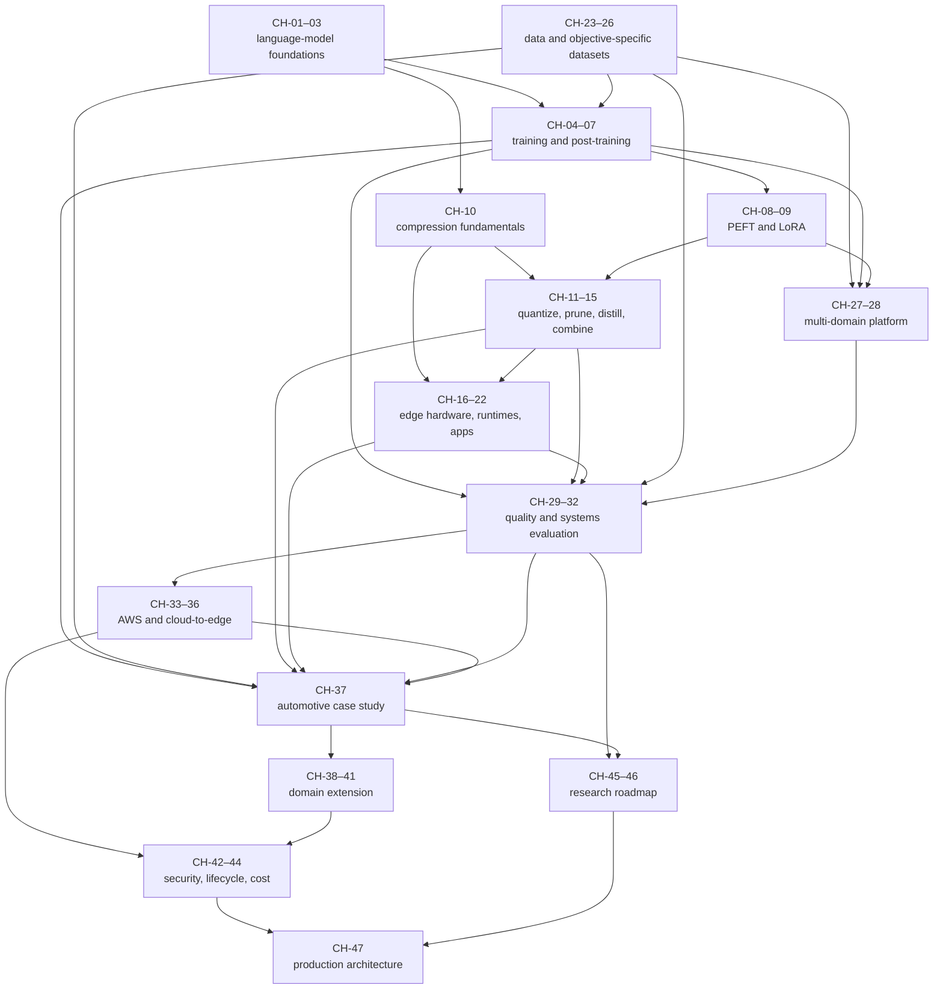

# Learning dependency map

## Purpose and entry prerequisites

This map gives the shortest defensible learning order from language-model foundations to a measured production
decision. It assumes Python, PyTorch fundamentals, basic linear algebra and probability, ordinary ML evaluation, Git,
command-line use, and cloud fundamentals. Readers missing these skills should complete the bridge exercise in the
[roadmap](README.md) before CH-01.

This map separates reading prerequisites from execution gates. A reader may survey later material early, but an
experiment may not bypass its gate merely because its chapter was read.

## Why the major blocks occur in this order

- Foundations precede model selection because architecture, tokenizer, context, and KV-cache choices determine every
  later training and deployment constraint.
- Data and evaluation begin early because rights, split isolation, safety strata, and metrics must be fixed before a
  model is optimized against them.
- SFT and PEFT precede advanced compression because the learner needs a qualified domain artifact and a
  high-precision reference.
- Compression fundamentals precede algorithms so that storage reduction is not confused with memory, latency, or
  energy improvement.
- Edge concepts precede runtime selection, and runtime probes precede full training, because operator and backend
  support can invalidate a candidate.
- AWS and edge benchmarks follow artifact freeze because target measurements must refer to an exact deployable model.
- Security, lifecycle, cost, and architecture integrate evidence from the whole path; learning them only as abstract
  checklists would hide their technical dependencies.

## Conceptual dependency graph

## Learning tracks

### Core model track

`CH-01 → CH-02 → CH-04 → CH-06 → CH-08 → CH-09 → CH-10 → CH-11 → CH-15`. This is the shortest route to understanding a
practical SFT/LoRA/quantization pipeline. CH-03 is required before selecting a real checkpoint; CH-05 and CH-07 are
conditional branches, not default requirements.

**Study and exit test:** derive attention and memory calculations, inspect an exact config/tokenizer, train one small
LoRA fixture, and convert one artifact. Explain which tensors train, which remain frozen, and how the selected format
changes storage and execution.

### Data and evaluation track

`CH-23 → CH-24 → CH-25 → CH-29 → CH-30 → CH-31 → CH-32`. Data rights and split integrity precede model adaptation.
Evaluation sets are frozen before training and calibration. CH-26 synthetic generation may augment training only after
CH-23–25 provenance and review controls exist.

**Study and exit test:** create a ten-record source register, group derivatives by root, build objective-specific
transforms, and score a blind mini-benchmark twice. Demonstrate no root leakage and explain where each metric fails.

### Edge track

`CH-02 → CH-10 → CH-11 → CH-16 → CH-17 → CH-18 → CH-19 → CH-20/21/22 → CH-31`. Runtime compatibility is probed before
conversion effort; physical-device qualification follows semantic parity and safety checks.

**Study and exit test:** calculate a conservative memory budget, probe one export, and profile cold, warm, and
sustained generation. Distinguish storage fit, loaded fit, peak fit, interactive speed, and sustained speed using one
physical device.

### AWS track

`CH-28 → CH-29–32 → CH-33 → CH-34/35 → CH-36`. Infrastructure choices follow workload and metric definitions. Current
Region, quota, image, driver, runtime, and price evidence is required at execution.

**Study and exit test:** deploy the same hashed artifact to the cheapest plausible tuple, run known-answer and load
tests, exercise rollback, and destroy resources. Defend service and instance selection from a frozen workload and
dated cost inputs.

### Product and research track

`CH-27–32 → CH-37 → CH-38–44 → CH-45–47`. The flagship project is the integration proof. Extension chapters cannot claim
reuse until the automotive lineage and domain-delta procedure are present.

**Study and exit test:** complete one end-to-end lineage, then vary exactly one domain assumption. Show which platform
components transfer, which data/evaluation/safety elements do not, and why.

## Recommended pacing

Use the 24-week or 12-week schedule in the [roadmap](README.md). Within each week, follow the study cycle in the
[authoring workflow](authoring-workflow.md). A learner may read ahead for context, but practical work advances only
after the preceding exit test. Schedule a cumulative reproduction after foundations, adaptation, compression, and
deployment rather than relying on chapter-by-chapter recognition.

## Execution dependency map

- **G0 — Governance:** [evidence](../00-governance/evidence-and-citation-standard.md), safety, reproducibility,
  code-listing, numbering, figure/table, no-runtime-RAG, and definition-of-done controls approved.
- **G1 — Identity and rights:** immutable model/tokenizer revisions, licenses, source rights, intended use, prohibited
  use, and reviewer roles recorded.
- **G2 — Data freeze:** grouped-root deduplication, leakage checks, train/validation/calibration/sealed manifests,
  hashes, and coverage report approved.
- **G3 — Baseline:** tokenizer/template smoke tests, scorer fixtures, untouched quality/safety outputs, failures, and
  resource envelope retained.
- **G4 — Adaptation:** SFT/CPT/FFT/LoRA/QLoRA branches run only from G3; checkpoint choice uses validation data only.
- **G5 — Compression:** source artifact passes semantic/safety gates; calibration data excludes sealed tests;
  quantization/pruning/distillation branches preserve parent hashes.
- **G6 — Export:** source-to-export parity, tokenizer/template equivalence, integrity manifest, and unsupported-operator
  report approved.
- **G7 — Target qualification:** exact AWS tuple or physical device/runtime tuple passes memory, reliability, quality,
  safety, latency, sustained-performance, and lifecycle gates.
- **G8 — Selection:** only reviewed candidates passing hard gates enter a target-specific Pareto set.
- **G9 — Publication:** links, fences, Mermaid, citations, status labels, licenses, expert reviews, raw evidence,
  unresolved limitations, and release approval pass.

## Critical-path ownership

- Research Lead owns source verification before chapter claims.
- Data Lead owns G1–G2 for datasets; Safety Reviewer has veto over consequential-domain data and criteria.
- Experiment Lead owns G3–G8 protocol integrity and immutable records.
- Cloud Lead and Edge Lead own their target environments but cannot waive quality or safety gates.
- Lead Technical Author owns chapter dependency declarations and reciprocal links.
- Managing Editor owns G9 and status promotion.

## Dependency-change rule

Any changed prerequisite, artifact path, or hard gate requires updates to this file, the
[detailed TOC](detailed-table-of-contents.md), affected protocol, and
[prompt coverage ledger](../15-audit-ledgers/prompt-coverage-ledger.md). A failed dependency produces `BLOCKED`,
`UNSUPPORTED`, `REJECTED`, or `INCONCLUSIVE`; it never silently disappears.

## Cross-links

- [Hands-on experiment sequence](hands-on-experiment-sequence.md)
- [Experiment framework](../06-experiment-framework/README.md)
- [Milestones](milestones.md)
