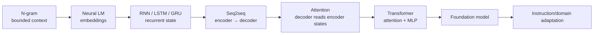
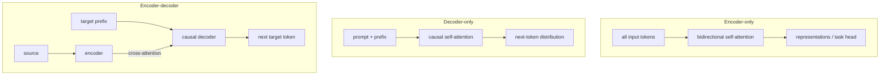
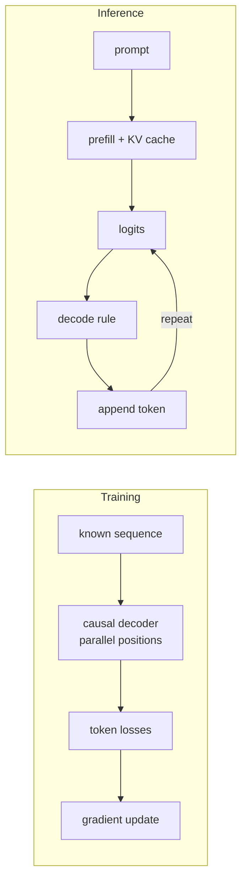

# CH-01: Evolution of Language Models

<a id="ch01-purpose"></a>

## Purpose and learning outcomes

Language modeling has repeatedly traded explicit assumptions for learned representations, and then traded sequential
computation for parallel computation. Those changes explain both the capabilities of modern foundation models and their
engineering costs. This chapter develops that progression as a chain of problems and solutions rather than as a list of
architectures.

After completing the chapter, an experienced AI engineer should be able to:

1. derive an N-gram model and explain smoothing, sparsity, and perplexity;
2. trace the transition from feed-forward neural models through recurrent networks, gated recurrence,
   sequence-to-sequence learning, attention, and Transformers;
3. distinguish encoder-only, decoder-only, and encoder-decoder systems by objective, information flow, and deployment
   behavior;
4. explain GPT-style training and token-by-token generation precisely;
5. distinguish a base foundation model from an instruction-tuned model, and an open-weight release from a fully
   open-source system;
6. reason about parameters, data, training compute, inference compute, memory, and scaling without treating parameter
   count as a synonym for quality;
7. separate generalization, memorization, and factual recall; and
8. decide when a specialized Small Language Model (SLM) is preferable to a larger general model, especially under
   offline and edge constraints.

The chapter moves from count tables to learned representations and then to attention. At each transition, ask the same
question: **what limitation of the current method forces the next design?** Historical mechanisms are stable; current
checkpoints, licenses, runtimes, and hardware support are handled in later chapters.

<a id="ch01-1"></a>

## 1. The language-modeling problem

<a id="ch01-1-1"></a>

### 1.1 From strings to probability distributions

The practical problem is simple to state: given a sequence of tokens, assign it a probability or predict what comes
next. The engineering consequences are not simple. Natural language has a vast combinatorial space, long-range
dependencies, ambiguous references, rare terminology, and knowledge that changes over time.

Let \(x_{1:T}=(x_1,x_2,\ldots,x_T)\), where \(x_t\) is the token at position \(t\) and \(T\) is sequence length. The
probability chain rule gives:

<a id="eq-ch01-01"></a> \[ \boxed{P(x_{1:T})=\prod_{t=1}^{T}P(x_t\mid x_{<t})} \tag{EQ-CH01-01} \]

Here \(x_{<t}\) means all tokens before position \(t\). This identity does not prescribe an architecture. An N-gram
table, recurrent network, and decoder-only Transformer can all estimate the conditional term while making very different
assumptions about context and computation.

A language model is therefore a parameterized or count-based estimator of distributions over token sequences. It
supports scoring, next-token prediction, generation, representation learning, and conditional generation. Claude
Shannon's information-theoretic treatment established central ideas behind entropy and sequential prediction
([Shannon, 1948](https://doi.org/10.1002/j.1538-7305.1948.tb01338.x), published in *Bell System Technical Journal*).
Modern neural systems are much larger estimators, but they do not repeal the chain rule.

<a id="ch01-1-2"></a>

### 1.2 Cross-entropy and perplexity

For next-token training, a model with parameters \(\theta\) produces \(p_\theta(v\mid x_{<t})\) for every vocabulary
token \(v\). The average negative log-likelihood is:

<!-- markdownlint-disable-next-line MD049 -->
<a id="eq-ch01-02"></a> \[ \boxed{\mathcal{L}_{\mathrm{NLL}}(\theta) =-\frac{1}{N}\sum_{i=1}^{N}\log p_\theta(x_i\mid
x_{<i})} \tag{EQ-CH01-02} \]

\(N\) is the number of predicted tokens. With one-hot targets, this is token-level cross-entropy. Perplexity is:

<a id="eq-ch01-03"></a> \[ \boxed{\mathrm{PPL}=\exp(\mathcal{L}_{\mathrm{NLL}})} \tag{EQ-CH01-03} \]

when natural logarithms are used. If average loss is \(1.5\) nats/token, perplexity is \(e^{1.5}\approx4.48\). This does
not mean the model literally considers 4.48 equally likely words; it is an effective-uncertainty intuition.

Perplexities are comparable only when tokenization, test data, preprocessing, and loss accounting are compatible.
Perplexity measures predictive fit, not instruction following, factual correctness, safety, or useful latency.

Consider:

> A flashing check-engine light usually indicates a severe \_\_\_.

A useful automotive model should assign meaningful probability to *misfire*, while preserving uncertainty about vehicle,
operating condition, and diagnostic evidence. Linguistic plausibility, domain knowledge, procedural judgment, and exact
factual recall are distinct capabilities. Language modeling provides a learning objective; it does not guarantee
grounded truth or safe diagnosis.

<a id="ch01-2"></a>

## 2. Statistical language models and N-grams

<a id="ch01-2-1"></a>

### 2.1 Problem, intuition, and definition

Early practical language models needed to estimate sequence probabilities using finite corpora and modest compute.
Counting was attractive: if “spark plug” is frequently followed by “gap,” empirical frequency is evidence for the next
word. The difficulty is sparsity. Even a large corpus observes only a minute fraction of possible sentences.

An order-\(n\) N-gram model approximates the full history by the preceding \(n-1\) tokens:

<a id="eq-ch01-04"></a> \[ \boxed{P(x_t\mid x_{<t})\approx P(x_t\mid x_{t-n+1:t-1})} \tag{EQ-CH01-04} \]

The maximum-likelihood trigram estimate is:

<a id="eq-ch01-05"></a> \[ \boxed{\hat P(x_t=c\mid x_{t-2}=a,x_{t-1}=b)=\frac{C(a,b,c)}{C(a,b)}} \tag{EQ-CH01-05} \]

\(C(\cdot)\) is a corpus count. If “fuel pressure” occurs 100 times, followed by “test” 35 times and “regulator” 15
times, the unsmoothed probabilities are 0.35 and 0.15. An unseen continuation receives zero. One zero term makes the
entire sequence probability zero.

An N-gram model is like a phrasebook indexed by the last few words: lookup is fast, but it cannot recognize that two
unseen phrases express the same idea. Neural language models solve that sharing problem; recurrent models then remove
the fixed window; attention removes the need to compress all history into one recurrent state.

Practical models redistribute probability mass:

- **additive smoothing** adds pseudo-counts, but is crude for large vocabularies;
- **backoff** uses a lower-order model when a higher-order context is unreliable;
- **interpolation** combines several orders;
- **discounting** subtracts mass from observed events and reallocates it.

Modified Kneser-Ney smoothing became influential because lower-order probability reflects how many distinct contexts a
word continues, not only raw frequency. [Chen and Goodman, 1999](https://dash.harvard.edu/handle/1/25104739), a Harvard
technical report, provides a systematic empirical study. Statistical parameter estimation is also treated in
[Brown et al., 1993](https://aclanthology.org/J93-2003/), *Computational Linguistics*. **Evidence: PAPER-REPORTED.**

<a id="ch01-2-2"></a>

### 2.2 Implementation, resources, and limits

An N-gram pipeline tokenizes a corpus, inserts boundary markers, counts contexts and continuations, estimates smoothed
probabilities, and stores counts or compact probability structures. Training is parallelizable counting rather than
gradient optimization. Inference is bounded-context lookup, so latency can be low and predictable. Memory grows with
retained N-grams; tries, finite-state representations, pruning, and quantized probabilities reduce storage.

**Strengths:** interpretable counts, deterministic scoring, cheap training, controllable vocabulary, and suitability for
constrained speech or input systems.

**Limitations:** no semantic parameter sharing, fixed context, poor handling of rare combinations, rapidly growing
storage, and brittle tokenization.

For a narrow command grammar on a microcontroller, an N-gram or finite-state model may beat a generative neural model.
For a technical assistant that connects symptoms, components, procedures, and caveats across paragraphs, sparse counts
and finite context are fundamental constraints.

<a id="ch01-3"></a>

## 3. Distributed representations and neural language models

<a id="ch01-3-1"></a>

### 3.1 Why counts were not enough

If “ignition coil failure” appears in training but “coil pack fault” does not, a count table has little basis for
sharing evidence. Neural models map discrete tokens to dense vectors and learn a smooth function over them. Similar
contexts can then produce similar predictions.

[Bengio et al., 2003](https://www.jmlr.org/papers/v3/bengio03a.html), *A Neural Probabilistic Language Model* in JMLR,
learned word embeddings jointly with a next-word predictor. Its central contribution was distributed representation: a
feature learned for one sequence could help another. **Evidence: PAPER-REPORTED.**

<a id="ch01-3-2"></a>

### 3.2 Feed-forward neural LM internals

For a fixed context of \(k\) tokens:

1. map each token ID \(x_i\) to \(e_i=E[x_i]\), with embedding matrix \(E\in\mathbb{R}^{V\times d}\);
2. concatenate or combine the \(k\) embeddings;
3. transform them through nonlinear layers;
4. project to \(V\) logits;
5. apply softmax.

<a id="eq-ch01-06"></a> \[ \boxed{p(x_t=j\mid x_{<t})=\frac{\exp(z_j)}{\sum_{v=1}^{V}\exp(z_v)}} \tag{EQ-CH01-06} \]

If logits for three candidates are \([2,1,0]\), softmax probabilities are approximately \([0.665,0.245,0.090]\). Logits
are unnormalized scores, not probabilities.

Neural models exchange sparse count storage for learned matrices and floating-point operations. Embeddings enable
generalization, but a fixed window still prevents long dependencies. Large-vocabulary output projection can dominate
compute; historical alternatives include hierarchical softmax and sampled losses.

<a id="ch01-4"></a>

## 4. RNNs, LSTMs, and GRUs

<a id="ch01-4-1"></a>

### 4.1 Recurrent neural networks

**Problem:** a fixed-window neural LM cannot naturally summarize a variable-length prefix.

**Intuition:** carry a state forward; each token updates a running summary.

<a id="eq-ch01-07"></a> \[ \boxed{h_t=\phi(W_{xh}e_t+W_{hh}h_{t-1}+b_h),\qquad z_t=W_{hy}h_t+b_y} \tag{EQ-CH01-07} \]

\(e_t\in\mathbb{R}^{d}\) is the current embedding, \(h_t\in\mathbb{R}^{m}\) hidden state, \(W\) learned matrices, \(b\)
biases, and \(\phi\) a nonlinearity. The same parameters are reused at every position.

Backpropagation through time repeatedly multiplies recurrent Jacobians. Their norms can shrink (vanishing gradients) or
grow (exploding gradients), making distant dependencies hard to learn. Gradient clipping helps explosions but not the
short-memory bias. [Elman, 1990](https://doi.org/10.1207/s15516709cog1402_1), *Finding Structure in Time*, demonstrated
recurrent learning of temporal structure. **Evidence: PAPER-REPORTED.**

The dependency \(h_t\leftarrow h_{t-1}\) limits training parallelism. Inference is streaming and retains fixed-size
state, a possible edge advantage, but compressing all history into one state impairs precise access to old details.

<a id="ch01-4-2"></a>

### 4.2 Long Short-Term Memory

LSTM adds a memory cell and learned write, retain, and expose controls:

<a id="eq-ch01-08"></a> \[ \begin{aligned} i_t&=\sigma(W_i[e_t;h_{t-1}]+b_i),& f_t&=\sigma(W_f[e_t;h_{t-1}]+b_f),\\
o_t&=\sigma(W_o[e_t;h_{t-1}]+b_o),& \tilde c_t&=\tanh(W_c[e_t;h_{t-1}]+b_c),\\ c_t&=f_t\odot c_{t-1}+i_t\odot\tilde
c_t,& h_t&=o_t\odot\tanh(c_t). \end{aligned} \tag{EQ-CH01-08} \]

\(\sigma\) is sigmoid, \(\odot\) elementwise multiplication, and \([a;b]\) concatenation. The input gate \(i_t\)
controls writing, forget gate \(f_t\) retention, and output gate \(o_t\) exposure. If an element of \(f_t\) stays near
one, that memory component and its gradient can persist.

[Hochreiter and Schmidhuber, 1997](https://doi.org/10.1162/neco.1997.9.8.1735) introduced LSTM in *Neural Computation*.
Variants differ in gates, peepholes, projections, and normalization. **Evidence: PAPER-REPORTED.**

<a id="ch01-4-3"></a>

### 4.3 Gated Recurrent Unit

The GRU combines cell and hidden state:

<a id="eq-ch01-09"></a> \[ \begin{aligned} z_t&=\sigma(W_z[e_t;h_{t-1}]),\quad r_t=\sigma(W_r[e_t;h_{t-1}]),\\ \tilde
h_t&=\tanh(W_h[e_t;r_t\odot h_{t-1}]),\\ h_t&=(1-z_t)\odot h_{t-1}+z_t\odot\tilde h_t . \end{aligned} \tag{EQ-CH01-09}
\]

\(z_t\) is an update gate and \(r_t\) a reset gate. Some implementations reverse interpolation coefficients, so
documentation matters. The GRU appeared in [Cho et al., 2014](https://aclanthology.org/D14-1179/), EMNLP. **Evidence:
PAPER-REPORTED.**

GRUs generally have fewer parameters and recurrent operations than same-width LSTMs, but neither is universally
superior. Data, task, sequence length, kernels, and latency decide. RNN-family models remain rational for bounded
streaming tasks with stable recurrent runtime support; modern generative ecosystems usually favor Transformers.

<a id="ch01-5"></a>

## 5. Sequence-to-sequence learning and attention

<a id="ch01-5-1"></a>

### 5.1 Fixed-vector encoder-decoder

Translation and summarization map one sequence to another. Seq2seq introduced:

1. an encoder that reads \(x_{1:S}\);
2. a decoder modeling \(P(y_t\mid y_{<t},x_{1:S})\);
3. teacher forcing during training; and
4. autoregressive feedback during inference.

[Sutskever, Vinyals, and Le, 2014](https://papers.nips.cc/paper/5346-sequence-to-sequence-learning-with-neural-networks)
demonstrated multilayer LSTM seq2seq translation at NeurIPS. In the basic formulation, the final encoder state must
carry the complete source, creating an information bottleneck. **Evidence: PAPER-REPORTED.**

<a id="ch01-5-2"></a>

### 5.2 Attention as differentiable internal lookup

Attention lets each decoder step compute a weighted combination of encoder states:

<a id="eq-ch01-10"></a> \[ \boxed{\alpha_{t,s}= \frac{\exp(\operatorname{score}(q_t,k_s))}
{\sum_{j=1}^{S}\exp(\operatorname{score}(q_t,k_j))}, \qquad c_t=\sum_{s=1}^{S}\alpha_{t,s}v_s} \tag{EQ-CH01-10} \]

\(\alpha_{t,s}\) is the weight from output position \(t\) to source position \(s\); \(c_t\) is context. Scores
\([2,1,0]\) normalize to approximately \([0.665,0.245,0.090]\). With scalar values \([10,4,-2]\), \(c_t\approx7.45\).

[Bahdanau, Cho, and Bengio, 2015](https://arxiv.org/abs/1409.0473), ICLR, showed learned soft alignment;
[Luong, Pham, and Manning, 2015](https://aclanthology.org/D15-1166/), EMNLP, compared global and local variants.
**Evidence: PAPER-REPORTED.**

Attention is retrieval-like over activations inside one model invocation, but it is not runtime Retrieval-Augmented
Generation. It does not search an external store and does not violate the
[no-runtime-RAG standard](../../00-governance/no-runtime-rag-standard.md).

<a id="ch01-6"></a>

## 6. Transformers

<a id="ch01-6-1"></a>

### 6.1 Attention as the primary sequence operator

Recurrent models improved sequence learning but retained a serial path. The Transformer removes recurrence from core
sequence processing. Tokens interact through attention; position is represented separately.

[Vaswani et al., 2017](https://papers.nips.cc/paper/7181-attention-is-all-you-need), *Attention Is All You Need*
(NeurIPS), introduced the encoder-decoder Transformer. **Evidence: PAPER-REPORTED.**

<a id="eq-ch01-11"></a> \[ \boxed{\operatorname{Attention}(Q,K,V)
=\operatorname{softmax}\left(\frac{QK^\top}{\sqrt{d_k}}+M\right)V} \tag{EQ-CH01-11} \]

\(Q\in\mathbb{R}^{T_q\times d_k}\), \(K\in\mathbb{R}^{T_k\times d_k}\), and \(V\in\mathbb{R}^{T_k\times d_v}\) are
queries, keys, and values; \(d_k\) is key width; \(M\) masks forbidden positions. Scaling prevents dot products from
growing with dimension and saturating softmax.

Multi-head attention applies several learned projections, concatenates their outputs, and projects again. Heads create
multiple interaction subspaces, but they should not automatically be interpreted as clean symbolic relations.

<a id="fig-ch01-01"></a> **FIG-CH01-01 — ILLUSTRATIVE: architectural transition.**  
*Alt text:* A progression from local count lookup to recurrent state, encoder-decoder attention, and Transformer
attention. Arrows are conceptual, not measured quality.



**Provenance:** author-created synthesis of cited primary literature. **Evidence: ILLUSTRATIVE.**

<a id="ch01-6-2"></a>

### 6.2 Block mechanics and resources

A Transformer layer normally combines token representations plus positional information, self- or cross-attention, a
position-wise MLP, residual paths, and normalization. Attention mixes token information; the MLP transforms each
position with shared parameters.

Training can process all positions simultaneously because targets are known and a causal mask prevents leakage. Standard
dense attention forms a \(T\times T\) score pattern, creating quadratic work in straightforward implementations.
Efficient kernels reduce intermediate memory but do not make every attention pattern linear.

Transformers map well to parallel accelerators, but autoregressive decoding remains sequential. Key-value (KV) caching
avoids recomputing prior keys and values at the cost of memory proportional to active context, layers, and KV
dimensions. [CH-02](ch-02-transformer-architecture-in-depth.md) develops these internals.

<a id="ch01-7"></a>

## 7. Encoder-only, decoder-only, and encoder-decoder Transformers

<a id="tbl-ch01-01"></a> **TBL-CH01-01 — Transformer architecture families (`STATICALLY REVIEWED`)**

<!-- markdownlint-disable MD013 -->
| Family          | Token visibility                                         | Typical objective                    | Natural strengths                          | Main limitation                 | Domain/edge implication                         |
| --------------- | -------------------------------------------------------- | ------------------------------------ | ------------------------------------------ | ------------------------------- | ----------------------------------------------- |
| Encoder-only    | Usually left and right context                           | Masked-token/representation learning | Classification, embeddings, token labeling | Not naturally free-running      | Efficient for bounded predictions               |
| Decoder-only    | Previous tokens under causal mask                        | Next-token prediction                | Generation, chat, continuation             | Serial decode and KV-cache cost | Natural offline assistant interface             |
| Encoder-decoder | Bidirectional source; causal target plus cross-attention | Conditional denoising/seq2seq        | Translation, summarization, transformation | Two stacks and cross-attention  | Efficient when source/target roles are distinct |
<!-- markdownlint-restore -->

These are typical patterns, not universal laws.

**Encoder-only:** BERT is canonical. [Devlin et al., 2019](https://aclanthology.org/N19-1423/), NAACL, introduced
bidirectional Transformer pretraining with masked-language modeling and next-sentence prediction. Contextual
representations are usually fine-tuned with task heads. **Evidence: PAPER-REPORTED.**

**Decoder-only:** position \(t\) attends only to positions \(\le t\). The causal structure matches
[EQ-CH01-01](#eq-ch01-01). Prompt and continuation use one stack.

**Encoder-decoder:** the encoder sees the source; the decoder uses causal self-attention and cross-attention. T5 cast
many tasks into text-to-text form ([Raffel et al., 2020](https://www.jmlr.org/papers/v21/20-074.html), JMLR).
**Evidence: PAPER-REPORTED.**

<a id="fig-ch01-02"></a> **FIG-CH01-02 — ILLUSTRATIVE: attention visibility.**  
*Alt text:* Encoder tokens exchange information bidirectionally; decoder tokens read only their prefix; encoder-decoder
generation combines causal decoder attention with cross-attention to encoded input.



**Provenance:** author-created abstraction. **Evidence: ILLUSTRATIVE.**

Choose from product semantics: a fault classifier may use an encoder, a service-note normalizer an encoder-decoder, and
open diagnostic dialogue a decoder. Then measure quality, memory, latency, and power. Popularity is not evidence of
fitness.

<a id="ch01-8"></a>

## 8. GPT-style autoregressive modeling

<a id="ch01-8-1"></a>

### 8.1 Training

GPT-style models are decoder-only Transformers trained primarily for next-token prediction. The original GPT combined
generative pretraining with discriminative fine-tuning
([Radford et al., 2018](https://cdn.openai.com/research-covers/language-unsupervised/language_understanding_paper.pdf),
OpenAI technical report). GPT-3 studied large-scale autoregression and in-context learning
([Brown et al., 2020](https://papers.neurips.cc/paper/2020/hash/1457c0d6bfcb4967418bfb8ac142f64a-Abstract.html),
NeurIPS). **Evidence: PAPER-REPORTED.**

```text
input:   <bos>  fuel  pressure  is  low
target:  fuel   pressure  is    low <eos>
```

All target positions are evaluated in one parallel pass under a causal mask. The model learns regularities and
associations in its corpus; it is not given a transactionally consistent symbolic fact database.

<a id="ch01-8-2"></a>

### 8.2 Inference

Generation tokenizes the prompt, runs a **prefill** to create KV state, obtains next-token logits, applies a decoding
rule, appends one token, and repeats.

<a id="eq-ch01-12"></a> \[ \boxed{x_t\sim\operatorname{softmax}\left(\frac{z_t}{\tau}\right)} \tag{EQ-CH01-12} \]

\(\tau>0\) is temperature. Lower values sharpen the distribution; higher values flatten it. Greedy decoding uses
\(\arg\max_j z_{t,j}\). Top-\(k\) and top-\(p\) restrict candidates. These controls alter generation behavior; they do
not add missing knowledge or guarantee truth.

<a id="fig-ch01-03"></a> **FIG-CH01-03 — ILLUSTRATIVE: training versus inference.**  
*Alt text:* Training predicts shifted targets in parallel; inference processes a prompt and generates one token per
sequential step.



**Provenance:** author-created workflow. **Evidence: ILLUSTRATIVE.**

Training stores activations, gradients, and optimizer state. Prefill processes prompt tokens in parallel; decode
processes one position at a time and is often constrained by weight/KV memory movement. A faster prefill does not imply
faster decode.

<a id="ch01-9"></a>

## 9. Foundation and instruction-tuned models

<a id="ch01-9-1"></a>

### 9.1 Foundation model

A foundation model is trained on broad data and adapted to many downstream tasks.
[Bommasani et al., 2021](https://arxiv.org/abs/2108.07258), the Stanford report *On the Opportunities and Risks of
Foundation Models*, systematized the term. It implies broad transfer, not a minimum parameter count. **Evidence:
PAPER-REPORTED.**

A base autoregressive model estimates continuation. It may answer, imitate, or continue the user's text; instruction
following is not guaranteed.

<a id="ch01-9-2"></a>

### 9.2 Instruction tuning

Instruction tuning uses demonstrations, preference data, reinforcement learning, or related post-training to align
behavior with user requests. FLAN studied instruction mixtures
([Wei et al., 2022](https://openreview.net/forum?id=gEZrGCozdqR), ICLR). InstructGPT used supervised demonstrations,
reward modeling, and reinforcement learning
([Ouyang et al., 2022](https://papers.nips.cc/paper_files/paper/2022/hash/b1efde53be364a73914f58805a001731-Abstract-Conference.html),
NeurIPS). **Evidence: PAPER-REPORTED.**

Instruction tuning changes conditional behavior; it is not a reliable substitute for domain knowledge acquisition. A
model can become better at formatting confident answers without becoming more correct.

<a id="tbl-02"></a> **TBL-02 — Base versus instruction-tuned models (`STATICALLY REVIEWED`)**

| Property         | Base model                                     | Instruction-tuned model                    |
| ---------------- | ---------------------------------------------- | ------------------------------------------ |
| Primary behavior | Continue pretraining distribution              | Follow learned instruction/chat patterns   |
| Typical data     | Broad self-supervised corpus                   | Demonstrations, conversations, preferences |
| Prompting        | Completion style                               | Roles, chat templates, explicit requests   |
| Knowledge        | Encoded by pretraining/adaptation              | Base knowledge plus post-training changes  |
| Main use         | Continued pretraining and custom post-training | Interactive assistants                     |
| Risk             | Uncontrolled continuation                      | Fluent compliance mistaken for factuality  |

A base checkpoint is often attractive for continued domain pretraining; an instruction checkpoint may reduce
conversational tuning. The choice is empirical and license-dependent.

<a id="ch01-10"></a>

## 10. Large versus small language models

<a id="ch01-10-1"></a>

### 10.1 Deployment-relative categories

LLM and SLM have no universal parameter thresholds. In this book, an **LLM** is large for the relevant training or
serving context; an **SLM** is deliberately compact for tighter memory, latency, energy, cost, or update constraints.
Architecture, precision, vocabulary, context, KV layout, sparsity, runtime, and hardware all affect feasibility.

<a id="tbl-01"></a> **TBL-01 — LLM versus SLM as engineering choices (`STATICALLY REVIEWED`)**

<!-- markdownlint-disable MD013 -->
| Dimension      | Larger general model tendency        | Smaller model tendency                  | Qualification                                 |
| -------------- | ------------------------------------ | --------------------------------------- | --------------------------------------------- |
| Capacity       | More representational capacity       | Capacity prioritized toward fewer tasks | Capacity does not guarantee learned knowledge |
| Weight memory  | Higher at equal precision            | Lower                                   | Quantization changes bytes/parameter          |
| Training       | Usually more costly                  | Usually less costly                     | Data curation may dominate effort             |
| Inference      | More compute and weight traffic      | Better chance of local execution        | Kernels and context can dominate              |
| Breadth        | Often broader with adequate training | Often narrower                          | Must be measured                              |
| Specialization | Strong but expensive base            | Can focus limited capacity              | Narrow tuning risks forgetting                |
| Offline use    | Often cloud-served                   | More amenable to devices                | Storage fit does not imply runtime fit        |
<!-- markdownlint-restore -->

No row is a universal empirical result; each is a tendency to validate.

<a id="eq-ch01-13"></a> \[ \boxed{M_{\mathrm{weights}}\approx N_p\frac{b}{8}} \tag{EQ-CH01-13} \]

\(N_p\) is parameter count and \(b\) bits per parameter. One billion parameters require ideally 2.0 GB at 16 bits or 0.5
GB at 4 bits. Real files add scales, zero points, metadata, and alignment. Runtime also needs KV cache, workspaces, and
application memory; training needs activations, gradients, optimizer state, and often master weights.

> Model file size \(\ne\) loaded memory \(\ne\) peak runtime memory \(\ne\) acceptable performance.

<a id="ch01-11"></a>

## 11. Open-weight versus fully open-source

“Open” is not a single property.

- **Open-weight** means trained parameters are downloadable under stated terms. Training data, preparation code,
  complete training code, optimizer state, and reproducible recipes may be absent; the license may restrict use.
- **Open-source AI system/model** should satisfy an explicit definition that permits use, study, modification, and
  redistribution of the preferred form for modification. Weights alone are insufficient.

The [Open Source Initiative Open Source AI Definition 1.0](https://opensource.org/ai/open-source-ai-definition)
identifies required freedoms and forms of access. **Evidence: DOC-VERIFIED as of the chapter cutoff.** Terminology and
policy continue to evolve.

<a id="tbl-ch01-03"></a> **TBL-CH01-03 — Release openness audit (`DOC-VERIFIED`)**

<!-- markdownlint-disable MD013 -->
| Artifact or right              | Open-weight release may provide it |                                          Strong open/reproducible expectation |
| ------------------------------ | ---------------------------------: | ----------------------------------------------------------------------------: |
| Inference weights              |                                Yes |                                                                           Yes |
| Architecture and configuration |                            Usually |                                                                           Yes |
| Tokenizer/chat template        |                              Often |                                                   Yes, with compatible rights |
| Training and inference source  |                              Maybe |                                                  Modification rights expected |
| Data provenance/preparation    |                              Maybe |                                                 Detailed information expected |
| Full training data             |                       Often absent | Availability or a lawful reproduction route is important, but often difficult |
| Commercial use                 |                  License-dependent |                                Must satisfy the actual definition and license |
| Redistribution/derivatives     |                  License-dependent |                                                     Required under open terms |
| Complete recipe                |                               Rare |                                             Needed for strong reproducibility |
<!-- markdownlint-restore -->

A public repository does not grant unrestricted commercial use. Engineers must audit the exact license for the exact
checkpoint and derivative. For domain SLMs, terms affect adapter training, merged-weight distribution, synthetic-data
generation, and bundling inside mobile applications.

<a id="ch01-12"></a>

## 12. Capacity, scaling laws, data, and compute

<a id="ch01-12-1"></a>

### 12.1 Capacity is not parameter count alone

Capacity informally describes the range and complexity of functions a model can represent. Parameter count is a proxy
within related architectures, but effective capacity also depends on depth, width, dense versus sparse activation,
tokenizer allocation, context, optimization, regularization, precision, and—critically—training data.

Too little capacity can erase domain distinctions. Excess capacity relative to data can increase memorization and cost.
Modern overparameterized optimization makes the classical “more parameters always overfit” account incomplete.

<a id="ch01-12-2"></a>

### 12.2 Empirical scaling

[Kaplan et al., 2020](https://arxiv.org/abs/2001.08361), *Scaling Laws for Neural Language Models*, reported approximate
power-law relationships among loss, size, data, and compute. [Hoffmann et al., 2022](https://arxiv.org/abs/2203.15556),
*Training Compute-Optimal Large Language Models* (NeurIPS), reported that many models were undertrained relative to
parameter count and argued for scaling parameters and tokens together under fixed compute. **Evidence: PAPER-REPORTED.**

A generic empirical form is:

<a id="eq-ch01-14"></a> \[ \boxed{L(N,D)\approx L_\infty+A N^{-\alpha}+B D^{-\beta}} \tag{EQ-CH01-14} \]

\(L\) is validation loss, \(N\) parameter count, \(D\) training tokens, \(L_\infty\) an asymptotic term, and
\(A,B,\alpha,\beta\) fitted constants. This is descriptive over measured regimes, not a universal law.

The defensible conclusions are limited:

1. Average loss trends can be predictable within a tested family.
2. Parameter-only scaling wastes capacity when data and optimization are insufficient.
3. Token count does not capture quality, duplication, provenance, or domain coverage.
4. Lower pretraining loss does not guarantee safe domain behavior.
5. A compute-optimal training model need not be inference-optimal.

For a dense decoder-only Transformer, a common first-order training estimate is:

<a id="eq-ch01-15"></a> \[ \boxed{C_{\mathrm{train}}\approx 6N_pD} \tag{EQ-CH01-15} \]

\(N_p\) is an approximately compatible non-embedding parameter count and \(D\) token count. The coefficient roughly
covers forward and backward matrix operations. Attention, embeddings, sparsity, recomputation, optimizer operations, and
utilization alter realized compute.

**ILLUSTRATIVE estimate:** \(N_p=10^9\), \(D=2\times10^{10}\) gives \(1.2\times10^{20}\) FLOPs. This is not a runtime,
cost, or executed run.

Data quality constrains data scaling. Repeating one manual 100 times increases tokens but not independent coverage. For
a specialist SLM, licensed, deduplicated, expert-reviewed domain coverage may be more valuable than raw volume; that
hypothesis needs held-out evaluation.

<a id="ch01-13"></a>

## 13. Training compute versus inference compute

Training computes predictions, losses, gradients, and updates. It holds weights, activations, gradients, optimizer
state, distributed communication buffers, and checkpoints. Continued pretraining and fine-tuning add development cost.

Inference is forward-only but repeated for every request. Decoder inference has two stages:

- **prefill:** process prompt tokens and construct KV cache;
- **decode:** generate one token at a time while reading weights and cached state.

A rough dense forward estimate is often proportional to \(2N_p\) operations per generated token for weight
multiplications, but attention, vocabulary projection, batching, quantization, and utilization matter. It is not a
latency prediction.

<a id="tbl-ch01-04"></a> **TBL-CH01-04 — Training and inference resources (`STATICALLY REVIEWED`)**

| Concern      | Training                                   | Inference                                              |
| ------------ | ------------------------------------------ | ------------------------------------------------------ |
| Passes       | Forward, backward, update                  | Forward only                                           |
| Parallelism  | Known tokens batch well                    | Prefill parallelizes; outputs are serial               |
| Major memory | Weights, activations, gradients, optimizer | Weights, KV cache, workspace                           |
| Precision    | Must support stable optimization           | May use aggressive quantization with validated kernels |
| Frequency    | Finite development runs                    | Repeated throughout product life                       |
| Edge role    | Usually off-device                         | Must meet RAM, power, thermal, and latency budgets     |

Training a compact model longer can be rational when many future inferences amortize development compute. A low-volume
tool may instead justify adapting a larger shared model. Workload measurement decides.

<a id="ch01-14"></a>

## 14. Generalization, memorization, and factual recall

<a id="ch01-14-1"></a>

### 14.1 Different phenomena

- **Generalization:** useful behavior on data or tasks not seen in the same form during training.
- **Memorization:** dependence on or reproduction of particular training examples, especially atypical sequences not
  explained by broad patterns.
- **Factual recall:** producing a fact in response to a query; it may arise from repeated association, composition,
  memorization, or a mixture.

A model can generalize a troubleshooting pattern while failing to recall a torque specification. It can memorize a
passage yet fail under paraphrase. It can answer correctly for the wrong latent reason. Output alone rarely identifies
the mechanism.

<a id="ch01-14-2"></a>

### 14.2 Parameterized knowledge

Facts and procedures create predictive regularities. Across contexts, representations can support paraphrased answers.
Parameters are nevertheless a compressed distributed representation, not an addressable, transactionally consistent
database.

[Petroni et al., 2019](https://aclanthology.org/D19-1250/), *Language Models as Knowledge Bases?* (EMNLP-IJCNLP), probed
relational knowledge through cloze prompts and exposed prompt and coverage limitations.
[Carlini et al., 2021](https://www.usenix.org/conference/usenixsecurity21/presentation/carlini-extracting), *Extracting
Training Data from Large Language Models* (USENIX Security), demonstrated verbatim extraction under studied conditions.
**Evidence: PAPER-REPORTED.** These results neither imply that every fact is memorized nor that every training example
is extractable.

Without runtime retrieval, encoded knowledge has unavoidable failure modes:

1. imperfect elicitation;
2. stale facts after training;
3. blended contradictory sources without inference-time provenance;
4. unsupported but fluent claims;
5. poor calibration;
6. interference and forgetting during adaptation;
7. privacy leakage from rare or duplicated strings.

For pharmacy, safety-critical repair, and animal care, an offline SLM cannot be an autonomous authority. Product design
needs explicit scope, uncertainty behavior, trusted evaluation, escalation, model/data versioning, and verification
against current authoritative material.

<a id="ch01-14-3"></a>

### 14.3 Evaluation implications

Use separate tests for near-duplicate leakage, verbatim continuation, paraphrased recall, compositional use,
out-of-distribution cases, contradiction handling, abstention, general-capability retention, and safety-critical
precision. Random document splits are inadequate when manuals share revisions or copied passages; split by lineage,
family, time, and entity where appropriate.

<a id="ch01-15"></a>

## 15. Why specialized SLMs can be useful

A general model allocates capacity across many languages, genres, and tasks. A specialized SLM focuses a smaller
capacity on a narrower operating distribution. Its value is fit among model, data, task, and deployment—not an
assumption that “small is smarter.”

Potential benefits:

- better exposure to domain terminology and conventions;
- training for approved answer formats, uncertainty, and escalation;
- lower weight memory and bandwidth;
- offline privacy and availability;
- domain-isolated updates and adapters;
- a narrower capability contract that can be evaluated deeply.

Potential costs:

- reduced breadth and weaker rare-case reasoning;
- stale knowledge without runtime retrieval;
- licensing and expert-review burden;
- catastrophic forgetting and false confidence;
- fragmented model, adapter, evaluation, and app releases;
- poor device performance despite small artifact size.

A practical domain SLM may combine a pretrained base, continued domain pretraining, supervised instruction tuning,
optional preference/safety post-training, and compression. Raw manuals, Q&A examples, preference pairs, and safety tests
serve different objectives.

**Engineering recommendation:** start with the smallest credible pretrained model supported by the target runtime,
establish an untouched baseline, and add specialization only when held-out domain tests improve. Compare a larger
reference and a non-generative alternative. This is a recommendation, not an executed finding.

For an offline mechanic assistant:

1. define prohibited advice and escalation;
2. select license- and runtime-compatible candidates;
3. build lineage-separated terminology, diagnosis, safety, and retention tests;
4. compare base, domain-adapted, and instruction-tuned forms;
5. quantify only after preserving an unquantized reference;
6. measure artifact size, peak memory, startup, prefill, decode, battery, and sustained thermal behavior on physical
   devices;
7. reject models that fit storage but fail RAM, performance, or safety gates.

<a id="ch01-16"></a>

## 16. The shift toward efficient and on-device AI

<a id="ch01-16-1"></a>

### 16.1 Historical synthesis

The progression was not a simple replacement of large models by small ones:

1. count models made probabilistic sequence scoring practical;
2. neural models introduced distributed representations;
3. recurrence modeled variable history;
4. gates improved long-dependency optimization;
5. seq2seq and attention enabled conditional generation without a single-vector bottleneck;
6. Transformers enabled highly parallel training and broad scaling;
7. foundation models consolidated transfer;
8. instruction tuning improved interaction;
9. inference economics, privacy, latency, and device limits renewed pressure for compact models.

Large models remain useful as broad systems, research references, and teachers subject to output validation. SLMs occupy
a different operating point.

Forces favoring efficiency include recurring inference cost, network latency, privacy, offline reliability, domain
isolation, increasingly capable mobile accelerators, and algorithmic advances in curation, distillation, quantization,
and architecture.

[Liu et al., 2024](https://arxiv.org/abs/2402.14905), *MobileLLM: Optimizing Sub-billion Parameter Language Models for
On-Device Use Cases* (ICML), studied architecture choices for compact on-device models. Its results are model- and
benchmark-specific; it is cited as evidence of active architecture-level mobile optimization, not universal superiority.
**Evidence: PAPER-REPORTED.**

<a id="ch01-16-2"></a>

### 16.2 Five on-device feasibility gates

A model is not practically mobile merely because it is called small:

1. **storage:** the artifact fits package/download policy and device storage;
2. **load memory:** weights and metadata fit addressable RAM;
3. **active memory:** weights, KV cache, workspaces, app, and OS coexist;
4. **performance:** startup, first token, and sustained decode are acceptable;
5. **energy/thermal:** useful speed persists without unacceptable drain or throttling.

Unsupported operators can force slow fallbacks or block conversion. Quantized weights accelerate only when the backend
has suitable kernels. NPU availability does not imply arbitrary autoregressive Transformer support.

<a id="ch01-17"></a>

## 17. Unified engineering comparison

<a id="tbl-ch01-05"></a> **TBL-CH01-05 — Historical model families (`PAPER-REPORTED / DOC-VERIFIED`)**

<!-- markdownlint-disable MD013 -->
| Family                      | Core mechanism                           | Strength                        | Limitation                      | Rational use                       |
| --------------------------- | ---------------------------------------- | ------------------------------- | ------------------------------- | ---------------------------------- |
| N-gram                      | Count bounded contexts                   | Interpretable, predictable      | Sparse and fixed-context        | Tiny vocabulary, grammar, baseline |
| Feed-forward neural LM      | Embeddings + fixed-window MLP            | Statistical sharing             | Fixed context                   | Bounded predictor                  |
| Plain RNN                   | Recurrent state                          | Streaming fixed-size state      | Gradient and serial bottlenecks | Short streaming sequence           |
| LSTM/GRU                    | Gated recurrent memory                   | Better long-dependency learning | Limited parallelism             | Streaming with supported kernels   |
| RNN seq2seq                 | Encoder state + decoder                  | Variable input/output           | Fixed-vector bottleneck         | Legacy compact transduction        |
| Attentive seq2seq           | Decoder reads source states              | Alignment/source access         | Recurrent decode                | Legacy translation/speech          |
| Transformer encoder         | Bidirectional attention                  | Contextual representation       | Attention/context cost          | Classification, extraction         |
| Transformer decoder         | Causal attention                         | General generation              | Serial decode, KV memory        | Chat/completion SLM                |
| Transformer encoder-decoder | Source encoder + cross-attentive decoder | Explicit transformation         | Two-stack complexity            | Translation/summarization          |
<!-- markdownlint-restore -->

The best alternative may be a classifier, finite-state system, rules engine, or search interface. A generative SLM is
justified only when flexible generation adds value.

<a id="ch01-18"></a>

## 18. Implementation decision framework

Before model selection, ask:

1. Is output closed-set, extractive, or generative?
2. What prompt and output lengths are truly required?
3. Which errors are safety-critical?
4. Must operation be offline?
5. What are storage, peak RAM, latency, energy, and thermal budgets?
6. Does the runtime support the architecture, tokenizer, operators, and precision?
7. Do exact license terms permit training, modification, redistribution, and commercial use?
8. Is domain knowledge stable enough for periodic weight releases?
9. Which larger and non-generative baselines expose compactness trade-offs?
10. Which measurements decide release readiness?

At minimum compare an untouched base SLM, instruction-tuned SLM, domain-adapted SLM, larger reference, non-generative
baseline where applicable, and unquantized/deployment-precision variants. Hold evaluation fixed. Record exact
model/tokenizer revisions, data snapshot, templates, seeds, decoding, runtime build, hardware, OS, lengths, trial
counts, raw outputs, and failures. **Evidence: PLANNED EXPERIMENT.**

<a id="ch01-19"></a>

## 19. Chapter summary

- Language models estimate sequence probabilities through the chain rule.
- N-grams use finite context; smoothing handles unseen events but not semantic abstraction.
- Neural models learn distributed representations. RNNs carry state; LSTMs and GRUs gate it.
- Seq2seq separates input and output; attention removes the single-vector bottleneck.
- Transformers use attention and position-wise transformations, parallelizing training positions but not autoregressive
  outputs.
- Encoder-only models emphasize representations, decoder-only models generation, and encoder-decoder models conditional
  transformation.
- GPT training predicts shifted tokens in parallel; inference uses prefill then sequential decode.
- Foundation models are broad bases. Instruction tuning shapes behavior but does not guarantee knowledge or truth.
- LLM and SLM are deployment-relative. Parameter count alone does not determine quality or feasibility.
- Open weights do not imply open source, reproducibility, or commercial permission.
- Scaling laws describe measured regimes; parameters, data, quality, and compute must be balanced.
- Training and inference stress different memory and compute resources.
- Generalization, memorization, and factual recall overlap but are not equivalent.
- Specialist SLMs can trade breadth for domain fit, efficiency, privacy, and offline availability, but require rigorous
  evaluation and updates.

<a id="ch01-20"></a>

## 20. Review questions

1. Derive the chain-rule factorization of a four-token sequence.
2. Why does an unsmoothed N-gram assign zero probability to a plausible sequence?
3. What sharing advantage does an embedding provide over a count table?
4. Explain vanishing gradients and the LSTM cell-state path.
5. Compare LSTM and GRU without claiming universal superiority.
6. What bottleneck does encoder-decoder attention remove?
7. Define query, key, value, mask, and scaling in dot-product attention.
8. Why does a Transformer parallelize training but not autoregressive output?
9. Give one suitable domain task for each Transformer family.
10. Distinguish prefill latency from decode throughput.
11. Why can instruction tuning improve helpfulness without improving factuality?
12. Give three reasons parameter count is an incomplete edge metric.
13. Distinguish open-weight from open-source and reproducible.
14. What does a scaling law establish—and not establish?
15. Why may a compute-optimal training model be inference-suboptimal?
16. Give examples of generalization, memorization, and factual recall.
17. Why is a specialist model not a factual database?
18. When should an engineer prefer a classifier or N-gram to a generative SLM?

<a id="ch01-21"></a>

## 21. Engineering exercises

### Exercise 1 — N-gram baseline

Implement unigram, bigram, and trigram models with interpolation on a legally usable domain corpus. Split by document
lineage. Report cross-entropy, perplexity, retained N-grams, serialized size, and peak lookup memory. Label results
`EXECUTED` only if code and raw outputs are retained.

### Exercise 2 — Recurrent versus attention bottleneck

Create a synthetic sequence-copy task with controlled dependency distance. Compare plain RNN, GRU, LSTM, and small
Transformer under matched token and approximate parameter budgets. Record seeds, learning curves, extrapolation,
throughput, and memory. Do not infer broad language quality from this task.

### Exercise 3 — Architecture memo

For a fault-code classifier, service-note normalizer, and interactive mechanic assistant, choose encoder-only,
encoder-decoder, decoder-only, or non-generative alternatives. Defend task semantics, resources, safety, and runtime
compatibility.

### Exercise 4 — Scaling calculator

Use [EQ-CH01-13](#eq-ch01-13) and [EQ-CH01-15](#eq-ch01-15) to calculate ideal weight size and first-order training
compute. Inputs must include parameters, precision, and tokens. Label output `ESTIMATE` and list excluded terms.

### Exercise 5 — Memorization/recall audit

Design disjoint tests for canary continuation, paraphrased facts, and compositional troubleshooting. Specify provenance,
contamination controls, extraction-risk controls, and human review. Never use sensitive real-world strings as canaries.

### Exercise 6 — Edge feasibility gate

For one SLM, budget artifact bytes, loaded weights, KV cache, context/output limits, app reserve, backend compatibility,
and battery/thermal protocol. Mark unmeasured values `ESTIMATE` and device work `PLANNED EXPERIMENT`.

<a id="ch01-22"></a>

## 22. Research references and source notes

“Reported” means the cited authors reported the result; this project has not reproduced it.

1. **Shannon, Claude E. (1948).** “A Mathematical Theory of Communication.” *Bell System Technical Journal*, journal
   article. [DOI](https://doi.org/10.1002/j.1538-7305.1948.tb01338.x). Information-theoretic foundation.
   **PAPER-REPORTED.**
2. **Brown, Peter F. et al. (1993).** “The Mathematics of Statistical Machine Translation: Parameter Estimation.”
   *Computational Linguistics* 19(2). [ACL Anthology](https://aclanthology.org/J93-2003/). Count-based probabilistic
   estimation. **PAPER-REPORTED.**
3. **Chen, Stanley F.; Goodman, Joshua (1999).** “An Empirical Study of Smoothing Techniques for Language Modeling.”
   Harvard technical report. [Repository](https://dash.harvard.edu/handle/1/25104739). Smoothing comparison; historical
   corpora limit direct modern applicability. **PAPER-REPORTED.**
4. **Bengio, Yoshua et al. (2003).** “A Neural Probabilistic Language Model.” *JMLR* 3.
   [Paper](https://www.jmlr.org/papers/v3/bengio03a.html). Distributed representations and neural probability
   estimation. **PAPER-REPORTED.**
5. **Elman, Jeffrey L. (1990).** “Finding Structure in Time.” *Cognitive Science* 14(2).
   [DOI](https://doi.org/10.1207/s15516709cog1402_1). Recurrent temporal representation. **PAPER-REPORTED.**
6. **Hochreiter, Sepp; Schmidhuber, Jürgen (1997).** “Long Short-Term Memory.” *Neural Computation* 9(8).
   [DOI](https://doi.org/10.1162/neco.1997.9.8.1735). Gated memory and error flow. **PAPER-REPORTED.**
7. **Cho, Kyunghyun et al. (2014).** “Learning Phrase Representations using RNN Encoder–Decoder for Statistical Machine
   Translation.” EMNLP. [ACL](https://aclanthology.org/D14-1179/). RNN encoder-decoder and GRU. **PAPER-REPORTED.**
8. **Sutskever, Ilya; Vinyals, Oriol; Le, Quoc V. (2014).** “Sequence to Sequence Learning with Neural Networks.”
   NeurIPS. [Proceedings](https://papers.nips.cc/paper/5346-sequence-to-sequence-learning-with-neural-networks). LSTM
   transduction. **PAPER-REPORTED.**
9. **Bahdanau, Dzmitry; Cho, Kyunghyun; Bengio, Yoshua (2015).** “Neural Machine Translation by Jointly Learning to
   Align and Translate.” ICLR. [arXiv](https://arxiv.org/abs/1409.0473). Additive attention. **PAPER-REPORTED.**
10. **Luong, Minh-Thang; Pham, Hieu; Manning, Christopher D. (2015).** “Effective Approaches to Attention-based Neural
    Machine Translation.” EMNLP. [ACL](https://aclanthology.org/D15-1166/). Attention variants. **PAPER-REPORTED.**
11. **Vaswani, Ashish et al. (2017).** “Attention Is All You Need.” NeurIPS.
    [Proceedings](https://papers.nips.cc/paper/7181-attention-is-all-you-need). Transformer architecture.
    **PAPER-REPORTED.**
12. **Radford, Alec et al. (2018).** “Improving Language Understanding by Generative Pre-Training.” OpenAI technical
    report, not archival proceedings.
    [PDF](https://cdn.openai.com/research-covers/language-unsupervised/language_understanding_paper.pdf). Generative
    pretraining plus fine-tuning. **PAPER-REPORTED.**
13. **Devlin, Jacob et al. (2019).** “BERT: Pre-training of Deep Bidirectional Transformers for Language Understanding.”
    NAACL-HLT. [ACL](https://aclanthology.org/N19-1423/). Bidirectional encoder pretraining. **PAPER-REPORTED.**
14. **Raffel, Colin et al. (2020).** “Exploring the Limits of Transfer Learning with a Unified Text-to-Text
    Transformer.” *JMLR* 21. [Paper](https://www.jmlr.org/papers/v21/20-074.html). Text-to-text encoder-decoder
    framework. **PAPER-REPORTED.**
15. **Brown, Tom B. et al. (2020).** “Language Models are Few-Shot Learners.” NeurIPS.
    [Proceedings](https://papers.neurips.cc/paper/2020/hash/1457c0d6bfcb4967418bfb8ac142f64a-Abstract.html). In-context
    behavior at scale. **PAPER-REPORTED.**
16. **Kaplan, Jared et al. (2020).** “Scaling Laws for Neural Language Models.” arXiv preprint.
    [arXiv:2001.08361](https://arxiv.org/abs/2001.08361). Empirical power laws; fitted regime limits generalization.
    **PAPER-REPORTED.**
17. **Bommasani, Rishi et al. (2021).** “On the Opportunities and Risks of Foundation Models.” Stanford CRFM
    report/arXiv. [arXiv:2108.07258](https://arxiv.org/abs/2108.07258). Foundation-model terminology.
    **PAPER-REPORTED.**
18. **Carlini, Nicholas et al. (2021).** “Extracting Training Data from Large Language Models.” USENIX Security.
    [USENIX](https://www.usenix.org/conference/usenixsecurity21/presentation/carlini-extracting). Training-data
    extraction under studied conditions. **PAPER-REPORTED.**
19. **Petroni, Fabio et al. (2019).** “Language Models as Knowledge Bases?” EMNLP-IJCNLP.
    [ACL](https://aclanthology.org/D19-1250/). Factual probing; prompt sensitivity limits database analogies.
    **PAPER-REPORTED.**
20. **Wei, Jason et al. (2022).** “Finetuned Language Models Are Zero-Shot Learners.” ICLR.
    [OpenReview](https://openreview.net/forum?id=gEZrGCozdqR). Instruction tuning. **PAPER-REPORTED.**
21. **Ouyang, Long et al. (2022).** “Training Language Models to Follow Instructions with Human Feedback.” NeurIPS.
    [Proceedings](https://papers.nips.cc/paper_files/paper/2022/hash/b1efde53be364a73914f58805a001731-Abstract-Conference.html).
    Demonstrations, preferences, and RLHF. **PAPER-REPORTED.**
22. **Hoffmann, Jordan et al. (2022).** “Training Compute-Optimal Large Language Models.” NeurIPS.
    [arXiv:2203.15556](https://arxiv.org/abs/2203.15556). Parameter/data compute-optimal analysis. **PAPER-REPORTED.**
23. **Liu, Zechun et al. (2024).** “MobileLLM: Optimizing Sub-billion Parameter Language Models for On-Device Use
    Cases.” ICML. [arXiv:2402.14905](https://arxiv.org/abs/2402.14905). Compact mobile architecture research; findings
    are model/device-specific. **PAPER-REPORTED.**
24. **Open Source Initiative (2024).** “Open Source AI Definition 1.0.” Authoritative definition.
    [Direct source](https://opensource.org/ai/open-source-ai-definition). Required freedoms/forms of access.
    **DOC-VERIFIED as of 2026-11-23.**

<a id="ch01-23"></a>

## 23. End notes

The numerical examples teach calculations; they are not benchmark results. Paper findings are attributed to their
sources and were not reproduced for this chapter. Recheck current checkpoints, licenses, runtime support, and device
performance before implementation. A trained model does not guarantee complete or current factual recall, so
safety-critical outputs still require authoritative verification and expert escalation.

## Cross-links

- [Part I index](README.md)
- [CH-02: Transformer Architecture in Depth](ch-02-transformer-architecture-in-depth.md)
- [CH-03: Modern SLM Architectures](ch-03-modern-slm-architectures.md)
- [Detailed table of contents](../../01-planning/detailed-table-of-contents.md)
- [CH-01 assessment](../../13-assessments/ch-01-assessment.md)
- [Evidence standard](../../00-governance/evidence-and-citation-standard.md)
- [No-runtime-RAG standard](../../00-governance/no-runtime-rag-standard.md)
