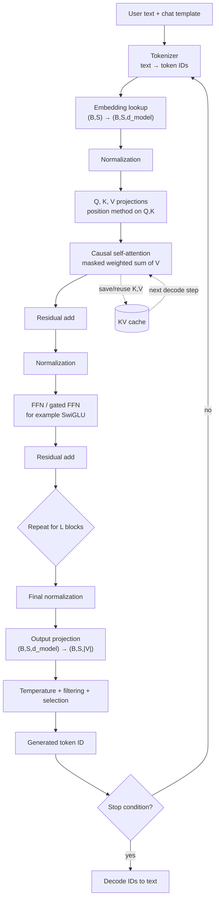
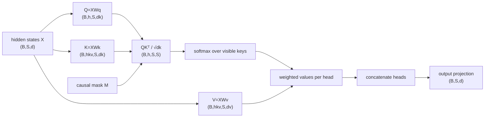
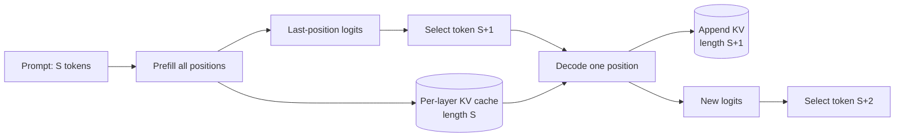
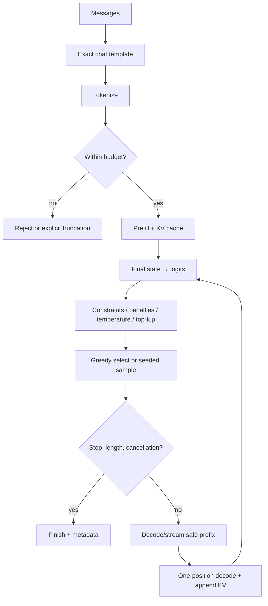

# CH-02: Transformer Architecture in Depth

<a id="ch02-purpose"></a>

## 2.1 Purpose and learning outcomes

A decoder-only Transformer turns a finite sequence of discrete token identifiers into a probability distribution over
the next token. Repeating that operation produces text. This concise description hides nearly every engineering
trade-off that matters to a small language model (SLM): how text is segmented, how order is represented, which earlier
tokens each position may read, how activations and cached state consume memory, and how a probability distribution
becomes one emitted token.

After completing this chapter, the reader should be able to distinguish major tokenizer families; derive the tensor
shapes and arithmetic of causal self-attention; explain multi-head attention (MHA), multi-query attention (MQA), and
grouped-query attention (GQA); trace a token through a decoder stack; calculate first-order attention and key-value (KV)
cache costs; compare dense, sparse, mixture-of-experts (MoE), local-attention, and state-space designs; and identify
architecture choices that affect offline mobile implementation.

Read the chapter as one pipeline: **represent text, mix information, transform each position, score the vocabulary, and
choose the next token**. Each stage solves a distinct problem and creates a distinct deployment cost. The mechanisms
explain model behavior, but they do not guarantee factual correctness or safe domain decisions.

<a id="ch02-system-view"></a>

## 2.2 The decoder-only computation

The original Transformer used an encoder and decoder [R1]. GPT-style language models retain a stack of causally masked
decoder blocks and train it to predict the next token. “Decoder-only” names the neural architecture, not merely the
external decoding algorithm.

<a id="fig-02"></a> **FIG-02 — Annotated GPT-style decoder-only Transformer (`ILLUSTRATIVE`).** Alt text: user text is
tokenized, embedded, processed by repeated causal-attention and feed-forward sublayers, projected to vocabulary logits,
sampled, and appended; cached keys and values feed the next iteration. Not measured; arrows show conceptual
relationships only.



The repeated block is usually either **pre-norm**, where normalization precedes each sublayer, or **post-norm**, where
it follows the residual addition. Exact ordering, bias terms, activation, position method, and head arrangement are
checkpoint-specific. An inference engine must reproduce the trained graph exactly.

<a id="ch02-tokenization"></a>

## 2.3 Tokenization: an open world, a finite vocabulary

### 2.3.1 Why tokenization exists

The output projection needs a finite number of rows, yet text contains arbitrary words, identifiers, Unicode characters,
and even malformed byte sequences. A tokenizer maps text to identifiers from vocabulary $\mathcal{V}$, and a decoder
maps identifiers back to text. The model sees identifiers, not words.

A tokenizer includes normalization, pre-tokenization, segmentation, special-token handling, and deterministic decoding.
Changing any part after pretraining changes the model interface. Replacing a tokenizer is therefore not a harmless
preprocessing edit: new input embeddings and output rows are untrained unless explicitly learned.

Think of the tokenizer as the model's passport office: it assigns the only identifiers the network recognizes. Two
tokenizers may render the same sentence visibly while issuing different ID sequences, so a checkpoint cannot safely
swap between them.

### 2.3.2 BPE, WordPiece, Unigram, and byte-level methods

**Byte Pair Encoding (BPE).** Gage’s compression algorithm repeatedly replaces the most frequent adjacent pair [R2].
Neural-tokenizer BPE variants begin with a base alphabet and learn merge operations; ranked merges combine adjacent
symbols during encoding [R3]. Frequent terms can become one token while rare identifiers split into reusable pieces.

**WordPiece.** WordPiece originated in speech recognition [R4] and later became prominent in NLP. Its training is
commonly described as selecting pieces that improve a language-model objective rather than simply merging the highest
raw-frequency pair. Implementations differ, so “WordPiece” is not one universal training algorithm. BERT uses WordPiece
with displayed continuation markers such as `##` [R5]; greedy longest-match encoding is common.

**Unigram language-model tokenization.** Unigram starts with a large candidate inventory and removes pieces whose
absence least harms a probabilistic segmentation model. For segmentation $z=(z_1,\ldots,z_m)$,

$$
P(z)=\prod_{i=1}^{m}p(z_i).
$$

Encoding can use Viterbi search for a high-probability segmentation. Kudo also proposed sampling plausible segmentations
during training as subword regularization [R6]. SentencePiece implements BPE and Unigram directly over raw text and
represents whitespace explicitly [R7].

**Byte-level tokenization.** A byte-level base alphabet makes every byte sequence representable. GPT-2 used a reversible
byte-to-Unicode mapping before BPE [R8]. Byte-level BPE remains subword tokenization: bytes are lossless base units,
then frequent sequences merge. A pure byte model predicts individual bytes. Byte fallback is another design in which
otherwise unknown characters become byte tokens. These are related, not identical.

<!-- markdownlint-disable MD013 -->
| Property               | Merge BPE                     | WordPiece                                                 | Unigram                                    | Byte base/fallback                                       |
| ---------------------- | ----------------------------- | --------------------------------------------------------- | ------------------------------------------ | -------------------------------------------------------- |
| Training idea          | Iterative pair merges         | Objective-driven piece selection; implementation-specific | Prune probabilistic candidates             | Guarantee byte coverage; may combine with BPE/Unigram    |
| Typical encoding       | Learned merge ranks           | Greedy longest match                                      | Viterbi/best or sampled segmentation       | Reversible byte mapping plus model-specific segmentation |
| Strength               | Simple and widely supported   | Mature word-piece behavior                                | Multiple segmentations; principled pruning | No out-of-vocabulary byte sequence                       |
| Weakness               | Rare strings may fragment     | Coverage depends on base vocabulary                       | More complex training/encoding             | One character can require several byte tokens            |
| Specialist implication | Compression depends on corpus | Domain vocabulary must be embedded and trained            | Sampling can regularize training           | Robust for part numbers, symbols, and noisy text         |
<!-- markdownlint-restore -->

**TBL-CH02-01 — Tokenizer families (`ILLUSTRATIVE`).** This is a conceptual comparison, not a benchmark.

### 2.3.3 Vocabulary size and fertility

Let $V=|\mathcal{V}|$ and model width be $d$. An untied input embedding contains $Vd$ parameters; an untied output
matrix contains another $Vd$. For $V=32{,}000$ and $d=2{,}048$, each has $65{,}536{,}000$ parameters. At two
bytes per parameter, its raw payload is 125 MiB; two untied matrices are 250 MiB. This `ILLUSTRATIVE` calculation
excludes alignment, quantization metadata, and runtime buffers.

A larger vocabulary can shorten common sequences but enlarges the embedding and output matrices. A smaller vocabulary
reduces those matrices but often increases **token fertility**—tokens per word, character, or byte—and therefore
sequence length, prefill work, and cache use. Evaluate:

- average and percentile tokens per document;
- fragmentation of units, drug names, diagnostic codes, and part numbers;
- round-trip fidelity and unknown-token rate;
- embedding/output memory; and
- downstream quality after controlled training.

Adding specialist tokens does not inject their meanings. Their vectors need initialization and training, and existing
identifier assignments must remain stable. Preserving the pretrained tokenizer is usually the lower-risk adaptation
baseline; modification should be justified by measured coverage or fertility problems.

<a id="ch02-embeddings-position"></a>

## 2.4 Embeddings and position

For token IDs $t_1,\ldots,t_S$, matrix $E\in\mathbb{R}^{V\times d}$ supplies

$$
X_i=E[t_i]\in\mathbb{R}^{d}.
$$

With batch $B$, $X$ has shape $(B,S,d)$. Practical kernels gather rows rather than materializing one-hot vectors.
Some models **tie** output and input embeddings by using $E^\top$ for the output projection, reducing parameters [R9].
Tying is a training-time architecture choice, not an inference toggle.

Attention without position information has no intrinsic way to distinguish reordered inputs. Major approaches include:

- **learned absolute embeddings**, which add a learned vector for each position;
- **sinusoidal encodings** [R1],

$$
PE_{(p,2j)}=\sin(p/10000^{2j/d}),\quad PE_{(p,2j+1)}=\cos(p/10000^{2j/d});
$$

- **relative representations**, which alter attention using relative distance [R10];
- **ALiBi**, which adds head-specific linear distance biases [R11]; and
- **rotary position embedding (RoPE)**, which rotates query/key coordinates [R12].

Here $p$ is position, $j$ indexes a coordinate pair, and $d$ is width. For one RoPE pair and $\theta_p=p\omega$,

$$
R_{\theta_p}= \begin{bmatrix} \cos\theta_p&-\sin\theta_p\\ \sin\theta_p&\cos\theta_p \end{bmatrix}.
$$

If $q'_p=R_{\theta_p}q$ and $k'_r=R_{\theta_r}k$, then <!-- markdownlint-disable-line MD013 MD049 -->

$$
(q'_p)^\top k'_r=q^\top R_{\theta_r-\theta_p}k,
$$
<!-- markdownlint-disable-line MD013 MD049 -->

so their dot product contains relative displacement. RoPE normally rotates $Q$ and $K$, not $V$. Frequency base,
rotary dimensions, scaling, and position indexing belong to the checkpoint contract.

No position technique makes context unlimited. Extrapolation can degrade because training distribution, attention
patterns, numerical precision, and learned behavior remain finite. RoPE scaling and positional interpolation can extend
an operating range, but require long-context retrieval, reasoning, and domain evaluation [R13].

<a id="ch02-attention"></a>

## 2.5 Causal self-attention

<a id="fig-03"></a> **FIG-03 — Self-attention and token processing (`ILLUSTRATIVE`).** Alt text: hidden states are
projected into query, key, and value tensors; query-key scores are scaled by the square root of key width, causally
masked, normalized with softmax, applied to values per head, concatenated, and output-projected. Dimensions are
symbolic, not measured; arrows show conceptual relationships only.



<a id="218-verification-status-and-unresolved-work"></a>

### 2.5.1 Equations and shapes

Given $X\in\mathbb{R}^{B\times S\times d}$, one head forms

$$
Q=XW_Q,\quad K=XW_K,\quad V_a=XW_V,
$$

where $W_Q,W_K\in\mathbb{R}^{d\times d_k}$, $W_V\in\mathbb{R}^{d\times d_v}$, and $V_a$ distinguishes the value
tensor from vocabulary size $V$. Scaled dot-product attention is

$$
\operatorname{Attention}(Q,K,V_a)= \operatorname{softmax}\left(\frac{QK^\top}{\sqrt{d_k}}+M\right)V_a.
$$

$M\in\mathbb{R}^{S\times S}$ is an additive mask. Scores have shape $(B,S,S)$ per head. For autoregressive
attention,

$$
M_{ij}= \begin{cases} 0,&j\le i,\\ -\infty,&j>i. \end{cases}
$$

Thus position $i$ cannot read a future key $j>i$. Implementations use a representable negative value or fused causal
kernel; negative infinity is conceptual. Padding masks are separate. A mask-orientation error can leak targets during
training.

### 2.5.2 Numerical example

For $S=3,d_k=2$, let

$$
Q=K=\begin{bmatrix}1&0\\0&1\\1&1\end{bmatrix},\quad V_a=\begin{bmatrix}1&0\\0&2\\3&1\end{bmatrix}.
$$

At the third position all keys are visible. Its scaled scores are

$$
\frac{[1,1]K^\top}{\sqrt2}\approx[0.707,0.707,1.414].
$$

Softmax is approximately $[0.248,0.248,0.503]$, yielding

$$
0.248[1,0]+0.248[0,2]+0.503[3,1]\approx[1.757,0.999].
$$

At the first position, the mask hides positions two and three, so its output is $[1,0]$. Values are `ILLUSTRATIVE`;
displayed rounding is approximate.

### 2.5.3 MHA, MQA, and GQA

MHA runs $H_q$ learned heads, concatenates their outputs, and projects:

$$
\operatorname{MHA}(X)=\operatorname{Concat}(O_1,\ldots,O_{H_q})W_O.
$$

If $d=H_qd_h$, each head usually has width $d_h$. Heads may learn different patterns, but no semantic role is
guaranteed.

MQA retains $H_q$ query heads while sharing one key and one value head [R14]. GQA uses $H_{kv}$ KV heads and maps
groups of query heads to each [R15]. MHA is the $H_{kv}=H_q$ endpoint; MQA is $H_{kv}=1$.

<!-- markdownlint-disable MD013 -->
| Design | Query heads |          KV heads | Cache implication               | Trade-off                                  |
| ------ | ----------: | ----------------: | ------------------------------- | ------------------------------------------ |
| MHA    |     $H_q$ |           $H_q$ | Largest under equal dimensions  | Independent KV representations             |
| GQA    |     $H_q$ | $1<H_{kv}<H_q$ | Reduced by about $H_q/H_{kv}$ | Middle ground; quality depends on training |
| MQA    |     $H_q$ |                 1 | Smallest                        | Maximum KV sharing                         |
<!-- markdownlint-restore -->

**TBL-CH02-02 — Head sharing (`ILLUSTRATIVE`).** Ratios assume equal layers, dimensions, precision, and context and do
not predict latency.

For layers $L$, batch $B$, cached length $S$, KV heads $H_{kv}$, head width $d_h$, and bytes per element
$b$,

$$
\text{KV bytes}\approx2LBSH_{kv}d_hb.
$$

The factor 2 stores keys and values. For $L=24,B=1,S=4096,H_{kv}=8,d_h=64,b=2$, payload is $201{,}326{,}592$ bytes,
or 192 MiB. With 32 KV heads and all else equal, it is 768 MiB. Real allocations can include padding, metadata,
alignment, and additional buffers.

### 2.5.4 Prefill and decode

During **prefill**, prompt positions are processed and cached. Dense attention has $S^2$ logical query-key
interactions. Fused exact kernels can avoid storing the full score matrix in high-bandwidth memory; FlashAttention is an
IO-aware exact algorithm, not sparse attention [R16].

During **decode**, the new token has one query per layer and reads cached keys/values. The cache grows with context.
Decode often stresses weight/cache movement, but the bottleneck depends on device, runtime, precision, batch, and
workload. Architecture alone cannot justify a tokens-per-second claim.

<a id="ch02-ffn-norm"></a>

## 2.6 FFNs, normalization, and residuals

Attention communicates across positions. The feed-forward network transforms each position independently:

$$
\operatorname{FFN}(x)=W_2\phi(W_1x+b_1)+b_2,
$$

where $x\in\mathbb{R}^{d}$, $W_1\in\mathbb{R}^{d_{ff}\times d}$, $W_2\in\mathbb{R}^{d\times d_{ff}}$, and $\phi$
may be ReLU or GELU. Ignoring bias, it uses $2dd_{ff}$ weights.

SwiGLU is a gated variant [R17]:

$$
\operatorname{SwiGLU}(x)=W_o[\operatorname{SiLU}(W_gx)\odot(W_ux)], \qquad \operatorname{SiLU}(z)=z\sigma(z).
$$

$W_g,W_u,W_o$ are gate, up, and output projections; $\odot$ is element-wise multiplication. It has roughly
$3dd_{ff}$ weights, so gated models often choose a different intermediate width. Comparing only the expansion ratio
without counting matrices is misleading.

Layer normalization is [R18]

$$
\operatorname{LN}(x)=\gamma\odot\frac{x-\mu}{\sqrt{\sigma^2+\epsilon}}+\beta,
$$

where $\mu,\sigma^2$ are the vector mean and variance; $\gamma,\beta$ are learned; and $\epsilon$ prevents
division by zero. RMSNorm omits mean subtraction [R19]:

$$
\operatorname{RMSNorm}(x)=\gamma\odot \frac{x}{\sqrt{\frac1d\sum_{j=1}^{d}x_j^2+\epsilon}}.
$$

The RMSNorm paper reports simplification and competitive results in tested settings (`PAPER-REPORTED`), not universal
superiority.

In a pre-norm block,

$$
h'=h+\operatorname{Attention}(\operatorname{Norm}(h)),
$$

$$

h_{\text{next}}=h'+\operatorname{FFN}(\operatorname{Norm}(h')).
$$

Residual connections provide identity paths around nonlinear sublayers [R20]. Parallel-residual and post-norm variants
exist; exact ordering is part of the checkpoint.

<a id="ch02-output"></a>

## 2.7 Decoder stack, logits, and softmax

After $L$ blocks and usually a final normalization, last-position state $h\in\mathbb{R}^{d}$ is projected:

$$
z=W_{\text{out}}h+b,\qquad z\in\mathbb{R}^{V}.
$$

Each $z_i$ is a **logit**, an unnormalized score. Softmax gives

$$
p_i=\frac{\exp(z_i)}{\sum_{j=1}^{V}\exp(z_j)}.
$$

Implementations subtract $\max_jz_j$ before exponentiation for numerical stability. Softmax creates a categorical
distribution, not calibrated truth confidence. A factually wrong continuation can receive high probability.

Training commonly uses teacher forcing and next-token cross-entropy. Generation consumes the model’s own selected
outputs. Once an unlikely token is selected, every later probability is conditioned on it.

<a id="ch02-decoding"></a>

## 2.8 Decoding and stopping

**Greedy decoding** selects $\arg\max_i z_i$. **Beam search** keeps several high-scoring partial sequences; it is
useful for some constrained tasks but is not automatically better for dialogue. **Sampling** draws from a modified
distribution.

Temperature $T>0$ rescales logits:

$$
p_i(T)=\frac{\exp(z_i/T)}{\sum_j\exp(z_j/T)}.
$$

$T<1$ sharpens and $T>1$ flattens. Implementations should treat zero as greedy rather than divide by zero. For
logits $[2,1,0]$, probabilities at $T=1$ are about $[0.665,0.245,0.090]$; at $T=0.5$, about
$[0.867,0.117,0.016]$ (`ILLUSTRATIVE`).

**Top-$k$** keeps the $k$ largest candidates and renormalizes. **Top-$p$** (nucleus) sampling sorts by probability
and keeps the smallest prefix whose cumulative mass reaches $p$ [R21]. Top-$p$'s candidate count adapts to
distribution shape. Combined filters need a documented order and minimum-candidate rule.

Repetition controls include multiplicative penalties, additive presence/frequency penalties, and repeated-$n$-gram
bans; they are not equivalent. Excessive penalties can corrupt technical terms, units, and lists. Record the exact
formula and whether it covers prompt tokens, generated tokens, or both.

Generation stops on a configured EOS/stop-token ID, a stop string detected by the application, a maximum-new-token
limit, cancellation, or resource failure. A stop string can span tokens, so streaming code may need to retain a suffix.
Special-token IDs and chat-control tokens must come from the checkpoint tokenizer/configuration. Stopping is not a
safety mechanism: unsafe content may precede the delimiter.

<a id="ch02-context-cache"></a>

## 2.9 Context windows, KV caches, and long-context limits

The context window counts tokens after templating: system messages, role delimiters, user text, history, and generated
output. For capacity $C$,

$$
S_{\text{prompt}}+S_{\text{generated}}\le C
$$

unless the runtime explicitly evicts, slides, or rejects content. Reserve output room before prefill.

The KV cache avoids recomputing prior keys and values. Each decode step creates one query plus one new key/value per
layer, attends over prior cache entries, and appends the new entries.

Long context remains limited by:

1. quadratic dense-attention work during prefill;
2. linear KV-cache growth and bandwidth;
3. positional extrapolation;
4. imperfect retrieval and reasoning amid distractors;
5. precision and kernel behavior;
6. limited long-sequence training data; and
7. unsafe application truncation.

Acceptance without an out-of-memory error is not evidence of effective context use. For mobile deployment, budget
weights, cache, activations/scratch space, tokenizer, runtime, and application separately. A file fitting in storage
does not imply runtime-memory fit or acceptable sustained performance.

<a id="fig-ch02-03"></a> **FIG-CH02-03 — Prefill and cached decode (`ILLUSTRATIVE`).** Alt text: a prompt is processed
in parallel to create per-layer KV entries; each decode step reads the cache, appends one entry, and emits new logits.
Not measured; arrows show conceptual relationships only.



<a id="ch02-alternatives"></a>

## 2.10 Dense, sparse, MoE, local, and state-space designs

“Dense” is overloaded. A dense model activates every parameter for each token; dense attention considers every allowed
query-key pair. A model may have dense FFNs with local attention, or global attention with sparse MoE FFNs.

**Dense Transformer.** Every token traverses all layers and FFNs. Static execution and mature runtime support simplify
deployment, but weights, cache traffic, and global prefill remain costly.

**Sparse/local attention.** Sparse attention evaluates selected pairs using fixed, learned, block, local, or routing
patterns. Practical acceleration requires matching kernels. Sliding-window attention lets position $i$ read only about
the prior $w$ positions, reducing interactions from $O(S^2)$ to $O(Sw)$ when $w\ll S$. A runtime may bound cache
accordingly. Direct access to older information is lost; stacked propagation is not equivalent to global lookup.

**Mixture of Experts.** MoE replaces a dense FFN with experts and a router:

$$
y=\sum_{e\in\operatorname{TopK}(g(x),k)}\alpha_e(x)f_e(x),
$$

where $g$ is the router, $f_e$ expert $e$, and $\alpha_e$ its normalized routing weight. Sparse activation can
increase total capacity without activating every expert per token [R22]. It does not make storage or RAM proportional to
active parameters: all experts may remain resident, routing is irregular, and mobile runtimes may lack kernels. Report
total parameters, active parameters, and resident bytes separately.

**State-space and hybrid models.** A simplified discrete state-space model (SSM) is

$$
h_t=Ah_{t-1}+Bx_t,\qquad y_t=Ch_t+Dx_t,
$$

where $x_t$ is input, $h_t$ state, and $y_t$ output. Modern selective SSMs make operators input-dependent. Mamba
reports linear sequence scaling and selective state updates [R23] (`PAPER-REPORTED`). SSMs can use fixed recurrent state
for streaming, but training scans, inference kernels, state precision, export support, and content retrieval differ from
attention. Hybrids combine attention with SSM or convolutional blocks.

<!-- markdownlint-disable MD013 -->
| Architecture                | Sequence state                    | Opportunity                                | Edge risk                                                |
| --------------------------- | --------------------------------- | ------------------------------------------ | -------------------------------------------------------- |
| Dense global Transformer    | KV grows with context             | Mature ecosystem; content lookup           | Weight/cache traffic; long prefill                       |
| Local-attention Transformer | Potentially window-bounded KV     | Controlled context cost                    | No direct distant access; kernel support                 |
| Sparse MoE Transformer      | Usually attention KV plus experts | More total capacity per active computation | Experts may all reside in RAM; irregular access          |
| SSM                         | Recurrent state can be fixed-size | Streaming sequence processing              | Specialized kernels/export; different retrieval behavior |
| Hybrid                      | Mixed state/cache                 | Balance mechanisms                         | Integration complexity                                   |
<!-- markdownlint-restore -->

**TBL-CH02-03 — Architecture comparison (`ILLUSTRATIVE`).** It predicts no quality or speed ordering.

<a id="ch02-mobile"></a>

## 2.11 Mobile implications

Mobile performance is a property of **model × precision × runtime × kernels × device × workload**, not parameter count
alone. Inspect:

- weight bytes, packing, dequantization, and memory bandwidth;
- vocabulary size and final output projection;
- KV heads, context allocation, cache precision, and layout;
- layer depth, matrix shapes, and serial kernel launches;
- FFN gating and fusion support;
- local/sparse attention semantics and kernels;
- MoE total resident weights, not only active FLOPs;
- RoPE variant, norm, activation, and export compatibility;
- separate prefill and decode behavior; and
- sustained thermal and energy behavior.

GQA/MQA can reduce cache payload relative to equal-width MHA. Local attention can bound work/cache only when model
semantics and runtime support permit. Quantized weights help only with correct kernels. A sparse representation without
sparse execution may save file bytes without reducing latency.

Specialist tokenization also affects edge cost. Fragmenting `P0301`, `N·m`, chemical names, or model numbers increases
sequence length and cache, but shrinking a vocabulary can harm language coverage. Measure on a representative, legally
usable domain corpus.

<a id="ch02-lifecycle"></a>

## 2.12 User input to generated token: complete lifecycle

1. **Construct the prompt.** Apply the checkpoint’s exact chat template. Delimiters consume context. Keep untrusted user
   text from impersonating control tokens.
2. **Normalize and tokenize.** Produce IDs with the exact tokenizer artifact and special-token policy.
3. **Enforce context policy.** Reserve output space; reject or explicitly truncate overflow. Never silently remove
   system/safety instructions.
4. **Embed.** Gather one vector per ID, yielding $(B,S,d)$.
5. **Prefill each layer.** Normalize; project Q/K/V; apply the position method; causally attend; add residual;
   normalize; apply FFN; add residual.
6. **Cache.** Store each layer’s prompt keys/values in the required layout and precision.
7. **Project.** Final normalization and output projection create $V$ logits for the final position.
8. **Constrain and transform.** Apply any allowed-ID/grammar constraints, repetition policy, temperature, and
   top-$k$/top-$p$ in documented order. Valid format does not guarantee true content.
9. **Select.** Greedy choice or seeded sampling returns one ID.
10. **Stop or stream.** Detect token/string stops, length, or cancellation; buffer possible stop suffixes and incomplete
    Unicode.
11. **Decode one position.** Embed the selected ID, compute one position through every layer against cached KV, append
    its KV, and obtain new logits.
12. **Repeat and record.** Continue until stopping; record model/tokenizer identity, parameters, token counts, finish
    reason, and safety outcome without logging sensitive text by default.

**FIG-CH02-04 — One-token control flow (`ILLUSTRATIVE`).** Alt text: messages move through template, tokenizer, context
check, prefill, logits, decoding filters, token selection, stopping, streaming, and cached decode.



**Listing CH02-L01 — Cached generation pseudocode.** Purpose: clarify state and ordering. This is pseudocode, not
executable. Evidence: `UNVERIFIED IMPLEMENTATION`.

```text
ids = tokenizer.apply_chat_template(messages)
assert_context_budget(ids, max_context, max_new_tokens)
logits, cache = model.prefill(ids)
generated = []

for step in 0 .. max_new_tokens - 1:
    scores = logits_for_last_position(logits)
    scores = apply_constraints(scores)
    scores = apply_repetition_policy(scores, ids, generated)
    distribution = temperature_and_candidate_filter(scores)
    next_id = select(distribution, rng)

    if token_or_buffer_completes_stop(next_id):
        return flush_safe_prefix(generated), finish_reason

    generated.append(next_id)
    emit_text_not_part_of_possible_stop_suffix(generated)
    logits, cache = model.decode_one(next_id, cache)

return flush_safe_prefix(generated), "length"
```

The pseudocode intentionally leaves tensor layout, API, RNG, and penalty formula unspecified; an executable
implementation must pin them.

<a id="ch02-failures"></a>

## 2.13 Failure modes and tests

Common failures are tokenizer/checkpoint mismatch; wrong chat template; off-by-one RoPE positions during cached decode;
inverted causal masks; incorrect GQA grouping; cache dtype/layout mismatch; unstable softmax; stop-token/string
confusion; context allocation without output room; unsupported-operator fallback; treating sampling probability as
factual confidence; and truncating safety context.

Unit tests should compare tokenizer round trips, full-prefix logits with incremental-cache logits, masks on tiny
tensors, GQA reference outputs, deterministic greedy generation, stop strings crossing token boundaries, and
maximum-context behavior.

<a id="ch02-summary"></a>

## 2.14 Chapter summary

- Tokenization defines the model’s discrete interface. Vocabulary size trades matrix memory against sequence fertility.
- Embeddings require position information. RoPE rotates queries and keys so scores contain relative displacement.
- Causal attention computes masked, scaled query-key similarities and value sums. Shape and mask correctness are
  fundamental.
- GQA and MQA share KV heads and can reduce cache payload relative to MHA under controlled assumptions.
- FFNs transform each position; SwiGLU adds a learned gate. Norm and residual ordering are checkpoint contracts.
- Output projection produces logits. Temperature, top-$k$, top-$p$, penalties, and stopping select text but add no
  knowledge.
- KV caching trades recomputation for linearly growing state. Advertised long context is not guaranteed effective
  reasoning.
- Local attention, MoE, SSMs, and hybrids alter resource trade-offs; gains require supported kernels and measurement.
- Storage fit, runtime-memory fit, and acceptable sustained mobile performance are separate gates.

<a id="ch02-review"></a>

## 2.15 Review questions

1. Why can byte-level BPE encode arbitrary UTF-8 without making every token one byte?
2. How can a larger vocabulary reduce sequence cost while increasing model cost?
3. Give the shape of $QK^\top$ for $B=2,H=8,S=512,d_h=64$.
4. Why is a causal mask needed during parallel training?
5. Under what assumptions does GQA reduce cache by $H_q/H_{kv}$?
6. Why is FlashAttention not sparse attention?
7. Contrast learned absolute position, RoPE, and ALiBi.
8. Why is RMSNorm not simply LayerNorm without $\beta$?
9. Distinguish logits, probabilities, calibration, and factual correctness.
10. Compare top-$k$ and top-$p$ for peaked and flat distributions.
11. Why may a model accept but fail to use a long context?
12. Why is active MoE parameter count insufficient for mobile RAM planning?
13. When can sliding-window attention bound cache, and what does it risk?
14. Name four conditions required before claiming one architecture is faster on a phone.

<a id="ch02-exercises"></a>

## 2.16 Engineering exercises

1. **Tokenizer audit.** Compare two fixed tokenizers on general and specialist corpora using token/character ratio,
   percentile lengths, and curated-term fragmentation. Record artifact hashes and normalization. Do not infer quality
   from fertility alone. Evidence target: `EXECUTED`.
2. **Attention reference.** Implement the three-token example, test every mask row, and compare against hand
   calculations with a declared tolerance.
3. **Cache calculator.** Calculate MHA/GQA/MQA payloads from an exact checkpoint. Separate arithmetic payload
   (`STATICALLY REVIEWED`) from measured process memory (`EXECUTED`).
4. **Cached-logit equivalence.** Compare full-prefix and incremental logits for a pinned
   model/tokenizer/runtime/device/precision.
5. **Decoding study.** Hold model and prompt fixed; vary temperature/top-$p$ over recorded seeds. Report diversity and
   task correctness separately.
6. **Long-context diagnostic.** Test retrieval by position and length with distractors. Do not equate successful
   allocation with successful use.
7. **Mobile screen.** Inventory operators, calculate weights/cache, verify runtime support, and design TTFT, prefill,
   decode, peak-memory, energy, and thermal measurements. Label unrun outcomes `PLANNED EXPERIMENT`.

<a id="ch02-references"></a>

## 2.17 References

Primary papers and original reports are preferred. Access date: 2026-11-23. Source claims are `PAPER-REPORTED`, not
reproduced.

- **[R1]** Vaswani, A. et al. (2017). “Attention Is All You Need.” _NeurIPS 2017_. arXiv:1706.03762. <!-- markdownlint-disable-line MD013 MD049 -->
  <https://arxiv.org/abs/1706.03762> — Transformer, attention, sinusoidal positions. Original encoder-decoder
  experiments are not modern SLM evidence.
- **[R2]** Gage, P. (1994). “A New Algorithm for Data Compression.” _C Users Journal_. <!-- markdownlint-disable-line MD013 MD049 -->
  <http://www.pennelynn.com/Documents/CUJ/HTML/94HTML/19940045.HTM> — Original byte-pair compression; not a
  neural-tokenizer study.
- **[R3]** Sennrich, R., Haddow, B., and Birch, A. (2016). “Neural Machine Translation of Rare Words with Subword
  Units.” _ACL 2016_. DOI:10.18653/v1/P16-1162. <https://aclanthology.org/P16-1162/> <!-- markdownlint-disable-line MD013 MD049 -->
- **[R4]** Schuster, M. and Nakajima, K. (2012). “Japanese and Korean Voice Search.” _ICASSP 2012_. <!-- markdownlint-disable-line MD013 MD049 -->
  DOI:10.1109/ICASSP.2012.6289079. <https://doi.org/10.1109/ICASSP.2012.6289079> — Early WordPiece source; later
  implementations differ.
- **[R5]** Devlin, J. et al. (2019). “BERT.” _NAACL-HLT 2019_. DOI:10.18653/v1/N19-1423. <!-- markdownlint-disable-line MD013 MD049 -->
  <https://aclanthology.org/N19-1423/> — WordPiece use; BERT is encoder-only.
- **[R6]** Kudo, T. (2018). “Subword Regularization.” _ACL 2018_. DOI:10.18653/v1/P18-1007. <!-- markdownlint-disable-line MD013 MD049 -->
  <https://aclanthology.org/P18-1007/>
- **[R7]** Kudo, T. and Richardson, J. (2018). “SentencePiece.” _EMNLP System Demonstrations_. DOI:10.18653/v1/D18-2012. <!-- markdownlint-disable-line MD013 MD049 -->
  <https://aclanthology.org/D18-2012/>
- **[R8]** Radford, A. et al. (2019). “Language Models are Unsupervised Multitask Learners.” OpenAI technical report.
  <https://cdn.openai.com/better-language-models/language_models_are_unsupervised_multitask_learners.pdf> — GPT-2
  byte-level BPE; no peer-reviewed venue claimed here.
- **[R9]** Press, O. and Wolf, L. (2017). “Using the Output Embedding to Improve Language Models.” _EACL 2017_. <!-- markdownlint-disable-line MD013 MD049 -->
  DOI:10.18653/v1/E17-2025. <https://aclanthology.org/E17-2025/>
- **[R10]** Shaw, P., Uszkoreit, J., and Vaswani, A. (2018). “Self-Attention with Relative Position Representations.”
  _NAACL-HLT 2018_. DOI:10.18653/v1/N18-2074. <https://aclanthology.org/N18-2074/> <!-- markdownlint-disable-line MD013 MD049 -->
- **[R11]** Press, O., Smith, N. A., and Lewis, M. (2022). “Train Short, Test Long.” _ICLR 2022_. <!-- markdownlint-disable-line MD013 MD049 -->
  <https://openreview.net/forum?id=R8sQPpGCv0> — ALiBi; extrapolation results are setting-specific.
- **[R12]** Su, J. et al. (2021). “RoFormer.” arXiv:2104.09864. <https://arxiv.org/abs/2104.09864> — RoPE; publication
  status stated only as arXiv.
- **[R13]** Chen, S. et al. (2023). “Extending Context Window of Large Language Models via Positional Interpolation.”
  arXiv:2306.15595. <https://arxiv.org/abs/2306.15595>
- **[R14]** Shazeer, N. (2019). “Fast Transformer Decoding: One Write-Head is All You Need.” arXiv:1911.02150.
  <https://arxiv.org/abs/1911.02150> — MQA.
- **[R15]** Ainslie, J. et al. (2023). “GQA.” _EMNLP 2023_. DOI:10.18653/v1/2023.emnlp-main.298. <!-- markdownlint-disable-line MD013 MD049 -->
  <https://aclanthology.org/2023.emnlp-main.298/>
- **[R16]** Dao, T. et al. (2022). “FlashAttention.” _NeurIPS 2022_. arXiv:2205.14135. <!-- markdownlint-disable-line MD013 MD049 -->
  <https://arxiv.org/abs/2205.14135> — Exact attention; gains are hardware/software dependent.
- **[R17]** Shazeer, N. (2020). “GLU Variants Improve Transformer.” arXiv:2002.05202. <https://arxiv.org/abs/2002.05202>
- **[R18]** Ba, J. L., Kiros, J. R., and Hinton, G. E. (2016). “Layer Normalization.” arXiv:1607.06450.
  <https://arxiv.org/abs/1607.06450>
- **[R19]** Zhang, B. and Sennrich, R. (2019). “Root Mean Square Layer Normalization.” _NeurIPS 2019_. <!-- markdownlint-disable-line MD013 MD049 -->
  <https://papers.nips.cc/paper/9403-root-mean-square-layer-normalization>
- **[R20]** He, K. et al. (2016). “Deep Residual Learning for Image Recognition.” _CVPR 2016_. DOI:10.1109/CVPR.2016.90. <!-- markdownlint-disable-line MD013 MD049 -->
  <https://doi.org/10.1109/CVPR.2016.90> — Original experiments concern vision.
- **[R21]** Holtzman, A. et al. (2020). “The Curious Case of Neural Text Degeneration.” _ICLR 2020_. <!-- markdownlint-disable-line MD013 MD049 -->
  <https://openreview.net/forum?id=rygGQyrFvH> — Nucleus sampling.
- **[R22]** Fedus, W., Zoph, B., and Shazeer, N. (2022). “Switch Transformers.” _JMLR_ 23(120). <!-- markdownlint-disable-line MD013 MD049 -->
  <https://jmlr.org/papers/v23/21-0998.html> — Top-1 expert routing; not mobile evidence.
- **[R23]** Gu, A. and Dao, T. (2024). “Mamba: Linear-Time Sequence Modeling with Selective State Spaces.” COLM 2024 /
  arXiv:2312.00752. <https://arxiv.org/abs/2312.00752> — Runtime and quality remain implementation/workload dependent.

<a id="ch02-verification"></a>

## 2.18 End notes

The equations, diagrams, and worked values explain mechanisms rather than report measured performance. The cached
generation listing is pseudocode. No model, tokenizer, runtime, or physical device was tested for this chapter; execute
the exercises on a pinned checkpoint and target before making compatibility, latency, memory, or energy claims.

Cross-links: [Part index](README.md) · [Detailed contents](../../01-planning/detailed-table-of-contents.md) ·
[Evidence standard](../../00-governance/evidence-and-citation-standard.md) ·
[Figure standard](../../00-governance/figure-table-standard.md)
