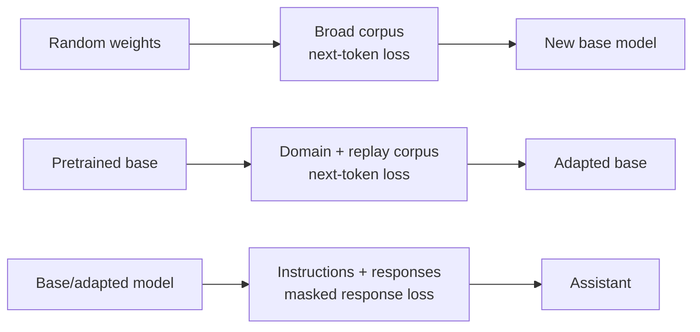
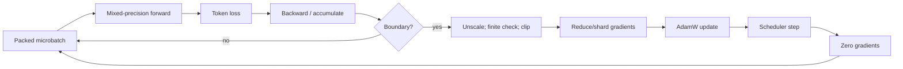

# CH-04: Pretraining Fundamentals

<a id="ch04-purpose"></a>

## 4.1 Purpose and learning outcomes

Pretraining converts an initialized neural network and a token corpus into a model that assigns useful probabilities to
language. The objective is compact; the engineering system is not. Initialization, data order, precision, optimizer
state, batch construction, communication, checkpointing, and failure recovery interact.

After this chapter, the reader should be able to derive next-token loss; relate tokens, epochs, batches, sequences, and
optimizer steps; explain AdamW, warmup, schedules, and mixed precision; select memory and distributed strategies;
diagnose failed training; and justify scratch training versus adaptation for a specialist Small Language Model (SLM).

The central engineering question is not merely “which loss should we minimize?” but “how do data, optimization,
precision, memory, and recovery combine into a stable learning system?” Think of pretraining as an apprenticeship:
billions of next-token exercises gradually shape the model, while the curriculum, feedback strength, and training
conditions determine what it learns and what it forgets.

<a id="ch04-problem"></a>

## 4.2 The pretraining problem

For tokens $x_{1:T}$, an autoregressive model factorizes:

<a id="eq-ch04-01"></a>
$$
\boxed{p_\theta(x_{1:T})=\prod_{t=1}^{T}p_\theta(x_t\mid x_{<t})} \tag{EQ-CH04-01}
$$

$\theta$ denotes trainable parameters, $x_t$ the target token, and $x_{<t}$ its prefix. Training samples text,
tokenizes and batches it, performs a causally masked forward pass, computes loss, backpropagates gradients, and updates
$\theta$.

Labels are derived from the text itself. This is **self-supervised learning**: supervision comes from observed data
rather than manual labels. It does not mean source-free, unbiased, lawful, private, or factually verified. Corpus
governance remains essential.

<a id="fig-ch04-01"></a> **FIG-CH04-01 — Pretraining, continued pretraining, and SFT (`ILLUSTRATIVE`; companion to
canonical FIG-04 in CH-05).**  
*Alt text:* Scratch pretraining begins with random weights; continued pretraining begins with pretrained weights and
domain text; SFT begins with a base or adapted model and curated responses.



**Provenance:** author-created; no measured ordering is implied. **Evidence: ILLUSTRATIVE.**

<a id="tbl-03"></a> **TBL-03 — Training from scratch versus continued pretraining versus SFT (`STATICALLY REVIEWED`)**

<!-- markdownlint-disable MD013 -->
| Dimension    | Scratch pretraining                | Continued pretraining                  | SFT                                     |
| ------------ | ---------------------------------- | -------------------------------------- | --------------------------------------- |
| Start        | Random weights                     | Pretrained checkpoint                  | Base or adapted checkpoint              |
| Data         | Broad corpus                       | Domain text, often with general replay | Curated input-output records            |
| Objective    | Language modeling                  | Language modeling                      | Conditional/response loss               |
| Main aim     | Build foundational representations | Shift knowledge distribution           | Shape task behavior                     |
| Burden       | Highest                            | Intermediate                           | Usually lowest                          |
| Main risk    | Undertrained foundation            | Forgetting                             | Fluent behavior without knowledge depth |
| Project role | Exception requiring justification  | Evaluate when raw domain text warrants | Core specialization route               |
<!-- markdownlint-restore -->

This table states engineering tendencies, not performance guarantees.

<a id="ch04-scratch"></a>

## 4.3 Training from scratch

Scratch training defines a tokenizer and architecture, initializes every learned parameter without imported knowledge,
and learns from the selected corpus. It provides maximum control over vocabulary, model graph, provenance, and
licensing, but the team must supply general language as well as specialist coverage.

It is justified when no checkpoint has acceptable rights or provenance; the target language/notation is poorly
represented; a materially different edge-oriented architecture is needed; enough lawful broad data and compute exist; or
scratch training itself is the research question. “The domain is specialized” is insufficient: automotive, pharmacy,
beekeeping, and industrial text still depend on general language and reasoning.

**Recommendation:** first compare an untouched pretrained SLM, SFT, continued pretraining, and
continued-pretraining-plus-SFT. Scratch training should close a measured gap in rights, tokenizer, architecture,
language coverage, domain quality, or deployment. Neither route guarantees factual or safety correctness.

<a id="ch04-initialization"></a>

## 4.4 Initializing weights

Initialization must break symmetry while keeping activations and gradients numerically useful through depth. Too-large
weights can amplify signals; too-small weights can suppress them. For fan-in $n_{\rm in}$ and fan-out $n_{\rm out}$,
Xavier initialization uses approximately:

<a id="eq-ch04-02"></a>
$$
\boxed{\operatorname{Var}(W)=\frac{2}{n_{\rm in}+n_{\rm out}}} \tag{EQ-CH04-02}
$$

For $n_{\rm in}=n_{\rm out}=2048$, standard deviation is $\sqrt{2/4096}\approx0.0221$ (`ILLUSTRATIVE`). Transformer
recipes may instead use architecture-specific normal initialization and depth-scaled residual projections; copy the
recipe only when normalization and residual topology match.

Typical choices are small random token embeddings and linear weights, zero biases, normalization scale one, and
normalization bias zero. Tied input/output embeddings are initialized once. Before scale-up:

1. seed all random generators;
2. inspect parameter and activation distributions;
3. run a tiny forward/backward pass;
4. verify finite logits, loss, gradients, and optimizer state;
5. unit-test causal masking and target shift; and
6. overfit a tiny clean batch.

With near-uniform logits and vocabulary $V$, initial loss is roughly $\ln V$. For $V=32{,}000$, that is about
10.37 nats/token. It is a diagnostic, not a universal acceptance threshold.

<a id="ch04-objective"></a>

## 4.5 Objectives and next-token prediction

At position $t$, logits $z_{t,v}$ produce:

$$
p_\theta(v\mid x_{<t})=\frac{e^{z_{t,v}}}{\sum_{u=1}^{V}e^{z_{t,u}}}.
$$

With validity mask $m_t$, causal cross-entropy is:

<a id="eq-ch04-03"></a>
$$
\boxed{\mathcal L=-\frac{1}{\sum_t m_t}\sum_t m_t \log p_\theta(x_t\mid x_{<t})}
\tag{EQ-CH04-03}
$$

`m_t=0` excludes padding or deliberately ignored positions. Inputs and targets shift by one:

```text
input:  <bos> torque the bolts evenly
target: torque the bolts evenly <eos>
```

For target probabilities $[0.5,0.25,0.8,0.1]$, mean loss is about 1.151 nats and perplexity $e^{1.151}\approx3.16$
(`ILLUSTRATIVE`).

Causal modeling suits decoder-only generation. Masked language modeling predicts hidden tokens using both sides;
denoising reconstructs corrupted spans; prefix/sequence-to-sequence objectives condition a target on a source. These
alternatives naturally suit different architectures. Next-token prediction can teach statistical regularities,
terminology, and procedures, but not source attribution, exact factual storage, conflict resolution, current knowledge,
or calibrated safety.

<a id="ch04-accounting"></a>

## 4.6 Tokens, epochs, batches, and sequence length

Let microbatch sequences/device be $b_\mu$, sequence length $S$, data-parallel workers $G$, accumulation steps
$A$, and valid target fraction $q$. Effective loss tokens/update are:

<a id="eq-ch04-04"></a>
$$
\boxed{B_{\rm tok}=b_\mu SGAq} \tag{EQ-CH04-04}
$$

With $b_\mu=2,S=2048,G=8,A=16,q=1$, one update covers 524,288 tokens. Ten billion tokens require about 19,074
updates, excluding remainders and resume duplication (`ILLUSTRATIVE`). “Batch size 256” is incomplete without sequence
length, workers, accumulation, packing, and valid-token policy.

An **epoch** traverses a defined dataset once. It is ambiguous for streaming weighted mixtures; consumed tokens and
optimizer steps are clearer. Repeating a one-billion-token corpus ten times is not equivalent to ten billion independent
tokens and can increase memorization.

Longer sequences expose longer dependencies but increase activations, padding risk, and dense-attention interactions.
Efficient kernels reduce memory traffic, not the dense $S^2$ logical pattern. Train the context distribution the
product needs; sequence-length warmup is a testable curriculum, not a universal rule [R5].

<a id="ch04-optimization"></a>

## 4.7 Gradient descent, AdamW, learning rates, warmup, and schedules

Stochastic gradient descent updates:

$$
\theta_{k+1}=\theta_k-\eta_k\nabla_\theta\mathcal L_k,
$$

where $\eta_k$ is learning rate. A minibatch gradient is a noisy full-corpus estimate. Larger effective batches may
improve utilization but require schedule retuning.

Adam tracks gradient moments:

$$
m_k=\beta_1m_{k-1}+(1-\beta_1)g_k,\quad v_k=\beta_2v_{k-1}+(1-\beta_2)g_k^2.
$$

AdamW decouples decay from the adaptive update [R7]:

<a id="eq-ch04-05"></a>
$$
\boxed{\theta_{k+1}=(1-\eta_k\lambda)\theta_k- \eta_k\frac{\hat m_k}{\sqrt{\hat
v_k}+\epsilon}} \tag{EQ-CH04-05}
$$

$\lambda$ is weight decay and hats denote bias-corrected moments. Biases and normalization parameters are often
exempted from decay, but that remains a recipe choice. PyTorch documents this decoupling [D1].

Relevant alternatives include momentum SGD (simpler state, often harder Transformer tuning), Adam (coupled
regularization semantics), Adafactor (factored second moments and lower matrix-state memory), LAMB (layerwise scaling
for large batches), and quantized optimizer states (less memory but additional convergence/kernel/checkpoint risk).

Warmup raises the learning rate gradually:

$$
\eta_k=\eta_{\max}k/W,\qquad 0\le k\le W.
$$

It reduces early update shock; it cannot repair bad masks, data, or initialization. After warmup, common schedules are
constant, linear, inverse-square-root, cosine, and warmup-stable-decay. For post-warmup progress $r$:

$$
\eta(r)=\eta_{\min}+\tfrac12[\eta_{\max}-\eta_{\min}](1+\cos(\pi r)).
$$

With $\eta_{\max}=3\!\times\!10^{-4}$ and $\eta_{\min}=3\!\times\!10^{-5}$, midpoint rate is
$1.65\!\times\!10^{-4}$ (`ILLUSTRATIVE`). Save scheduler state: restarting or extending a decayed run without policy
causes discontinuities.

<a id="fig-ch04-02"></a> **FIG-CH04-02 — Optimizer-step control loop (`ILLUSTRATIVE`).**



*Alt text:* Microbatches accumulate before unscaling, clipping, distributed reduction, AdamW, and scheduler advancement.
**Evidence: ILLUSTRATIVE.**

<a id="ch04-precision"></a>

## 4.8 Mixed precision: FP32, FP16, and BF16

| Format | Bits | Exponent | Fraction | Training implication                          |
| ------ | ---: | -------: | -------: | --------------------------------------------- |
| FP32   |   32 |        8 |       23 | Wide range/precision; more memory and traffic |
| FP16   |   16 |        5 |       10 | Narrow range; often needs loss scaling        |
| BF16   |   16 |        8 |        7 | FP32-like range, coarser significand          |

Mixed precision runs expensive matrix work and selected activations in a lower precision while retaining sensitive
reductions, master weights, or optimizer state in FP32. Exact behavior depends on framework and sharding.

FP16 loss scaling computes $s\mathcal L$, then unscales gradients before clipping and updating. Dynamic scaling
adjusts $s$ after overflows/stable periods. BF16 often avoids FP16's range problem, but support must be native and its
lower precision still requires validation.

“Two bytes per parameter” is not training memory. A mixed-precision AdamW implementation may hold a 2-byte low-precision
weight, 2–4-byte gradient, 4-byte master weight, and two 4-byte moments: roughly 16–18 bytes/parameter before
activations, buffers, and fragmentation (`ESTIMATE`). One billion replicated parameters can therefore require roughly
16–18 GB of model state.

<a id="ch04-memory"></a>

## 4.9 Accumulation and activation checkpointing

**Gradient accumulation** performs several microbatch forward/backward passes before one optimizer update. It increases
effective batch without simultaneous residency. If valid-token counts vary, sum token losses and divide by total valid
tokens; merely dividing every microbatch mean by $A$ is exact only for equal valid counts. Accumulation adds
passes/update and changes schedule accounting. Dropout randomness, clipping, and stateful behavior can prevent exact
equivalence to one large batch.

**Activation checkpointing** stores selected boundaries and recomputes interior forward activations during backward. It
trades compute for activation memory; it is unrelated to a recoverable disk checkpoint. PyTorch currently recommends
explicitly using the non-reentrant implementation [D2]. Recomputed functions must observe compatible random/global
state.

When memory is exhausted: profile first; reduce microbatch; use supported mixed precision; restore effective batch with
accumulation; selectively checkpoint activations; improve packing/length; then shard optimizer, gradients, or
parameters. A run that fits can still be too slow to justify.

<a id="ch04-data"></a>

## 4.10 Packing, curriculum, and data mixtures

Packing concatenates examples into fuller blocks. Lengths $[700,500,300,200]$ padded separately to 1024 use
1,700/4,096 = 41.5% payload. A two-block packing can reach 1,700/2,048 = 83.0% (`ILLUSTRATIVE`). Define EOD tokens,
cross-document attention, position reset, target masking, and source IDs. Block-diagonal attention prevents unrelated
documents from attending across boundaries but needs compatible kernels.

A **curriculum** changes sampling over time: short to long, clean to noisy, general to domain, or easy to hard. It can
reduce early cost or instability, but difficulty proxies can encode bias and simultaneous data/LR changes confound
causality. Record consumed tokens by stratum.

For source $i$ with $N_i$ tokens, temperature sampling uses:

<a id="eq-ch04-06"></a>
$$
\boxed{w_i=\frac{N_i^\alpha}{\sum_jN_j^\alpha}} \tag{EQ-CH04-06}
$$

For source sizes $[100,10,1]$ million and $\alpha=0.5$, weights are approximately $[0.706,0.223,0.071]$, versus
proportional $[0.901,0.090,0.009]$. Flattening increases small-source exposure and memorization risk.

A specialist mixture may include lawful general language, domain manuals, procedures, terminology, structured records,
and safety material. Select weights using quality, duplication, risk, coverage, and validation—not size alone. Split by
document lineage before sampling.

<a id="fig-ch04-03"></a> **FIG-CH04-03 — Governed data-to-batch pipeline (`ILLUSTRATIVE`).**


*Alt text:* Sources pass governance, deduplication, split, sampling, tokenization, and packing before training.
**Evidence: ILLUSTRATIVE.**

<a id="ch04-distributed"></a>

## 4.11 Distributed training and parallelism

**Data parallelism** replicates a model, assigns different data to ranks, and averages gradients $g=G^{-1}\sum_rg_r$.
It is simple and throughput-oriented but replicates states and communicates gradients.

**Tensor parallelism** partitions individual matrices, attention heads, or feed-forward dimensions. It fits layers too
large for one device but introduces collectives inside layers and needs fast interconnects.

**Pipeline parallelism** assigns layer groups to stages and streams microbatches. It partitions depth but creates
fill/drain bubbles, activation transfers, and stage-imbalance risk.

| Constraint                    | First candidate   | Principal cost                         |
| ----------------------------- | ----------------- | -------------------------------------- |
| Model fits; throughput needed | Data parallel     | Gradient all-reduce, replicated states |
| States do not fit             | FSDP or ZeRO      | Gather/reduce communication            |
| A layer does not fit          | Tensor parallel   | Intra-layer collectives                |
| Stack does not fit            | Pipeline parallel | Bubbles and balancing                  |
| Several constraints           | Hybrid            | Operational complexity                 |

No topology is best independent of model shape, network, precision, sequence length, and failures.

<a id="ch04-fsdp-zero"></a>

## 4.12 FSDP and DeepSpeed ZeRO

PyTorch **Fully Sharded Data Parallel (FSDP)** shards parameters across data-parallel ranks, gathers a wrapped module's
working parameters, computes, reduce-scatters gradients, and updates local optimizer shards. Wrap granularity trades
gather size against collective frequency. Official documentation defines mixed-precision and full/sharded/local
checkpoint forms [D3].

DeepSpeed **ZeRO** partitions redundant data-parallel state [R11, D4]:

| Stage | Sharded state                               |
| ----- | ------------------------------------------- |
| 1     | Optimizer states                            |
| 2     | Optimizer states and gradients              |
| 3     | Optimizer states, gradients, and parameters |

CPU/NVMe offload can increase capacity while shifting the bottleneck to host/storage bandwidth and latency. FSDP and
ZeRO-3 address closely related state-sharding problems through different APIs; do not stack them casually.

If replicated state costs 18 bytes/parameter, ideal four-way full sharding suggests 4.5 bytes/parameter/rank. Actual
peaks are higher due to gathered parameters, activations, buckets, temporaries, and fragmentation (`ESTIMATE`).

<a id="ch04-checkpoints"></a>

## 4.13 Checkpoint management

A model-only checkpoint is not an exact training resume. Save:

- model shards and metadata;
- optimizer moments/counters;
- scheduler and FP16 scaler;
- global step and consumed tokens;
- sampler cursor, mixture, and curriculum state;
- all random-generator states;
- tokenizer/model/data/code immutable identities;
- topology/environment manifest;
- metrics, schema version, and checksums.

Use frequent recovery checkpoints plus retained milestones. Write, flush, checksum, then atomically publish a manifest
where supported; retain the prior known-good copy. All ranks must follow the framework's collective save contract.
DeepSpeed specifically documents that all ranks participate in ZeRO saves [D5].

Run a restore drill before scale: save, kill workers, reload, verify learning rate and next sample IDs, compare
trajectory, test corruption failure, and export the downstream weight form. An un-restored checkpoint is an untested
backup.

<a id="ch04-implementation"></a>

## 4.14 PyTorch/Transformers-oriented implementation concepts

**Listing CH04-L01 — Conceptual update loop.** Purpose: ordering of accumulation, mixed precision, clipping, optimizer,
and schedule. Dependencies/APIs must be pinned for the selected environment. Status: `UNVERIFIED IMPLEMENTATION`.

```python
optimizer.zero_grad(set_to_none=True)
for update in range(num_updates):
    loss_sum = 0.0
    valid_count = 0
    for microstep in range(accumulation_steps):
        batch = next(train_iterator)
        with torch.autocast("cuda", dtype=torch.bfloat16, enabled=use_amp):
            logits = model(
                input_ids=batch["input_ids"],
                attention_mask=batch["attention_mask"],
            ).logits
            token_loss_sum, valid_tokens = causal_loss_sum(
                logits, batch["labels"]
            )
            # Resolve exact global token normalization in production.
            loss = token_loss_sum / expected_valid_tokens_per_update
        loss.backward()
        loss_sum += token_loss_sum.detach()
        valid_count += valid_tokens

    # For FP16 GradScaler: unscale before this point.
    norm = torch.nn.utils.clip_grad_norm_(model.parameters(), max_grad_norm)
    if not torch.isfinite(norm):
        raise FloatingPointError("non-finite gradient norm")
    optimizer.step()
    scheduler.step()
    optimizer.zero_grad(set_to_none=True)
```

Framework abstractions do not remove the need to inspect token normalization, parameter groups, sampler state, dtype,
scheduler order, distributed synchronization, and checkpoint contents. Transformers may provide causal-LM model classes;
PyTorch supplies autograd, autocast, optimizers, recomputation, and distributed primitives; Accelerate, FSDP, or
DeepSpeed may orchestrate/shard them.

<a id="ch04-resources"></a>

## 4.15 Compute, memory, and economic feasibility

A common dense-Transformer planning estimate is:

<a id="eq-ch04-07"></a>
$$
\boxed{C_{\rm train}\approx6N_pD} \tag{EQ-CH04-07}
$$

For 500M parameters and 10B tokens, this is $3\times10^{19}$ FLOPs (`ESTIMATE`). It omits exact attention, embeddings,
recomputation, optimizer work, and utilization. Peak hardware FLOPs are not sustained throughput. Hoffmann et al.
reported parameter/data balancing in their studied regime [R12], not a universal token ratio for every domain corpus.

Peak memory is:

$$
M_{\rm peak}\approx M_{\rm params}+M_{\rm grads}+M_{\rm optim} +M_{\rm activations}+M_{\rm comm}+M_{\rm
temporary}+M_{\rm fragmentation}.
$$

Economic feasibility includes compute, failed runs, idle bottlenecks, checkpoints, transfer, data rights, cleaning,
expert review, evaluation, maintenance, and opportunity cost. With verified current rates:

$$
C_\$ \approx n r_c h(1+p_f)+S_or_o+S_dr_d+S_nr_n+c_e,
$$

where $n$ is instances, $r_c$ hourly compute rate, $h$ hours, $p_f$ failure reserve, $S$ storage/transfer
quantities, $r$ their rates, and $c_e$ engineering/review cost. No prices are supplied because region, provider,
contract, and date must be checked.

<a id="ch04-instability"></a>

## 4.16 Instability and loss spikes

Symptoms include sudden loss/gradient growth, non-finite tensors, repeated loss-scale drops, validation degradation,
rank desynchronization, or throughput collapse. Root causes fall into:

1. data—bad IDs, masks, packing, duplication, or mixture transitions;
2. numerics—overflow, underflow, unstable reductions;
3. optimization—excess LR, insufficient warmup, clipping/moment errors;
4. architecture/initialization—residual or normalization scaling;
5. distributed logic—wrong averaging or mismatched collectives; and
6. resume—missing optimizer, scheduler, scaler, RNG, or data state.

Takase et al. analyze internal-gradient and initialization mechanisms [R13]; Wortsman et al. propose an Adam-instability
mechanism [R14]. Neither explains every spike.

Triage by preserving the last good state and offending sample IDs; finding the first anomaly; replaying from a
known-good checkpoint; comparing adjacent batches; inspecting per-layer norms/non-finite counts; verifying LR, scaler,
step, and mixture state; then testing one controlled intervention. Skipping a batch without diagnosis can hide a
pipeline defect.

| Symptom                       | Evidence                             | Controlled response                   |
| ----------------------------- | ------------------------------------ | ------------------------------------- |
| Non-finite at step 0          | logits, targets, masks, module stats | Tiny FP32 objective test              |
| Spike after warmup            | LR, norms, source IDs                | Deterministic replay; lower-LR branch |
| Train falls, validation rises | per-source validation, duplicates    | Stop/improve mixture/regularize       |
| Resume diverges               | complete state manifest, next IDs    | Restore missing state                 |
| Delayed OOM                   | shapes, gather/allocator trace       | bound lengths; tune wrapping/buckets  |
| Rank hang                     | per-rank steps and logs              | align collective control flow         |

<a id="ch04-fit"></a>

## 4.17 Underfitting, overfitting, and forgetting

**Underfitting** means poor fit even on training data. Causes include inadequate capacity/data/steps, low LR, excessive
regularization, tokenizer fragmentation, short context, or a broken objective. First prove the model can overfit a tiny
batch.

**Overfitting** means improving training fit with stagnant/degrading held-out performance. Track lineage-separated
validation, domain tasks, exact-string extraction under privacy controls, safety, and general retention. Mitigate with
independent data, deduplication, lower tiny-source exposure, stopping, appropriate decay/dropout, and better mixtures.

**Catastrophic forgetting** is loss of prior capabilities during adaptation. It is primarily a continued-pretraining/SFT
concern. Mitigate using lower LR/shorter runs, governed general replay, balanced transitions, parameter-efficient
adapters, regularization toward original weights, retention tests, or separate models. Replay costs compute and does not
guarantee preservation.

<a id="ch04-domain-edge"></a>

## 4.18 Domain-SLM and edge implications

- **Automotive:** preserve model-year, unit, manufacturer, procedure, and safety distinctions.
- **Pharmacy:** require authoritative, dated, jurisdiction-aware sources and expert release gates; never treat the model
  as an autonomous prescriber.
- **Beekeeping:** account for region, climate, species, disease, and small-corpus repetition.
- **Industrial repair:** audit tokenization of part numbers, symbols, units, and ordered procedures.

Without runtime retrieval, knowledge can be stale, blended, or imperfectly recalled. Updates require governed
retraining/adaptation and artifact release. Safety-critical outputs require authoritative verification.

Pretraining choices also fix edge costs: vocabulary affects matrices and token fertility; depth affects serial
execution; width affects bandwidth; MHA/GQA/MQA affects future KV cache; unsupported activations/norms block export; MoE
total resident weights can exceed active weights. Compression cannot always repair an unsuitable architecture.

<a id="ch04-decision"></a>

## 4.19 Scratch-versus-adaptation decision

Ask whether a new tokenizer or graph is materially necessary; enough broad lawful data exists; pilot/ablation/failure
budgets are funded; evaluation can fairly compare strong pretrained baselines; the edge runtime supports the
architecture; and the team can maintain future retraining.

Recommended sequence:

1. choose license- and runtime-compatible pretrained SLMs;
2. audit tokenizer fertility;
3. establish untouched quality and edge baselines;
4. run SFT;
5. add continued pretraining only when raw domain text and evaluation justify it;
6. compare full and parameter-efficient adaptation;
7. approve scratch training only for a documented unresolved requirement.

This recommendation is not an executed finding.

<a id="ch04-summary"></a>

## 4.20 Summary

- Causal pretraining minimizes shifted-token cross-entropy derived self-supervisedly from text.
- Scratch training maximizes control but assumes responsibility for broad data, optimization, and evaluation.
- Tokens/update depend on microbatch, sequence, workers, accumulation, packing, and valid masks.
- AdamW, warmup, and schedules jointly define optimization; all state must resume.
- Mixed precision saves memory/traffic but needs format-aware numerical controls.
- Accumulation trades steps for fit; activation checkpointing trades recompute for memory.
- Packing, curricula, and mixtures need explicit semantics and exposure audits.
- Data, tensor, and pipeline parallelism partition different dimensions; FSDP/ZeRO shard state.
- Checkpoints require optimizer, schedule, scaler, RNG, sampler, mixture, and metadata.
- Instability, underfitting, overfitting, and forgetting are separate diagnoses.
- Compute, memory, rights, failed runs, labor, review, and maintenance determine feasibility.
- Adaptation is the default for this project; scratch training requires measured justification.

<a id="ch04-review"></a>

## 4.21 Review questions

1. Why is self-supervision not ungoverned learning?
2. Derive masked next-token cross-entropy.
3. Why is $\ln V$ only an initial-loss diagnostic?
4. Compute effective tokens/update for a declared distributed batch.
5. Why are repeated tokens not independent data?
6. Distinguish Adam and AdamW.
7. Why unscale FP16 gradients before clipping?
8. When does accumulation equal a large batch?
9. Contrast activation and training checkpoints.
10. What semantics must packing define?
11. How does $\alpha<1$ affect mixture exposure?
12. Compare data, tensor, and pipeline parallelism.
13. What does each ZeRO stage shard?
14. Why is ideal sharded memory a lower bound?
15. Which states make resume exact?
16. How would you distinguish bad data from optimizer instability?
17. Contrast underfitting, overfitting, and forgetting.
18. How do pretraining choices constrain edge deployment?
19. Give three justified reasons for scratch training.
20. Why is adaptation the stronger first specialist-SLM experiment?

<a id="ch04-exercises"></a>

## 4.22 Engineering exercises

1. **Objective test:** hand-calculate and implement a five-token causal loss; test target shifts and masks.
2. **Token ledger:** reconcile raw positions, valid targets, workers, accumulation, and resume sample IDs.
3. **Initialization pilot:** compare two documented recipes over three seeds and a tiny-batch overfit.
4. **Precision study:** compare FP32, FP16 scaling, and native BF16 on pinned hardware.
5. **Memory ladder:** measure microbatch reduction, accumulation, checkpointing, and sharding separately.
6. **Packing audit:** compare padding, cross-document packing, and block-diagonal packing.
7. **Mixture ablation:** hold total tokens/optimization fixed while varying general/domain/safety weights.
8. **Parallelism plan:** estimate states, activations, communication, and checkpoints for each topology.
9. **Disaster drill:** kill and restore a distributed run; verify next IDs, LR, scaler, and trajectory.
10. **Decision memo:** justify scratch or adaptation using rights, data, FLOPs, memory, evaluation, edge fit, and
    maintenance.

Unrun exercises are `PLANNED EXPERIMENT`; claim `EXECUTED` only with pinned environments and retained raw results.

<a id="ch04-references"></a>

## 4.23 References

The notes identify each source's contribution and project relevance; limitations are stated where direct transfer is
risky. Public paper/code availability is not evidence that this project reproduced a result. Reproduction packages,
artifact hashes, and long-term URL availability were not independently audited.

1. **Glorot, X.; Bengio, Y. (2010).** “Understanding the difficulty of training deep feedforward neural networks.”
   *AISTATS*. <https://proceedings.mlr.press/v9/glorot10a.html> — initialization. **PAPER-REPORTED.**
2. **He, K. et al. (2015).** “Delving Deep into Rectifiers.” *ICCV*. <https://arxiv.org/abs/1502.01852> — rectifier
   initialization; vision setting. **PAPER-REPORTED.**
3. **Devlin, J. et al. (2019).** “BERT.” *NAACL-HLT*. <https://aclanthology.org/N19-1423/> — masked LM.
   **PAPER-REPORTED.**
4. **Raffel, C. et al. (2020).** “Exploring the Limits of Transfer Learning with a Unified Text-to-Text Transformer.”
   *JMLR*. <https://www.jmlr.org/papers/v21/20-074.html> — denoising/text-to-text. **PAPER-REPORTED.**
5. **Li, M. et al. (2022).** “The Stability-Efficiency Dilemma.” *NeurIPS*. <https://arxiv.org/abs/2108.06084> —
   sequence-length warmup; setting-specific. **PAPER-REPORTED.**
6. **Kingma, D. P.; Ba, J. (2015).** “Adam.” *ICLR*. <https://arxiv.org/abs/1412.6980> — adaptive moments.
   **PAPER-REPORTED.**
7. **Loshchilov, I.; Hutter, F. (2019).** “Decoupled Weight Decay Regularization.” *ICLR*.
   <https://openreview.net/forum?id=Bkg6RiCqY7> — AdamW. **PAPER-REPORTED.**
8. **Shazeer, N.; Stern, M. (2018).** “Adafactor.” *ICML*. <https://proceedings.mlr.press/v80/shazeer18a.html> —
   factored optimizer state. **PAPER-REPORTED.**
9. **You, Y. et al. (2020).** “Large Batch Optimization for Deep Learning.” *ICLR*.
   <https://openreview.net/forum?id=Syx4wnEtvH> — LAMB. **PAPER-REPORTED.**
10. **Bengio, Y. et al. (2009).** “Curriculum Learning.” *ICML*. <https://doi.org/10.1145/1553374.1553380> — curriculum
    formulation. **PAPER-REPORTED.**
11. **Rajbhandari, S. et al. (2020).** “ZeRO.” *SC20*. <https://arxiv.org/abs/1910.02054> — state partitioning.
    **PAPER-REPORTED.**
12. **Hoffmann, J. et al. (2022).** “Training Compute-Optimal Large Language Models.” *NeurIPS*.
    <https://arxiv.org/abs/2203.15556> — compute/data scaling in the studied regime. **PAPER-REPORTED.**
13. **Takase, S. et al. (2024).** “Spike No More.” *ICML*. <https://arxiv.org/abs/2312.16903> — gradient/initialization
    stability. **PAPER-REPORTED.**
14. **Wortsman, M. et al. (2023).** “A Theory on Adam Instability in Large-Scale Machine Learning.” arXiv.
    <https://arxiv.org/abs/2304.09871> — proposed mechanism. **PAPER-REPORTED.**
15. **Narayanan, D. et al. (2021).** “Efficient Large-Scale Language Model Training on GPU Clusters Using Megatron-LM.”
    *SC21*. <https://arxiv.org/abs/2104.04473> — hybrid parallelism. **PAPER-REPORTED.**
16. **PyTorch.** AdamW documentation. <https://docs.pytorch.org/docs/stable/generated/torch.optim.AdamW.html>
    **DOC-VERIFIED.**
17. **PyTorch.** Activation checkpointing. <https://docs.pytorch.org/docs/stable/checkpoint.html> **DOC-VERIFIED.**
18. **PyTorch.** FullyShardedDataParallel. <https://docs.pytorch.org/docs/stable/fsdp.html> **DOC-VERIFIED.**
19. **DeepSpeed.** ZeRO tutorial. <https://www.deepspeed.ai/tutorials/zero/> **DOC-VERIFIED.**
20. **DeepSpeed.** Model checkpointing. <https://www.deepspeed.ai/getting-started/#model-checkpointing>
    **DOC-VERIFIED.**
21. **PyTorch.** Automatic Mixed Precision examples. <https://docs.pytorch.org/docs/stable/notes/amp_examples.html>
    **DOC-VERIFIED.**
22. **Hugging Face Transformers.** Language modeling. <https://huggingface.co/docs/transformers/tasks/language_modeling>
    **DOC-VERIFIED.**

<a id="ch04-verification"></a>

## 4.24 End notes

The calculations and diagrams are teaching examples, and the update-loop listing was not executed. Before using it,
pin the framework APIs and run a tiny objective, precision, checkpoint-resume, and distributed-state test. Learned
parameters do not guarantee current or exact facts; pharmacy and safety-critical repair still require authoritative
verification, qualified review, and governed model updates.

## Cross-links

- [Part II index](README.md)
- [CH-01](../part-01-language-model-foundations/ch-01-evolution-of-language-models.md)
- [CH-02](../part-01-language-model-foundations/ch-02-transformer-architecture-in-depth.md)
- [CH-05](ch-05-continued-pretraining-and-domain-adaptation.md)
- [CH-06](ch-06-supervised-fine-tuning.md)
- [CH-04 assessment](../../13-assessments/ch-04-assessment.md)
- [Evidence standard](../../00-governance/evidence-and-citation-standard.md)
- [Reproducibility standard](../../00-governance/reproducibility-standard.md)
- [No-runtime-RAG standard](../../00-governance/no-runtime-rag-standard.md)
