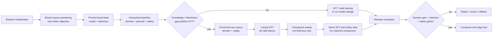
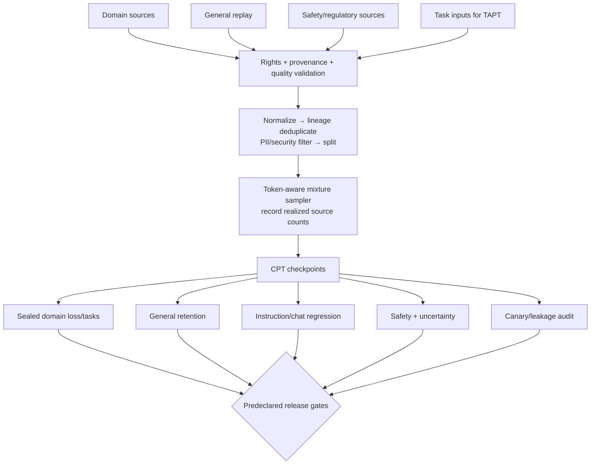

# CH-05: Continued Pretraining and Domain Adaptation

<a id="ch05-purpose"></a>

## 5.1 Purpose and learning outcomes

A pretrained Small Language Model (SLM) may speak fluent general English yet assign poor probabilities to `P0301`, _QT <!-- markdownlint-disable-line MD013 MD049 -->
prolongation_, _Varroa destructor_, or _spindle runout_. Continued pretraining can reduce that mismatch by exposing the <!-- markdownlint-disable-line MD013 MD049 -->
model to raw specialist text under its language-modeling objective. It can also waste compute, memorize restricted
documents, contaminate evaluation, erase useful general behavior, or make an instruction model behave like a document
completer.

This chapter treats continued pretraining as a controlled intervention, not a mandatory pipeline stage. After completing
it, the reader should be able to:

1. distinguish continued pretraining (CPT), domain-adaptive pretraining (DAPT), task-adaptive pretraining (TAPT),
   supervised fine-tuning (SFT), and domain-specific pretraining from scratch;
2. explain how raw next-token training changes a pretrained model and why knowledge acquisition is not answer-format
   learning;
3. choose a base or instruction checkpoint and defend the recovery plan for instruction behavior;
4. construct domain/general mixtures, replay policies, leakage-resistant splits, and tokenizer ablations;
5. select a learning-rate search and checkpoint-evaluation protocol without assuming that lower training loss means a
   better assistant;
6. measure domain fit, task quality, safety, and general-capability retention separately;
7. recognize when CPT is justified, inconclusive, wasteful, or harmful; and
8. design automotive, pharmacy, beekeeping, and industrial-repair experiments compatible with a no-runtime-RAG product.

The chapter follows one decision chain: diagnose a real distribution gap, choose an objective and checkpoint, construct
a governed mixture, train conservatively, and keep the change only if held-out domain gains survive retention and safety
gates. Continued pretraining is optional; “do not run it” is a valid engineering conclusion.

<a id="ch05-decision-first"></a>

## 5.2 The decision before the training

The problem is distribution mismatch. Let \(P_0(x)\) denote the broad pretraining distribution, \(P_D(x)\) a
target-domain distribution, and \(P_T(x)\) the input distribution of a particular downstream task. A model trained
mostly on \(P_0\) may tokenize, represent, and predict \(P_D\) poorly. The practical question is not merely whether the
distributions differ; it is whether updating parameters on available domain text produces enough **held-out product
value** to justify compute, governance, and regression risk.

Use CPT only after an untouched checkpoint has been evaluated:

1. define the product task and hazards;
2. measure domain perplexity, terminology handling, factual/task performance, safety, and general retention;
3. diagnose whether the gap is knowledge, response behavior, freshness, or all three;
4. audit data rights, quality, and independence;
5. compare SFT-only with CPT-plus-the-same-SFT; and
6. reject CPT if gains are absent, unsafe, contaminated, or outweighed by regressions.

<a id="tbl-ch05-01"></a> **TBL-CH05-01 — Training objectives and what they can reasonably teach (`ILLUSTRATIVE`).**

<!-- markdownlint-disable MD013 -->
| Intervention             | Typical starting point         | Data                              | Loss-bearing tokens                               | Primary learning pressure                      | It does **not** guarantee            |
| ------------------------ | ------------------------------ | --------------------------------- | ------------------------------------------------- | ---------------------------------------------- | ------------------------------------ |
| Pretraining from scratch | Random weights                 | Very large broad or domain corpus | Nearly all valid tokens                           | Language, representations, corpus regularities | Instruction following, truth, safety |
| CPT                      | Existing pretrained checkpoint | New raw/semi-structured corpus    | Nearly all valid tokens                           | Continue the original LM objective             | Useful task behavior                 |
| DAPT                     | Existing checkpoint            | Broad corpus from target domain   | Nearly all valid tokens                           | Domain vocabulary, register, regularities      | Target-task optimality               |
| TAPT                     | Existing checkpoint            | Unlabeled inputs from target task | Nearly all valid tokens                           | Narrow task-input distribution                 | Correct labels or outputs            |
| SFT                      | Base or adapted checkpoint     | Input-output demonstrations       | Usually assistant/output tokens, policy-dependent | Response behavior and mappings                 | Broad domain acquisition             |
| Preference/safety tuning | Usually SFT checkpoint         | Comparisons or feedback           | Method-dependent                                  | Preferred behavior                             | Factual completeness                 |
<!-- markdownlint-restore -->

Terminology is inconsistent in the literature: **continued**, **continuous**, and **continual** pretraining are
sometimes used interchangeably. Here, **CPT** means an additional language-model training phase. **Continual
pretraining** is reserved for sequential updates where retention across time or domains is explicit.

<a id="ch05-definitions"></a>

## 5.3 CPT, DAPT, TAPT, and domain-specific language models

### 5.3.1 Continued pretraining

For a decoder-only model with parameters \(\theta_0\), CPT resumes next-token optimization on corpus \(D_C\):

<a id="eq-ch05-01"></a> \[ \boxed{ \theta_C=\arg\min_\theta -\frac{1}{N_C}\sum_{x\in D_C}\sum_{t\in\mathcal V(x)} \log
p_\theta(x_t\mid x_{<t}) } \tag{EQ-CH05-01} \]

\(\mathcal V(x)\) is the set of valid, non-padding target positions and \(N_C\) their count. Unlike SFT with
assistant-only masking, ordinary causal CPT learns from headings, prose, tables converted to text, warnings, references,
and every other retained token. The model is not told which sentences are answers or which statements are
safety-critical.

For masked language models, the same concept uses the original masked-token objective. The influential DAPT/TAPT study
used RoBERTa and downstream classification, so its findings should not be silently generalized to every decoder-only
chat SLM [R1].

### 5.3.2 DAPT and TAPT

**DAPT** continues pretraining on an unlabeled corpus representative of a domain: biomedical articles, automotive
service literature, apiculture extension documents, or industrial maintenance reports. The corpus should cover more than
one final task.

**TAPT** continues pretraining on the unlabeled text of a specific task distribution. For an automotive symptom-to-cause
classifier, TAPT might use symptom narratives after removing labels. For pharmacy interaction screening, it might use
intended input text, never held-out answers.

Gururangan et al. evaluated four domains and eight classification tasks and reported that DAPT improved downstream
results, while TAPT could add gains after DAPT; data-selected task augmentation was useful where a large domain corpus
was unavailable [R1]. **Evidence: PAPER-REPORTED.** This establishes that adaptive pretraining can help under studied
conditions, not that it always helps generative SLMs.

### 5.3.3 Domain-specific language modeling

A **domain-specific language model** is optimized and evaluated for a defined domain distribution. It can be produced by
pretraining from scratch, DAPT from a broad base, CPT followed by SFT and safety tuning, parameter-efficient adaptation,
or a multi-domain mixture.

BioBERT initialized BERT from general-domain weights and continued pretraining on PubMed abstracts and PMC full text
[R2]. SciBERT trained from scratch on scientific papers and studied an in-domain vocabulary [R3]. PubMedBERT reported
that from-scratch biomedical pretraining outperformed mixed-domain/continued-pretraining alternatives in its studied
BLURB setting [R4]. **Evidence: PAPER-REPORTED.** These encoder-model findings show that both continuation and
from-scratch strategies can be rational; they do not establish a universal ordering for decoder-only SLMs.

<a id="fig-04"></a> **FIG-04 — Pretraining versus continued pretraining versus SFT (`ILLUSTRATIVE`).**  
_Alt text:_ Random initialization leads to broad-corpus pretraining; a broad base checkpoint may instead continue on a <!-- markdownlint-disable-line MD013 MD049 -->
governed domain/general mixture; either a base or adapted checkpoint may undergo supervised instruction tuning, with
matched evaluation and forgetting checks before compression. Not measured; arrows show conceptual relationships only.



**Provenance:** author-created synthesis. No quality or cost ordering is implied.

<a id="ch05-mechanism"></a>

## 5.4 What changes inside the model

CPT updates embeddings, attention projections, feed-forward layers, normalizations, and output projection unless some
are frozen. Repeated specialist contexts alter the probability landscape:

- fragments around `P0301` become predictive of misfire-related text;
- _warfarin_ co-occurs with monitoring, interactions, and bleeding-risk language; <!-- markdownlint-disable-line MD013 MD049 -->
- _capped brood_ and _mite count_ acquire apiculture-specific neighborhoods; <!-- markdownlint-disable-line MD013 MD049 -->
- alarm codes become associated with machine states and maintenance procedures.

This is distributed statistical adaptation, not insertion into a database. The resulting model may fail to recall a
trained fact, merge contradictory revisions, reproduce a passage, or emit an obsolete procedure. Under the
[no-runtime-RAG standard](../../00-governance/no-runtime-rag-standard.md), no document is fetched at inference to repair
these limitations. Release engineering therefore needs narrow scope, versioned weights, uncertainty behavior, current
external ground truth during evaluation, and human escalation for consequential output.

Gradient updates also affect shared features. If a corpus repeatedly uses terse maintenance fragments, the model can
improve on those fragments while worsening on general prose or instruction boundaries. Smaller models have less spare
capacity, but capacity alone does not predict forgetting; diversity, optimizer state, learning rate, token count, and
checkpoint choice matter.

<a id="ch05-raw-vs-instruction"></a>

## 5.5 Raw documents are not instruction data

**Raw domain document**

```text
Fault P0301 indicates a misfire detected in cylinder 1.
Before replacing components, inspect freeze-frame data and verify ignition,
fuel delivery, compression, wiring, and applicable manufacturer procedures.
```

In CPT, the model predicts every next token. It can learn terminology, co-occurrence, exposition, and procedural order.
It is not trained to answer a user, ask for missing evidence, refuse unsafe work, or cite uncertainty.

**Instruction example**

<!-- markdownlint-disable MD013 -->
```json
{
  "messages": [
    { "role": "user", "content": "P0301 appeared. Should I replace the injector?" },
    {
      "role": "assistant",
      "content": "Not from the code alone. P0301 identifies a cylinder-1 misfire, not its cause. Preserve freeze-frame data, check applicable service information, and test ignition, fuel, compression, and wiring before replacement. Stop if the flashing warning or symptoms indicate catalyst-damaging operation."
    }
  ]
}
```
<!-- markdownlint-restore -->

SFT can teach the answer pattern, caveat, ordering, and escalation. A few demonstrations may not supply enough varied
exposure for robust domain representations.

<a id="tbl-ch05-02"></a> **TBL-CH05-02 — Raw-document CPT versus conversational SFT (`ILLUSTRATIVE`).**

<!-- markdownlint-disable MD013 -->
| Dimension           | Raw-document CPT                                 | Conversational SFT                                |
| ------------------- | ------------------------------------------------ | ------------------------------------------------- |
| Unit                | Document/chunk/packed stream                     | Prompt-response or multi-turn record              |
| Objective           | Original LM objective                            | Conditional response loss, often assistant-only   |
| Typical supervision | Self-supervised token identity                   | Curated desired behavior                          |
| Best suited to      | Terminology, register, broad corpus regularities | Formatting, dialogue, tasks, uncertainty, refusal |
| Common failure      | Document completion, memorization, forgetting    | Fluent templates without deep coverage            |
| Safety              | Learns warnings only as text patterns            | Can explicitly train escalation/refusal           |
| Evaluation          | Held-out loss plus transfer                      | Task, human, safety, calibration                  |
<!-- markdownlint-restore -->

Knowledge and formatting are not cleanly separable—both phases alter parameters—but the distinction is operationally
useful. A model that knows why a machine must be verified de-energized but gives an unsafe step order has a behavior
problem. A model that produces an elegant interaction warning without knowing the interaction has a knowledge problem.

Evaluate the CPT checkpoint using completion/probing, then apply **the same SFT data and training budget** to baseline
and CPT arms. If CPT-plus-SFT improves only style metrics already improved by SFT, the knowledge-acquisition claim is
weak.

<a id="ch05-domain-shift"></a>

## 5.6 Domain shift is multidimensional

“Domain” can shift lexically, syntactically, semantically, structurally, by task, over time, across regions, and by
source institution. _Queen_, _bearing_, and _interaction_ illustrate specialist meanings; terse work orders differ <!-- markdownlint-disable-line MD013 MD049 -->
structurally from explanatory prose; regulations and component procedures change with revision and jurisdiction.

Estimate shift before training with tokenizer fertility, term coverage, n-gram or embedding-distribution diagnostics,
source composition, baseline held-out loss, and expert error analysis. These identify hypotheses, not proof that CPT
will help.

_Adaptation Odyssey_ reported that additional pretraining worsened same-domain perplexity for some domains, particularly <!-- markdownlint-disable-line MD013 MD049 -->
those similar to original pretraining data, and token analysis implicated special tokens in part of the degradation
[R5]. **PAPER-REPORTED.** A study of raw-domain DAPT for generative models reported downstream fine-tuning gains but
prompting regressions in several studied settings [R6]. **PAPER-REPORTED.** “More in-domain text” is not monotonic
evidence of improvement.

<a id="ch05-base-instruction"></a>

## 5.7 Continue a base checkpoint or an instruction checkpoint?

### 5.7.1 Base checkpoint: default experimental starting point

A base checkpoint's objective matches raw causal CPT. It offers no chat behavior to overwrite, clearer interpretation of
domain-loss changes, and the clean sequence `base → CPT → SFT → optional preference/safety tuning`. Costs are that
instruction following, templates, refusal behavior, and product tone must be added or restored. If the released
instruction model's post-training data is unavailable, recreating comparable behavior may be difficult.

### 5.7.2 Instruction checkpoint: possible but high-risk

An instruction checkpoint encodes post-training behavior. Raw CPT changes probabilities implementing role boundaries,
end-of-turn behavior, concise answers, refusal, and format conventions. Some behavior may survive a small update or
replay, but preservation must be measured.

Current Gemma documentation recommends starting raw-text CPT from a base checkpoint and applying chat/instruction tuning
afterward; it warns that continuing an instruction checkpoint can overwrite turn-ending behavior in that documented
workflow [R7]. **DOC-VERIFIED, not runtime-reproduced.** Research comparing CPT and instruction tuning reports that
ordering and balance affect instruction following [R8]. **PAPER-REPORTED.**

If only an instruction checkpoint is available:

1. freeze the original checkpoint and tokenizer;
2. create template, stop-token, refusal, format, and multi-turn regression tests;
3. test raw-only, raw-plus-instruction replay, and smaller-update variants;
4. evaluate intermediate checkpoints;
5. plan recovery SFT with rights to the data; and
6. reject adaptation if restored behavior cannot match the original safety envelope.

Putting raw documents into chat JSON does not solve the objective mismatch. What matters is which tokens receive loss
and which conditional distribution is trained.

<a id="ch05-mixtures"></a>

## 5.8 Domain mixtures and general-data replay

Let domains \(D_1,\ldots,D_K\) have sampling weights \(w_k\ge0\), \(\sum_k w_k=1\):

<a id="eq-ch05-02"></a> \[ \boxed{\mathcal L_{\text{mix}}(\theta)=\sum_{k=1}^{K}w_k\, \mathbb E_{x\sim
D_k}\left[\mathcal L_{\mathrm{LM}}(x;\theta)\right]} \tag{EQ-CH05-02} \]

Weights are token-sampling probabilities, not necessarily raw corpus fractions. A 10-million-token safety corpus mixed
naturally with 990 million manual tokens gets about 1% of updates. Upsampling increases exposure but also duplication
and memorization.

Separate core domain documents, high-authority safety/regulatory text, diverse general replay, optional
neighboring-domain data, TAPT inputs, and evaluation. Evaluation must never enter training.

With replay fraction \(\rho\):

<a id="eq-ch05-03"></a> \[ \boxed{\mathcal L=(1-\rho)\mathcal L_D+\rho\mathcal L_G} \tag{EQ-CH05-03} \]

\(\mathcal L_D\) is domain loss and \(\mathcal L_G\) general replay loss. Increasing \(\rho\) can reduce forgetting but
spends updates away from the domain; no ratio is universal.

Ibrahim et al. studied continual pretraining at scales through 10B parameters and reported that learning-rate
re-warming/re-decay plus replay could match retraining baselines in tested shifts; even low replay reduced forgetting in
those experiments [R9]. **PAPER-REPORTED.** This supports replay as an ablation, not a fixed recipe.

Replay quality matters. A web sample may preserve web style but not mathematics, multilingual ability, code,
instructions, or safety. If original pretraining data is unavailable, construct a licensed proxy and state its gaps. For
an instruction checkpoint, raw general replay alone may not preserve instruction behavior; include a governed
instruction-replay arm.

Mixture procedure:

1. define capability strata to retain;
2. deduplicate within and across sources;
3. cap single-source and repeated-template influence;
4. select token-level weights;
5. log realized token counts by source;
6. compare domain-only and multiple replay weights at equal update tokens; and
7. evaluate domain gain and retention together.

<a id="fig-ch05-02"></a> **FIG-CH05-02 — Mixture, training, and release gates (`ILLUSTRATIVE`).**  
_Alt text:_ Licensed domain, general replay, safety, and optional task-input streams are independently cleaned and <!-- markdownlint-disable-line MD013 MD049 -->
decontaminated, sampled into CPT, and evaluated against sealed suites.



<a id="ch05-forgetting"></a>

## 5.9 Preserving capabilities and mitigating forgetting

**Catastrophic forgetting** is a substantial loss of previously acquired performance after learning new data. It can
appear as higher general perplexity, worse reasoning/language scores, broken chat control, or loss on earlier domains.
An average can hide a critical regression.

Mitigation families are:

1. replay of representative old/general data;
2. smaller updates through lower LR, fewer tokens, early stopping, freezing, or adapters;
3. regularization toward source parameters, logits, or representations;
4. distillation/rehearsal on retention prompts;
5. adapters or domain isolation;
6. checkpoint selection and rollback; and
7. re-SFT/post-training to restore answer behavior.

Each has failure modes. Replay needs lawful data and compute; regularization can block useful learning; distillation
preserves represented behavior and errors; adapters may lack capacity or complicate mobile deployment; re-SFT does not
prove general retention.

Ke et al. propose soft masking for sequential DAPT [R10]. Jin et al. report effective retention from distillation-based
methods in research-paper and tweet streams [R11]. **PAPER-REPORTED.** Compare these with replay and smaller updates
before accepting added complexity.

For a higher-is-better metric \(m_j\), relative retention is:

<a id="eq-ch05-04"></a> \[ \boxed{ R_j=\frac{m_j(\theta_C)-m_j(\theta_0)} {\max(|m_j(\theta_0)|,\epsilon)} }
\tag{EQ-CH05-04} \]

If exact match falls from 60% to 57%, \(R=-0.05\), a 5% relative drop. **ILLUSTRATIVE.** Reverse sign or report a ratio
for losses. Do not average a severe contraindication regression with easy style wins; enforce per-gate floors.

<a id="ch05-tokenizer"></a>

## 5.10 Tokenizer adaptation

The pretrained tokenizer defines IDs, embedding rows, output rows, chat controls, and runtime assumptions. Keeping it
unchanged is the lowest-risk baseline. Fragmentation is inconvenient, not automatically fatal.

Audit held-out general/domain text for tokens per character/word/document, curated-term fragmentation, truncation,
fallback/round-trip behavior, matrix cost, and target runtime support.

Add tokens only if fertility and downstream ablation justify it:

1. append IDs without reassigning old IDs;
2. resize input embeddings and LM head, respecting weight tying;
3. initialize new rows using a declared method;
4. train new rows sufficiently, optionally embedding-only first;
5. continue full-model training if needed; and
6. validate old-token logits, special IDs, export, and edge runtime.

Changing vocabulary by \(V_{\text{new}}\) rows at width \(d\) adds \(V_{\text{new}}d\) parameters when weights are tied
and up to twice that when untied. For 2,000 tokens and \(d=2{,}048\), a tied matrix adds 4,096,000 parameters, about
7.81 MiB at two bytes/parameter before metadata. **ILLUSTRATIVE.**

SciBERT evaluated general and scientific vocabularies [R3]. PubMedBERT argued that in-domain vocabulary was one benefit
of from-scratch biomedical pretraining [R4]. Recent work proposes continued BPE training and reports better tokenization
efficiency than naïve extension in tested languages [R12]. **PAPER-REPORTED.** Efficiency is not downstream quality;
success was language-dependent.

Never replace a tokenizer without remapping/training embeddings. Equal strings do not imply equal IDs, and new rows have
no learned semantics. Tokenizer changes may also block edge conversion.

<a id="ch05-learning-rate"></a>

## 5.11 Learning rate, optimizer state, and duration

CPT begins near a useful solution. A from-scratch learning rate can destroy it; too small a rate can waste compute.
Exact ranges are model-, optimizer-, batch-, precision-, and data-dependent, so there is no universal number.

Use a logarithmic conservative pilot sweep justified by the original recipe or official continuation guidance. Hold
token budget and effective batch constant. Restart each candidate from the immutable source; reinitialize optimizer
unless continuation state is intentionally available; warm up; evaluate intermediate token counts; monitor domain and
replay loss separately; and stop on non-finite loss, repeated spikes, sharp retention loss, or safety regression.

Re-warming can help adaptation and increase forgetting. Ibrahim et al. study re-warming/re-decay with replay [R9]; Gupta
et al. study re-warming continual pretraining [R13]. **PAPER-REPORTED.** Their schedules are evidence, not transferable
constants.

Record update tokens, unique source tokens, repetitions, and realized mixture counts. A small corpus repeated ten times
and a large one-pass corpus can have equal processed tokens but different memorization risk.

<a id="ch05-perplexity"></a>

## 5.12 Domain perplexity: useful and narrow

For \(N\) held-out tokens:

<a id="eq-ch05-05"></a> \[ \boxed{ \mathrm{PPL}_D= \exp\left( -\frac{1}{N}\sum_{i=1}^{N}\log p_\theta(x_i\mid x_{<i}) <!-- markdownlint-disable-line MD013 MD049 -->
\right) } \tag{EQ-CH05-05} \]

If loss falls from 2.30 to 2.10 nats/token, perplexity falls from about 9.97 to 8.17, an 18.1% relative reduction.
**ILLUSTRATIVE.** This means better average prediction on that corpus, not 18.1% better factuality.

Comparisons require identical tokenizer, token stream, boundaries, context, stride, masking, and aggregation. With a
changed tokenizer, token PPL is generally not directly comparable; report byte/character-normalized cross-entropy where
appropriate and prioritize shared downstream tests.

PPL may improve through boilerplate, worsen while a task improves, or improve while prompting/safety regress. Stratify
loss by source, authority, terminology, structure, safety, time, region, and special tokens. The token analysis in [R5]
warns that aggregate PPL can hide special-token effects.

<a id="ch05-checkpoints"></a>

## 5.13 Checkpoint evaluation and selection

Save by processed token count; never select only the final or lowest-training-loss checkpoint.

<a id="tbl-ch05-03"></a> **TBL-CH05-03 — Minimum checkpoint scorecard. (`PLANNED EXPERIMENT`)**

| Axis                 | Example measures                                         | Decision role                  |
| -------------------- | -------------------------------------------------------- | ------------------------------ |
| Optimization         | Domain/replay validation NLL, gradient norm, loss spikes | Detect instability/overfit     |
| Domain language      | Same-tokenizer PPL; term completion; document strata     | Distribution fit               |
| Domain tasks         | Exact match/F1/rubric scores; expert review              | Product utility                |
| Knowledge            | Paraphrased probes; compositional cases                  | Separate recall from templates |
| Instruction behavior | Role following, format, multi-turn, stop behavior        | Detect raw-CPT regression      |
| General retention    | Pinned broad suite by capability                         | Forgetting gate                |
| Safety               | Hazard recognition, abstention, escalation               | Hard release gate              |
| Memorization/privacy | canary exposure, verbatim continuation, PII probes       | Governance gate                |
| Deployment           | Artifact size, conversion, peak RAM, TTFT/decode later   | Edge feasibility               |

Use fixed prompts/decoding, declared seeds, paired comparisons, uncertainty intervals, and blind expert review. Keep
development data for selection and a final test opened only afterward.

Constrained selection is:

<a id="eq-ch05-06"></a> \[ \boxed{ \theta^\star=\arg\max_{\theta\in\mathcal C}Q_D(\theta) \quad\text{s.t.}\quad
R_j(\theta)\ge\tau_j,\; S_h(\theta)\ge\sigma_h } \tag{EQ-CH05-06} \]

\(Q_D\) is domain utility; \(R_j\) retention; \(S_h\) safety; and \(\tau_j,\sigma_h\) predeclared floors. Weighted
averages are inappropriate when one catastrophic hazard can be hidden by easy wins.

<a id="ch05-contamination"></a>

## 5.14 Contamination, memorization, and split design

Training contamination occurs when evaluation content, answers, or semantic equivalents enter training or selection.
Technical manuals are mirrored, quoted, revised, and converted into synthetic Q&A.

Controls:

1. create evaluation first when feasible and seal hashes/IDs;
2. split by lineage, product/model family, organization, time, and revision;
3. normalize and exact/near-deduplicate before chunking;
4. search for phrases, answers, tables, and semantic equivalents;
5. trace synthetic examples to facts and benchmark exposure;
6. keep prompts/answers out of training repositories;
7. report removed overlap and residual uncertainty; and
8. use fresh expert-authored and time-forward tests.

Yang et al. show paraphrase and translation can evade string decontamination and report missed overlap in studied
corpora [R14]. **PAPER-REPORTED.** N-gram filtering is necessary but insufficient.

Memorization risk rises with rare strings, duplication, repetition, and sensitive text. Use synthetic—not real secret or
personal—canaries under approval. Contamination also includes obsolete manuals, unsafe anecdotes, OCR errors, poisoning,
prompt-like text, and conflicting regulations. Preserve source authority and metadata.

<a id="ch05-domains"></a>

## 5.15 Four domain designs

These are `PLANNED EXPERIMENT` designs, not results.

### 5.15.1 Automotive mechanic model

**Scope:** component theory, terminology, safe test sequencing, symptom interpretation, and generic standards. Never
infer replacement from a trouble code alone.

**Raw corpus:** lawfully usable standards/tutorials, authorized service information, electrical theory, emissions
explanations, workflows, and expert-reviewed narratives. Preserve family, model year, market, engine, transmission,
revision, units, and safety category.

**Risks:** one marque dominates; copied code lists create false volume; obsolete procedures conflict; forum anecdotes
teach parts-swapping. Sample by system and authority, not document count.

**TAPT:** unlabeled intended intake narratives, split by vehicle family/time, without labels.

**Evaluation:** lineage-separated PPL; code/symptom/cause distinctions; measurement-first diagnosis; unit/wiring
terminology; high-voltage, fuel, lifting, rotating and hot-surface escalation; general language/arithmetic retention.

Compare baseline+SFT, CPT+same SFT, replay variants, and TAPT+same SFT. Candidate replay percentages are experimental
variables, not recommendations.

### 5.15.2 Pharmacy knowledge model

**Scope:** educational terminology, pharmacology concepts, label interpretation, interaction-risk recognition, and
escalation. Not autonomous prescribing, dispensing, or patient-specific dosing.

**Raw corpus:** legally usable authoritative labeling and public regulatory/biomedical sources whose terms permit use.
Attach jurisdiction, date, type, drug, formulation, route, population, and supersession metadata. Public access is not a
training license.

**Risks:** statements differ by formulation, route, country, age, pregnancy status, and revision. Abstracts are not
approved labels. Duplicate common-drug labels can swamp rare severe risks.

**Evaluation:** date-specific label facts; contraindications/interactions; drug/formulation/route/jurisdiction
disambiguation; refusal of prescribing; escalation with missing patient factors; time-forward tests;
privacy/memorization.

Lower PPL is not a release criterion. One severe contraindication regression can block release.

### 5.15.3 Beekeeping model

**Scope:** biology, inspection concepts, seasonal management, pest/disease recognition, and region-aware escalation.

**Raw corpus:** extension publications, lawfully usable research/education, permitted association material, approved
treatment labels, and expert records. Retain species, climate, season, region, hive type, disease status, and date.

**Risks:** a small corpus invites memorization; local climate/legal advice may not transfer; hobbyist repetition can
swamp rare disease/pesticide hazards.

Start with SFT-only and unchanged tokenizer because a base may know common terms. Run DAPT only if fertility, loss, and
expert error analysis reveal a gap. Evaluate differentiation of swarming, queenlessness, starvation, brood disease, and
mites; requests for region/season/evidence; escalation; treatment legality uncertainty; and general retention.

### 5.15.4 Industrial repair model

**Scope:** maintenance concepts, alarm interpretation, structured troubleshooting, and safe escalation for bounded
equipment families.

**Raw corpus:** licensed OEM manuals, layout-checked schematics, failure analyses, de-identified and authorized work
orders, standards, and safety procedures. Preserve model, firmware, serial range, site conditions, alarm version, and
supersession.

**Risks:** `E17` differs across controllers; site workarounds conflict with OEM procedure; notes contain unsafe
shortcuts. Separate observations, verified root causes, and actions.

**Evaluation:** machine/version binding; alarm-versus-cause distinction; measurement before replacement; lockout/tagout,
stored energy, pressure, heat, guarding; refusal to bypass interlocks; novel model/alarm combinations.

Separate adapters may improve family isolation but add selection and validation. One model reduces duplicate storage but
can increase cross-family interference. Measure both.

<a id="ch05-usefulness"></a>

## 5.16 When CPT helps, wastes compute, or harms

<a id="tbl-ch05-04"></a> **TBL-CH05-04 — CPT decision signals. (`STATICALLY REVIEWED`)**

<!-- markdownlint-disable MD013 -->
| Outcome                   | Evidence pattern                                                                                  | Response                          |
| ------------------------- | ------------------------------------------------------------------------------------------------- | --------------------------------- |
| Worth a pilot             | Large lawful corpus; clear baseline gap; poor terminology/context modeling; broad exposure needed | Run controlled CPT/SFT comparison |
| TAPT may suffice          | Task inputs differ; broad knowledge is adequate                                                   | Test TAPT first                   |
| SFT is targeted           | Knowledge probes pass; failures concern format/dialogue/refusal                                   | Use governed SFT                  |
| From scratch merits study | Abundant domain text, severe language/tokenizer mismatch, sufficient compute                      | Compare with CPT as high-cost arm |
| Likely waste              | Tiny repetitive corpus; no baseline gap/evaluation; data exists without a product hypothesis      | Skip or fix evaluation            |
| Likely harm               | Unlicensed/conflicting data; no recovery set; high LR; no retention/safety review                 | Do not train/release              |
<!-- markdownlint-restore -->

CPT is plausible when lawful domain text is abundant, diverse, authoritative, underrepresented, and relevant to many
tasks. It wastes compute when the base already fits, the corpus is tiny/repetitive, SFT is the missing intervention,
evaluation is contaminated, a classifier is better, or parameter storage cannot meet freshness/exactness needs.

It harms when updates overwrite behavior, domain-only training causes forgetting, low-authority data is learned,
sensitive passages are memorized, tokenizer changes break compatibility, lower PPL is mistaken for diagnosis, or
incompatible regions/products are blended.

The correct experimental result can be **“do not use CPT.”**

<a id="ch05-implementation"></a>

## 5.17 Implementation patterns

Use Python, PyTorch, Transformers, Datasets, and Accelerate in a tested lockfile. The implementation should accept the
checkpoint ID, immutable revision, train/validation manifests, output directory, learning-rate candidate, token budget,
warmup, precision, and batch settings as command-line inputs; do not hard-code blank template values.

The minimum causal-CPT loop is:

1. load the approved base model and matching tokenizer with remote code disabled unless separately reviewed;
2. verify model, tokenizer, license, and dataset hashes;
3. insert reviewed end-of-document boundaries and pack without losing source IDs;
4. sample domain, general replay, and safety streams by token weight;
5. copy non-padding input IDs to labels for causal language modeling;
6. train to a fixed **token** budget while logging realized tokens by source;
7. evaluate and save at token-aligned intervals;
8. test exact resume state; and
9. run sealed domain, retention, instruction, safety, and memorization suites before promotion.

`DataCollatorForLanguageModeling(tokenizer=tokenizer, mlm=False)` provides the basic causal labels in the documented
Transformers workflow [R15, R16], but a production collator still needs reviewed packing, document boundaries, and
source accounting. A plain `truncation=True` pipeline silently discards suffixes and is unsuitable as the final data
path.

Record each checkpoint in a machine-readable run manifest containing source and artifact hashes, update and unique-token
counts, realized mixture weights, optimizer/scheduler state, environment lock, hardware, driver/runtime, seeds, all
scorecard results, and the release decision. Reject incomplete manifests rather than storing empty result objects.

Expected implementation failures include out-of-memory errors, tokenizer mismatch, non-finite loss, missing document
boundaries, source-weight drift across workers, contaminated validation data, and inconsistent resume state. Exercise
the failure path on a small pilot before committing the full token budget.

<a id="ch05-experimental-design"></a>

## 5.18 Experimental design and ablations

**Question:** Does raw-domain CPT improve the final specialist assistant beyond SFT alone at acceptable retention,
safety, and compute?

**Arms:** untouched base; base→shared SFT; base→domain-only CPT→shared SFT; base→domain+replay CPT→shared SFT;
base→TAPT→shared SFT; instruction→raw CPT→recovery SFT if relevant; tokenizer expansion→CPT→shared SFT if justified; and
a non-generative baseline where applicable.

All CPT mixture arms use equal update tokens. All post-CPT arms receive identical SFT data, template, budget, search
policy, and evaluation.

Required ablations:

1. no CPT versus CPT;
2. domain-only versus at least two replay weights;
3. low/medium LR candidates;
4. early/intermediate/final checkpoints;
5. unchanged tokenizer versus expansion when justified;
6. base-CPT-SFT versus instruction-CPT-recovery if both matter;
7. DAPT versus TAPT;
8. raw versus equal-token instruction-shaped data;
9. all-data versus high-authority/source-balanced mixture; and
10. full versus adapter/selective update if resources motivate it.

Pin revisions, manifests, preprocessing, length, token budget, batch, optimizer, schedules, seeds, hardware, lockfile,
SFT, decoding, and prompts. Report absolute scores, paired differences, uncertainty, stratified errors, selection
multiplicity, failed-run compute, and recovery cost. Do not draw measured graphs before results exist.

<a id="ch05-governance"></a>

## 5.19 Data governance, licensing, privacy, and safety

Every record needs source URI/ID, owner, license or contract basis, acquisition date, permitted uses, redistribution
limits, version/supersession, transformations, review, split, and withdrawal policy.

- Access is not permission to train or redistribute derived weights.
- Remove or lawfully govern patient, customer, employee, owner, and technician identifiers.
- Proprietary manuals and site procedures may prohibit training/distribution.
- Treat files/parsers as untrusted; scan for poisoning and anomalous repetition.
- Prefer regulatory/OEM/expert-reviewed authority; preserve provenance.
- Encode effective/superseded status and use time-split tests.
- Define hazards, prohibited actions, uncertainty, escalation, incident response, and rollback before release.

Pharmacy and hazardous repair require qualified expert review. An SLM must not autonomously prescribe, approve a repair,
bypass an interlock, or assert equipment is safe. Fluency is not verification.

<a id="ch05-edge"></a>

## 5.20 Edge and mobile implications

With unchanged architecture/tokenizer, CPT does not change parameter count or inference graph and does not inherently
make an SLM faster or smaller. Better domain fit might let a smaller checkpoint pass quality gates, but this needs
matched evidence.

Vocabulary expansion enlarges matrices and artifacts; adapters add storage/loading/routing; merged models simplify
runtime but reduce isolation; long-document CPT does not remove KV limits; technical answers may be longer; and post-CPT
quantization may disproportionately affect rare terms.

No-runtime-RAG removes retrieval storage and supports offline independence, but sacrifices runtime provenance and
fresh-document lookup. Revision-sensitive releases need a stated knowledge cutoff, source snapshot, model hash,
jurisdiction/product scope, and verification requirements.

<a id="ch05-summary"></a>

## 5.21 Chapter summary

- CPT resumes a language-model objective; DAPT uses broad domain text and TAPT uses unlabeled target-task inputs.
- Raw documents teach predictive regularities, not guaranteed knowledge, dialogue, refusal, or safe formatting.
- Base checkpoints are the clean default; instruction checkpoints require preservation and recovery tests.
- Mixtures are token-sampling policies. Replay can mitigate forgetting, but ratios are empirical.
- Preserve the tokenizer unless measured fragmentation justifies an expansion ablation.
- Learning rate and update tokens control adaptation and damage; evaluate intermediate checkpoints.
- Domain PPL measures fixed-tokenizer predictive fit, not factuality or safety.
- Select checkpoints on domain, retention, instruction, safety, privacy, contamination, and deployment gates.
- Split by lineage, product, time, and revision; string decontamination misses semantic overlap.
- “Skip CPT” is a valid result.
- CPT itself does not improve edge latency or memory.

<a id="ch05-review"></a>

## 5.22 Review questions

1. Define CPT, DAPT, and TAPT with one dataset each.
2. Why do encoder/classification findings not prove generative-assistant gains?
3. Which tokens normally bear causal CPT loss?
4. Why can raw CPT improve knowledge probes while reducing prompting?
5. Distinguish knowledge acquisition from answer formatting.
6. When is a base checkpoint preferable?
7. What must be tested for instruction-checkpoint CPT?
8. Explain token weights versus corpus fractions.
9. How does replay help and what does it cost?
10. Why can lower domain PPL fail to improve utility?
11. Why are PPLs under different tokenizers incomparable?
12. What evidence justifies vocabulary expansion?
13. Why must new token rows be trained?
14. Give four dimensions of domain shift.
15. Why use constrained release gates?
16. How do random chunk splits contaminate evaluation?
17. Give one high-severity gate for each example domain.
18. Give three cases where CPT wastes compute.
19. Why does CPT not inherently improve mobile latency?
20. What would justify rejecting CPT despite lower loss?

<a id="ch05-exercises"></a>

## 5.23 Engineering exercises

1. **Baseline gap audit:** create lineage-separated fertility, loss, terminology, task, safety, and retention results;
   write a go/no-go memo.
2. **Mixture calculator:** compute configured/realized weights, unique exposure, repetitions, and per-source updates.
3. **Replay ablation:** design domain-only and two equal-token replay arms with floors, LR candidates, checkpoints,
   seeds, and stopping criteria.
4. **Tokenizer decision:** audit 200 terms and held-out documents; compare fertility, parameters, round trip,
   compatibility, and downstream design.
5. **Knowledge versus format:** pair completions, probes, questions, and safety conversations across base, CPT, SFT,
   CPT+SFT.
6. **Contamination red team:** trace exact, revised, translated, paraphrased, and synthetic variants; document filter
   misses.
7. **Safety case:** write intended use, misuse, hazards, expert review, release gates, update, and rollback.
8. **Edge handoff:** calculate tokenizer/adapter bytes and design quantized terminology, safety, RAM, TTFT, decode,
   energy, and thermal tests.

Only work with manifests, code, hashes, and raw outputs may be labeled `EXECUTED`; otherwise use `PLANNED EXPERIMENT`,
`ILLUSTRATIVE`, or `ESTIMATE`.

<a id="ch05-references"></a>

## 5.24 Research references and source notes

“Reported” means the authors reported the result; this project has not reproduced it. Access/check date: 2026-11-23.

1. **[R1] Gururangan, Suchin et al. (2020).** “Don't Stop Pretraining: Adapt Language Models to Domains and Tasks.” _ACL <!-- markdownlint-disable-line MD013 MD049 -->
   2020_. DOI: [10.18653/v1/2020.acl-main.740](https://doi.org/10.18653/v1/2020.acl-main.740); <!-- markdownlint-disable-line MD013 MD049 -->
   [ACL](https://aclanthology.org/2020.acl-main.740/); [code](https://github.com/allenai/dont-stop-pretraining).
   DAPT/TAPT across four domains/eight classification tasks. Limitation: RoBERTa encoder/classification setting.
   **PAPER-REPORTED.**
2. **[R2] Lee, Jinhyuk et al. (2020).** “BioBERT.” _Bioinformatics_ 36(4). DOI: <!-- markdownlint-disable-line MD013 MD049 -->
   [10.1093/bioinformatics/btz682](https://doi.org/10.1093/bioinformatics/btz682);
   [full text](https://pmc.ncbi.nlm.nih.gov/articles/PMC7703786/); [code](https://github.com/dmis-lab/biobert).
   Continued BERT on PubMed/PMC. **PAPER-REPORTED.**
3. **[R3] Beltagy, Iz; Lo, Kyle; Cohan, Arman (2019).** “SciBERT.” _EMNLP-IJCNLP_. DOI: <!-- markdownlint-disable-line MD013 MD049 -->
   [10.18653/v1/D19-1371](https://doi.org/10.18653/v1/D19-1371); [ACL](https://aclanthology.org/D19-1371/);
   [code](https://github.com/allenai/scibert). Scientific from-scratch BERT/vocabulary study. **PAPER-REPORTED.**
4. **[R4] Gu, Yu et al. (2021).** “Domain-Specific Language Model Pretraining for Biomedical Natural Language
   Processing.” _ACM TCH_ 3(1). DOI: [10.1145/3458754](https://doi.org/10.1145/3458754); <!-- markdownlint-disable-line MD013 MD049 -->
   [arXiv:2007.15779](https://arxiv.org/abs/2007.15779). PubMedBERT/BLURB; encoder-specific. **PAPER-REPORTED.**
5. **[R5] Yıldız, Çağatay et al. (2024).** “Adaptation Odyssey in LLMs.” _EMNLP 2024_. DOI: <!-- markdownlint-disable-line MD013 MD049 -->
   [10.18653/v1/2024.emnlp-main.1108](https://doi.org/10.18653/v1/2024.emnlp-main.1108);
   [ACL](https://aclanthology.org/2024.emnlp-main.1108/). Failure cases, similarity, token effects. **PAPER-REPORTED.**
6. **[R6] Cheng, Daixuan; Huang, Shaohan; Wei, Furu (2024).** “Adapting Large Language Models to Domains via Reading
   Comprehension.” _ICLR 2024_. [arXiv:2309.09530](https://arxiv.org/abs/2309.09530); <!-- markdownlint-disable-line MD013 MD049 -->
   [official repository](https://github.com/microsoft/LMOps). Reports prompting/fine-tuning tension. **PAPER-REPORTED.**
7. **[R7] Google DeepMind (2026).** “Continued pre-training with Gemma 4.”
   [Official documentation](https://gemma.ai/tuning/continued-pretraining/). Product-specific, time-sensitive base-first
   guidance. **DOC-VERIFIED; not executed.**
8. **[R8] Jindal, Ishan et al. (2024).** “Balancing Continuous Pre-Training and Instruction Fine-Tuning: Optimizing
   Instruction-Following in LLMs.” [arXiv:2410.10739](https://arxiv.org/abs/2410.10739). Ordering/balance study; treated
   as preprint. **PAPER-REPORTED.**
9. **[R9] Ibrahim, Adam et al. (2024).** “Simple and Scalable Strategies to Continually Pre-train Large Language
   Models.” [arXiv:2403.08763](https://arxiv.org/abs/2403.08763). LR re-warming/re-decay and replay. **PAPER-REPORTED.**
10. **[R10] Ke, Zixuan et al. (2023).** “Continual Pre-training of Language Models.” _ICLR 2023_. <!-- markdownlint-disable-line MD013 MD049 -->
    [OpenReview](https://openreview.net/forum?id=m_GDIItaI3o); [arXiv:2302.03241](https://arxiv.org/abs/2302.03241).
    Sequential DAPT soft masking. **PAPER-REPORTED.**
11. **[R11] Jin, Xisen et al. (2022).** “Lifelong Pretraining.” _NAACL 2022_. DOI: <!-- markdownlint-disable-line MD013 MD049 -->
    [10.18653/v1/2022.naacl-main.37](https://doi.org/10.18653/v1/2022.naacl-main.37);
    [ACL](https://aclanthology.org/2022.naacl-main.37/). Temporal/domain retention. **PAPER-REPORTED.**
12. **[R12] Purason, Taido et al. (2026).** “Teaching Old Tokenizers New Words.” _Findings of EACL 2026_. DOI: <!-- markdownlint-disable-line MD013 MD049 -->
    [10.18653/v1/2026.findings-eacl.341](https://doi.org/10.18653/v1/2026.findings-eacl.341);
    [arXiv:2512.03989](https://arxiv.org/abs/2512.03989). Continued BPE; efficiency is not quality. **PAPER-REPORTED.**
13. **[R13] Gupta, Kshitij et al. (2023).** “How to (re)warm your model?”
    [arXiv:2308.04014](https://arxiv.org/abs/2308.04014). LR re-warming; treated as preprint. **PAPER-REPORTED.**
14. **[R14] Yang, Shuo et al. (2024).** “Rethinking Benchmark and Contamination for Language Models with Rephrased
    Samples.” [arXiv:2311.04850](https://arxiv.org/abs/2311.04850);
    [code](https://github.com/lm-sys/llm-decontaminator). Surface decontamination limitations. **PAPER-REPORTED.**
15. **[R15] Hugging Face.** “Causal language modeling.”
    [Transformers documentation](https://huggingface.co/docs/transformers/en/tasks/language_modeling), checked
    2026-11-23. **DOC-VERIFIED; not executed.**
16. **[R16] Hugging Face.** “Data collator.”
    [Transformers API](https://huggingface.co/docs/transformers/main_classes/data_collator), checked 2026-11-23.
    **DOC-VERIFIED; not executed.**

<a id="ch05-verification"></a>

## 5.25 End notes

The mixture, perplexity, retention, and vocabulary calculations are teaching examples rather than recommended settings.
No CPT run, tokenizer experiment, conversion, or device test was performed for this chapter. Before implementation,
recheck current APIs, exact checkpoint and license terms, data rights, and target hardware; then retain execution
records and qualified domain-safety review.

## Cross-links

- [Part II index](README.md)
- [CH-04: Pretraining Fundamentals](ch-04-pretraining-fundamentals.md)
- [CH-06: Supervised Fine-Tuning](ch-06-supervised-fine-tuning.md)
- [CH-05 assessment](../../13-assessments/ch-05-assessment.md)
- [Evidence standard](../../00-governance/evidence-and-citation-standard.md)
- [Reproducibility standard](../../00-governance/reproducibility-standard.md)
- [Safety standard](../../00-governance/safety-and-risk-standard.md)
- [No-runtime-RAG standard](../../00-governance/no-runtime-rag-standard.md)
