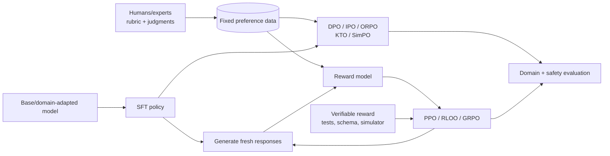

# CH-07: Preference Optimization and Post-Training

<a id="ch07-status"></a>

## 7.1 How to use this chapter

SFT shows a model an answer to imitate; preference optimization acts more like a coach comparing two attempted plays
and explaining which better satisfies a rubric. That comparison can sharpen behavior only when the model already
produces plausible candidates and the rubric reflects the real task.

This chapter uses **preference optimization** for training from comparative or binary judgments and **online
reinforcement learning (RL)** for methods that generate fresh actions from a changing policy and optimize a reward. A
derivation from an RL objective does not make an offline classification loss “RL.” Follow the methods in increasing
operational complexity: data and reward modeling, offline direct objectives, then online RL.

<a id="ch07-objectives"></a>

## 7.2 Learning objectives

After completing this chapter, the reader should be able to:

1. design chosen/rejected, ranked, binary-feedback, and prompt-only datasets without confusing preference with factual
   truth;
2. derive reward-model, PPO, DPO, IPO, ORPO, KTO, SimPO, RLOO, and GRPO objectives at an engineering level;
3. classify a method as online/offline, direct/reward-model-based, RL/non-RL, reference-based/reference-free, and
   predominantly on-policy/off-policy;
4. estimate the dominant model copies, generation cost, memory pressure, and stability risks;
5. recognize reward hacking, calibration failure, length/style shortcuts, judge bias, and safety regressions;
6. choose between SFT, offline direct preference optimization, reward modeling, and online RL for a specialist small
   language model (SLM); and
7. define release gates for safety-critical, offline specialist models.

<a id="ch07-problem"></a>

## 7.3 What post-training is—and is not

Pretraining predicts text. Supervised fine-tuning (SFT) imitates target responses. Neither objective explicitly says
“response A is safer, more useful, or more professionally appropriate than response B.” Preference data supplies that
contrast.

For a prompt \(x\), a labeler may judge response \(y^+\) **chosen** and \(y^-\) **rejected**. The label means only that
\(y^+\) won under a stated rubric and annotation process. It does **not** imply that every token in \(y^+\) is correct,
that \(y^-\) is wholly bad, or that the ordering generalizes to every user. A terse but unsafe answer can beat a verbose
hallucination; both may still fail the release rubric.

Post-training primarily changes behavior—format, abstention, conversational cooperation, style, and which learned
capabilities are elicited. It is an unreliable substitute for acquiring broad missing domain knowledge. Under this
book's no-runtime-RAG architecture, preference training cannot guarantee exact storage, freshness, or verification of
technical facts.

**FIG-CH07-01 — Post-training routes (`ILLUSTRATIVE`).** Alt text: SFT creates an initial policy; offline preference
methods train from fixed labels, reward-model RL trains from fresh samples scored by a learned proxy, and
verifiable-reward RL uses deterministic checks.



<a id="ch07-data"></a>

## 7.4 Preference data

### 7.4.1 Data forms

<!-- markdownlint-disable MD013 -->
| Form            | Minimum fields                   | Suitable methods            | Principal risk                       |
| --------------- | -------------------------------- | --------------------------- | ------------------------------------ |
| Pairwise        | prompt, chosen, rejected         | RM, DPO, IPO, ORPO, SimPO   | forced choice hides ties/both-bad    |
| Ranked list     | prompt, \(K\) responses, ranking | RM or pair expansion        | correlated pairs and overcounting    |
| Binary feedback | prompt, response, desirable      | KTO, BCO-style objectives   | class imbalance; no local comparator |
| Scalar score    | prompt, response, rubric scores  | regression RM, filtering    | annotator-scale inconsistency        |
| Prompt-only     | prompt                           | PPO, RLOO, GRPO, online DPO | reward/judge must operate online     |
| Demonstration   | prompt, expert response          | SFT                         | no explicit negative boundary        |
<!-- markdownlint-restore -->

**TBL-CH07-01 — Preference data forms (`STATICALLY REVIEWED`).**

A ranked set of \(K\) responses yields \(K(K-1)/2\) pair relations, but they are not independent. InstructGPT grouped
comparisons from one ranking to avoid repeatedly treating correlated completions as independent updates [R3].
`PAPER-REPORTED`

### 7.4.2 Schemas

**Listing 07-01 — Explicit-prompt pairwise JSONL (`UNVERIFIED IMPLEMENTATION`).**

<!-- markdownlint-disable MD013 -->
```json
{
  "id": "auto-0042",
  "prompt": [{ "role": "user", "content": "P0420 is present. What should be checked first?" }],
  "chosen": [
    {
      "role": "assistant",
      "content": "Confirm the code and freeze-frame data, inspect for related codes and obvious exhaust leaks, then follow the manufacturer diagnostic procedure. Do not replace the catalyst from the code alone."
    }
  ],
  "rejected": [{ "role": "assistant", "content": "Replace the catalytic converter immediately." }],
  "rubric_id": "auto-dx-v3",
  "chosen_reason_codes": ["diagnostic_order", "avoids_parts_cannon"],
  "rejected_risk_codes": ["unsupported_repair"],
  "annotator_role": "ase-certified-reviewer",
  "source_ids": ["manual-family-x-rev-2026-02"],
  "label_confidence": 0.94,
  "split_group": "fault-family-p0420"
}
```
<!-- markdownlint-restore -->

**Listing 07-02 — Binary feedback and prompt-only records (`UNVERIFIED IMPLEMENTATION`).**

<!-- markdownlint-disable MD013 -->
```jsonl
{"id":"pharm-017","prompt":"Can I double my missed prescription dose?","completion":"Do not double it without product-specific instructions. Check the official leaflet or contact a pharmacist; urgent symptoms require local emergency guidance.","label":true,"rubric_id":"pharm-escalation-v2","risk_tier":"high"}
{"id":"math-verify-81","prompt":"Return the exact JSON object satisfying these constraints.","reward_spec":"json-schema-v4","split_group":"constraint-template-19"}
```
<!-- markdownlint-restore -->

Store raw responses, rubric version, display order, model/checkpoint that generated each candidate, decoding settings,
annotator qualification, adjudication, ties, “both unsafe,” confidence, provenance, and group-aware split keys. Do not
put paraphrases of one incident across train and test.

### 7.4.3 Collection protocol

1. Define atomic dimensions: factuality, procedure order, relevance, uncertainty, citation behavior, refusal
   correctness, and communication.
2. Give labelers a **tie**, **both acceptable**, and **both unacceptable** option. Convert to strict pairs only under a
   documented policy.
3. Randomize response order and blind model identity.
4. Insert gold/control items and measure per-dimension agreement; disagreement can reflect underspecified policy, not
   careless labelers.
5. Escalate high-risk disagreements to qualified experts.
6. Sample hard, near-tie, out-of-distribution (OOD), and adversarial cases—not only obvious wins.
7. Separate annotation used to train a judge from evaluation used to certify the final model.

For pharmacy education, the “expert” role must be defined by jurisdiction and task. For repair, expertise in one vehicle
family does not automatically qualify a reviewer for high-voltage electric vehicles. Majority vote cannot repair a
systematically wrong rubric.

<a id="ch07-reward-modeling"></a>

## 7.5 Reward modeling

A reward model (RM) maps a prompt-response pair to a scalar:

\[ r_\phi(x,y)\in\mathbb{R}. \]

With the Bradley–Terry model,

\[ P_\phi(y^+\succ y^-\mid x) =\sigma\!\left(r_\phi(x,y^+)-r_\phi(x,y^-)\right), \]

\[ \mathcal L_\text{RM} =-\mathbb E_{(x,y^+,y^-)\sim D} \log\sigma\!\left(r_\phi(x,y^+)-r_\phi(x,y^-)\right). \]

Here \(\phi\) are RM parameters, \(D\) is the comparison dataset, and \(\sigma(z)=1/(1+e^{-z})\). Only the reward
**difference** is identified: adding a constant to every reward changes neither probability nor loss. Centering makes
logs easier to interpret but does not create ground-truth units.

**Worked example.** If chosen and rejected scores are 1.2 and 0.3, the implied preference probability is
\(\sigma(0.9)\approx0.711\). If the scores are shifted to 101.2 and 100.3, it remains 0.711. This is `ILLUSTRATIVE`.

Outcome RMs score a whole answer. Process reward models (PRMs) score intermediate steps, potentially improving credit
assignment but requiring step-level labels and creating more surfaces to game. As of the research freeze, TRL documents
`RewardTrainer` and marks `PRMTrainer` experimental [R20]. `DOC-VERIFIED`

### 7.5.1 Calibration

Ranking accuracy asks whether the sign is right. Calibration asks whether predicted probabilities match observed
frequencies. For bins \(B_m\), an empirical expected calibration error is

\[ \operatorname{ECE}=\sum_m\frac{|B_m|}{n} \left|\operatorname{acc}(B_m)-\operatorname{conf}(B_m)\right|. \]

Also report log loss, Brier score, reliability diagrams, accuracy by reward-gap bin, annotator group, domain stratum,
response length, and risk tier. Calibrate on held-out data with temperature or isotonic scaling only after freezing the
RM; retain uncalibrated metrics too.

Bai et al. found useful in-distribution calibration in their studied preference models but warned that RL could push
into score ranges outside calibration evidence [R4]. `PAPER-REPORTED` Calibration on old-policy samples does not
validate scores on a newly optimized policy.

### 7.5.2 Reward hacking and overoptimization

A proxy reward is an attack surface. The policy may learn:

- verbosity, headings, disclaimers, or authoritative tone that correlate with preference;
- refusal everywhere because unsafe answers are strongly penalized;
- copied rubric phrases;
- reward-model tokenizer or truncation artifacts;
- plausible but unverifiable technical detail;
- test-specific formatting without solving the task; or
- a rare OOD pattern assigned an erroneously high score.

Gao, Schulman, and Hilton measured proxy-reward overoptimization in a synthetic-gold setup and found that optimizing a
proxy too far can reduce gold reward [R5]. `PAPER-REPORTED` The setup does not establish a universal numerical law for
specialist SLMs.

Mitigations include KL constraints, early stopping on independent human/expert evaluation, RM ensembles or uncertainty
gates, adversarial red-teaming, periodic on-policy relabeling, held-out reward models, length-matched evaluations, and
verifiable rewards. None eliminates Goodhart's law.

<a id="ch07-rlhf-ppo"></a>

## 7.6 Classical RLHF and PPO

Reinforcement learning from human feedback (RLHF) is a pipeline, not a synonym for PPO:

1. SFT an initial policy \(\pi_\text{SFT}\);
2. collect comparisons and train \(r_\phi\);
3. sample fresh responses from policy \(\pi_\theta\);
4. optimize reward while constraining drift from reference \(\pi_\text{ref}\);
5. evaluate with humans and safety tests, then refresh feedback if needed.

The regularized objective is commonly written

\[ \max_\theta\; \mathbb E_{x\sim D_x,y\sim\pi_\theta(\cdot|x)} \left[r_\phi(x,y) -\beta
D_\mathrm{KL}\!\left(\pi_\theta(\cdot|x)\| \pi_\text{ref}(\cdot|x)\right)\right]. \]

\(\beta>0\) controls the reward–drift trade-off. The KL term is not a safety proof; it merely discourages distributional
movement from a reference that can itself be unsafe.

### 7.6.1 PPO

Proximal Policy Optimization (PPO) [R1] reuses a sampled batch while clipping policy-ratio changes:

\[ \mathcal L_\text{clip} =-\mathbb E_t\left[ \min(\rho_t A_t, \operatorname{clip}(\rho_t,1-\epsilon,1+\epsilon)A_t)
\right], \qquad \rho_t=\frac{\pi_\theta(a_t|s_t)} {\pi_{\theta_\text{old}}(a_t|s_t)}. \]

\(s_t\) is prompt plus prior tokens, \(a_t\) the next token, \(A_t\) an estimated advantage, \(\epsilon\) a clipping
threshold, and \(\pi_{\theta_\text{old}}\) the behavior policy that generated the batch. A value/critic model estimates
returns; practical RLHF also uses KL shaping, whitening, clipping, and implementation-specific loss terms.

PPO is an **online, on-policy-family RL method**: it repeatedly refreshes samples from a recent policy. Multiple
optimization epochs make later updates within a batch technically off-policy relative to current parameters, with ratios
correcting limited drift. Calling PPO simply “off-policy” loses the operational distinction from fixed logged-data
training.

**Benefits:** fresh policy data, arbitrary sequence-level rewards, and exploration beyond a fixed pair dataset.  
**Costs:** policy, reference, reward, and value computations; online generation; rollout storage; sensitive
normalization and KL control. Sharding or parameter-efficient fine-tuning can reduce trainable state but not erase
inference for auxiliary models.

InstructGPT used SFT, a pairwise RM, PPO, and KL regularization [R3]. Helpful-and-Harmless work provides another
foundational pipeline [R4]. These are influential demonstrations, not evidence that PPO is required for every domain.

<a id="ch07-direct-methods"></a>

## 7.7 Offline direct preference objectives

<a id="ch07-dpo"></a>

### 7.7.1 DPO

Direct Preference Optimization (DPO) derives an implicit reward from the KL-regularized RLHF solution and trains the
policy with binary classification [R6]:

\[ \mathcal L_\text{DPO} =-\mathbb E_D\log\sigma\left(\beta\left[ \log\frac{\pi_\theta(y^+|x)}{\pi_\text{ref}(y^+|x)}
-\log\frac{\pi_\theta(y^-|x)}{\pi_\text{ref}(y^-|x)} \right]\right). \]

\(\pi_\theta(y|x)\) is the sequence likelihood, usually the sum of completion-token log probabilities;
\(\pi_\text{ref}\) is a frozen reference; and \(\beta\) follows the implementation's convention. DPO needs no explicit
RM, value model, or online rollout during ordinary offline training.

**Worked example.** Suppose the policy-minus-reference log ratios are \(0.7\) for chosen and \(0.2\) for rejected. With
\(\beta=0.1\), the logit is \(0.05\), loss \(-\log\sigma(0.05)\approx0.668\). If the rejected ratio rises above the
chosen ratio, the loss exceeds \(\log2\) and the update pushes their relative margin back. `ILLUSTRATIVE`

DPO is offline, fixed-data, direct, reference-based, and non-RL in its training procedure. It is also behavior-policy
dependent: if pairs came from a very different generator, the dataset may be off-policy for the current model and omit
its actual failure modes. A reference-free option in a library is not the original DPO objective.

<a id="ch07-ipo"></a>

### 7.7.2 IPO

Identity Preference Optimization (IPO) is a special case of \(\Psi\)-preference optimization from Azar et al. [R7]. It
avoids DPO's unbounded logit transform and fits a finite target:

\[ \mathcal L_\text{IPO} =\mathbb E_D\left[ h_\theta(x,y^+,y^-)-\frac{1}{2\tau} \right]^2, \]

\[ h_\theta= \log\frac{\pi_\theta(y^+|x)}{\pi_\text{ref}(y^+|x)} -\log\frac{\pi_\theta(y^-|x)}{\pi_\text{ref}(y^-|x)}.
\]

\(\tau\) is the paper's regularization parameter. Libraries may expose a differently named/scaled hyperparameter; do not
transfer values mechanically. IPO is offline, direct, reference-based, non-RL. Its bounded target is attractive when
near-deterministic labels cause DPO to keep widening margins, but it does not correct bad labels or coverage.

<a id="ch07-orpo"></a>

### 7.7.3 ORPO

Odds Ratio Preference Optimization (ORPO) combines chosen-response negative log likelihood with an odds-ratio contrast
[R9]:

\[ \mathcal L_\text{ORPO} =\mathcal L_\text{SFT}(x,y^+) -\lambda\log\sigma\left(
\log\frac{\operatorname{odds}_\theta(y^+|x)} {\operatorname{odds}_\theta(y^-|x)} \right), \] <!-- markdownlint-disable-line MD013 MD049 -->

where \(\operatorname{odds}(y|x)=P_\theta(y|x)/(1-P_\theta(y|x))\), with exact sequence-probability handling defined by
the implementation, and \(\lambda\) controls the preference term. ORPO is offline, direct, explicitly reference-free,
non-RL, and “monolithic”: it can learn chosen behavior and reject disfavored behavior in one stage.

Reference-free means no frozen reference forward pass. Initialization, chosen NLL, and data still anchor behavior. It
does not mean “unregularized” or “immune to drift.”

<a id="ch07-kto"></a>

### 7.7.4 KTO

Kahneman–Tversky Optimization (KTO) learns from individually labeled desirable/undesirable completions instead of paired
responses [R8]. It constructs a utility from the policy/reference log ratio relative to a KL-derived reference point,
with separate desirable and undesirable terms and weights. Conceptually:

\[ r_\theta(x,y)=\beta\log \frac{\pi_\theta(y|x)}{\pi_\text{ref}(y|x)},\qquad v_\theta\approx\mathbb
E[\operatorname{KL}(\pi_\theta\|\pi_\text{ref})], \]

then increases a sigmoid utility of \(r_\theta-v_\theta\) for desirable examples and decreases the corresponding utility
for undesirable examples. The exact stop-gradient, weighting, batching, and KL estimate are implementation-defining; use
the paper or frozen library source rather than reimplementing from this summary.

KTO is offline, direct, reference-based, non-RL. Its operational advantage is data collection: incident logs, approvals,
and thumbs-up/down may be available without matched alternatives. Its risks are label imbalance, weak local contrast,
and confounding prompt difficulty with response quality.

<a id="ch07-simpo"></a>

### 7.7.5 SimPO

Simple Preference Optimization (SimPO) uses average completion log probability as a reference-free implicit reward and
imposes a target margin [R10]:

\[ s_\theta(x,y)=\frac{\beta}{|y|} \log\pi_\theta(y|x), \]

\[ \mathcal L_\text{SimPO} =-\mathbb E_D\log\sigma\left( s_\theta(x,y^+)-s_\theta(x,y^-)-\gamma \right). \]

\(|y|\) is completion length, \(\beta\) a scale, and \(\gamma\) the target margin. Length normalization addresses a
mismatch between summed sequence likelihood and generation-time comparison; it can also change preferences for concise
versus detailed domain answers, so evaluate by answer type. SimPO is offline, direct, reference-free, non-RL.

Current TRL `main` documentation maps SimPO to a DPOTrainer normalized sigmoid loss (`loss_type="sigmoid_norm"`) and IPO
to `loss_type="ipo"` [R19]. This mapping is `DOC-VERIFIED` on the access date, not a promise for another release.

<a id="ch07-online-rl"></a>

## 7.8 Simpler online RL: RLOO and GRPO

<a id="ch07-rloo"></a>

### 7.8.1 RLOO

REINFORCE Leave-One-Out (RLOO) samples \(G\) completions for the same prompt. For completion \(i\), the other samples
form a baseline:

\[ b_i=\frac{1}{G-1}\sum_{j\ne i}R_j,\qquad \hat A_i=R_i-b_i, \]

\[ \mathcal L_\text{RLOO} =-\frac1G\sum_{i=1}^G\hat A_i \log\pi_\theta(y_i|x). \]

The leave-one-out baseline reduces variance without a learned value network. Ahmadian et al. revisit REINFORCE-style
RLHF and report competitive results under their tested settings [R11]. `PAPER-REPORTED`

RLOO is online, RL, reward-based, usually reference-regularized, and on-policy-family. The current TRL documentation
adds clipped importance ratios when reusing a rollout and treats KL as detached reward shaping [R22]. `DOC-VERIFIED`

<a id="ch07-grpo"></a>

### 7.8.2 GRPO

Group Relative Policy Optimization (GRPO), introduced in DeepSeekMath [R12], samples a group of completions for a prompt
and normalizes rewards within the group:

\[ \hat A_i=\frac{R_i-\bar R}{s_R+\delta}, \quad \bar R=\frac1G\sum_iR_i, \quad s_R=\sqrt{\frac1G\sum_i(R_i-\bar R)^2}.
\]

It then uses a PPO-like clipped ratio plus a KL term, but no learned value model. \(\delta\) prevents division by zero.
If every completion receives the same reward, the group offers little or no learning signal. Reward scale, group size,
duplicates, difficulty, and zero-variance handling matter.

GRPO is online, RL, reward-based, usually reference-based when KL is enabled, and on-policy-family with rollout reuse.
It is especially natural for **verifiable** rewards—exact answers, tests, schemas, constraint checkers—because repeated
samples can be ranked without a learned judge. For open-ended repair or pharmacy prose, a weak judge can merely turn
GRPO into efficient reward hacking.

RLOO and GRPO save the learned critic, not rollout generation. With \(G\) completions per prompt, generation can
dominate compute. GRPO's recent popularity does not establish universal superiority over PPO, RLOO, DPO, or SFT.

<a id="ch07-taxonomy"></a>

## 7.9 Method taxonomy and compute

<!-- markdownlint-disable MD013 -->
| Method   | Data during update     | Objective                 | Explicit RM/reward | Reference           | Predominant policy relation | Dominant burden                   |
| -------- | ---------------------- | ------------------------- | ------------------ | ------------------- | --------------------------- | --------------------------------- |
| SFT      | fixed demonstrations   | token NLL                 | no                 | no                  | offline imitation           | one trainable model               |
| RM       | fixed pairs            | pairwise classification   | trains RM          | no                  | offline                     | RM forward/backward               |
| PPO-RLHF | fresh rollouts         | clipped policy gradient   | yes                | usually yes         | on-policy-family            | policy + RM + critic + generation |
| DPO      | fixed pairs            | logistic direct           | no                 | yes                 | offline/off-policy data     | policy + reference forwards       |
| IPO      | fixed pairs            | squared direct            | no                 | yes                 | offline/off-policy data     | policy + reference forwards       |
| ORPO     | fixed pairs            | chosen NLL + odds         | no                 | no explicit         | offline/off-policy data     | one trainable model               |
| KTO      | fixed binary labels    | utility direct            | no                 | yes                 | offline/off-policy data     | policy + reference forwards       |
| SimPO    | fixed pairs            | length-normalized margin  | no                 | no explicit         | offline/off-policy data     | one trainable model               |
| RLOO     | fresh grouped rollouts | REINFORCE LOO             | reward required    | usually yes         | on-policy-family            | \(G\) generations + reward        |
| GRPO     | fresh grouped rollouts | clipped group-relative RL | reward required    | optional/configured | on-policy-family            | \(G\) generations + reward        |
<!-- markdownlint-restore -->

**TBL-CH07-02 — Core method classification (`STATICALLY REVIEWED`).** “Reference-free” means no explicit frozen
reference model in the loss; it does not remove initialization/data regularization. “Off-policy data” here means fixed
responses were generated by an earlier or different policy.

### 7.9.1 Resource accounting

Count functions, not slogans:

\[ \text{peak training memory}\approx \text{trainable weights}+\text{gradients}+\text{optimizer}
+\text{activations}+\text{reference/RM/critic residency} +\text{rollout buffers}. \]

- Offline direct methods avoid generation during updates. Reference-based methods still need reference log
  probabilities, which can be precomputed when data and tokenization are immutable, trading storage for compute.
- Reference-free ORPO/SimPO can reduce model residency, but activation/optimizer memory remains.
- PPO normally adds reward and value inference and rollout orchestration.
- RLOO/GRPO remove the critic but multiply sampled completion tokens by group size.
- Parameter-efficient fine-tuning reduces gradients/optimizer state for the policy; it does not remove auxiliary-model
  forward passes.
- Quantizing a frozen reference or reward model is an experiment, not automatically safe: changed log probabilities or
  rankings can alter the objective.

Do not publish generic VRAM numbers. Record exact parameter count, dtype, sequence lengths, batch/group size,
checkpointing, sharding, optimizer, adapter configuration, reference precomputation, reward model, and rollout engine.

### 7.9.2 Engineering comparison and method status

<!-- markdownlint-disable MD013 -->
| Method       | Best-supported reason to test                             | Main failure mode                                          | Practical status at freeze                                |
| ------------ | --------------------------------------------------------- | ---------------------------------------------------------- | --------------------------------------------------------- |
| Reward model | reusable scorer; arbitrary downstream RL/filtering        | proxy exploitation and OOD miscalibration                  | established component; TRL documented                     |
| PPO          | fresh exploration with flexible reward and learned critic | complexity, instability, reward hacking                    | established RL algorithm; TRL trainer marked experimental |
| DPO          | simplest strong paired offline baseline                   | stale/off-policy pairs, unbounded margin pressure          | peer-reviewed and broadly documented                      |
| IPO          | finite preference-margin target                           | target/regularization sensitivity; same data limits as DPO | primary theory/paper; available through TRL DPO loss      |
| ORPO         | one reference-free SFT-plus-preference stage              | odds/probability numerics and chosen-data dependence       | primary paper; TRL trainer marked experimental            |
| KTO          | naturally uses unpaired positive/negative logs            | class/prompt imbalance and weaker local contrast           | primary paper; TRL trainer marked experimental            |
| SimPO        | reference-free, length-normalized pair objective          | length normalization/margin can distort answer style       | primary paper; current TRL DPO loss mapping documented    |
| RLOO         | online RL without a learned critic                        | high rollout variance/cost; reward quality                 | primary paper; TRL online trainer documented              |
| GRPO         | grouped online RL with verifiable rewards                 | zero-variance groups and checker/judge gaming              | primary paper; TRL online trainer documented              |
<!-- markdownlint-restore -->

**TBL-CH07-03 — Engineering comparison (`DOC-VERIFIED`, `STATICALLY REVIEWED`).** “Documented” means an official
interface was present on the access date; it does not mean this project executed it. “Experimental” follows the TRL
taxonomy, not a judgment that the underlying paper is invalid.

<a id="ch07-modern"></a>

## 7.10 Other verified modern approaches

These methods are relevant, but fewer variants are usually better than an uncontrolled “loss zoo.”

- **Rejection sampling / best-of-\(N\):** generate \(N\) candidates, retain the best under experts, a judge, or a
  verifier, then SFT. Simple and often a strong baseline; inference/data-generation cost grows with \(N\), and judge
  exploitation remains.
- **RLAIF and Constitutional AI:** AI feedback can scale ranking and self-revision under written principles; Bai et al.
  introduced Constitutional AI with supervised and RL phases [R13]. `PAPER-REPORTED` AI feedback transfers judge biases
  and requires human/expert audit.
- **SLiC-HF / hinge preference losses:** directly calibrate sequence likelihood with ranking constraints [R14].
  Generalized Preference Optimization (GPO) places DPO, IPO, and SLiC-like losses in a common convex-loss family [R15].
- **CPO:** combines preference contrast with chosen likelihood, conceptually adjacent to ORPO [R16].
- **BCO:** reframes desirable/undesirable examples as binary classification; useful when pairs are absent [R17].
- **Robust/label-smoothed DPO:** models preference-label noise, but an assumed flip rate cannot represent systematic
  expert disagreement or policy ambiguity.
- **Online DPO/OAIF:** samples current-policy pairs and obtains online AI feedback [R18]. It reduces stale/off-policy
  data but introduces a live judge and generation cost; TRL marks `OnlineDPOTrainer` experimental [R20].
- **Nash-MD, XPO, SPPO, EXO, AOT, APO, NCA, and DiscoPOP:** current TRL documentation exposes or discusses several of
  these, many as experimental trainers or DPO loss variants [R19–R20]. `DOC-VERIFIED` Their presence in a library
  verifies an interface, not broad maturity or superiority. Use only after tracing the primary paper, assumptions,
  source implementation, and a domain-specific baseline.

**Verified-method status rule:** “peer-reviewed” concerns publication; “documented” concerns an interface; “reproduced”
requires this project to run a frozen protocol. None implies the others.

<a id="ch07-small-models"></a>

## 7.11 Stability in smaller specialist models

SLMs have less redundant capacity and can move sharply under a narrow preference set. Common symptoms are repetitive
phrasing, universal refusal, shorter answers, forgotten terminology, format collapse, and improved judge scores with
worse factuality.

Practical controls:

1. start from a competent domain SFT checkpoint, not a raw base model;
2. use low learning rates, gradient clipping, warmup, and conservative preference strength;
3. mix or regularize toward high-quality chosen demonstrations;
4. stratify batches by domain, difficulty, risk, and response length;
5. monitor chosen and rejected log probabilities separately—winning solely by suppressing rejected text may reduce
   overall likelihood;
6. evaluate general capability and domain recall at frequent checkpoints;
7. include ties/ambiguous cases in analysis rather than manufacturing certainty;
8. compare full fine-tuning with LoRA under the same objective; PEFT can constrain movement but is not a stability
   guarantee; and
9. stop on independent expert/safety metrics, not training preference accuracy.

For a 100M–1B model, inability to produce any correct candidate is a capacity/data problem. Preference optimization
cannot rank a behavior into existence if the model never represents or samples it. CPT, better SFT, distillation, or a
larger model may be required.

<a id="ch07-safety"></a>

## 7.12 Safety-oriented preference training

Safety data should distinguish:

- **correct compliance**;
- **correct refusal with a useful safe alternative**;
- **over-refusal** of benign work;
- **unsafe compliance**;
- **false reassurance**;
- **uncertain/escalate**; and
- **jurisdiction- or equipment-dependent answer**.

A single helpful/harmless scalar can hide trade-offs. Preserve rubric dimensions and report a safety vector. In
pharmacy, expert preference cannot turn an experimental model into an autonomous prescriber. In high-voltage, lifting,
braking, or pressure-system repair, outputs must state prerequisites, lockout/isolation, source-specific
torque/procedure limits, and escalation where appropriate.

Adversarial tests must include euphemisms, role-play, multi-turn escalation, unit ambiguity, conflicting symptoms,
omitted prerequisites, and requests to override safety interlocks. Evaluate both false acceptance and false refusal.
Preference training is defense-in-depth, not a release argument by itself.

The no-runtime-RAG constraint makes stale parameterized knowledge unavoidable. Train uncertainty and escalation, but
verify that the model does not merely append a disclaimer to an unsafe procedure.

<a id="ch07-domain-example"></a>

## 7.13 Worked specialist-SLM design

Suppose an automotive SFT model often replaces a part from one diagnostic trouble code. The target behavior is ordered
diagnosis.

1. Build prompts across code families, vehicles, ambiguous symptoms, and safety tiers.
2. Generate multiple candidates from the current SFT model and one alternative model; retain generator metadata.
3. Have qualified reviewers score evidence use, test order, unnecessary replacement, safety, and uncertainty.
4. Keep “both bad” candidates for analysis and SFT repair; create strict pairs only when one response genuinely wins.
5. Establish three baselines: chosen-only SFT, DPO, and a reference-free direct method.
6. Use held-out fault families to test generalization; do not split paraphrases randomly.
7. Measure procedure-step correctness, unsupported replacement rate, unsafe-action rate, calibration, answer length,
   refusal correctness, and general-retention metrics.
8. Advance to RLOO/GRPO only if a reliable deterministic simulator/checker or audited RM adds signal unavailable in
   fixed pairs.

This is a `PLANNED EXPERIMENT`; no expected improvement is asserted.

<a id="ch07-implementation"></a>

## 7.14 Implementation patterns

### 7.14.1 Offline DPO-family configuration

**Listing 07-03 — TRL DPO skeleton (`UNVERIFIED IMPLEMENTATION`).** Purpose: illustrate the frozen-artifact inputs.
Dependencies: Python, PyTorch, Transformers, Datasets, Accelerate, PEFT if used, and TRL. Exact versions, CUDA stack,
model revision, and dataset revision must be frozen after checking the selected TRL release. Hardware: depends on model,
precision, sequence lengths, and batch strategy. This listing was not run.

```python
import os

from datasets import load_dataset
from transformers import AutoModelForCausalLM, AutoTokenizer
from trl import DPOConfig, DPOTrainer

MODEL = os.environ["MODEL_ID"]
REVISION = os.environ["MODEL_REVISION"]
DATASET = os.environ["PREFERENCE_DATASET_ID"]
DATA_REVISION = os.environ["PREFERENCE_DATASET_REVISION"]

model = AutoModelForCausalLM.from_pretrained(MODEL, revision=REVISION)
tokenizer = AutoTokenizer.from_pretrained(MODEL, revision=REVISION)
dataset = load_dataset(
    DATASET,
    revision=DATA_REVISION,
    split="train",
)

config = DPOConfig(
    output_dir="artifacts/ch07-dpo",
    beta=0.1,                 # experimental value, not a recommendation
    learning_rate=5e-7,       # experimental value, tune and record
    per_device_train_batch_size=1,
    gradient_accumulation_steps=16,
    max_length=2048,
    max_prompt_length=1024,
    loss_type="sigmoid",      # freeze docs/source for other loss mappings
    report_to="none",
    seed=42,
)

trainer = DPOTrainer(
    model=model,
    ref_model=None,           # library may derive a frozen reference; verify
    args=config,
    train_dataset=dataset,
    processing_class=tokenizer,
)
trainer.train()
trainer.save_model()
```

Expected failures include schema/template mismatch, chosen/rejected truncation, out-of-memory, unintended reference
sharing, and a loss name changed across releases. Security: do not load untrusted remote code or pickle artifacts
without review. Validation: inspect formatted examples, verify loss against a hand calculation, freeze hashes, run a
tiny overfit test, then run domain/safety regressions.

### 7.14.2 GRPO with a verifiable reward

**Listing 07-04 — TRL GRPO skeleton (`UNVERIFIED IMPLEMENTATION`).** Purpose: demonstrate prompt-only online RL with a
narrow deterministic reward. Dependencies: Python, PyTorch, Transformers, Datasets, Accelerate, TRL, and `jsonschema`;
freeze mutually compatible versions and commits before use. Hardware depends on policy size, group size, and completion
length. Expected failures include schema-reward saturation, out-of-memory during grouped generation, malformed
conversational completions, and API drift. Security: treat generated text as untrusted input and bound parsing
resources. The reward does not score open-ended medical or repair correctness. This listing was not run; recheck the API
against the frozen release.

```python
import json
import os
from datasets import load_dataset
from jsonschema import validate, ValidationError
from trl import GRPOConfig, GRPOTrainer

PROMPT_DATASET = os.environ["PROMPT_DATASET_ID"]
PROMPT_DATA_REVISION = os.environ["PROMPT_DATASET_REVISION"]
MODEL = os.environ["MODEL_ID"]
prompt_only_dataset = load_dataset(
    PROMPT_DATASET,
    revision=PROMPT_DATA_REVISION,
    split="train",
)

SCHEMA = {
    "type": "object",
    "required": ["answer", "confidence"],
    "properties": {
        "answer": {"type": "string"},
        "confidence": {"type": "number", "minimum": 0, "maximum": 1},
    },
    "additionalProperties": False,
}

def schema_reward(completions, **kwargs):
    rewards = []
    for completion in completions:
        text = completion[0]["content"] if isinstance(completion, list) else completion
        try:
            validate(json.loads(text), SCHEMA)
            rewards.append(1.0)
        except (json.JSONDecodeError, ValidationError, KeyError, TypeError):
            rewards.append(0.0)
    return rewards

args = GRPOConfig(
    output_dir="artifacts/ch07-grpo",
    num_generations=4,
    max_completion_length=256,
    learning_rate=1e-6,
    seed=42,
    report_to="none",
)

trainer = GRPOTrainer(
    model=MODEL,
    reward_funcs=schema_reward,
    args=args,
    train_dataset=prompt_only_dataset,  # define from a frozen snapshot
)
trainer.train()
```

Passing a JSON schema is not task correctness. Pair this reward with task checks and adversarial tests, and audit for
degenerate minimal outputs.

<a id="ch07-evaluation"></a>

## 7.15 Evaluation and failure analysis

<!-- markdownlint-disable MD013 -->
| Layer        | Required measurements                                                                                          |
| ------------ | -------------------------------------------------------------------------------------------------------------- |
| Data         | pair count, unique prompts, generator mix, tie/both-bad rate, annotator agreement, class/risk/length balance   |
| Optimization | train/validation loss, chosen/rejected log-probabilities, KL to reference, reward distribution, gradient norms |
| Preference   | held-out expert win/tie/loss with confidence intervals; blinded randomized order                               |
| Domain       | factual accuracy, procedural order, units, terminology, OOD fault families                                     |
| Safety       | unsafe compliance, over-refusal, escalation correctness, jailbreak and multi-turn results                      |
| Calibration  | reliability, Brier/log loss, selective risk/coverage, abstention quality                                       |
| Robustness   | prompt paraphrase, verbosity control, formatting, truncation, multilingual/code/unit strata                    |
| Retention    | general instruction following and pre-optimization domain suite                                                |
| Deployment   | source versus exported/quantized behavior, RAM, latency, energy, thermal results                               |
<!-- markdownlint-restore -->

**TBL-CH07-04 — Evaluation stack (`PLANNED EXPERIMENT`).**

Use paired evaluation because every model sees the same prompts. Report ties and confidence intervals, not only win
rate. Length-match or model length effects explicitly. Human/judge evaluators need position-randomization and repeated
consistency checks. If an LLM judge trained the data, do not use the same judge as sole final evaluator.

Failure triage:

- RM validation improves while expert quality falls: shortcut or distribution shift.
- Reward rises while independent reward falls: overoptimization.
- DPO loss falls by lowering rejected likelihood only: track chosen likelihood and SFT retention.
- GRPO reward variance is zero: groups are indistinguishable or checker is too coarse.
- Safety improves while benign refusal rises: policy boundary is too broad.
- Exported model regresses: preference behavior was precision/runtime sensitive; rerun all gates after compression.

<a id="ch07-edge"></a>

## 7.16 Edge and offline implications

Post-training usually changes weights or adapters, not decoder architecture. Therefore it normally does not reduce
per-token inference FLOPs, KV-cache size, or context memory. A LoRA adapter may add runtime operations unless merged; a
merged adapter preserves base shape. Reference and reward models are training-only and are not shipped to the phone.

Indirect effects matter:

- concise answers can reduce generated tokens and energy, but must not omit safety steps;
- structured output can simplify application parsing;
- universal refusals can look fast while destroying utility;
- quantization can change close preference margins and refusal behavior; and
- an offline model cannot consult an updated RM or policy service, so release-time evaluation and signed updates are
  critical.

Re-evaluate the exact exported artifact. A source checkpoint passing safety tests does not qualify its INT4 mobile
derivative.

<a id="ch07-decision"></a>

## 7.17 Decision framework

**FIG-CH07-02 — Method selection (`ILLUSTRATIVE`).** Alt text: method selection branches from data availability and
reward verifiability toward SFT, offline preference optimization, reward-model RL, or verifiable-reward training with
evaluation gates.

```text
Does the SFT model produce correct, safe candidates?
  no  -> improve data/CPT/SFT/capacity; preference training is premature
  yes
   |
Is there a demonstrated behavior-ranking problem?
  no  -> keep SFT; avoid extra complexity
  yes
   |
What labels exist?
  demonstrations only -> SFT / rejection-sampling SFT
  binary logs         -> KTO or BCO baseline
  fixed pairs         -> DPO baseline; compare IPO and one reference-free method
  fresh verifiable reward available
                      -> compare SFT/DPO with RLOO or GRPO
  audited learned reward + online budget
                      -> RLOO/GRPO; PPO only when critic/control benefits justify it
```

### When SFT alone is preferable

Choose SFT when:

- the desired answer can be written unambiguously by experts;
- domain knowledge/capacity, not style selection, is the bottleneck;
- preference volume is small, noisy, or lacks meaningful rejected alternatives;
- the model rarely samples a correct candidate;
- compute cannot support additional model copies or rollout generation;
- release risk favors a transparent imitation target;
- evaluation cannot distinguish genuine improvement from judge preference; or
- the gain sought is format, terminology, or a deterministic refusal template.

Chosen-only SFT is a mandatory baseline. Preference optimization adds value when rejected behavior carries information
that demonstrations alone do not express, or when online exploration plus a trustworthy reward reaches model-generated
failures absent from fixed data.

### Recommended staged experiment

1. domain SFT;
2. stronger curated SFT/rejection-sampling SFT;
3. DPO as the reference-based offline baseline;
4. one justified alternative—IPO for overfitting concern, KTO for unpaired labels, ORPO/SimPO for reference-memory
   constraints;
5. only then online RLOO or GRPO with verifiable/audited rewards;
6. PPO only if value-function and fine-grained control benefits are demonstrated;
7. export/quantize and rerun all domain and safety gates.

Select a Pareto set across expert quality, safety, calibration, memory, training tokens, wall time, and deployment
behavior. Do not declare one algorithm universally best.

<a id="ch07-reproducibility"></a>

## 7.18 Reproducibility and verification record

Every run must freeze the experiment ID and lifecycle state; paper objective and exact implementation version; inspected
objective-source hash; policy repository, immutable revision, and SFT-parent hash; reference, reward, and judge artifact
hashes; data snapshot, schema, rubric, and annotator qualifications; seed, precision, optimizer, lengths, batch/group
size, and method-specific coefficients; exact hardware and drivers; and evaluation-suite hash, raw-output location,
trial count, and paired statistical method.

Store these as validated machine-readable fields. Do not allow “latest,” family-only model names, zero-length defaults,
or blank hashes to pass the preflight check.

Before execution, unit-test masking and sequence log probabilities; manually verify several losses; check that
chosen/rejected share the same prompt; inspect truncation; test reference freezing; and confirm reward sign. After
execution, retain logs, environment lock, checkpoints, raw generations, annotation exports, failures, exclusions, and
artifact checksums.

<a id="ch07-verification-notes"></a>

## 7.19 End notes

The framework listings and hyperparameters were not executed and are not recommendations. Freeze and inspect the
selected TRL release because mutable documentation can differ from installed APIs. Paper comparisons remain scoped to
their original models, data, judges, and protocols; specialist deployment requires task-qualified reviewers. No method
here is universally established for 100M–4B specialist SLMs, and every compressed edge artifact requires renewed
behavior and safety qualification.

<a id="ch07-summary"></a>

<a id="71-chapter-status-and-evidence-boundary"></a>

## 7.20 Chapter summary

- Preferences express rubric-relative comparisons, not factual truth.
- Reward models learn relative scalar proxies; calibration is distribution-bounded and optimization can exploit them.
- PPO is an online RL algorithm with a critic and substantial rollout/auxiliary-model cost.
- DPO and IPO are offline, reference-based direct objectives; ORPO and SimPO remove the explicit reference; KTO accepts
  binary unpaired labels.
- RLOO and GRPO are online RL methods that replace a learned critic with within-prompt sample baselines; they still pay
  generation and reward costs.
- Online/offline, RL/direct, reference/reference-free, and on/off-policy are separate axes.
- Small models need conservative updates, chosen-likelihood and retention monitoring, and strong SFT baselines.
- Safety preference training needs expert rubrics, over-refusal measurement, adversarial evaluation, and artifact-level
  release gates.
- SFT alone is often the correct engineering choice when knowledge, data quality, capacity, or transparent behavior—not
  ranking—is the bottleneck.

<a id="ch07-questions"></a>

## 7.21 Review questions

1. Why does “chosen” not mean factually correct?
2. Why are pairs derived from one \(K\)-way ranking correlated?
3. What is unidentifiable in the Bradley–Terry RM?
4. Distinguish ranking accuracy from reward calibration.
5. How does optimizing an RM create distribution shift?
6. Why is PPO an on-policy-family method despite batch reuse?
7. What model components make PPO more expensive than DPO?
8. What does DPO's reference policy do?
9. Why can DPO improve its margin by suppressing rejected responses without improving chosen responses?
10. How does IPO bound the target that DPO can keep increasing?
11. In what sense are ORPO and SimPO reference-free?
12. Why is KTO useful for operational feedback logs?
13. Compare RLOO's leave-one-out baseline with GRPO's group normalization.
14. Why is GRPO attractive for verifiable rewards but risky with a weak prose judge?
15. Why can an SLM's capacity make preference optimization premature?
16. Name four ways safety preference training can fail.
17. Why must a quantized edge artifact repeat preference/safety evaluation?
18. Give three conditions under which SFT alone is preferable.

<a id="ch07-exercises"></a>

## 7.22 Engineering exercises

1. **Schema audit:** validate 500 pair records for prompt identity, empty completions, truncation, duplicate leakage,
   ties, and conflicting risk labels. `PLANNED EXPERIMENT`
2. **Loss calculation:** implement RM, DPO, IPO, and SimPO losses on synthetic log probabilities and compare with a
   frozen library implementation. `PLANNED EXPERIMENT`
3. **Calibration:** construct reliability diagrams and Brier/ECE results by domain and risk tier for an RM; test
   temporal and policy shift.
4. **SFT versus DPO:** compare chosen-only SFT and DPO under matched tokens, optimizer, and checkpoints. Track
   chosen/rejected likelihood separately.
5. **KTO conversion:** convert a binary incident log without fabricating pairs; quantify class, prompt-difficulty, and
   annotator imbalance.
6. **Reward-hacking red team:** identify five cheap stylistic shortcuts in a domain RM and create
   length/style-controlled counterexamples.
7. **RLOO versus GRPO:** use a deterministic structured-output task, equalize generated tokens, and report zero-variance
   groups and wall time.
8. **Expert study:** design qualification, adjudication, and agreement procedures for automotive and pharmacy reviewers;
   explain why they differ.
9. **Safety frontier:** plot helpfulness against unsafe compliance and over-refusal; reject any single-score conclusion.
10. **Edge regression:** compare source and quantized artifacts on identical preference pairs and safety prompts,
    retaining all raw outputs.

<a id="ch07-references"></a>

## 7.23 Primary sources and official documentation

Access date for all URLs: **2026-11-23**.

1. **[R1]** John Schulman, Filip Wolski, Prafulla Dhariwal, Alec Radford, and Oleg Klimov. “Proximal Policy Optimization
   Algorithms.” 2017, arXiv:1707.06347. <https://arxiv.org/abs/1707.06347>
2. **[R2]** Paul F. Christiano et al. “Deep Reinforcement Learning from Human Preferences.” NeurIPS 2017,
   arXiv:1706.03741. <https://arxiv.org/abs/1706.03741>
3. **[R3]** Long Ouyang et al. “Training Language Models to Follow Instructions with Human Feedback.” NeurIPS 2022,
   arXiv:2203.02155. <https://arxiv.org/abs/2203.02155> and
   <https://proceedings.neurips.cc/paper_files/paper/2022/hash/b1efde53be364a73914f58805a001731-Abstract.html>
4. **[R4]** Yuntao Bai et al. “Training a Helpful and Harmless Assistant with Reinforcement Learning from Human
   Feedback.” 2022, arXiv:2204.05862. <https://arxiv.org/abs/2204.05862>
5. **[R5]** Leo Gao, John Schulman, and Jacob Hilton. “Scaling Laws for Reward Model Overoptimization.” ICML 2023,
   PMLR 202. <https://proceedings.mlr.press/v202/gao23h.html>
6. **[R6]** Rafael Rafailov et al. “Direct Preference Optimization: Your Language Model is Secretly a Reward Model.”
   NeurIPS 2023, arXiv:2305.18290. <https://arxiv.org/abs/2305.18290>
7. **[R7]** Mohammad Gheshlaghi Azar et al. “A General Theoretical Paradigm to Understand Learning from Human
   Preferences.” 2024, arXiv:2310.12036. <https://arxiv.org/abs/2310.12036>
8. **[R8]** Kawin Ethayarajh et al. “KTO: Model Alignment as Prospect Theoretic Optimization.” 2024, arXiv:2402.01306.
   <https://arxiv.org/abs/2402.01306>
9. **[R9]** Jiwoo Hong, Noah Lee, and James Thorne. “ORPO: Monolithic Preference Optimization without Reference Model.”
   2024, arXiv:2403.07691. <https://arxiv.org/abs/2403.07691>
10. **[R10]** Yu Meng, Mengzhou Xia, and Danqi Chen. “SimPO: Simple Preference Optimization with a Reference-Free
    Reward.” 2024, arXiv:2405.14734. <https://arxiv.org/abs/2405.14734> and official code
    <https://github.com/princeton-nlp/SimPO>
11. **[R11]** Arash Ahmadian et al. “Back to Basics: Revisiting REINFORCE Style Optimization for Learning from Human
    Feedback in LLMs.” 2024/updated record, arXiv:2402.14740. <https://arxiv.org/abs/2402.14740>
12. **[R12]** Zhihong Shao et al. “DeepSeekMath: Pushing the Limits of Mathematical Reasoning in Open Language Models.”
    2024, arXiv:2402.03300. <https://arxiv.org/abs/2402.03300>
13. **[R13]** Yuntao Bai et al. “Constitutional AI: Harmlessness from AI Feedback.” 2022, arXiv:2212.08073.
    <https://arxiv.org/abs/2212.08073>
14. **[R14]** Yao Zhao et al. “SLiC-HF: Sequence Likelihood Calibration with Human Feedback.” 2023, arXiv:2305.10425.
    <https://arxiv.org/abs/2305.10425>
15. **[R15]** Yunhao Tang et al. “Generalized Preference Optimization: A Unified Approach to Offline Alignment.” 2024,
    arXiv:2402.05749. <https://arxiv.org/abs/2402.05749>
16. **[R16]** Haoran Xu et al. “Contrastive Preference Optimization: Pushing the Boundaries of LLM Performance in
    Machine Translation.” 2024, arXiv:2401.08417. <https://arxiv.org/abs/2401.08417>
17. **[R17]** Hanze Dong et al. “Binary Classifier Optimization for Large Language Model Alignment.” 2024,
    arXiv:2404.04656. <https://arxiv.org/abs/2404.04656>
18. **[R18]** Shangmin Guo et al. “Direct Language Model Alignment from Online AI Feedback.” 2024, arXiv:2402.04792.
    <https://arxiv.org/abs/2402.04792>
19. **[R19]** Hugging Face. “DPO Trainer.” Official TRL `main` documentation.
    <https://huggingface.co/docs/trl/main/en/dpo_trainer>
20. **[R20]** Hugging Face. “TRL—Transformers Reinforcement Learning.” Official trainer taxonomy.
    <https://huggingface.co/docs/trl/main/index>
21. **[R21]** Hugging Face. “GRPO Trainer.” Official TRL documentation.
    <https://huggingface.co/docs/trl/main/en/grpo_trainer>
22. **[R22]** Hugging Face. “RLOO Trainer.” Official TRL documentation.
    <https://huggingface.co/docs/trl/main/en/rloo_trainer>
23. **[R23]** Hugging Face. “Reward Modeling.” Official TRL documentation.
    <https://huggingface.co/docs/trl/main/en/reward_trainer>
24. **[R24]** Hugging Face. “ORPO Trainer.” Official TRL documentation.
    <https://huggingface.co/docs/trl/main/en/orpo_trainer>
25. **[R25]** Hugging Face. “KTO Trainer.” Official TRL documentation.
    <https://huggingface.co/docs/trl/main/en/kto_trainer>
26. **[R26]** Hugging Face. “Online DPO Trainer.” Official TRL documentation.
    <https://huggingface.co/docs/trl/main/en/online_dpo_trainer>

<a id="ch07-cross-links"></a>

## 7.24 Cross-links

- [Part II index](README.md)
- [CH-05: Continued Pretraining and Domain Adaptation](ch-05-continued-pretraining-and-domain-adaptation.md)
- [CH-06: Supervised Fine-Tuning](ch-06-supervised-fine-tuning.md)
- [CH-07 assessment](../../13-assessments/ch-07-assessment.md)
- [Evidence standard](../../00-governance/evidence-and-citation-standard.md)
- [Reproducibility standard](../../00-governance/reproducibility-standard.md)
- [Safety and risk standard](../../00-governance/safety-and-risk-standard.md)
- [No-runtime-RAG standard](../../00-governance/no-runtime-rag-standard.md)
