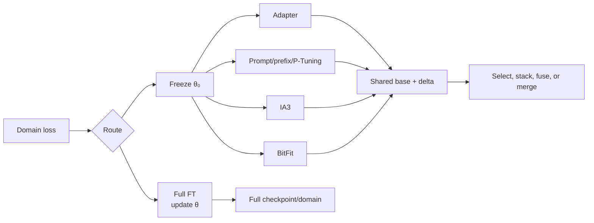
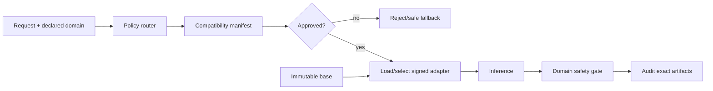

# CH-08: Full Fine-Tuning Versus PEFT

<a id="ch08-status"></a>

## 8.1 Status, purpose, and learning outcomes

**Research freeze:** 2026-11-23. **Status: AUTHORED / NOT EXECUTED.** No model was trained, adapter loaded, merge
performed, or cloud/mobile benchmark run. Listings are `UNVERIFIED IMPLEMENTATION`; arithmetic and diagrams are
`ILLUSTRATIVE` or `ESTIMATE`; cited results are `PAPER-REPORTED`; inspected official interfaces are `DOC-VERIFIED`.

This chapter explains why parameter-efficient fine-tuning (PEFT) emerged; how full fine-tuning, frozen backbones,
bottleneck adapters, prompt tuning, prefix tuning, P-Tuning, IA3, and BitFit work; and how composition and deployment
change the engineering trade-off. Afterward, the reader should be able to derive parameter/memory estimates, distinguish
training efficiency from artifact and runtime efficiency, design multi-adapter deployment, and select methods under
quality, VRAM, storage, time, domain, and edge constraints.

“Adapter” is overloaded. **Bottleneck adapter** means an inserted residual module. **PEFT adapter artifact** means any
task-specific state package, including prompts and IA3 vectors. Stacking, learned fusion, parameter merging, and merging
into the base are distinct.

<a id="ch08-why"></a>

## 8.2 Why PEFT emerged

Full fine-tuning is flexible but scales poorly across tasks:

1. gradients and optimizer moments scale with the whole model;
2. every domain normally creates another full checkpoint; and
3. updating shared weights can regress unrelated domains.

PEFT asks whether a small task-specific state can steer a shared frozen pretrained backbone. Houlsby et al. proposed
compact per-task adapters [R1]; later methods learned input prompts, layerwise prefixes, selected biases, or activation
scales [R2–R7]. This made experiments and multi-domain lifecycle management more accessible. It did **not** make the
backbone tiny, guarantee full-tuning quality, or solve stale and unsafe knowledge.

<a id="fig-ch08-01"></a> **FIG-CH08-01 — Full tuning and frozen-backbone adaptation (`ILLUSTRATIVE`).**  
_Alt text:_ Full tuning updates all weights and saves a full checkpoint; PEFT backpropagates through a frozen backbone <!-- markdownlint-disable-line MD013 MD049 -->
but saves a small task component.



<a id="ch08-accounting"></a>

## 8.3 Common mathematics and accounting

For pretrained parameters $\theta_0$, total count $N$, task data $D$, and loss $\mathcal L$, full tuning solves:

<a id="eq-ch08-01"></a>
$$
\boxed{\theta^\star=\arg\min_\theta\mathcal L(D;\theta),\quad N_{\rm train}=N}
\tag{EQ-CH08-01}
$$

PEFT introduces or selects $\phi$:

<a id="eq-ch08-02"></a>
$$
\boxed{\phi^\star=\arg\min_\phi\mathcal L(D;f(x;\theta_0,\phi)),
\quad\nabla_{\theta_0}\mathcal L=0,\quad|\phi|\ll N} \tag{EQ-CH08-02}
$$

Frozen means no optimizer update to $\theta_0$. Derivatives may still propagate through operations using $\theta_0$
to reach $\phi$.

With bytes $b_w$ for a frozen weight and $b_t$ for each trainable parameter plus gradient/master/moments:

<a id="eq-ch08-03"></a>
$$
\boxed{M_{\rm full}\approx Nb_t,\qquad M_{\rm PEFT}\approx(N-|\phi|)b_w+|\phi|b_t}
\tag{EQ-CH08-03}
$$

A simplified mixed-precision Adam layout may use about 16 bytes/trainable parameter, while a frozen BF16 weight uses 2.
For $N=1$ billion, full trainable state is about 14.90 GiB; frozen weights are 1.86 GiB; one million trainable adapter
parameters add about 15.26 MiB of 16-byte state (`ESTIMATE`). Peak memory is larger:

$$
M_{\rm peak}=M_{\rm state}+M_{\rm activations}+M_{\rm temporary} +M_{\rm communication}+M_{\rm allocator}.
$$

Freezing removes most weight-gradient and optimizer state, not backbone forward FLOPs or all activations.

<a id="tbl-ch08-01"></a> **TBL-CH08-01 — “Efficiency” is not one quantity (`STATICALLY REVIEWED`).**

| Quantity                 | PEFT effect                     | Incorrect inference                           |
| ------------------------ | ------------------------------- | --------------------------------------------- |
| Trainable parameters     | Usually much lower              | “The model now has only this many parameters” |
| Peak training VRAM       | Often lower; activations remain | “1% trainable means 1% VRAM”                  |
| Incremental task storage | Usually much lower              | “A merged model remains adapter-sized”        |
| Runtime RAM              | Base still resides              | “Tiny adapter means tiny phone RAM”           |
| Runtime speed            | Method/backend-dependent        | “Faster training means faster decoding”       |

Each major method below follows: problem, intuition, definition, mechanism, example/equation, implementation,
strengths/weaknesses/resources, alternatives, domain/edge use, and evidence.

### A learner-first decision walkthrough

Consider a 1B-parameter BF16 base that must support 20 independently updated repair domains. The first question is not
“Which PEFT acronym is best?” but “What must change, and what must remain operationally independent?”

1. **Establish the gap.** If the base already recognizes the terminology but answers in the wrong format, begin with
   prompt tuning, IA3, or BitFit. If it lacks broad domain behavior, test a bottleneck adapter or LoRA against full
   fine-tuning. If it lacks the underlying knowledge, PEFT alone may be the wrong intervention; Chapter 5's continued
   pretraining question comes first.
2. **Account for state.** Full tuning gives every parameter an optimizer state. A 10M-parameter adapter trains only 1%
   of a 1B model, but the complete 1B backbone still participates in forward and backward passes. The useful claim is
   “optimizer and gradient state fell,” not “training now uses 1% of the memory.”
3. **Trace one tensor.** With a bottleneck adapter, a hidden vector of width 2,048 is projected to 64 values,
   transformed, projected back to 2,048, and added to the residual stream. With prompt tuning, the hidden vector is not
   altered by a new layer; learned virtual embeddings instead enter before the first block. With prefix tuning, learned
   keys and values enter every attention layer.
4. **Plan deployment before training.** A runtime that cannot execute bottleneck modules may still accept a merged
   LoRA or BitFit model. A KV-limited phone may reject prefix tuning even though its checkpoint is small. Twenty cloud
   domains may share one base plus adapters; twenty offline products may require twenty merged base-sized artifacts.
5. **Run the smallest discriminating experiment.** Compare untouched, full-tuned, and one credible PEFT candidate on
   identical tokens and evaluation data. Add methods only when the observed failure has a mechanism they address.

The comparison tables in this chapter should therefore be read by **resource axis**. “Tiny trainable state” predicts
small optimizer and incremental checkpoint cost; it does not predict loaded RAM, decode speed, or final standalone
artifact size. A method is preferable only when the row matching the actual bottleneck improves without violating
quality, safety, or runtime support.

<a id="ch08-full"></a>

## 8.4 Full-parameter fine-tuning

**Problem and intuition.** Some shifts require coordinated changes throughout embeddings, attention, feed-forward
layers, normalization, and output projection. Let every intended weight move.

**Definition and mechanism.** Set all intended parameters trainable, forward, compute the Chapter 5–7 objective,
backpropagate every parameter gradient, and update all parameter groups. The update
$\Delta\theta=\theta^\star-\theta_0$ has no adapter-imposed structure.

**Example and resources.** A 500M-parameter BF16 checkpoint is about 0.93 GiB in weights; ten independent domains
require about 9.31 GiB before metadata and optimizer checkpoints (`ILLUSTRATIVE`). Training state can be many times
weight size. Data parallelism communicates nearly all gradients; FSDP/ZeRO can shard state but adds collectives and
checkpoint complexity.

**Implementation and trade-offs.** Conventional CPT/SFT with no freezing is mature, unrestricted, and an essential
quality baseline. It has the highest optimizer/gradient burden, full checkpoints, broad forgetting surface, and
expensive multi-domain rollback. More capacity is not guaranteed generalization: narrow data can move all weights
harmfully.

**Domain and edge.** One stable automotive model may favor a simple standalone full checkpoint. Many customer,
vehicle-family, or jurisdiction variants favor isolation. At equal dtype, full tuning preserves architecture and nominal
artifact size; it does not reduce KV cache, latency, or energy.

**Evidence.** Foundational PEFT papers compare against full tuning [R1–R7], but their task-specific results do not prove
a universal quality ordering.

<a id="ch08-frozen"></a>

## 8.5 Frozen backbones and parameter-efficient adaptation

**Problem and intuition.** Reuse costly general representations and learn only task-specific steering.

**Definition.** Frozen-backbone approaches include feature extraction with an external head, selective tuning such as
BitFit, additive modules, soft prompts, and multiplicative scales. Feature extraction is not synonymous with PEFT; PEFT
integrates small trainable state with the model.

**Mechanism/resources.** Frozen tensors participate in forward computation. Training an early adapter still requires
derivative propagation through later frozen operations. Optimizer state, gradient storage, communication, and
checkpoints shrink; activations, logits, backbone FLOPs, and base residency do not shrink proportionally. Freeze before
optimizer/distributed wrapping and explicitly govern heads, tied weights, normalization, dropout, and `modules_to_save`.

**Domain/edge.** A frozen base isolates domain updates but does not isolate unsafe behavior: an adapter can hallucinate,
memorize, or be paired with the wrong base. A frozen base may be quantized only where the training backend supports
backward through that representation; this is an additional technique, not a property of PEFT.

<a id="ch08-adapters"></a>

## 8.6 Bottleneck adapter tuning

**Problem and intuition.** Avoid full task copies by giving every layer a small residual detour: compress, transform,
expand, and add back.

**Definition and mechanism.** For $h\in\mathbb R^d$ and bottleneck $m\ll d$:

<a id="eq-ch08-04"></a>
$$
\boxed{A(h)=h+W_{\rm up}\sigma(W_{\rm down}h+b_d)+b_u} \tag{EQ-CH08-04}
$$

$W_{\rm down}\in\mathbb R^{m\times d}$, $W_{\rm up}\in\mathbb R^{d\times m}$. Near-identity initialization preserves
initial base behavior. Houlsby adapters used two modules/layer and task-specific normalization/head parameters [R1];
other layouts differ.

```text
residual h ─────────────────┐
       └→ down d→m → σ → up m→d ─┴→ output
```

**Example.** One adapter has $2dm+d+m$ parameters. For $L=24,d=2048,m=64$, one/layer has 6,342,144 parameters (about
12.10 MiB at two bytes); two/layer have about 12.68M (24.19 MiB) (`ILLUSTRATIVE`).

**Implementation/trade-offs.** Insert at documented positions, freeze the base, train adapters plus required
heads/norms, and save configuration with weights. Strengths: nonlinear capacity, isolation, small storage, composition.
Weaknesses: extra serial operators, layout sensitivity, export support, and possible latency. Unlike prompts, no virtual
positions are consumed; unlike IA3/BitFit, more capacity and state are used.

**Domain/edge/evidence.** Separate automotive, pharmacy, and beekeeping adapters support independent rollback. Stacking
a “safety adapter” still requires interaction tests. Edge runtimes must support the inserted graph; bottlenecks are not
generally algebraically collapsible into one base matrix. Houlsby et al. reported near-full-tuning BERT results in
studied tasks [R1], not decoder-only SLM product evidence.

<a id="ch08-prompt"></a>

## 8.7 Prompt tuning

**Problem and intuition.** Replace brittle human-written prompts with learned continuous “virtual token” embeddings.

**Definition/mechanism.** For input embeddings $X\in\mathbb R^{S\times d}$, learn $P\in\mathbb R^{p\times d}$:

<a id="eq-ch08-05"></a>
$$
\boxed{H_0=[P;X],\qquad P^\star=\arg\min_P\mathcal L(f_{\theta_0}([P;X]),y)} \tag{EQ-CH08-05}

$$

Only the first layer directly receives these virtual embeddings.

**Example/resources.** $N_P=pd$. For $p=64,d=2048$, $N_P=131{,}072$, about 0.25 MiB at two bytes. Effective input
length becomes $S+p$, so attention/prefill cost is not represented by parameter count.

**Implementation/trade-offs.** Choose length and initialization, prepend embeddings, freeze the base, and optimize the
normal task loss. Official PEFT docs expose `PromptTuningConfig` and random, vocabulary-sampled, or text initialization
[D2]. Strengths: tiny state, easy base reuse, possible mixed-task batches. Weaknesses: limited capacity,
scale/task/initialization sensitivity, context consumption, unreadable prompts, and runtime support.

**Domain/edge/evidence.** Prompt tuning is plausible for formatting or eliciting existing knowledge, weak evidence for
installing broad missing pharmacy/repair facts. Mobile deployment must account for virtual positions and conversion.
Lester et al. reported increasing competitiveness with T5 scale [R3]; that finding is not guaranteed for 100M–4B domain
decoders.

<a id="ch08-prefix"></a>

## 8.8 Prefix tuning

**Problem and intuition.** Input-only prompts may steer layers too indirectly. Supply learned task-specific key/value
“past” at every layer.

**Definition/mechanism.**

<a id="eq-ch08-06"></a>
$$
\boxed{\operatorname{Attn}(Q_\ell,[P^K_\ell;K_\ell],[P^V_\ell;V_\ell])} \tag{EQ-CH08-06}
$$

A training-time reparameterization network may generate prefixes and be discarded after materialization.

**Example/resources.** A full-width decoder approximation is $N_{\rm prefix}\approx2Lpd$. For $L=24,p=64,d=2048$:
6,291,456 values, about 12 MiB at two bytes (`ILLUSTRATIVE`). GQA/MQA, encoder-decoder placement, and projection change
this. Prefix positions add per-layer KV residency and attention work.

**Implementation/trade-offs.** PEFT exposes `PrefixTuningConfig`, virtual-token count, optional projection, and warns
that its documented encoder-decoder path applies prefixes only to the decoder rather than exactly reproducing the paper
[D3]. Strengths: stronger layerwise steering and compact storage. Weaknesses: KV/cache overhead, tensor-shape
sensitivity, training instability, and export limitations. Prefix state generally cannot be folded into a constant
base-weight update.

**Domain/edge/evidence.** Useful for generation steering where the base knows the domain. It can be unattractive on
KV-limited phones. Li and Liang reported results for GPT-2 table-to-text and BART summarization [R2]; open-ended
specialist QA remains an experiment.

<a id="ch08-ptuning"></a>

## 8.9 P-Tuning and P-Tuning v2

**Problem and intuition.** Independent soft tokens may not model relationships or overcome brittle discrete wording.
Original **P-Tuning** learns prompt embeddings through an encoder and can interleave them with discrete tokens.
**P-Tuning v2** inserts deep prompts across layers. They are not synonyms.

**Definition/mechanism.**

<a id="eq-ch08-07"></a>
$$
\boxed{H_P=g_\psi(E_P),\qquad H_0=\operatorname{Interleave}(H_P,E(x))} \tag{EQ-CH08-07}
$$

$g_\psi$ is commonly an MLP or LSTM. Original P-Tuning studied frozen and jointly tuned language models; only the
frozen case is strictly PEFT [R4]. V2 uses deep layer prompts and task-dependent choices including prompt length,
optional reparameterization, multi-task initialization, and heads [R5].

**Example/resources.** Input P-Tuning uses $pd$ embeddings plus encoder weights. A two-layer $d\to h\to d$ MLP adds
approximately $2dh+h+d$. For $p=32,d=1024,h=128$, the total is about 294,912 parameters (`ILLUSTRATIVE`). Deep
P-Tuning scales with layer layout.

**Implementation/trade-offs.** PEFT exposes `PromptEncoderConfig`, MLP/LSTM type, encoder depth, hidden size, and
dropout [D4]. Original P-Tuning offers richer input placement; v2 offers more capacity for smaller models/harder tasks.
Both add hyperparameters, terminology ambiguity, and portability risk; neither creates absent base capability.

**Domain/edge/evidence.** Test original P-Tuning for bounded NLU and v2 when input prompts underfit. Materialize
training-only encoders where supported and benchmark the exact deployed graph. The papers report gains in their NLU,
probing, and sequence-labeling settings [R4, R5], not universal generative results.

<a id="ch08-ia3"></a>

## 8.10 IA3

**Problem and intuition.** Even matrices may be unnecessary; learn per-channel “equalizer” vectors that amplify or
inhibit existing features.

**Definition/mechanism.**

<a id="eq-ch08-08"></a>
$$
\boxed{K'_\ell=l^K_\ell\odot K_\ell,\quad V'_\ell=l^V_\ell\odot V_\ell,\quad H'_{\rm <!-- markdownlint-disable-line MD013 MD049 -->
ff,\ell}=l^{\rm ff}_\ell\odot H_{\rm ff,\ell}} \tag{EQ-CH08-08}
$$
<!-- markdownlint-disable-line MD013 MD049 -->

**Example/resources.** For full-width KV and feed-forward width $d_{\rm ff}$, $N_{\rm IA3}\approx L(2d+d_{\rm ff})$.
With $L=24,d=2048,d_{\rm ff}=8192$: 294,912 values, about 0.56 MiB at two bytes (`ILLUSTRATIVE`). GQA/MQA changes
this.

**Implementation/trade-offs.** PEFT documents `IA3Config`, target modules, feed-forward identification, and weighted
adapter combination [D5, D7]. Strengths: extremely small state, simple multiplication, potential foldability.
Weaknesses: constrained expressiveness, architecture-specific module names, and narrower ecosystem. Folding into
adjacent weights depends on scaling side, orientation, tying, quantization, and backend; do not assume zero latency.

**Domain/edge/evidence.** IA3 is attractive for many narrow adapters and storage-limited updates. A folded standalone
artifact is still base-sized. Liu et al. introduced IA3 in T-Few/T0 and reported strong few-shot results there [R6], not
a general domain-SLM guarantee.

<a id="ch08-bitfit"></a>

## 8.11 BitFit

**Problem and intuition.** Adapt by shifting affine operating points while retaining learned matrix transformations.

**Definition/mechanism.** For $z=Wx+b$, freeze $W$ and optimize:

<a id="eq-ch08-09"></a>
$$
\boxed{b^\star=\arg\min_b\mathcal L(f(x;W_0,b),y)} \tag{EQ-CH08-09}
$$

**Example/resources.** If a hypothetical 24-layer decoder has six selected width-2048 biases/layer, it trains
$24\cdot6\cdot2048=294{,}912$ values. Real modern decoders may omit biases, so BitFit can have little capacity or be
inapplicable.

**Implementation/trade-offs.** Freeze all parameters; enable an audited bias set and required head; assert exact
names/counts. Strengths: simplicity, tiny deltas, no new positions/operators. Weaknesses: architecture dependence,
limited capacity, and ambiguity over heads/norms. Bias deltas can be added into base biases, yielding a normal base-size
artifact.

**Domain/edge/evidence.** Use as a low-cost behavior baseline, not an assumption for broad knowledge acquisition.
Ben-Zaken et al. reported competitive BERT-family masked-LM results in some data regimes [R7]; bias-free decoder
evidence must be newly established.

<a id="ch08-implementation"></a>

## 8.12 Implementation patterns

All listings are `UNVERIFIED IMPLEMENTATION`. Exact versions, immutable model/data revisions, licenses, hashes,
hardware, and APIs must be pinned.

**Listing CH08-L01 — Audit full, frozen, and BitFit parameter sets.** Purpose: prevent accidental full or zero-parameter
training. Dependencies: Python/PyTorch. Expected failures: naming misses biases, tied/head parameters are wrong,
architecture has no biases. Security: reviewed safe checkpoint format; no untrusted remote code.

```python
# UNVERIFIED IMPLEMENTATION
def configure_trainable(model, mode, head_prefixes=("lm_head",)):
    for _, p in model.named_parameters():
        p.requires_grad = mode == "full"
    if mode == "bitfit":
        for name, p in model.named_parameters():
            is_bias = name.endswith(".bias")
            is_head = any(
                name == h or name.startswith(h + ".") for h in head_prefixes
            )
            p.requires_grad = is_bias or is_head
    elif mode not in {"full", "frozen"}:
        raise ValueError(mode)
    selected = [(n, p.numel()) for n, p in model.named_parameters()
                if p.requires_grad]
    if mode != "frozen" and not selected:
        raise RuntimeError("No trainable parameters")
    print("trainable", sum(count for _, count in selected))
    return selected
```

Build the optimizer only after freezing. Do not use an unreviewed substring match.

**Listing CH08-L02 — Documented PEFT configuration branches.** Dependencies: compatible Python, PyTorch, Transformers,
and PEFT lockfile. Hardware: model/length dependent. Expected failures: API drift, architecture mapping, wrong target
modules/task type, encoder-decoder prefix mismatch, OOM.

```python
# UNVERIFIED IMPLEMENTATION — select one branch; verify installed APIs.
from peft import (IA3Config, PrefixTuningConfig, PromptEncoderConfig,
                  PromptTuningConfig, TaskType, get_peft_model)

method = "<prompt|prefix|p_tuning|ia3>"
if method == "prompt":
    cfg = PromptTuningConfig(
        task_type=TaskType.CAUSAL_LM, num_virtual_tokens=32,
        prompt_tuning_init="RANDOM")
elif method == "prefix":
    cfg = PrefixTuningConfig(
        task_type=TaskType.CAUSAL_LM, num_virtual_tokens=32,
        prefix_projection=False)
elif method == "p_tuning":
    cfg = PromptEncoderConfig(
        task_type=TaskType.CAUSAL_LM, num_virtual_tokens=32,
        encoder_reparameterization_type="MLP", encoder_hidden_size=128)
elif method == "ia3":
    cfg = IA3Config(
        task_type=TaskType.CAUSAL_LM,
        target_modules=["k_proj", "v_proj", "down_proj"],
        feedforward_modules=["down_proj"])
else:
    raise ValueError(method)

model = get_peft_model(base_model, cfg)
model.print_trainable_parameters()
```

Before training: inspect trainable tensors and SFT masks; tiny-overfit; disable/enable comparison; save/reload; verify
base, tokenizer, template, method, target modules, and PEFT version in the manifest.

**Listing CH08-L03 — State-only estimator.** Standard Python; no accelerator. It excludes activations and is not a
peak-memory estimator.

```python
# UNVERIFIED IMPLEMENTATION
def state_estimate(total, trainable, frozen_bytes=2, trainable_bytes=16):
    if not 0 <= trainable <= total:
        raise ValueError("invalid count")
    state = (total - trainable) * frozen_bytes + trainable * trainable_bytes
    return {
        "state_GB": state / 1e9,
        "base_artifact_GB": total * frozen_bytes / 1e9,
        "adapter_artifact_GB": trainable * frozen_bytes / 1e9,
        "excluded": "activations,temp,communication,allocator,KV,metadata",
    }
```

Replace assumptions with observed dtypes and measure allocated/reserved VRAM, CPU RAM, time, checkpoint bytes, and
energy.

<a id="ch08-composition"></a>

## 8.13 Adapter stacking, fusion, and merging

### Stacking

**Problem/mechanism:** apply independently trained transformations sequentially:
$$
h_1=A_1(h),\qquad h_2=A_2(h_1).
$$

Order matters: nonlinear adapters generally do not commute. Stacking retains all components and adds runtime work.
AdapterHub documents `Stack` with method/model compatibility limits [D8]. A language→task or domain→safety stack is a
`PLANNED EXPERIMENT`, not guaranteed modularity.

### Learned fusion

AdapterFusion trains a layer-dependent mixer over outputs of frozen source adapters [R9]. It preserves adapters and adds
branches plus fusion parameters. It needs target composition data and can route to wrong expertise. It is not parameter
averaging.

### Parameter merging

For aligned compatible tensors:

<a id="eq-ch08-10"></a>
$$
\boxed{\phi_{\rm merge}=\sum_{i=1}^{K}\alpha_i\phi_i} \tag{EQ-CH08-10}
$$

Same shape is insufficient: adapters need the same exact base, tokenizer, method, insertion points, and tensor
semantics. Independent nonlinear hidden units may be misaligned; conflicting deltas can cancel. PEFT documents weighted
LoRA/IA3 combinations and supported merge methods [D7]. An interface is not evidence of retained quality.

### Merging into the base

Foldable methods produce $\theta_{\rm deploy}=\theta_0+\Delta\theta(\phi)$. The standalone artifact has approximately
$N$ base-shaped parameters, **not** $|\phi|$. Merging may remove dispatch but loses cheap switching and creates a
full artifact/domain. Quantized merges can be non-invertible; preserve source adapter, manifest, and rollback.

Prompt/prefix states generally remain conditioning state. Nonlinear bottleneck adapters generally cannot collapse into
one adjacent matrix. IA3 can often fold into compatible matrices; BitFit adds bias deltas; LoRA is covered in Chapter 9.

<a id="tbl-ch08-02"></a> **TBL-CH08-02 — Composition semantics (`STATICALLY REVIEWED`).**

| Operation       | Keeps sources active |       Runtime path | New training | Main risk                    |
| --------------- | -------------------: | -----------------: | -----------: | ---------------------------- |
| Select one      |                  One |   method-dependent |           No | wrong routing                |
| Stack           |                  Yes |  summed components |           No | order/interference           |
| Fusion          |                  Yes |   branches + mixer |          Yes | routing overfit              |
| Parameter merge |     One merged delta |        one adapter |           No | cancellation                 |
| Merge into base |                   No | usually base graph |           No | full artifact/lost isolation |

<a id="ch08-multi"></a>

## 8.14 Multi-adapter deployment

<a id="fig-ch08-02"></a> **FIG-CH08-02 — Governed multi-adapter service (`ILLUSTRATIVE`).**  
_Alt text:_ A policy router selects a signed compatible adapter for an immutable base, then logs and safety-checks the <!-- markdownlint-disable-line MD013 MD049 -->
exact pair.



This selects a trained component; it is not document retrieval.

**Modes:** process/base per adapter (simple, duplicated residency); one active adapter (switch latency); cached adapters
(RAM/eviction); per-sample routing (restrictive library/kernel support); or merged model/domain (simple runtime,
duplicated full artifacts).

Every adapter manifest must bind exact base repository/revision/hash; tokenizer/vocabulary/template; PEFT
method/version/commit/targets/shapes/dtype; data/objective/parent/license/cutoff; evaluation and hazard gates; supported
quantization/export/runtime/device; adapter hash/signature/revocation/rollback.

Official PEFT APIs document named adapter loading/activation/management, and AdapterHub documents stack, fusion, batch
split, multitask, and parallel composition [D6, D8]. `DOC-VERIFIED`; not executed.

Adapter selection is request state. A process-global mutable active adapter can contaminate concurrent requests unless
routing is request-scoped or instances are isolated. Authenticate sources, use safe formats, verify signatures, bound
caches, test races, and log the exact base-adapter pair. Tenant adapters can encode sensitive or malicious behavior.

<a id="ch08-tradeoffs"></a>

## 8.15 Quality, VRAM, storage, and time

<a id="tbl-ch08-03"></a> **TBL-CH08-03 — Qualitative comparison (`STATICALLY REVIEWED`).**

| Method     | Trainable state | Runtime effect         | Incremental storage | Quality constraint           |
| ---------- | --------------- | ---------------------- | ------------------- | ---------------------------- |
| Full FT    | highest         | base graph             | full model          | flexible; forgetting/overfit |
| Bottleneck | low–moderate    | extra layer ops        | small               | layout/capacity              |
| Prompt     | very low        | input positions        | tiny                | scale/task/init              |
| Prefix     | low             | per-layer KV positions | small               | KV cost                      |
| P-Tuning   | very low–low    | prompts/encoder        | tiny–small          | many hyperparameters         |
| IA3        | very low        | scales; often foldable | tiny                | constrained rescaling        |
| BitFit     | very low        | no new operators       | tiny                | bias availability            |

**Quality.** Full tuning has maximum update freedom but can overfit; PEFT can regularize or underfit. Behavior/format
steering may fit prompts, IA3, or BitFit. Broad domain acquisition may require adapters, LoRA, or full tuning. Missing
base capability cannot reliably be prompted into existence.

**VRAM.** PEFT primarily saves gradients and optimizer moments. Long-sequence activations can dominate. Compare
identical batch, length, precision, checkpointing, kernels, and hardware.

**Storage.** For $K$ tasks:

<a id="eq-ch08-11"></a>
$$
\boxed{S_{\rm full}\approx KNb,\qquad S_{\rm shared}\approx Nb+\sum_k|\phi_k|b_k}
\tag{EQ-CH08-11}
$$

For a 1B-parameter two-byte base, 20 tasks, and 10M two-byte parameters/adapter: full task weights are about 37.25 GiB;
shared base plus adapters about 2.24 GiB (`ILLUSTRATIVE`). Distribute 20 merged bases and the saving disappears.

**Time.** PEFT can reduce optimizer work, gradient communication, and checkpoint I/O. The backbone forward remains;
extra operators, inefficient small kernels, loading, recomputation, and data bottlenecks can erase wall-time gains:
$$

T=T_{\rm data}+T_{\rm fwd}+T_{\rm bwd}+T_{\rm opt} +T_{\rm comm}+T_{\rm checkpoint}+T_{\rm eval}.
$$
Training
throughput is not inference throughput.

<a id="ch08-distributed"></a>

## 8.16 Optimizer and distributed implications

- **DDP:** communicate only trainable gradients; freeze before wrapping/optimizer construction and inspect
  buckets/unused-parameter behavior.
- **FSDP/ZeRO:** PEFT may replicate a base that fits; a too-large frozen base still needs sharding, offload, or lower
  precision. Mixed frozen/trainable tensors constrain wrapping and `use_orig_params`; verify the selected PyTorch
  release [D9].
- **ZeRO value:** optimizer-state sharding saves less when adapter state is already tiny, while ZeRO-3 can still shard
  base weights.
- **Checkpoints:** distinguish adapter-only, base+adapter, optimizer resume, sharded state, and merged export.
  Adapter-only cannot reproduce without exact base/tokenizer; merged inference weights cannot exactly resume training.
- **Quantized/offloaded base:** backward support, compute dtype, dequantization buffers, targets, and merge order are
  backend-specific. CPU/NVMe offload trades VRAM for transfer and RAM.
- **Fleet:** PEFT reduces all-reduce/checkpoint traffic and allows concurrent domain runs, but jobs can become
  data-bound and governance load grows.

<a id="ch08-selection"></a>

## 8.17 Selection framework

1. Define the gap: broad knowledge, narrow behavior, terminology, safety boundary, or format.
2. Establish untouched and full-FT baselines; if full FT is infeasible, say so.
3. Set hard constraints: RAM, download, operators, context/KV, switching, offline updates.
4. Test the smallest credible set, not every method.
5. Match data, supervised tokens, search effort, seeds, and evaluation.
6. Measure quality, retention, safety, memory, time, artifacts, and exported runtime.
7. Select a Pareto set, not a universal winner.

```text
Base lacks capability? → test CPT/broader adaptation; prompts are weak evidence
Many isolated domains? → adapter/LoRA/IA3 baseline
KV-limited edge? → avoid prefix-heavy methods
Runtime lacks adapter ops? → foldable method or evaluated merged artifact
Tiny behavior set? → BitFit/prompt/IA3 baseline
Always → evaluate quality + safety + retention + exact export
```

<a id="ch08-domain-edge"></a>

## 8.18 Domain-SLM and edge/cloud consequences

- **Automotive:** isolate vehicle family, market, model year, and revision; test code-versus-cause reasoning and
  cross-family leakage.
- **Pharmacy:** isolate jurisdiction, formulation, and cutoff; never merge incompatible label regimes without qualified
  review; no autonomous prescribing.
- **Beekeeping:** regional adapters may be compact, but small data increases memorization and seasonal-transfer risk.
- **Industrial repair:** isolate equipment/alarm namespaces; never route from an ambiguous code alone.

Without runtime retrieval, learned facts can be stale, blended, or imperfectly recalled. Small updates ease releases but
do not provide exact storage, citations, or authority.

On edge, an adapter-only download is small only if the exact base is installed. Base + active adapter + KV cache must
fit RAM. Prefixes consume KV/context; bottlenecks may add unsupported operators; folded/merged artifacts are base-sized.
Quantized exports require complete factual, format, safety, latency, energy, and thermal requalification. A 5-MiB
adapter beside a 2-GiB base is not a 5-MiB model.

Cloud can amortize one base across adapters only with request-scoped support. Measure cache hit/load time, cold starts,
fragmentation, mixed-adapter batching, isolation, and tail latency. Merged tenant models simplify correctness but
duplicate accelerator memory.

<a id="ch08-safety"></a>

## 8.19 Limitations and safety

1. Quality is not monotonic in trainable count.
2. An adapter is not standalone; exact base compatibility is mandatory.
3. Composition is not arithmetic knowledge addition.
4. State savings are not peak-memory/runtime savings.
5. Small artifacts can leak data or encode malicious behavior.
6. Frozen base does not mean safe output.
7. Routing is a safety boundary.
8. Quantization/export can alter behavior.
9. Learned knowledge remains stale/conflicting/hallucinatory.
10. Foundational NLP benchmarks are not product evidence.

Release gates require provenance/licensing, contamination/memorization tests, factuality, uncertainty, refusal
precision/recall, worst-hazard tests, retention, concurrency isolation, signed artifacts, rollback, and incident
response. Pharmacy and hazardous repair require qualified-human verification.

<a id="ch08-experiment"></a>

## 8.20 Matched experimental design

Compare untouched base, full FT, bottleneck adapter, prompt, prefix, P-Tuning, IA3, BitFit, and Chapter 9 LoRA. Hold
fixed immutable base/tokenizer/template, splits, objective, update tokens, sequence/packing, effective batch, precision,
decoding, hardware, seed schedule, and search budget where meaningful.

Record trainable/total parameters; allocated/reserved VRAM and CPU RAM; optimizer/checkpoint bytes; supervised tokens/s;
accelerator-hours and failures; adapter/base/merged/export bytes; load/switch time, TTFT, prefill/decode, energy/thermal
where measured; domain quality, safety, calibration, memorization, retention; and source/export parity.

Use multiple seeds for decision-critical comparisons. Equal epochs are not equal supervised tokens; equal trainable
counts are not equal capacity. This is a `PLANNED EXPERIMENT`.

<a id="ch08-summary"></a>

## 8.21 Summary

- Full tuning maximizes update freedom and state/checkpoint cost.
- Frozen backbones retain full-model computation; PEFT mainly saves trainable state, communication, and incremental
  storage.
- Bottleneck adapters add nonlinear residual modules; prompt tuning adds input embeddings; prefix tuning adds layerwise
  KV context.
- Original P-Tuning uses a prompt encoder; v2 uses deep prompts.
- IA3 rescales channels; BitFit updates biases.
- Training efficiency is distinct from standalone artifact size and runtime performance.
- Stacking, fusion, delta merging, and base merging have different semantics.
- Multi-adapter deployment requires exact manifests, request-safe routing, signatures, isolation, and per-combination
  evaluation.
- PEFT does not guarantee knowledge, freshness, factuality, or safety.

<a id="ch08-review"></a>

## 8.22 Review questions and exercises

### Review questions

1. Why did model/task scaling motivate PEFT?
2. Distinguish total, trainable, and incremental parameters.
3. Why do frozen weights not eliminate activation memory?
4. Derive bottleneck, prompt, prefix, and IA3 counts.
5. How do prompt and prefix tuning differ?
6. Distinguish P-Tuning and P-Tuning v2.
7. Why can BitFit fail on a modern decoder?
8. Distinguish stacking, fusion, parameter merging, and base merging.
9. Why is a merged artifact not adapter-sized?
10. How can global adapter activation corrupt concurrency?
11. Why can PEFT fail to reduce wall time?
12. Why must a quantized edge artifact be requalified?

### Engineering exercises

1. Audit exact trainable tensors for every method on one pinned SLM.
2. Measure weights, gradients, moments, activations, temporaries, and allocator reserve separately.
3. Ablate bottleneck width, prompt/prefix length, and IA3 targets under matched search budgets.
4. Test BitFit on biased and bias-free architectures.
5. Compare adapter orders, learned fusion, and weighted merge on domain/safety suites.
6. Prove simultaneous two-adapter requests cannot cross tenants.
7. Ledger base, adapter-only, merged, quantized, and edge-export bytes.
8. Compare replicated PEFT, sharded-base PEFT, and full FSDP.
9. Measure edge load, RAM, TTFT, decode, energy, and thermal behavior.
10. Write selection memos for pharmacy, twenty vehicle families, and an offline phone.

Unrun exercises remain `PLANNED EXPERIMENT`.

<a id="ch08-references"></a>

## 8.23 Primary sources and official documentation

Access/check date: **2026-11-23**. Results were not reproduced; mutable docs require release-pinned rechecking.

1. **[R1] Houlsby, Neil et al. (2019).** “Parameter-Efficient Transfer Learning for NLP.” _ICML 2019_, PMLR 97; <!-- markdownlint-disable-line MD013 MD049 -->
   arXiv:1902.00751. <https://proceedings.mlr.press/v97/houlsby19a.html> — `PAPER-REPORTED`.
2. **[R2] Li, Xiang Lisa; Liang, Percy (2021).** “Prefix-Tuning: Optimizing Continuous Prompts for Generation.”
   _ACL-IJCNLP 2021_; arXiv:2101.00190; DOI 10.18653/v1/2021.acl-long.353. <https://aclanthology.org/2021.acl-long.353/> <!-- markdownlint-disable-line MD013 MD049 -->
   — `PAPER-REPORTED`.
3. **[R3] Lester, Brian; Al-Rfou, Rami; Constant, Noah (2021).** “The Power of Scale for Parameter-Efficient Prompt
   Tuning.” _EMNLP 2021_; arXiv:2104.08691; DOI 10.18653/v1/2021.emnlp-main.243. <!-- markdownlint-disable-line MD013 MD049 -->
   <https://aclanthology.org/2021.emnlp-main.243/> — `PAPER-REPORTED`.
4. **[R4] Liu, Xiao et al. (2021/2022).** “GPT Understands, Too.” arXiv:2103.10385. <https://arxiv.org/abs/2103.10385> —
   original P-Tuning; `PAPER-REPORTED`.
5. **[R5] Liu, Xiao et al. (2022).** “P-Tuning v2.” _ACL 2022 short_; arXiv:2110.07602; DOI <!-- markdownlint-disable-line MD013 MD049 -->
   10.18653/v1/2022.acl-short.8. <https://aclanthology.org/2022.acl-short.8/> — `PAPER-REPORTED`.
6. **[R6] Liu, Haokun et al. (2022).** “Few-Shot Parameter-Efficient Fine-Tuning is Better and Cheaper than In-Context
   Learning.” _NeurIPS 2022_; arXiv:2205.05638. <https://arxiv.org/abs/2205.05638> — IA3/T-Few; `PAPER-REPORTED`. <!-- markdownlint-disable-line MD013 MD049 -->
7. **[R7] Ben-Zaken, Elad; Ravfogel, Shauli; Goldberg, Yoav (2022).** “BitFit.” _ACL 2022 short_; arXiv:2106.10199; DOI <!-- markdownlint-disable-line MD013 MD049 -->
   10.18653/v1/2022.acl-short.1. <https://aclanthology.org/2022.acl-short.1/> — `PAPER-REPORTED`.
8. **[R8] He, Junxian et al. (2022).** “Towards a Unified View of Parameter-Efficient Transfer Learning.” _ICLR 2022_; <!-- markdownlint-disable-line MD013 MD049 -->
   arXiv:2110.04366. <https://openreview.net/forum?id=0RDcd5Axok> — `PAPER-REPORTED`.
9. **[R9] Pfeiffer, Jonas et al. (2021).** “AdapterFusion.” _EACL 2021_; arXiv:2005.00247; DOI <!-- markdownlint-disable-line MD013 MD049 -->
   10.18653/v1/2021.eacl-main.39. <https://aclanthology.org/2021.eacl-main.39/> — `PAPER-REPORTED`.
10. **[R10] Pfeiffer, Jonas et al. (2020).** “MAD-X.” _EMNLP 2020_; arXiv:2005.00052; DOI <!-- markdownlint-disable-line MD013 MD049 -->
    10.18653/v1/2020.emnlp-main.617. <https://aclanthology.org/2020.emnlp-main.617/> — stacking in its studied setting;
    `PAPER-REPORTED`.
11. **[D1] Hugging Face.** PEFT index. <https://huggingface.co/docs/peft/index> — `DOC-VERIFIED`.
12. **[D2] Hugging Face.** Prompt tuning API. <https://huggingface.co/docs/peft/main/en/package_reference/prompt_tuning>
    — `DOC-VERIFIED`.
13. **[D3] Hugging Face.** Prefix tuning API. <https://huggingface.co/docs/peft/main/en/package_reference/prefix_tuning>
    — `DOC-VERIFIED`.
14. **[D4] Hugging Face.** P-Tuning API. <https://huggingface.co/docs/peft/main/en/package_reference/p_tuning> —
    `DOC-VERIFIED`.
15. **[D5] Hugging Face.** IA3 API. <https://huggingface.co/docs/peft/main/en/package_reference/ia3> — `DOC-VERIFIED`.
16. **[D6] Hugging Face.** `PeftModel` API. <https://huggingface.co/docs/peft/en/package_reference/peft_model> —
    `DOC-VERIFIED`.
17. **[D7] Hugging Face.** Model merging. <https://huggingface.co/docs/peft/en/developer_guides/model_merging> —
    `DOC-VERIFIED`.
18. **[D8] AdapterHub.** Adapter composition. <https://docs.adapterhub.ml/adapter_composition.html> — `DOC-VERIFIED`.
19. **[D9] PyTorch.** FSDP. <https://docs.pytorch.org/docs/stable/fsdp.html> — `DOC-VERIFIED`.

<a id="ch08-verification"></a>

## 8.24 Verification note

The listings and experiments are instructional and unexecuted; the chapter claims no measured quality, memory, speed,
cost, or energy result. Recheck mutable PEFT interfaces against the installed release, then retain raw evidence for any
training, merge, export, or device claim.

<a id="ch08-crosslinks"></a>

## 8.25 Cross-links

- [Part III index](README.md)
- [CH-04](../part-02-training-and-domain-adaptation/ch-04-pretraining-fundamentals.md)
- [CH-05](../part-02-training-and-domain-adaptation/ch-05-continued-pretraining-and-domain-adaptation.md)
- [CH-06](../part-02-training-and-domain-adaptation/ch-06-supervised-fine-tuning.md)
- [CH-07](../part-02-training-and-domain-adaptation/ch-07-preference-optimization-and-post-training.md)
- [CH-09](ch-09-lora-and-its-evolution.md)
- [CH-08 assessment](../../13-assessments/ch-08-assessment.md)
- [Evidence standard](../../00-governance/evidence-and-citation-standard.md)
- [Reproducibility standard](../../00-governance/reproducibility-standard.md)
- [Safety standard](../../00-governance/safety-and-risk-standard.md)
- [No-runtime-RAG standard](../../00-governance/no-runtime-rag-standard.md)
