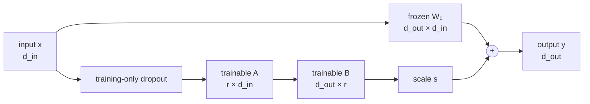
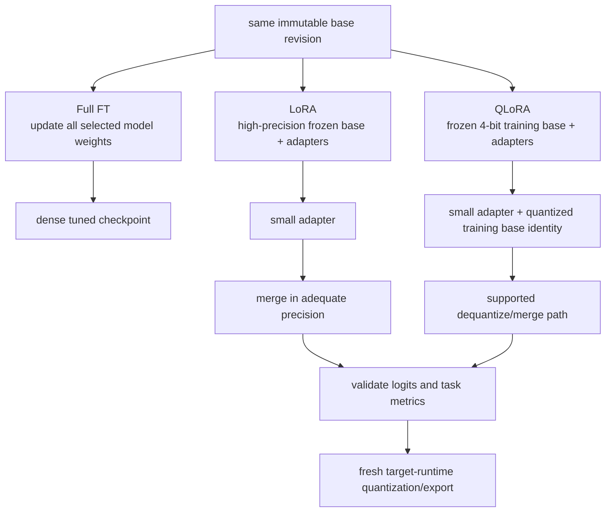

# CH-09: LoRA and Its Evolution

## Chapter contract and evidence notation

Low-Rank Adaptation (LoRA) is a way to learn a constrained update to selected weights while leaving the pretrained
backbone unchanged. It primarily reduces **trainable state**, optimizer state, and per-domain checkpoint size. It does
not, by itself, make the backbone smaller, shorten the key-value (KV) cache, or guarantee faster inference.

This chapter uses the repository evidence labels literally:

- `DOC-VERIFIED` means that an API or constraint was present in official documentation checked on 2026-11-23; it does
  not mean that it ran here.
- `PAPER-REPORTED` means that the cited authors reported a result; this project has not reproduced it.
- `ILLUSTRATIVE` marks derived examples and educational diagrams, not measured results.
- `PLANNED EXPERIMENT` describes a protocol awaiting execution.
- Every code listing is `UNVERIFIED IMPLEMENTATION`. No package, GPU, model, merge, or export was executed for this
  chapter.

The method names in this chapter do not imply universal superiority. Results depend on the exact model revision, task,
data, rank, targets, precision, optimizer, and evaluation protocol. LoRA also does not solve stale knowledge,
hallucination, or unsafe advice: a pharmacy or repair adapter still requires qualified review and risk-specific
evaluation.

## 9.1 The problem LoRA solves

For a pretrained linear transformation,

$$
y = W_0x+b,
$$

$W_0\in\mathbb{R}^{d_{\text{out}}\times d_{\text{in}}}$ can contain millions of parameters. Full fine-tuning learns
an unconstrained $\Delta W$ of the same shape. Adam-like training then needs memory for the model, gradients,
optimizer moments, activations, and temporary buffers. Repeating that process for automotive, pharmacy, and beekeeping
models also creates one full checkpoint per domain.

LoRA starts from the empirical hypothesis that a useful task update can often be represented in a much lower-dimensional
subspace. Rather than optimize $W_0$, it freezes $W_0$ and learns

$$
\Delta W=sBA,\qquad A\in\mathbb{R}^{r\times d_{\text{in}}},\quad B\in\mathbb{R}^{d_{\text{out}}\times r},
$$

where $r\ll\min(d_{\text{in}},d_{\text{out}})$, and

$$
y=W_0x+sB(Ax)+b.
$$

The matrix $A$ is the down-projection from the input space to an $r$-dimensional latent space; $B$ is the
up-projection back to the output space. The product has rank at most $r$. “Low rank” constrains the **update**, not
the rank or size of the frozen pretrained matrix.

<a id="fig-06"></a> **FIG-06 — How low-rank matrices modify a frozen weight (`ILLUSTRATIVE`).** Alt text: an input takes
a frozen dense path and a trainable low-rank path; the scaled outputs are added.



The construction is exact linear algebra, not a lossy decomposition performed after training: during training, $A$ and
$B$ directly parameterize the allowed update. After training, an additive adapter can be folded into a dense weight:

$$
W_{\text{merged}}=W_0+sBA.
$$

The merged layer has the original shape and normally the original dense inference cost. The adapter saves training and
artifact resources; a separate compression method is still needed to reduce the final dense model.

## 9.2 Shapes, parameter count, and a numerical example

A dense $d_{\text{out}}\times d_{\text{in}}$ update has $d_{\text{out}}d_{\text{in}}$ trainable elements. LoRA has

$$
N_{\text{LoRA}}=r(d_{\text{in}}+d_{\text{out}})
$$

elements per targeted matrix, excluding optional trainable bias or magnitude terms. Its fraction of that matrix is

$$
\rho=\frac{r(d_{\text{in}}+d_{\text{out}})} {d_{\text{in}}d_{\text{out}}}.
$$

**Example (`ILLUSTRATIVE`).** For a $4096\times4096$ projection and $r=16$:

- dense matrix: $16{,}777{,}216$ elements;
- LoRA: $16(4096+4096)=131{,}072$ elements;
- fraction: $0.78125\%$;
- BF16 adapter values alone: $262{,}144$ bytes, or 256 KiB.

The 256 KiB figure is not training VRAM. If each trainable element has a 2-byte parameter, 2-byte gradient, and two
4-byte optimizer moments, those states alone total about 1.5 MiB for this adapter; framework copies, activations,
alignment, and buffers add more.

Consider an `ILLUSTRATIVE` 32-layer decoder with hidden size 4096 and MLP intermediate size 11008, using separate `q`,
`k`, `v`, `o`, `gate`, `up`, and `down` projections and no adapter biases:

- targeting only `q` and `v` at rank 16 adds $32\times2\times131{,}072=8{,}388{,}608$ parameters;
- targeting all seven projections adds approximately 39,976,960 parameters.

This four-to-five-fold difference is why “rank 16” is not a complete configuration. Target coverage can matter more than
rank in isolation.

### 9.2.1 Follow one LoRA update numerically

Let a frozen $2\times3$ projection be

$$

W_0=\begin{bmatrix}1&0&-1\\0&2&1\end{bmatrix},\quad
A=\begin{bmatrix}1&-1&0\end{bmatrix},\quad
B=\begin{bmatrix}0.2\\-0.1\end{bmatrix},

$$

with rank $r=1$, $\alpha=1$, and therefore $s=\alpha/r=1$. For input
$x=[2,1,-1]^\top$, the frozen path gives $W_0x=[3,1]^\top$. The adapter first compresses the three input features to
one coordinate:

$$

Ax=1(2)-1(1)+0(-1)=1.

$$

It then expands that coordinate:

$$

B(Ax)=[0.2,-0.1]^\top.

$$

The final output is $[3.2,0.9]^\top$. Equivalently,

$$

BA=\begin{bmatrix}0.2&-0.2&0\\-0.1&0.1&0\end{bmatrix},
\quad (W_0+BA)x=[3.2,0.9]^\top.

$$

This small example exposes the entire mechanism: $A$ chooses a direction in input-feature space, $B$ decides how
that direction changes each output, and merging precomputes the same rank-one update into $W_0$. Rank one cannot
represent every $2\times3$ update, but it may represent the update the task actually needs.

### 9.2.2 End-to-end implementation workflow

1. Pin the base, tokenizer, template, data, and evaluation set.
2. Inspect real module names and shapes; calculate adapter counts for each proposed target set.
3. Attach ordinary LoRA first and prove that only intended factors are trainable.
4. Tiny-overfit a few examples, reload the adapter in a clean process, and compare disabled versus enabled behavior.
5. Train the controlled run while logging separate $A$, $B$, and $sBA$ norms.
6. Compare the unmerged adapter with a supported high-precision merge.
7. Quantize or export the merged child for each target runtime, then rerun domain, safety, memory, and performance gates.

The variant table later in the chapter is best read as a map from an observed problem to a modification. QLoRA addresses
base-weight training memory; rsLoRA and LoRA+ address optimization dynamics; PiSSA, EVA, OLoRA, CorDA, Astra, MiCA, and
NoRA change initialization or subspace choice; DoRA adds magnitude adaptation; LoftQ and QA-LoRA explicitly engage
quantization. None of these names, by itself, predicts a smaller or faster deployed dense model.

## 9.3 Rank, alpha, scaling, and dropout

### Rank $r$

Rank controls the maximum dimensionality of each learned update. Increasing $r$:

- increases trainable parameters and adapter compute linearly;
- can increase capacity;
- does not guarantee better validation quality;
- can overfit small or repetitive domain sets;
- interacts with scaling, initialization, targets, and optimizer.

Rank should be selected on a validation frontier, not copied from an unrelated paper. Begin with a logarithmic sweep
such as $r\in\{4,8,16,32,64\}$ only where the resource budget permits, then refine around non-dominated choices.
Compare equal target sets and scaling conventions. A higher-rank adapter with fewer targets is not directly comparable
to a lower-rank all-linear adapter.

### Alpha and scaling

In canonical LoRA the multiplier is

$$
s=\frac{\alpha}{r},
$$

where `lora_alpha` is $\alpha$. Alpha does not add representational rank; it changes the magnitude of the adapter
branch and therefore its optimization dynamics. Holding $\alpha$ fixed while increasing rank reduces canonical scale.
Holding $\alpha/r$ fixed makes initial scale conventions comparable, but still does not equalize capacity or
gradients.

Rank-stabilized LoRA (rsLoRA) instead uses

$$
s_{\text{rs}}=\frac{\alpha}{\sqrt r}.
$$

Kalajdzievski derives this scaling to keep adapter activations and backpropagated gradients stable in rank-asymptotic
conditions. Practical benefit remains an experiment, especially at small ranks (`PAPER-REPORTED`). Current PEFT exposes
`use_rslora=True` (`DOC-VERIFIED`).

### Dropout

LoRA dropout masks the input to the adapter branch during training:

$$
y=W_0x+sBA\,D_p(x),
$$

with inverted dropout $D_p$. It is disabled for evaluation. It does not permanently zero adapter weights, and it is
absent from the merged dense weight. Dropout may regularize a small dataset but also injects gradient noise and can slow
fitting. Treat $p=0$ as a baseline and test nonzero values on validation data; do not assume `0.05` is universally
optimal.

## 9.4 Initialization and gradient flow

The common initialization samples $A$ and sets $B=0$. Consequently $BA=0$, so attaching the adapter initially
leaves the model output unchanged. For upstream gradient $g=\partial\mathcal{L}/\partial y$, ignoring a batch
dimension and dropout for clarity,

$$
\frac{\partial\mathcal{L}}{\partial B}=s\,g(Ax)^\top, \qquad \frac{\partial\mathcal{L}}{\partial A}=s\,B^\top
gx^\top.
$$

At step zero, $B=0$, so $A$'s gradient is zero while $B$ receives a gradient if $Ax\neq0$. Once $B$ moves away
from zero, both factors learn. This asymmetry motivates methods such as LoRA+, LoRA-FA, PiSSA, EVA, MiCA, and NoRA. It
is also why gradient logging should separate `lora_A` from `lora_B` rather than report a single aggregate norm.

The frozen backbone still participates in forward and backward computation: gradients must flow through its operations
to reach earlier adapters. “Frozen” means `requires_grad=False` for those parameters, not that the backbone is absent
from the graph or consumes no activation memory.

Training-instability checks should include:

1. finite loss, logits, adapter weights, and gradients;
2. norms of $A$, $B$, and $sBA$ per layer;
3. ratio $\|sBA\|_F/\|W_0\|_F$;
4. clipping frequency and learning-rate schedule;
5. BF16/FP16 overflow behavior;
6. domain validation and general-capability retention;
7. at least several seeds for close comparisons.

Loss alone can hide a collapsing adapter, memorization, or catastrophic forgetting.

## 9.5 Choosing target modules

LoRA only changes modules it targets. Module names are architecture-specific; never assume every decoder has `q_proj`,
`v_proj`, or separate projections. Some models fuse QKV, use grouped-query attention, omit biases, contain
Mixture-of-Experts parameters, or implement projections with nonstandard classes. Inspect `model.named_modules()` and
the actual shapes.

### Attention targets

- **Query (`q`)** changes how each token asks for information.
- **Key (`k`)** changes how tokens advertise matching features.
- **Value (`v`)** changes what content is retrieved.
- **Output (`o`)** changes how head outputs are recombined.

Q/V-only targeting is a useful low-cost baseline and follows the original LoRA experiments for some models. It is not a
rule. Adapting all attention projections increases capacity and trainable state; fused QKV requires a target compatible
with the implementation.

### MLP targets

Decoder MLPs commonly have gate, up, and down projections. Their dimensions often exceed attention projection
dimensions, so adapters there can dominate parameter count. They can also be important for broad terminology and
domain-pattern adaptation. The claim that MLPs “store facts” is too coarse to select targets by itself; use
attention-only versus attention-plus-MLP ablations.

### Embeddings and output heads

LoRA can target supported embedding layers, but vocabulary changes and newly introduced tokens require special care.
Tied input/output embeddings, tokenizer identity, and export support must remain consistent. Current PEFT also documents
selective trainable token indices, but runtime and checkpoint compatibility must be tested before relying on them
(`DOC-VERIFIED`, `TEST-REQUIRED`).

### Layer-specific adaptation

Uniform rank is simple, not necessarily optimal. Current PEFT documents `rank_pattern` and `alpha_pattern` for
per-module overrides (`DOC-VERIFIED`). Useful hypotheses include:

- larger ranks in upper layers for response style;
- larger ranks in layers whose validation-gradient or activation analyses show greater domain shift;
- MLP-heavy allocation for terminology acquisition;
- small or zero ranks in insensitive layers.

These are hypotheses, not universal layer roles. AdaLoRA and EVA automate different kinds of allocation; manual patterns
remain easier to audit.

`target_modules="all-linear"` selects linear/Conv1D modules recognized by PEFT and excludes a Transformers output head
in the documented path (`DOC-VERIFIED`). It is convenient for QLoRA-style experiments, but inspect the resulting
trainable parameter names. “All linear” can be expensive and does not imply support for every custom parameter or expert
implementation.

## 9.6 Merging, unmerging, and inference overhead

An unmerged LoRA layer evaluates $W_0x$, $Ax$, and $B(Ax)$. The extra multiply-add count per token, ignoring
batching, is approximately

$$
r(d_{\text{in}}+d_{\text{out}}),
$$

plus launches, reads, casts, and framework overhead. The percentage is small for a large dense matrix, but real latency
can be launch- or memory-bound—especially at batch size one on an edge CPU. Measure the selected runtime; do not infer
latency from parameter count.

For additive, mergeable LoRA:

- `merge_adapter()` folds active adapters into the base while retaining adapter state for later unmerge;
- `unmerge_adapter()` reverses that in supported non-lossy settings;
- `merge_and_unload()` returns a standalone base-architecture model and removes PEFT functionality.

These current PEFT semantics are `DOC-VERIFIED`. `merge_and_unload()` is not in-place, so its return value must be
assigned. Not every PEFT method or quantization configuration supports merge.

For quantized weights, merge can require dequantize–add–requantize. PEFT warns that repeated merge/unmerge cycles can
accumulate rounding error and that unmerge need not recover the original quantized codes (`DOC-VERIFIED`). Reload the
original base for an exact operational reset.

<a id="fig-05"></a> **FIG-05 — Full FT, LoRA, and QLoRA lifecycle (`ILLUSTRATIVE`).** Alt text: the same immutable base
branches into full-weight tuning, high-precision frozen-base LoRA, and quantized-frozen-base QLoRA; adapter branches
merge through supported precision, validate parity, and undergo fresh target-runtime quantization or export. Not
measured; arrows show conceptual relationships only.



Training quantization is not automatically deployment quantization. A bitsandbytes NF4 training representation may not
be accepted by GGUF, ExecuTorch, Core ML, or another edge runtime. A defensible workflow is: preserve the immutable base
and adapter, merge through a supported high-enough-precision path, validate, then quantize afresh for the target
runtime.

## 9.7 The principal methods

### 9.7.1 LoRA

**Distinction.** Learn an additive rank-$r$ update on selected modules while freezing the base. Default zero-output
initialization starts as a no-op.

**Claimed target.** Reduce trainable parameters, optimizer memory, and task-specific artifact size while retaining
useful adaptation capacity.

**Evidence and maturity.** The original ICLR 2022 paper evaluated RoBERTa, DeBERTa, GPT-2, and GPT-3 settings and
reported competitive quality and no additional latency after merge (`PAPER-REPORTED`). LoRA is established and widely
implemented, but those findings do not prove parity on a new SLM or domain.

**Compatibility.** Target class, name, shape, tied weights, parallelism, quantization, and merge support must be
verified. Standard additive adapters are broadly mergeable into compatible floating-point dense weights.

**Deployment.** Unmerged adapters enable domain switching with one shared base; merged artifacts simplify edge
deployment and remove the adapter branch, but duplicate the full model per domain.

### 9.7.2 QLoRA

**Distinction.** QLoRA backpropagates through a frozen 4-bit quantized base into LoRA adapters. The paper introduced
NormalFloat 4 (NF4), double quantization, and paged optimizers. The base quantized codes are not trained.

**Claimed target.** Make adaptation of larger models fit in less accelerator memory. The paper reported
full-16-bit-fine-tuning-level task performance in its evaluated settings and a 65B experiment on one 48 GB GPU
(`PAPER-REPORTED`), not a universal guarantee.

**Evidence and maturity.** Established for resource-constrained accelerator training. Current Transformers documents
bitsandbytes 4-bit loading, `bnb_4bit_quant_type="nf4"`, nested quantization, and BF16 compute (`DOC-VERIFIED`).
Hardware/backend support is time-sensitive.

**Compatibility.** Only extra parameters are trained in the documented 4/8-bit path. Quantized kernels, compute dtype,
device map, distributed strategy, and linear-module replacement must work together. Official Transformers guidance says
`device_map="auto"` is for inference rather than training (`DOC-VERIFIED`).

**Deployment.** QLoRA lowers training memory; it does not dictate the release format. Merging commonly requires
dequantization or a backend-specific path, then validation and target quantization. Do not advertise an NF4 training
checkpoint as a mobile artifact without runtime tests.

### 9.7.3 AdaLoRA

**Distinction.** AdaLoRA uses an SVD-like parameterization and importance scores to prune less important singular
components while reallocating a global rank budget over modules.

**Claimed target.** Spend a fixed, especially small, parameter budget on more important matrices rather than assigning
equal rank everywhere.

**Evidence and maturity.** Published at ICLR 2023 with an official repository; improvement is paper-reported and
strongest in tested low-budget regimes. Current PEFT has a dedicated AdaLoRA API (`DOC-VERIFIED`).

**Compatibility.** It adds scheduling variables such as initial rank, target rank, warmup, and pruning intervals.
Interrupt/resume and distributed state need validation. PEFT documents bitsandbytes and GPTQ support, but exact model
and merge/export paths remain `TEST-REQUIRED`.

**Deployment.** Once finalized, its low-rank update can retain LoRA-like adapter benefits. Training is more complex;
fixed-rank LoRA is the stronger reproducibility baseline.

### 9.7.4 DoRA

**Distinction.** Weight-Decomposed Low-Rank Adaptation separates each weight's column-wise magnitude from direction. A
magnitude vector is trainable, while a LoRA update adapts direction. Conceptually,

$$
W' = m\odot\frac{W_0+sBA}{\|W_0+sBA\|_{\text{column}}},
$$

with broadcasting over columns (implementation conventions must be checked).

**Claimed target.** Narrow the learning-capacity and stability gap between LoRA and full fine-tuning, especially at low
ranks.

**Evidence and maturity.** ICML 2024 Oral; improvements across the paper's language and vision tasks are
`PAPER-REPORTED`. PEFT documents `use_dora=True`, currently for supported embedding, linear, and Conv2d paths, and
recommends merge for inference due to greater overhead (`DOC-VERIFIED`).

**Compatibility.** QDoRA is documented with bitsandbytes, but issues have been reported with DeepSpeed ZeRO-2. Other
quantizers and fused modules need tests.

**Deployment.** Merge where supported. Unmerged DoRA has more computation and state than LoRA; it does not create a
smaller dense edge model.

### 9.7.5 rsLoRA

**Distinction.** Use $\alpha/\sqrt r$, not $\alpha/r$.

**Claimed target.** Prevent activation and gradient collapse as rank grows and make larger ranks useful.

**Evidence and maturity.** The source is an arXiv paper with theory and experiments; PEFT support is `DOC-VERIFIED`. The
paper explicitly notes that the limiting analysis does not itself prove practical quality gains at every rank.

**Compatibility and deployment.** The adapter shape is ordinary LoRA, so merge and deployment are unchanged. Record the
scaling convention in checkpoint metadata; interpreting an rsLoRA checkpoint with canonical scaling changes its
function.

### 9.7.6 LoRA+

**Distinction.** LoRA+ uses separate learning rates for $A$ and $B$, often expressed as $\eta_B=\lambda\eta_A$.

**Claimed target.** Correct width-dependent optimization imbalance and improve convergence without changing adapter
shape.

**Evidence and maturity.** ICML 2024; speed and quality gains are `PAPER-REPORTED`. Current PEFT documents a LoRA+
optimizer path (`DOC-VERIFIED`), but trainer and distributed integrations must be tested.

**Compatibility and deployment.** It is an optimizer policy. It can in principle combine with ordinary mergeable LoRA,
but compatibility with another variant's custom optimizer or frozen factor is not automatic. Inference and artifact
shape are unchanged.

### 9.7.7 PiSSA

**Distinction.** Principal Singular Values and Singular Vectors Adaptation initializes the trainable low-rank factors
from principal singular components of $W_0$, with the residual held frozen. Unlike default LoRA, the factors are
meaningful and nonzero at initialization while base/residual bookkeeping keeps the initial function aligned.

**Claimed target.** Faster convergence, better task quality, and lower initial quantization error than default
LoRA/QLoRA in tested settings.

**Evidence and maturity.** NeurIPS 2024 with official code; results are `PAPER-REPORTED`. PEFT documents exact and
iterative fast-SVD initialization (`"pissa"` and `"pissa_niter_N"`) (`DOC-VERIFIED`).

**Compatibility.** PEFT states PiSSA cannot be applied directly to already quantized weights. Its streaming replacement
path currently requires `safetensors`, bitsandbytes 4-bit, and excludes variants such as DoRA (`DOC-VERIFIED`). Because
the base residual is modified, adapter-only saving is insufficient unless converted using the documented initial-adapter
metadata.

**Deployment.** After correct conversion, the update has a standard mergeable LoRA shape. Losing the residual or loading
against the wrong base silently invalidates the model.

### 9.7.8 OLoRA

**Distinction.** Orthonormal LoRA uses a QR-derived orthonormal basis and translates the base weight by the initialized
low-rank component before training.

**Claimed target.** Better conditioning, convergence, and stability.

**Evidence and maturity.** A 2024 arXiv paper with PEFT initialization support (`init_lora_weights="olora"`)
(`DOC-VERIFIED`). Its evidence base is less mature than multi-venue established methods; treat gains as
`PAPER-REPORTED`.

**Compatibility.** QR initialization costs preprocessing and mutates the effective base/residual relationship. Preserve
the initial adapter and exact base revision for conversion. Already-quantized or custom layers require explicit tests.

**Deployment.** It can become standard LoRA after correct conversion/merge; the initialization itself provides no
inference compression.

### 9.7.9 EVA

**Distinction.** Explained Variance Adaptation performs incremental SVD on input activations from representative data,
initializes $A$ with high-explained-variance right singular directions, and can redistribute rank across layers.

**Claimed target.** Maximize expected gradient signal at initialization, accelerate adaptation, and allocate a fixed
rank budget according to observed activation variance.

**Evidence and maturity.** NeurIPS 2025 with official code; reported cross-domain improvements remain `PAPER-REPORTED`.
PEFT documents `init_lora_weights="eva"`, `EvaConfig`, and a dataloader-driven initialization (`DOC-VERIFIED`).

**Compatibility.** Results depend on the calibration data, preprocessing, sequence distribution, and module coverage.
Initialization adds accelerator, I/O, and reproducibility costs. PEFT documents bitsandbytes operation, but each
model/backend must be tested.

**Deployment.** The trained adapter is LoRA-shaped and mergeable where ordinary LoRA is supported. Its chief effect is
training initialization/allocation, not runtime.

### 9.7.10 LoftQ

**Distinction.** LoRA-Fine-Tuning-aware Quantization jointly/alternately seeks a quantized backbone $Q$ and low-rank
factors that approximate a high-precision weight:

$$
\min_{Q,A,B}\|W_0-Q-BA\|_F.
$$

**Claimed target.** Reduce the quantization discrepancy present before QLoRA fine-tuning, especially at difficult
low-bit settings.

**Evidence and maturity.** ICLR 2024 with official code. Improvements are `PAPER-REPORTED`. Current PEFT has a full
initialization path and a convenient one-step `replace_lora_weights_loftq` path (`DOC-VERIFIED`).

**Compatibility.** PEFT currently documents LoftQ for linear layers; embedding, convolutional, and
`nn.MultiheadAttention` paths are unsupported in that guide. The one-step replacement requires `safetensors` and
bitsandbytes 4-bit. It updates LoRA only, unlike iterative LoftQ, so it is not algorithmically identical. PEFT
recommends broad linear targeting and NF4 in this path (`DOC-VERIFIED`).

**Deployment.** LoftQ is a training initialization/quantization method, not a generic edge quantizer. Release conversion
remains runtime-specific.

## 9.8 Additional verified current variants

These methods are relevant because they are supported in current PEFT or have credible primary implementations, but they
should not displace the core LoRA/QLoRA baseline without evidence.

### CorDA

Context-Oriented Decomposition Adaptation uses activation covariance to orient a weight decomposition.
Instruction-previewed mode emphasizes task components; knowledge-preserved mode targets preservation of pretrained
knowledge. NeurIPS 2024 results are `PAPER-REPORTED`; PEFT documents `init_lora_weights="corda"` and preprocessing with
representative data (`DOC-VERIFIED`). Covariance collection, inversion/decomposition, base residuals, and calibration
provenance raise implementation risk. Its adapter can be converted/merged, but the initial model relationship must be
retained.

### LoRA-FA

LoRA with Frozen-A keeps the random down-projection $A$ fixed and trains only $B$. This removes the need to retain
the full input activation solely for $A$'s gradient and roughly halves adapter trainable parameters at equal rank. The
arXiv paper's memory and quality findings are `PAPER-REPORTED`. PEFT documents `create_lorafa_optimizer`
(`DOC-VERIFIED`). Because the subspace is fixed, capacity differs from ordinary LoRA; it cannot be fairly compared only
by rank. The final additive update remains mergeable.

### Riemannian-preconditioned LoRA

This ICML 2024 method preconditions factor gradients using small $r\times r$ Gram matrices, schematically

$$
g_A\leftarrow(B^\top B+\delta I)^{-1}g_A,\qquad g_B\leftarrow g_B(AA^\top+\delta I)^{-1}.
$$

Its target is better conditioning and learning-rate robustness. PEFT documents a Riemannian optimizer path
(`DOC-VERIFIED`); quality and overhead claims are `PAPER-REPORTED`. It changes training only, so successful standard
merging leaves no inference difference.

### QA-LoRA

Quantization-Aware LoRA uses group-wise quantization and constrained adaptation so the learned update can be integrated
into a low-bit model. It is an ICLR 2024 method with an official repository (`PAPER-REPORTED`), distinct from QLoRA:
QLoRA optimizes adapters through a frozen quantized base, whereas QA-LoRA explicitly designs for a quantized merged
result. Its reference implementation is tied to particular GPTQ/Llama-era assumptions; current PEFT configuration
contains `qalora_group_size`, but end-to-end backend support must be established for the chosen model (`DOC-VERIFIED`,
`TEST-REQUIRED`).

### Activated LoRA (aLoRA)

aLoRA activates only after a designated invocation token sequence, allowing the preceding base-model KV cache to be
reused. NeurIPS 2025 findings are `PAPER-REPORTED`; current PEFT documents `alora_invocation_tokens` for causal language
modeling (`DOC-VERIFIED`). It targets multi-stage server workflows, not general domain SFT. Because token-dependent
activation is part of its function, aLoRA cannot be represented by one globally merged dense weight. Invocation
tokenization, cache provenance, and serving-runtime support are hard compatibility requirements. It is usually a poor
fit for a single merged offline specialist model.

### Astra

Activation-Space Tail-Eigenvector LoRA uses a small task calibration set, output-activation covariance, and tail
eigenvectors, then residualizes the base so initialization preserves output. It was published in ACL Findings 2026 and
integrated into current PEFT with `init_lora_weights="astra"` (`DOC-VERIFIED`). It requires explicit targets and
preprocessing before adapter injection. Results are `PAPER-REPORTED`; independent maturity is still limited. Calibration
lineage and conversion metadata are mandatory.

### MiCA and NoRA-init

Minor Component Adaptation (MiCA) initializes $B$ from the left singular vectors associated with the smallest singular
values of $W_0$, initializes $A=0$, freezes $B$, and trains $A$. Current PEFT documents
`init_lora_weights="mica"` for supported linear/embedding paths (`DOC-VERIFIED`). Its 2026 source is recent; reported
knowledge-acquisition gains are preliminary for this project.

Normalized LoRA's initialization-only PEFT form normalizes columns of random $A$, sets $B=0$, and then trains
standard LoRA. Current PEFT documents `init_lora_weights="nora"` (`DOC-VERIFIED`). The August 2026 paper is very recent;
treat stability and forgetting claims as `PAPER-REPORTED`. Both MiCA and NoRA require controlled ablation before
production use.

## 9.9 Comparison and selection

<a id="tbl-05"></a> **TBL-05 — LoRA variants. (`PAPER-REPORTED / DOC-VERIFIED`)** Evidence describes maturity, not a
ranking.

<!-- markdownlint-disable MD013 -->
| Method    | Exact change from LoRA                       | Primary claimed target         | Additional training dependency    | Deployment effect             | Project maturity  |
| --------- | -------------------------------------------- | ------------------------------ | --------------------------------- | ----------------------------- | ----------------- |
| LoRA      | Additive $sBA$                             | Cheap adaptation               | Targets, rank, scale              | Mergeable; no model shrink    | Core practical    |
| QLoRA     | Frozen 4-bit base during training            | Lower training memory          | Quantized kernels/backend         | Release format still separate | Core practical    |
| AdaLoRA   | Dynamic per-module rank budget               | Budget efficiency              | Importance schedule               | LoRA-like after finalization  | Advanced          |
| DoRA      | Train magnitude plus low-rank direction      | Capacity/stability             | Magnitude state, normalization    | Merge preferred               | Advanced          |
| rsLoRA    | $\alpha/\sqrt r$ scaling                   | High-rank stability            | Scaling metadata                  | Same as LoRA                  | Advanced          |
| LoRA+     | Different A/B learning rates                 | Optimization speed             | Optimizer groups                  | No change                     | Advanced          |
| PiSSA     | Principal weight-SVD initialization/residual | Convergence/quantization error | SVD and conversion metadata       | Mergeable after conversion    | Advanced          |
| OLoRA     | QR initialization/base translation           | Conditioning                   | QR and residual provenance        | Mergeable after conversion    | Experimental      |
| EVA       | Data-driven activation SVD/rank allocation   | Gradient signal/budget         | Calibration dataloader            | Same shape as LoRA            | Advanced          |
| LoftQ     | Joint quantization/LoRA initialization       | Quantization discrepancy       | Full-precision source + quantizer | Not an edge format            | Advanced QLoRA    |
| CorDA     | Context-oriented decomposition               | Task learning or retention     | Calibration covariance            | Conversion required           | Advanced          |
| LoRA-FA   | Freeze A; train B                            | Activation memory              | Special optimizer                 | Same merge shape              | Advanced          |
| QA-LoRA   | Group-wise quantization-aware update         | Quantized merged model         | Specific quantization path        | Potential low-bit merge       | Experimental here |
| aLoRA     | Token-gated adapter                          | KV-cache reuse                 | Invocation-aware training/runtime | Not globally mergeable        | Specialized       |
| Astra     | Tail output-activation eigenspace            | Task-aware low-rank training   | Calibration/eigendecomposition    | Conversion required           | Emerging          |
| MiCA      | Freeze minor-subspace B; train A             | Knowledge acquisition          | Weight SVD                        | Additive merge                | Emerging          |
| NoRA-init | Normalize A at initialization                | Stable optimization            | None after init                   | Same as LoRA                  | Emerging          |
<!-- markdownlint-restore -->

Practical order for this project:

1. Establish full FT, LoRA, and QLoRA controls.
2. Ablate attention-only versus all-linear, rank, dropout, and canonical versus rsLoRA scaling.
3. Test DoRA and LoRA+ only after the base LoRA run is stable.
4. Use LoftQ only for a justified QLoRA quantization-error experiment.
5. Use EVA, CorDA, Astra, PiSSA, OLoRA, MiCA, or NoRA when their initialization hypothesis matches a measured problem
   and their provenance can be retained.
6. Treat aLoRA as a server orchestration method, not the default edge adapter.

## 9.10 Full FT versus LoRA versus QLoRA: a fair protocol

<a id="tbl-04"></a> **TBL-04 — Controlled baseline comparison (`PLANNED EXPERIMENT`).**

<!-- markdownlint-disable MD013 -->
| Controlled item    | Full FT                                        | LoRA                            | QLoRA                                 |
| ------------------ | ---------------------------------------------- | ------------------------------- | ------------------------------------- |
| Base               | Same immutable model ID and commit             | Same                            | Same pre-quantization source          |
| Tokenizer/template | Same revision and exact rendered text          | Same                            | Same                                  |
| Data               | Same immutable train/validation/test IDs       | Same                            | Same                                  |
| Loss mask          | Same assistant/completion mask                 | Same                            | Same                                  |
| Tokens seen        | Same effective tokens and sequence policy      | Same                            | Same                                  |
| Evaluation         | Same checkpoints, prompts, decoder, metrics    | Same                            | Same                                  |
| Trainable weights  | All declared model weights                     | Declared adapters only          | Declared adapters only                |
| Base precision     | Declared BF16/FP16/FP32                        | Same high-precision load policy | Declared 4-bit scheme + compute dtype |
| Search budget      | Equal number of trials or separately disclosed | Equal                           | Equal                                 |
| Deployment test    | Dense artifact                                 | Adapter and merged              | Adapter, merged, freshly quantized    |
<!-- markdownlint-restore -->

### Step-by-step protocol

1. **Freeze the experimental identity.** Record model repository, immutable revision, license, tokenizer files, chat
   template hash, dataset hash, code commit, container digest, CUDA/driver/library versions, and hardware.
2. **Create one baseline evaluation.** Run the untouched model on domain accuracy, safety-critical subsets, calibration,
   hallucination/unsupported claims, and general-retention tasks.
3. **Fix data exposure.** Use identical tokenized examples, packing, maximum length, loss masking, global token batch,
   number of tokens, validation cadence, and early-stopping rule.
4. **Separate algorithm from resource policy.** First compare at equal data and trial budget. Then report a second
   “fit-to-hardware” comparison if QLoRA permits a larger batch or model. Do not mix those conclusions.
5. **Tune fairly.** Give each method the same trial count over method-appropriate learning rates. For LoRA methods also
   search rank/targets/alpha/dropout; for full FT search weight decay and learning rate; for QLoRA include quantization
   and compute dtype as fixed declared factors or budgeted ablations.
6. **Use repeated seeds.** Report every seed, mean, dispersion, and paired differences. Do not select a winner from one
   run.
7. **Measure resources.** Capture peak allocated and reserved accelerator memory, host memory, wall time, tokens/s,
   energy if instrumented, checkpoint bytes, and trainable count. Define measurement boundaries.
8. **Validate artifacts.** Compare unmerged and merged outputs, then evaluate the actual deployment quantization/export.
   A successful training metric is not an export result.
9. **Apply decision gates.** Require domain improvement, bounded general regression, safety thresholds, reproducible
   loading, and target-runtime success.

### Planning memory arithmetic, not a capacity promise

For a hypothetical 7-billion-parameter dense model:

- BF16 parameter values alone are approximately 14 GB decimal.
- Ideal packed 4-bit values alone are approximately 3.5 GB decimal, before scales, metadata, non-quantized modules,
  allocator overhead, and buffers.
- A common mixed-precision AdamW accounting of 16 bytes per fully trainable parameter would be approximately 112 GB for
  parameter/gradient/master/moment states, before activations and distributed sharding.
- A 40-million-parameter LoRA with 12 bytes of trainable state per parameter is approximately 480 MB, plus the frozen
  base, activations, and runtime overhead.

All four values are `ILLUSTRATIVE`. Actual peak VRAM can differ substantially because precision policies, optimizer
implementation, activation checkpointing, sequence length, attention kernel, batch size, offload, and sharding dominate.
Measure; never schedule a job from this arithmetic alone.

## 9.11 Practical implementations

Dependencies must be resolved into a lockfile and recorded at execution time. The live APIs were checked in official
PyTorch, Transformers, and PEFT documentation, but the listings were not run.

### Listing CH09-L01 — Minimal PyTorch LoRA linear layer

**Status:** `UNVERIFIED IMPLEMENTATION`  
**Purpose:** expose the mechanism without a PEFT abstraction.  
**Prerequisites:** a currently supported PyTorch environment.  
**Expected failures:** unsupported dtype/device combinations; incorrect fan-in/fan-out conventions when transplanting
weights; merging while training.

```python
import math
import torch
from torch import nn
from torch.nn import functional as F

class LoRALinear(nn.Module):
    def __init__(self, base: nn.Linear, rank: int, alpha: float, dropout: float = 0.0):
        super().__init__()
        if rank <= 0 or rank > min(base.in_features, base.out_features):
            raise ValueError("rank must be in [1, min(in_features, out_features)]")
        self.base = base
        self.rank = rank
        self.scale = alpha / rank
        self.dropout = nn.Dropout(dropout)
        self.lora_A = nn.Parameter(torch.empty(rank, base.in_features))
        self.lora_B = nn.Parameter(torch.zeros(base.out_features, rank))
        nn.init.kaiming_uniform_(self.lora_A, a=math.sqrt(5))
        self.base.requires_grad_(False)

    def forward(self, x: torch.Tensor) -> torch.Tensor:
        adapter = F.linear(F.linear(self.dropout(x), self.lora_A), self.lora_B)
        return self.base(x) + self.scale * adapter

    @torch.no_grad()
    def merged_weight(self) -> torch.Tensor:
        return self.base.weight + self.scale * (self.lora_B @ self.lora_A)
```

Validation: verify equality to the base at initialization; run `torch.autograd.gradcheck` in double precision on a tiny
layer; check that the base has no gradient; compare eval-mode unmerged output with an `nn.Linear` constructed from
`merged_weight()`.

### Listing CH09-L02 — Inspect targets and attach PEFT LoRA

**Status:** `UNVERIFIED IMPLEMENTATION`  
**Purpose:** prevent architecture-name assumptions and attach a documented adapter.  
**Inputs:** replace `MODEL_ID` and `REVISION` with an approved immutable model and commit.  
**Security:** prefer `safetensors`; review remote code before ever enabling it.

```python
import torch
from transformers import AutoModelForCausalLM, AutoTokenizer
from peft import LoraConfig, TaskType, get_peft_model

MODEL_ID = "example-org/approved-model"
REVISION = "aaaaaaaaaaaaaaaaaaaaaaaaaaaaaaaaaaaaaaaa"

tokenizer = AutoTokenizer.from_pretrained(MODEL_ID, revision=REVISION)
base = AutoModelForCausalLM.from_pretrained(
    MODEL_ID,
    revision=REVISION,
    dtype=torch.bfloat16,
)

for name, module in base.named_modules():
    if isinstance(module, torch.nn.Linear):
        print(name, tuple(module.weight.shape))

config = LoraConfig(
    task_type=TaskType.CAUSAL_LM,
    r=16,
    lora_alpha=32,
    lora_dropout=0.0,
    target_modules="all-linear",
    bias="none",
)
model = get_peft_model(base, config)
model.print_trainable_parameters()

unexpected = [
    name for name, parameter in model.named_parameters()
    if parameter.requires_grad and "lora_" not in name
]
if unexpected:
    raise RuntimeError(f"Unexpected trainable parameters: {unexpected}")
```

For DoRA or rsLoRA, add only the documented flag (`use_dora=True` or `use_rslora=True`) and create a separate
experiment. For layer-specific allocation, use anchored patterns and print every matched module; an over-broad suffix
can silently target unintended layers.

### Listing CH09-L03 — QLoRA model preparation

**Status:** `UNVERIFIED IMPLEMENTATION`  
**Purpose:** load a bitsandbytes NF4 base and add all-linear LoRA.  
**Prerequisites:** a hardware/software combination supported by the installed bitsandbytes, Transformers, Accelerate,
PyTorch, and PEFT releases.  
**Expected failures:** unsupported accelerator kernels; insufficient BF16 support; a model with unsupported/custom
linear layers; distributed device-map conflicts.

```python
import torch
from transformers import AutoModelForCausalLM, AutoTokenizer, BitsAndBytesConfig
from peft import LoraConfig, TaskType, get_peft_model, prepare_model_for_kbit_training

MODEL_ID = "example-org/approved-model"
REVISION = "aaaaaaaaaaaaaaaaaaaaaaaaaaaaaaaaaaaaaaaa"

quant = BitsAndBytesConfig(
    load_in_4bit=True,
    bnb_4bit_quant_type="nf4",
    bnb_4bit_use_double_quant=True,
    bnb_4bit_compute_dtype=torch.bfloat16,
)
tokenizer = AutoTokenizer.from_pretrained(MODEL_ID, revision=REVISION)
base = AutoModelForCausalLM.from_pretrained(
    MODEL_ID,
    revision=REVISION,
    quantization_config=quant,
    dtype=torch.bfloat16,
)
base = prepare_model_for_kbit_training(base)

adapter = LoraConfig(
    task_type=TaskType.CAUSAL_LM,
    r=16,
    lora_alpha=32,
    lora_dropout=0.0,
    target_modules="all-linear",
    bias="none",
)
model = get_peft_model(base, adapter)
model.print_trainable_parameters()
print("Loaded footprint bytes:", model.get_memory_footprint())
```

The model-loading footprint is not peak training memory. Measure peak memory around complete forward/backward/optimizer
steps at the target sequence length. Add the trainer only after verifying the dataset's chat template and loss mask.

### Listing CH09-L04 — Merge and numerical validation

**Status:** `UNVERIFIED IMPLEMENTATION`  
**Purpose:** validate adapter loading, deterministic output equivalence, and a standalone merged save.  
**Caveat:** use a fresh supported high-precision base for merge unless the selected quantization backend explicitly
documents a safe merge.

```python
from pathlib import Path
import json
import torch
from transformers import AutoModelForCausalLM, AutoTokenizer
from peft import PeftModel

MODEL_ID = "example-org/approved-model"
REVISION = "aaaaaaaaaaaaaaaaaaaaaaaaaaaaaaaaaaaaaaaa"
ADAPTER_DIR = Path("artifacts/adapter")
MERGED_DIR = Path("artifacts/merged")

tokenizer = AutoTokenizer.from_pretrained(MODEL_ID, revision=REVISION)
base = AutoModelForCausalLM.from_pretrained(
    MODEL_ID, revision=REVISION, dtype=torch.bfloat16
).eval()
peft_model = PeftModel.from_pretrained(base, ADAPTER_DIR).eval()

batch = tokenizer(
    ["A fixed, non-sensitive validation prompt."],
    return_tensors="pt",
)
batch = {key: value.to(peft_model.device) for key, value in batch.items()}

with torch.inference_mode():
    logits_unmerged = peft_model(**batch).logits.float().cpu()

merged = peft_model.merge_and_unload(safe_merge=True).eval()
with torch.inference_mode():
    logits_merged = merged(**batch).logits.float().cpu()

max_abs = (logits_unmerged - logits_merged).abs().max().item()
max_rel = (
    (logits_unmerged - logits_merged).abs()
    / logits_unmerged.abs().clamp_min(1e-6)
).max().item()
if not torch.allclose(logits_unmerged, logits_merged, rtol=1e-3, atol=1e-3):
    raise RuntimeError(f"Merge mismatch: max_abs={max_abs}, max_rel={max_rel}")

MERGED_DIR.mkdir(parents=True, exist_ok=False)
merged.save_pretrained(MERGED_DIR, safe_serialization=True)
tokenizer.save_pretrained(MERGED_DIR)
(MERGED_DIR / "merge-validation.json").write_text(json.dumps({
    "base_model": MODEL_ID,
    "base_revision": REVISION,
    "adapter_path": str(ADAPTER_DIR),
    "max_abs_logit_error": max_abs,
    "max_rel_logit_error": max_rel,
}, indent=2))
```

The tolerance is illustrative and must be justified for the selected dtype. Also compare greedy token IDs over a fixed
prompt suite and rerun all domain, retention, and safety evaluations. Hash every saved file. After deployment
quantization, compare against the merged reference again; merge equivalence does not imply quantized equivalence.

## 9.12 Adapter export and release gates

A release candidate should fail closed unless all of the following are true:

1. Base model and tokenizer revisions match the adapter metadata.
2. Adapter target names, shapes, rank patterns, alpha patterns, scaling convention, and initialization/conversion
   metadata are present.
3. Loading reports no missing or unexpected trainable keys.
4. The adapter is a no-op at initialization where the method promises that property.
5. Unmerged and merged logits agree within a predeclared precision-dependent tolerance on a fixed corpus.
6. Greedy generations and task metrics are compared; numerical closeness on one prompt is insufficient.
7. Domain, general-retention, and safety-critical suites pass.
8. The merged model can be reloaded in a clean process.
9. The target quantizer consumes the merged reference and records calibration data, settings, tool commit, and artifact
   hashes.
10. The actual cloud/edge runtime passes model loading, tokenizer/template, context, memory, latency, thermal, and
    sustained-generation tests.

For multiple domains, retaining one base plus small adapters is storage efficient in the cloud. An edge runtime that
cannot load adapters may require one merged-and-quantized artifact per domain, eliminating much of that storage
advantage. A runtime that supports adapters must still be benchmarked for operator overhead and adapter switching.

## 9.13 Domain and edge implications

### Domain capability

LoRA can encode terminology, response conventions, and task behavior, but its low-rank constraint may underfit a broad
domain shift. QLoRA's lower memory can enable larger models or more experiments, but quantization error may matter for
small or sensitive models. Full FT remains a necessary upper-control where feasible.

For automotive diagnostics, evaluate safe procedure ordering, unit accuracy, and escalation on high-risk faults. For
pharmacy, an adapter is not an autonomous prescriber: test contraindications, interactions, uncertainty, and referral
behavior with qualified experts. For beekeeping and animal care, evaluate regional and seasonal conflicts. Learned
adapters can memorize stale or contradictory material and cannot retrieve current authoritative facts at runtime under
this project's no-RAG architecture.

### Edge deployment

Merged LoRA normally has the same dense dimensions as the base, so:

- storage and RAM do not fall merely because training used LoRA;
- KV-cache size is unchanged;
- decode compute is unchanged after merge, except for numerical/layout effects;
- unmerged execution may be slower if kernels cannot fuse the adapter;
- post-merge quantization, distillation, architecture selection, and runtime-specific conversion determine mobile
  feasibility.

QLoRA is chiefly a training-memory method. LoftQ and QA-LoRA consider quantization during adaptation, but neither
guarantees support in a chosen mobile runtime. aLoRA's KV-cache reuse targets chained serving and requires runtime
integration; it does not shrink a standalone offline model.

## 9.14 Common failure modes

- **Wrong targets:** the run trains zero adapters or unintended modules.
- **Base mismatch:** an adapter loads against a model with the same name but a different revision or tensor layout.
- **Template mismatch:** training and inference render different control tokens, overwhelming any adapter improvement.
- **Rank folklore:** rank is increased without adjusting scale, targets, or overfitting controls.
- **Merge in low precision:** repeated quantized merge/unmerge adds error.
- **Missing residual metadata:** PiSSA/OLoRA/CorDA/Astra conversion loses the initial base relationship.
- **Unfair baseline:** QLoRA sees more tokens or a larger model than full FT but the result is presented as a
  method-only comparison.
- **Artifact-only success:** training loss improves, but the exported runtime cannot load the model or produces
  different outputs.
- **Safety displacement:** domain metric gains hide worse refusal or uncertainty behavior.
- **Unsupported combinations:** multiple attractive flags are enabled without evidence that their mathematics and
  implementation compose.

## 9.15 Summary

LoRA expresses a selected weight update as $sBA$, freezes the pretrained matrix, and trains small factors. Rank
controls update dimension; alpha and the scaling rule control branch magnitude; dropout regularizes only the training
branch; targets determine where adaptation is possible. Zero-$B$ initialization creates asymmetric early gradients.
Merging removes ordinary adapter execution overhead but does not compress the dense model.

QLoRA reduces frozen-base training memory, not automatically deployment memory. AdaLoRA reallocates rank; DoRA separates
magnitude and direction; rsLoRA changes rank scaling; LoRA+ changes factor learning rates; PiSSA, OLoRA, EVA, LoftQ,
CorDA, Astra, MiCA, and NoRA alter initialization or subspace selection; LoRA-FA freezes one factor; QA-LoRA designs for
quantized integration; aLoRA gates adaptation for KV-cache reuse. Each has different provenance, compatibility, and
export consequences.

The engineering default is not “use the newest variant.” It is a controlled full-FT/LoRA/QLoRA baseline, followed by
targeted ablations and end-to-end artifact validation.

## 9.16 Review questions and exercises

1. Derive the LoRA parameter count for a $d_{\text{out}}\times d_{\text{in}}$ matrix and state when it ceases to be
   parameter-efficient.
2. Explain why $A$ receives zero gradient at the first step under zero-$B$ initialization, and why the whole adapter
   can still begin learning.
3. For $r=64,\alpha=32$, compute canonical and rsLoRA scaling. Explain why this arithmetic alone cannot predict which
   trains better.
4. Compare QLoRA, LoftQ, and QA-LoRA without using “all are 4-bit LoRA” as a description.
5. Design attention-only and all-linear target ablations for a selected SLM. Include exact module names, parameter
   counts, and a fair token budget.
6. Implement CH09-L01 and test initial no-op behavior, base freezing, gradient flow, and merge equivalence. Submit logs
   and environment hashes.
7. Create a rank/alpha/dropout experiment with at least three seeds. Report a quality–trainable-state Pareto frontier
   rather than a single winner.
8. Diagnose why an adapter trained on one base revision may appear to load on another yet be invalid.
9. Write an export validation plan for GGUF or another selected edge runtime, including where fresh quantization occurs.
10. For a safety-critical domain, define two domain metrics, two general retention metrics, and four release-blocking
    safety failures.
11. Explain why aLoRA is not globally mergeable and identify a workload where its KV-cache behavior is useful.
12. Audit a paper-reported improvement in this chapter: identify model, data, baselines, search budget, and whether its
    conclusion transfers to a 0.5B–4B domain SLM.

## 9.17 Sources and verification record

Primary papers and official repositories:

1. Hu et al. (2022), *LoRA: Low-Rank Adaptation of Large Language Models*, ICLR, arXiv:2106.09685:
   <https://openreview.net/forum?id=nZeVKeeFYf9> and <https://github.com/microsoft/LoRA>
2. Dettmers et al. (2023), *QLoRA: Efficient Finetuning of Quantized LLMs*, NeurIPS, arXiv:2305.14314:
   <https://arxiv.org/abs/2305.14314> and <https://github.com/artidoro/qlora>
3. Zhang et al. (2023), *AdaLoRA*, ICLR, arXiv:2303.10512: <https://arxiv.org/abs/2303.10512> and
   <https://github.com/QingruZhang/AdaLoRA>
4. Liu et al. (2024), *DoRA: Weight-Decomposed Low-Rank Adaptation*, ICML:
   <https://proceedings.mlr.press/v235/liu24bn.html> and <https://github.com/NVlabs/DoRA>
5. Kalajdzievski (2023), *A Rank Stabilization Scaling Factor for Fine-Tuning with LoRA*, arXiv:2312.03732:
   <https://arxiv.org/abs/2312.03732>
6. Hayou, Ghosh, and Yu (2024), *LoRA+*, ICML: <https://proceedings.mlr.press/v235/hayou24a.html> and
   <https://github.com/nikhil-ghosh-berkeley/loraplus>
7. Meng, Wang, and Zhang (2024), *PiSSA*, NeurIPS, arXiv:2404.02948: <https://arxiv.org/abs/2404.02948> and
   <https://github.com/GraphPKU/PiSSA>
8. Büyükakyüz (2024), *OLoRA*, arXiv:2406.01775: <https://arxiv.org/abs/2406.01775>
9. Paischer et al. (2025), *Explained Variance Adaptation*, NeurIPS, arXiv:2410.07170:
   <https://proceedings.neurips.cc/paper_files/paper/2025/hash/41d33bd41fd44bd9dba0e092047cf213-Abstract-Conference.html>
   and <https://github.com/ml-jku/EVA>
10. Li et al. (2024), *LoftQ*, ICLR: <https://openreview.net/forum?id=LzPWWPAdY4> and
    <https://github.com/yxli2123/LoftQ>
11. Yang et al. (2024), *CorDA*, NeurIPS: <https://arxiv.org/abs/2406.05223> and <https://github.com/iboing/CorDA>
12. Zhang et al. (2023/2026 revision), *LoRA-FA*, arXiv:2308.03303: <https://arxiv.org/abs/2308.03303>
13. Zhang and Pilanci (2024), *Riemannian Preconditioned LoRA*, ICML:
    <https://proceedings.mlr.press/v235/zhang24ax.html> and
    <https://github.com/pilancilab/Riemannian_Preconditioned_LoRA>
14. Xu et al. (2024), *QA-LoRA*, ICLR:
    <https://proceedings.iclr.cc/paper_files/paper/2024/hash/e6c2e85db1f1039177c4495ccd399ac4-Abstract-Conference.html>
    and <https://github.com/yuhuixu1993/qa-lora>
15. Greenewald et al. (2025), *Activated LoRA*, NeurIPS:
    <https://proceedings.neurips.cc/paper_files/paper/2025/hash/4d0b6303d4a4811445f69f357bf6def5-Abstract-Conference.html>
16. Liu et al. (2026), *Astra*, ACL Findings: <https://aclanthology.org/2026.findings-acl.1593/> and
    <https://github.com/LyoAI/Astra>
17. Rüdiger and Raschka (2026), *MiCA*, arXiv:2604.01694: <https://arxiv.org/abs/2604.01694>
18. Kang et al. (2026), *Normalized Low-Rank Adaptation*, arXiv:2608.31036: <https://arxiv.org/abs/2608.31036>

Official implementation documentation checked on 2026-11-23:

- PEFT LoRA configuration, initialization, optimizer, DoRA, aLoRA, and merge documentation:
  <https://huggingface.co/docs/peft/package_reference/lora>
- PEFT quantization and LoftQ/PiSSA constraints: <https://huggingface.co/docs/peft/developer_guides/quantization>
- Transformers bitsandbytes documentation: <https://huggingface.co/docs/transformers/quantization/bitsandbytes>
- PyTorch `nn.Linear` reference: <https://docs.pytorch.org/docs/stable/generated/torch.nn.Linear.html>

**Verification note.** The mathematical examples were derived and the cited sources reviewed, but the listings and
experiments were not executed. Lock a compatible environment and preserve raw evidence before making any training,
merge, quantization, export, or device-performance claim.

## Cross-links

- [Part index](README.md)
- [CH-08: Full Fine-Tuning Versus PEFT](ch-08-full-fine-tuning-versus-peft.md)
- [CH-09 assessment](../../13-assessments/ch-09-assessment.md)
- [Evidence standard](../../00-governance/evidence-and-citation-standard.md)
- [PEFT research survey](../../04-research-comparison-report/peft-methods.md)
