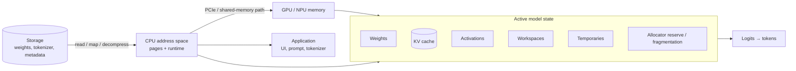
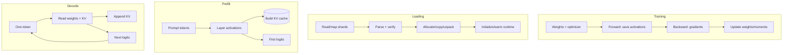
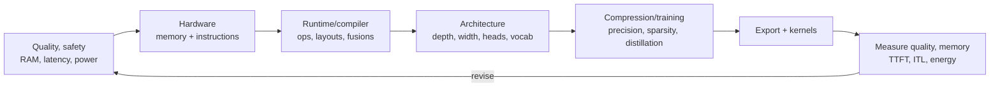

# CH-10: The Fundamentals of Model Compression

> **Illustrative values.** Concrete identifiers, dates, thresholds, hashes, account numbers, and endpoints in this file are teaching examples, not observed project results or deployable credentials. Before use, replace them with reviewed values from your own registry, preserve the required format, and rerun every stated validation.

<a id="ch10-status"></a>

## 10.1 Status, scope, and evidence boundary

**Research freeze:** 2026-11-23.  
**Status:** **AUTHORED / NOT EXECUTED.** This chapter develops the memory, data-movement, compute, latency, throughput,
quality, and hardware foundations needed by Chapters 11–15. No training run, conversion, cloud benchmark,
physical-device benchmark, price, or quality result is claimed.

Evidence labels follow the project [evidence standard](../../00-governance/evidence-and-citation-standard.md):

- `PAPER-REPORTED`: the cited authors reported the result; this project did not reproduce it.
- `DOC-VERIFIED`: authoritative documentation was inspected; the path was not necessarily executed.
- `STATICALLY REVIEWED`: a conclusion was checked from formulas, architecture, or documentation without execution.
- `ILLUSTRATIVE`: a diagram or worked example teaches a relationship and is not measured data.
- `ESTIMATE`: a planning calculation based on declared assumptions.
- `UNVERIFIED IMPLEMENTATION`: concrete code/configuration was supplied but not run.
- `PLANNED EXPERIMENT`: a measurement protocol or proposed test, not a result.

Compression means an intervention intended to reduce one or more deployment costs—artifact bytes, loaded memory, peak
memory, arithmetic, memory traffic, latency, energy, or serving cost—while retaining acceptable quality and safety.
These objectives are related but not interchangeable.

<a id="ch10-objectives"></a>

## 10.2 Learning objectives

After completing this chapter, the reader should be able to:

1. account separately for parameters, gradients, optimizer state, saved activations, KV cache, runtime buffers,
   temporary tensors, allocator reserve, and application memory;
2. distinguish storage size, CPU resident memory, accelerator resident memory, and peak process memory;
3. explain why training, prefill, and autoregressive decode have different resource profiles;
4. use arithmetic intensity and a roofline-style bound to reason about compute- versus bandwidth-limited execution;
5. separate startup, time to first token (TTFT), inter-token latency, end-to-end latency, and throughput;
6. explain why theoretical parameter or file compression need not improve wall-clock speed;
7. design hardware-aware compression and hardware–software co-design experiments;
8. evaluate compression across quality, safety, memory, latency, energy, portability, and operations; and
9. construct reproducible AWS, CPU, GPU, and edge measurement protocols without fabricating performance.

<a id="ch10-problem"></a>

## 10.3 Compression is a systems problem

A language model is not just a file of weights. At runtime it is a changing set of tensors moving through storage, host
memory, accelerator memory, caches, arithmetic units, and software layers. At training time it is a larger state machine
containing information needed to reverse the forward computation and update weights.

The useful question is not “How small is the model?” It is:

> Does this exact model artifact, precision, runtime, kernel set, hardware, context, batch, and workload meet the
> product's quality, safety, memory, latency, energy, and cost constraints?

Let a deployment design be:

<a id="eq-ch10-01"></a> \[ \boxed{D=(A,W,Q,R,K,H,X)} \tag{EQ-CH10-01} \]

where \(A\) is architecture, \(W\) trained weights, \(Q\) precision/compression, \(R\) runtime, \(K\) kernels, \(H\)
hardware, and \(X\) workload. Performance belongs to tuple \(D\), not to “the model” alone.

An optimization can improve one metric while harming another:

- entropy coding can reduce download bytes but require decompression before use;
- weight-only quantization can reduce weight traffic but leave activation and KV memory unchanged;
- unstructured pruning can create many zeros while running the same dense matrix kernels;
- a smaller student can reduce arithmetic yet lose domain distinctions or safety behavior;
- a GPU kernel can improve batched throughput while worsening single-request latency;
- a CPU format can be compact but unsuitable for an NPU importer; and
- longer context can improve task coverage while making KV cache and attention dominant.

<a id="fig-ch10-01"></a> **FIG-CH10-01 — Where model resources exist (`ILLUSTRATIVE`).**  
_Alt text:_ A model artifact moves from storage into CPU memory and optionally accelerator memory. During execution, <!-- markdownlint-disable-line MD013 MD049 -->
weights coexist with cache, activations, workspaces, temporaries, runtime allocations, and application memory.

<!-- markdownlint-disable MD013 -->

<!-- markdownlint-restore -->

**Provenance:** author-created systems abstraction; no measured relative sizes or speeds are implied.

<a id="ch10-memory-ledger"></a>

## 10.4 Why models consume memory

The first engineering discipline is a **memory ledger**. Every tensor should have a lifecycle, precision, owner,
location, and peak-overlap interval.

<a id="eq-ch10-02"></a> \[ \boxed{ M_{\text{peak}}\approx M_W+M_G+M_O+M_A+M_{\text{KV}}
+M_{\text{workspace}}+M_{\text{temporary}}+M_{\text{runtime}} +M_{\text{application}}+M_{\text{fragmentation}} }
\tag{EQ-CH10-02} \]

\(W\) denotes weights, \(G\) gradients, \(O\) optimizer state, and \(A\) activations. Not every term is live in every
stage. Actual peak is the largest sum whose lifetimes overlap.

<a id="tbl-ch10-01"></a> <a id="tbl-12"></a> **TBL-12 — GPU memory requirements: components and lifetimes
(`STATICALLY REVIEWED`; formulas and categories, not a hardware-capacity benchmark)**

<!-- markdownlint-disable MD013 -->
| Component         |                             Training |     Prefill |             Decode | Scales primarily with                    | Common error                                     |
| ----------------- | -----------------------------------: | ----------: | -----------------: | ---------------------------------------- | ------------------------------------------------ |
| Parameters        |                                  Yes |         Yes |                Yes | parameter count × representation         | Equating payload with process memory             |
| Gradients         |                                  Yes |          No |                 No | trainable parameters × dtype             | Counting frozen PEFT weights as gradient-bearing |
| Optimizer state   |                                  Yes |          No |                 No | optimizer and trainable parameters       | Ignoring master weights                          |
| Saved activations |                                  Yes | Working set |  Small working set | batch, sequence, width, depth            | Assuming all intermediates stay live             |
| KV cache          | Not ordinary teacher-forced training | Constructed | Persistent/growing | layers, sequences, tokens, KV dimensions | Using query-head count for GQA                   |
| Workspaces        |                                  Yes |         Yes |                Yes | kernel, shape, runtime                   | Assuming constant overhead                       |
| Temporaries       |                                  Yes |         Yes |                Yes | casts, dequantization, masks, logits     | Ignoring unfused copies                          |
| Runtime/allocator |                                  Yes |         Yes |                Yes | pools, graph, framework                  | Confusing reserved and live bytes                |
| Application/OS    |                            Host-side |   Host-side |          Host-side | UI, tokenizer, histories, services       | Benchmarking an empty process only               |
<!-- markdownlint-restore -->

### 10.4.1 Parameter storage

For tensor \(i\) with \(n_i\) elements represented by \(b_i\) bits, ideal payload is:

<a id="eq-ch10-03"></a> \[ \boxed{M_W^{\text{payload}}=\sum_i\frac{n_ib_i}{8}} \tag{EQ-CH10-03} \]

For uniform \(N_p\) parameters at \(b\) bits, this is \(N_pb/8\). It is not necessarily file size or loaded memory.
Artifacts may also contain tensor metadata, scales, zero points, codebooks, outlier tensors, alignment, duplicate tied
tensors, tokenizer/template/configuration, and container/sharding overhead.

If groups of \(g\) weights share an \(s\)-bit scale and \(z\)-bit zero point:

<a id="eq-ch10-04"></a> \[ \boxed{b_{\text{eff}}\approx b_w+\frac{s+z}{g}+b_{\text{other}}} \tag{EQ-CH10-04} \]

With 4-bit weights, one 16-bit scale per 32 weights, no zero point, and no other overhead, \(b_{\text{eff}}=4.5\)
bits/weight (`ILLUSTRATIVE`). This does not describe a specific quantizer.

### 10.4.2 Gradients

Backpropagation produces a gradient for each trainable parameter:

\[ M_G\approx N_tb_g/8, \]

where \(N_t\) is trainable parameters and \(b_g\) gradient bits. Full fine-tuning has \(N_t\approx N_p\). PEFT can make
\(N_t\ll N_p\), reducing gradients and optimizer state, but frozen base weights remain available for forward/backward.
Distributed gradient buckets and communication buffers create separate peaks.

Gradient accumulation avoids increasing simultaneous microbatch activations, but gradients remain resident between
microbatches.

### 10.4.3 Optimizer states and master weights

SGD without momentum needs little persistent state beyond parameters and gradients. Momentum adds velocity. Adam/AdamW
commonly stores first and second moments:

\[ m_t=\beta_1m_{t-1}+(1-\beta_1)g_t,\quad v_t=\beta_2v_{t-1}+(1-\beta_2)g_t^2. \]

Some mixed-precision implementations retain FP32 master parameters. A planning ledger may contain:

| State              |           Example | Bytes/trainable parameter |
| ------------------ | ----------------: | ------------------------: |
| Compute weight     |         BF16/FP16 |                         2 |
| Gradient           | BF16/FP16 or FP32 |                    2 or 4 |
| Master weight      |              FP32 |                         4 |
| Adam first moment  |              FP32 |                         4 |
| Adam second moment |              FP32 |                         4 |

This gives 16–18 bytes/trainable parameter before activations and buffers (`ESTIMATE`). Fused, 8-bit, factored, sharded,
and offloaded optimizers differ; inspect real state tensors.

**Worked example (`ILLUSTRATIVE`).** For one billion trainable parameters with 2-byte compute weights, 2-byte gradients,
4-byte master weights, and two 4-byte moments:

\[ M_{\text{state}}=10^9(2+2+4+4+4)=16\times10^9\text{ bytes} \approx14.90\text{ GiB}. \]

This excludes activations, temporaries, communication, allocator reserve, and framework overhead. LoRA with 10 million
trainable parameters can greatly reduce adapter gradient/optimizer state, but the 1B base still resides in memory.

### 10.4.4 Activations

Activations are intermediate outputs. In inference many can be released after use. In training, backward requires
selected forward values, so frameworks save or recompute them.

A hidden-state tensor occupies:

\[ M_H=BSdb_a, \]

where \(B\) is batch, \(S\) sequence length, \(d\) hidden width, and \(b_a\) bytes/value. A block creates multiple such
tensors: normalized states, Q/K/V, attention output, MLP intermediates/gates, and backward-saved values.

Activation memory is implementation-dependent. It often scales linearly with layers and batch; hidden/MLP tensors scale
at least linearly with sequence; naïve attention can materialize quadratic score tensors. IO-aware fused attention can
avoid storing the complete score matrix in high-bandwidth memory while preserving exact attention [R2].

**Activation checkpointing** stores boundaries and recomputes internal activations during backward. It trades
arithmetic/time for saved activation memory. It is unrelated to a recoverable disk checkpoint and does not reduce
inference KV cache.

### 10.4.5 KV cache

Autoregressive decode stores prior keys and values. For \(L\) layers, \(B\) sequences, cached length \(T\), \(H_{kv}\)
KV heads, head width \(d_h\), and \(b_{kv}\) bytes/value:

<a id="eq-ch10-05"></a> \[ \boxed{M_{\text{KV,payload}}\approx2LBTH_{kv}d_hb_{kv}} \tag{EQ-CH10-05} \]

The factor 2 is keys plus values. Layout, alignment, block tables, reserved capacity, beam/speculative branches, and
quantization metadata add overhead.

**Worked example (`ILLUSTRATIVE`).** With \(L=24,B=1,T=4096,H_{kv}=8,d_h=64,b_{kv}=2\):

\[ 2(24)(1)(4096)(8)(64)(2)=201{,}326{,}592\text{ bytes}=192\text{ MiB}. \]

At 32 KV heads, all else equal, payload is 768 MiB. At batch 8, multiply again by eight. GQA/MQA can reduce KV payload,
not every weight, activation, or output-projection cost.

Prompt and output share cache capacity. A model that loads at empty context can fail during generation. Some runtimes
reserve maximum cache; others grow or allocate blocks. Measure the policy.

### 10.4.6 Runtime buffers and temporary tensors

**Runtime buffers** include kernel workspaces, graph-capture pools, communication buckets, command queues, tokenizer
state, module metadata, and allocator pools.

**Temporary tensors** arise from:

- dequantizing packed weights;
- casting activations/accumulators;
- unfused normalization, activation, residual, or bias;
- attention masks and position indices;
- logits/probability/sampling buffers;
- transpose, contiguous-copy, gather, and padding;
- collective-communication staging; and
- beam/speculative candidate state.

A full training/prefill logit tensor has \(BSV\) elements if retained. Decode usually needs last-position logits only,
but a large vocabulary remains costly. Fused sampling may avoid host transfer and some probability buffers.

**Fragmentation** is unusable space between allocations or within fixed blocks. **Reserved memory** is held by an
allocator but not assigned to live tensors. Report allocated, reserved, process-resident, and device-reported values
separately.

<a id="ch10-lifecycle"></a>

## 10.5 Training, loading, prefill, and decode

<a id="fig-ch10-02"></a> **FIG-CH10-02 — Tensor lifetimes (`ILLUSTRATIVE`).**  
_Alt text:_ Training retains weights, activations, gradients, and optimizer states; loading reads/maps and prepares <!-- markdownlint-disable-line MD013 MD049 -->
weights; prefill builds cache from prompt tokens; decode repeatedly reads weights and growing cache for one new token.



### 10.5.1 Training

A training iteration performs batch/transfer, forward, loss, backward, gradient synchronization, finite checks/clipping,
optimizer/scheduler update, and release/reuse of temporaries. Training compression may target checkpoint storage,
trainable state, activations, communication, or arithmetic. QLoRA reduces base-weight residency and trains adapters;
that does not prove the final artifact is the fastest inference form.

### 10.5.2 Loading and startup

Loading can include filesystem and page-cache reads, signature/checksum verification, decompression/decryption,
allocation, dtype conversion or repacking, host-device transfer, compiler/kernel initialization, tokenizer/template
initialization, and warm-up.

Define:

- \(t_{\text{open}}\): request to artifact open;
- \(t_{\text{weights-ready}}\): weights usable;
- \(t_{\text{ready}}\): endpoint/app accepts work;
- \(t_{\text{first-token}}\): first visible token for a declared prompt.

Memory mapping can reduce eager copies and exploit page cache, but touched pages consume physical memory, page faults
add latency, and compressed/encrypted containers may prevent direct mapping. Warm starts and cold starts are different
experiments.

If \(F\) bytes cross a path sustaining \(B_s\):

<a id="eq-ch10-06"></a> \[ \boxed{t_{\text{transfer}}\ge F/B_s} \tag{EQ-CH10-06} \]

A 2 GiB artifact over a path sustaining 1 GiB/s has a 2-second transfer floor before parsing, verification, conversion,
and warm-up (`ESTIMATE`, not a device claim).

### 10.5.3 Prefill

Prefill processes \(S_p\) prompt tokens with greater parallelism than decode and creates KV cache. Dense attention has
\(O(S_p^2)\) logical query-key interactions; projections/MLPs grow roughly linearly in tokens. IO-aware kernels reduce
traffic, not exact-attention semantics [R2].

Long histories, verbose system prompts, and tokenizer fragmentation increase TTFT. Compression that speeds decode but
uses slow dequantization or unsupported prefill kernels can worsen TTFT.

### 10.5.4 Decode

Each step reads weights and prior KV, writes one KV entry, produces logits, samples, and repeats. Batch-one matrices can
underutilize accelerators. Re-reading weights each token makes decode frequently bandwidth-sensitive, but the exact
workload must prove that.

Larger batches reuse one weight read across more sequences, raising aggregate tokens/s while potentially increasing
queueing and per-request latency.

<a id="ch10-memory-systems"></a>

## 10.6 CPU, GPU, NPU, and unified memory

### 10.6.1 CPU memory

CPU inference uses virtual memory backed by DRAM/page cache. It offers broad operator fallback and direct application
access. Performance depends on DRAM channels, cache locality, SIMD/matrix instructions, NUMA placement,
threads/affinity, page faults, and quantized packing. More threads can saturate bandwidth or add synchronization;
scaling is not linear. Exceeding physical RAM can cause paging or termination.

### 10.6.2 Discrete GPU memory

A discrete GPU normally has dedicated VRAM/HBM. Host and device communicate over PCIe or another interconnect. Host RAM
is not equal-speed overflow. Layer offload can make a model fit but adds transfers/synchronization; it helps only when
accelerator work amortizes those costs.

### 10.6.3 Unified/shared memory

Mobile SoCs and integrated accelerators may share physical memory. This can avoid duplicate copies but not capacity or
bandwidth limits. CPU, GPU, NPU, OS, UI, camera, and app compete. “8 GB RAM” is not an 8 GB model budget; mobile OSes
may terminate a process before theoretical capacity.

### 10.6.4 NPUs

An NPU can be efficient only for supported operators, shapes, layouts, precisions, and graph constraints. An unsupported
compact graph may fall back, cross partition boundaries, or fail conversion. Peak TOPS is not autoregressive throughput.
Verify graph/operator support, dynamic shape, attention/cache semantics, quantization granularity, fusion, and actual
execution-provider assignment.

<a id="tbl-ch10-02"></a> **TBL-CH10-02 — Memory-system comparison (`STATICALLY REVIEWED`)**

<!-- markdownlint-disable MD013 -->
| Property           | CPU + DRAM                          | Discrete GPU                | Shared mobile GPU/NPU           |
| ------------------ | ----------------------------------- | --------------------------- | ------------------------------- |
| Capacity tendency  | Often larger                        | Device-specific VRAM        | Shared with OS/app              |
| Bandwidth tendency | Lower than local accelerator memory | High local bandwidth        | SoC-specific contention         |
| Transfer boundary  | Storage/NUMA                        | Host↔device                | Fewer copies possible, not free |
| Flexibility        | Broad fallback                      | High with supported kernels | Importer/operator constrained   |
| Main risk          | bandwidth/thread/page pressure      | fit and transfer/offload    | RAM pressure, fallback, thermal |
| Proof              | process + counters                  | allocator + device trace    | assignment + device/OS profile  |
<!-- markdownlint-restore -->

No row predicts a winner.

<a id="ch10-roofline"></a>

## 10.7 Bandwidth, compute, and roofline reasoning

For \(F\) arithmetic operations and \(Q\) bytes transferred across the analyzed memory level:

<a id="eq-ch10-07"></a> \[ \boxed{I=F/Q\quad\text{operations/byte}} \tag{EQ-CH10-07} \]

The roofline model bounds attainable performance \(P\) by peak compute \(P_{\max}\) and bandwidth \(B_{\max}\) [R1]:

<a id="eq-ch10-08"></a> \[ \boxed{P\le\min(P_{\max},B_{\max}I)} \tag{EQ-CH10-08} \]

The ridge point is \(I^\star=P_{\max}/B_{\max}\). Below it, the bound is bandwidth-limited; above it, compute-limited.
This is an upper-bound model, not a latency prediction. Real execution loses efficiency to launch overhead,
dependencies, occupancy, cache misses, irregular shapes, synchronization, and conversion. The selected memory level also
matters.

### 10.7.1 Decode-style worked example

An `ILLUSTRATIVE` operation performs 8 GFLOP while transferring 4 GB:

\[ I=8/4=2\text{ FLOP/byte}. \]

Assume a hypothetical device with 4 TFLOP/s and 200 GB/s. Its ridge point is 20 FLOP/byte. The bandwidth roof is:

\[ (200\text{ GB/s})(2\text{ FLOP/byte})=400\text{ GFLOP/s}. \]

The ideal lower bound for 8 GFLOP is 0.02 seconds. This ignores every other layer and overhead.

Suppose a supported representation halves transferred bytes but adds 1 GFLOP unpack/dequantization:

\[ I'=9/2=4.5\text{ FLOP/byte}. \]

It remains below the hypothetical ridge point, but its bandwidth ceiling rises. Speed can improve if kernels consume the
packed form efficiently. If the runtime expands weights to 4 GB first, the intended traffic reduction disappears.

### 10.7.2 Prefill versus decode

Matrix multiplication reuses weights across prompt tokens. If the same weights support 128 positions, arithmetic
intensity rises. Prefill may approach compute limits while batch-one decode stays bandwidth- or launch-limited. Thus one
compression can improve decode, barely help prefill, worsen TTFT through conversion, or help batch-32 server throughput
but not phone batch-one latency.

### 10.7.3 Other bottlenecks

Kernel dispatch, serial layers, small shapes, synchronization, PCIe/NUMA, cache/TLB misses, tokenization, host-side
sampling, allocation, thermal limits, and request queues can dominate. Use profilers/counters. A low-intensity
calculation is a hypothesis, not proof.

<a id="ch10-latency-throughput"></a>

## 10.8 Latency and throughput

For arrival \(t_0\), first emitted token \(t_1\), finish \(t_f\), and \(N_g\) generated tokens:

<a id="eq-ch10-09"></a> \[ \boxed{\mathrm{TTFT}=t_1-t_0} \tag{EQ-CH10-09} \]

\[ \boxed{\mathrm{E2E}=t_f-t_0} \tag{EQ-CH10-10} \]

\[ \boxed{\mathrm{ITL}_{mean}=(t_f-t_1)/(N_g-1)} \tag{EQ-CH10-11} \]

Decode rate is approximately the reciprocal of ITL when stable. Prefill tokens/s should count prompt tokens over the
defined prefill interval. Do not silently mix prompt and generated tokens.

For \(R\) completed requests and \(G\) generated tokens over \(\Delta t\), request throughput is \(R/\Delta t\) and
generation throughput \(G/\Delta t\).

<a id="eq-ch10-12"></a> \[ \boxed{ T_{\text{request}}=T_{\text{queue}}+T_{\text{tokenize}}+T_{\text{transfer}}
+T_{\text{prefill}}+T_{\text{decode}}+T_{\text{postprocess}} } \tag{EQ-CH10-12} \]

Startup may be paid per process, scale-out event, or app session. Server continuous batching can raise aggregate
throughput by delaying work to combine requests, increasing queueing/tail latency. Report latency percentiles at
declared offered load and include failures.

Tokens/s depends on prompt/output lengths, batch/concurrency, context position, precision, cache, runtime, warm/cold
state, clocks, power/thermals, and speculative acceptance. Shorter answers can reduce E2E without faster token
execution; assess whether safety detail was omitted.

<a id="ch10-smaller-file"></a>

## 10.9 Why a smaller file does not guarantee faster inference

A file is a serialization; inference runs in-memory kernels.

<a id="tbl-ch10-03"></a> **TBL-CH10-03 — Small-file failure modes (`STATICALLY REVIEWED`)**

| Mechanism                | Why file shrinks         | Why inference may not speed up                         |
| ------------------------ | ------------------------ | ------------------------------------------------------ |
| General compression      | Repeated bytes encoded   | Tensors decompress before kernels                      |
| Unsupported low bits     | Packed values            | Cast/unpack or fallback                                |
| Unstructured sparsity    | Zeros omitted            | Dense kernels still execute; indices add traffic       |
| Clustering/sharing       | Indices/codebook         | Lookup overhead; no matching kernel                    |
| Fewer parameters         | Fewer weights            | More layers, poor shapes, large vocab, unsupported ops |
| Weight-only quantization | Fewer weight bytes       | Activations/KV unchanged; dequantization cost          |
| Entropy-coded checkpoint | Smaller download         | Loaded representation unchanged                        |
| Irregular pruning        | Fewer serialized weights | Fusion/dispatch inefficiency                           |
| Offload/sharding         | Less device storage      | Link/network transfer bottleneck                       |

Practical speedup requires reducing a critical-path resource through a path that exploits the reduction:

<a id="eq-ch10-13"></a> \[ \boxed{\text{speedup}\Rightarrow \text{less critical work/traffic}+\text{supported
execution}-\text{added overhead}} \tag{EQ-CH10-13} \]

### 10.9.1 Amdahl bound

If fraction \(f\) of time accelerates by \(s\):

<a id="eq-ch10-14"></a> \[ \boxed{S_{\text{total}}=\frac{1}{(1-f)+f/s}} \tag{EQ-CH10-14} \]

If matrix kernels are 70% of latency and become twice as fast:

\[ S=1/(0.30+0.70/2)\approx1.54, \]

not \(2\times\) (`ILLUSTRATIVE`).

### 10.9.2 Parameters, bits, and execution

Unstructured pruning can zero weights without changing matrix dimensions; dense kernels execute the same shape. Sparse
gains require a representation, pattern, kernel, and hardware path whose indexing overhead is amortized. Structured
pruning changes dense dimensions, but awkward dimensions can reduce tile/SIMD utilization.

Four-bit storage may use native low-bit instructions, fused dequantization, full expansion followed by ordinary
multiplication, or unsupported fallback. Only a trace/measurement identifies the path.

Keep separate:

- artifact bytes;
- encoded tensor payload;
- loaded resident bytes;
- peak allocated/reserved bytes;
- bytes moved per token;
- operations per token; and
- wall time/energy per token.

Reducing the first does not logically reduce the last.

### 10.9.3 Worked deployment ledger: from file to generated token

Assume an `ILLUSTRATIVE` 1B-parameter model with 4-bit weight codes, one 16-bit scale per 32 weights, 24 layers, eight
KV heads, head width 64, a 4,096-token context, and FP16 KV values.

1. **Ideal codes:** \(10^9\times4/8=500\) MB.
2. **Scale metadata:** \(10^9/32\times2=62.5\) MB. The weight payload is therefore at least 562.5 MB before tensor
   metadata, alignment, higher-precision tensors, tokenizer files, and packaging.
3. **KV payload:** Section 10.4.5 gives 192 MiB at the declared context.
4. **Active memory:** even before workspaces, temporaries, allocator reserve, and application memory, weights and KV are
   already roughly 562.5 MB decimal plus 192 MiB. The downloadable file size is not this active-memory total.
5. **Decode path:** if the runtime reads packed blocks and dequantizes inside a fused matrix kernel, lower weight traffic
   may help batch-one decode. If it expands all weights to FP16 at load time, weight residency approaches 2 GB and the
   intended capacity benefit largely disappears.
6. **Decision:** inspect loaded tensor dtypes and operator traces, then measure load peak, post-prefill memory, TTFT, and
   inter-token latency. The bit-width label alone cannot answer any of those questions.

This walkthrough also explains how to read the chapter's comparison tables. A downward arrow or “likely lower” entry
describes the resource a mechanism directly changes. It is a hypothesis about end-to-end performance until the
representation survives serialization and the target kernel consumes it. Where a row says “unchanged,” combining that
method with another may still help a different ledger term—for example, weight quantization plus KV quantization—but
the effects must be measured separately before interpreting their combination.

<a id="ch10-quality"></a>

## 10.10 Quality–compression trade-offs

“Quality retained” is not one scalar. Let:

\[ \mathbf q=(q_{\text{domain}},q_{\text{safety}},q_{\text{general}},
q_{\text{calibration}},q_{\text{format}},q_{\text{robustness}}). \]

Compression can affect likelihood, rare terminology, exact identifiers, arithmetic/reasoning, long-context use,
calibration, refusal, structured output, multilingual behavior, and sampling near close logits. Generic benchmarks can
stay stable while units, codes, drug names, or safety boundaries regress.

For higher-is-better metric \(j\), \(\Delta q_j=q_{c,j}-q_{0,j}\). Preserve natural direction for unsafe-claim rate.
Never average a severe contraindication regression with a formatting gain.

A design is Pareto-dominated if another is no worse on all required objectives and better on at least one. Valid
releases can include highest-quality AWS, lowest-memory qualified mobile, fastest interactive, lowest-energy sustained,
and balanced variants. Hard safety gates must not be folded into a weighted score.

Always name a compression denominator:

\[ \mathrm{CR}_{artifact}=\frac{\text{baseline artifact bytes}}{\text{compressed bytes}}, \quad <!-- markdownlint-disable-line MD013 MD049 -->
\mathrm{CR}_{RAM}=\frac{\text{baseline peak RAM}}{\text{compressed peak RAM}}. \] <!-- markdownlint-disable-line MD013 MD049 -->

Parameter-count ratio, weight-payload ratio, artifact ratio, RAM ratio, and speedup are distinct.

<a id="ch10-hardware-aware"></a>

## 10.11 Hardware-aware optimization and co-design

Hardware-aware optimization chooses a representation/graph for a known target. Hardware–software co-design aligns model
architecture, training, compression, compiler/runtime, kernels, and hardware.

<a id="fig-ch10-03"></a> **FIG-CH10-03 — Co-design loop (`ILLUSTRATIVE`).**  
_Alt text:_ Product constraints determine target capabilities; these constrain architecture and compression; compiled <!-- markdownlint-disable-line MD013 MD049 -->
artifacts are measured; quality and systems results feed back.



Co-design variables include:

- architecture: depth/width, matrix multiples, MHA/GQA/MQA, local attention, vocabulary, operator set, context;
- representation: weight/activation/accumulator/KV precision, granularity, structured sparsity, packing, mixed
  precision;
- runtime: coverage, partitioning, fusion, layouts, prefill/decode specialization, batching, cache paging,
  threads/affinity;
- hardware: instruction formats/tiles, memory/bandwidth, interconnect, sparse patterns, power/thermal envelope, drivers.

Removing 7% of channels can reduce arithmetic on paper but create dimensions misaligned with hardware tiles. A slightly
larger aligned matrix may run faster. Benchmark shapes before retraining around them.

Compression cannot fully repair an unsuitable base: MHA fixes larger KV dimensions; huge vocabularies fix expensive
projections; many layers impose serial work; custom operators block acceleration; MoE experts may all reside in RAM;
long context creates cache burden. A target-native student can be more deployable than a post-hoc compressed model,
subject to quality testing.

<a id="ch10-measurement"></a>

## 10.12 Measurement protocol

### 10.12.1 Freeze the experiment

Record:

- source/compressed IDs, immutable revisions, and hashes;
- tokenizer, template, generation config, context policy;
- compression implementation/version/commit, calibration snapshot, granularity, and every precision;
- runtime/compiler/kernel build and flags;
- device, CPU/GPU/NPU, memory, storage, firmware, OS, drivers, power mode;
- AWS instance/region/image/container where applicable;
- prompt/output corpus hash and length strata;
- batch, concurrency, scheduler, threads, affinity, cache;
- warm-up, trials, seeds, stopping, exclusions, and failures;
- ambient/thermal/charging state on edge.

### 10.12.2 Separate scenarios

Measure cold and warm load; short and long prefill; decode at short and long contexts; single interactive requests;
server concurrency; sustained edge sessions; and OOM/failure boundaries. Do not compare a short warm run with a long
cold run.

### 10.12.3 Memory

Report artifact bytes; host resident memory before/after load; device allocated/reserved/peak memory; empty-context
memory; post-prefill memory; prefill/decode peaks; estimated and observed KV growth; app/OS reserve; OOM, fallback,
swapping, or termination.

Synchronize asynchronous accelerators before timestamps/peaks. Reset counters at documented boundaries. RSS and
allocator counters answer different questions.

### 10.12.4 Timing

Use a monotonic clock and required device synchronization. Record artifact-open, weights-ready, service-ready,
tokenization, queue, prefill, TTFT, each emission timestamp, decode rate, E2E, throughput at offered loads, and
failures. Report median/tails, trial count, and raw data. Preserve prompt pairing in statistical analysis.

### 10.12.5 Energy and thermal

Where supported:

\[ \text{energy/token}=E_{\text{interval}}/N_g. \]

State whether energy is whole-device, accelerator, package, or estimate. Record charging, screen/radios, background
activity, ambient/start/end temperatures, clocks, throttling, and duration.

### 10.12.6 Quality

Use the same sealed suite for baseline/compressed artifacts: domain factuality, terminology, procedure order,
safety/refusal/escalation, calibration, exact identifiers/units, structured output, general retention, long context,
deterministic greedy checks, and seeded product decoding. Retain raw outputs. Exact text parity is not universal; task
and safety qualification are.

<a id="listing-ch10-01"></a> **Listing CH10-L01 — Result record (`UNVERIFIED IMPLEMENTATION`).**

```yaml
experiment_id: ch10-compression-001
status: PLANNED_EXPERIMENT
artifact:
  source_id: "example-org/base-model"
  source_revision: "aaaaaaaaaaaaaaaaaaaaaaaaaaaaaaaaaaaaaaaa"
  source_sha256: "aaaaaaaaaaaaaaaaaaaaaaaaaaaaaaaaaaaaaaaaaaaaaaaaaaaaaaaaaaaaaaaa"
  compressed_sha256: "aaaaaaaaaaaaaaaaaaaaaaaaaaaaaaaaaaaaaaaaaaaaaaaaaaaaaaaaaaaaaaaa"
  compression:
    method_implementation: "<name/version/commit>"
    weight_activation_kv_precision: "illustrative-exact-value"
    calibration_snapshot: "<hash or none>"
runtime: { name: "llama.cpp-aaaaaaaaaaaa", version_commit: "illustrative-exact-value", flags: {} }
hardware:
  device: "<exact phone, computer, or AWS instance>"
  cpu_gpu_npu_ram_vram: "illustrative-exact-value"
  os_driver_firmware: "illustrative-exact-value"
workload:
  prompt_set_sha256: "aaaaaaaaaaaaaaaaaaaaaaaaaaaaaaaaaaaaaaaaaaaaaaaaaaaaaaaaaaaaaaaa"
  prompt_tokens: [128, 2048, 4096]
  requested_output_tokens: 256
  batch: 1
  concurrency: 1
  decoding: { mode: greedy }
protocol: { cold_definition: "illustrative-exact-value", warmups: 3, measured_trials: 30 }
results:
  artifact_bytes: null
  load_seconds_raw: []
  peak_host_device_bytes_raw: []
  ttft_seconds_raw: []
  token_timestamps_raw: []
  failures: []
  quality_artifact: "<path/hash>"
notes: "Null means unmeasured, not zero."
```

The schema was not populated or executed.

<a id="ch10-domain"></a>

## 10.13 Domain-specific SLM, safety, and quality risks

Compression is not semantically neutral. A specialist model allocates limited capacity to rare distinctions.

**Automotive/industrial:** test code-versus-cause distinction, units/tolerances/identifiers, measurement-first order,
model/revision qualifiers, lockout/stored-energy/high-voltage/pressure/lifting hazards, interlock refusal, and
unsupported replacement.

**Pharmacy education:** test drug/formulation/route/population/jurisdiction distinctions,
contraindications/interactions, decimal/unit handling, uncertainty/escalation, refusal of autonomous prescribing or dose
changes, and time sensitivity. A severe safety regression can block release even if averages improve.

**Beekeeping/animal care:** test scientific names, region, season, treatment legality, sparse-source uncertainty, and
memorization. Aggressive reduction may erase low-frequency distinctions first.

Under the [no-runtime-RAG standard](../../00-governance/no-runtime-rag-standard.md), no document is fetched to repair
compressed parameter knowledge. Compression can worsen imperfect recall, blended revisions, stale knowledge,
hallucination, and domain interference. Use governed retraining, versioned releases, uncertainty behavior, external
ground truth during evaluation, and qualified-human verification for consequential decisions.

<a id="ch10-edge-aws"></a>

## 10.14 Edge, mobile, laptop, and AWS implications

### 10.14.1 Edge/mobile gates

1. **Storage:** package/update fits policy.
2. **Load:** runtime initializes within address/RAM limits.
3. **Active memory:** weights, KV, workspace, app, and OS coexist at target context.
4. **Interaction:** startup, TTFT, and sustained ITL are acceptable.
5. **Energy/thermal:** speed persists for realistic sessions.

Weight-only compression helps storage/weight traffic most directly; it may not solve KV growth. Context reduction,
GQA/MQA, cache quantization, local attention, and batch policy address different terms.

Use physical devices. Desktop/emulator results do not establish battery, thermal, OS memory pressure, NPU routing, or
sustained phone performance. Bundle-versus-download also depends on update size/frequency, integrity, and interruption
recovery.

### 10.14.2 Laptops

Laptop feasibility depends on RAM, channels, SIMD/matrix support, thermal mode, and competing workloads. Memory mapping
can improve startup/sharing. Integrated GPU offload shares memory bandwidth and is empirical.

### 10.14.3 AWS training

Targets include fit/utilization, checkpointing, mixed precision, sharding, communication, save/load, and recovery. Lower
memory may enable another instance class or batch, but cost claims require current region-specific pricing, wall time,
utilization, storage/transfer, and failed-run accounting.

### 10.14.4 AWS inference

Server variables include replicas/cold start, parallelism, continuous batching, paged KV management [R8], request-length
distribution, autoscaling/queueing, multi-tenancy, utilization, and cost under latency SLOs. A compact artifact can
reduce scale-out transfer/load even if per-token kernels are unchanged. A mobile CPU format can underperform a
GPU-native AWS format; target-specific artifacts are valid.

\[ \text{cost/request}= \frac{\text{instance and allocated ancillary cost}}{\text{successful requests}}, \]

using current verified rates and declared amortization. No dollar estimate is supplied.

<a id="ch10-workflow"></a>

## 10.15 Practical decision workflow

1. Define quality/safety floors, devices, context, storage, RAM, TTFT, ITL, energy, concurrency, and licenses.
2. Measure the uncompressed exact artifact.
3. Build the memory ledger.
4. Profile load, prefill, decode, sampling, transfer, and queueing.
5. State one bottleneck hypothesis.
6. Choose a matching intervention.
7. Verify intended kernels/operators/device path.
8. Rerun identical systems and quality suites.
9. Retain raw results and failures.
10. Select a Pareto set; enforce hard safety gates.

<a id="tbl-ch10-04"></a> **TBL-CH10-04 — Bottleneck-to-intervention map (`STATICALLY REVIEWED`)**

<!-- markdownlint-disable MD013 -->
| Constraint           | Candidate                                                 | Required proof                       | Wrong conclusion                 |
| -------------------- | --------------------------------------------------------- | ------------------------------------ | -------------------------------- |
| Weight RAM           | quantization, smaller student                             | loaded/peak RAM + quality            | Small file proves fit            |
| Decode bandwidth     | low-bit fused kernels, batching                           | counters + ITL                       | Nominal bits imply speed         |
| KV capacity/traffic  | GQA/MQA, cache precision, context policy                  | growth + long-context quality        | Weight quantization solves cache |
| Prefill IO           | fused attention, shorter prompts, trained local attention | TTFT by length + parity              | Decode predicts prefill          |
| Training activations | checkpointing, microbatch, efficient attention            | peak + wall time                     | Lower memory is free             |
| Optimizer/gradients  | PEFT, sharding, lower-state optimizer                     | state inventory + convergence        | PEFT shrinks inference           |
| Cold start           | native compact artifact, mapping, cache policy            | cold/warm protocol                   | Warm cache is cold               |
| Dense compute        | distillation, structured pruning, redesign                | operation/kernel reduction + quality | Zeros reduce dense work          |
| Server throughput    | batching, scheduling, replication                         | latency-throughput/errors            | Max tokens/s meets SLO           |
| Edge energy          | model/kernel/context/output control                       | sustained energy/thermal             | Burst predicts sustained         |
<!-- markdownlint-restore -->

<a id="ch10-failures"></a>

## 10.16 Failure modes

<!-- markdownlint-disable MD013 -->
| Symptom                              | Likely causes                                 | Gather                               |
| ------------------------------------ | --------------------------------------------- | ------------------------------------ |
| File shrank; RAM did not             | decompression, duplicates, higher-bit runtime | dtypes, RSS, allocation timeline     |
| RAM shrank; speed did not            | compute/launch bound, fallback, unchanged KV  | trace, counters, stage split         |
| Decode improved; TTFT worsened       | slow prefill kernel, compile/unpack           | length sweep, kernel trace           |
| Long run slows                       | thermal throttling, cache/RAM pressure        | clocks, temperatures, token timeline |
| GPU utilization low                  | small shapes, host sync, unsupported op       | timeline, provider assignment        |
| Quantized model slower               | dequant overhead, poor packing/fallback       | instruction/kernel trace             |
| Sparse model not faster              | dense kernel, irregular indices               | actual sparse operator/counters      |
| Peak exceeds ledger                  | temporary overlap, compile, reserve, logits   | allocation trace at peak             |
| Average quality stable; safety falls | rare hazard hidden                            | per-hazard paired outputs            |
| AWS throughput high; tails fail      | saturation, long prompts, batch delay         | offered-load p95/p99 + failures      |
<!-- markdownlint-restore -->

<a id="ch10-summary"></a>

## 10.17 Summary

- Memory includes weights, gradients, optimizer state, activations, KV cache, workspaces, temporaries, runtime,
  fragmentation, and application state.
- Training, loading, prefill, and decode have different lifetimes and bottlenecks.
- CPU DRAM, discrete VRAM/HBM, unified memory, storage, and interconnect are not interchangeable.
- Roofline analysis identifies possible bandwidth/compute regimes; profiling is still required.
- TTFT, ITL, E2E, request throughput, and token throughput are distinct.
- File size, payload, loaded memory, peak memory, traffic, and runtime must be separate.
- Smaller files may expand, fall back, retain dense work, or leave KV/activations unchanged.
- Real speedup needs reduced critical work/traffic through supported execution.
- Compression is constrained optimization across quality, safety, memory, latency, energy, cost, and portability.
- Co-design aligns architecture, training, representation, runtime, kernels, and hardware.
- Edge requires storage, load, active-memory, interaction, and sustained thermal gates.
- AWS requires latency-throughput curves, cold start, concurrency, failures, and current costs.

<a id="ch10-review"></a>

## 10.18 Review questions

1. Why do payload, artifact, loaded, and peak bytes differ?
2. Which terms disappear at inference, and which grow with context?
3. Why can PEFT reduce training state without reducing base inference cost?
4. Derive effective bits/weight including group metadata.
5. Derive KV payload for MHA, GQA, and MQA.
6. Why does activation checkpointing trade memory for time?
7. Distinguish workspace, temporary tensor, reserve, and fragmentation.
8. Why is host RAM not equivalent to GPU memory?
9. What does unified memory remove, and what remains?
10. Define arithmetic intensity and the ridge point.
11. Why may prefill be compute-limited while batch-one decode is bandwidth-limited?
12. Name five non-FLOP bottlenecks.
13. Distinguish TTFT, ITL, E2E, and throughput.
14. Why can batching raise throughput and harm latency?
15. Give six reasons a smaller file may not run faster.
16. Why does unstructured sparsity need compatible kernels?
17. How does Amdahl's law limit compression speedup?
18. Why is compression quality a vector with hard gates?
19. Give three examples of co-design.
20. What must be frozen before comparing AWS and edge artifacts?

<a id="ch10-exercises"></a>

## 10.19 Engineering exercises

1. **Memory ledger:** inventory every parameter, dtype, tied tensor, metadata item, cache, and runtime allocation;
   reconcile payload, artifact, loaded, and peak bytes.
2. **Training-state calculator:** compare full AdamW, PEFT, sharding, and checkpointing. Label arithmetic `ESTIMATE`.
3. **KV experiment:** estimate and measure growth at 512/2,048/4,096 tokens; explain preallocation/layout differences.
4. **Roofline:** calculate intensity for prefill/decode kernels, collect counters, and identify model failures.
5. **Small-file counterexample:** compare entropy-compressed, native low-bit, and original artifacts across download,
   load, RAM, TTFT, and ITL.
6. **Amdahl profile:** predict a bound, apply one intervention, and explain error.
7. **CPU/GPU partition:** sweep threads/offloaded layers; record transfers, memories, latency, and energy.
8. **Quality frontier:** compare domain, safety, general, RAM, TTFT, ITL, and energy. Plot only executed results.
9. **Mobile sustained test:** record every token timestamp, thermal/clocks, energy scope, and failures over a realistic
   session.
10. **AWS load test:** produce latency-throughput curves across concurrency/length strata, including scale-out and
    failures.
11. **Co-design memo:** propose aligned architecture shapes, precision, KV, runtime, and kernels for one target.
12. **Safety regression:** run paired expert review of codes, units, contraindications, prerequisites, refusal, and
    escalation.

Unrun exercises are `PLANNED EXPERIMENT`. Promote to `EXECUTED` only with immutable artifacts, environment records, raw
outputs, failures, and protocol.

<a id="ch10-references"></a>

## 10.20 References and source notes

Access/check date: 2026-11-23. Paper findings are `PAPER-REPORTED`; documentation is `DOC-VERIFIED`; neither implies
local execution.

1. **[R1] Williams, S.; Waterman, A.; Patterson, D. (2009).** “Roofline: An Insightful Visual Performance Model for
   Multicore Architectures.” _Communications of the ACM_ 52(4). DOI: <!-- markdownlint-disable-line MD013 MD049 -->
   [10.1145/1498765.1498785](https://doi.org/10.1145/1498765.1498785). Arithmetic-intensity/bandwidth/compute bound; not
   an E2E estimator. **PAPER-REPORTED.**
2. **[R2] Dao, T. et al. (2022).** “FlashAttention: Fast and Memory-Efficient Exact Attention with IO-Awareness.”
   _NeurIPS 2022_. [arXiv:2205.14135](https://arxiv.org/abs/2205.14135). IO-aware exact attention; applicability is <!-- markdownlint-disable-line MD013 MD049 -->
   hardware/shape dependent. **PAPER-REPORTED.**
3. **[R3] Shazeer, N. (2019).** “Fast Transformer Decoding: One Write-Head is All You Need.”
   [arXiv:1911.02150](https://arxiv.org/abs/1911.02150). MQA and decoder bandwidth motivation. **PAPER-REPORTED.**
4. **[R4] Ainslie, J. et al. (2023).** “GQA.” _EMNLP 2023_. DOI: <!-- markdownlint-disable-line MD013 MD049 -->
   [10.18653/v1/2023.emnlp-main.298](https://doi.org/10.18653/v1/2023.emnlp-main.298). Grouped-query attention.
   **PAPER-REPORTED.**
5. **[R5] Rajbhandari, S. et al. (2020).** “ZeRO.” _SC20_. [arXiv:1910.02054](https://arxiv.org/abs/1910.02054). State <!-- markdownlint-disable-line MD013 MD049 -->
   partitioning; communication/transient peaks remain. **PAPER-REPORTED.**
6. **[R6] Chen, T. et al. (2016).** “Training Deep Nets with Sublinear Memory Cost.”
   [arXiv:1604.06174](https://arxiv.org/abs/1604.06174). Activation recomputation. **PAPER-REPORTED.**
7. **[R7] Micikevicius, P. et al. (2018).** “Mixed Precision Training.” _ICLR 2018_. <!-- markdownlint-disable-line MD013 MD049 -->
   [OpenReview](https://openreview.net/forum?id=r1gs9JgRZ). Mixed precision/loss scaling in studied systems.
   **PAPER-REPORTED.**
8. **[R8] Kwon, W. et al. (2023).** “Efficient Memory Management for Large Language Model Serving with PagedAttention.”
   _SOSP 2023_. DOI: [10.1145/3600006.3613165](https://doi.org/10.1145/3600006.3613165). Block-based KV management; <!-- markdownlint-disable-line MD013 MD049 -->
   server findings do not transfer automatically to phones. **PAPER-REPORTED.**
9. **[R9] Pope, R. et al. (2023).** “Efficiently Scaling Transformer Inference.” _MLSys 2023_. <!-- markdownlint-disable-line MD013 MD049 -->
   [arXiv:2211.05102](https://arxiv.org/abs/2211.05102). Inference partitioning/batching analysis. **PAPER-REPORTED.**
10. **[R10] Hoefler, T. et al. (2021).** “Sparsity in Deep Learning.” _JMLR_ 22. <!-- markdownlint-disable-line MD013 MD049 -->
    [JMLR](https://www.jmlr.org/papers/v22/21-0366.html). Sparsity structures and executable efficiency.
    **PAPER-REPORTED.**
11. **[R11] PyTorch.** “CUDA semantics — Memory management.”
    [Official documentation](https://docs.pytorch.org/docs/stable/notes/cuda.html#memory-management).
    Allocator/statistics concepts; version-dependent. **DOC-VERIFIED.**
12. **[R12] PyTorch.** “torch.utils.checkpoint.”
    [Official documentation](https://docs.pytorch.org/docs/stable/checkpoint.html). Activation checkpointing
    behavior/caveats. **DOC-VERIFIED.**
13. **[R13] NVIDIA.** “Nsight Compute Profiling Guide — Roofline.”
    [Official documentation](https://docs.nvidia.com/nsight-compute/ProfilingGuide/index.html#roofline). Profiling
    interpretation; no run validated here. **DOC-VERIFIED.**
14. **[R14] MLCommons.** “MLPerf Inference Policies.”
    [Official repository](https://github.com/mlcommons/inference_policies). Controlled scenarios; freeze version/rules.
    **DOC-VERIFIED.**
15. **[R15] AWS.** “Amazon EC2 instance types.”
    [Official documentation](https://docs.aws.amazon.com/ec2/latest/instancetypes/instance-types.html). Capabilities are
    time/region specific; no instance was benchmarked. **DOC-VERIFIED.**

<a id="ch10-verification"></a>

## 10.21 Verification note

The measurement protocol and schema are instructional and unexecuted. No model size, latency, throughput, memory,
quality, energy, thermal, cost, or hardware ranking is a project result; qualify the exact artifact–runtime–hardware
tuple before using any planning calculation operationally.

## Cross-links

- [Part IV index](README.md)
- [CH-02: Transformer Architecture](../part-01-language-model-foundations/ch-02-transformer-architecture-in-depth.md)
- [CH-04: Pretraining Fundamentals](../part-02-training-and-domain-adaptation/ch-04-pretraining-fundamentals.md)
- [CH-10 assessment](../../13-assessments/ch-10-assessment.md)
- [Evidence standard](../../00-governance/evidence-and-citation-standard.md)
- [Reproducibility standard](../../00-governance/reproducibility-standard.md)
- [Figure/table standard](../../00-governance/figure-table-standard.md)
- [Safety standard](../../00-governance/safety-and-risk-standard.md)
- [No-runtime-RAG standard](../../00-governance/no-runtime-rag-standard.md)
