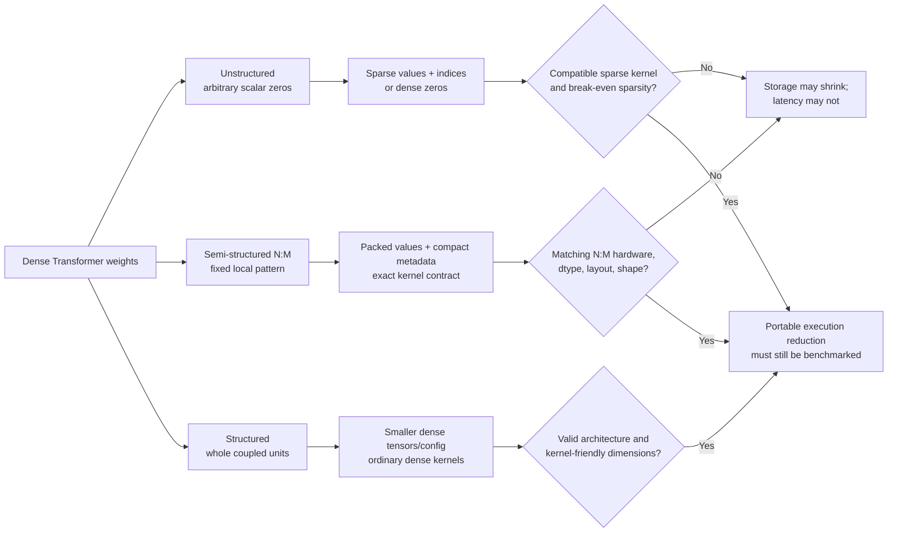

# CH-12: Pruning — Complete Research and Implementation

> **Illustrative values.** Concrete identifiers, dates, thresholds, hashes, account numbers, and endpoints in this file are teaching examples, not observed project results or deployable credentials. Before use, replace them with reviewed values from your own registry, preserve the required format, and rerun every stated validation.

## 12.1 Scope, outcome, and evidence status

Pruning removes parameters or whole computational structures from a trained model. The central engineering question is
not merely, “How many weights became zero?” It is:

> **Does the exported model execute less work, use less resident memory, and preserve enough domain and safety quality
> on the target runtime?**

This chapter develops that question from first principles through a controlled experiment for domain-specific small
language models (SLMs). It covers unstructured, semi-structured, and structured pruning; weight and structure criteria;
attention-head, layer, channel, neuron, and multilayer perceptron (MLP) pruning; N:M and 2:4 patterns; sparse formats
and kernels; schedules; one-shot and iterative procedures; recovery and distillation; architecture constraints; and
quality–latency decisions.

**Chapter evidence status (source review date: 2026-11-23):**

- Conceptual explanations, equations, and educational examples are `ILLUSTRATIVE`.
- Statements explicitly attributed to papers are `PAPER-REPORTED`, not independently reproduced.
- Statements about NVIDIA cuSPARSELt and current project repositories are `DOC-VERIFIED`, not device measurements.
- All code listings are `UNVERIFIED IMPLEMENTATION`; no listing in this chapter was executed.
- The end-to-end experiment is a `PLANNED EXPERIMENT`. It contains no invented results.
- CPU, GPU, and mobile outcomes remain unknown until raw measurements are produced under the stated protocol.

The absence of executed results is deliberate and important. A sparse checkpoint is not evidence of lower latency. A
paper result on one model, dataset, precision, accelerator, or batch size is not a portable result for an Android phone,
iPhone, ARM board, or a different SLM.

Cross-links: [compression fundamentals](ch-10-the-fundamentals-of-model-compression.md),
[quantization](ch-11-quantization-complete-research-and-implementation.md),
[distillation](ch-13-knowledge-distillation-complete-research-and-implementation.md),
[combined optimization](ch-15-combining-optimization-techniques.md), and
[edge benchmarking](../part-08-evaluation-benchmarking-and-research-experiments/ch-31-compression-and-edge-benchmarking.md).

---

## 12.2 The problem pruning solves—and the problem it does not

A decoder-only Transformer spends most of its inference time in matrix operations:

- token embedding and language-model output projection;
- query, key, value, and output projections in attention;
- gate, up, and down projections in a gated MLP;
- smaller normalization, positional, masking, sampling, and runtime operations.

Pruning attempts to remove weakly useful parameters or structures while preserving model behavior. It can target three
distinct resources:

1. **Storage:** fewer stored values, or values encoded with sparse metadata.
2. **Runtime memory:** fewer loaded values and, for some structural changes, smaller activations or key-value (KV)
   caches.
3. **Execution:** fewer useful multiply-accumulate operations and less memory traffic.

These resources do not move together automatically. Replacing weights by zeros can make a file compress well with a
generic compressor while leaving its dense tensor shape, allocated memory, and dense general matrix multiplication
(GEMM) unchanged. Conversely, deleting four Transformer blocks reduces dense parameters, layer execution, and per-layer
KV-cache storage without requiring a sparse kernel.

For an original parameter tensor $W$, a binary mask $M$ gives:

$$
W' = W \odot M,\qquad M_{ij}\in\{0,1\}
$$

where $\odot$ is element-wise multiplication. The pruned fraction, or sparsity, is:

$$
s = 1-\frac{\lVert M\rVert_0}{|M|}
$$

where $\lVert M\rVert_0$ counts retained entries and $|M|$ is the number of mask entries. This definition applies to
individual weights. For layers or heads, always report a separate structural removal ratio because “30% pruning” could
otherwise mean 30% of blocks, heads, MLP channels, or scalar weights.

**Numerical example (`ILLUSTRATIVE`).** A $4096\times4096$ FP16 matrix contains 16,777,216 weights and occupies 32 MiB
as a dense payload. Setting 50% to zero still occupies 32 MiB when saved and loaded densely. An ideal value-only sparse
payload would use 16 MiB, but a real format also stores positions or metadata, requires alignment, and may be converted
back to dense by the runtime. Deleting 25% of its input and output dimensions instead produces a $3072\times3072$
dense matrix with 9,437,184 weights—43.75% fewer than the original—and ordinary dense kernels can execute it. Whether it
is faster still depends on kernel shape efficiency.

### Pruning versus adjacent techniques

- **Quantization** changes numerical representation; it does not inherently remove dimensions.
- **Distillation** trains a student to imitate a teacher; the student may have an independently designed smaller
  architecture.
- **Low-rank factorization** replaces a matrix with products of thinner matrices.
- **Pruning** selects a subnetwork or reduced structure from an existing model, possibly followed by recovery.

These can be combined, but each transformation can invalidate the calibration assumptions of the next.

---

## 12.3 A taxonomy based on what the runtime sees

<a id="fig-09"></a> **FIG-09 — Unstructured versus semi-structured versus structured pruning (`ILLUSTRATIVE`).** Alt
text: three paths show arbitrary scalar zeros requiring sparse metadata and kernels; fixed two-of-four groups requiring
matching accelerator support; and deletion of complete rows, columns, heads, MLP channels, or layers producing smaller
dense tensors. This is a mechanism diagram, not measured performance.



<a id="tbl-08"></a> **TBL-08 — Pruning methods and deployment consequences.** Evidence: mechanism synthesis; empirical
outcomes are `TEST-REQUIRED`.

<!-- markdownlint-disable MD013 -->
| Family                   |            Removed unit | Tensor shape changes? | Specialized kernel required for speed? |      Likely portable dense benefit | Principal risk                                 |
| ------------------------ | ----------------------: | --------------------: | -------------------------------------: | ---------------------------------: | ---------------------------------------------- |
| Unstructured             |           scalar weight |                    No |                            Usually yes |                                Low | metadata, irregular access, unsupported export |
| Block sparse             |        rectangular tile |            Usually no |                                    Yes |                      Low to medium | tile pattern/runtime mismatch                  |
| N:M / 2:4                |       N positions per M |                    No |                                    Yes | Low outside supported accelerators | convention and hardware lock-in                |
| Head                     |   attention head/groups |             Sometimes | No if tensors are physically rewritten |                             Medium | GQA/MQA coupling and divisibility              |
| MLP neuron/channel       |    intermediate feature |                   Yes |                                     No |                  High when aligned | gated projections must remain coupled          |
| Hidden channel           | residual-stream feature |          Yes globally |                                     No |                               High | every connected tensor must be rewritten       |
| Layer/block              |       Transformer block |                   Yes |                                     No |                               High | reasoning/generation degradation               |
| Vocabulary/embedding row |                   token |                   Yes |                                     No |                   Specialized case | tokenizer and output-head incompatibility      |
| Dynamic skipping         |   input-dependent block |       Not necessarily |                   Runtime control flow |                      Low to medium | synchronization and mobile/NPU graph limits    |
<!-- markdownlint-restore -->

### 12.3.1 Unstructured pruning

Unstructured pruning independently removes scalar weights. It offers the largest combinatorial freedom and can preserve
quality better than coarse pruning at the same scalar sparsity because it can retain useful values anywhere. The output
tensor shapes remain unchanged.

Common realizations are:

- a dense tensor containing zeros;
- coordinate (COO), compressed sparse row (CSR), or compressed sparse column (CSC) storage;
- block-sparse row formats;
- backend-specific packed sparse formats.

Unstructured sparsity is a useful scientific baseline and can be valuable on a server with an appropriate sparse matrix
multiplication (SpMM) kernel. It is not a default mobile optimization.

### 12.3.2 Semi-structured N:M pruning

N:M sparsity constrains each contiguous group of $M$ values. Unfortunately, literature and software use conflicting
language: some say “N:M” means **N nonzeros in every M values**; others describe N removed. This chapter always states
the convention.

Here, **2:4 means exactly two retained nonzero positions among each group of four eligible weights**, hence 50% scalar
sparsity. Example:

$$
[0.8,-0.1,0.4,0.02]\rightarrow[0.8,0,0.4,0]
$$

if magnitude selects the two retained entries. This regularity reduces metadata and permits accelerator-specific data
paths.

NVIDIA documents sparse Tensor Core and cuSPARSELt support for 50% structured patterns on listed GPU architectures and
types (`DOC-VERIFIED`) [NVIDIA-cuSPARSELt]. NVIDIA’s “up to 2×” matrix throughput is a hardware-path ceiling, not a
guaranteed model-level speedup (`VENDOR-REPORTED`). Token sampling, attention, memory transfers, unsupported layers,
conversion overhead, small matrices, and decode batch size can lower or erase the gain.

### 12.3.3 Structured pruning

Structured pruning removes a unit that maps to a dense architectural dimension: a head, key/value head, MLP channel,
residual channel, or complete block. A mask used only during training is insufficient. Deployment requires physically
slicing tensors, updating configuration, preserving tied relationships, and exporting a valid model.

Structured pruning sacrifices selection freedom but is usually the strongest path to **portable** reduction because
common runtimes already optimize dense matrices. It is especially attractive when the target includes mobile CPUs or
multiple heterogeneous backends.

---

## 12.4 Selection criteria: how importance is estimated

Pruning is an optimization problem:

$$
\min_{M}\;\mathcal{L}(W\odot M;\mathcal{D}_{cal})+\lambda C(M)+\mu R_{\text{target}}(M)+\nu A(M)
$$
<!-- markdownlint-disable-line MD013 MD049 -->

where $\mathcal{L}$ is calibration or recovery loss, $C$ penalizes retained capacity, $R_{\text{target}}$
approximates measured target-runtime cost, and $A$ penalizes invalid or poorly aligned shapes. $\lambda,\mu,\nu$
control trade-offs. In practice, exact combinatorial optimization is infeasible, so methods use scores and schedules.

### 12.4.1 Magnitude-based pruning

The simplest score is:

$$
I_{ij}=|W_{ij}|
$$

and the lowest-scoring weights are removed. **Global magnitude pruning** ranks weights across eligible tensors; **local
magnitude pruning** applies a fixed ratio within each tensor, row, or group.

Global selection can preserve sensitive matrices but may catastrophically empty naturally low-scale layers. Local
selection prevents this but spends the same sparsity budget on both sensitive and redundant tensors. Never prune
normalization parameters, biases, embeddings, or the output head implicitly; eligibility must be explicit.

For a head, neuron, or channel group $g$, magnitude can be aggregated as:

$$
I_g=\lVert W_g\rVert_1,\quad \lVert W_g\rVert_2,\quad\text{or}\quad \frac{\lVert W_g\rVert_2}{\sqrt{|g|}}
$$

The normalization matters when group sizes differ.

### 12.4.2 Activation- and gradient-aware importance

Magnitude does not account for how often a weight’s input is active. A first-order Taylor approximation for removing
group $g$ is:

$$
\Delta\mathcal{L}_g \approx \left|\sum_{i\in g}W_i\frac{\partial\mathcal{L}}{\partial W_i}\right|
$$
<!-- markdownlint-disable-line MD013 MD049 -->

This motivates gradient-weight products. Second-order approaches approximate curvature:

$$
\Delta\mathcal{L}\approx \nabla\mathcal{L}^{\top}\Delta W+ \frac{1}{2}\Delta W^{\top}H\Delta W
$$

where $H$ is a Hessian or an approximation derived from layer inputs. Curvature-aware reconstruction can compensate
retained weights after pruning but costs calibration memory and computation.

Activation-aware scores include $|W_{ij}|\lVert X_j\rVert_2$, the criterion used by Wanda, where $X_j$ is the
calibration activation entering input channel $j$. This highlights a crucial domain implication: scores computed on
general web text may differ from scores computed on automotive fault descriptions, pharmaceutical terminology, or
beekeeping procedures.

### 12.4.3 Movement pruning

Movement pruning learns mask scores during fine-tuning. Rather than selecting weights solely because they are currently
small, it rewards weights moving away from zero and removes those moving toward it. Sanh et al. introduced movement
pruning for pretrained language models at NeurIPS 2020 [Sanh2020]. It is training-dependent and historically centered on
encoder models. For decoder-only SLMs, generation quality and runtime sparse support remain `TEST-REQUIRED`.

### 12.4.4 Output-reconstruction and fluctuation criteria

Some methods minimize layer-output error:

$$
\min_{\widehat{W}}\lVert WX-\widehat{W}X\rVert_F^2 \quad\text{subject to a sparsity/structure constraint.}
$$

Others score how predictable or recoverable a channel’s output is. FLAP, for example, uses fluctuation-based structured
importance, adaptive allocation, and bias compensation; its reported retraining-free results are `PAPER-REPORTED`
[An2024]. These criteria are compelling but still inherit calibration-distribution sensitivity.

### Calibration design is part of the algorithm

Use a frozen, hashed calibration set that contains:

- representative general language;
- representative domain language;
- long and short sequences;
- instruction and raw-domain styles if both are deployed;
- safety-critical examples for score sensitivity analysis, but never the held-out evaluation answers.

Compare general-only, domain-only, and mixed calibration. If the selected structures change substantially, pruning is
calibration-unstable and should receive additional recovery and safety scrutiny.

---

## 12.5 What can be pruned inside a decoder-only Transformer

Consider a layer with hidden width $d$, $h_q$ query heads, $h_{kv}$ key/value heads, per-head dimension $d_h$,
and MLP width $d_{ff}$. A common gated MLP is:

$$
\operatorname{MLP}(x)=W_{\text{down}} \left[\phi(W_{\text{gate}}x)\odot(W_{\text{up}}x)\right].
$$

### 12.5.1 Attention-head pruning

In standard multi-head attention, removing query head $k$ requires removing the corresponding blocks from $W_Q$ and
from the input dimension of $W_O$. If key and value heads are also removed, matching blocks in $W_K$, $W_V$, cache
layout, and runtime configuration must change.

Grouped-query attention (GQA) and multi-query attention (MQA) complicate this:

- several query heads share one key/value head;
- $h_q$ must generally remain divisible by $h_{kv}$;
- removing a KV head may require removing its associated query group;
- head ordering can interact with rotary positional embedding (RoPE) layouts;
- fused QKV projections must be sliced by semantic offsets, not as an undifferentiated matrix.

Masking a head output to zero does not necessarily reduce compute. Portable benefit requires physically smaller
projections and a runtime accepting the new head configuration. Removing only query heads may reduce attention
projection work but not KV-cache width; removing KV heads can reduce cache size if the exported cache really has fewer
KV channels.

### 12.5.2 Layer or block pruning

Layer pruning removes complete Transformer blocks. For $L$ layers, retaining $L'$ changes approximate dense block
work by $L'/L$, though embeddings, language head, sampling, and other fixed costs remain. KV cache is approximately:

$$
B_{\text{KV}} = 2\,L\,T\,h_{kv}\,d_h\,b
$$

bytes for one sequence, where 2 represents keys and values, $T$ is cached tokens, and $b$ is bytes per cache
element. Therefore, reducing layers from 24 to 18 reduces this layer-proportional cache component by 25%
(`ILLUSTRATIVE`), while MLP-only pruning does not.

Static layer removal is highly portable. Its danger is quality: depth supports iterative representation refinement,
long-range behavior, and reasoning. Perplexity alone can miss degraded instruction following or safety behavior.

### 12.5.3 MLP neuron and intermediate-channel pruning

For a gated MLP, one intermediate neuron $j$ is represented by:

- row $j$ of $W_{\text{gate}}$;
- row $j$ of $W_{\text{up}}$;
- column $j$ of $W_{\text{down}}$.

All three must be removed together. Pruning only one tensor breaks semantics or dimensions. Reducing $d_{ff}$ is
usually portable because it creates smaller dense GEMMs. Keep widths aligned to backend-friendly multiples and benchmark
candidate alignments rather than maximizing nominal parameter reduction.

### 12.5.4 Hidden/residual-channel pruning

Reducing $d$ has broad impact: embeddings, attention projections, MLP input/output dimensions, normalization vectors,
residual streams, and often the language-model head must all agree. Tied input/output embeddings must remain tied after
slicing. A local hidden-channel decision therefore becomes a graph-wide dependency problem.

Methods such as SliceGPT use function-preserving rotations before deleting rows and columns, making hidden-dimension
slicing more viable [Ashkboos2024]. Targeted methods such as Sheared LLaMA learn masks for layers, heads, hidden
dimensions, and intermediate dimensions toward a predefined dense target architecture [Xia2024].

### 12.5.5 Channels, neurons, and terminology

“Channel” can mean an input/output feature of a linear layer; “neuron” often means an MLP intermediate unit. Always
identify the tensor axes. “Head pruning” can mean zeroing head outputs, deleting query heads only, or deleting coupled
Q/K/V/O head dimensions; these are not equivalent.

### 12.5.6 Embeddings, vocabulary, MoE, and other architectures

- **Embedding/vocabulary pruning** requires tokenizer remapping and output-label consistency; it is outside ordinary
  weight pruning.
- **Tied embeddings** require identical slicing and retained index order.
- **Mixture-of-Experts (MoE)** can prune experts, expert MLP channels, or router paths, but load balance and capacity
  constraints become first-class.
- **Sliding-window or hybrid architectures** can have layer-specific attention types; uniform block deletion may alter
  long-context coverage.
- **Tensor parallelism** constrains dimensions to shard counts and collective layouts.
- **Fused kernels** may accept only canonical widths, head counts, or projection layouts.

Architecture-aware pruning begins with a dependency graph and exporter constraints, not a flat list of tensors.

---

## 12.6 Sparse representations, kernels, and hardware reality

### 12.6.1 Representation costs

For $n$ values, nonzero fraction $\rho=1-s$, value width $b_v$ bits, and index width $b_i$ bits, a simplified
coordinate sparse payload is:

$$
B_{\text{sparse}}\approx n\rho(b_v+b_i)+B_{\text{metadata}}.
$$

Dense storage is $B_{\text{dense}}=nb_v$. Ignoring metadata, sparse storage wins only when:

$$
\rho < \frac{b_v}{b_v+b_i}.
$$

If values and indices are both 16 bits, the break-even is more than 50% sparsity—and row pointers, alignment, and
runtime work push the real break-even higher. N:M formats use much less positional metadata because only local patterns
must be encoded.

### 12.6.2 Dense GEMM versus sparse SpMM

Dense GEMM benefits from regular memory access, vectorization, blocking, fused epilogues, and years of tuning.
Unstructured SpMM must locate nonzeros and gather corresponding activations. At low batch sizes typical of
autoregressive decode, kernel-launch, metadata, cache, and gather costs can dominate. A theoretical reduction in
multiplication count is therefore not equivalent to wall-clock reduction.

The relevant test is not:

```text
count_nonzero(pruned) < count_nonzero(baseline)
```

It is:

```text
same model semantics + sparse representation + selected runtime kernel
→ lower median and tail latency, lower memory/energy, acceptable quality
```

### 12.6.3 Why arbitrary zeros usually do not accelerate mobile inference

Unstructured sparsity often fails to improve mobile latency for six concrete reasons:

1. **Dense loading:** mobile export may serialize or reconstruct a dense tensor; zeros consume the same RAM.
2. **Dense operators:** the graph still invokes dense linear operators over unchanged dimensions.
3. **Missing kernels:** ARM NEON, Metal, Vulkan, Core ML, NNAPI/vendor NPU, ExecuTorch, LiteRT, or a chosen LLM runtime
   may not expose the required sparse operator for that model, dtype, and shape.
4. **Metadata and gathers:** sparse indices add bandwidth and irregular access.
5. **Small-batch decode:** there may be insufficient arithmetic to amortize sparse dispatch overhead.
6. **Graph fallback:** one unsupported sparse operator can fall back to CPU, decompose into slower operations, or fail
   conversion.

Even if a desktop library accepts a sparse tensor, that says nothing about a mobile deployment backend. Mobile support
must be demonstrated through conversion logs, operator placement, runtime traces, and physical-device measurements.

### 12.6.4 Which methods reduce dense dimensions portably?

The strongest candidates are:

- **static layer removal:** fewer blocks and less layer-proportional KV cache;
- **MLP/intermediate-width pruning:** smaller gate/up/down matrices;
- **hidden-width slicing:** smaller matrices throughout the model, if globally consistent;
- **physical head/KV-head deletion:** smaller attention projections and possibly cache;
- **target-architecture pruning:** a regular, uniformly shaped dense model;
- **distilling into a smaller dense architecture:** not pruning itself, but an essential control.

Portable does not mean guaranteed faster. A width of 3584 may be slower than a slightly wider but better-aligned shape
on a particular kernel. Use hardware compatibility gates before expensive recovery.

### 12.6.5 Compatibility gates

<!-- markdownlint-disable MD013 -->
| Gate               | Pass condition                                                    | Failure action                        |
| ------------------ | ----------------------------------------------------------------- | ------------------------------------- |
| G1 semantic        | model loads; tokenizer/config/ties valid                          | reject artifact                       |
| G2 shape           | head, RoPE, GQA, residual, gated-MLP dependencies valid           | revise pruning groups                 |
| G3 alignment       | dimensions satisfy target kernel/sharding multiples               | round target or reject                |
| G4 export          | converter emits no unsupported/custom sparse operation            | use dense structure or supported path |
| G5 placement       | intended CPU/GPU/NPU executes target operators                    | reject claimed acceleration           |
| G6 representation  | file and RAM preserve intended sparse/compact form                | report dense fallback                 |
| G7 correctness     | logits/generation pass deterministic smoke tests                  | reject                                |
| G8 latency         | confidence interval shows useful improvement under fixed protocol | do not ship for speed                 |
| G9 quality/safety  | domain, general, and safety thresholds pass                       | recover, lower ratio, or reject       |
| G10 sustained edge | thermal, energy, memory, and crash gates pass                     | reject mobile release                 |
<!-- markdownlint-restore -->

---

## 12.7 Pruning schedules and recovery

### 12.7.1 One-shot pruning

One-shot methods estimate importance on a calibration set and prune once, often layer by layer. They avoid full
retraining and are operationally attractive for large models. SparseGPT and Wanda are prominent examples. One-shot does
not mean “without data,” and it does not guarantee “without recovery.”

### 12.7.2 Iterative and gradual pruning

Iterative pruning alternates:

1. prune a small increment;
2. recover;
3. re-estimate scores;
4. repeat until target or gate failure.

A cubic gradual schedule from initial sparsity $s_i$ to final $s_f$ can be written:

$$
s(t)=s_f+(s_i-s_f) \left(1-\frac{t-t_0}{t_1-t_0}\right)^3,\quad t_0\le t\le t_1.
$$

Gradual pruning gives optimization time to adapt, but it costs more and can overfit the recovery set. Compare it against
a compute-matched one-shot baseline.

### 12.7.3 Layer-wise versus global allocation

Uniform sparsity is easy to reproduce but ignores sensitivity. Global allocation can preserve fragile layers while
heavily pruning redundant ones. Good experiments include:

- uniform ratio;
- score-driven global allocation;
- protected first/last layers;
- runtime-cost-aware allocation;
- architecture-aligned target widths.

Do not choose the best rule on the final test set.

### 12.7.4 Recovery fine-tuning

Recovery can use:

- no training;
- low-rank adaptation (LoRA);
- full-parameter fine-tuning;
- continued pretraining;
- supervised domain recovery;
- mixed domain/general replay;
- pruning-aware distillation.

The recovery objective should prevent domain and general forgetting:

$$
\mathcal{L}_{rec}= \alpha\mathcal{L}_{domain}+\beta\mathcal{L}_{general}+\gamma\mathcal{L}_{KD} <!-- markdownlint-disable-line MD013 MD049 -->
+\delta\mathcal{L}_{safety}.
$$

Report training tokens, optimizer, steps, wall time, GPU-hours, peak VRAM, energy if measurable, and teacher-inference
cost. A pruned artifact that needs more recovery compute than training a competitive native small model is not
automatically the best engineering choice.

### 12.7.5 Pruning-aware distillation

With dense teacher logits $z_T$, pruned student logits $z_S$, and temperature $\tau$:

$$
\mathcal{L}_{KD}= \tau^2\,\mathrm{KL} \left( \operatorname{softmax}(z_T/\tau) \;\middle\|\;
\operatorname{softmax}(z_S/\tau) \right).
$$

The $\tau^2$ factor preserves gradient scale under temperature. Feature or attention matching can be added when
dimensions can be mapped. Layer-pruned students need an explicit teacher-to-student layer map; hidden-width-pruned
students may need learned projections.

Distillation can recover behavior represented in the teacher outputs over the recovery distribution. It cannot restore
facts, safety cases, languages, or long-context behaviors absent from that distribution.

### 12.7.6 Ordering with adapters and quantization

Recommended default:

1. train the domain model or merge the deployment adapter;
2. prune;
3. recover;
4. re-evaluate;
5. quantize the final shapes;
6. export and benchmark.

Exceptions require evidence. Pruning quantized weights can distort importance estimates; pruning an unmerged base can
remove capacity later needed by an adapter; quantizing before structural surgery may leave unsupported packed tensors.
Joint methods should be evaluated through their documented path.

---

## 12.8 Required and credible research methods

### 12.8.1 SparseGPT

SparseGPT performs layer-wise, one-shot pruning with an approximate second-order reconstruction derived from calibration
inputs. It updates retained weights to compensate for removed weights, supports unstructured and N:M patterns, and was
designed to operate at LLM scale. Frantar and Alistarh report at least 50% one-shot sparsity with small degradation in
studied large-model settings and experiments combining pruning and quantization (`PAPER-REPORTED`) [Frantar2023].

**Strengths:** influential baseline; no full retraining; curvature-informed reconstruction; N:M support.

**Limits:** calibration required; implementation/model support must be verified; memory/time for layer statistics;
arbitrary sparsity still requires a deployable sparse backend. Paper quality results do not prove mobile speed.

### 12.8.2 Wanda

Wanda scores a weight by:

$$
I_{ij}=|W_{ij}|\;\lVert X_j\rVert_2
$$

and prunes within each output row without a weight update. The approach is simpler than second-order reconstruction and
supports unstructured and N:M experiments. The ICLR 2024 paper and official repository establish it as a practical
research baseline (`PAPER-REPORTED`, `DOC-VERIFIED`) [Sun2024].

**Strengths:** simple; activation-aware; lower implementation complexity.

**Limits:** calibration dependence; per-row allocation may not be globally optimal; sparse execution caveat remains;
domain-only calibration can over-specialize retained capacity.

### 12.8.3 LLM-Pruner

LLM-Pruner discovers interdependent groups, estimates group importance with gradient information, structurally removes
coupled components, and uses LoRA recovery. It targets task-agnostic compression with limited recovery data
(`PAPER-REPORTED`) [Ma2023].

**Strengths:** produces structural changes; explicitly models dependency groups; offers a recovery path.

**Limits:** architecture-specific dependency rules; nonstandard layer shapes may reduce kernel efficiency; current
checkpoint/GQA support must be pinned and tested; the official repository warns that compressed models can produce
repetitive or nonsensical output in some configurations (`DOC-VERIFIED`). Generation, not only perplexity, is mandatory.

### 12.8.4 SliceGPT

SliceGPT uses computational invariance in Transformer networks to apply orthogonal transformations and then delete rows
and columns, reducing the embedding dimension and producing smaller dense matrices. The paper reports parameter and
compute reductions on evaluated models (`PAPER-REPORTED`) [Ashkboos2024].

**Strengths:** dense dimension reduction; promising cross-runtime portability; no irregular sparse kernel required.

**Limits:** architecture assumptions and conversion complexity; tied embeddings and normalization variants;
rotation/export support; irregular target widths; quantization should be calibrated after slicing.

### 12.8.5 ShortGPT and ShortGPT-gen

ShortGPT introduces Block Influence based on hidden-state similarity to identify low-impact blocks for static removal.
The ACL Findings 2025 publication reports that straightforward block removal can degrade generative tasks and proposes
generation-oriented dynamic skipping in ShortGPT-gen (`PAPER-REPORTED`) [Men2025].

**Strengths:** static block removal is simple and portable; directly reduces depth and KV-cache layers.

**Limits:** block similarity is not proof of behavioral redundancy; dynamic skipping requires runtime control flow and
may be unsuitable for static mobile/NPU graphs; repository and independent reproduction maturity require checking.

### 12.8.6 Other credible structured methods

<!-- markdownlint-disable MD013 -->
| Method                  | Core idea                                                                                                                           | Scope and evidence                                             | Relevance here                                                                 |
| ----------------------- | ----------------------------------------------------------------------------------------------------------------------------------- | -------------------------------------------------------------- | ------------------------------------------------------------------------------ |
| CoFi                    | jointly learns coarse layer and fine head/unit masks with layer-wise distillation                                                   | encoder-focused results are `PAPER-REPORTED` [Xia2022]         | important structured-pruning foundation; decoder transfer requires testing     |
| ZipLM                   | chooses structures using loss–runtime trade-offs for a measured inference environment                                               | BERT/GPT-2 results are `PAPER-REPORTED` [Kurtic2023]           | demonstrates why latency-aware cost beats parameter count alone                |
| Sheared LLaMA           | prunes to a predefined dense target over layers, heads, hidden and MLP widths, then continues pretraining with dynamic data loading | LLaMA-2-derived results are `PAPER-REPORTED` [Xia2024]         | strong portable target-shape concept; recovery cost is material                |
| FLAP                    | retraining-free structured channel pruning using fluctuation scores, adaptive allocation, and bias compensation                     | LLM results are `PAPER-REPORTED` [An2024]                      | practical one-shot structured candidate                                        |
| LayerDrop               | trains with structured dropout so layers can be removed at inference                                                                | sequence-model results are `PAPER-REPORTED` [Fan2020]          | shows pruning-aware pretraining; not a post-hoc guarantee                      |
| Head importance studies | remove heads using gradient/attention criteria                                                                                      | BERT/NMT findings are `PAPER-REPORTED` [Michel2019; Voita2019] | foundational evidence of head redundancy; architecture/task transfer is unsafe |
<!-- markdownlint-restore -->

### 12.8.7 Method-selection summary

- Use **magnitude** as the minimum honest baseline.
- Use **Wanda** and **SparseGPT** to test sparse quality retention, not to assume deployment speed.
- Use **2:4** only when the final accelerator/runtime contract is known before pruning.
- Use **SliceGPT, LLM-Pruner, FLAP, target-shape pruning, and static layer removal** as dense portability candidates.
- Include **native smaller dense models and distilled students** as controls. Pruning must earn its added complexity.

---

## 12.9 A complete controlled pruning-ratio experiment

### 12.9.1 Research question and hypotheses

**Question:** Under a fixed domain-quality budget, which pruning family improves the Pareto frontier for file size,
resident memory, CPU/GPU/mobile latency, and recovery cost?

**Pre-registered hypotheses (`PLANNED EXPERIMENT`):**

- H1: Dense structured pruning will yield more portable latency gains than unstructured pruning at similar quality.
- H2: SparseGPT or Wanda will retain quality better than magnitude pruning at matched unstructured sparsity, but will
  not improve mobile latency without a compatible sparse kernel.
- H3: Layer pruning will reduce KV-cache memory; MLP pruning will not materially reduce KV-cache memory.
- H4: Moderate recovery will regain some quality, but gains will depend on recovery distribution and may not restore
  safety-critical tails.

These are hypotheses, not results.

### 12.9.2 Baseline and variant matrix

Pin one model revision and tokenizer revision. A 0.5B–3B dense decoder is practical for the first study; use the
already-selected project baseline rather than silently changing architecture.

| ID family | Variant                                      | Ratios                       |
| --------- | -------------------------------------------- | ---------------------------- |
| D0        | untouched dense baseline                     | 0%                           |
| D1        | no-op load/save/convert control              | 0%                           |
| U-MAG     | local and global unstructured magnitude      | 20, 30, 40, 50, 60%          |
| U-WAN     | Wanda unstructured                           | 20, 30, 40, 50, 60%          |
| U-SGPT    | SparseGPT unstructured                       | 20, 30, 40, 50, 60%          |
| NM        | magnitude, Wanda, SparseGPT 2-retained-of-4  | fixed 50% eligible weights   |
| LAYER     | static magnitude/influence block removal     | 10, 20, 30% layers           |
| MLP       | coupled gate/up/down channel pruning         | 10, 20, 30, 40% $d_{ff}$  |
| HEAD      | architecture-valid head/KV-group pruning     | 10, 20, 30% eligible groups  |
| WIDTH     | SliceGPT or target-shape hidden slicing      | 10, 20, 30% hidden width     |
| STRUCT    | LLM-Pruner/FLAP where supported              | 10, 20, 30% dense parameters |
| SMALL     | native dense model near each structured size | matched parameter bands      |

Run a staged design:

1. **Stage A—quality screen:** all ratios, no recovery.
2. **Stage B—compatibility screen:** export only candidates above quality floor.
3. **Stage C—recovery:** no recovery, LoRA, and full recovery for shortlisted points.
4. **Stage D—runtime:** dense, sparse-supported, and fallback runtime paths.
5. **Stage E—physical mobile:** only artifacts that pass G1–G9.

This avoids spending mobile benchmark and recovery budgets on invalid candidates.

### 12.9.3 Controlled variables

Hold constant:

- model/tokenizer revisions and chat template;
- calibration, recovery, validation, and test hashes;
- sequence truncation/packing;
- evaluation prompts, order, decoding, stop tokens, and seeds;
- context and generated-token lengths;
- dtype/quantization within each pruning-only comparison;
- runtime build, compiler flags, thread count, affinity, and backend;
- warm-up count, measured repetitions, ambient/device state;
- quality harness and scorer versions.

Quantization is a separate factorial variable. First compare pruning at one supported precision; then quantize only
shortlisted final shapes.

### 12.9.4 Dataset partitions

Create non-overlapping immutable partitions:

- `cal-general`: score calibration;
- `cal-domain`: domain score calibration;
- `recover-train`: domain/general replay and optional teacher targets;
- `recover-valid`: early stopping and hyperparameter choice;
- `test-domain`: factual, terminology, diagnostic, and procedural tasks;
- `test-general`: general capability retention;
- `test-safety`: hazardous instructions, contraindications, escalation, uncertainty;
- `perf-prompts`: synthetic or non-sensitive fixed-length performance prompts.

No test item may select ratios, masks, recovery steps, or checkpoints.

### 12.9.5 Quality metrics

Report:

- validation/test negative log-likelihood and perplexity where appropriate;
- exact match, F1, or task accuracy for deterministic domain tasks;
- expert-scored factual correctness and procedural ordering;
- hallucination/unsupported-claim rate;
- safety escalation and unsafe-compliance rates;
- general benchmark retention;
- generation degeneration: repetition, empty output, stop failure, and invalid structured output;
- paired bootstrap confidence intervals and per-item deltas.

Quality retention for a “higher is better” metric $Q$ is:

$$
R_Q = \frac{Q_{\text{pruned}}}{Q_{\text{dense}}}\times100\%.
$$

For error metrics, report absolute and relative increase instead; do not invert without explanation.

### 12.9.6 Parameter, sparsity, and file metrics

Record all of the following because no one field is sufficient:

- configured dense parameter count;
- physically present dense parameter count after structural rewrite;
- actual nonzero scalar count;
- eligible and excluded parameter counts;
- requested versus achieved sparsity;
- tensor shapes and retained indices;
- raw checkpoint bytes;
- packaged artifact bytes;
- compressed-download bytes;
- sparse values bytes and metadata bytes;
- tokenizer/config/runtime-library sizes separately.

Hash every artifact with SHA-256.

### 12.9.7 Runtime memory

Measure:

- process memory before load;
- steady memory after load;
- peak during load/conversion;
- peak prefill;
- peak decode;
- KV-cache allocation at each context length;
- GPU allocated/reserved and device peak where applicable;
- mobile process proportional set size/resident set size using platform-appropriate tools.

Test at context lengths such as 128, 512, 2048, and the approved deployment maximum, subject to model support. A model
that fits at load but fails at deployed context does not pass.

### 12.9.8 Latency and throughput

Separate:

- startup/model-load time;
- time to first token (TTFT);
- prefill tokens/s;
- decode tokens/s;
- per-token decode latency;
- end-to-end latency;
- p50, p90, p95, and p99 where trial count supports them.

Use fixed prompt-length/output-length buckets, batch size 1 for interactive mobile, and server-relevant batches
separately. Synchronize GPU timing. Exclude warm-ups from measured trials but report their count. At least 30 measured
repetitions per condition is a reasonable initial design; pre-register the final count and confidence method.

### 12.9.9 CPU, GPU, and mobile protocol

**CPU:** record exact processor, ISA, core topology, RAM, OS, governor/power mode, thread count, affinity, runtime
commit, BLAS/kernel backend, and temperature. Run idle-device controls.

**GPU:** record accelerator, driver, runtime/CUDA versions, power limit, clocks policy, dtype, sparse backend, kernel
selection, batch, and synchronization. Compare dense baseline on the same software stack.

**Mobile:** record device SKU, SoC, OS/build, RAM, battery health/charge, charging state, ambient temperature, screen
state, airplane/network state, app/runtime build, operator placement, thread/affinity, and model location. Start from a
defined thermal state. Run:

1. cold-load trials after process termination;
2. warmed short inference trials;
3. sustained generation for a fixed duration or token count;
4. cooldown defined by measured surface/SoC temperature;
5. repeated randomized variant order where operationally possible.

Measure battery energy only with a validated platform method or external power monitor; otherwise label it unavailable.
Never infer energy from latency alone.

### 12.9.10 Recovery cost protocol

For each shortlisted ratio, compare:

- R0: none;
- R1: LoRA recovery with fixed rank and token budget;
- R2: full recovery with the same token budget;
- R3: pruning-aware distillation with separately reported teacher cost.

Record setup/conversion time, score/prune time, GPU-hours, peak VRAM, training tokens, steps, examples/s, energy if
available, teacher tokens, failures, and total human intervention. Include a native-small-model adaptation control with
a comparable compute budget.

### 12.9.11 Statistical analysis and decision rule

Use paired quality tests because all variants answer the same items. Use bootstrap confidence intervals over items and
independent runtime trials. If many variants are compared, control false discoveries or emphasize confidence intervals
and pre-registered primary comparisons.

A candidate advances only if:

1. domain and safety quality exceed predefined floors;
2. general retention is acceptable;
3. artifact passes compatibility gates;
4. measured resource improvement is practically meaningful and its interval excludes a negligible benefit;
5. recovery cost is justified against a native smaller model;
6. it is non-dominated on the selected quality–RAM–latency–energy–cost axes.

Do not collapse all metrics into an arbitrary single score unless stakeholder weights and normalization are
pre-registered.

### 12.9.12 Illustrative result interpretation

<!-- markdownlint-disable MD013 -->
| Variant | Evidence | Domain score | Dense params | Scalar zeros | Peak RAM | Mobile rate | Recovery | Gate |
| --- | --- | ---: | ---: | ---: | ---: | ---: | ---: | --- |
| Dense baseline | `ILLUSTRATIVE` | 90 | 1.0B | 0% | 2.4 GiB | 8 tok/s | 0 GPU-h | pass |
| 50% dense-zero | `ILLUSTRATIVE` | 88 | 1.0B | 50% | 2.4 GiB | 8 tok/s | 0 GPU-h | fail quality |
| 20% MLP-width | `ILLUSTRATIVE` | 89 | 0.84B | 0% | 2.1 GiB | 9 tok/s | 6 GPU-h | pass |
| 25% layer | `ILLUSTRATIVE` | 86 | 0.78B | 0% | 1.9 GiB | 10 tok/s | 8 GPU-h | fail quality |
| Native 0.8B | `ILLUSTRATIVE` | 90 | 0.8B | 0% | 1.8 GiB | 11 tok/s | 4 GPU-h adaptation | pass |
<!-- markdownlint-restore -->

Every value above is invented solely to demonstrate reasoning; none is a measurement or expected result. The
dense-zero row makes the central lesson visible: scalar sparsity changed, but dense dimensions, RAM, and latency did
not. The MLP-width row produced a portable systems gain because tensors became physically smaller, although recovery
cost belongs in the decision. Layer pruning crossed the quality floor and must be rejected despite its larger speed
gain. The native 0.8B control dominates the shown pruned survivors, so a rational team would stop pruning and select the
simpler native model—subject to uncertainty, safety strata, licensing, and the omitted systems metrics.

For an executed study, replace this educational table with raw measurements and confidence intervals. Interpret the
earlier method table in the same way: unstructured and N:M entries predict speed only when the required sparse
representation and kernel are observed; structured entries predict smaller dense work only after physical rewriting
and valid export.

---

## 12.10 Implementation listings

All listings in this section are `UNVERIFIED IMPLEMENTATION`. They were authored for the experiment design but were not
installed, executed, or benchmarked. Before use, pin exact package and model revisions in a lockfile, review remote
model code, use safe tensor formats, and run on a non-production copy. The examples intentionally do not claim support
for every architecture.

### Listing CH12-L01 — dependency snapshot

Purpose: proposed isolated environment for the generic PyTorch/Hugging Face examples. The research repositories for
named methods should use separate locked environments at pinned commits because their dependency constraints differ.

```text
# requirements-ch12.txt — UNVERIFIED IMPLEMENTATION
torch==2.5.1
transformers==4.46.3
accelerate==1.1.1
safetensors==0.4.5
datasets==3.1.0
numpy==2.1.3
psutil==6.1.0
pydantic==2.10.1
```

```powershell
py -3.11 -m venv .venv-ch12
.\.venv-ch12\Scripts\Activate.ps1
python -m pip install --upgrade pip
python -m pip install --require-hashes -r requirements-ch12.lock
```

The shown `.txt` versions are a proposed snapshot, not a hash-locked production environment. Generate and review
`requirements-ch12.lock` before execution; do not run `--require-hashes` against the un-hashed snippet.

### Listing CH12-L02 — reproducible magnitude masks and physical MLP slicing

Purpose: provide transparent baselines. Inputs: a locally trusted Hugging Face model, an output directory, mode, and
ratio. Output: a dense-zero unstructured checkpoint or a physically narrower Llama-like gated MLP checkpoint. Expected
failures: unsupported architecture, tied/fused layouts, invalid width alignment, insufficient RAM, or custom remote
code.

```python
# prune_baseline.py — UNVERIFIED IMPLEMENTATION
from __future__ import annotations

import argparse
import json
import math
from pathlib import Path

import torch
from transformers import AutoModelForCausalLM, AutoTokenizer

EXCLUDED = ("embed_tokens", "lm_head", "norm")

def eligible_linears(model):
    for name, module in model.named_modules():
        if isinstance(module, torch.nn.Linear) and not any(x in name for x in EXCLUDED):
            yield name, module

@torch.no_grad()
def local_unstructured_magnitude(model, ratio: float) -> dict:
    audit = {}
    for name, module in eligible_linears(model):
        w = module.weight
        prune_n = int(math.floor(w.numel() * ratio))
        if prune_n == 0:
            continue
        flat = w.abs().reshape(-1)
        selected = torch.topk(flat, prune_n, largest=False, sorted=False).indices
        mask = torch.ones_like(flat, dtype=torch.bool)
        mask[selected] = False
        w.mul_(mask.reshape_as(w))
        audit[name] = {
            "shape": list(w.shape),
            "zeros": int((w == 0).sum().item()),
            "elements": w.numel(),
        }
    return audit

@torch.no_grad()
def slice_llama_like_mlp(model, ratio: float, multiple: int) -> dict:
    """Physically slice coupled gate/up rows and down columns.

    Supports only blocks exposing model.layers[*].mlp.{gate_proj,up_proj,down_proj}.
    A production implementation must validate the exact architecture and config.
    """
    layers = getattr(getattr(model, "model", None), "layers", None)
    if layers is None:
        raise TypeError("Expected a Llama-like model.model.layers layout")
    audit = {}
    target_width = None
    for layer_idx, block in enumerate(layers):
        mlp = block.mlp
        gate, up, down = mlp.gate_proj, mlp.up_proj, mlp.down_proj
        width = gate.out_features
        if up.out_features != width or down.in_features != width:
            raise ValueError(f"Layer {layer_idx}: coupled MLP widths disagree")
        keep_n = max(multiple, int(width * (1.0 - ratio)) // multiple * multiple)
        if keep_n >= width:
            raise ValueError("Ratio/alignment removes no MLP channels")

        # A transparent group-magnitude baseline; learned methods may score better.
        score = (
            gate.weight.float().pow(2).sum(dim=1)
            + up.weight.float().pow(2).sum(dim=1)
            + down.weight.float().pow(2).sum(dim=0)
        )
        keep = torch.topk(score, keep_n, largest=True, sorted=False).indices.sort().values

        new_gate = torch.nn.Linear(gate.in_features, keep_n, bias=gate.bias is not None,
                                   device=gate.weight.device, dtype=gate.weight.dtype)
        new_up = torch.nn.Linear(up.in_features, keep_n, bias=up.bias is not None,
                                 device=up.weight.device, dtype=up.weight.dtype)
        new_down = torch.nn.Linear(keep_n, down.out_features, bias=down.bias is not None,
                                   device=down.weight.device, dtype=down.weight.dtype)
        new_gate.weight.copy_(gate.weight[keep])
        new_up.weight.copy_(up.weight[keep])
        new_down.weight.copy_(down.weight[:, keep])
        if gate.bias is not None:
            new_gate.bias.copy_(gate.bias[keep])
        if up.bias is not None:
            new_up.bias.copy_(up.bias[keep])
        if down.bias is not None:
            new_down.bias.copy_(down.bias)
        mlp.gate_proj, mlp.up_proj, mlp.down_proj = new_gate, new_up, new_down
        audit[str(layer_idx)] = {
            "original_intermediate": width,
            "retained_intermediate": keep_n,
            "retained_indices": keep.cpu().tolist(),
        }
        target_width = keep_n if target_width is None else target_width
        if keep_n != target_width:
            raise ValueError("This exporter requires uniform intermediate widths")

    model.config.intermediate_size = target_width
    return audit

def main():
    p = argparse.ArgumentParser()
    p.add_argument("--model", required=True, help="Local path or pinned trusted revision")
    p.add_argument("--revision", required=True)
    p.add_argument("--output", required=True)
    p.add_argument("--mode", choices=("unstructured", "mlp"), required=True)
    p.add_argument("--ratio", type=float, required=True)
    p.add_argument("--multiple", type=int, default=64)
    args = p.parse_args()
    if not 0.0 < args.ratio < 1.0:
        raise ValueError("--ratio must be strictly between 0 and 1")

    model = AutoModelForCausalLM.from_pretrained(
        args.model,
        revision=args.revision,
        torch_dtype=torch.float16,
        trust_remote_code=False,
        low_cpu_mem_usage=True,
    )
    tokenizer = AutoTokenizer.from_pretrained(
        args.model, revision=args.revision, trust_remote_code=False
    )
    before = sum(p.numel() for p in model.parameters())
    if args.mode == "unstructured":
        audit = local_unstructured_magnitude(model, args.ratio)
    else:
        audit = slice_llama_like_mlp(model, args.ratio, args.multiple)
    after = sum(p.numel() for p in model.parameters())

    out = Path(args.output)
    out.mkdir(parents=True, exist_ok=False)
    model.save_pretrained(out, safe_serialization=True)
    tokenizer.save_pretrained(out)
    (out / "pruning_audit.json").write_text(
        json.dumps(
            {
                "mode": args.mode,
                "requested_ratio": args.ratio,
                "parameter_count_before": before,
                "parameter_count_after": after,
                "details": audit,
            },
            indent=2,
        ),
        encoding="utf-8",
    )

if __name__ == "__main__":
    main()
```

Example commands (`UNVERIFIED IMPLEMENTATION`):

```powershell
python prune_baseline.py --model C:\models\baseline --revision aaaaaaaaaaaaaaaaaaaaaaaaaaaaaaaaaaaaaaaa `
  --output C:\models\baseline-u50 --mode unstructured --ratio 0.50

python prune_baseline.py --model C:\models\baseline --revision aaaaaaaaaaaaaaaaaaaaaaaaaaaaaaaaaaaaaaaa `
  --output C:\models\baseline-mlp20 --mode mlp --ratio 0.20 --multiple 64
```

Important limitation: after unstructured pruning, `save_pretrained` writes dense tensors containing zeros. It does
**not** create a deployable sparse representation. That behavior is intentional: it creates the no-speedup
sparse-quality control.

### Listing CH12-L03 — validate 2:4 and gate a CUDA sparse conversion

Purpose: prevent a mislabeled 2:4 artifact. Inputs: a 2D tensor in the grouping orientation expected by the chosen
backend. Output: validation or backend-specific packed tensor. Expected failures: CPU tensor, unsupported dtype,
shape/alignment mismatch, wrong grouping orientation, or pattern violation.

```python
# validate_2of4.py — UNVERIFIED IMPLEMENTATION
import torch

def assert_two_retained_of_four(weight: torch.Tensor) -> None:
    if weight.ndim != 2 or weight.shape[1] % 4:
        raise ValueError("Expected 2D weight with grouped dimension divisible by four")
    groups = weight.reshape(weight.shape[0], -1, 4)
    retained = groups.ne(0).sum(dim=-1)
    if not torch.all(retained == 2):
        bad = int((retained != 2).sum().item())
        raise ValueError(f"{bad} groups violate exactly-two-retained-of-four")

def to_packed_cuda_2of4(weight: torch.Tensor):
    assert_two_retained_of_four(weight)
    if not weight.is_cuda:
        raise ValueError("PyTorch semi-structured conversion requires CUDA here")
    from torch.sparse import to_sparse_semi_structured
    return to_sparse_semi_structured(weight.contiguous())
```

PyTorch’s semi-structured API and NVIDIA cuSPARSELt requirements are time-sensitive. Verify current dtype, architecture,
orientation, and minimum-shape constraints against official documentation before execution [PyTorchSemiStructured;
NVIDIA-cuSPARSELt].

### Listing CH12-L04 — machine-readable result record

Purpose: refuse incomplete benchmark records before analysis.

```python
# result_schema.py — UNVERIFIED IMPLEMENTATION
from pydantic import BaseModel, Field
from typing import Literal

class PruningResult(BaseModel):
    evidence: Literal["EXECUTED", "REPRODUCED"]
    run_id: str
    git_commit: str
    model_revision: str
    tokenizer_revision: str
    dataset_hashes: dict[str, str]
    method: str
    requested_ratio: float = Field(ge=0, lt=1)
    achieved_scalar_sparsity: float = Field(ge=0, le=1)
    dense_parameter_count: int
    nonzero_count: int
    artifact_sha256: str
    artifact_bytes: int
    runtime_name: str
    runtime_commit: str
    hardware: dict[str, str]
    software: dict[str, str]
    quality: dict[str, float]
    memory_bytes: dict[str, int]
    latency_ms: dict[str, float]
    throughput_tokens_s: dict[str, float]
    recovery: dict[str, float | int | str]
    failures: list[str]
```

Add the exact schema package version to the execution lockfile. Raw per-trial observations must be retained; this record
is a summary, not a substitute for raw data.

### Named-method execution rule

Do not paste paper-repository commands into an allegedly common environment. For SparseGPT, Wanda, LLM-Pruner, SliceGPT,
ShortGPT, FLAP, or Sheared LLaMA:

1. pin the official repository commit;
2. archive license and README;
3. create a separate lockfile/container;
4. patch model support only under review;
5. record calibration and exclusion rules;
6. save masks/indices and conversion logs;
7. run the same D0/D1 controls and evaluation harness;
8. label outcomes `EXECUTED`, and `REPRODUCED` only when the intended result and protocol were actually reproduced.

---

## 12.11 Domain-specific and edge implications

### 12.11.1 Domain knowledge is not uniformly redundant

Rare terminology and procedures may rely on weights or circuits that appear unimportant on generic calibration text.
Domain pruning should therefore test three calibration mixtures and measure mask overlap. A low overlap between general
and domain masks is evidence that “importance” is distribution-dependent.

For automotive and industrial repair, evaluation must include fault-code interpretation, ordered troubleshooting, units,
warnings, and escalation. For pharmacy, any release requires qualified review of contraindications, interaction-risk
recognition, uncertainty, and refusal/escalation. A small average quality loss can conceal an unacceptable safety-tail
loss.

Pruning does not solve stale knowledge or hallucination. In this project’s no-runtime-retrieval architecture, compressed
parameters remain the primary learned knowledge store; removing capacity can amplify imperfect recall and conflicts.
Recovery data and expert evaluation are release requirements, not guarantees.

### 12.11.2 Edge decision hierarchy

For a heterogeneous mobile fleet:

1. prefer a strong native small dense model as the control;
2. test dense layer/MLP/width pruning;
3. recover and quantize the final regular architecture;
4. export to each target runtime;
5. benchmark physical devices;
6. consider unstructured or N:M sparsity only for a specifically supported backend.

For an NVIDIA edge/server target with verified sparse Tensor Core support, 2:4 becomes a serious candidate. It remains a
separate artifact track from the portable ARM/iOS/Android dense model unless the mobile runtime documents the same
contract.

### 12.11.3 Quality versus latency interpretation

Parameter count is a weak latency proxy. Approximate dense matrix FLOPs can also mislead because decode is
memory-sensitive and shape-dependent. A proper comparison presents:

- quality versus TTFT;
- quality versus decode tokens/s;
- quality versus peak RAM;
- quality versus sustained energy/token;
- quality versus total recovery cost.

The selected model should lie on a measured Pareto frontier. If a native 1B dense model dominates a pruned 3B-derived 1B
model in quality, latency, RAM, and engineering cost, use the native model. Prior investment in pruning is not a
decision criterion.

---

## 12.12 Failure modes and troubleshooting

<!-- markdownlint-disable MD013 -->
| Symptom                                           | Likely cause                                        | Required check                                    |
| ------------------------------------------------- | --------------------------------------------------- | ------------------------------------------------- |
| File shrinks but RAM/latency does not             | zeros compressed on disk, dense load/kernel         | inspect runtime representation and operator trace |
| Nonzero count is correct but 2:4 kernel rejects   | wrong grouping, dtype, orientation, or alignment    | validate every group and backend contract         |
| Exported logits differ before recovery            | incorrect coupled slicing or config                 | deterministic layer-by-layer equivalence test     |
| Repetitive/nonsensical generation                 | excessive structural loss or weak recovery          | generation suite, lower ratio, broader recovery   |
| Perplexity acceptable, domain answers fail        | calibration/evaluation mismatch                     | domain and safety task breakdown                  |
| GPU faster, mobile slower                         | accelerator-specific sparse path or irregular shape | per-device kernel/placement trace                 |
| Head pruning gives no speedup                     | masks remained; projection shapes unchanged         | inspect physical Q/K/V/O dimensions               |
| MLP-pruned model fails to load                    | gate/up/down or config mismatch                     | verify coupled axes and `intermediate_size`       |
| Layer-pruned cache allocation unchanged           | runtime still uses original config/static cache     | inspect layer count and cache tensors             |
| Recovery restores domain but harms general skills | narrow recovery distribution                        | mixed replay and general retention gate           |
| Structured model has fewer FLOPs but is slower    | poor tiling/alignment or fusion loss                | benchmark aligned neighboring widths              |
<!-- markdownlint-restore -->

---

## 12.13 Engineering recommendations

### Core practical

- Establish dense and no-op conversion controls.
- Implement transparent magnitude baselines.
- Separate scalar sparsity, physical parameter reduction, and runtime speed.
- Benchmark structured MLP and static layer pruning first for mobile portability.
- Use representative mixed calibration and untouched held-out tests.
- Quantize only after pruning/recovery unless a verified joint method requires otherwise.

### Advanced practical

- Compare Wanda and SparseGPT for quality retention.
- Evaluate SliceGPT, FLAP, LLM-Pruner, or target-shape pruning for dense reductions.
- Add runtime-aware objectives and aligned target widths.
- Use pruning-aware distillation when recovery budget and teacher governance permit.

### Experimental

- Dynamic generation-time layer skipping.
- Irregular unstructured mobile kernels.
- Joint sparse/ultra-low-bit paths without mature exporter support.
- Architecture surgery for fused, MoE, or hybrid sequence models without validated dependency tooling.

### Stop conditions

Stop increasing pruning when any of these occurs:

- safety or domain threshold failure;
- repeated degeneration;
- unsupported export/operator fallback;
- no practical latency/RAM gain;
- recovery cost exceeds the native-small alternative;
- confidence intervals no longer support a meaningful benefit.

---

## 12.14 Summary

1. Pruning is valuable only when the removed representation maps to storage, memory, or execution savings that matter on
   the target.
2. Unstructured pruning preserves dimensions. Without sparse storage and matching kernels, mobile runtimes usually
   execute the same dense work.
3. N:M patterns trade selection freedom for regularity. NVIDIA 2:4 support is real but accelerator-, dtype-, layout-,
   and shape-specific; it is not a universal mobile feature.
4. Structured deletion of layers, MLP channels, hidden width, and physically coupled heads produces smaller dense models
   and is generally more portable.
5. Transformer surgery is graph-wide: GQA/MQA, RoPE, fused QKV, gated MLPs, residual width, tied embeddings, KV cache,
   sharding, and exporters constrain valid choices.
6. SparseGPT and Wanda are essential sparse baselines. LLM-Pruner, SliceGPT, FLAP, Sheared LLaMA-style target pruning,
   and static ShortGPT-style layer removal are relevant structured candidates.
7. One-shot pruning lowers optimization cost; iterative pruning can adapt better but must be compared at matched
   compute. Recovery and distillation costs belong in the result.
8. Parameter count and checkpoint size are not latency measurements. CPU, GPU, and physical mobile testing must fix
   runtime, prompts, context, output length, thermal state, and repetition protocol.
9. Domain and safety tails can degrade while average perplexity looks acceptable.
10. The final decision is a measured Pareto choice against native small dense and distilled controls—not a contest for
    the largest sparsity percentage.

---

## 12.15 Review questions and engineering exercises

### Concept review

1. Why can a 60%-zero dense checkpoint consume the same runtime weight memory as its baseline?
2. Define 2:4 using an explicit retained-versus-pruned convention.
3. Contrast scalar sparsity, physical parameter reduction, and theoretical FLOP reduction.
4. Why must a gated MLP neuron be removed from three projections together?
5. How can layer pruning reduce KV-cache memory while MLP pruning does not?
6. Why is query-head pruning different under MHA, GQA, and MQA?
7. Compare magnitude, first-order Taylor, activation-aware, and approximate second-order criteria.
8. What makes a structured shape “portable,” and why does portability still not guarantee speed?

### Evidence critique

1. A paper reports 50% sparsity with negligible perplexity change. List the missing evidence needed to claim faster
   Android inference.
2. A vendor reports “up to 2×” sparse Tensor Core throughput. Explain why this is not a 2× end-to-end generation claim.
3. A model file is 40% smaller after ZIP compression. Design checks to determine whether deployed RAM or latency
   changed.
4. Identify which claims in this chapter are `PAPER-REPORTED`, `DOC-VERIFIED`, `ILLUSTRATIVE`, and `PLANNED EXPERIMENT`.

### Practical assignments

1. Implement the D0/D1/U-MAG controls for a pinned local SLM. Produce an audit of eligible parameters, achieved zeros,
   raw bytes, loaded RAM, and unchanged tensor shapes.
2. Extend CH12-L02 with model-specific dependency validation and deterministic pre/post slicing tests. Keep the listing
   `UNVERIFIED IMPLEMENTATION` until executed.
3. Pre-register a 0/20/30/40% MLP-width study with aligned widths. Include domain, general, safety, and
   generation-degeneration gates.
4. On one physical phone, compare a dense baseline, a dense-zero 50% checkpoint, and a physically narrower dense model.
   Record operator placement, thermal state, TTFT, decode rate, and peak RAM.
5. Compare prune→recover→quantize against native-small→domain-adapt→quantize under a matched compute budget.

### Decision exercise

1. Choose an artifact strategy for (a) a Snapdragon Android fleet, (b) Apple devices, and (c) an NVIDIA GPU service.
   Defend whether each should use dense structured pruning, 2:4, unstructured sparsity, or no pruning. Unsupported
   assumptions are scoring errors.

---

## 12.16 Sources and further reading

Primary papers and official documentation are preferred. Findings below remain attributed rather than reproduced.

- **[Frantar2023]** Elias Frantar and Dan Alistarh. “SparseGPT: Massive Language Models Can Be Accurately Pruned in
  One-Shot.” _ICML 2023_, PMLR 202:10323–10337. arXiv:2301.00774. <!-- markdownlint-disable-line MD013 MD049 -->
  [Paper](https://proceedings.mlr.press/v202/frantar23a.html); [official code](https://github.com/IST-DASLab/sparsegpt).
  Contribution: scalable approximate second-order one-shot LLM pruning. Limitation: sparse quality does not establish
  portable runtime acceleration.
- **[Sun2024]** Mingjie Sun, Zhuang Liu, Anna Bair, and J. Zico Kolter. “A Simple and Effective Pruning Approach for
  Large Language Models.” _ICLR 2024_. arXiv:2306.11695. [Paper](https://openreview.net/forum?id=PxoFut3dWW); <!-- markdownlint-disable-line MD013 MD049 -->
  [official code](https://github.com/locuslab/wanda). Contribution: weight-times-activation-norm pruning. Limitation:
  calibration and sparse-kernel dependence.
- **[Ma2023]** Xinyin Ma, Gongfan Fang, and Xinchao Wang. “LLM-Pruner: On the Structural Pruning of Large Language
  Models.” _NeurIPS 2023_. arXiv:2305.11627. [Paper](https://arxiv.org/abs/2305.11627); <!-- markdownlint-disable-line MD013 MD049 -->
  [official code](https://github.com/horseee/LLM-Pruner). Contribution: coupled structural groups, gradient importance,
  LoRA recovery. Limitation: architecture-specific surgery and recovery sensitivity.
- **[Ashkboos2024]** Saleh Ashkboos et al. “SliceGPT: Compress Large Language Models by Deleting Rows and Columns.”
  _ICLR 2024_. arXiv:2401.15024. [Paper](https://arxiv.org/abs/2401.15024); <!-- markdownlint-disable-line MD013 MD049 -->
  [official code](https://github.com/microsoft/TransformerCompression). Contribution: invariance-based rotations
  followed by dense width slicing. Limitation: architecture/export assumptions.
- **[Men2025]** Xin Men et al. “ShortGPT: Layers in Large Language Models are More Redundant Than You Expect.” _Findings <!-- markdownlint-disable-line MD013 MD049 -->
  of ACL 2025_. arXiv:2403.03853. [ACL paper](https://aclanthology.org/2025.findings-acl.1035/); <!-- markdownlint-disable-line MD013 MD049 -->
  [repository](https://github.com/icip-cas/ShortGPT). Contribution: Block Influence and depth reduction, with
  generation-oriented extension. Limitation: static removal can harm generation; dynamic execution is runtime-sensitive.
- **[Xia2022]** Mengzhou Xia et al. “Structured Pruning Learns Compact and Accurate Models.” _ACL 2022_. <!-- markdownlint-disable-line MD013 MD049 -->
  arXiv:2204.00408. [Paper](https://arxiv.org/abs/2204.00408). Contribution: CoFi multi-granularity structured masks and
  layer-wise distillation. Limitation: primarily encoder/task-focused evidence.
- **[Kurtic2023]** Eldar Kurtic et al. “ZipLM: Inference-Aware Structured Pruning of Language Models.” _NeurIPS 2023_. <!-- markdownlint-disable-line MD013 MD049 -->
  arXiv:2302.04089. [Paper](https://arxiv.org/abs/2302.04089); [official code](https://github.com/IST-DASLab/ZipLM).
  Contribution: target-runtime-aware loss–latency pruning. Limitation: runtime calibration is environment-specific.
- **[Xia2024]** Mengzhou Xia et al. “Sheared LLaMA: Accelerating Language Model Pre-training via Structured Pruning.”
  _ICLR 2024_. arXiv:2310.06694. [Paper](https://arxiv.org/abs/2310.06694); <!-- markdownlint-disable-line MD013 MD049 -->
  [official code](https://github.com/princeton-nlp/LLM-Shearing). Contribution: target dense architecture plus continued
  pretraining and dynamic batch loading. Limitation: substantial recovery compute/data.
- **[An2024]** Yongqi An et al. “Fluctuation-based Adaptive Structured Pruning for Large Language Models.” _AAAI 2024_. <!-- markdownlint-disable-line MD013 MD049 -->
  arXiv:2312.11983. [Paper](https://arxiv.org/abs/2312.11983); [official code](https://github.com/CASIA-IVA-Lab/FLAP).
  Contribution: retraining-free structured channel scoring and compensation. Limitation: model/runtime transfer requires
  testing.
- **[Sanh2020]** Victor Sanh, Thomas Wolf, and Alexander M. Rush. “Movement Pruning: Adaptive Sparsity by Fine-Tuning.”
  _NeurIPS 2020_. arXiv:2005.07683. <!-- markdownlint-disable-line MD013 MD049 -->
  [Paper](https://proceedings.neurips.cc/paper/2020/hash/eae15aabaa768ae4a5993a8a4f4fa6e4-Abstract.html). Contribution:
  learned movement-based masks. Limitation: training and sparse execution required.
- **[Fan2020]** Angela Fan, Edouard Grave, and Armand Joulin. “Reducing Transformer Depth on Demand with Structured
  Dropout.” _ICLR 2020_. arXiv:1909.11556. [Paper](https://openreview.net/forum?id=SylO2yStDr). Contribution: LayerDrop <!-- markdownlint-disable-line MD013 MD049 -->
  trains depth-robust models. Limitation: requires pruning-aware training.
- **[Michel2019]** Paul Michel, Omer Levy, and Graham Neubig. “Are Sixteen Heads Really Better than One?” _NeurIPS <!-- markdownlint-disable-line MD013 MD049 -->
  2019_. arXiv:1905.10650. <!-- markdownlint-disable-line MD013 MD049 -->
  [Paper](https://proceedings.neurips.cc/paper/2019/hash/2c601ad9d2ff9bc8b282670cdd54f69f-Abstract.html). Contribution:
  head-importance analysis. Limitation: findings are not universal across modern decoder architectures.
- **[Voita2019]** Elena Voita et al. “Analyzing Multi-Head Self-Attention: Specialized Heads Do the Heavy Lifting, the
  Rest Can Be Pruned.” _ACL 2019_. arXiv:1905.09418. [Paper](https://aclanthology.org/P19-1580/). Contribution: <!-- markdownlint-disable-line MD013 MD049 -->
  specialized-head analysis and pruning. Limitation: machine-translation setting.
- **[NVIDIA-cuSPARSELt]** NVIDIA. “cuSPARSELt: A High-Performance CUDA Library for Sparse Matrix-Matrix Multiplication.”
  Official documentation. [Documentation](https://docs.nvidia.com/cuda/cusparselt/). Contribution: supported structured
  sparse GEMM contracts. Limitation: vendor-specific and version-sensitive.
- **[PyTorchSemiStructured]** PyTorch. “Accelerating Neural Network Training with Semi-Structured (2:4) Sparsity.”
  Official tutorial/API materials. [Tutorial](https://pytorch.org/tutorials/advanced/semi_structured_sparse.html).
  Contribution: PyTorch packed semi-structured workflow. Limitation: current device, dtype, shape, and operator support
  must be rechecked.
- **[LeCun1990]** Yann LeCun, John Denker, and Sara Solla. “Optimal Brain Damage.” _NeurIPS 1989 proceedings, published <!-- markdownlint-disable-line MD013 MD049 -->
  1990_. [Paper](https://proceedings.neurips.cc/paper/1989/hash/6c9882bbac1c7093bd25041881277658-Abstract.html). <!-- markdownlint-disable-line MD013 MD049 -->
  Contribution: curvature-based saliency foundation.
- **[Hassibi1993]** Babak Hassibi and David G. Stork. “Second Order Derivatives for Network Pruning: Optimal Brain
  Surgeon.” _NeurIPS 1992 proceedings, published 1993_. <!-- markdownlint-disable-line MD013 MD049 -->
  [Paper](https://proceedings.neurips.cc/paper/1992/hash/303ed4c69846ab36c2904d3ba8573050-Abstract.html). Contribution:
  second-order weight-removal compensation.

## 12.17 Verification note

The listings and pruning protocol were not executed, and the result table is explicitly illustrative. Production use
requires a pinned model and runtime, raw confidence-bearing measurements, physical-device tests, and qualified safety
review.
