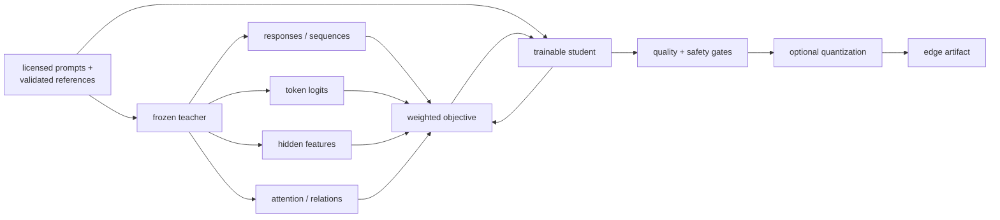
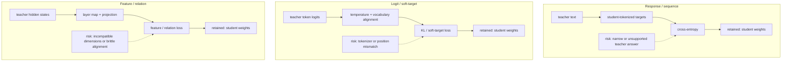
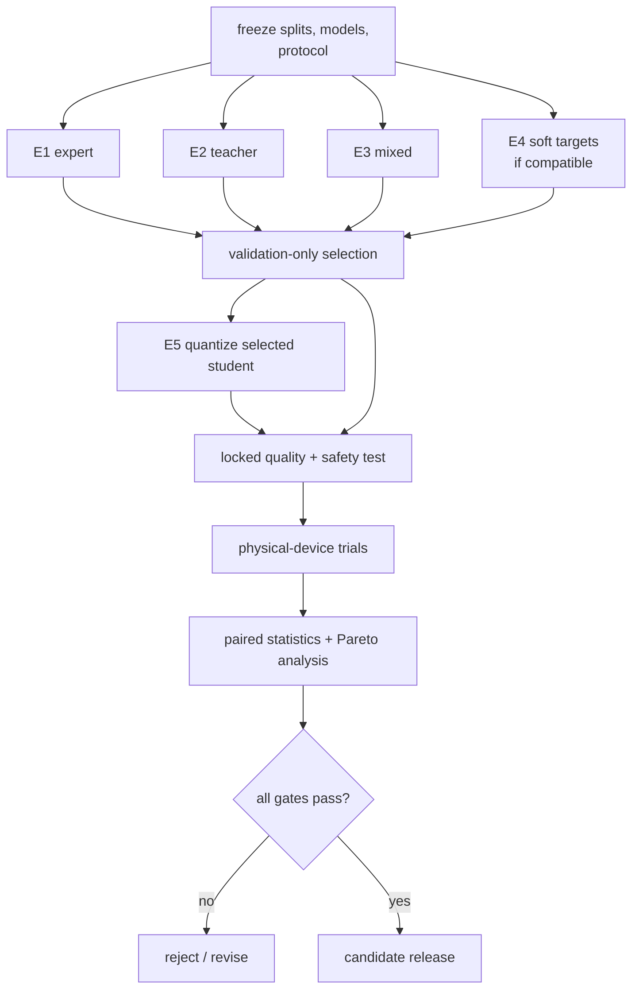

# CH-13: Knowledge Distillation — Complete Research and Implementation

> **Illustrative values.** Concrete identifiers, dates, thresholds, hashes, account numbers, and endpoints in this file are teaching examples, not observed project results or deployable credentials. Before use, replace them with reviewed values from your own registry, preserve the required format, and rerun every stated validation.

## 13.0 Chapter contract, status, and evidence notation

Knowledge distillation (KD) trains a **student** model using information supplied by one or more **teacher** models.
Unlike quantization, which changes numerical representation, or unstructured pruning, which inserts zeros, distillation
can produce a genuinely smaller dense architecture. That makes it especially interesting for portable CPU and mobile
runtimes. It does **not** guarantee that the student is faster, factual, safe, or better than a natively pretrained
model of the same size.

**Research freeze:** 2026-11-23. **Status: AUTHORED / NOT EXECUTED.** No model was trained, teacher API called,
checkpoint quantized, or physical device benchmarked for this chapter. All code listings are
`UNVERIFIED IMPLEMENTATION`; experiment protocols are `PLANNED EXPERIMENT`; diagrams and worked numbers are
`ILLUSTRATIVE`; empirical claims attributed to papers are `PAPER-REPORTED`. Nothing here is a measured project result.

The evidence labels follow the repository [standard](../../00-governance/evidence-and-citation-standard.md):

- `PAPER-REPORTED`: a cited publication reports the finding; this project has not reproduced it.
- `DOC-VERIFIED`: an official interface or constraint was documented at the research freeze; runtime operation was not
  tested here.
- `UNVERIFIED IMPLEMENTATION`: executable-looking code that has not been run.
- `PLANNED EXPERIMENT`: a protocol awaiting execution and raw evidence.
- `ILLUSTRATIVE` or `ESTIMATE`: educational material, never a benchmark.

After this chapter, the reader should be able to distinguish response, sequence, logit, feature, and attention
distillation; design compatible losses; choose a deployable student; govern teacher-generated data; and execute the five
controlled experiments required by this project.

## 13.1 The engineering problem

A strong teacher may be too large, costly, private, or slow for offline use. Training a small model only on one-hot
reference answers discards information the teacher has about plausible alternatives, relationships among tokens,
response style, error recovery, and task structure. KD asks whether some of that behavior can be transferred into a
deployable student.

The compression is not literal copying. A 7B teacher cannot be losslessly encoded into a 0.5B student. The student has
less capacity, a different optimization history, and often a different tokenizer or architecture. Distillation is
therefore **constrained behavioral approximation** under a chosen prompt distribution and loss. What is absent from
transfer data, teacher signals, losses, and student capacity is unlikely to transfer.

For a domain-specific small language model (SLM), four goals compete:

1. retain trustworthy domain knowledge and diagnostic behavior;
2. preserve enough general language competence and uncertainty behavior;
3. fit storage, RAM, operator, latency, energy, and thermal constraints;
4. keep synthesis, training, validation, licensing, and maintenance affordable.

Distillation changes the quality side of this trade-off. Student architecture, context length, key-value (KV) cache
design, runtime kernels, and quantization usually determine whether the result is actually mobile-feasible.

## 13.2 Teacher–student learning

Suppose an automotive item asks why an engine cranks but does not start. A hard label contains one accepted diagnostic
sequence. A teacher can additionally show that fuel and ignition branches are both plausible and that unsafe fuel
handling requires a warning. KD can expose this information as:

- a complete answer (**response/sequence signal**);
- probabilities over each next token (**logit signal**);
- internal representations (**feature signal**);
- attention or token-relation structures (**attention signal**).

Let \(x\) be a prompt, \(y\) a human-validated target sequence, \(\theta_T\) frozen teacher parameters, and \(\theta_S\)
trainable student parameters. A general objective is

\[ \mathcal L = \lambda_{\mathrm{hard}}\mathcal L_{\mathrm{hard}}(y,x;\theta_S) +\lambda_{\mathrm{KD}}\mathcal
L_{\mathrm{KD}}(\theta_T,\theta_S,x) +\sum_j\lambda_j\mathcal L_j . \]

Additional terms may match hidden states, relations, safety behavior, or general-capability replay. The weights
\(\lambda\) are hyperparameters; they need not sum to one unless the implementation defines them that way.

<a id="fig-10"></a> **FIG-10 — Teacher–student transfer paths (`ILLUSTRATIVE`).** Alt text: prompts and references feed
a frozen teacher and trainable student; optional teacher responses, logits, features, and attention become losses; only
the student is exported. Not measured; arrows show conceptual relationships only.



The teacher is used during data generation or training, not primary inference. Calling a remote teacher at inference
would violate this project's offline/no-runtime-RAG objective and would not produce a self-contained SLM.

## 13.3 Distillation signals

<a id="fig-11"></a> **FIG-11 — Response, logit, and feature distillation (`ILLUSTRATIVE`).** Alt text: three aligned
paths compare text-level teacher responses, token-distribution logits, and internal hidden features; each path
identifies its supervision point, alignment requirement, retained student artifact, and principal failure mode. Not
measured; arrows show conceptual relationships only.



### 13.3.1 Response and sequence-level distillation

**Response distillation** trains the student on teacher-produced outputs using ordinary next-token cross-entropy. It
works with a black-box API because only text is required. **Sequence-level KD**, introduced for neural machine
translation by Kim and Rush [R2], approximates a teacher sequence distribution with decoded candidates and trains on
them. In modern instruction models, SFT on teacher completions is both response imitation and a practical form of
sequence-level KD.

Given a teacher-decoded sequence \(\hat y_T=(\hat y_1,\ldots,\hat y_m)\),

\[ \mathcal L_{\mathrm{seq}} =-\sum_{i=1}^{m}m_i\log p_S(\hat y_i\mid x,\hat y_{<i}), \]

where \(m_i\) masks prompt, padding, or unapproved tokens. The student tokenizes the text with its own tokenizer, so
vocabularies may differ.

Sequence KD is simple and storage-efficient, but one decoded answer reveals one narrow path. Greedy decoding suppresses
diversity; high-temperature sampling may amplify hallucination. Beam width, temperature, top-\(p\), system prompt,
teacher revision, and stop conditions are dataset parameters, not incidental details. Kim and Rush report translation
results in their setting (`PAPER-REPORTED`); that is not proof a domain chat student will improve.

### 13.3.2 Logits, soft targets, temperature, and KL

For vocabulary logits \(z_T,z_S\in\mathbb R^V\) and temperature \(T>0\),

\[ p_T^{(T)}(v)= \frac{\exp(z_{T,v}/T)}{\sum_{u=1}^{V}\exp(z_{T,u}/T)},\qquad p_S^{(T)}(v)=
\frac{\exp(z_{S,v}/T)}{\sum_{u=1}^{V}\exp(z_{S,u}/T)}. \]

\(T=1\) gives ordinary probabilities. \(T>1\) flattens the distribution and exposes relative probabilities among
non-argmax tokens—the “soft targets” popularized by Hinton, Vinyals, and Dean [R1]. \(T<1\) sharpens it. Distillation
temperature is distinct from synthetic-response sampling temperature.

A common forward-KL loss is

\[ \mathcal L_{\mathrm{FKL}} =T^2\sum_{i\in M} D_{\mathrm{KL}}\!\left( p_T^{(T)}(\cdot\mid c_i) \parallel
p_S^{(T)}(\cdot\mid c_i)\right), \]

\[ D_{\mathrm{KL}}(P\parallel Q) =\sum_v P(v)\log\frac{P(v)}{Q(v)} , \]

where \(c_i=(x,y_{<i})\) is context and \(M\) contains supervised positions. Terms independent of the student may be
omitted, making this soft-label cross-entropy up to a constant. The conventional \(T^2\) approximately restores gradient
scale after softening; it is not universal and must match reduction.

**Worked example (`ILLUSTRATIVE`).** For teacher logits \([4,2,0]\):

- at \(T=1\): approximately \([0.867,0.117,0.016]\);
- at \(T=2\): approximately \([0.665,0.245,0.090]\).

The hard target says only “token 1.” The soft target says token 2 is much more plausible than token 3. If the student at
\(T=2\) predicts \([0.55,0.30,0.15]\),

\[ D_{\mathrm{KL}}(p_T\parallel p_S) \approx .665\ln(.665/.55)+.245\ln(.245/.30)+.09\ln(.09/.15) \approx 0.032. \]

Closeness does not establish factual correctness.

Forward \(D_{\mathrm{KL}}(p_T\|p_S)\) penalizes missing teacher modes. Reverse \(D_{\mathrm{KL}}(p_S\|p_T)\) penalizes
student mass in low-teacher-probability regions and is more mode-seeking. MiniLLM [R7] applies reverse-KL-oriented,
on-policy methods to generative KD (`PAPER-REPORTED`). Direction, sampling distribution, and estimator must be stated;
“KL distillation” is underspecified.

Full-vocabulary logits cost about \(N_{\mathrm{tokens}}Vb\) bytes. One billion positions, vocabulary 50,000, and 2-byte
values imply about 100 TB before metadata (`ESTIMATE`). Practical systems use top-\(k\), quantized caches, chunking, or
recomputation. A top-\(k\) cache must retain or account for omitted probability mass; renormalizing retained entries
changes the target.

### 13.3.3 Features and intermediate layers

If teacher layer \(\phi(l)\) corresponds to student layer \(l\), and widths differ, use a learned projection \(W_l\):

\[ \mathcal L_{\mathrm{hid}} =\frac{1}{|M|}\sum_l\sum_{i\in M} \left\|W_l h^S_{l,i}-h^T_{\phi(l),i}\right\|_2^2. \]

Layer maps may be uniform, last-layer-only, or learned. Raw mean-squared error is sensitive to scale and representation
rotations; cosine, normalized, relational, or contrastive losses may fit better. Projection modules can usually be
discarded after training.

Feature KD requires internal teacher access and aligned semantic positions. It can overconstrain a student with
different depth, width, activation, positional encoding, or inductive bias. Lower feature loss is not evidence of better
generation.

### 13.3.4 Attention transfer

Attention transfer may match post-softmax maps, query–key products, value–value relations, or aggregated token
relations. For compatible maps:

\[ \mathcal L_{\mathrm{attn}} =\frac{1}{LH}\sum_{l,h} \left\|A^T_{\phi(l),\psi(h)}-A^S_{l,h}\right\|_F^2 . \]

Head counts, grouped-query attention (GQA), multi-query attention (MQA), causal masks, local windows, rotary positions,
and dimensions may differ. Head-index matching can be meaningless. MiniLM [R5] distills attention distributions and
value relations, reducing rigid layer mapping (`PAPER-REPORTED`). Attention resemblance is not proof of behavioral or
causal equivalence.

### 13.3.5 Method comparison

<a id="tbl-09"></a> **TBL-09 — Distillation methods. (`PAPER-REPORTED`)** Mechanisms synthesized from [R1–R9];
performance is intentionally not ranked.

<!-- markdownlint-disable MD013 -->
| Signal              | Teacher access              | Tokenizer constraint                | Advantage              | Main failure/cost                   |
| ------------------- | --------------------------- | ----------------------------------- | ---------------------- | ----------------------------------- |
| Hard response       | text                        | text can be retokenized             | simple; API-compatible | one sampled path; fluent errors     |
| Sequence-level      | decoded sequences/scores    | text can be retokenized             | generation-aligned     | decoding policy biases data         |
| Full logits         | vocabulary logits           | normally identical tokens/positions | rich uncertainty       | huge compute/storage                |
| Top-\(k\) logits    | token IDs, values, residual | normally aligned                    | cheaper                | approximate and cache-heavy         |
| Hidden features     | internals                   | position alignment                  | internal structure     | projections and memory              |
| Attention/relations | attention/QKV               | strong structural compatibility     | token relations        | head/mask mismatch                  |
| Preference/ranking  | candidate scores/ranks      | text candidates                     | comparative behavior   | scorer bias; not classical KD alone |
<!-- markdownlint-restore -->

## 13.4 Offline, online, on-policy, self, and multi-teacher KD

**Offline KD** precomputes responses, logits, or features. It is reusable, auditable, and separable from student
training, but storage-heavy, fixed to a teacher snapshot, and limited to predetermined contexts. It is the preferred
first response-KD design when outputs require expert review.

**Online KD** runs the teacher during student training. It avoids giant caches and can score current student contexts,
but adds teacher forward-pass compute, infrastructure coupling, privacy exposure, and failure surface.

Teacher-forced KD scores expert or teacher prefixes. At inference, the student conditions on its own tokens, creating
exposure mismatch. **On-policy KD** samples student continuations and asks the teacher to score visited contexts.
MiniLLM [R7], Generalized Knowledge Distillation (GKD) [R8], and related work explore this family (`PAPER-REPORTED`). It
can target student-specific errors but is materially more expensive and estimator-sensitive.

**Self-distillation** may mean an earlier/larger checkpoint teaches another version, the same architecture learns from
previous predictions, or a model generates and retrains on its own outputs. It does not mean zero-cost or
self-validating. Repeated self-training can reinforce error and narrow diversity; retain independent references and
untouched tests.

**Multi-teacher KD** combines complementary domain, language, safety, or reasoning teachers through weighted mixtures,
routing, gating, consensus, or separate losses:

\[ \mathcal L_{\mathrm{multi}} =\sum_{k=1}^{K}w_k(x)D_{\mathrm{KL}}(p_{T_k}\|p_S),\quad w_k(x)\ge0,\quad\sum_k
w_k(x)=1. \]

Weights should reflect competence and calibration, not size alone. Average logits only with aligned vocabularies and
positions. Probability averaging across disagreement may create a distribution no expert endorses. For safety-critical
conflicts, authoritative evidence and qualified adjudication outrank majority vote.

## 13.5 Domain, task, data-free, and synthetic distillation

**Domain-specific KD** concentrates on knowledge such as automotive systems, pharmacy, or beekeeping. **Task-specific
KD** targets a narrower behavior such as diagnosis, interaction-risk classification, structured extraction, or safe
refusal. The axes are independent.

A useful mixture contains authoritative expert examples, validated teacher expansions, difficult boundaries,
counterfactuals, safety/refusal cases, general-language replay, and out-of-domain prompts. Distillation can teach answer
format without broad knowledge: polished dialogues do not guarantee coverage of rare faults. Evaluate by concept and
hazard class.

“**Data-free**” usually means the original training set is unavailable. It may still require seed prompts, metadata, a
generator, priors, or teacher gradients. For language models:

- generated prompts may not represent users;
- the teacher may invent both question and answer, creating circular evidence;
- rare hazards are omitted;
- repeated synthetic training can reduce diversity;
- output-retention terms and private API inputs create legal/privacy risk.

Synthetic data is useful for coverage expansion, paraphrase, difficulty, counterexamples, and dialogue variants
**after** a domain ontology and trusted evidence base exist. It is not evidence. Factual records should link to an
authoritative source or expert decision independent of the generator.

Quality gate: schema/privacy/license checks; deterministic domain checks; independent model critique only as triage;
risk-stratified expert review; leakage/duplicate checks; recorded accept/revise/reject reason; immutable snapshot and
content hash.

Offline sources may build and validate data, but the released student answers from parameters under this project's
no-runtime-RAG constraint. Stale facts, imperfect recall, hallucination, and conflict remain.

## 13.6 Research lineage and modern generative distillation

**TBL-CH13-01 — Influential approaches.** Results are `PAPER-REPORTED`; applicability statements are engineering
analysis.

<!-- markdownlint-disable MD013 -->
| Approach                     | Mechanism/contribution                                           | Transferable lesson                    | Invalid inference                          |
| ---------------------------- | ---------------------------------------------------------------- | -------------------------------------- | ------------------------------------------ |
| Classical KD [R1]            | softened targets plus hard labels                                | token-KL foundation                    | classification gains imply LM gains        |
| Sequence KD [R2]             | teacher-decoded NMT sequences                                    | response transfer; decoding matters    | NMT results predict chat quality           |
| DistilBERT [R3]              | LM, soft-target, cosine losses; shallower BERT                   | combined losses; initialization        | encoder figures predict mobile decoding    |
| TinyBERT [R4]                | general/task stages; embedding, hidden, attention, prediction KD | staged multi-level transfer            | every loss should be copied to decoders    |
| MiniLM [R5]                  | attention and value-relation transfer                            | relational matching reduces rigid maps | causal/GQA compatibility is proven         |
| Distilling Step-by-Step [R6] | labels plus generated rationales                                 | concise rationale as auxiliary target  | rationale equals faithful hidden reasoning |
| MiniLLM [R7]                 | on-policy, reverse-KL-oriented generative KD                     | modern open-teacher baseline           | cheaper than response SFT                  |
| GKD [R8]                     | on-policy framework and flexible divergences                     | compare prefix distributions           | domain/mobile benefit is established       |
| DistiLLM [R9]                | skewed KL and adaptive off-policy method                         | test divergence/sampling stability     | independent reproduction is unnecessary    |
<!-- markdownlint-restore -->

DistilBERT initializes a six-layer student from alternating layers of a twelve-layer BERT teacher and combines
masked-LM, distillation, and cosine losses [R3]. TinyBERT uses general and task-specific stages, matching embeddings,
hidden states, attention, and predictions with augmentation [R4]. MiniLM transfers final-layer attention and value
relations [R5]. These are instructive, but BERT is bidirectional and encoder-only: no autoregressive KV cache or
token-decoding loop exists, so reported speed/quality cannot be imported.

The practical modern baseline is validated teacher-response SFT. More advanced generative methods add student-generated
contexts, sequence divergences, rationales/process labels, candidate preferences, and adaptive sampling. They may reduce
exposure mismatch but make teacher cost, credit assignment, and evaluation harder. Add complexity only through ablation.

## 13.7 Teacher choice, access, and legal constraints

| Dimension        | Proprietary/API teacher                   | Open-weight local teacher              |
| ---------------- | ----------------------------------------- | -------------------------------------- |
| Available signal | text; sometimes log probabilities         | text, logits, hidden states, attention |
| Reproducibility  | endpoint may change                       | revisions can be hashed/archived       |
| Marginal cost    | token pricing/rate limits                 | hardware, energy, operations           |
| Privacy          | data leaves boundary unless contracted    | can remain controlled                  |
| Rights           | API terms may restrict retention/training | model/data licenses may restrict use   |
| Deep KD          | usually response-only                     | logit/feature/online feasible          |
| Maintenance      | deprecation/version drift                 | local security/dependencies            |

Legal review must answer:

1. May source documents be sent to this teacher?
2. May outputs be retained and used to train another model?
3. Are attribution, redistribution, acceptable-use, or field restrictions inherited?
4. Can the exact teacher version and terms be evidenced later?
5. Does unknown teacher training provenance create unacceptable risk?

“Open-weight” does not mean open source, unrestricted commercial use, or known training provenance. Capture model card,
license text, checkpoint/tokenizer commit, and dependencies. Recheck before release; this is not legal advice.

Evaluate candidate teachers blind on frozen domain, safety, and calibration subsets. A larger general teacher that
contradicts specialist references is a poor domain teacher.

## 13.8 Teacher-output quality control and provenance

Every generated record should preserve lineage:

```json
{
  "record_id": "auto-kd-000184",
  "domain": "automotive",
  "risk_tier": "safety_critical",
  "prompt": { "system": "...", "user": "..." },
  "teacher": {
    "provider_or_family": "aaaaaaaaaaaaaaaaaaaaaaaaaaaaaaaaaaaaaaaa",
    "checkpoint_or_api_revision": "aaaaaaaaaaaaaaaaaaaaaaaaaaaaaaaaaaaaaaaa",
    "tokenizer_revision": "aaaaaaaaaaaaaaaaaaaaaaaaaaaaaaaaaaaaaaaa"
  },
  "decoding": { "temperature": 0.2, "top_p": 0.95, "seed": null },
  "raw_response": "<immutable raw output>",
  "normalized_response": "<candidate target>",
  "evidence_refs": ["source-doc-id#section"],
  "validators": [
    { "type": "rule", "id": "units-v2", "result": "pass" },
    { "type": "expert", "reviewer": "pseudonymous-id", "result": "accept" }
  ],
  "decision": "accept",
  "rejection_reason": null,
  "license_record": "license-snapshot-id",
  "created_at": "2026-01-15T12:00:00Z",
  "content_sha256": "aaaaaaaaaaaaaaaaaaaaaaaaaaaaaaaaaaaaaaaaaaaaaaaaaaaaaaaaaaaaaaaa"
}
```

Values are `ILLUSTRATIVE`. Access-control raw outputs because they may contain unsafe, private, or copyrighted material.
Retain originals and edit history. Score factual correctness, completeness, diagnostic order, units, uncertainty, source
consistency, refusal correctness, benchmark leakage, and diversity. Use expert adjudication rather than one opaque
model-as-judge score.

## 13.9 Student selection and tokenizer mismatch

Select the student before expensive generation. Require:

- suitable license, model card, pretrained capacity, and technical vocabulary;
- context/KV-cache budget, dense/MoE design, GQA/MQA, depth, width, vocabulary;
- training, export, quantization, and target-runtime operator support;
- storage, peak RAM, startup, sustained latency, battery, and thermal fit.

Fewer parameters can still be slower due to vocabulary projection, depth, operators, or kernels. Compare against a
natively pretrained model of similar size. Starting from a strong small checkpoint is usually a better baseline than
random initialization under a limited domain budget.

Response KD tolerates tokenizer mismatch: decode teacher text, then tokenize with the student. Sequence length and
weighting change—a one-token teacher term may require five student decisions.

Direct token-logit KD normally requires identical vocabulary and boundaries. With mismatch, use text KD, a
shared-tokenizer teacher, an explicitly tested byte/span probability mapping, complete-string scores, or textual
candidate rankings. Never match token IDs by padding/truncation. Shared vocabulary files still do not prove matching
normalization, chat templates, special tokens, or positions.

## 13.10 Reasoning versus final-answer supervision

Final answers are clean but weak process signals. Rationales can expose decomposition, checks, and diagnostic order.
Distilling Step-by-Step [R6] reports gains from separate label and rationale supervision in studied tasks
(`PAPER-REPORTED`). Yet fluent chain of thought can be post-hoc, false, restricted, or unsafe.

Distinguish hidden reasoning (never observable from text alone), verbatim chain-of-thought, concise evidence-linked
rationale, labeled intermediate process, and final-answer supervision. Prefer concise verified rationales and explicit
process labels. Evaluate process separately from outcome and do not reward verbosity. In pharmacy or hazardous repair, a
correct final answer reached through unsafe steps is a failure.

## 13.11 Loss design

\[ \mathcal L = \alpha\mathcal L_{\mathrm{expert}} +\beta\mathcal L_{\mathrm{teacher\ text}} +\gamma T^2\mathcal
L_{\mathrm{KL}} +\delta\mathcal L_{\mathrm{feature}} +\eta\mathcal L_{\mathrm{replay}}. \]

State KL direction and context source; temperature; full or top-\(k\); layer/head maps; prompt/assistant/EOS/padding
masks; domain/risk/source sampling; sequence normalization; weights/schedule; teacher eval mode, precision, and gradient
detachment.

More losses are not automatically better. Gradients conflict, feature loss can dominate, and duplicate synthetic text
can swamp expert examples. Ablate one factor at a time.

**Worked mixed loss (`ILLUSTRATIVE`).** If hard, scaled-KL, and hidden losses are \(1.8,0.25,0.40\), with weights
\(0.6,0.3,0.1\):

\[ \mathcal L=0.6(1.8)+0.3(0.25)+0.1(0.40)=1.195. \]

Inspect gradients and validation results; raw loss magnitudes are insufficient.

## 13.12 Implementation listings

All listings are `UNVERIFIED IMPLEMENTATION`: not installed, run, type-checked, or benchmarked. Pin Python, PyTorch,
Transformers, Datasets, Accelerate, tokenizer, CUDA/runtime, and model revisions. Expected failures include OOM,
template/mask errors, absent API logits, tokenizer mismatch, and unsupported export operators.

### Listing CH13-L01 — governed response dataset

Purpose: block unreviewed teacher output from SFT. Inputs: immutable review JSONL. Output: accepted training JSONL.
Hardware: CPU. Do not log private raw responses.

```python
# UNVERIFIED IMPLEMENTATION — intentionally not executed.
import hashlib, json
from pathlib import Path

def digest(obj):
    data = json.dumps(obj, sort_keys=True, ensure_ascii=False).encode()
    return hashlib.sha256(data).hexdigest()

def materialize(review_path: Path, output_path: Path):
    seen = set()
    with review_path.open(encoding="utf-8") as src, \
         output_path.open("w", encoding="utf-8") as dst:
        for number, line in enumerate(src, 1):
            r = json.loads(line)
            required = {"record_id", "prompt", "normalized_response", "teacher",
                        "evidence_refs", "validators", "decision", "license_record"}
            if missing := required - r.keys():
                raise ValueError(f"line {number}: missing {sorted(missing)}")
            if r["decision"] != "accept":
                continue
            if not r["evidence_refs"]:
                raise ValueError(f"{r['record_id']}: no independent evidence")
            if not any(v.get("type") == "expert" and v.get("result") == "accept"
                       for v in r["validators"]):
                raise ValueError(f"{r['record_id']}: no expert acceptance")
            h = digest({"prompt": r["prompt"],
                        "response": r["normalized_response"]})
            if h in seen:
                continue
            seen.add(h)
            out = {
                "id": r["record_id"],
                "messages": [
                    {"role": "system", "content": r["prompt"].get("system", "")},
                    {"role": "user", "content": r["prompt"]["user"]},
                    {"role": "assistant", "content": r["normalized_response"]},
                ],
                "source_kind": "validated_teacher",
                "teacher_revision": r["teacher"],
                "evidence_refs": r["evidence_refs"],
                "license_record": r["license_record"],
                "content_sha256": h,
            }
            dst.write(json.dumps(out, ensure_ascii=False) + "\n")
```

Add leakage, near-duplicate, rights, risk-tier, and reviewer-authorization checks in the production pipeline.

### Listing CH13-L02 — aligned hard plus forward-KL loss

Inputs: aligned IDs/masks and labels with prompt/padding set to `-100`. Hardware: student training plus teacher
inference memory. Teacher and student must use identical vocabulary ordering and chat-token sequence.

```python
# UNVERIFIED IMPLEMENTATION — intentionally not executed.
from dataclasses import dataclass
import torch
import torch.nn.functional as F

@dataclass
class KDConfig:
    temperature: float = 2.0
    hard_weight: float = 0.5
    kd_weight: float = 0.5

def causal_kd_loss(student, teacher, batch, cfg: KDConfig):
    if cfg.temperature <= 0:
        raise ValueError("temperature must be positive")
    labels = batch["labels"]
    valid = labels.ne(-100)
    if not valid.any():
        raise ValueError("no supervised assistant tokens")

    student_out = student(input_ids=batch["input_ids"],
                          attention_mask=batch["attention_mask"])
    with torch.inference_mode():
        teacher.eval()
        teacher_out = teacher(input_ids=batch["input_ids"],
                              attention_mask=batch["attention_mask"])

    # Position i predicts token i+1.
    s = student_out.logits[:, :-1, :]
    t = teacher_out.logits[:, :-1, :].to(dtype=s.dtype)
    target, mask = labels[:, 1:], valid[:, 1:]
    if s.shape != t.shape:
        raise ValueError("KD requires identical [batch,time,vocab] shapes")

    hard = F.cross_entropy(s.reshape(-1, s.size(-1)), target.reshape(-1),
                           ignore_index=-100)
    temp = cfg.temperature
    teacher_prob = F.softmax(t / temp, dim=-1)
    student_log_prob = F.log_softmax(s / temp, dim=-1)
    token_kl = F.kl_div(student_log_prob, teacher_prob,
                        reduction="none").sum(dim=-1)
    soft = token_kl.masked_select(mask).mean() * temp**2
    total = cfg.hard_weight * hard + cfg.kd_weight * soft
    return total, {"hard": hard.detach(), "soft": soft.detach(),
                   "tokens": mask.sum().detach()}
```

Production code must add distributed placement, precision policy, accumulation, cache handling, checkpoints, logging,
and exact tokenizer identity checks.

### Listing CH13-L03 — auditable top-\(k\) cache schema

```python
# UNVERIFIED IMPLEMENTATION — intentionally not executed.
from typing import TypedDict

class TokenTarget(TypedDict):
    token_position: int
    top_token_ids: list[int]
    top_logits_fp16: list[float]
    logsumexp_all_logits: float  # retained probabilities + residual mass

class KDCacheRecord(TypedDict):
    record_id: str
    input_ids_sha256: str
    teacher_checkpoint_sha256: str
    tokenizer_sha256: str
    chat_template_sha256: str
    targets: list[TokenTarget]
```

Manifest dataset index, teacher precision, \(k\), temperature policy, and code revision. Validate random cache entries
against fresh teacher passes.

## 13.13 Five required experiments

### Research question and hypotheses

**Question:** under a fixed student and domain-data budget, which supervision best preserves acceptable domain quality
while improving measured mobile deployment? Hypotheses (`PLANNED EXPERIMENT`): validated teacher data improve breadth
but can increase unsupported claims; mixed data outperform either source; aligned soft targets add value; quantization
reduces deployment resources with bounded quality loss; architecture/runtime, not target origin, determine mobile speed.
These are not results.

### Variants

Use one immutable student initialization \(S_0\), chat template, context length, and training-token budget where
feasible. Add untouched \(S_0\) and a same-size native SLM as controls.

<!-- markdownlint-disable MD013 -->
| ID  | Required experiment   | Signal                                    | Isolation                                                  |
| --- | --------------------- | ----------------------------------------- | ---------------------------------------------------------- |
| E1  | direct expert         | expert/reference-validated data only      | no teacher targets                                         |
| E2  | teacher examples      | independently validated teacher data only | compare equal tokens and equal acquisition budget          |
| E3  | mixed                 | expert + validated teacher                | preregister weights; cross-source deduplication            |
| E4  | soft targets          | E3 hard data + aligned teacher KL         | same-tokenizer open teacher; otherwise honestly infeasible |
| E5  | distilled + quantized | best distilled checkpoint, then PTQ       | no recovery unless separate E5b                            |
<!-- markdownlint-restore -->

Additional controls: teacher-sized direct SFT, unfiltered synthetic data only in a safe isolated analysis, and a
same-size native pretrained model.

### Dataset construction

Freeze an ontology. An automotive pilot should stratify engine mechanical, fuel, ignition, electrical, emissions,
braking, safety, diagnostic process, and uncertainty. Pharmacy needs separate authoritative sources and qualified
clinical review; no autonomous prescribing.

Partition by source, underlying scenario, and near-duplicate group **before** paraphrase/generation. The test set
contains no teacher target used in training. Compare E1/E2 under equal accepted tokens and equal acquisition budget.
Select E3 weights on validation only. E4 uses exact token alignment; if none exists, report infeasible rather than
simulating soft targets.

### Training and reproducibility controls

Hold constant checkpoint/tokenizer commit, initialization, optimizer/scheduler, learning-rate search budget, effective
batch tokens, context, precision, early-stopping rule, supervised-token budget, hardware class, container digest, seed
set, and checkpoint-selection metric. Prefer at least three seeds.

Record accelerator-hours, wall time, peak memory, generation tokens, actual API/local cost inputs, storage, reviewer
hours, acceptance rate, and failures. Preserve commands, logs, environment, raw results, hashes, and rejected runs.

### Quality, safety, and statistics

Use paired prompts. Measure source-backed factual accuracy, process/order, structured-task F1/exact match, unsupported
claims, contradictions, calibration, safety/refusal/escalation correctness, general retention, paraphrase/noise/OOD
robustness, length, and format. Expert preference supplements—not replaces— factual scoring.

Bootstrap prompt-level confidence intervals; use paired tests such as McNemar's for paired binary outcomes; address
multiple comparisons. Report strata because averages hide hazardous subsets. Safety minima are non-compensatory.

### E5 quantization

Select E5 on validation only. Use runtime-supported post-training quantization (PTQ) with immutable representative
calibration data excluding test prompts. Record converter/runtime, format, granularity, group size, calibration hash,
fallback operators, artifact hash, and failures. Compare E5 to its unquantized parent to isolate quantization, then to
E1–E4 for the overall pipeline.

### Physical mobile evidence plan

Mobile implications remain `PLANNED EXPERIMENT`. Record device/SoC, RAM, OS, runtime commit, backend, threads/delegate,
ambient temperature, battery and charging state, connectivity/background policy, context/output lengths, and artifact
hash.

After fixed warm-up, run randomized paired trials measuring artifact/download size, peak resident memory, post-load
memory, startup, time to first token (TTFT), prefill/decode tokens/s, end-to-end latency, energy where instrumented,
battery change, temperature and sustained thermal-soak throughput, crashes, OOMs, and output mismatches. Separate
cold/warm runs; report median, dispersion, trial count, and raw traces. A candidate must pass quality/safety **and**
device-specific RAM, TTFT, decode, energy, and thermal limits.

**FIG-CH13-02 — Evidence-producing experiment (`ILLUSTRATIVE`).** Alt text: teacher data generation, student training,
evaluation, optional compression, and target benchmarking produce an auditable evidence chain with rejection paths.



**TBL-CH13-03 — Illustrative results walkthrough (`ILLUSTRATIVE`; invented values, not measurements).**

<!-- markdownlint-disable MD013 -->
| Variant | Domain score | Unsafe errors | General retention | Artifact | Peak RAM | Decode rate | Interpretation |
| --- | ---: | ---: | ---: | ---: | ---: | ---: | --- |
| S0 untouched | 61 | 7 | 92 | 1.0 GB | 1.5 GB | 12 tok/s | deployment baseline |
| E1 expert | 78 | 2 | 90 | 1.0 GB | 1.5 GB | 12 tok/s | trusted-data gain |
| E2 teacher | 81 | 6 | 88 | 1.0 GB | 1.5 GB | 12 tok/s | breadth rose; safety failed |
| E3 mixed | 84 | 2 | 90 | 1.0 GB | 1.5 GB | 12 tok/s | strongest qualified FP student |
| E4 soft-target | 85 | 2 | 90 | 1.0 GB | 1.5 GB | 12 tok/s | small incremental gain |
| E5 E4 + INT4 | 83 | 3 | 89 | 0.32 GB | 0.8 GB | 18 tok/s | fails a two-error safety ceiling |
| Same-size native + expert | 82 | 2 | 90 | 0.9 GB | 1.4 GB | 13 tok/s | simpler qualified control |
<!-- markdownlint-restore -->

These invented values demonstrate the decision process. E2 is not acceptable merely because its average domain score
exceeds E1: it repeats more unsafe teacher behavior and loses more general capability. E3 shows why mixing validated
teacher breadth with expert anchors can be useful. E4's one-point gain would require uncertainty and added teacher-cost
analysis before it justified soft-logit complexity. E5 is smaller and faster but crosses the pre-registered safety
ceiling, so the quantized artifact is rejected; the correct rollback is E4, followed by a less aggressive or
mixed-precision quantization attempt. The native control remains competitive and may be preferred if E4's small score
advantage does not exceed uncertainty or maintenance cost.

The apparent artifact value in the E5 row belongs under Artifact; the illustrative table intentionally omits total cost,
TTFT, energy, confidence intervals, and hardware identity to show that an incomplete table cannot support release.
Executed results must add those fields and raw provenance before plotting a Pareto frontier.

### 13.13.1 Follow one record through the complete workflow

1. A licensed automotive reference supplies a “cranks but does not start” scenario and independent expected checks.
2. The teacher generates two candidate diagnostic responses. Review rejects one for proposing a fuel test before
   ventilation and isolation; the accepted response is edited, source-linked, and hashed.
3. E1 trains only on the expert answer. E2 trains on the accepted teacher answer. E3 samples both under a declared
   source ratio. No rejected output reaches training.
4. If teacher and student tokenization align exactly, E4 additionally compares next-token distributions at assistant
   positions. Otherwise E4 is reported infeasible; token IDs are never forced into false alignment.
5. All students answer the same sealed variant of the scenario. Scoring separates final diagnosis, test order,
   unsupported claims, and safety prerequisites.
6. Only the validation-selected student is quantized. Its unquantized parent and quantized child are compared on the
   same records so any regression can be attributed to quantization rather than distillation.
7. The qualified child is tested on the physical device; teacher calls are absent from deployment.

This record-level view explains the comparison table in Section 13.3.5: response signals are easy to align and audit,
logits expose richer alternatives but demand vocabulary/position compatibility, and features/attention add internal
constraints whose cost and fragility must earn a measured benefit.

## 13.14 Failure modes

<!-- markdownlint-disable MD013 -->
| Failure                 | Symptom                              | Cause                               | Diagnostic/correction           |
| ----------------------- | ------------------------------------ | ----------------------------------- | ------------------------------- |
| teacher error transfer  | fluent repeated falsehood            | unvalidated teacher                 | independent source/expert audit |
| capacity ceiling        | high train and validation loss       | student too small                   | larger/native student control   |
| style without knowledge | format rises; rare strata do not     | narrow prompts                      | ontology coverage audit         |
| forgetting              | domain rises; general/safety falls   | narrow mixture                      | replay and checkpoint ablation  |
| mode collapse           | repetitive answers                   | greedy/self-generated data          | diversity audit                 |
| exposure mismatch       | teacher-forced good; generation poor | gold prefixes only                  | on-policy evaluation pilot      |
| KL instability          | NaNs/spikes                          | temperature/reduction/precision bug | loss/gradient unit tests        |
| feature domination      | low feature loss; worse answers      | excessive/misaligned loss           | remove or anneal                |
| tokenizer mismatch      | wrong shapes/positions               | incompatible vocab/template         | response KD or valid mapping    |
| leakage                 | implausibly high benchmark           | paraphrase/source overlap           | grouped semantic audit          |
| safety regression       | hazardous confidence                 | teacher/missing hazard cases        | risk gate and expert review     |
| no speedup              | smaller but same/slower              | kernel/architecture bottleneck      | target-device operator profile  |
| cost overrun            | teacher dominates                    | online/full-logit design            | offline/top-\(k\)/response KD   |
<!-- markdownlint-restore -->

Also test truncated safety warnings, EOS/template corruption, calibration loss, copyright memorization, API drift, and
quantization-amplified weaknesses.

## 13.15 Cost-effectiveness

\[ C_{\mathrm{total}}= C_{\mathrm{teacher\ generation}}+ C_{\mathrm{teacher\ during\ training}}+ C_{\mathrm{student\
training}}+ C_{\mathrm{expert\ review}}+ C_{\mathrm{storage}}+ C_{\mathrm{evaluation}}+ C_{\mathrm{conversion}}+
C_{\mathrm{device\ testing}}+ C_{\mathrm{maintenance}}. \]

For API synthesis, \[ C_{\mathrm{generation}}=N_{\mathrm{in}}r_{\mathrm{in}} +N_{\mathrm{out}}r_{\mathrm{out}}, \]
using actual token counts and contemporaneous billing units. For local teachers, report accelerator-hours, utilization,
energy where measurable, labor, and amortization assumptions.

Teacher data are not “free”: ontology design, validation, rejection, and expert adjudication remain. Compare
equal-quality safe systems: \[ \text{incremental cost effectiveness}=(C_A-C_B)/(Q_A-Q_B). \] If uncertainty in
\(Q_A-Q_B\) spans zero, do not claim superiority.

Use response KD for black-box access and simplicity; offline aligned logit KD when open models and storage permit;
online/on-policy KD only after exposure mismatch is demonstrated and added cost justified.

## 13.16 Legal, safety, privacy, and provenance

Distillation can reproduce memorization, copyrighted expression, personal data, bias, unsafe instructions, and policy
violations. A smaller student is not legally or ethically purified.

Required controls:

- document rights for every source, prompt, output, model, and tokenizer;
- verify terms permit retention and downstream training;
- prohibit unauthorized manuals, customer records, health information, credentials, and personally identifiable
  information;
- minimize/access-control raw output and logs;
- scan for verbatim memorization and sensitive strings;
- preserve versions, settings, decisions, edits, licenses, and hashes;
- define intended/prohibited use, escalation, and human oversight;
- require qualified review for pharmacy and safety-critical repair;
- maintain incident, takedown, rollback, and dataset-removal procedures;
- revalidate after teacher, data, student, quantizer, or runtime changes.

An experimental pharmacy student must not prescribe or replace a professional. A repair student must not authorize
hazardous work without appropriate isolation, lockout, competence, personal protective equipment, and service
information. Exact obligations vary; obtain legal/regulatory advice.

## 13.17 Decision framework

1. Start with a deployable pretrained student.
2. Establish E1 direct-expert performance first.
3. Prefer validated response KD initially.
4. Mix sources only with lineage and ablations.
5. Attempt soft targets only with legitimate logit access and exact alignment.
6. Add feature/attention/on-policy losses only after a demonstrated limitation.
7. Quantize only a quality-qualified checkpoint and rerun every gate.
8. Select a Pareto frontier; unsafe models are dominated regardless of speed.

Priority: teacher–student, soft targets, temperature, and KL are **foundational**; validated response KD, mixed data,
provenance, and student/mobile co-design are **core practical**; aligned top-\(k\) and selected intermediate losses are
**advanced practical**; on-policy reverse-KL, conflict-aware multi-teacher, and data-free KD are **experimental here**;
DistilBERT, TinyBERT, and MiniLM are **historical but instructive**.

## 13.18 Summary

- KD is constrained behavioral approximation, not lossless compression or factual verification.
- Response/sequence KD tolerates tokenizer mismatch. Logit KD provides richer distributions but normally requires
  alignment. Feature/attention KD requires deeper compatibility.
- Temperature, KL direction, sampled contexts, reduction, masking, and omitted mass materially affect the objective.
- Offline KD favors auditability; online/on-policy KD can address student contexts at higher cost.
- Self/synthetic KD amplifies errors; multi-teacher KD needs conflict handling.
- Encoder-era DistilBERT, TinyBERT, and MiniLM do not establish causal-SLM mobile outcomes.
- Student architecture determines much of deployment behavior; distillation alone does not shrink KV cache or guarantee
  fast kernels.
- E1 expert, E2 teacher, E3 mixed, E4 soft-target, and E5 distilled+quantized remain unexecuted.
- Rights, safety, privacy, provenance, and physical-device evidence are release requirements.

## 13.19 Review questions and exercises

1. Why can a soft target carry more information than a one-hot target?
2. Derive forward KL's student-dependent term and explain \(T^2\).
3. Distinguish response, sequence, and token-logit KD.
4. Why does response KD tolerate tokenizer mismatch?
5. Compare teacher-forced and on-policy contexts.
6. Why is attention similarity not proof of equivalent reasoning?
7. Why cannot DistilBERT figures serve as mobile decoder benchmarks?
8. Give two meanings and risks of self-distillation.
9. Compute \(T=2\) probabilities for logits \([3,1,-1]\), then forward KL to \([0.60,0.30,0.10]\).
10. Estimate FP16 full-logit storage for 50 million positions and vocabulary 32,000; propose an explicit approximation.
11. Design valid transfer from byte-BPE teacher to Unigram student.
12. Construct assistant-only masks for multi-turn chat, including EOS.
13. Build a 100-record governed generation pilot and report expert agreement.
14. Unit-test CH13-L02 for identical distributions, all-masked inputs, vocabulary mismatch, and mixed precision before
    using a real model.
15. Preregister E1–E5 with commits, hashes, seeds, metric, safety minima, device budgets, and statistical tests.
16. Profile the untrained candidate student on target hardware before teacher generation.
17. Audit one proprietary and one open-weight teacher using Section 13.7.
18. Compare concise verified rationales with final-answer-only supervision, scoring process and outcome separately.

## 13.20 Sources

All findings below remain `PAPER-REPORTED`.

**[R1]** Geoffrey Hinton, Oriol Vinyals, and Jeff Dean. “Distilling the Knowledge in a Neural Network.” NIPS
workshop, 2015. arXiv:1503.02531. <https://arxiv.org/abs/1503.02531>. Soft targets and hard/soft losses. Limitation:
classification framing; no modern causal mobile evidence.

**[R2]** Yoon Kim and Alexander M. Rush. “Sequence-Level Knowledge Distillation.” EMNLP 2016. DOI: 10.18653/v1/D16-1139.
<https://aclanthology.org/D16-1139/>. Teacher-decoded NMT sequences. Limitation: translation setting and decoding
approximation.

**[R3]** Victor Sanh et al. “DistilBERT, a Distilled Version of BERT: Smaller, Faster, Cheaper and Lighter.” NeurIPS
EMC2 Workshop, 2019. arXiv:1910.01108. <https://arxiv.org/abs/1910.01108>. Triple-loss, shallower BERT. Limitation:
encoder-only tasks/hardware. Historical, unmaintained implementation:
  <https://github.com/huggingface/transformers-research-projects/tree/main/distillation>.

**[R4]** Xiaoqi Jiao et al. “TinyBERT: Distilling BERT for Natural Language Understanding.” Findings of EMNLP 2020. DOI:
10.18653/v1/2020.findings-emnlp.372. <https://aclanthology.org/2020.findings-emnlp.372/>. Two-stage, multi-level KD.
Limitation: BERT alignment and complex augmentation. Repository:
<https://github.com/huawei-noah/Pretrained-Language-Model/tree/master/TinyBERT>.

**[R5]** Wenhui Wang et al. “MiniLM: Deep Self-Attention Distillation for Task-Agnostic Compression of Pre-Trained
Transformers.” NeurIPS 2020. arXiv:2002.10957. <https://arxiv.org/abs/2002.10957>. Attention/value relations.
Limitation: encoder-focused evidence. Repository: <https://github.com/microsoft/unilm/tree/master/minilm>.

**[R6]** Cheng-Yu Hsieh et al. “Distilling Step-by-Step! Outperforming Larger Language Models with Less Training Data
and Smaller Model Sizes.” Findings of ACL 2023. DOI: 10.18653/v1/2023.findings-acl.507.
<https://aclanthology.org/2023.findings-acl.507/>. Labels plus rationales. Limitation: rationales are not guaranteed
faithful hidden reasoning.

**[R7]** Yuxian Gu et al. “MiniLLM: Knowledge Distillation of Large Language Models.” ICLR 2024.
<https://openreview.net/forum?id=5h0qf7IBZZ>. On-policy, reverse-KL-oriented generative KD. Limitation: teacher-logit
cost/complexity. Repository: <https://github.com/microsoft/LMOps/tree/main/minillm>.

**[R8]** Rishabh Agarwal et al. “On-Policy Distillation of Language Models: Learning from Self-Generated Mistakes.”
ICLR 2024. <https://openreview.net/forum?id=3zKtaqxLhW>. Generalized Knowledge Distillation. Limitation: online teacher
cost and studied model/task scope.

**[R9]** Akash Jha et al. “DistiLLM: Towards Streamlined Distillation for Large Language Models.” ICML 2024.
arXiv:2402.03898. <https://arxiv.org/abs/2402.03898>. Skewed KL and adaptive off-policy method. Limitation: complexity
and need for independent reproduction. Repository: <https://github.com/jongwooko/distillm>.

**[R10]** Sergey Zagoruyko and Nikos Komodakis. “Paying More Attention to Attention.” ICLR 2017. arXiv:1612.03928.
<https://arxiv.org/abs/1612.03928>. Attention-transfer lineage. Limitation: convolutional vision, not direct LM
evidence.

**[R11]** Adriana Romero et al. “FitNets: Hints for Thin Deep Nets.” ICLR 2015. arXiv:1412.6550.
<https://arxiv.org/abs/1412.6550>. Intermediate hints. Limitation: vision precursor, not direct LM evidence.

**[R12]** Hugging Face Transformers documentation, model outputs and causal-LM interfaces.
<https://huggingface.co/docs/transformers/>. `DOC-VERIFIED` at the research freeze only; pin and reverify the installed
release before CH13-L02.

## 13.21 Verification note and cross-links

The listings and E1–E5 protocol were not executed; the result walkthrough is invented teaching data. Reverify model
rights, interfaces, environments, and target runtimes, then retain raw evidence before making any empirical claim.

Related material:

- [Part IV index](README.md)
- [CH-11: Quantization](ch-11-quantization-complete-research-and-implementation.md)
- [CH-12: Pruning](ch-12-pruning-complete-research-and-implementation.md)
- [CH-15: Combined optimization](ch-15-combining-optimization-techniques.md)
- [CH-13 assessment](../../13-assessments/ch-13-assessment.md)
- [Evidence standard](../../00-governance/evidence-and-citation-standard.md)
- [Safety standard](../../00-governance/safety-and-risk-standard.md)
- [Reproducibility standard](../../00-governance/reproducibility-standard.md)
- [No-runtime-RAG standard](../../00-governance/no-runtime-rag-standard.md)
