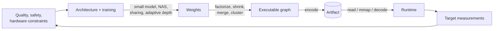
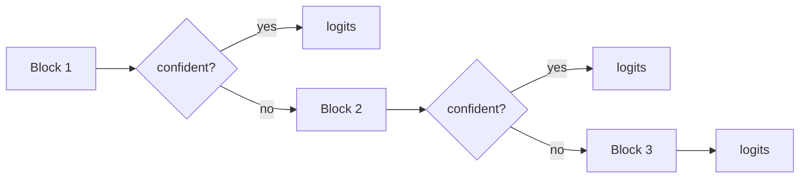
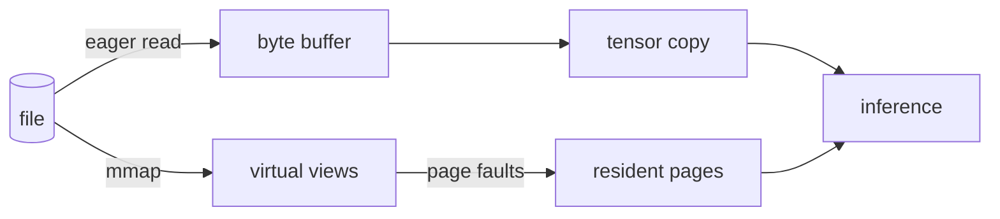

<a id="1421-honest-completion-record"></a>

# CH-14: Additional Model Compression Techniques

> **Illustrative values.** Concrete identifiers, dates, thresholds, hashes, account numbers, and endpoints in this file are teaching examples, not observed project results or deployable credentials. Before use, replace them with reviewed values from your own registry, preserve the required format, and rerun every stated validation.

<a id="ch14-status"></a>

## 14.1 Status, scope, and evidence boundary

**Research freeze:** 2026-11-23.  
**Status:** **AUTHORED / NOT EXECUTED.** This chapter covers methods beyond Chapters 11–13. No training, conversion,
benchmark, or device test was executed.

Evidence labels follow the project [evidence standard](../../00-governance/evidence-and-citation-standard.md):
`PAPER-REPORTED`, `DOC-VERIFIED`, `STATICALLY REVIEWED`, `ILLUSTRATIVE`, `ESTIMATE`, `UNVERIFIED IMPLEMENTATION`, and
`PLANNED EXPERIMENT`. A cited result is never represented as locally reproduced.

Some methods reduce unique parameters, some reduce dense dimensions or expected computation, and others reduce only
download bytes or eager copying. Model merging is normally consolidation, not within-model compression. Memory mapping
changes loading, not parameter count.

<a id="ch14-objectives"></a>

## 14.2 Learning objectives

The reader should be able to:

1. calculate when matrix/tensor factorization saves parameters;
2. distinguish static shrinking, early exit, and adaptive computation;
3. distinguish sharing, tying, clustering, and merging;
4. separate artifact size, resident memory, operations, and latency;
5. design hardware-aware and joint searches without proxy-metric overclaiming; and
6. decide when a directly trained small model is preferable.

<a id="ch14-map"></a>

## 14.3 Lifecycle and maturity map

<a id="fig-ch14-01"></a> **FIG-CH14-01 — Where methods act (`ILLUSTRATIVE`).**  
_Alt text:_ Architecture methods precede trained weights; checkpoint methods alter weights or dimensions; coding alters <!-- markdownlint-disable-line MD013 MD049 -->
files; memory mapping alters loading; all candidates return to target measurement.



<a id="tbl-ch14-01"></a> **TBL-CH14-01 — Project classification (`STATICALLY REVIEWED`)**

<!-- markdownlint-disable MD013 -->
| Method                           | Main effect              | Classification                   | Initial verdict            |
| -------------------------------- | ------------------------ | -------------------------------- | -------------------------- |
| Low-rank matrix factorization    | parameters/MACs          | Foundational; advanced practical | selective experiment       |
| Tensor decomposition             | multiway compactness     | Advanced/experimental            | research track             |
| Layer dropping/shrinking         | dense depth/width        | Core practical                   | high priority              |
| Early exit/adaptive compute      | expected work            | Experimental for causal SLMs     | defer                      |
| Embedding tying                  | unique parameters        | Foundational/core                | prefer when compatible     |
| Cross-layer sharing              | unique parameters        | Advanced                         | design-time option         |
| Model merging                    | fleet consolidation      | Advanced/experimental            | not compression by default |
| Adapter merging                  | deployment consolidation | Core/advanced                    | quality-gated              |
| Vocabulary/embedding compression | embedding/output cost    | Advanced                         | pretraining-time preferred |
| Clustering/entropy coding        | artifact bytes           | Historical/foundational          | distribution experiment    |
| Memory mapping                   | loading/residency        | Core practical                   | benchmark                  |
| Hardware-aware NAS               | target graph             | Advanced/experimental            | narrow search              |
| Joint search                     | co-optimization          | Experimental                     | impractical initially      |
| Direct small-model training      | native small graph       | Core strategy; expensive         | compare later              |
<!-- markdownlint-restore -->

<a id="ch14-low-rank"></a>

## 14.4 Low-rank weight factorization and matrix decomposition

### Problem, intuition, internals, and math

If \(W\in\mathbb R^{m\times n}\) mostly acts through an \(r\)-dimensional subspace, replace it with:

<a id="eq-ch14-01"></a> \[ \boxed{W\approx UV,\quad U\in\mathbb R^{m\times r},\quad V\in\mathbb R^{r\times n}}
\tag{EQ-CH14-01} \]

The full matrix has \(mn\) parameters; factors have \(r(m+n)\). Savings require:

<a id="eq-ch14-02"></a> \[ \boxed{r<\frac{mn}{m+n}} \tag{EQ-CH14-02} \]

For \(4096\times4096\), rank 512 changes 16,777,216 values to 4,194,304 (`ILLUSTRATIVE`). Execution becomes
\(4096\rightarrow512\rightarrow4096\). Two launches, an intermediate, and poor shapes can erase theoretical speedup.

With singular value decomposition \(W=P\Sigma Q^\top\), truncated SVD retains the top \(r\) singular values:

<a id="eq-ch14-03"></a> \[ W_r=P_{:r}\Sigma_{:r}Q_{:r}^{\top}. \tag{EQ-CH14-03} \]

This minimizes reconstruction error, not language-model loss. Use per-layer sensitivity and recovery training. Paths are
post-training SVD, direct factorized training, or gated rank-one pruning [R1–R4].

This is not LoRA: LoRA keeps full \(W\) and learns low-rank \(\Delta W\). Merging LoRA normally restores a full dense
matrix.

### Implementation

<a id="listing-ch14-01"></a> **Listing CH14-L01 — SVD replacement (`UNVERIFIED IMPLEMENTATION`).**

```python
import torch
from torch import nn

@torch.no_grad()
def factorize(layer: nn.Linear, rank: int) -> nn.Sequential:
    W = layer.weight.float()
    U, S, Vh = torch.linalg.svd(W, full_matrices=False)
    root = S[:rank].sqrt()
    a = nn.Linear(layer.in_features, rank, bias=False)
    b = nn.Linear(rank, layer.out_features, bias=layer.bias is not None)
    a.weight.copy_(root[:, None] * Vh[:rank])
    b.weight.copy_(U[:, :rank] * root[None, :])
    if layer.bias is not None:
        b.bias.copy_(layer.bias)
    return nn.Sequential(a.to(layer.weight.dtype), b.to(layer.weight.dtype))
```

Pin versions; preserve tied tensors and fused-QKV layout; avoid tiny layers; recover on governed domain/general replay
data; export; then trace actual kernels.

### Effects, strengths, limits, alternatives, relevance

- Weight bytes and ideal arithmetic fall only below break-even rank; KV cache is unchanged.
- Dense GEMMs are portable, but latency is empirical.
- Layer sensitivity varies; SVD energy is not semantic importance.
- Alternatives are structured width pruning, distillation, quantization, or a native smaller model.
- Test rare terminology, identifiers, units, contraindications, procedures, and safety behavior.
- Align ranks to target tiles; AWS and batch-one mobile may prefer different ranks.

**Maturity:** matrix factorization is **foundational**; selective factorization with recovery is **advanced practical**;
indiscriminate whole-model factorization is **impractical initially**.

<a id="ch14-tensor"></a>

## 14.5 Tensor decomposition

Matrix flattening can hide layer/head/channel structure. Common representations are:

- CP: \(\mathcal W\approx\sum_{j=1}^{r}a_j\circ b_j\circ c_j\);
- Tucker: \(\mathcal W\approx\mathcal G\times_1A\times_2B\times_3C\);
- Tensor Train: a chain of contracted cores;
- Block-Term Decomposition (BTD): a sum of Tucker-like blocks.

For \(\mathcal W\in\mathbb R^{I\times J\times K}\), Tucker storage is:

<a id="eq-ch14-04"></a> \[ IR_1+JR_2+KR_3+R_1R_2R_3 \tag{EQ-CH14-04} \]

instead of \(IJK\), before metadata. A Tensorized Transformer used BTD/shared projections in attention [R2].

Implementation requires a meaningful tensorization, rank search, decomposition or from-scratch training,
contraction-order optimization, recovery, and export validation. A compact formula can become transposes, temporaries,
and many unsupported kernels.

**Resources:** parameters may fall; arithmetic and peak memory depend on contractions; KV usually does not.
**Strength:** captures multiway correlation. **Limits:** difficult rank search, kernels, conversion, and debugging.
**Alternative:** matrix factors or dense shrinking. **Domain/edge:** promising only when the exact runtime executes
contractions efficiently. **Maturity:** **advanced/experimental; impractical for the first production artifact**.

<a id="ch14-layer-drop"></a>

## 14.6 Layer dropping and architecture shrinking

Depth imposes serial latency. Removing whole blocks reduces parameters, block operations, dispatches, and per-layer KV.
LayerDrop trains with complete blocks randomly bypassed so fixed shallower subnetworks are more robust [R5]:

<a id="eq-ch14-05"></a> \[ h_{l+1}=h_l+\frac{z_l}{1-p}F_l(h_l),\qquad z_l\sim\mathrm{Bernoulli}(1-p). \tag{EQ-CH14-05}
\]

Exact conventions vary. Post-hoc dropping, LayerDrop training, and early exit are different. Selection may use uniform
spacing, validation search, similarity, importance, or learned gates. Materialize a new dense checkpoint/configuration;
do not merely skip blocks in Python.

Architecture shrinking also includes hidden width, FFN width, heads/KV heads, experts, vocabulary, and context/attention
design. For a gated decoder block, an approximate count is:

<a id="eq-ch14-06"></a> \[ N_{\rm block}\approx2d^2+2d(H_{kv}d_h)+3dd_{\rm ffn}. \tag{EQ-CH14-06} \]

Width changes couple embeddings, norms, residuals, Q/K/V/O, FFNs, and head divisibility. Arbitrary first-channel slicing
is invalid unless trained for it. MatFormer trains nested FFN prefixes [R22]; MobileLLM studied deep-thin layouts, GQA,
embedding sharing, and block sharing [R23].

**Worked example:** materializing 18 of 24 equal-shape blocks removes one quarter of block work/weights, not one quarter
of total latency or parameters (`ILLUSTRATIVE`).

**Implementation:** structured dependency-aware slicing plus recovery; distill into a smaller configuration; train
nested widths; or train natively. **Strength:** portable dense graph and lower worst-case work. **Limits:** irreversible
capacity loss and substantial recovery. **Domain/edge:** high-priority, but gate multi-step reasoning, rare entities,
safety prerequisites, and long context. **Maturity:** layer/FFN shrinking is **core/advanced practical**; arbitrary
graph surgery is **experimental**.

<a id="ch14-early-exit"></a>

## 14.7 Early exit and adaptive computation

Early exit adds intermediate heads and stops when a confidence/policy threshold is met. For exit depth \(D(x)\):

<a id="eq-ch14-07"></a> \[ \boxed{\mathbb E[D]=\sum_{l=1}^{L}\Pr(D\ge l)} \tag{EQ-CH14-07} \]

Expected savings do not reduce worst-case depth. DeeBERT used entropy thresholds for encoder classification [R7];
Depth-Adaptive Transformer studied decoder depth [R6].

<a id="fig-ch14-02"></a> **FIG-CH14-02 — Static versus dynamic depth (`ILLUSTRATIVE`).**  
_Alt text:_ A static model always runs three blocks; a dynamic model tests intermediate heads and can stop after one, <!-- markdownlint-disable-line MD013 MD049 -->
two, or three.



Causal generation is harder than classification: per-token exit can leave missing deeper-layer KV states. Recompute,
monotonic depth, full deep caches, or approximation each changes correctness and savings. Intermediate vocabulary heads
add cost. Confidence is not correctness; unsafe answers can be confidently wrong.

Adaptive computation generalizes exit to variable depth, width, heads, experts, iterations, or token processing. ACT and
Universal Transformer use halting/ponder concepts [R8, R9]:

<a id="eq-ch14-08"></a> \[ \mathcal L=\mathcal L_{\rm task}+\lambda\mathbb E[C(x)]. \tag{EQ-CH14-08} \]

Implementation needs heads/router, compute regularization, anti-collapse limits, calibration, cache policy, and runtime
branching. Batches may pay the deepest path unless compacted.

**Resources:** expected compute may fall; parameters, worst-case RAM, and tails may not. **Strength:** work follows
difficulty. **Limits:** calibration drift, divergence, control-flow/export problems, and safety risk. **Alternatives:**
static smaller model, nested artifacts, or qualified routing. **Domain/edge:** enforce minimum work and evaluate safety
by exit depth. **Maturity:** **advanced for encoder tasks; experimental/impractical initially for causal domain SLMs**.

<a id="ch14-sharing"></a>

## 14.8 Weight sharing and parameter tying

Cross-layer sharing reuses one tensor across repeated layer applications. It reduces unique weights, not repeated
arithmetic, activations, serial depth, or necessarily KV. ALBERT shares Transformer parameters and factorizes embeddings
[R10]; Universal Transformer reuses transitions [R9].

Parameter tying commonly reuses input embedding \(E\in\mathbb R^{V\times d}\) as output projection:

<a id="eq-ch14-09"></a> \[ \boxed{W_{\rm out}=E} \tag{EQ-CH14-09} \]

[R11, R12]. For \(V=32{,}000,d=2048\), one BF16 matrix is about 125 MiB; tying avoids a second payload (`ILLUSTRATIVE`)
but not output multiplication.

Factorized embeddings use \(E=AB\), with \(A\in\mathbb R^{V\times e}\), \(B\in\mathbb R^{e\times d}\), requiring
\(Ve+ed\) parameters. Ensure serializers preserve aliases rather than duplicating storage; optimizers must reference one
parameter object.

**Strengths:** tying is simple and mature; sharing can greatly reduce unique weights. **Limits:** repeated compute
remains; shared gradients/capacity may interfere. **Alternatives:** clustering, factors, or a smaller model.
**Domain/edge:** sharing is best designed during pretraining, not imposed after specialization. **Maturity:** embedding
tying is **foundational/core**; broad layer sharing is **advanced design-time practice and experimental post hoc**.

<a id="ch14-merging"></a>

## 14.9 Model and adapter merging

For common base \(\theta_0\), task vector \(\tau_i=\theta_i-\theta_0\), task arithmetic forms:

<a id="eq-ch14-10"></a> \[ \theta_{\rm merge}=\theta_0+\sum_i\alpha_i\tau_i. \tag{EQ-CH14-10} \]

TIES trims small deltas, elects signs, and merges aligned entries [R17, R18]. DARE drops/rescales delta entries before
merging [R19]. Inputs normally need the same base, architecture, shapes, tokenizer IDs, and parameter semantics.

Turning \(K\) full models into one can reduce fleet storage/operations, but one merged model usually retains one model's
parameter count, compute, and KV. Risks are destructive interference, calibration changes, tokenizer mismatch, and
license incompatibility.

For LoRA adapter \(i\), \(\Delta W_i=B_iA_i\). Operations differ:

1. merge one adapter into \(W\);
2. sum full deltas \(\sum_i\alpha_iB_iA_i\);
3. concatenate factors, increasing rank;
4. refactor the summed delta by SVD, adding approximation.

Direct factor averaging is not delta averaging because:

\[ \left(\sum_i\alpha_iB_i\right)\left(\sum_j\alpha_jA_j\right) \ne\sum_i\alpha_iB_iA_i. \]

PEFT documents linear, concatenation, SVD, TIES, and DARE combinations; APIs are version-dependent [R27].

**Implementation:** freeze common base/tokenizer; compute deltas precisely; sweep method/coefficients on development
data; test every domain, general retention, and safety; then export/hash. **Resources:** adapter dispatch may disappear;
the base usually does not shrink. **Alternatives:** independent adapters/router, joint SFT, or distillation.
**Domain/edge:** merging couples release cycles and can blend conflicting safety policies. **Maturity:** one-adapter
merge is **core practical**; multi-model/adapter interference-aware merging is **advanced/experimental**.

<a id="ch14-vocab"></a>

## 14.10 Vocabulary optimization and embedding compression

Embedding/output matrices cost \(Vd\) each when untied. Smaller vocabulary can reduce these and logits, but increase
sequence length, prefill, KV, and spelling errors. Token IDs are part of the model contract; deleting rows without
tokenizer remapping corrupts semantics, while remapping requires retraining.

Options are pretraining-time right-sizing, mandatory byte fallback, domain tokens justified by reduced fragmentation,
pruning/remapping with recovery, tied/factorized embeddings, and frequency-adaptive embeddings. Baevski and Auli assign
smaller dimensions to rarer vocabulary bands [R13]; GroupReduce uses frequency-block low-rank approximation [R14].

For a tied embedding:

<a id="eq-ch14-11"></a> \[ \Delta N=(V_{\rm old}-V_{\rm new})d. \tag{EQ-CH14-11} \]

Reducing 64,000 to 40,000 at \(d=2048\) removes 49,152,000 parameters, about 93.75 MiB BF16 (`ILLUSTRATIVE`). If
automotive terms expand from 1.4 to 2.0 tokens, end-to-end performance may worsen.

**Implementation gates:** measure token-length distributions by domain/language; exact identifiers/units/drug names;
fallback; prompt/output lengths; quality after recovery; logits latency; template and adapter compatibility.
**Strength:** can attack dominant embedding cost. **Limit:** tokenizer surgery changes learned sequence distribution.
**Alternatives:** tying/factorization without token changes. **Maturity:** tying/right-sizing are **core**; adaptive
embeddings are **advanced**; post-hoc vocabulary replacement is **experimental and usually impractical initially**.

<a id="ch14-clustering"></a>

## 14.11 Weight clustering and entropy coding

Weight clustering stores index \(a_i\) into centroids \(c_k\):

<a id="eq-ch14-12"></a> \[ \min_{\{c_k\},\{a_i\}}\sum_{i=1}^{N}(w_i-c_{a_i})^2, \qquad \text{bits}\approx
N\lceil\log_2K\rceil+Kb_c. \tag{EQ-CH14-12} \]

Centroids can be retrained using aggregated gradients. Deep Compression combined pruning, trained clustering/weight
sharing, and Huffman coding [R15]. If a runtime reconstructs dense weights, clustering saves disk but not steady-state
memory/compute. Native indexed kernels are required for more.

Entropy coding uses shorter codes for common symbols. For \(p_i\):

<a id="eq-ch14-13"></a> \[ H(X)=-\sum_i p_i\log_2p_i. \tag{EQ-CH14-13} \]

Quantized indices and sparse deltas are more compressible than high-entropy floating weights. Distribution-only
compression saves download bytes; load-time decompression can worsen startup, temporary disk, CPU, battery, and peak
RAM. Compress before encryption.

**Strengths:** compact packages and codebooks. **Limits:** indirection, metadata, decode, weak mainstream SLM kernels,
and semantic damage hidden by reconstruction error. **Alternatives:** supported INT4/INT8 formats. **Domain/edge:** test
rare distinctions and install constraints. **Maturity:** **historical/foundational; core for distribution;
experimental/impractical as inference acceleration without native kernels**.

<a id="ch14-mmap"></a>

## 14.12 Memory-mapped loading

Memory mapping maps file offsets into virtual memory; pages enter physical memory when touched. Clean file-backed pages
may be evicted/shared. It avoids eager whole-file buffers but does not make the working set free.

<a id="fig-ch14-03"></a> **FIG-CH14-03 — Eager versus mapped loading (`ILLUSTRATIVE`).**  
_Alt text:_ Eager loading may use a byte buffer and tensor copy; mapping faults file-backed pages directly into <!-- markdownlint-disable-line MD013 MD049 -->
residency.



GGUF targets mmap-compatible storage [R28]. PyTorch documents `torch.load(..., mmap=True)` [R29], and Safetensors
documents an mmap backend [R30].

<a id="listing-ch14-02"></a> **Listing CH14-L02 — Mapped PyTorch load (`UNVERIFIED IMPLEMENTATION`).**

```python
import torch
state = torch.load(
    "model.pt", map_location="cpu", weights_only=True, mmap=True
)
```

Only load trusted, integrity-verified artifacts. Measure cold/warm open, weights-ready, TTFT, major/minor faults, bytes
read, RSS/PSS, peak RAM, storage/filesystem, multiple-process sharing, and accelerator copies/repacking. GPU/NPU upload
still copies. Compression/encryption may prevent direct mapping.

**Strength:** lazy residency, fewer eager copies, possible sharing. **Limits:** page-fault stalls and unchanged fully
touched working set. **Maturity:** **core practical**, target-measured.

<a id="ch14-search"></a>

## 14.13 Hardware-aware NAS and joint compression search

Parameters/FLOPs are imperfect latency proxies. Hardware-aware neural architecture search (NAS) selects architecture
\(a\) under measured target constraints:

<a id="eq-ch14-14"></a> \[ \max_{a\in\mathcal A}Q(a) \;\text{s.t.}\; L_H(a)\le L_{\max},\ M_H(a)\le M_{\max},\ E_H(a)\le
E_{\max}. \tag{EQ-CH14-14} \]

Safety remains a hard gate. MnasNet used measured mobile latency; ProxylessNAS searched target task/hardware;
Once-for-All trained a supernet and specialized subnetworks [R20, R21, R24]. These vision results do not establish SLM
speed.

Implementation: define legal/exportable depth, width, FFN, heads/KV heads, operators, and context; train
candidates/supernet; collect physical measurements or predictors; search; retrain finalists; export and remeasure.
Separate prefill/decode and vary context. Predictors can fail on fusion, unseen shapes, thermal state, and compiler
updates.

Joint search adds rank, sparsity, and weight/activation/KV precision. APQ jointly searched architecture, pruning, and
quantization in vision [R25]. Interactions matter: rank plus bits compounds error; pruning changes outliers/groups;
width changes tile/head divisibility; vocabulary changes sequence length; depth changes KV; early exit changes expected
cost.

**Strength:** target-specific co-design. **Limits:** search compute, supernet bias, device farms, predictor error, and
difficult language evaluation. **Domain/edge:** every finalist needs sealed domain/general/safety qualification.
**Maturity:** narrow hardware-aware search is **advanced/experimental**; broad joint search is **impractical
initially**.

<a id="ch14-direct-small"></a>

## 14.14 Training small models directly

Direct training allocates the target graph, tokenizer, precision, and cache budget from the start, avoiding compression
scars and unsupported structures. Compute-optimal training and deployment-optimal training differ: repeated constrained
inference can justify more training compute for a smaller model. Hoffmann et al. studied compute-optimal model/data
allocation [R26]; TinyLlama and MobileLLM are direct-small-model research examples [R31, R23].

Design around supported aligned dense operators, GQA/MQA, tied/factorized embeddings, justified tokenizer, target
depth/width, context, domain/general mixtures, provenance, safety, and quantization/export from inception.

Direct training is not automatically cheap. Data licensing/filtering, pretraining, ablations, and broad evaluation may
exceed adapting an existing SLM. Low capacity can harm broad language, rare knowledge, reasoning, and multi-domain
behavior.

Compare: (1) adapted native SLM, (2) compressed larger model, (3) distilled target student, and (4) directly trained
target model if budget allows. Equalize final runtime/context and include training/teacher costs separately from
repeated inference.

**Strength:** clean, predictable, hardware-native graph. **Limit:** expensive/uncertain pretraining. **Maturity:**
**core strategic alternative**, but from-scratch training is **impractical for the initial prototype**.

<a id="ch14-effects"></a>

## 14.15 Resource and priority synthesis

### Worked selection walkthrough

Assume an `ILLUSTRATIVE` domain model misses a 1.2 GiB mobile weight budget and profiling shows that MLP weights dominate
resident memory, while KV cache remains acceptable.

1. **Do not begin with early exit.** It changes expected depth but retains worst-case weights and complicates causal KV
   state, so it does not directly solve the stated capacity problem.
2. **Calculate a factorization candidate.** A \(4096\times4096\) MLP projection has 16,777,216 values. Rank 512 uses
   \(512(4096+4096)=4,194,304\), a 75% parameter reduction for that matrix. The candidate is worthwhile only if two
   smaller GEMMs execute efficiently and recovery preserves quality.
3. **Compare dense shrinking.** Reducing a gated MLP width requires coordinated gate/up rows and down columns. It
   produces ordinary smaller dense tensors and is often easier to export, but removes channels rather than approximating
   one matrix.
4. **Exclude storage-only remedies from the RAM claim.** Entropy coding can shrink the download; mmap can reduce eager
   copies. Neither proves that the fully touched working set falls below 1.2 GiB.
5. **Keep a native-small control.** If an adapted model designed for the target dimensions matches domain and safety
   quality, it may avoid factorization, custom conversion, and recovery.
6. **Measure the actual tuple.** Compare artifact bytes, post-load and peak RAM, TTFT, decode, energy, quality, and
   safety for factorized, width-shrunk, and native-small candidates on the same runtime and device.

The resource table below is therefore not a ranking. Read each arrow as the mechanism's direct effect: static depth
changes weights, compute, and layer-proportional KV; sharing changes unique storage but not repeated execution; mmap
changes load behavior but not parameter count; merging usually changes fleet management rather than one model's
dimensions. The “critical proof” column identifies the observation required before converting a tendency into an
engineering conclusion.

<a id="tbl-ch14-02"></a> **TBL-CH14-02 — Resource tendencies (`STATICALLY REVIEWED`, not benchmarks)**

<!-- markdownlint-disable MD013 -->
| Method          | Artifact |       Loaded weights |            Dense compute |               KV | Critical proof      |
| --------------- | -------: | -------------------: | -----------------------: | ---------------: | ------------------- |
| low rank        |        ↓ |                    ↓ |   ↓ if kernels favorable |                — | trace + rank sweep  |
| tensor          |        ↓ |                    ↓ |                uncertain |                — | contraction/export  |
| static depth    |        ↓ |                    ↓ |                        ↓ |                ↓ | recovery + device   |
| early exit      |   same/↑ |               same/↑ |               expected ↓ |          complex | exit/cache/tails    |
| sharing/tying   | ↓ unique | ↓ if alias preserved |                        — |                — | serialization audit |
| merge           |  fleet ↓ |           same/model |                        — |                — | interference        |
| vocab reduction |        ↓ |                    ↓ | logits ↓; sequence may ↑ |         variable | token/runtime sweep |
| clustering      |        ↓ |     only native path |                uncertain |                — | kernel trace        |
| entropy coding  |        ↓ |    same after decode |                        — |                — | install/load/peak   |
| mmap            |        — | eventual set similar |                        — |                — | cold/warm faults    |
| native small    |        ↓ |                    ↓ |                        ↓ | design-dependent | full qualification  |
<!-- markdownlint-restore -->

<a id="tbl-ch14-03"></a> **TBL-CH14-03 — Project priority (`STATICALLY REVIEWED`)**

<!-- markdownlint-disable MD013 -->
| Priority         | Methods                                                                                                        |
| ---------------- | -------------------------------------------------------------------------------------------------------------- |
| P0               | adapted pretrained SLM, adapter, supported quantization                                                        |
| P1               | adapter merge, dense layer/FFN shrinking with recovery, mmap                                                   |
| P2               | selective low rank, embedding tying/factorization, narrow architecture sweep                                   |
| P3               | model merge, nested models, tokenizer redesign                                                                 |
| Research         | early exit, adaptive compute, tensorization, clustering kernels, broad NAS                                     |
| Reject as stated | entropy coding as inference speedup; unrelated-checkpoint merge; post-hoc tokenizer surgery without retraining |
<!-- markdownlint-restore -->

<a id="ch14-experiments"></a>

## 14.16 Experiment gates and reproducibility

Freeze model/tokenizer revisions and hashes, data snapshots, seeds, precision, runtime/compiler, conversion,
hardware/OS/firmware, context/output lengths, decoding, warm-ups/trials, thermal/power state, and failure policy. Retain
raw outputs, traces, and artifacts. Do not tune on the sealed test set; averages cannot override safety failures.

<a id="tbl-ch14-04"></a> **TBL-CH14-04 — Staged matrix (`PLANNED EXPERIMENT`)**

| Gate | Variants                    | Required evidence                             |
| ---- | --------------------------- | --------------------------------------------- |
| G0   | untouched domain baseline   | quality/safety, bytes, RAM, TTFT, ITL, energy |
| G1   | layers × low ranks          | quality, MACs, trace, latency                 |
| G2   | depth/FFN ratios + recovery | parameters, KV, quality, latency              |
| G3   | tying/factorized embeddings | unique storage, aliasing, logits              |
| G4   | adapter/model merge methods | every domain, interference, safety            |
| G5   | tokenizer candidates        | lengths, fallback, copying, memory            |
| G6   | eager/mmap/encoded package  | cold/warm, faults, RSS, temporary space       |
| G7   | exit thresholds             | depth/tails/cache/safety by exit              |
| G8   | narrow NAS/direct student   | total training cost and target metrics        |

Stop if factors exceed original storage; custom forms expand before inference; recovery misses safety floors; exit
confidence fails high-risk slices; sharing serializes duplicates; merge hides a source-domain failure; tokenizer breaks
fallback/IDs/templates; mmap helps only irrelevant warm starts; NAS prediction disagrees with device; or direct training
lacks a credible baseline path.

<a id="listing-ch14-03"></a> **Listing CH14-L03 — Evidence record (`UNVERIFIED IMPLEMENTATION`).**

```yaml
experiment_id: ch14-illustrative-method-illustrative-id-001
status: PLANNED_EXPERIMENT
source: { model_revision: "aaaaaaaaaaaaaaaaaaaaaaaaaaaaaaaaaaaaaaaa", tokenizer_revision: "aaaaaaaaaaaaaaaaaaaaaaaaaaaaaaaaaaaaaaaa", sha256: "aaaaaaaaaaaaaaaaaaaaaaaaaaaaaaaaaaaaaaaaaaaaaaaaaaaaaaaaaaaaaaaa" }
method: { name: "illustrative-method", implementation_commit: "illustrative-exact-value", configuration: {} }
training: { dataset_hash: "<hash or none>", seeds: [], environment: "illustrative-exact-value" }
artifact: { sha256: "aaaaaaaaaaaaaaaaaaaaaaaaaaaaaaaaaaaaaaaaaaaaaaaaaaaaaaaaaaaaaaaa", parameters: null, unique_parameters: null, bytes: null }
runtime: { version_commit: "illustrative-exact-value", device_os_firmware: "illustrative-exact-value", flags: {} }
protocol: { prompt_hash: "aaaaaaaaaaaaaaaaaaaaaaaaaaaaaaaaaaaaaaaaaaaaaaaaaaaaaaaaaaaaaaaa", lengths: [], warmups: null, trials: null }
results:
  quality_safety_raw: "<path or null>"
  load_memory_ttft_itl_energy_raw: "<path or null>"
  failures: []
decision: unmeasured
```

Null means unmeasured, not zero.

<a id="ch14-domain"></a>

## 14.17 Domain, edge, and safety implications

Compression can erase rare but consequential distinctions before averages reveal it:

- automotive/industrial: identifiers, units, code-versus-cause, high voltage, lifting, fuel, pressure, and stored
  energy;
- pharmacy education: formulation, route, population, interactions, contraindications, decimals/units, jurisdiction, and
  escalation—never autonomous prescribing;
- animal care/beekeeping: species, region, season, treatment legality, uncertainty, and veterinary escalation.

Test by frequency and risk. Merge adds interference tests; vocabulary changes add copying/tokenization tests; exit adds
calibration by depth; factorization/clustering add rare-term tests; shrinking adds reasoning and long-context tests.

Under the [no-runtime-RAG standard](../../00-governance/no-runtime-rag-standard.md), retrieval cannot repair knowledge
lost by compression. Ground-truth documents remain appropriate for offline evaluation; consequential outputs require
qualified-human verification.

<a id="ch14-summary"></a>

## 14.18 Summary

- Low-rank replacement is not LoRA; theoretical reductions require executable kernels.
- Tensor methods are compact but difficult to contract/export.
- Static dense shrinking is generally more portable than dynamic/irregular methods.
- Early exit complicates causal KV state and safety calibration.
- Sharing reduces unique parameters, not repeated compute; embedding tying is mature.
- Merging consolidates; it does not inherently compress one model.
- Vocabulary reduction can increase token count; tokenizer surgery requires recovery.
- Clustering and entropy coding may shrink only storage.
- Memory mapping changes loading, not eventual working set.
- NAS must use target measurements; joint search is initially too expensive.
- Direct small-model training is clean but data/compute intensive.

<a id="ch14-review"></a>

## 14.19 Review questions and exercises

### Questions

1. Derive the factorization break-even rank.
2. Why does SVD error not predict domain quality?
3. Compare CP, Tucker, TT, and BTD.
4. Distinguish LayerDrop, static removal, and early exit.
5. Why is causal early exit difficult?
6. Distinguish sharing, tying, clustering, and merging.
7. Which costs remain with cross-layer sharing?
8. Why is full-model merging not necessarily compression?
9. Why does averaging LoRA factors create cross terms?
10. How can vocabulary reduction increase total work?
11. When does clustering save only storage?
12. Distinguish mapped virtual pages from resident/device memory.
13. Why must NAS separate prefill and decode?
14. When can deployment-optimal training favor a smaller overtrained model?

### Engineering exercises

1. Inventory matrices and calculate break-even ranks; then factorize one FFN projection and measure traces and paired
   quality.
2. Materialize 75% and 50% depths with equal recovery budgets; measure KV, latency, and safety.
3. Simulate exit thresholds from intermediate logits; label results simulation until branching exists.
4. Audit tensor aliases through save/load.
5. Compare linear/TIES adapter merges across every source domain.
6. Train candidate tokenizers on permitted training data and compare token lengths, fallback, copying, and estimated
   payload.
7. Cluster one tensor; calculate codebook/index entropy and measure decode overhead.
8. Compare eager, mmap, and compressed-install artifacts on cold/warm startup and peak space.
9. Run a narrow physical-device search over depth, FFN width, and KV heads.
10. Write a full-cost direct-versus-compressed proposal.

Unrun exercises are `PLANNED EXPERIMENT`.

<a id="ch14-references"></a>

## 14.20 Primary sources and authoritative documentation

Access/check date: 2026-11-23.

1. **[R1] Sainath, T. N. et al. (2013).** “Low-rank matrix factorization for Deep Neural Network training with
   high-dimensional output targets.” _ICASSP_. DOI: <!-- markdownlint-disable-line MD013 MD049 -->
   [10.1109/ICASSP.2013.6638949](https://doi.org/10.1109/ICASSP.2013.6638949). **PAPER-REPORTED.**
2. **[R2] Ma, X. et al. (2019).** “A Tensorized Transformer for Language Modeling.” _NeurIPS_. <!-- markdownlint-disable-line MD013 MD049 -->
   [arXiv:1906.09777](https://arxiv.org/abs/1906.09777). **PAPER-REPORTED.**
3. **[R3] Wang, B. et al. (2019).** “Low Rank Factorization for Compact Multi-Head Self-Attention.”
   [arXiv:1912.00835](https://arxiv.org/abs/1912.00835). **PAPER-REPORTED.**
4. **[R4] Wang, Z. et al. (2020).** “Structured Pruning of Large Language Models.” _EMNLP_. DOI: <!-- markdownlint-disable-line MD013 MD049 -->
   [10.18653/v1/2020.emnlp-main.496](https://doi.org/10.18653/v1/2020.emnlp-main.496). **PAPER-REPORTED.**
5. **[R5] Fan, A.; Grave, E.; Joulin, A. (2020).** “Reducing Transformer Depth on Demand with Structured Dropout.”
   _ICLR_. [arXiv:1909.11556](https://arxiv.org/abs/1909.11556). **PAPER-REPORTED.** <!-- markdownlint-disable-line MD013 MD049 -->
6. **[R6] Elbayad, M. et al. (2020).** “Depth-Adaptive Transformer.” _ICLR_. <!-- markdownlint-disable-line MD013 MD049 -->
   [OpenReview](https://openreview.net/forum?id=SJg7KhVKPH). **PAPER-REPORTED.**
7. **[R7] Xin, J. et al. (2020).** “DeeBERT.” _ACL_. DOI: <!-- markdownlint-disable-line MD013 MD049 -->
   [10.18653/v1/2020.acl-main.204](https://doi.org/10.18653/v1/2020.acl-main.204). **PAPER-REPORTED.**
8. **[R8] Graves, A. (2016).** “Adaptive Computation Time for Recurrent Neural Networks.”
   [arXiv:1603.08983](https://arxiv.org/abs/1603.08983). **PAPER-REPORTED.**
9. **[R9] Dehghani, M. et al. (2019).** “Universal Transformers.” _ICLR_. <!-- markdownlint-disable-line MD013 MD049 -->
   [OpenReview](https://openreview.net/forum?id=HyzdRiR9Y7). **PAPER-REPORTED.**
10. **[R10] Lan, Z. et al. (2020).** “ALBERT.” _ICLR_. [OpenReview](https://openreview.net/forum?id=H1eA7AEtvS). <!-- markdownlint-disable-line MD013 MD049 -->
    **PAPER-REPORTED.**
11. **[R11] Press, O.; Wolf, L. (2017).** “Using the Output Embedding to Improve Language Models.” _EACL_. DOI: <!-- markdownlint-disable-line MD013 MD049 -->
    [10.18653/v1/E17-2025](https://doi.org/10.18653/v1/E17-2025). **PAPER-REPORTED.**
12. **[R12] Inan, H. et al. (2017).** “Tying Word Vectors and Word Classifiers.” _ICLR_. <!-- markdownlint-disable-line MD013 MD049 -->
    [OpenReview](https://openreview.net/forum?id=r1aPbsFle). **PAPER-REPORTED.**
13. **[R13] Baevski, A.; Auli, M. (2019).** “Adaptive Input Representations for Neural Language Modeling.” _ICLR_. <!-- markdownlint-disable-line MD013 MD049 -->
    [OpenReview](https://openreview.net/forum?id=ByxZX20qFQ). **PAPER-REPORTED.**
14. **[R14] Chen, P. et al. (2018).** “GroupReduce.” _NeurIPS_. <!-- markdownlint-disable-line MD013 MD049 -->
    [Proceedings](https://proceedings.neurips.cc/paper/2018/hash/a2b8a85a29b2d64ad6f47275bf1360c6-Abstract.html).
    **PAPER-REPORTED.**
15. **[R15] Han, S. et al. (2016).** “Deep Compression.” _ICLR_. [arXiv:1510.00149](https://arxiv.org/abs/1510.00149). <!-- markdownlint-disable-line MD013 MD049 -->
    **PAPER-REPORTED.**
16. **[R16] Chen, W. et al. (2015).** “Compressing Neural Networks with the Hashing Trick.” _ICML_. <!-- markdownlint-disable-line MD013 MD049 -->
    [PMLR](https://proceedings.mlr.press/v37/chenc15.html). **PAPER-REPORTED.**
17. **[R17] Ilharco, G. et al. (2023).** “Editing Models with Task Arithmetic.” _ICLR_. <!-- markdownlint-disable-line MD013 MD049 -->
    [OpenReview](https://openreview.net/forum?id=6t0Kwf8-jrj). **PAPER-REPORTED.**
18. **[R18] Yadav, P. et al. (2023).** “TIES-Merging.” _NeurIPS_. [arXiv:2306.01708](https://arxiv.org/abs/2306.01708). <!-- markdownlint-disable-line MD013 MD049 -->
    **PAPER-REPORTED.**
19. **[R19] Yu, L. et al. (2024).** “Language Models are Super Mario.” _ICML_. <!-- markdownlint-disable-line MD013 MD049 -->
    [arXiv:2311.03099](https://arxiv.org/abs/2311.03099). **PAPER-REPORTED.**
20. **[R20] Tan, M. et al. (2019).** “MnasNet.” _CVPR_. [arXiv:1807.11626](https://arxiv.org/abs/1807.11626). <!-- markdownlint-disable-line MD013 MD049 -->
    **PAPER-REPORTED.**
21. **[R21] Cai, H. et al. (2019).** “ProxylessNAS.” _ICLR_. [OpenReview](https://openreview.net/forum?id=HylVB3AqYm). <!-- markdownlint-disable-line MD013 MD049 -->
    **PAPER-REPORTED.**
22. **[R22] Devvrit et al. (2024).** “MatFormer.” _NeurIPS_. [arXiv:2310.07707](https://arxiv.org/abs/2310.07707). <!-- markdownlint-disable-line MD013 MD049 -->
    **PAPER-REPORTED.**
23. **[R23] Liu, Z. et al. (2024).** “MobileLLM.” [arXiv:2402.14905](https://arxiv.org/abs/2402.14905). Publication
    status requires release-time recheck. **PAPER-REPORTED.**
24. **[R24] Cai, H. et al. (2020).** “Once-for-All.” _ICLR_. [OpenReview](https://openreview.net/forum?id=HylxE1HKwS). <!-- markdownlint-disable-line MD013 MD049 -->
    **PAPER-REPORTED.**
25. **[R25] Wang, T. et al. (2020).** “APQ.” _CVPR_. <!-- markdownlint-disable-line MD013 MD049 -->
    [CVF](https://openaccess.thecvf.com/content_CVPR_2020/html/Wang_APQ_Joint_Search_for_Network_Architecture_Pruning_and_Quantization_Policy_CVPR_2020_paper.html).
    **PAPER-REPORTED.**
26. **[R26] Hoffmann, J. et al. (2022).** “Training Compute-Optimal Large Language Models.” _NeurIPS_. <!-- markdownlint-disable-line MD013 MD049 -->
    [arXiv:2203.15556](https://arxiv.org/abs/2203.15556). **PAPER-REPORTED.**
27. **[R27] Hugging Face PEFT.** “Model merging.”
    [Documentation](https://huggingface.co/docs/peft/developer_guides/model_merging). **DOC-VERIFIED.**
28. **[R28] ggml-org.** “GGUF specification.”
    [Documentation](https://github.com/ggml-org/ggml/blob/master/docs/gguf.md). **DOC-VERIFIED.**
29. **[R29] PyTorch.** “Tips for Loading an `nn.Module` from a Checkpoint.”
    [Documentation](https://docs.pytorch.org/tutorials/recipes/recipes/module_load_state_dict_tips.html).
    **DOC-VERIFIED.**
30. **[R30] Hugging Face Safetensors.** “Torch API.” [Documentation](https://huggingface.co/docs/safetensors/api/torch).
    **DOC-VERIFIED.**
31. **[R31] Zhang, P. et al. (2024).** “TinyLlama.” [arXiv:2401.02385](https://arxiv.org/abs/2401.02385).
    Publication/release status requires recheck. **PAPER-REPORTED.**

<a id="ch14-verification"></a>

## 14.21 Verification note

The listings and experiment matrix are unexecuted, and the selection walkthrough is illustrative. Qualify the exact
model, runtime, device, ranks, shapes, and thresholds before making quality or deployment claims.

## Cross-links

- [Part IV index](README.md)
- [CH-10: Compression Fundamentals](ch-10-the-fundamentals-of-model-compression.md)
- [CH-11: Quantization](ch-11-quantization-complete-research-and-implementation.md)
- [CH-12: Pruning](ch-12-pruning-complete-research-and-implementation.md)
- [CH-13: Knowledge Distillation](ch-13-knowledge-distillation-complete-research-and-implementation.md)
- [CH-14 assessment](../../13-assessments/ch-14-assessment.md)
- [Evidence standard](../../00-governance/evidence-and-citation-standard.md)
- [Reproducibility standard](../../00-governance/reproducibility-standard.md)
- [Safety standard](../../00-governance/safety-and-risk-standard.md)
- [No-runtime-RAG standard](../../00-governance/no-runtime-rag-standard.md)
