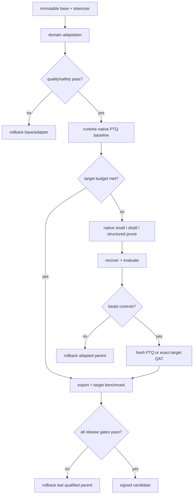
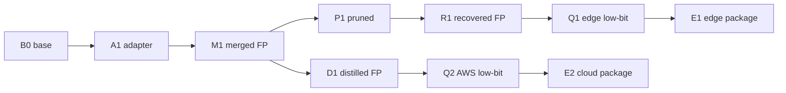
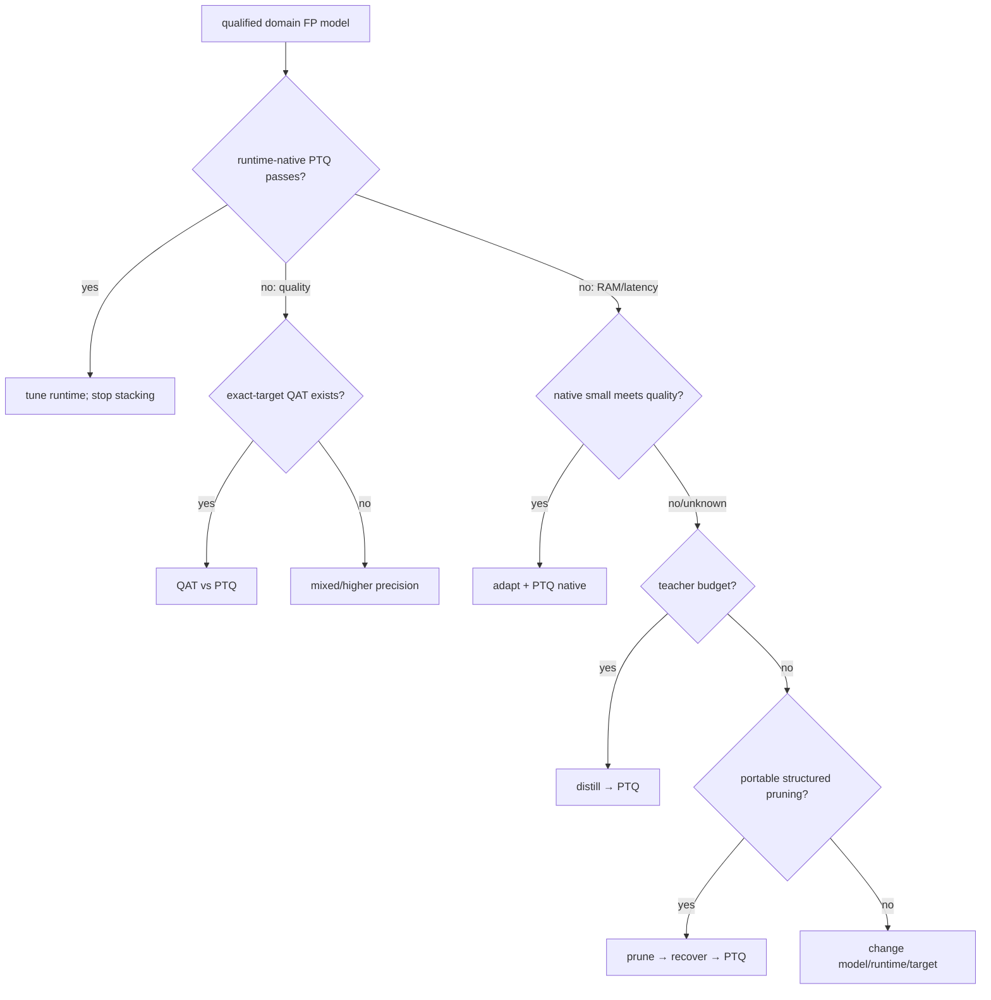

# CH-15: Combining Optimization Techniques

> **Illustrative values.** Concrete identifiers, dates, thresholds, hashes, account numbers, and endpoints in this file are teaching examples, not observed project results or deployable credentials. Before use, replace them with reviewed values from your own registry, preserve the required format, and rerun every stated validation.

## 15.1 Contract, scope, and honest status

This chapter converts fine-tuning, quantization, pruning, and knowledge distillation into **ordered, testable deployment
pipelines**. The objective is not maximum nominal compression. It is the least complex artifact that meets
pre-registered quality, safety, memory, latency, energy, compatibility, and maintenance constraints on a named target.

**Research freeze:** 2026-11-23. **Status: AUTHORED / NOT EXECUTED.** No model was trained, merged, pruned, distilled,
quantized, exported, served on Amazon Web Services (AWS), or tested on a physical edge device for this chapter. All
listings are `UNVERIFIED IMPLEMENTATION`; all experiments are `PLANNED EXPERIMENT`; diagrams/examples are
`ILLUSTRATIVE`; cited findings are `PAPER-REPORTED` or `DOC-VERIFIED`. No number in this chapter is a project benchmark.

The evidence labels follow the project [standard](../../00-governance/evidence-and-citation-standard.md). Prerequisites
are [CH-10](ch-10-the-fundamentals-of-model-compression.md),
[CH-11](ch-11-quantization-complete-research-and-implementation.md),
[CH-12](ch-12-pruning-complete-research-and-implementation.md), and
[CH-13](ch-13-knowledge-distillation-complete-research-and-implementation.md).

The governing rule is:

> Apply one transformation, evaluate every gate, preserve its parent, and stop when the next step does not improve the
> target-specific Pareto frontier.

## 15.2 Noncommutativity: why order changes the result

Let \(F,P,D,Q,E\) denote fine-tuning, pruning, distillation, quantization, and export. In general,

\[ Q(F(W))\ne F(Q(W)),\qquad P(D(W))\ne D(P(W)),\qquad E(Q(P(W)))\ne Q(E(P(W))). \]

Each operation changes what the next operation sees:

- fine-tuning changes weights and activation distributions;
- pruning changes values, masks, dimensions, layer maps, or cache geometry;
- distillation changes architecture and behavior over a sampled distribution;
- quantization changes the numerical lattice, grouping, packing, and operators;
- export constrains layouts, shapes, data types, and graph operations.

**Toy example (`ILLUSTRATIVE`).** With weight \(w=0.44\), update \(\Delta=0.04\), and rounding to 0.1,
\(Q(w+\Delta)=0.5\), while \(Q(w)+Q(\Delta)=0.4\). Groupwise quantization makes the interaction stronger: one changed
weight can change the scale shared by many weights.

Pruning scores computed from quantized weights may reorder candidates. Distillation can remove redundancy that later
pruning expects. Structured pruning invalidates feature-distillation layer maps. QAT for one fake-quant recipe may not
match another runtime's packing. Therefore blindly stacking techniques fails through:

1. interacting numerical and capacity loss;
2. stale calibration statistics;
3. incompatible tool, shape, and kernel contracts;
4. dense fallback despite smaller files;
5. inability to attribute regressions; and
6. growing version, conversion, and rollback burden.

## 15.3 Constrained optimization and stage gates

For candidate \(a\), let \(q,s,m,l,e,c\) be domain quality, safety, peak memory, latency, energy, and total cost:

\[ \min_a[m(a),l(a),e(a),c(a)] \quad\text{subject to}\quad q(a)\ge q_{\min},\ s(a)\ge s_{\min},\
a\in\mathcal C(H,R), \]

where \(\mathcal C(H,R)\) is compatibility with hardware \(H\) and runtime \(R\). Safety is a hard constraint, not a
compensating score.

Before any sequence, freeze model/tokenizer/template/license revisions and hashes;
train/recovery/calibration/validation/test manifests; target runtime, converter, kernels, hardware, context, workload,
seeds, repetitions, and synchronization; quality/safety/system thresholds; and total compute, teacher, review,
conversion, and device-test budgets.

| Gate        | Required evidence                                      | Failure action            |
| ----------- | ------------------------------------------------------ | ------------------------- |
| Identity    | source, data, code, environment, and parent hashes     | stop; repair lineage      |
| Semantic    | finite logits, valid tokenization/stops, smoke prompts | rollback parent           |
| Quality     | domain/general metrics with uncertainty                | recover or reject         |
| Safety      | per-hazard minima and qualified review where required  | reject                    |
| Format      | converter succeeds; shapes/ties/metadata valid         | choose supported path     |
| Placement   | intended CPU/GPU/NPU kernels actually run              | reject acceleration claim |
| Memory      | load, prefill, decode, and max-context peaks fit       | reduce or reject          |
| Performance | cold/warm TTFT, prefill, decode, sustained trials pass | rollback/retune           |
| Operations  | signed manifest, reproducible build, tested rollback   | do not release            |

<a id="fig-12"></a> **FIG-12 — Combined compression workflow (`ILLUSTRATIVE`).**  
*Alt text:* A domain checkpoint goes through PTQ, optional architecture reduction, recovery, target export, and physical
testing; each step can stop and roll back. Not measured; arrows show conceptual relationships only.



## 15.4 Artifact lineage and rollback

Never overwrite a parent. Each child manifest records artifact ID and SHA-256; parent IDs;
source/tokenizer/template/license hashes; transformation/config; code commit and environment/container; command, seed,
hardware, and data manifests; shapes, precision, sparsity, exclusions, and merge details; raw evaluation IDs and
failures; runtime/converter/kernel versions; approvals; and an explicit rollback ID.



Keep the last qualified high-precision checkpoint before every quantization. Do not “recover” by dequantizing a release.
Keep adapters after merge and keep masks/retained indices plus the pre-prune checkpoint.

## 15.5 Sequence 1 — Fine-tuning → quantization

- **Order:** fine-tune; select on validation; merge adapters if applicable; verify merge; calibrate final dense weights;
  PTQ; export; evaluate.
- **Compatibility constraints:** quantizer/runtime must support the final architecture; merge before ordinary PTQ;
  calibration must represent the final template/workload; never requantize a low-bit artifact.
- **Expected benefit:** domain adaptation plus lower storage and weight memory/bandwidth.
- **Extra compute:** training, calibration, conversion, and complete re-evaluation.
- **Degradation risks:** rounding erases small domain updates, harms rare terms or refusal boundaries, or overfits
  calibration.
- **Real deployment value:** high only with consuming low-bit kernels and measured target improvement; file reduction
  alone is not value.
- **Controlled experiment (`PLANNED EXPERIMENT`):** base FP, fine-tuned FP, and the same fine-tuned parent at
  runtime-native INT8 and supported 4-bit; isolate fine-tuning and PTQ deltas with identical tests.
- **Hardware:** training/quantization GPU as required; exact AWS target and physical ARM/mobile target for inference.
- **Stop criteria:** stop reducing bits when gates fail, budget already passes, or latency/energy no longer improves.
- **Rollback artifact:** validated unquantized fine-tuned/merged checkpoint, adapter, and exact base.

## 15.6 Sequence 2 — QLoRA → merge → quantize

- **Order:** QLoRA-train adapter; save it; reload exact clean high-precision base; merge in supported precision; test
  adapter-attached versus merged outputs; freshly quantize one child per target.
- **Compatibility constraints:** NF4/FP4 training storage is not a universal serving format. Base revision, targets,
  tokenizer, rank/scaling, and method-specific rules (for example DoRA, PiSSA, or LoftQ) must match. Merge can require
  more RAM/VRAM than training.
- **Expected benefit:** low training memory plus ordinary dense deployment children.
- **Extra compute:** adapter training, reconstruction/merge, parity tests, and separate target conversions.
- **Degradation risks:** wrong base, double merge, merge into quantized storage, dtype error, or PTQ suppressing adapter
  effects.
- **Real deployment value:** core practical when parity and target support are proven; QLoRA itself does not prove
  faster serving.
- **Controlled experiment (`PLANNED EXPERIMENT`):** compare training-stack adapter, adapter on clean FP base, merged FP,
  and quantized merged model using paired logits, greedy outputs, quality, and safety.
- **Hardware:** CUDA GPU for common QLoRA paths; enough CPU/GPU memory for clean merge; final physical/cloud target.
- **Stop criteria:** merge outside tolerance, ambiguous lineage, unsupported converter, or no final deployment gain.
- **Rollback artifact:** immutable adapter, exact base, training manifest, and validated merged FP checkpoint.

## 15.7 Sequence 3 — Pruning → recovery fine-tuning

- **Order:** score a qualified domain model; prune once/gradually; physically rewrite structured shapes or pack a
  supported sparse form; recover with domain, general replay, and safety data; export; evaluate.
- **Compatibility constraints:** gated MLP axes, attention/GQA, RoPE, residual width, tied embeddings, sharding, and
  alignment must remain valid. Unstructured sparsity needs an actual sparse kernel.
- **Expected benefit:** fewer executable structures or supported sparse work with recovered quality; layer pruning may
  also reduce KV cache.
- **Extra compute:** scoring, surgery, recovery, repeated export; iterative pruning multiplies cost.
- **Degradation risks:** rare circuits removed, degeneration/forgetting, or irregular shapes slower than baseline.
- **Real deployment value:** advanced practical for smaller dense shapes; target-specific for 2:4; weak for dense zeros.
- **Controlled experiment (`PLANNED EXPERIMENT`):** pre-registered ratios with no recovery, compute-matched LoRA
  recovery, and full recovery against an unpruned training control; measure real latency.
- **Hardware:** GPU for scoring/recovery; verified NVIDIA target for 2:4; CPU/phone for structured portability.
- **Stop criteria:** first hard-gate failure, unsupported export, degeneration, no practical target gain, or recovery
  cost above native-small control.
- **Rollback artifact:** pre-prune checkpoint, mask/index map, pre-recovery pruned child, and best recovered child.

## 15.8 Sequence 4 — Pruning → distillation

- **Order:** freeze original domain model as teacher; prune a student copy; validate graph; distill responses/logits and
  compatible features while preserving masks; evaluate.
- **Compatibility constraints:** logit KD usually needs identical tokens and positions; feature KD needs explicit maps;
  response KD tolerates shape differences. Optimizers must not regrow forbidden weights.
- **Expected benefit:** teacher distributions can guide recovery beyond one-hot labels.
- **Extra compute:** teacher inference/cache, student training, and expert validation.
- **Degradation risks:** copied teacher errors, insufficient masked capacity, invalid maps, or style recovery without
  rare knowledge.
- **Real deployment value:** only if pruning changes executable structure or a supported sparse representation; KD adds
  no kernel support.
- **Controlled experiment (`PLANNED EXPERIMENT`):** same pruned parent with hard recovery, response KD, and aligned
  logit KD at equal accepted tokens and accelerator budget; include native-small control.
- **Hardware:** GPU memory for teacher+student or offline teacher generation; exact deployment hardware.
- **Stop criteria:** KD fails to beat hard recovery, teacher cost exceeds budget, safety worsens, or no systems gain.
- **Rollback artifact:** unpruned teacher, exact pre-KD pruned student, masks/indices, targets/cache manifest, and
  hard-recovery control.

## 15.9 Sequence 5 — Distillation → quantization

- **Order:** select target-supported student; distill; qualify FP student; recalibrate on student activations; PTQ into
  target-native formats; rerun all gates.
- **Compatibility constraints:** teacher compatibility controls training; student architecture controls
  quantizer/export/runtime. Never reuse teacher calibration parameters.
- **Expected benefit:** smaller dense architecture plus low-bit weights; depth or KV redesign can also lower
  serial/cache costs.
- **Extra compute:** teacher generation/inference, student training/review, PTQ, conversion, and device tests.
- **Degradation risks:** student capacity loss and quantization error compound; small students can be sensitive; teacher
  errors persist.
- **Real deployment value:** core edge candidate because both dense reduction and mature low-bit kernels can be
  portable.
- **Controlled experiment (`PLANNED EXPERIMENT`):** distilled FP, INT8, and 4-bit versus natively pretrained/adapted
  student at the same deployment budget.
- **Hardware:** teacher/student GPUs; exact AWS and physical edge targets.
- **Stop criteria:** lower bits fail, or native small dominates quality, systems, cost, and maintenance.
- **Rollback artifact:** qualified FP student with teacher/data lineage and last qualified target child.

<a id="1525-honest-completion-record"></a>

## 15.10 Sequence 6 — Distillation → pruning → recovery

- **Order:** distill/qualify dense student; score remaining redundancy; prune one ratio/structure; recover with
  expert/general data and optionally teacher; export/evaluate before later PTQ.
- **Compatibility constraints:** students may have little redundancy; structural validity and teacher maps must be
  updated; masks must remain fixed.
- **Expected benefit:** may cross a strict RAM/latency boundary missed by distillation alone.
- **Extra compute:** all KD cost plus pruning, surgery, recovery, evaluation.
- **Degradation risks:** compounded capacity loss, degeneration, safety-tail loss, and excessive complexity.
- **Real deployment value:** research branch justified only by measured executable reduction.
- **Controlled experiment (`PLANNED EXPERIMENT`):** distilled-only, distill→prune, hard recovery, and KD recovery at
  matched ratios; include smaller native and larger quantized controls.
- **Hardware:** GPU for stages; dense target runtime for structured pruning or matching sparse accelerator.
- **Stop criteria:** first moderate ratio has no gain, recovery misses gates, or simpler candidate dominates.
- **Rollback artifact:** qualified distilled FP student, pre-recovery pruned child, and structure/mask manifest.

## 15.11 Sequence 7 — QAT after compression

- **Order:** finalize distilled/pruned architecture; initialize fake quantizers matching exact target; warm/freeze
  observers as planned; low-rate train; convert/export with matching backend.
- **Compatibility constraints:** bits, signedness, granularity, group, clipping, zero point, accumulator, exclusions,
  and packing must match deployment; pruning masks/shapes remain fixed.
- **Expected benefit:** adaptation to quantization noise when PTQ misses quality.
- **Extra compute:** training, search, export debugging, exact-backend tests.
- **Degradation risks:** overfit, range instability, or fake/real mismatch.
- **Real deployment value:** target-dependent; use only with stable runtime-native QAT/export and demonstrated PTQ
  failure.
- **Controlled experiment (`PLANNED EXPERIMENT`):** one compressed parent at FP, PTQ, and QAT with identical target
  format/calibration; report QAT hours.
- **Hardware:** QAT-capable training accelerator and exact CPU/GPU/NPU target.
- **Stop criteria:** no benefit beyond uncertainty, conversion mismatch, or unjustified maintenance.
- **Rollback artifact:** compressed FP parent, PTQ control, checkpoints around observer freeze, and conversion manifest.

## 15.12 Sequence 8 — Structured pruning → quantization

- **Order:** physically remove structures; update config/ties; recover in FP; calibrate new shapes; quantize; export.
- **Compatibility constraints:** dimensions must satisfy group, SIMD/tile, sharding, attention, and converter alignment;
  fused kernels may assume canonical shapes.
- **Expected benefit:** fewer dense operations/parameters and fewer bits per retained weight; layer/KV-head removal can
  reduce cache.
- **Extra compute:** scoring/surgery, recovery, calibration, conversion.
- **Degradation risks:** compounded loss, poor tiling, or stale metadata.
- **Real deployment value:** advanced practical when ordinary dense low-bit kernels accept reduced aligned shapes.
- **Controlled experiment (`PLANNED EXPERIMENT`):** 2×2 factorial: neither, pruning only, quantization only, both; add
  neighboring aligned widths.
- **Hardware:** GPU for recovery; every target CPU/GPU/NPU for placement.
- **Stop criteria:** combined child is dominated by either single technique or fallback occurs.
- **Rollback artifact:** recovered structured FP parent, structure map, pre-prune parent, and calibration manifest.

## 15.13 Sequence 9 — Native small vs larger compressed

- **Order:** define deployment envelope; choose native small and larger-origin compressed candidates; adapt both with
  governed data; optimize through supported paths; compare deployable tuples.
- **Compatibility constraints:** equal parameters do not control tokenizer, pretraining, depth/width, vocabulary,
  attention/KV design, context, license, or runtime. Match product constraints and budgets where possible.
- **Expected benefit:** native models offer coherence/simple tooling; compressed students may inherit teacher behavior.
  Neither is presumed superior.
- **Extra compute:** two full tracks and budget normalization.
- **Degradation risks:** unfair data/compute, cherry-picking, or parameter count used as a latency proxy.
- **Real deployment value:** mandatory control against sunk-cost decisions.
- **Controlled experiment (`PLANNED EXPERIMENT`):** compare first at equal artifact/peak-RAM bands, then equal measured
  latency bands; identical tests.
- **Hardware:** method-appropriate training, identical final target protocol.
- **Stop criteria:** one branch cannot meet hard gates or is Pareto-dominated including maintenance.
- **Rollback artifact:** independently qualified parent for each branch.

## 15.14 Sequence 10 — Mixed precision / layer-sensitive quantization

- **Order:** create uniform low-bit baseline; measure tensor/layer sensitivity; restore only pre-registered sensitive
  modules; export/benchmark exact map.
- **Compatibility constraints:** runtime must support mixed types without costly transitions; ties, sharding, groups,
  and NPU partitioning constrain exclusions.
- **Expected benefit:** regain quality while retaining most compression.
- **Extra compute:** sweeps, conversions, validation, kernel profiling.
- **Degradation risks:** validation overfit, excessive restoration, casts or fallback slower than uniform higher
  precision.
- **Real deployment value:** useful when uniform low bit narrowly fails and the runtime consumes mixed tensors natively.
- **Controlled experiment (`PLANNED EXPERIMENT`):** uniform INT8/4-bit, random equal-budget restoration, first/last
  heuristic, and sensitivity selection; report effective bits and placement.
- **Hardware:** GPU for sweeps; exact cloud/edge target for verification.
- **Stop criteria:** stop restoring once gates pass; reject fallback/dominated policy.
- **Rollback artifact:** uniform low-bit control, FP parent, tensor precision map.

## 15.15 Sequence 11 — Joint pruning and distillation

- **Order:** initialize student and masks; jointly/alternately optimize task, KD, and sparsity losses; harden masks on
  schedule; rewrite/pack; optionally fixed-structure recover; export.
- **Compatibility constraints:** mask groups must be deployable; loss scales interact; maps must survive shape changes;
  sparse runtime contract remains.
- **Expected benefit:** teacher behavior can influence which capacity survives.
- **Extra compute:** teacher passes, mask/loss/schedule search, ablations, and specialized export—the highest training
  complexity here.
- **Degradation risks:** unstable masks, conflicting gradients, premature hardening, teacher bias, or non-executable
  sparsity.
- **Real deployment value:** experimental until it beats strong sequential baselines and exports beneficially.
- **Controlled experiment (`PLANNED EXPERIMENT`):** equal accelerator-hours for prune→hard recovery, prune→KD,
  distill→prune→KD, and joint; ablate losses and schedules at the same final structure.
- **Hardware:** teacher+student GPUs; matching sparse target if applicable.
- **Stop criteria:** high seed variance, no sequential-baseline advantage, export failure, or no runtime gain.
- **Rollback artifact:** initial student/teacher, stable soft-mask checkpoint, hardened map, and best sequential
  control.

## 15.16 Sequence 12 — Combined training/inference optimization

- **Order:** prove runtime feasibility; choose architecture/tokenizer/context/KV design; adapt; compress one stage at a
  time; export; then hold weights fixed while tuning context cap, KV precision, threads, affinity, batching, offload,
  memory mapping, and packaging.
- **Compatibility constraints:** operators, precision, cache, shapes, speculative paths, batching, and partition must
  work together. Server and single-user mobile optimizations differ.
- **Expected benefit:** optimizes the actual model–runtime–hardware–workload tuple; runtime tuning may beat another
  weight transform.
- **Extra compute:** design-of-experiments, builds, profiling, load/soak tests.
- **Degradation risks:** confounding, benchmark overfit, truncation, KV loss, thermal throttling, tails, or silent
  fallback.
- **Real deployment value:** mandatory final production stage.
- **Controlled experiment (`PLANNED EXPERIMENT`):** freeze weights; run a fractional-factorial runtime sweep; confirm
  winner with randomized repeats.
- **Hardware:** exact production AWS stack and named physical edge devices.
- **Stop criteria:** service/safety gates pass and remaining changes are dominated, negligible, or operationally too
  complex.
- **Rollback artifact:** signed model plus previous runtime config, container/app build, deployment manifest, and
  known-good release.

## 15.17 Comparison and decision trees

<a id="tbl-10"></a> **TBL-10 — Combined compression pipelines (`STATICALLY REVIEWED`; outcomes require target-specific
experiments).**

<!-- markdownlint-disable MD013 -->
| Sequence                  | Priority          | Principal value                        | Principal risk                  | Deployment judgment      |
| ------------------------- | ----------------- | -------------------------------------- | ------------------------------- | ------------------------ |
| FT→quantize               | Core              | domain + low-bit                       | PTQ erases small updates        | first baseline           |
| QLoRA→merge→quantize      | Core              | low training memory + deployable child | NF4 mistaken for serving format | strong default           |
| prune→recovery            | Advanced          | executable structure                   | unsupported sparsity/shape      | target-dependent         |
| prune→distill             | Advanced/research | behavior-guided recovery               | teacher cost/alignment          | prove over hard recovery |
| distill→quantize          | Core edge         | dense student + low bit                | compounded loss                 | strong candidate         |
| distill→prune→recover     | Research          | exceed student reduction               | little redundancy               | only after budget miss   |
| compression→QAT           | Target-dependent  | PTQ recovery                           | fake/real mismatch              | only after PTQ failure   |
| structured prune→quantize | Advanced          | shape + precision                      | alignment/fallback              | promising if supported   |
| native vs compressed      | Mandatory         | complexity control                     | unfair matching                 | always compare           |
| mixed precision           | Advanced          | protect sensitive tensors              | casts/fallback                  | after uniform PTQ        |
| joint pruning+KD          | Experimental      | teacher-guided masks                   | instability                     | needs ablations          |
| training+inference        | Production        | deployed tuple                         | confounding                     | final stage              |
<!-- markdownlint-restore -->



Target guidance:

- **ARM/mobile CPU:** native or distilled dense model plus exact runtime-native INT8/4-bit; structured pruning only with
  accepted shapes.
- **Mobile GPU/NPU:** select supported architecture/quantization first and prove placement; conversion alone is
  insufficient.
- **AWS low-batch decode:** compare FP/BF16 with serving-native weight-only formats; architecture reduction if serial
  work dominates.
- **AWS high-throughput/prefill:** test runtime-native W8A8/FP8 or FP/BF16; mobile weight-only conclusions do not
  transfer.
- **NVIDIA sparse target:** use 2:4 only after hardware, dtype, grouping, shape, library, and serving-kernel validation.

### 15.17.1 Illustrative end-to-end pipeline walkthrough

Suppose a domain-tuned 1.5B model passes quality and safety but exceeds a phone's active-memory budget. The following is
an educational decision trace, not a measured recommendation.

1. **Create the parent.** Train a QLoRA adapter because full tuning does not fit the available training GPU. Preserve the
   adapter and exact base. QLoRA solves the training-memory problem; it has not yet solved the phone problem.
2. **Merge correctly.** Reload the clean high-precision base, attach the adapter, compare fixed-prompt logits, merge once,
   and save a new high-precision child. If attached and merged behavior diverges beyond the declared tolerance, stop.
3. **Try the cheapest deployment intervention.** Quantize the merged child into one format the phone runtime consumes
   natively. Recalibrate on representative final prompts. If quality, safety, RAM, and sustained latency pass, stop:
   pruning or distillation would add risk without a demonstrated need.
4. **If RAM still fails, branch from high precision.** Do not prune the low-bit file. Compare (a) a native smaller model,
   (b) a distilled dense student, and (c) a structured-pruned model recovered in floating point. Each branch gets its
   own parent and evidence.
5. **Quantize only qualified branches.** Freshly calibrate each final architecture; pruning and distillation changed
   activation distributions and tensor shapes.
6. **Attribute every delta.** Compare pruned FP with its recovered FP parent to measure recovery, then recovered FP with
   quantized child to measure quantization. A final failure is otherwise impossible to diagnose.
7. **Select per target.** The phone may prefer a dense distilled INT4 child, while an AWS high-throughput service may
   prefer the original architecture in BF16, FP8, or W8A8. Sharing a source lineage does not require sharing a release
   format.
8. **Stop on the frontier.** If the distilled-and-quantized child meets all constraints and additional pruning saves
   only download bytes while harming safety or maintenance, the correct optimization is to stop.

To interpret TBL-10, begin with “Principal value,” then verify that the current bottleneck matches it. Read “Priority”
as experiment order, not expected superiority. “Deployment judgment” states the evidence threshold: for example,
distill→quantize is a strong edge candidate because it combines a smaller dense graph with mature low-bit kernels, but
it must still beat a native-small control. No row authorizes stacking all techniques.

## 15.18 Reproducible matrix and Pareto selection

Use successive halving, not a full Cartesian product.

| Stage          | Candidates                                     | Primary gate            | Maximum survivors |
| -------------- | ---------------------------------------------- | ----------------------- | ----------------: |
| 0 feasibility  | architectures × runtimes                       | load/generate/placement |    supported only |
| 1 adaptation   | base, full FT, LoRA, QLoRA                     | domain/general/safety   |                 3 |
| 2 PTQ          | FP, INT8, two supported 4-bit                  | quality/RAM/execution   |      3 per target |
| 3 architecture | native, distilled, structured, optional sparse | hard gates/latency      |                 3 |
| 4 combinations | winners × selected precisions; optional QAT    | marginal Pareto gain    |      3 per target |
| 5 runtime      | context/KV/threads/offload/batching/package    | sustained SLO           |      2 per target |
| 6 release      | cloud load/soak or physical edge soak          | ops/safety/rollback     |      approved set |

For each combined artifact retain direct parents: domain FP; architecture- reduced FP; recovered FP; quantized child;
exported child. This isolates architecture, recovery, quantization, and conversion deltas.

Measure domain/general/safety quality by stratum; artifact bytes, effective bits, physical parameters/nonzeros;
load/peak memory and KV growth; cold/warm startup, TTFT, prefill, sustained decode, and end-to-end latency; utilization,
energy where instrumented, thermals, failures, and placement; plus teacher tokens, expert hours, accelerator-hours,
conversion/device-test time, dependencies, custom operators, reproducibility, and rollback time.

Candidate \(a\) dominates \(b\) when it is no worse on every selected objective and better on at least one, after hard
gates. Build separate fronts per hardware/workload. Use confidence intervals; if results overlap, prefer the simpler
candidate unless a pre-registered practical threshold says otherwise. Never draw an empirical frontier from invented
values.

**Listing CH15-L01 — Pareto extraction (`UNVERIFIED IMPLEMENTATION`).**  
Purpose: reject incomplete/unqualified rows and mark non-dominated candidates. Dependencies: pinned Python/pandas.
Input: validated Parquet. Output: CSV. Expected failures: missing/null/incomparable metrics or no qualified candidate.
Hardware: CPU. Not run.

```python
import pandas as pd

OBJECTIVES = {
    "domain_score_lower_ci": "max",
    "peak_memory_bytes": "min",
    "ttft_p95_ms": "min",
    "sustained_decode_ms_per_token": "min",
    "energy_j_per_token": "min",
    "total_cost_units": "min",
}

def pareto(g):
    if g[list(OBJECTIVES)].isna().any().any():
        raise ValueError("unmeasured is not zero")
    x = g[list(OBJECTIVES)].copy()
    for col, direction in OBJECTIVES.items():
        if direction == "max":
            x[col] = -x[col]
    m = x.to_numpy()
    dominated = [
        any((o <= r).all() and (o < r).any()
            for j, o in enumerate(m) if i != j)
        for i, r in enumerate(m)
    ]
    return g.assign(pareto=[not value for value in dominated])

df = pd.read_parquet("results/validated-aggregates.parquet")
required = {"candidate", "hardware", "workload", "all_hard_gates_pass",
            *OBJECTIVES}
if missing := required - set(df.columns):
    raise ValueError(sorted(missing))
q = df[df.all_hard_gates_pass].copy()
if q.empty:
    raise RuntimeError("no qualified candidates")
q.groupby(["hardware", "workload"], group_keys=False).apply(
    pareto, include_groups=False
).to_csv("results/pareto.csv", index=False)
```

## 15.19 Executable-looking pipeline contract

**Listing CH15-L02 — Pipeline configuration (`UNVERIFIED IMPLEMENTATION`).**  
Purpose: make order, parent, gate, and rollback explicit. The orchestrator is not implemented here; pin it before use.
Inputs are trusted hashed artifacts; outputs are immutable children. Expected failures include OOM, merge mismatch,
invalid shapes, unsupported runtime, and gate failure. Reject executable remote checkpoint code and unsafe pickle;
verify hashes/licenses.

```yaml
schema: ch15.pipeline/v1
status: UNVERIFIED_IMPLEMENTATION
source:
  model_id: "illustrative-id-001"
  revision: "aaaaaaaaaaaaaaaaaaaaaaaaaaaaaaaaaaaaaaaa"
  sha256_manifest: "aaaaaaaaaaaaaaaaaaaaaaaaaaaaaaaaaaaaaaaaaaaaaaaaaaaaaaaaaaaaaaaa"
  tokenizer_revision: "aaaaaaaaaaaaaaaaaaaaaaaaaaaaaaaaaaaaaaaa"
  chat_template_sha256: "aaaaaaaaaaaaaaaaaaaaaaaaaaaaaaaaaaaaaaaaaaaaaaaaaaaaaaaaaaaaaaaa"
datasets:
  train: { manifest: "aaaaaaaaaaaaaaaaaaaaaaaaaaaaaaaaaaaaaaaaaaaaaaaaaaaaaaaaaaaaaaaa", overlaps_test: false }
  recovery: { manifest: "aaaaaaaaaaaaaaaaaaaaaaaaaaaaaaaaaaaaaaaaaaaaaaaaaaaaaaaaaaaaaaaa", overlaps_test: false }
  calibration: { manifest: "aaaaaaaaaaaaaaaaaaaaaaaaaaaaaaaaaaaaaaaaaaaaaaaaaaaaaaaaaaaaaaaa", overlaps_test: false }
  validation: { manifest: "aaaaaaaaaaaaaaaaaaaaaaaaaaaaaaaaaaaaaaaaaaaaaaaaaaaaaaaaaaaaaaaa" }
  domain_test: { manifest: "aaaaaaaaaaaaaaaaaaaaaaaaaaaaaaaaaaaaaaaaaaaaaaaaaaaaaaaaaaaaaaaa" }
  general_test: { manifest: "aaaaaaaaaaaaaaaaaaaaaaaaaaaaaaaaaaaaaaaaaaaaaaaaaaaaaaaaaaaaaaaa" }
  safety_test: { manifest: "aaaaaaaaaaaaaaaaaaaaaaaaaaaaaaaaaaaaaaaaaaaaaaaaaaaaaaaaaaaaaaaa" }
target:
  hardware: "<exact device or AWS instance>"
  runtime: { name: "illustrative-name", version_or_commit: "aaaaaaaaaaaaaaaaaaaaaaaaaaaaaaaaaaaaaaaa" }
  workload:
    {
      prompt_tokens: [128, 512, 2048],
      output_tokens: 128,
      batch: 1,
      concurrency: 1,
      context_cap: 4096,
      decoding: greedy,
    }
pipeline:
  - { id: adapt, operation: qlora, parent: source, output: adapter, rollback: source }
  - { id: merge, operation: merge_into_clean_fp_base, parents: [source, adapter], output: merged_fp, rollback: adapter }
  - {
      id: reduce,
      enabled: false,
      operation: structured_prune_then_recover,
      parent: merged_fp,
      output: recovered_fp,
      rollback: merged_fp,
    }
  - {
      id: quantize,
      operation: "llama.cpp-native-Q4_K_M",
      parent: "merged-fp",
      output: target_quantized,
      rollback: "merged-fp",
    }
gates:
  domain_score_min: "0.05"
  unsafe_compliance_max: "0.05"
  peak_memory_bytes_max: "0.05"
  ttft_p95_ms_max: "0.05"
  sustained_decode_tokens_s_min: "0.05"
  operator_fallback_allowed: false
evidence: { label: PLANNED_EXPERIMENT, raw_results_uri: null, child_sha256: null }
```

**Listing CH15-L03 — Fail-closed stage runner (`UNVERIFIED IMPLEMENTATION`).**  
Purpose: illustrate immutable lineage, not provide a training framework. Dependencies/hardware are stage-specific and
must be pinned. Expected failures: nonzero command, missing manifest, or later gate failure. Output: JSON record. Not
run.

```python
import hashlib, json, subprocess, time
from pathlib import Path

def sha256(path):
    h = hashlib.sha256()
    with Path(path).open("rb") as f:
        for block in iter(lambda: f.read(1024 * 1024), b""):
            h.update(block)
    return h.hexdigest()

def run_stage(stage_id, command, parent_manifest, output_manifest, record):
    if not Path(parent_manifest).is_file():
        raise FileNotFoundError(parent_manifest)
    started = time.time()
    p = subprocess.run(command, check=False, text=True, capture_output=True)
    row = {"stage": stage_id, "command": command,
           "parent_sha256": sha256(parent_manifest), "started": started,
           "ended": time.time(), "returncode": p.returncode,
           "stdout": p.stdout, "stderr": p.stderr,
           "output_manifest": str(output_manifest)}
    Path(record).write_text(json.dumps(row, indent=2), encoding="utf-8")
    if p.returncode or not Path(output_manifest).is_file():
        raise RuntimeError(f"{stage_id} failed; rollback parent")
```

Production must isolate environments, protect sensitive logs, validate/sign manifests, run gates before advancement, and
test rollback.

## 15.20 Failure attribution

| Symptom                            | Isolating comparison                    | Rollback                |
| ---------------------------------- | --------------------------------------- | ----------------------- |
| adapter passes; merge fails        | attached adapter vs merged FP           | adapter + exact base    |
| pruned FP fails                    | pre-prune vs pre-recovery prune         | pre-prune parent        |
| recovery harms general             | pruned before/after recovery by stratum | earlier checkpoint      |
| recovered FP passes; low-bit fails | recovered FP vs PTQ                     | recovered FP            |
| framework passes; target fails     | source runtime vs target export         | pre-export child        |
| file shrinks; RAM does not         | file bytes vs loaded tensors/placement  | supported format        |
| RAM falls; latency worsens         | profiler, casts, shape, fallback        | prior precision/shape   |
| short passes; long fails           | context/KV precision sweep              | higher KV precision/cap |
| sustained run slows                | token timeline/clocks/temperature       | lower load/model        |
| average passes; hazard fails       | per-hazard paired outputs               | last safety-qualified   |

Fix the responsible high-precision parent; do not patch the final low-bit file.

## 15.21 Domain, edge, and AWS implications

**Automotive/industrial:** test code-versus-cause, diagnostic order, units, tolerances, model/revision qualifiers, high
voltage, pressure, lifting, rotating machinery, stored energy, lockout/tagout, and escalation. A correct answer reached
through unsafe steps fails.

**Pharmacy education:** test drug, formulation, route, population, contraindication, interaction, decimal/unit,
jurisdiction, uncertainty, refusal, and escalation. Qualified clinical review and non-autonomous use limits are
mandatory; averages cannot compensate for hazardous errors.

**Low-resource domains:** stratify rare species, diseases, seasons, climates, legal treatments, and regional rules.
Compression may erase rare distinctions first.

Under the [no-runtime-RAG standard](../../00-governance/no-runtime-rag-standard.md), deployment does not retrieve
documents or call a teacher to repair missing knowledge. Training cannot guarantee exact storage. Staleness,
hallucination, conflicts, and imperfect recall remain.

### Edge/mobile

Pass storage/download, load, active-memory-at-context, interaction, and sustained energy/thermal gates. Practical
default: LoRA/QLoRA→clean merge→runtime-native PTQ. If insufficient, compare native small, distilled dense, and
structured-pruned dense branches, each quantized from recovered FP. Use arbitrary/N:M sparsity only with proven backend
support.

Android/iOS and AWS may require different children from the same FP parent. Successful conversion does not prove GPU/NPU
execution; retain placement reports. Physical testing records device/SoC/RAM/OS, app/runtime build, threads/affinity,
battery/charging, ambient/start temperatures, background policy, artifact hash, context/workload, randomized order,
warm-up, raw token times, failures, and cooldown. Desktop/emulator tests do not establish mobile energy or thermals.

### AWS

QLoRA training memory does not predict merge, KD, pruning-statistics, or QAT peaks. Checkpoint/harden every recoverable
boundary. For inference, low-batch decode may favor serving-native weight-only formats; high-batch/prefill may favor
W8A8/FP8 or FP/BF16. Structured smaller models can reduce serial work but irregular shapes can lower utilization.
Benchmark load/scale-out, queueing, tokenization, prefill/decode, batching, KV, failures, tail latency, and current
region-specific cost inputs. No AWS price or winner is claimed.

Keep prior container, runtime config, model package, manifest, and routing policy for blue/green or canary rollback.

## 15.22 Recommended practical funnel

1. Prove untouched runtime feasibility.
2. Establish FP domain/safety baseline.
3. Preserve adapter and prove clean merge parity.
4. Try one mature INT8 and one mature 4-bit target PTQ.
5. If budgets pass, stop compressing and tune runtime.
6. Otherwise compare native small, distilled, and structured-pruned dense.
7. Recover/evaluate architecture before low-bit conversion.
8. Use mixed precision when uniform PTQ narrowly fails.
9. Use exact-target QAT only when PTQ is the isolated blocker.
10. Use joint pruning/KD only after strong sequential baselines.
11. Run AWS load/soak or physical edge soak.
12. Select target-specific Pareto releases and test rollback.

## 15.23 Summary and exercises

Compression operations are noncommutative. FT→PTQ and QLoRA→merge→PTQ are first baselines. Distill→PTQ is a strong edge
candidate but must beat native small controls. Structured prune→recover→PTQ is useful only with aligned executable
shapes. QAT follows final architecture selection and demonstrated PTQ failure. Joint pruning/KD is experimental. Every
stage needs a parent, manifest, gate, and rollback; every final decision is target-specific and Pareto-based.

Exercises:

1. Build a lineage graph for QLoRA→merge→prune→recover→INT4.
2. Pre-register the four-cell structured-pruning×quantization factorial.
3. Define merge-parity logit and generation tolerances before execution.
4. Compare hard and KD recovery at equal accelerator-hours/accepted tokens.
5. Compare native-small and compressed-large at equal RAM, then equal TTFT.
6. Compare sensitivity restoration with a random equal-bit-budget control.
7. Prove a sparse kernel executes using an operator trace.
8. Compare PTQ and exact-target QAT from one compressed parent.
9. Populate CH15-L02 without illustrative values; keep it unverified until run.
10. Produce a Pareto front only from complete measured records.
11. Design Android sustained and AWS offered-load protocols.
12. Execute a rollback drill from a failed target package.
13. Audit safety-critical outputs after every stage.
14. Write a memo stopping after PTQ because extra techniques are dominated.

## 15.24 Sources

All findings remain attributed, not reproduced.

1. Dettmers, T. et al. (2023). “QLoRA.” *NeurIPS 2023*. [arXiv:2305.14314](https://arxiv.org/abs/2305.14314).
2. Hu, E. et al. (2022). “LoRA.” *ICLR 2022*. [arXiv:2106.09685](https://arxiv.org/abs/2106.09685).
3. Frantar, E. and Alistarh, D. (2023). “SparseGPT.” *ICML 2023*.
   [PMLR](https://proceedings.mlr.press/v202/frantar23a.html).
4. Sun, M. et al. (2024). “Wanda.” *ICLR 2024*. [OpenReview](https://openreview.net/forum?id=PxoFut3dWW).
5. Ma, X. et al. (2023). “LLM-Pruner.” *NeurIPS 2023*. [arXiv:2305.11627](https://arxiv.org/abs/2305.11627).
6. Ashkboos, S. et al. (2024). “SliceGPT.” *ICLR 2024*. [arXiv:2401.15024](https://arxiv.org/abs/2401.15024).
7. Hinton, G.; Vinyals, O.; Dean, J. (2015). “Distilling the Knowledge in a Neural Network.”
   [arXiv:1503.02531](https://arxiv.org/abs/1503.02531).
8. Kim, Y. and Rush, A. (2016). “Sequence-Level Knowledge Distillation.” *EMNLP 2016*.
   [ACL](https://aclanthology.org/D16-1139/).
9. Jiao, X. et al. (2020). “TinyBERT.” *Findings EMNLP 2020*. [ACL](https://aclanthology.org/2020.findings-emnlp.372/).
10. Xia, M. et al. (2022). “Structured Pruning Learns Compact and Accurate Models.” *ACL 2022*.
    [arXiv:2204.00408](https://arxiv.org/abs/2204.00408).
11. Xia, M. et al. (2024). “Sheared LLaMA.” *ICLR 2024*. [arXiv:2310.06694](https://arxiv.org/abs/2310.06694).
12. Frantar, E. et al. (2023). “GPTQ.” *ICLR 2023*. [arXiv:2210.17323](https://arxiv.org/abs/2210.17323).
13. Lin, J. et al. (2024). “AWQ.” *MLSys 2024*. [arXiv:2306.00978](https://arxiv.org/abs/2306.00978).
14. Xiao, G. et al. (2023). “SmoothQuant.” *ICML 2023*. [PMLR](https://proceedings.mlr.press/v202/xiao23c.html).
15. Jacob, B. et al. (2018). Integer quantization and QAT. *CVPR 2018*.
    [arXiv:1712.05877](https://arxiv.org/abs/1712.05877).
16. Hoefler, T. et al. (2021). “Sparsity in Deep Learning.” *JMLR*.
    [JMLR](https://www.jmlr.org/papers/v22/21-0366.html).
17. NVIDIA. [cuSPARSELt documentation](https://docs.nvidia.com/cuda/cusparselt/) (`DOC-VERIFIED`; version/hardware
    specific).
18. Hugging Face. [PEFT](https://huggingface.co/docs/peft/) and
    [bitsandbytes integration](https://huggingface.co/docs/transformers/quantization/bitsandbytes) (`DOC-VERIFIED`;
    version-sensitive).
19. ggml-org. [llama.cpp/GGUF](https://github.com/ggml-org/llama.cpp) (`DOC-VERIFIED`; pin exact commit/type).
20. PyTorch. [ExecuTorch LLM](https://docs.pytorch.org/executorch/stable/llm/getting-started.html) (`DOC-VERIFIED`;
    backend support test-required).
21. Google. [LiteRT-LM](https://developers.google.com/edge/litert-lm/overview) (`DOC-VERIFIED`; conversion is not
    placement evidence).
22. AWS. [EC2 instance types](https://docs.aws.amazon.com/ec2/latest/instancetypes/instance-types.html) (`DOC-VERIFIED`;
    current region/price/availability must be checked).

## 15.25 Verification note

The pipelines, listings, and walkthrough are unexecuted teaching material. Exact checkpoints, versions, targets,
budgets, thresholds, and any deployment or superiority claim require archived raw evidence and qualified safety review.

## Cross-links

- [Part IV index](README.md)
- [Combined optimization research report](../../04-research-comparison-report/combined-optimization-pipelines.md)
- [Reproducibility standard](../../00-governance/reproducibility-standard.md)
- [Safety standard](../../00-governance/safety-and-risk-standard.md)
- [No-runtime-RAG standard](../../00-governance/no-runtime-rag-standard.md)
