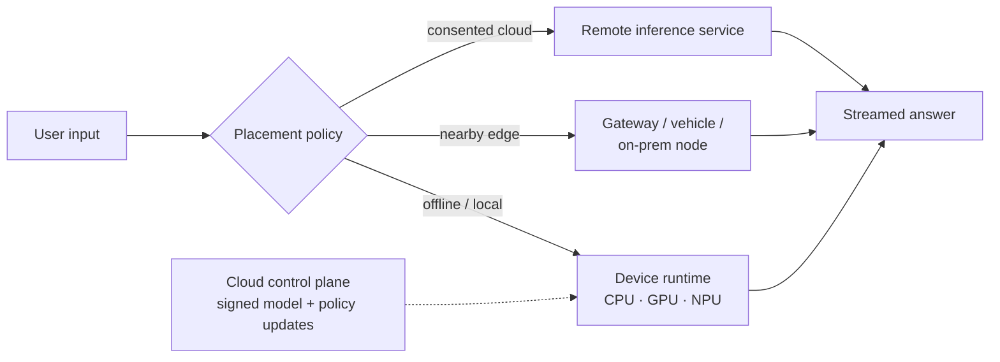
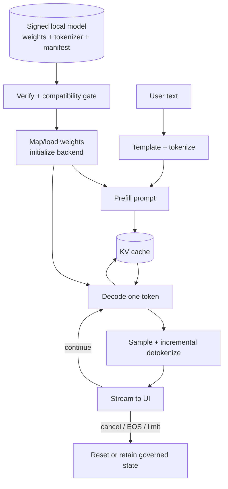
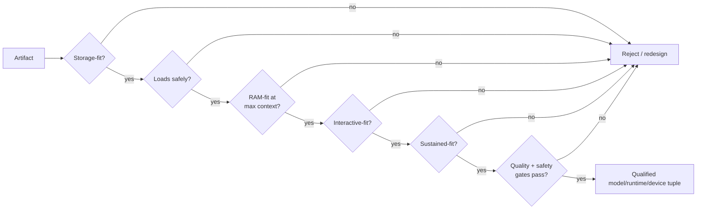
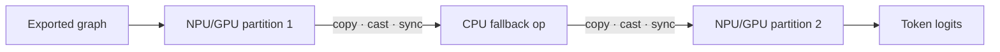

# CH-16: Edge AI Fundamentals

> **Illustrative values.** Concrete identifiers, dates, thresholds, hashes, account numbers, and endpoints in this file are teaching examples, not observed project results or deployable credentials. Before use, replace them with reviewed values from your own registry, preserve the required format, and rerun every stated validation.

<a id="ch16-status"></a>

## 16.1 Scope, learning outcomes, and evidence boundary

**Research freeze:** 2026-11-23.  
**Status:** **AUTHORED / NOT EXECUTED.** This chapter defines the systems foundations for cloud, edge, on-device,
offline, and hybrid inference. It contains no measured phone, tablet, embedded-device, laptop, or cloud-GPU result.
Worked numbers and diagrams are `ILLUSTRATIVE` or `ESTIMATE`; compatibility statements derived from official
documentation are `DOC-VERIFIED`; proposed tests are `PLANNED EXPERIMENT`. A documented backend is not represented as
tested, and a vendor capability is not represented as an independently reproduced performance result.

Evidence labels follow the project [evidence standard](../../00-governance/evidence-and-citation-standard.md). The
chapter builds on the memory and execution model in
[CH-10](../part-04-model-compression-and-optimization/ch-10-the-fundamentals-of-model-compression.md) and the
target-specific optimization workflow in
[CH-15](../part-04-model-compression-and-optimization/ch-15-combining-optimization-techniques.md). Detailed mobile
hardware, runtime, optimization, and platform integration follow in Chapters 17–21.

After completing this chapter, the reader should be able to:

1. distinguish edge, on-device, cloud, offline, and hybrid inference without using the terms interchangeably;
2. construct storage, random-access memory (RAM), latency, energy, and thermal budgets for a small language model (SLM);
3. explain CPU, graphics processing unit (GPU), and neural processing unit (NPU) execution in terms of operators, memory
   movement, graph partitioning, and sustained—not peak—performance;
4. separate **storage-fit**, **RAM-fit**, **interactive-fit**, and **sustained-fit**;
5. evaluate model/runtime/hardware compatibility rather than assuming architecture portability;
6. compare cloud-GPU and smartphone execution under equivalent workloads;
7. design a reproducible physical-device measurement protocol; and
8. choose an inference placement for a domain SLM subject to privacy, reliability, safety, and no-runtime-retrieval
   constraints.

<a id="ch16-problem"></a>

## 16.2 The problem: useful intelligence inside a finite envelope

Training asks whether a model can learn. Deployment asks whether an exact artifact can deliver acceptable behavior
inside a product envelope:

\[ \boxed{ D=(A,W,Q,R,K,H,X,P) } \tag{EQ-CH16-01} \]

where:

- \(A\): model architecture and tokenizer;
- \(W\): trained weights or merged adapters;
- \(Q\): weight, activation, accumulator, and key–value (KV) cache precision;
- \(R\): inference runtime and converter;
- \(K\): actual kernels and operator placement;
- \(H\): hardware, operating system, drivers, and firmware;
- \(X\): workload—prompt, output, context, batch, concurrency, and decoding; and
- \(P\): power, thermal, lifecycle, and product policy.

Performance belongs to tuple \(D\), not to a model name or parameter count. A 4-bit file can fail because the runtime
expands it, an NPU can remain idle because one attention operator is unsupported, and a model that generates quickly for
20 seconds can slow after several minutes as the device reaches a thermal limit.

**Resource-constrained machine learning (ML)** is the design and operation of ML under explicit ceilings on one or more
of storage, RAM, compute, memory bandwidth, power, energy, temperature, latency, network access, update size, or
supported operators. The constraint is part of the model specification, not an inconvenience considered after training.

<a id="ch16-definitions"></a>

## 16.3 Canonical definitions and placement modes

### Edge AI

**Edge AI** executes some ML computation near the data source or user rather than exclusively in a remote centralized
data center. An edge node may be a phone, vehicle computer, factory gateway, laptop, retail appliance, or an on-premises
server. Edge does not necessarily mean offline, battery-powered, or inside the sensor itself.

### On-device inference

**On-device inference** executes the model inside the end-user or field device that receives the input and presents the
result. A phone running a quantized SLM locally is on-device. A phone sending input to a nearby office gateway is edge
inference but not on-device inference.

### Cloud inference

**Cloud inference** sends a request to remotely managed compute and returns generated output. The service can use
accelerators, batching, replicas, centralized controls, and larger models. Its end-to-end behavior includes network,
queueing, authentication, service, and response-stream transport—not only GPU kernel time.

### Offline inference

**Offline inference** completes the required inference path without network connectivity. The model, tokenizer, runtime,
policy, and required assets are local. A product that silently calls a server when local inference fails is not fully
offline. Offline does not imply that the app never connects: it may download signed model updates while connected and
later infer independently.

### Hybrid cloud–edge inference

**Hybrid inference** deliberately divides work or requests between local and remote components. Valid forms include:

- **request routing:** local for routine/private work, cloud for eligible complex work;
- **cascade:** local model attempts first, then an explicitly permitted cloud model handles low-confidence cases;
- **split computing:** early and late graph segments run in different locations;
- **local safety/privacy filter:** local logic redacts, classifies, or blocks before an allowed cloud request;
- **cloud control plane, local data plane:** cloud distributes signed artifacts and policy while inference remains
  local; and
- **asynchronous enhancement:** local answer is immediate; a remote, consented analysis is optional and clearly
  separate.

The primary domain capability in this project must be learned into model parameters or trained adapters. Hybrid design
must not quietly replace specialization with runtime document retrieval or a remote teacher. See the
[no-runtime-RAG standard](../../00-governance/no-runtime-rag-standard.md).

<a id="fig-ch16-01"></a> **FIG-CH16-01 — Inference placement spectrum (`ILLUSTRATIVE`).**  
_Alt text:_ Inputs can remain on the device, travel to a nearby edge node, travel to a cloud service, or follow an <!-- markdownlint-disable-line MD013 MD049 -->
explicit policy that selects among paths. The offline path has no network dependency.



The dotted control-plane path is not per-answer retrieval.

<a id="tbl-ch16-01"></a> <a id="tbl-17"></a> **TBL-17 — Cloud versus edge inference (`STATICALLY REVIEWED`; qualitative
engineering comparison, not a measured ranking)**

<!-- markdownlint-disable MD013 -->
| Property                    | On-device offline          | Nearby edge node           | Cloud                       | Hybrid                                  |
| --------------------------- | -------------------------- | -------------------------- | --------------------------- | --------------------------------------- |
| Network required per answer | No                         | Usually local network      | Yes                         | Policy-dependent                        |
| Raw-input exposure          | Can remain local           | Leaves end device          | Leaves local environment    | Must be explicit by route               |
| Model-size ceiling          | Device storage/RAM/thermal | Node-specific              | Larger accelerator pools    | Multiple ceilings                       |
| Latency components          | local queue + compute      | local network + node       | WAN + queue + compute       | route plus selected path                |
| Central updates             | downloaded package         | centrally managed node     | immediate service rollout   | both                                    |
| Offline reliability         | High if app/device works   | Limited if link/node fails | unavailable without network | only local branch                       |
| Elastic throughput          | No                         | Limited                    | Yes, with capacity/cost     | cloud branch only                       |
| Main operational risk       | device fragmentation       | gateway availability       | dependency, cost, privacy   | policy complexity/inconsistent behavior |
<!-- markdownlint-restore -->

No row identifies a universal winner.

<a id="ch16-inference-lifecycle"></a>

## 16.4 What actually happens during local generation

An offline SLM product is a pipeline, not merely a matrix multiplication:

1. locate and authenticate the artifact;
2. verify version, hash/signature, compatibility, and available space;
3. open or memory-map weights and initialize the runtime;
4. initialize tokenizer, chat template, sampler, and model state;
5. tokenize input;
6. run **prefill** over prompt tokens and construct KV cache;
7. repeatedly run **decode** for one or more new tokens;
8. incrementally detokenize complete Unicode text and stream it to the user;
9. support cancellation, context limits, reset, backgrounding, and memory pressure;
10. preserve or discard conversation state according to privacy policy.

<a id="fig-ch16-02"></a> **FIG-CH16-02 — On-device inference data and memory flow (`ILLUSTRATIVE`).**  
_Alt text:_ A signed model package is verified and loaded; user text is tokenized; prompt prefill builds a KV cache; <!-- markdownlint-disable-line MD013 MD049 -->
decode repeatedly reads weights and cache; text is streamed locally.



Prefill and decode have different shapes. Prefill can exploit token parallelism; batch-one decode repeatedly reads
weights and a growing cache to produce one token. A backend that is excellent at large matrix multiplication may still
be inefficient at small sequential decode. Startup, time to first token (TTFT), inter-token latency (ITL), and sustained
throughput must therefore be measured separately.

For arrival \(t_0\), first visible token \(t_1\), finish \(t_f\), and \(N_g>1\) generated tokens:

\[ \mathrm{TTFT}=t_1-t_0,\qquad \mathrm{ITL}_{mean}=\frac{t_f-t_1}{N_g-1}. \tag{EQ-CH16-02} \]

End-to-end response time is:

\[ \boxed{ T_{\mathrm{E2E}}= T_{\mathrm{load}}+T_{\mathrm{tokenize}}+T_{\mathrm{queue}}+
T_{\mathrm{prefill}}+T_{\mathrm{decode}}+T_{\mathrm{render}} } \tag{EQ-CH16-03} \]

For a warm, already-loaded session, \(T_{\mathrm{load}}\) may be zero for that request; it still exists at app or model
startup and must not disappear from product analysis.

<a id="ch16-fit-gates"></a>

## 16.5 Storage-fit, RAM-fit, interactive-fit, and sustained-fit

These are four different claims.

### Storage-fit

The complete distributable package fits the device's permitted and available persistent storage, including
installation/update overhead:

\[ \boxed{ S_{\mathrm{required}}= S_{\mathrm{artifact}}+S_{\mathrm{tokenizer}}+S_{\mathrm{runtime}}+
S_{\mathrm{metadata}}+S_{\mathrm{update\ staging}}+S_{\mathrm{reserve}} } \tag{EQ-CH16-04} \]

Atomic updates may temporarily require old and new artifacts plus download/staging space. Filesystems, app stores,
backup policy, encryption, decompression, and user free-space variability matter. “The GGUF is 900 MB” is not a complete
storage budget.

### RAM-fit

The process completes loading, prefill, and maximum supported generation without operating-system termination,
allocation failure, destructive paging, or unplanned fallback:

\[ \boxed{ M_{\mathrm{peak}}= M_W+M_{\mathrm{KV}}+M_A+M_{\mathrm{workspace}}+M_{\mathrm{temporary}}+
M_{\mathrm{runtime}}+M_{\mathrm{application}}+M_{\mathrm{margin}} \le M_{\mathrm{allowed}} } \tag{EQ-CH16-05} \]

\(M_W\) is loaded weights; \(M_{\mathrm{KV}}\) cache; \(M_A\) live activations; and the other terms cover workspaces,
conversion buffers, allocator reserve, tokenizer/UI state, and a safety margin. Installed physical RAM is not
\(M_{\mathrm{allowed}}\): the operating system and other processes share it, and mobile process limits are
platform/state dependent.

For \(L\) layers, batch \(B\), cached tokens \(T\), \(H_{kv}\) KV heads, head width \(d_h\), and \(b_{kv}\) bytes per
value:

\[ \boxed{ M_{\mathrm{KV,payload}}\approx 2LBTH_{kv}d_hb_{kv} } \tag{EQ-CH16-06} \]

The factor 2 is keys plus values. Runtime layouts, reserved capacity, quantization metadata, and alignment add overhead.

### Interactive-fit

The loaded model meets product-specific responsiveness and quality requirements:

\[ \mathrm{TTFT}_{p95}\le \tau_{\mathrm{first}},\qquad \mathrm{ITL}_{p95}\le \tau_{\mathrm{token}},\qquad Q\ge <!-- markdownlint-disable-line MD013 MD049 -->
Q_{\min},\qquad F\le F_{\max}, \tag{EQ-CH16-07} \]

where \(\tau\) values are pre-registered product thresholds, \(Q\) is a quality vector, and \(F\) is failure rate.
Thresholds are requirements, not universal human-perception constants. A model can fit RAM yet have unusable startup,
prompt ingestion, or generation.

### Sustained-fit

The product continues meeting memory, latency, energy, temperature, crash, and quality gates over realistic sessions:

\[ \boxed{ r_{\mathrm{sustained}}= \frac{N_{\mathrm{generated\ after\ warmup}}} {t_{\mathrm{end}}-t_{\mathrm{warmup}}} }
\tag{EQ-CH16-08} \]

Report the token timeline, not only one average. A burst rate measured before the device heats is not sustained
performance.

<a id="fig-ch16-03"></a> **FIG-CH16-03 — Deployment feasibility gates (`ILLUSTRATIVE`).**  
_Alt text:_ Artifact feasibility progresses through storage, load, active memory, interaction, and sustained operation; <!-- markdownlint-disable-line MD013 MD049 -->
failure at any gate blocks the release.



<a id="ch16-sizing"></a>

## 16.6 Detailed sizing examples

### 16.6.1 Weight payload and metadata

Consider an `ILLUSTRATIVE` dense model with \(N=1.5\times10^9\) parameters stored with 4-bit codes, one 16-bit scale per
group of 32 weights, and no zero point:

\[ b_{\mathrm{eff}}=4+\frac{16}{32}=4.5\ \text{bits/weight}. \]

\[ M_W^{payload}=\frac{1.5\times10^9\times4.5}{8} =843.75\ \text{MB}\approx804.7\ \text{MiB}. \]

This is not a claim about a named file or runtime. Tensor metadata, alignment, higher-precision tensors,
tokenizer/configuration, and container overhead remain. A runtime that expands weights to 8 or 16 bits has a different
loaded-memory value.

### 16.6.2 KV cache and active-memory budget

Assume \(L=24\), \(B=1\), \(T=4096\), \(H_{kv}=8\), \(d_h=64\), and FP16 cache values (\(b_{kv}=2\)):

\[ M_{\mathrm{KV}}=2(24)(1)(4096)(8)(64)(2) =201{,}326{,}592\ \text{bytes}=192\ \text{MiB}. \]

An `ESTIMATE` ledger could be:

| Component                             |            Assumption |        Budget |
| ------------------------------------- | --------------------: | ------------: |
| Packed weight payload                 |     calculation above |       805 MiB |
| Non-payload weight/container overhead | 8% planning allowance |        64 MiB |
| KV payload at 4,096 tokens            |     calculation above |       192 MiB |
| Runtime/workspaces/temporaries        |    planning allowance |       300 MiB |
| Tokenizer, UI, conversation state     |    planning allowance |       150 MiB |
| Application safety margin             |    planning allowance |       512 MiB |
| **Estimated active budget**           |                   sum | **2,023 MiB** |

The allowances are not measured and must not be used to claim fit on a “2 GB” or “4 GB” phone. They demonstrate why a
nominal 805 MiB weight payload needs a much larger process/system envelope.

If context doubles to 8,192 tokens, the ideal KV payload doubles to 384 MiB. If the architecture uses 32 KV heads
instead of 8, this cache term becomes four times larger. Weight quantization alone does not change either relationship.

### 16.6.3 Update storage

Suppose a model package is 1.0 GiB, runtime/tokenizer assets are 0.15 GiB, the app retains the old model until the new
signature and smoke test pass, and download staging needs the complete new package. An `ESTIMATE` of peak update-related
space is:

\[ 1.0_{\mathrm{old}}+1.0_{\mathrm{new}}+1.0_{\mathrm{staging}}+ 0.15_{\mathrm{assets}}+0.25_{\mathrm{reserve}}=3.40\
\mathrm{GiB}. \]

Streaming directly into the final verified container can reduce duplication, while decompression or encryption workflows
can increase it. Measure the actual updater and preserve rollback.

### 16.6.4 Interaction budget

For a hypothetical product requirement of \(\tau_{\mathrm{first}}=2.0\) s and \(\tau_{\mathrm{token}}=150\) ms
(`ILLUSTRATIVE` requirements, not measured human thresholds), an observed candidate with 1.4 s p95 TTFT and 120 ms p95
ITL passes the timing gates only if:

- the workload lengths match the specification;
- the values are sustained after thermal warm-up;
- failures and output truncation are counted;
- quality and safety also pass; and
- the device/runtime configuration is exactly identified.

An average 100 ms ITL with p95 220 ms would fail the stated p95 requirement.

<a id="ch16-mobile-limits"></a>

## 16.7 Mobile and edge constraints

### Shared memory and bandwidth

Smartphone systems-on-chip (SoCs) commonly use shared physical memory across CPU, GPU, NPU, display, camera, operating
system, and applications. Shared memory can avoid some discrete host-to-device copies, but it does not create infinite
capacity or bandwidth. Concurrent UI rendering, camera use, background services, and model inference contend for the
same system.

Decode is frequently sensitive to weight and cache traffic. A rough lower bound for moving \(Q\) bytes through a path
sustaining \(B\) bytes/s is:

\[ t\ge Q/B. \tag{EQ-CH16-09} \]

This is a bound, not a token-latency predictor. Cache effects, kernel fusion, arithmetic, launch overhead,
synchronization, and thermal state lower realized performance.

### Storage and I/O

Mobile storage has finite free space, variable read behavior, filesystem and encryption overhead, and app-distribution
constraints. Memory mapping can reduce eager copying and permit file-backed eviction, but touched pages become resident
and page faults can delay first use. A compressed distribution archive may save download bytes while requiring extra
CPU, temporary space, and RAM during decompression.

### Operating-system lifecycle

The process can be backgrounded, suspended, recreated, or terminated under pressure. The implementation must handle:

- interrupted model download and atomic recovery;
- background/foreground transitions;
- cancellation during prefill or decode;
- memory warnings and low-memory kills;
- device lock and protected-file availability;
- activity/view recreation and conversation-state ownership;
- model unload/reload and stale cache invalidation.

### Fixed product envelope

A cloud service can add replicas or select a larger instance. A shipped phone cannot add RAM, cooling, or a newer
driver. The fleet includes different SoCs, operating systems, RAM sizes, storage states, and vendor runtimes.
Compatibility therefore belongs to a tested **cohort**, not “Android” or “iPhone” in general.

<a id="ch16-accelerators"></a>

## 16.8 CPU, GPU, and NPU acceleration

Acceleration succeeds only when the model graph, representation, runtime, and hardware agree.

### CPU

Mobile CPUs are the portability baseline. They offer mature control flow and broad operator fallback, and optimized
libraries can use ARM vector/matrix instructions and multiple cores. Limits include lower aggregate arithmetic/memory
bandwidth than specialized accelerators, competition with application work, and energy/thermal cost at high thread
counts.

More threads do not guarantee lower latency. Memory bandwidth can saturate; synchronization and heterogeneous
performance/efficiency cores can produce diminishing or negative returns. Thread count, affinity, power mode, and active
core topology must be measured.

### GPU

Mobile GPUs provide parallel arithmetic and high local/shared-memory throughput through APIs such as Metal, Vulkan, or
OpenCL-family paths. They can accelerate prefill and supported matrix operations, but small decode shapes, shader
compilation, dispatch overhead, layout conversion, and competition with UI rendering can reduce gains. Unified memory
removes a discrete PCIe boundary but not bandwidth contention or capacity pressure.

### NPU

An NPU is designed for efficient tensor operations at supported precisions, layouts, and shapes. Peak tera-operations
per second (TOPS) does not predict autoregressive token generation. Practical questions are:

1. Does the converter capture the architecture and dynamic behavior?
2. Are attention, rotary position encoding, normalization, KV updates, sampling boundaries, and quantization supported?
3. Are batch, prompt, and context shapes static, bounded, or dynamic?
4. Which operators actually execute on the NPU?
5. How often does execution cross CPU/NPU boundaries?
6. Does the NPU path improve end-to-end latency and energy after compilation and transfers?

Partial delegation can be correct but slower because intermediate tensors cross backend boundaries.

<a id="fig-ch16-04"></a> **FIG-CH16-04 — Graph partitioning and fallback (`ILLUSTRATIVE`).**  
_Alt text:_ Supported graph regions execute on an accelerator while unsupported operations execute on the CPU; each <!-- markdownlint-disable-line MD013 MD049 -->
boundary can add conversion, synchronization, and data movement.



<a id="tbl-ch16-02"></a> **TBL-CH16-02 — Accelerator tendencies and proof requirements (`STATICALLY REVIEWED`)**

<!-- markdownlint-disable MD013 -->
| Dimension              | CPU                                            | Mobile GPU               | Mobile NPU                        |
| ---------------------- | ---------------------------------------------- | ------------------------ | --------------------------------- |
| Operator flexibility   | Broad                                          | Runtime/shader dependent | Usually most constrained          |
| Dynamic control/shapes | Strongest                                      | Mixed                    | Often constrained                 |
| Quantization           | Runtime-native blocks/INT8/low-bit             | Backend-specific         | Compiler/vendor recipe specific   |
| Prefill potential      | Moderate                                       | Strong when supported    | Strong when graph fits            |
| Batch-one decode       | Often competitive due to low dispatch overhead | Shape/kernel dependent   | Graph/compiler dependent          |
| Application contention | CPU/UI/services                                | UI/display/graphics      | Vendor-specific shared resources  |
| Main portability       | ISA/runtime                                    | API + driver             | SoC + SDK + compiler + firmware   |
| Required evidence      | CPU trace, threads, clocks                     | operator/shader trace    | partition report and NPU counters |
<!-- markdownlint-restore -->

The table contains no performance ranking.

<a id="ch16-thermal"></a>

## 16.9 Power, battery, thermals, and sustained performance

### Power versus energy

Power is an instantaneous rate in watts (joules per second). Energy is accumulated work:

\[ \boxed{E=\int_{t_0}^{t_1}P(t)\,dt} \tag{EQ-CH16-10} \]

For \(N_g\) generated tokens:

\[ E_{\mathrm{token}}=\frac{E_{\mathrm{interval}}-E_{\mathrm{idle\ baseline}}}{N_g}. \tag{EQ-CH16-11} \]

State whether measurement covers the whole device, battery rail, package, CPU/GPU/NPU, or a software estimate. Battery
percentage is usually too coarse for a short run. If instrumentation is unavailable, report energy as unavailable; do
not infer it from latency.

For battery energy \(E_b\) in watt-hours and average incremental inference power \(P_i\) in watts, a planning-only
continuous-runtime estimate is:

\[ t_{\mathrm{battery}}\approx \frac{\eta E_b}{P_{\mathrm{base}}+P_i}, \tag{EQ-CH16-12} \]

where \(\eta\) represents usable-energy and conversion assumptions. This is not a battery-life prediction: display,
radios, temperature, battery health, operating-system policy, workload duty cycle, and voltage-dependent behavior all
matter.

### Thermal dynamics and throttling

Electrical power becomes heat. A simple first-order thermal model is:

\[ C_\theta\frac{dT}{dt} =P(t)-\frac{T(t)-T_a}{R_\theta}, \tag{EQ-CH16-13} \]

where \(T\) is device/component temperature, \(T_a\) ambient temperature, \(C_\theta\) effective thermal capacitance,
and \(R_\theta\) thermal resistance. It is an educational lumped model, not a phone calibration.

At sustained constant power, the model approaches:

\[ T_{\infty}=T_a+P R_\theta. \tag{EQ-CH16-14} \]

Firmware and the operating system reduce frequency, voltage, active cores, or workload allocation before unsafe
temperatures. **Thermal throttling** is this reduction of available performance under thermal/power control. A phone has
a small passive cooling envelope and must also protect battery and skin-temperature limits; a server GPU generally has
engineered active cooling and a larger sustained power envelope.

### Why burst benchmarks mislead

Define the retention ratio:

\[ \rho_{\mathrm{sustain}}= \frac{r_{\mathrm{late\ window}}}{r_{\mathrm{early\ window}}}. \tag{EQ-CH16-15} \]

This ratio is meaningful only with declared windows and equivalent context/work. A value below one may reflect thermal
throttling, growing KV traffic, background activity, battery policy, or a combination. Record clocks, temperatures,
power mode, and token timestamps before assigning cause.

Charging is not neutral: it can add heat and trigger different power policy. Screen brightness, radios, ambient
temperature, case, battery level/health, and prior workload must be controlled or recorded.

<a id="ch16-portability"></a>

## 16.10 Framework compatibility and architecture portability

A model is portable only if its complete semantic and execution contract survives conversion:

\[ \boxed{ \text{portable}= \text{graph support}\land \text{numeric support}\land \text{state support}\land
\text{tokenizer/template parity}\land \text{target execution} } \tag{EQ-CH16-16} \]

Successful serialization or loading proves only part of this conjunction.

### Compatibility layers

1. **Architecture:** decoder blocks, normalization, activations, attention type, position encoding, mixture-of-experts
   routing, tied weights.
2. **Shapes:** hidden/MLP widths, head counts, GQA/MQA ratios, vocabulary, context, batch, dynamic dimensions.
3. **Numerics:** weight/activation/KV precision, scale granularity, accumulators, clipping, mixed-precision exclusions.
4. **State:** KV layout, cache growth/reset/reuse, sliding/rotating behavior, multiple sessions.
5. **Text semantics:** tokenizer normalization, added/special tokens, chat template, beginning/end-of-sequence and stop
   tokens, incremental Unicode.
6. **Operators:** converter capture, lowering, fusion, custom operations, backend partitions and fallback.
7. **Product API:** streaming, cancellation, lifecycle, model updates, error reporting, thread safety.

### Architecture characteristics that affect portability

<a id="tbl-ch16-03"></a> **TBL-CH16-03 — Architecture portability checklist (`STATICALLY REVIEWED`)**

<!-- markdownlint-disable MD013 -->
| Characteristic                    | Deployment consequence                                                                             |
| --------------------------------- | -------------------------------------------------------------------------------------------------- |
| Dense standard linear layers      | Widest kernel/export coverage                                                                      |
| GQA/MQA                           | Smaller KV cache, but runtime must implement exact head mapping                                    |
| Full multi-head attention         | Larger KV term; broadly understood                                                                 |
| Sliding/local attention           | Can bound attention/cache work, but custom semantics may block export                              |
| MoE                               | Active compute may be sparse while all experts still consume storage/RAM; routing support required |
| Custom normalization/activation   | May cause decomposition or CPU fallback                                                            |
| Fused QKV / unusual tensor layout | Converter must preserve semantic slices and packing                                                |
| Dynamic/very long context         | Cache capacity, shape, and graph-compile burden                                                    |
| Large vocabulary                  | Larger embedding/output projection and logits                                                      |
| Tied embeddings                   | Saves unique storage only if serializer/runtime preserves tying                                    |
| Irregular pruned dimensions       | Dense portability possible, but tile/SIMD alignment may worsen                                     |
| Native low-bit architecture       | Requires matching arithmetic and kernels; not equivalent to ordinary PTQ                           |
<!-- markdownlint-restore -->

### Current runtime families

The following is a selection aid, not a benchmark. Exact model/backend/device support remains `TEST-REQUIRED`.

<a id="tbl-ch16-04"></a> **TBL-CH16-04 — Mobile inference framework roles (`DOC-VERIFIED` from official documentation
reviewed 2026-11-23)**

<!-- markdownlint-disable MD013 -->
| Runtime family              | Typical artifact/path                       | Strong role                                                             | Fundamental caution                                                      |
| --------------------------- | ------------------------------------------- | ----------------------------------------------------------------------- | ------------------------------------------------------------------------ |
| llama.cpp / GGUF            | supported checkpoint → GGUF                 | broad CPU baseline; Metal/Vulkan paths; integrated tokenizer/generation | GGUF is not one quantizer; architecture/template/backend parity required |
| ExecuTorch                  | PyTorch export → backend-specialized `.pte` | PyTorch-owned CPU and vendor-backend portfolio                          | normally export/test per backend; partial delegation possible            |
| LiteRT / LiteRT-LM          | LiteRT graphs / `.litertlm` package         | Google/Android path with LLM orchestration                              | legacy TFLite and current LiteRT APIs differ; model/SoC support finite   |
| ONNX Runtime Mobile / GenAI | ONNX/ORT graphs + generation config         | graph-runtime ecosystem and selected execution providers                | generic ONNX conversion is not a complete efficient generation stack     |
| Core ML                     | Core ML model/package                       | first-party Apple CPU/GPU/Neural Engine path                            | app/higher layer owns tokenizer, sampler, and chat semantics             |
| MLX Swift LM                | MLX weights + Swift architecture            | Apple GPU/CPU rapid integration                                         | not an Apple Neural Engine path; shared-memory pressure remains          |
| MLC LLM                     | converted weights + target-compiled library | compiler-first Android/iOS/web GPU path                                 | compiler/runtime/artifact versions form one release unit                 |
| MNN / ncnn                  | runtime-specific converted graphs/weights   | mobile C++ CPU/GPU alternatives                                         | exact LLM orchestration and backend support require validation           |
| Qualcomm QNN/Genie          | vendor binaries/configuration               | controlled Snapdragon CPU/GPU/HTP cohorts                               | highest SoC/SDK coupling; terms and redistribution need review           |
<!-- markdownlint-restore -->

For detailed dated evidence, see the [edge runtime survey](../../04-research-comparison-report/edge-runtime-survey.md).
For framework-specific selection and integration, see [CH-18](ch-18-edge-inference-frameworks.md).

<a id="ch16-cloud-phone"></a>

## 16.11 Cloud GPU versus smartphone

The difference is not “the same GPU, but smaller.” The systems optimize different objectives.

<a id="tbl-ch16-05"></a> **TBL-CH16-05 — Cloud accelerator and smartphone comparison (`STATICALLY REVIEWED`)**

<!-- markdownlint-disable MD013 -->
| Dimension            | Cloud GPU service                                             | Smartphone/on-device                                     |
| -------------------- | ------------------------------------------------------------- | -------------------------------------------------------- |
| Power/cooling        | high sustained power, active cooling                          | small passive envelope, skin/battery constraints         |
| Memory               | dedicated VRAM/HBM, often large/high bandwidth                | shared system memory with OS/UI and other accelerators   |
| Scale                | replicas, sharding, tensor/pipeline parallelism               | usually one SoC and one user                             |
| Workload             | many concurrent users; batching valuable                      | latency-sensitive batch one                              |
| Network              | required for user request                                     | not required for offline path                            |
| Model choice         | larger models and server-native formats possible              | compact, supported artifacts required                    |
| Scheduling           | continuous batching, queues, autoscaling                      | foreground lifecycle, UI responsiveness, OS policy       |
| Accelerator software | CUDA-class mature server stack where applicable               | Metal/Vulkan/vendor compilers and fragmented drivers     |
| Storage/update       | centralized artifact and immediate rollback                   | download size, free space, signing, interrupted update   |
| Privacy              | request leaves device unless protected by architecture/policy | raw prompt can remain local                              |
| Observability        | centralized logs/traces/counters                              | privacy-limited telemetry and heterogeneous devices      |
| Reliability          | provider/network/service dependencies                         | device/app/artifact dependencies                         |
| Economics            | metered capacity and utilization                              | user-owned compute; battery and engineering costs remain |
| Optimization target  | aggregate throughput plus latency SLOs                        | TTFT/ITL, RAM, energy, thermals, package size            |
<!-- markdownlint-restore -->

### Cloud latency model

\[ T_{\mathrm{cloud}}= T_{\mathrm{uplink}}+T_{\mathrm{auth}}+T_{\mathrm{queue}}+
T_{\mathrm{prefill}}+T_{\mathrm{decode}}+T_{\mathrm{stream}}. \tag{EQ-CH16-17} \]

### Local latency model

\[ T_{\mathrm{local}}= T_{\mathrm{local\ queue}}+T_{\mathrm{tokenize}}+
T_{\mathrm{prefill}}+T_{\mathrm{decode}}+T_{\mathrm{render}}, \tag{EQ-CH16-18} \]

with occasional startup/load cost. Local removes WAN and service queueing but can have much slower compute. Cloud may
produce the first token sooner or later depending on network, load, model, and prompt; there is no universal ordering.

Server batching reuses weights across requests and can raise aggregate tokens/s. A single phone typically has no
independent requests to batch without delaying the user. Server PagedAttention-style memory management can improve
multi-request KV utilization, while phone batch-one deployment may gain little from the same mechanism. Likewise, a
cloud FP8 or AWQ/GPTQ kernel does not imply mobile support; target-specific artifacts from the same qualified
high-precision parent are normal.

<a id="ch16-hybrid-policy"></a>

## 16.12 Hybrid placement as an explicit policy

Let actions \(a\in\{\mathrm{local},\mathrm{edge},\mathrm{cloud},\mathrm{refuse}\}\). A policy may minimize expected
cost:

\[ \min_a \left[ \lambda_L L(a)+ \lambda_E E(a)+ \lambda_C C(a)+ \lambda_R R(a) \right] \tag{EQ-CH16-19} \]

subject to:

\[ \mathrm{privacy}(a,x)=\mathrm{allowed},\quad \mathrm{network}(a)=\mathrm{available},\quad Q(a,x)\ge
Q_{\min}(x),\quad \mathrm{safety}(a,x)=\mathrm{pass}. \tag{EQ-CH16-20} \]

\(L\) is latency, \(E\) energy, \(C\) monetary/operational cost, and \(R\) reliability risk. The weights are stakeholder
choices; privacy and safety are hard constraints.

A safe routing design must specify:

- which data may leave the device and under what consent;
- whether the user can force offline mode;
- behavior when the network, service, authentication, or local model fails;
- whether local and cloud outputs have different capability/safety notices;
- how conversation state is partitioned and deleted;
- whether routing itself leaks sensitive metadata;
- how versions are synchronized and rolled back; and
- that no offline claim is silently violated by fallback.

Confidence from an SLM is not automatically calibrated. A “low-confidence → cloud” cascade needs an independently
validated uncertainty signal and must not send prohibited data. Safety-critical uncertainty may require refusal or
qualified-human escalation, not a larger model.

<a id="ch16-privacy-reliability"></a>

## 16.13 Privacy, reliability, security, and safety

### Privacy

On-device execution can keep raw prompts, generated text, and intermediate state local, reducing exposure to network
interception and central logs. It does not guarantee privacy:

- prompts may enter application logs, crash reports, keyboard services, screenshots, backups, or analytics;
- model outputs and history may persist in local files;
- the model may memorize sensitive training data;
- a downloaded model can be extracted and inspected;
- hybrid routing can reveal content or metadata.

Apply data minimization, local encryption/data-protection APIs, explicit retention limits, redacted telemetry, and
user-visible deletion. Avoid logging full prompts or outputs by default.

### Reliability and availability

Offline inference removes network and service dependencies but introduces local failure modes: corrupt/incompatible
artifact, insufficient RAM/storage, thermal shutdown, unsupported backend, app lifecycle termination, or battery
depletion. Cloud inference centralizes repair and rollback but adds WAN, identity, quota, regional, and provider
dependencies.

For independent components with availability \(A_i\), a strictly serial path has:

\[ A_{\mathrm{serial}}=\prod_i A_i. \tag{EQ-CH16-21} \]

This is an `ILLUSTRATIVE` reliability model; real failures are correlated. A hybrid fallback improves availability only
if its failures are sufficiently independent and policy permits the fallback.

### Security

Treat model files and converters as a supply chain:

- prefer non-executable tensor formats where possible;
- pin and review runtime/converter dependencies;
- verify cryptographic hashes and signatures before loading;
- reject malformed metadata, path traversal, incompatible versions, and oversized declarations;
- use atomic install and tested rollback;
- protect downloaded artifacts and entitlement where required;
- assume local weights can eventually be extracted; do not embed secrets in them.

### Safety and the no-runtime-RAG constraint

Learned parameters do not guarantee exact factual storage. Offline domain SLMs can be stale, hallucinate, blend
revisions, omit prerequisites, or express unsupported confidence. Compression can worsen rare distinctions. Without
runtime retrieval, the product cannot fetch a current manual or formulary to repair each answer.

Consequently:

- define educational/assistive—not autonomous—intended use;
- train and test uncertainty, refusal, and escalation;
- evaluate against authoritative external ground truth offline;
- require qualified review for safety-critical releases and consequential outputs;
- separate answer quality from procedural safety;
- version knowledge by model release and communicate currency;
- block autonomous prescribing, dosage changes, hazardous repair authorization, or bypass of interlocks;
- retain deterministic safety controls where appropriate, without claiming they make the model correct.

Privacy can conflict with safety telemetry; collect the minimum evidence needed to diagnose failures, with consent and
access controls.

<a id="ch16-domain"></a>

## 16.14 Implications for domain-specific SLMs

### Automotive and industrial repair

Offline use is valuable in workshops, vehicles, farms, and industrial locations with poor connectivity. Test:

- code-versus-cause distinction and ordered measurement-first diagnosis;
- model/year/variant qualifiers, units, torque/tolerance values, and identifiers;
- high voltage, fuel, pressure, heat, lifting, rotating machinery, and stored energy;
- lockout/tagout, personal protective equipment, service-information verification, and escalation;
- noisy abbreviations and speech/transcription artifacts;
- safe behavior when exact revision-specific data are not known.

A local model should not invent a specification merely because it cannot retrieve a manual.

### Pharmacy education

Local processing can reduce exposure of sensitive questions, but an experimental SLM must not prescribe or independently
change therapy. Evaluate formulation, route, population, interaction, contraindication, decimal/unit, jurisdiction,
freshness, refusal, and escalation separately. A smaller offline artifact may be acceptable for educational
classification or terminology while a high-risk decision remains out of scope.

### Beekeeping, animal care, and low-resource domains

Test species, disease, climate, season, jurisdiction, treatment legality, sparse-source uncertainty, and veterinary
escalation. Rare regional distinctions can disappear during compression. An offline model needs an explicit release date
and region scope because it cannot obtain current regulations during inference.

### Multi-domain deployment

Choices include independent artifacts, one base plus adapters, a merged multi-domain model, or a router selecting
already-installed models. Compare:

- total storage of all artifacts;
- peak RAM while switching;
- cold-switch latency;
- domain isolation and licensing;
- adapter/runtime support;
- cross-domain interference and safety;
- update independence.

Do not keep every model resident merely because total storage fits.

<a id="ch16-measurement"></a>

## 16.15 Measurement protocol: from claim to evidence

The protocol below is a `PLANNED EXPERIMENT`. It creates no benchmark result.

### 16.15.1 Freeze identity

Record:

- source model, tokenizer, chat template, configuration, license, immutable revisions, and hashes;
- trained adapter and merge lineage;
- conversion/quantization method, exact precision/group settings, calibration manifest, tool versions/commits, command,
  and artifact hashes;
- runtime commit/release, build flags, backend/delegate, native libraries, and application build;
- device SKU, SoC, CPU/GPU/NPU, RAM/storage, OS/build, firmware/driver;
- context policy, prompt/output corpus hash, decoding, stop rules, and expected token IDs.

### 16.15.2 Prove semantic compatibility first

Before timing:

1. compare tokenizer IDs and decoded bytes for domain terms, units, Unicode, whitespace, code, emoji, and special
   tokens;
2. compare rendered chat templates byte-for-byte;
3. compare source and target logits for short and long prefill, first decode, and cache reuse using declared tolerances;
4. verify EOS/end-of-turn/stop behavior and incremental Unicode;
5. rerun domain, general, long-context, and safety suites after conversion/quantization.

A faster incorrect conversion is a failure.

### 16.15.3 Control device state

Record ambient and start temperature, battery level/health where available, charging state, screen brightness/state,
radios/network, airplane mode, background applications, case, power mode, storage free space, and prior workload. Define
a cooldown criterion. Randomize candidate order to reduce thermal carryover.

### 16.15.4 Workload strata

At minimum:

- cold launch after process termination and page-cache policy declaration;
- warm already-loaded request;
- short/medium/long prompt prefill;
- decode at early and late context positions;
- maximum approved context;
- cancellation during prefill and decode;
- context exhaustion/reset/history edit;
- sustained 10–30 minute session or a pre-registered realistic duration;
- memory-pressure, background/foreground, and model-update scenarios.

Use batch one for interactive mobile; test server concurrency separately.

### 16.15.5 Measure

**Storage:** artifact, tokenizer, runtime libraries, app package, download, installed, temporary update, and rollback
bytes.

**Memory:** process before load; peak load; post-load; peak prefill; steady/peak decode; maximum context; reset/unload;
operating-system termination; GPU/NPU allocations where observable.

**Latency:** open, weights-ready, first request ready, tokenize, queue, prefill, TTFT, every emitted token timestamp,
end-to-end, cancellation response.

**Execution:** thread count/affinity, CPU/GPU/NPU utilization, operator placement, fallback boundaries, clocks,
compile/cache behavior.

**Energy/thermal:** measurement scope and instrument; idle baseline; joules/token where valid; battery change;
temperatures; thermal state; clocks; early/late throughput.

**Reliability:** crash, out-of-memory, timeout, malformed output, stop failure, context failure, and successful-request
denominator.

**Quality/safety:** paired exact prompts, raw outputs, domain/general/safety metrics by stratum, expert review for
consequential domains.

### 16.15.6 Repetition and reporting

Run a pilot to estimate variance, then pre-register repetitions. Report raw trials, median and applicable tail
percentiles, dispersion/confidence intervals, failure count, and exclusions with reasons. Synchronize asynchronous
backends before timestamps. Warm-up is reported but excluded only according to the pre-registered protocol.

Never compare:

- different prompt/output lengths as if equivalent;
- burst phone rate with sustained phone rate;
- vendor peak TOPS with generated tokens/s;
- server batch throughput with phone batch-one latency;
- emulator with physical-device energy/thermals;
- paper/vendor results with local measurements on one empirical series.

<a id="listing-ch16-01"></a> **Listing CH16-L01 — Minimum run record (`UNVERIFIED IMPLEMENTATION`).**

```yaml
schema: ch16.edge-run/v1
evidence: PLANNED_EXPERIMENT
identity:
  model_revision: "aaaaaaaaaaaaaaaaaaaaaaaaaaaaaaaaaaaaaaaa"
  tokenizer_revision: "aaaaaaaaaaaaaaaaaaaaaaaaaaaaaaaaaaaaaaaa"
  source_sha256: "aaaaaaaaaaaaaaaaaaaaaaaaaaaaaaaaaaaaaaaaaaaaaaaaaaaaaaaaaaaaaaaa"
  artifact_sha256: "aaaaaaaaaaaaaaaaaaaaaaaaaaaaaaaaaaaaaaaaaaaaaaaaaaaaaaaaaaaaaaaa"
  converter_runtime_commits: ["illustrative-exact-value"]
target:
  device_sku_soc_ram: "illustrative-exact-value"
  os_firmware_driver: "illustrative-exact-value"
  backend_and_placement: "<CPU/GPU/NPU + report>"
state:
  ambient_c: null
  start_temperature_c: null
  battery_percent: null
  charging: false
  screen_radios_background_policy: "illustrative-exact-value"
workload:
  prompt_set_sha256: "aaaaaaaaaaaaaaaaaaaaaaaaaaaaaaaaaaaaaaaaaaaaaaaaaaaaaaaaaaaaaaaa"
  prompt_tokens: [128, 512, 2048]
  requested_output_tokens: 128
  context_cap: 4096
  decoding: greedy
  batch: 1
protocol:
  cold_definition: "illustrative-exact-value"
  warmups: 3
  measured_trials: 30
  sustained_minutes: 20
results:
  storage_bytes: null
  memory_bytes_raw: []
  ttft_ms_raw: []
  token_timestamps_raw: []
  energy_joules_raw: []
  temperature_and_clock_trace: null
  quality_safety_artifact: null
  failures: []
notes: "Null means unmeasured, not zero."
```

The record has not been populated or executed.

<a id="ch16-decision"></a>

<a id="1622-honest-completion-record"></a>

## 16.16 Decision framework

### Step 1 — Define hard requirements

Specify:

- offline guarantee and allowed network behavior;
- data classes that may or may not leave the device;
- domain, general, calibration, and safety floors;
- supported device cohorts and minimum OS;
- artifact/download/update storage;
- peak process/system memory at target context;
- cold/warm TTFT, ITL, end-to-end, failure, and cancellation limits;
- sustained duration, energy, battery, and thermal limits;
- licensing, update, rollback, accessibility, and maintenance requirements.

### Step 2 — Select placement

Choose among local, nearby edge, cloud, or explicit hybrid routing. Reject routes that violate privacy, offline,
jurisdiction, or safety policy. Include a deterministic unsupported-device outcome.

### Step 3 — Perform architecture/runtime feasibility

Before domain training or large teacher-generation expenditure, test that the base architecture:

- converts;
- preserves tokenizer/template semantics;
- loads and generates correctly;
- fits preliminary storage/RAM;
- executes on the intended backend rather than harmful fallback.

### Step 4 — Build a portable baseline

Use an optimized CPU path as the correctness and coverage baseline. Add OS-native/vendor GPU/NPU paths only when they
beat it under the same quality, workload, and device state.

### Step 5 — Optimize the correct bottleneck

<!-- markdownlint-disable MD013 -->
| Binding constraint | Candidate intervention                                         | Required proof                        |
| ------------------ | -------------------------------------------------------------- | ------------------------------------- |
| Download/storage   | supported quantization, smaller student, packaging             | installed/update bytes and quality    |
| Weight RAM/traffic | runtime-native low-bit weights                                 | loaded/peak RAM and kernel trace      |
| KV RAM/traffic     | GQA/MQA architecture, context policy, KV quantization          | long-context quality and cache growth |
| TTFT/prefill       | prompt control, prefill graph/kernel, chunking                 | TTFT by prompt length                 |
| Decode             | low-bit kernels, architecture reduction, thread/backend tuning | ITL/token trace                       |
| Thermal/energy     | efficient backend, fewer threads, smaller model/output/context | sustained energy and thermal trace    |
| Compatibility      | standard operators, target-native export, alternate runtime    | parity and placement                  |
| Cloud tail/cost    | batching, autoscaling, smaller serving artifact                | offered-load latency/failure/cost     |
<!-- markdownlint-restore -->

### Step 6 — Select a Pareto set

A candidate is dominated if another qualified candidate is no worse on every selected objective and better on at least
one. Construct separate fronts for low-end Android, flagship Android, modern iPhone, laptop, gateway, and cloud
workloads. Hard safety and privacy failures are not compensated by speed.

Possible releases include:

- highest-quality cloud model;
- portable CPU offline model;
- Apple-optimized model;
- qualified Snapdragon-specific model;
- lowest-memory offline model;
- balanced default.

One universal artifact is not a requirement.

### Step 7 — Release and maintain

Sign artifacts; bind model, tokenizer, template, runtime, and cohort in a manifest; stage updates; test rollback;
preserve the previous qualified version; monitor privacy-safe crashes, memory, latency, battery, and quality
regressions; and requalify after any component change.

<a id="ch16-failures"></a>

## 16.17 Common failure modes

<!-- markdownlint-disable MD013 -->
| Symptom                              | Likely cause                                 | Required evidence/action                           |
| ------------------------------------ | -------------------------------------------- | -------------------------------------------------- |
| File fits but load fails             | expansion, duplicate buffers, process limit  | allocation/RSS timeline and loaded dtypes          |
| Loads but fails at long context      | KV growth/preallocation                      | context sweep and cache inventory                  |
| NPU selectable but CPU busy          | unsupported partitions/fallback              | delegate placement report                          |
| GPU slower than CPU                  | dispatch, copies, poor shapes, UI contention | synchronized trace and backend comparison          |
| Fast first minute, then slow         | thermal/power policy or growing context      | clocks, temperature, token timeline                |
| Quantized artifact is slower         | dequantization or unsupported layout         | kernel trace; use runtime-native format            |
| Output differs after export          | tokenizer/template/cache/numeric mismatch    | golden IDs, logits, stop tests                     |
| Offline mode contacts network        | analytics, fallback, tokenizer/model fetch   | network-deny test and dependency audit             |
| Update requires excessive space      | old/new/staging/decompression overlap        | instrument real updater; stream or revise rollback |
| Battery claim is unstable            | coarse percentage or uncontrolled state      | calibrated energy scope and randomized repeats     |
| Average quality passes; hazards fail | rare safety tail hidden                      | stratified safety gate and expert review           |
| Cloud looks faster in lab only       | ideal network/no queue                       | realistic network and offered-load protocol        |
| Local history leaks                  | logs, backup, crash/analytics, files         | retention and telemetry audit                      |
| “Universal” model fails one cohort   | driver/SoC/runtime fragmentation             | cohort-specific qualification/fallback             |
<!-- markdownlint-restore -->

## 16.18 Worked placement decision: a workshop assistant

Consider an offline-first automotive assistant with a 1.5B-parameter model, 4.5 effective weight bits, 24 layers,
eight KV heads of width 64, FP16 KV, a 4,096-token context cap, and one active chat. These are `ILLUSTRATIVE`
assumptions, not a named-model or phone result.

1. **Weights:** §16.6 gives an ideal packed payload of about 805 MiB. Add the illustrative 8% container allowance:
   \(805+64=869\) MiB.
2. **KV cache:** EQ-CH16-06 gives 192 MiB at the context cap.
3. **Other live memory:** use the stated 300 MiB runtime/workspace allowance, 150 MiB application allowance, and
   512 MiB safety margin. The planning total is \(869+192+300+150+512=2{,}023\) MiB.
4. **Storage during update:** a roughly 1 GiB artifact can temporarily require about 3.4 GiB when old, staged, and new
   copies coexist (§16.6.3). Storage-fit therefore cannot be inferred from the final file alone.
5. **Latency:** suppose an unmeasured design budget allocates 0.25 s to tokenization, 1.35 s to prefill, and 0.15 s to
   first decode. Warm TTFT is 1.75 s. A 0.90 s cold load makes cold TTFT 2.65 s. The product must state which one its
   requirement covers.
6. **Sustained operation:** if a future test begins at 10 token/s and later records 7 token/s, then
   \(\rho_{\mathrm{sustain}}=0.70\). That observation alone does not prove thermal throttling: the growing context,
   background work, and clocks/thermal state must be inspected together.

The first engineering decision is **not** “this fits a 4 GiB phone.” The correct conclusion is: the tuple deserves a
physical-device admission test only if the operating system can provide at least the measured peak plus headroom,
the updater has sufficient free storage, and the quality gate passes.

### Expected behavior and diagnostic checkpoints

| Checkpoint | Expected behavior | If it fails |
| --- | --- | --- |
| Network denied | Existing installed model still loads and answers | audit hidden downloads, analytics, and cloud fallback |
| 4,096-token boundary | input is rejected or compacted explicitly before allocation failure | inspect context accounting and KV reservation |
| User cancels | generation stops at a defined boundary and state is either valid or reset | trace native cancellation and cache ownership |
| Device warms | app reduces optional work or pauses truthfully | inspect thermal callbacks, clocks, and thread/backend policy |
| Artifact corrupt | verification rejects it before runtime parsing | fix signed-manifest, length, and hash checks |
| Output is fluent but wrong | release is blocked | compare tokenizer/template, logits, and domain safety results |

This walkthrough illustrates the chapter's central method: calculate a first-order envelope, state every allowance,
then replace each allowance with measurement on an immutable model/runtime/device tuple.

<a id="ch16-summary"></a>

## 16.19 Summary

- Edge, on-device, offline, cloud, and hybrid inference describe different placement and connectivity properties.
- Resource-constrained ML treats storage, RAM, bandwidth, compute, energy, temperature, latency, and operator support as
  model requirements.
- A deployable system is an architecture–weights–precision–runtime–kernel–hardware–workload–policy tuple.
- Storage-fit, RAM-fit, interactive-fit, and sustained-fit are separate gates.
- Runtime memory includes weights, KV cache, activations, workspaces, temporaries, runtime/app state, and margin.
- CPU is the broad fallback; GPU and NPU paths require exact operator, shape, precision, and placement proof.
- Peak TOPS and burst tokens/s do not establish sustained interactive performance.
- Power, energy, battery, and thermal behavior are related but not interchangeable.
- Framework support does not prove model support; conversion does not prove semantic parity or accelerator execution.
- Cloud GPUs optimize sustained capacity and multi-user throughput; smartphones optimize local privacy, batch-one
  interaction, shared-memory fit, and passive thermal operation.
- Hybrid routing requires explicit consent, failure behavior, privacy and safety constraints; it must not conceal
  runtime retrieval or remote-teacher substitution.
- Domain SLMs remain fallible and stale. Offline privacy benefits do not remove verification, escalation, security, or
  qualified-review requirements.
- No device or cloud result is claimed in this chapter; physical execution remains mandatory.

<a id="ch16-review"></a>

## 16.20 Review questions

1. Distinguish edge, on-device, and offline inference with one counterexample for each pair.
2. Why is a nearby gateway edge inference but not on-device inference?
3. What terms belong in a local end-to-end latency model?
4. Why can a model be storage-fit but not RAM-fit?
5. Derive KV payload and identify which architectural variables change it.
6. Why is installed RAM not the model's available RAM budget?
7. Distinguish interactive-fit from sustained-fit.
8. Why does unified memory not eliminate capacity and bandwidth constraints?
9. Give three reasons more CPU threads can hurt.
10. Why does NPU TOPS not predict autoregressive tokens/s?
11. How can partial accelerator delegation make execution slower?
12. What semantic properties must survive conversion beyond logits?
13. Why can a cloud format and mobile format legitimately differ?
14. Distinguish power, energy, energy/token, and battery percentage.
15. Explain thermal throttling with EQ-CH16-13.
16. Why can cloud batching be valuable while phone batching harms interaction?
17. What privacy risks remain when inference is entirely local?
18. Under what conditions should a hybrid cascade refuse instead of using cloud?
19. Why can no-runtime-RAG increase the importance of knowledge currency and uncertainty?
20. What evidence is needed before claiming a domain SLM works offline on a phone?

<a id="ch16-exercises"></a>

<a id="1620-engineering-exercises"></a>

## 16.21 Engineering exercises

1. **Feasibility ledger:** choose an immutable 0.5B–3B checkpoint and calculate ideal weight payload, metadata
   allowance, KV at 512/2,048/4,096 tokens, runtime/app allowance, and storage-update peak. Label all unmeasured values
   `ESTIMATE`.
2. **Four-fit audit:** define storage, RAM, interactive, and sustained thresholds for one low-end and one flagship
   phone. Explain why the thresholds differ.
3. **Tokenizer parity:** create golden cases covering Unicode, domain units, identifiers, special tokens, and chat
   templates; compare source and target IDs and bytes.
4. **Backend placement:** export one supported model to CPU and one accelerator backend; retain partition reports and
   reject unsupported speed claims.
5. **Thermal soak:** on a physical device, randomize variants, start from a temperature band, record every token
   timestamp, clocks, thermal state, energy scope, and failures for a pre-registered duration.
6. **Update-space test:** simulate interrupted, corrupt, insufficient-space, and rollback scenarios for a signed model
   package.
7. **Offline proof:** deny network access after installation and test first launch, tokenization, inference, logging,
   analytics, failure handling, and model fallback.
8. **Cloud/local comparison:** use identical prompts and output limits; separate WAN, queue, prefill, and decode; do not
   compare server batch throughput with phone latency.
9. **Hybrid threat model:** classify prompts by privacy/risk and design allowed routes, consent, failure behavior, data
   deletion, and refusal.
10. **Runtime bake-off:** compare a CPU-first runtime, an OS-native/runtime-graph path, and one vendor path on exact
    devices using the common protocol.
11. **Domain safety gate:** create an expert-reviewed automotive or pharmacy slice with rare hazards; show why averages
    cannot override one critical failure class.
12. **Pareto decision:** select separate artifacts for low-end Android, flagship Android, iPhone, and cloud; defend
    every unsupported cell as “test required,” not as a guess.

Unrun exercises are `PLANNED EXPERIMENT`. Promote evidence only after immutable artifacts, environment records, raw
outputs, failures, and protocol adherence exist.

<a id="ch16-references"></a>

## 16.22 References and official documentation

Accessed or recency-checked 2026-11-23. Paper findings are `PAPER-REPORTED`; official documentation is `DOC-VERIFIED`;
neither implies execution in this project.

1. **Williams, S.; Waterman, A.; Patterson, D. (2009).** “Roofline: An Insightful Visual Performance Model for Multicore
   Architectures.” _Communications of the ACM_ 52(4). DOI: <!-- markdownlint-disable-line MD013 MD049 -->
   [10.1145/1498765.1498785](https://doi.org/10.1145/1498765.1498785). Compute/bandwidth bounds; not an end-to-end
   mobile predictor. **PAPER-REPORTED.**
2. **Shazeer, N. (2019).** “Fast Transformer Decoding: One Write-Head is All You Need.”
   [arXiv:1911.02150](https://arxiv.org/abs/1911.02150). Multi-query attention and decode bandwidth/cache motivation.
   **PAPER-REPORTED.**
3. **Ainslie, J. et al. (2023).** “GQA: Training Generalized Multi-Query Transformer Models from Multi-Head
   Checkpoints.” _EMNLP 2023_. DOI: [10.18653/v1/2023.emnlp-main.298](https://doi.org/10.18653/v1/2023.emnlp-main.298). <!-- markdownlint-disable-line MD013 MD049 -->
   Grouped-query attention. **PAPER-REPORTED.**
4. **Dao, T. et al. (2022).** “FlashAttention: Fast and Memory-Efficient Exact Attention with IO-Awareness.” _NeurIPS <!-- markdownlint-disable-line MD013 MD049 -->
   2022_. [arXiv:2205.14135](https://arxiv.org/abs/2205.14135). IO-aware attention; target support is hardware/runtime <!-- markdownlint-disable-line MD013 MD049 -->
   specific. **PAPER-REPORTED.**
5. **Kwon, W. et al. (2023).** “Efficient Memory Management for Large Language Model Serving with PagedAttention.” _SOSP <!-- markdownlint-disable-line MD013 MD049 -->
   2023_. DOI: [10.1145/3600006.3613165](https://doi.org/10.1145/3600006.3613165). Server KV management; server gains do <!-- markdownlint-disable-line MD013 MD049 -->
   not automatically transfer to batch-one phones. **PAPER-REPORTED.**
6. **Sze, V. et al. (2017).** “Efficient Processing of Deep Neural Networks: A Tutorial and Survey.” _Proceedings of the <!-- markdownlint-disable-line MD013 MD049 -->
   IEEE_ 105(12). DOI: [10.1109/JPROC.2017.2761740](https://doi.org/10.1109/JPROC.2017.2761740). Data movement, energy, <!-- markdownlint-disable-line MD013 MD049 -->
   and accelerator design foundations. **PAPER-REPORTED.**
7. **David, R. et al. (2021).** “TensorFlow Lite Micro: Embedded Machine Learning for TinyML Systems.” _MLSys 2021_. <!-- markdownlint-disable-line MD013 MD049 -->
   [Proceedings](https://proceedings.mlsys.org/paper_files/paper/2021/hash/6c44dc73014d66ba49b28d483a8f8b0d-Abstract.html).
   Constrained-runtime principles; microcontroller evidence is not generative-SLM feasibility. **PAPER-REPORTED.**
8. **MLCommons.** [MLPerf Inference policies and benchmarks](https://github.com/mlcommons/inference_policies).
   Controlled benchmark-scenario guidance; freeze the exact rules/version. **DOC-VERIFIED.**
9. **Android Developers.** [Thermal API](https://developer.android.com/games/optimize/adpf/thermal).
   Thermal-status/headroom interfaces and adaptation guidance; device behavior remains vendor specific.
   **DOC-VERIFIED.**
10. **Android Developers.** [BatteryManager](https://developer.android.com/reference/android/os/BatteryManager). Battery
    properties exposed by Android; availability and precision vary. **DOC-VERIFIED.**
11. **Apple Developer.**
    [`ProcessInfo.thermalState`][apple-thermal-state].
    Platform thermal-state signal; not a power meter. **DOC-VERIFIED.**
12. **Apple Developer.** [Core ML](https://developer.apple.com/documentation/coreml) and
    [stateful models](https://developer.apple.com/videos/play/wwdc2024/10159/). Apple CPU/GPU/Neural Engine integration
    and stateful-model path. **DOC-VERIFIED.**
13. **ggml-org.** [llama.cpp](https://github.com/ggml-org/llama.cpp/),
    [Android guide](https://github.com/ggml-org/llama.cpp/blob/HEAD/docs/android.md), and
    [GGUF specification](https://github.com/ggml-org/ggml/blob/master/docs/gguf.md). Runtime, mobile example, and
    container documentation. **DOC-VERIFIED.**
14. **PyTorch.** [ExecuTorch backend overview](https://docs.pytorch.org/executorch/stable/backends-overview.html) and
    [LLM documentation](https://docs.pytorch.org/executorch/stable/llm/getting-started.html). Backend-specialized export
    and mobile execution. **DOC-VERIFIED.**
15. **Google AI Edge.** [LiteRT](https://developers.google.com/edge/litert) and
    [LiteRT-LM](https://developers.google.com/edge/litert-lm/overview). Current runtime and generative orchestration
    documentation. **DOC-VERIFIED.**
16. **Microsoft.** [ONNX Runtime Mobile](https://onnxruntime.ai/docs/tutorials/mobile/),
    [ONNX Runtime GenAI](https://onnxruntime.ai/docs/genai/), and
    [QNN Execution Provider](https://onnxruntime.ai/docs/execution-providers/QNN-ExecutionProvider.html). Mobile
    graph/generation/provider documentation; exact support is test-required. **DOC-VERIFIED.**
17. **Apple ML Research.** [MLX](https://github.com/ml-explore/mlx) and
    [MLX Swift LM](https://github.com/ml-explore/mlx-swift-lm). Apple CPU/GPU unified-memory framework and Swift LLM
    integration. **DOC-VERIFIED.**
18. **MLC team.** [MLC LLM](https://github.com/mlc-ai/mlc-llm/) and
    [model compilation](https://llm.mlc.ai/docs/compilation/compile_models.html). Compiler-first multi-platform
    deployment. **DOC-VERIFIED.**
19. **Alibaba.** [MNN](https://github.com/alibaba/MNN) and
    [MNN-LLM guide](https://mnn-docs.readthedocs.io/en/latest/transformers/llm.html). Mobile runtime and LLM
    export/execution documentation. **DOC-VERIFIED.**
20. **Tencent.** [ncnn](https://github.com/Tencent/ncnn) and [releases](https://github.com/Tencent/ncnn/releases/).
    Mobile CPU/Vulkan runtime and evolving LLM support. **DOC-VERIFIED.**
21. **Qualcomm.**
    [Genie generative-AI workflow](https://docs.qualcomm.com/doc/80-80020-15B/topic/use-genai-model-with-genie.html).
    Vendor-specific Snapdragon generative deployment. SDK/version/terms remain target-specific. **DOC-VERIFIED.**
22. **PyTorch.** [Mobile performance recipe](https://pytorch.org/tutorials/recipes/mobile_perf.html). General mobile
    profiling/optimization considerations; APIs and applicability require release-time verification. **DOC-VERIFIED.**

[apple-thermal-state]: https://developer.apple.com/documentation/foundation/processinfo/thermalstate-swift.property

<a id="ch16-completion"></a>

## 16.23 Verification note

The equations, worked budgets, and decision process are analytical teaching material. No exact
checkpoint/runtime/device tuple was run or qualified. To promote a candidate, execute §16.15, preserve raw parity,
placement, memory, latency, sustained energy/thermal, failure, and quality evidence, and complete qualified
domain-safety review. The dated [edge runtime survey](../../04-research-comparison-report/edge-runtime-survey.md) bounds
documentation claims; the measured record should feed the [CH-16 assessment](../../13-assessments/ch-16-assessment.md).

## Cross-links

- [Part V index](README.md)
- [CH-17: Mobile Hardware Architecture](ch-17-mobile-hardware-architecture.md)
- [CH-18: Edge Inference Frameworks](ch-18-edge-inference-frameworks.md)
- [CH-19: Mobile Inference Optimization](ch-19-mobile-inference-optimization.md)
- [CH-20: Android Deployment](ch-20-android-deployment.md)
- [CH-21: iOS Deployment](ch-21-ios-deployment.md)
- [CH-22: Other Edge Devices](ch-22-other-edge-devices.md)
- [Evidence standard](../../00-governance/evidence-and-citation-standard.md)
- [Reproducibility standard](../../00-governance/reproducibility-standard.md)
- [Safety standard](../../00-governance/safety-and-risk-standard.md)
- [No-runtime-RAG standard](../../00-governance/no-runtime-rag-standard.md)
