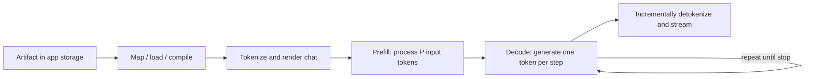
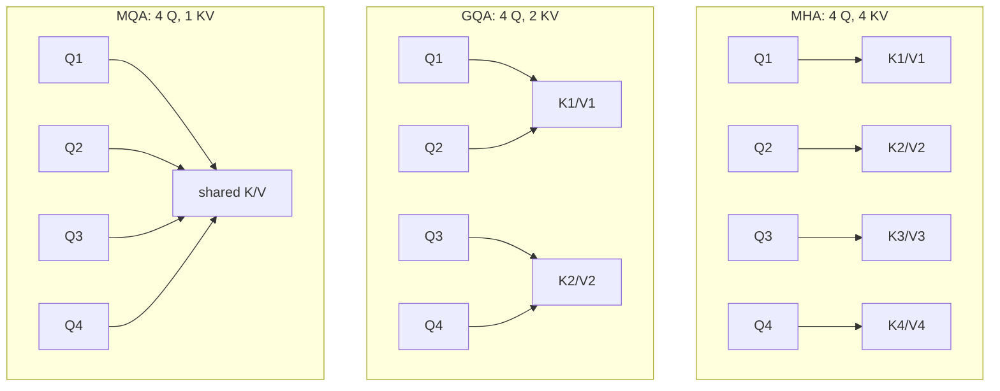

# Chapter 19 — Mobile Inference Optimization

**Research cut-off:** 2026-11-23  
**Scope:** offline, autoregressive Small Language Model (SLM) inference for one interactive user on a phone or tablet,
with server techniques included only to establish their transfer limits  
**Evidence status:** research and official documentation are cited; no implementation in this chapter was executed and
no physical device was benchmarked. Code and configurations are therefore `UNVERIFIED IMPLEMENTATION`, numerical worked
examples are `ILLUSTRATIVE`, and the benchmark design is a `PLANNED EXPERIMENT`.

## 19.1 The objective is a usable product, not a high peak number

A model that fits in storage may fail to fit in memory. A model that fits in memory may produce its first token too
slowly. A model that is fast for a 20-second demo may throttle after five minutes. Mobile optimization is therefore a
constrained, multi-objective problem:

\[ \min \left(T_\text{first},\, T_\text{token},\, M_\text{peak},\, E_\text{token},\, S_\text{artifact}\right)
\quad\text{subject to}\quad Q \ge Q_\min,\ C \ge C_\min,\ \text{no crash} \]

where \(T_\text{first}\) is Time to First Token (TTFT), \(T_\text{token}\) is steady decode time per output token,
\(M_\text{peak}\) is peak resident memory, \(E_\text{token}\) is energy per generated token, \(S_\text{artifact}\) is
installed/downloaded model size, \(Q\) is measured task quality, and \(C\) is usable context length.

No single optimization minimizes all terms. Four-bit weights reduce storage and weight traffic, but a poorly matched
dequantization kernel can be slower than eight-bit. A GPU can improve prefill while increasing startup cost, memory
pressure, or sustained power. A longer context improves conversational continuity but increases cache memory and decode
work. The correct result is a measured Pareto frontier, not a universal preset.

This chapter assumes the deployment distinctions from [Chapter 16](ch-16-edge-ai-fundamentals.md), hardware constraints
from [Chapter 17](ch-17-mobile-hardware-architecture.md), and runtime choices from
[Chapter 18](ch-18-edge-inference-frameworks.md). It does not use runtime retrieval: prompt reduction means removing
redundant conversational text, not retrieving external documents.

### 19.1.1 The stage model

An interactive request has five materially different phases.



<a id="fig-17"></a> **FIG-17 — Prefill versus decode inference stages (`ILLUSTRATIVE`).** Alt text: an artifact is
loaded, prompt tokens are processed together during prefill to create a KV cache and first-token boundary, then decode
repeatedly reads and appends cache entries one generated token at a time before streaming text. Loading, prefill,
decode, and UI streaming have different bottlenecks and must be measured separately. Not measured; arrows show
conceptual relationships only.

Let \(P\) be input tokens and \(G\) generated tokens. A useful decomposition is:

\[ T_\text{total}=T_\text{load}+T_\text{tokenize}+T_\text{prefill}(P)
+\sum_{i=1}^{G}T_\text{decode}(P+i-1)+T_\text{UI}. \]

Warm-request TTFT excludes loading only when the app really keeps a valid model session resident:

\[ T_\text{TTFT}=T_\text{load,cold}+T_\text{tokenize} +T_\text{prefill}(P)+T_\text{decode}(P). \]

Report cold and warm values separately.

## 19.2 Prefill and decode are different workloads

### Prefill

Prefill evaluates all prompt tokens, produces the first logits, and writes a Key-Value (KV) cache for every layer. Its
matrix multiplications have substantial token-level parallelism. For dense causal attention, attention-score work over
\(P\) prompt tokens is \(O(P^2)\), although projections and MLPs also contribute heavily. Accelerators and larger prompt
batches can be effective because there is enough parallel work.

Optimize prefill by:

1. sending fewer tokens;
2. using a fused, tiled attention kernel supported by the selected backend;
3. processing prompt tokens in chunks when peak temporary memory is the limiter;
4. retaining a valid common-prefix cache for repeated requests;
5. selecting an accelerator only after including compile, transfer, and synchronization costs;
6. using an architecture with an efficient attention pattern and fewer KV heads.

Chunked prefill caps a temporary-memory spike by processing \(c<P\) tokens at a time. It usually trades more launches
and synchronization for lower peak memory. It does **not** make the semantic context shorter or remove the final KV
cache. Chunk size is a memory/throughput tuning parameter, not a quality setting.

### Decode

Decode evaluates one newly selected token, appends one K/V entry per layer, and attends over prior cache entries. At
batch one, large weight tensors are repeatedly read for very little arithmetic. Decode is commonly constrained by memory
bandwidth, kernel-launch overhead, and serial dependency: token \(i+1\) cannot ordinarily begin before token \(i\) is
selected.

A simple lower-bound diagnostic is:

\[ T_\text{decode}\gtrsim \max\left(\frac{B_\text{weights}+B_\text{KV-read}}{\text{effective bandwidth}},
\frac{F_\text{token}}{\text{effective FLOP/s}}\right)+T_\text{launch}. \]

This is not a latency predictor. Caches, fusion, dequantization, backend transfers, frequency changes, and contention
alter all terms.

Optimize decode by choosing the smallest model that meets quality; choosing a weight format with fast kernels on the
actual SoC; selecting native GQA/MQA; reducing active context; quantizing KV only after quality/kernel tests; tuning CPU
threads or accelerator placement; and testing speculation only after the baseline is stable.

### Worked latency example

Assume an explicitly `ILLUSTRATIVE`, not measured, cold request has 1.20 s loading, 0.04 s tokenization, 1.60 s prefill,
and 0.12 s for the first decode step. Cold TTFT is \(1.20+0.04+1.60+0.12=2.96\) s; warm TTFT with a resident session is
1.76 s. If later decode steps average 0.10 s/token, the nominal decode rate is 10 tokens/s and 128 output tokens add
about 12.8 s. Halving load time changes cold TTFT but not steady decode; halving prompt tokens may change prefill and
later cache scans but does not imply exactly half the latency. This is why load, prefill, and decode must remain
separate result columns.

<!-- markdownlint-disable MD013 -->
| Lever                                | Primary stage                    |    Likely mobile value | Main trap                               |
| ------------------------------------ | -------------------------------- | ---------------------: | --------------------------------------- |
| Shorter prompt                       | Prefill and decode               |                   High | Removing safety/task-critical context   |
| Weight quantization + matched kernel | Mostly decode; also load/prefill |                   High | Smaller file but slower dequantization  |
| GQA/MQA architecture                 | Decode and KV memory             |                   High | Cannot safely retrofit without training |
| Flash-style fused attention          | Prefill; sometimes long decode   |      Backend-dependent | Name does not imply mobile support      |
| KV quantization                      | Long-context decode and memory   |            Medium–high | Quality loss or slow kernel             |
| Prefix reuse                         | Repeated identical prefix        |            Medium–high | Stale cache after history edits         |
| Speculation                          | Decode                           | Experimental on mobile | Draft overhead, RAM, low acceptance     |
| Continuous batching                  | Multi-request service            |       Low for one chat | Throughput rather than user latency     |
| PagedAttention                       | Multi-session KV allocation      |            Usually low | Indirection without fragmentation       |
<!-- markdownlint-restore -->

**Table CH19-1 — Stage-aware optimization map.** Values are engineering recommendations, not measured rankings.

## 19.3 KV-cache mechanics and memory

Without a cache, every decode step would recompute keys and values for the entire prefix. A KV cache stores them once.
For \(L\) decoder layers, \(H_{kv}\) KV heads, head dimension \(d_h\), sequence length \(S\), batch \(B\), and \(b\)
bytes per element:

\[ M_\text{KV}=2\,L\,B\,S\,H_{kv}\,d_h\,b. \]

The factor 2 represents keys and values. Runtimes add alignment, block metadata, staging buffers, or duplicate graph
I/O, so measured resident memory can exceed this ideal.

<a id="fig-18"></a> **FIG-18 — KV-cache growth (`ESTIMATE`).** Alt text: ideal KV-cache bytes increase linearly with
cached tokens, layers, batch, KV heads, head width, and bytes per scalar; runtime allocator curves must be measured
separately. Formula-derived only: \(M_\text{KV}=2LBSH_{kv}d_hb\). Assumptions and worked values follow; alignment,
metadata, staging buffers, and duplicate graph I/O are excluded.

```text
cached tokens S:      0 ───────────────→ configured context limit
ideal cache bytes:    0 ───────────────→ 2 × L × B × S × Hkv × dh × b
runtime allocation:   unknown until measured for the exact artifact/runtime/target
```

### Worked memory example

Consider an `ILLUSTRATIVE` 32-layer model with \(H_q=32\), \(d_h=128\), batch one, and 4,096 active tokens:

- **MHA:** \(H_{kv}=32\), FP16: \(2(32)(4096)(32)(128)(2)=2{,}147{,}483{,}648\) bytes, or 2.00 GiB.
- **GQA with eight KV heads:** \(H_{kv}=8\), FP16: 512 MiB.
- **GQA plus ideal INT8 cache:** approximately 256 MiB before scales/metadata.
- **Same GQA, 8,192 tokens, FP16:** approximately 1.00 GiB.

Architecture and context can dominate cache memory. Weight quantization does not automatically quantize KV.

Control KV memory by lowering \(S\); choosing fewer KV heads; lowering cache precision; allocating on demand; using a
supported rotating cache; reusing a valid prefix; and destroying inactive sessions. Never infer behavior from a context
flag alone: determine whether allocation is eager, dynamic, paged, or fixed-shape.

## 19.4 KV-cache quantization

KV quantization lowers cache storage and cache-read bandwidth independently from weight precision. A uniform asymmetric
quantizer maps:

\[ q=\operatorname{clip}\left(\operatorname{round}\left(\frac{x}{s}\right)+z,\ q_\min,q_\max\right), \qquad
\hat{x}=s(q-z), \]

where \(s\) is scale and \(z\) zero point. Grouping determines which values share metadata; packing and dequantization
are not free.

`PAPER-REPORTED`: KIVI observed different outlier structure in keys and values and proposed per-channel key and
per-token value quantization at two bits, retaining recent tokens at higher precision. The authors reported lower peak
memory and higher server throughput on tested models. These results do not prove the same speed or quality on mobile
[KIVI paper](https://proceedings.mlr.press/v235/liu24bz.html),
[official implementation](https://github.com/jy-yuan/KIVI).

`DOC-VERIFIED`: llama.cpp exposes separate K and V cache types, including floating-point and quantized formats
(`--cache-type-k`, `--cache-type-v`)
[official options](https://github.com/ggml-org/llama.cpp/blob/master/tools/server/README.md). This does not prove every
backend implements every type efficiently or reproduces KIVI.

Validation order:

1. establish FP16/BF16 cache quality and latency;
2. test eight-bit K and V;
3. test K-only and V-only changes;
4. test lower bits only with a native kernel;
5. evaluate short, long, repetitive, code-like, numeric, and domain prompts;
6. measure decode at several active lengths;
7. test rollover and prefix reuse.

Quantization can lose at short context because metadata work exceeds bytes saved and win at long context when traffic
dominates. “4× cache compression” is not “4× total-memory reduction.”

## 19.5 Attention heads: MHA, GQA, MQA, and pruning

With \(H_q\) query heads:

- **MHA:** \(H_{kv}=H_q\);
- **GQA:** \(1<H_{kv}<H_q\), with groups sharing K/V;
- **MQA:** \(H_{kv}=1\).

MQA targets incremental-decoding KV bandwidth [Shazeer, 2019](https://arxiv.org/abs/1911.02150). GQA interpolates
between MHA and MQA [Ainslie et al., 2023](https://arxiv.org/abs/2305.13245). For fixed \(L,S,d_h,b\), cache memory
falls linearly with \(H_{kv}\).



<a id="fig-ch19-02"></a> **FIG-CH19-02 — KV-head sharing (`ILLUSTRATIVE`).** Alt text: MHA assigns one key/value pair
per query head, GQA shares key/value pairs within query-head groups, and MQA shares one key/value pair across all shown
query heads. Not measured; arrows show conceptual relationships only.

This is mainly an architecture/training decision. Arbitrarily averaging trained K/V projections changes model function.
The GQA conversion uses uptraining; head pruning likewise needs saliency analysis, structural surgery, recovery
training, export support, and quality evaluation. Zeroing heads while retaining dense shapes rarely yields portable
speed. Prefer an already capable native GQA/MQA checkpoint; treat post hoc head removal as a compression experiment.

## 19.6 Context length and sliding windows

A lower configured maximum can reduce reserved cache, accelerator graph size, and worst-case latency, but only if
runtime allocation reflects it. Prompt length affects prefill attention (roughly quadratic for dense attention), cache
size (linear), each decode scan (approximately linear), and shared input/output budget.

Do not use a model-card maximum as the mobile default. Select the smallest context that passes product tasks, then test
larger tiers.

A model trained with sliding-window attention lets each token attend to at most \(W\) recent tokens:

\[ M_\text{KV,window}\approx2LBW H_{kv}d_hb, \]

subject to global layers/tokens and implementation. Evicting old entries from a full-attention model is not
automatically equivalent; it changes information and may interact with RoPE, absolute positions, attention sinks, and
chat semantics. Runtime context shifting needs quality tests at the boundary.

Preserve the current question, safety constraints, identity, units, and diagnostic state. Compact structured application
state where feasible. A generated summary is not lossless.

## 19.7 Prefix caching

Prefix caching stores KV for an identical token prefix and resumes after it. It is valid only when exact token
IDs/positions, model, adapter, quantization, backend, cache format, mask, and template match.

For one mobile chat, retain the append-only session cache and prefill only newly appended tokens. A system prompt may be
cached across sessions if the runtime exposes a safe snapshot. The gain is skipped prefill, not decode.

Failure modes include edited history with stale cache, adapter switching, truncation at the wrong token boundary,
confusing semantic equivalence with token identity, sensitive persisted caches, and snapshots larger than recomputation
is worth. Server automatic prefix caches matter when many requests share prefixes; one-user apps usually need explicit
session state, not a global eviction policy.

## 19.8 FlashAttention: an algorithm family, not a portable switch

FlashAttention tiles \(Q,K,V\), computes online softmax, and reduces transfers between large memory and on-chip memory
while preserving exact attention semantics apart from floating-point effects.

`PAPER-REPORTED`:

- FlashAttention introduced IO-aware exact attention [Dao et al., 2022](https://arxiv.org/abs/2205.14135).
- FlashAttention-2 improved work partitioning [Dao, 2023](https://arxiv.org/abs/2307.08691).
- FlashAttention-3 targets Hopper asynchrony/low precision [Shah et al., 2024](https://arxiv.org/abs/2407.08608).

`DOC-VERIFIED`: the official implementation documents FA2 primarily for NVIDIA Ampere/Ada/Hopper and supported AMD
paths; FA3 is Hopper-specific [official repository](https://github.com/Dao-AILab/flash-attention). These kernels do not
become Android Vulkan, Adreno, Metal, or ANE kernels because a runtime uses the same name.

Mobile runtimes may independently implement the IO-aware principle. Support depends on runtime, backend, model, head
dimension, dtype, and mask. A kernel may accelerate prefill but not one-token decode; GQA, quantized KV, windows, and
unusual dimensions may select different paths. Enable a documented path, capture placement, and benchmark it. Report the
concrete kernel/backend, not only “FlashAttention enabled.”

## 19.9 PagedAttention: important server research, conditional mobile relevance

PagedAttention stores KV in fixed-size non-contiguous blocks and presents a logical sequence through a block table. The
vLLM paper targets fragmentation, over-reservation, copy sharing, and dynamic multi-request serving
[Kwon et al., SOSP 2023](https://arxiv.org/abs/2309.06180), DOI
[10.1145/3600006.3613165](https://doi.org/10.1145/3600006.3613165).

For one conversation, there may be no competing sequence to fragment a pool; contiguous/ring caches are simpler; block
tables add addressing; and delegates may demand static tensors. OS file paging is not PagedAttention.

Paged allocation becomes relevant if the app keeps several chats, branches candidates, grows without maximum
reservation, or shares prefixes. The kernel must consume paged K/V directly; copying blocks contiguous each step defeats
the benefit. Classification: core server technique, conditional multi-session mobile technique, not a default
single-chat optimization.

## 19.10 Speculative decoding, draft models, and multi-token prediction

Speculative decoding lets a cheaper draft propose \(\gamma\) tokens. The target evaluates those positions together,
accepts a valid prefix, and corrects rejection. The exact sampling algorithm preserves the target distribution
[Leviathan et al.](https://arxiv.org/abs/2211.17192); greedy variants need separate equivalence analysis.

An approximate break-even condition is:

\[ \frac{\mathbb{E}[A]+1}{T_d(\gamma)+T_v(\gamma)} > \frac{1}{T_t(1)}, \]

where \(A\) is accepted draft tokens, \(T_d\) draft time, \(T_v\) verification time, and \(T_t(1)\) ordinary
target-token time. It fails when the draft is slow, acceptance low, or verification cannot exploit parallel positions.

Mobile costs include second-model storage/RAM, possibly two caches, tokenizer mismatch, cross-device synchronization,
and extra energy. Small targets leave less compute to save. Prefer a shared tokenizer/family and measure acceptance by
domain: specialized identifiers and high-temperature sampling may accept poorly after domain SFT.

Self-speculation may skip layers or add proposal heads. Multi-token prediction trains multiple future-token heads over a
shared trunk. `PAPER-REPORTED`: Gloeckle et al. reported training/inference benefits in their evaluated setup
[arXiv:2404.19737](https://arxiv.org/abs/2404.19737). That is not evidence that an arbitrary checkpoint or mobile
runtime supports tree verification. Treat separate drafts, self-speculation, Medusa-like trees, and multi-token heads as
distinct experiments. Do not claim lossless acceleration unless the algorithm and implementation preserve the target
decoding distribution.

## 19.11 Continuous batching and batch-size trade-offs

Continuous batching admits and retires requests at iteration boundaries. Orca formalized iteration-level scheduling and
selective batching for servers [Yu et al., OSDI 2022](https://www.usenix.org/conference/osdi22/presentation/yu); vLLM
combines serving scheduling with paged KV management.

This improves aggregate throughput across concurrent requests. It does not remove one user's serial token dependency. On
a single-user phone, request batch one generally minimizes interactive latency and memory.

Mobile exceptions include generating independent alternatives, queued background jobs, a local multi-user service,
speculative target verification, and prefill of independent prompts. Larger batches may improve accelerator utilization
but multiply activations/KV and worsen TTFT, UI responsiveness, energy, and thermals. Report request throughput,
aggregate and per-request token throughput, per-request TTFT/inter-token latency, memory, and energy. Never market
aggregate batched tokens/s as one-user chat speed.

## 19.12 Prompt processing and streaming

### Prompt efficiency

The highest-confidence prefill optimization is fewer correct tokens:

1. use the checkpoint's exact chat template;
2. avoid repeating invariant instructions when a valid prefix is retained;
3. remove UI metadata and labels training does not require;
4. store structured app state compactly;
5. cap few-shot examples and prove their value;
6. keep domain terminology exact—abbreviations may tokenize poorly or become ambiguous;
7. count tokens, not characters;
8. bound output with stop conditions and a task-appropriate limit.

Prompt changes can alter quality and safety. Re-run the same domain suite after every template optimization.

### Token streaming

Streaming does not reduce compute, but improves perceived latency:

```text
token ID → incremental detokenizer → valid text fragment
→ bounded UI queue → frame-coalesced render
```

Do not decode each token independently: subword/byte tokenizers can split Unicode. Buffer incomplete fragments. Do not
re-layout a growing UI string for every token; coalesce updates. Apply backpressure. Cancellation must stop generation,
synchronize the backend, and retain or discard KV atomically.

Measure model TTFT, first correctly rendered text, median/p95 inter-token gap, UI frame stalls, and cancellation
latency.

## 19.13 CPU threads and affinity

More threads are not automatically faster. Mobile CPUs combine performance and efficiency cores, share memory bandwidth,
and operate under thermal policy. Excess workers oversubscribe, evict cache lines, contend with UI, and heat the device.

Tune prefill and decode separately if possible. Prefill often scales across more cores; batch-one decode may saturate
bandwidth earlier. Test 1, intermediate counts, performance-core count, and all-core settings.

Affinity pins or prefers workers. It can reduce migration but is device-specific:

- core topology/IDs vary;
- OS policy may be better informed;
- all “big” cores can throttle sooner;
- stealing a UI/audio core harms product behavior;
- iOS exposes no general Android/Linux-style affinity contract.

Treat affinity as an Android/Linux native-runtime experiment. Record masks/topology and benchmark sustained use with UI
interaction.

## 19.14 GPU offload

GPU offload places transformer operations through Metal, Vulkan, OpenCL, or a delegate. It is attractive for prefill and
sufficiently large matrices. It can lose through copies/synchronization, graph fallback, shader compilation, duplicated
buffers, UI contention, driver failures, or power.

“Layers offloaded” is insufficient. A mixed graph can cross CPU/GPU repeatedly. Test CPU-only, partial, and full
supported offload; capture placement and transfer traces. Include cold compilation, warm execution, memory, and a 10–30
minute run.

Unified memory can reduce explicit copies on Apple devices, but synchronization, cache coherence, residency, and total
pressure remain. Unified memory is not unlimited memory.

## 19.15 NPU execution

NPUs can provide efficient arithmetic, but dynamic sequence growth, KV updates, unsupported sampling/tokenization,
unusual quantizers, and one-token shapes can prevent full delegation.

Common constraints are fixed/enumerated shapes, vendor quantization, limited architectures/operators, compiled artifacts
tied to SDK/SoC/firmware, graph sharding, CPU tokenizer/sampler, and separate prefill/decode graphs.

`DOC-VERIFIED`: Core ML can schedule across Apple CPU/GPU/Neural Engine, and iOS 18+ model state supports in-place state
such as KV [Apple stateful-model session](https://developer.apple.com/videos/play/wwdc2024/10159/). ExecuTorch
documents Qualcomm, MediaTek, Samsung,
Core ML, Vulkan, and CPU backends with backend-specific exports
[overview](https://docs.pytorch.org/executorch/stable/backends-overview.html). LiteRT-LM documents Android NPU paths;
Qualcomm Genie/QNN requires target-specific assets [LiteRT-LM](https://developers.google.com/edge/litert-lm/overview),
[Qualcomm workflow](https://docs.qualcomm.com/doc/80-80020-15B/topic/use-genai-model-with-genie.html).

These are capability statements, not performance. Prove delegation using traces and compare optimized CPU/GPU. Excluding
CPU fallback, compilation, or state copies invalidates an NPU speed claim.

## 19.16 Model files: mmap, lazy loading, sharding, and app storage

### Memory mapping

`mmap` maps file pages into virtual address space and faults pages into physical memory on access. For an uncompressed
mmap-friendly artifact such as GGUF, it can avoid a full heap copy, keep clean pages evictable/reloadable, allow
sharing, and simplify large-tensor access.

It does not remove storage latency. Cold random faults can hurt TTFT; mapped address size differs from resident memory;
dirty/decompressed buffers are different. Android documents file-backed demand paging for app code
[memory guide](https://developer.android.com/topic/performance/memory/guide/app-code).

### Lazy loading and prefetch

Lazy loading delays reads, materialization, or accelerator upload. It lowers initial residency but may move stalls into
first inference. Dense transformers touch nearly every weight per token, so lazy weights reshape startup more than
steady residency. Controlled warm-up or prefetch can improve predictability at an I/O/memory cost.

Report map time, cold first prefill under a reproducible reset, warm prefill, resident/proportional memory, and major
faults where observable.

### Sharding

Sharding splits a logical model across files or graph partitions. It helps packaging/download limits, resumable updates,
compiler limits, and optional components. It does not reduce total bytes. Excess shards add metadata, descriptors,
seeks, checks, and failure states. File sharding on one phone is not server tensor parallelism.

### Loading from app storage

Prefer a private, immutable, versioned directory:

1. download to a temporary private file or install packaged data;
2. verify byte length and cryptographic digest/signature;
3. check disk for download plus installation peak;
4. atomically rename a complete version;
5. open read-only and map/load;
6. retain the previous compatible version through health checks;
7. never load a partially written file.

Compressed APK/AAB assets may require extraction before random access/mmap. Test interruption, low disk, corruption,
concurrent update/load, app upgrade, and rollback. Exclude model/cache files from backup where policy requires.

## 19.17 Quantized kernels: format is not performance

A format defines representation; a kernel determines speed:

\[ T=T_\text{read packed}+T_\text{unpack/dequant}+T_\text{compute}+T_\text{requant}+T_\text{sync}. \]

Match CPU ISA, quantization group/block, scale layout, activation dtype, matrix alignment, accelerator support, fusion,
and KV dtype. INT4 may expand through a slow fallback and save disk without saving peak memory/time. A larger Q5/Q8 may
have faster kernels and higher quality. Keep weight format, cache format, and activation precision separate.

`UNVERIFIED IMPLEMENTATION` — illustrative llama.cpp configuration; option names were checked against official
documentation but not run:

```bash
# LISTING CH19-1 — CPU-first baseline; replace MODEL and tune on-device.
llama-cli \
  --model MODEL.gguf \
  --ctx-size 4096 \
  --batch-size 256 \
  --ubatch-size 128 \
  --threads 4 \
  --threads-batch 6 \
  --cache-type-k q8_0 \
  --cache-type-v q8_0 \
  --flash-attn on \
  --prompt "..."
```

Pin a release, record quantizer/checkpoint, confirm with `--help`, compare fused attention off/on, sweep
threads/batches, and test FP16 versus Q8 cache quality. Not every build accepts or accelerates every combination; see
the [CLI](https://github.com/ggml-org/llama.cpp/blob/master/tools/cli/README.md) and
[server options](https://github.com/ggml-org/llama.cpp/blob/master/tools/server/README.md).

## 19.18 Context and batch controls are not interchangeable

“Batch” can mean independent request batch, prompt-token batch, memory-limiting micro-batch, speculation width, or
training batch. Larger prompt/micro-batches may improve prefill but raise temporary memory. Larger request batches
improve aggregate throughput but usually worsen one-user latency/cache. Context raises cache and decode cost regardless
of prompt batching.

Use a two-dimensional sweep:

1. choose product context tiers (for example 1K, 2K, 4K, 8K);
2. at each tier, sweep prefill batch/micro-batch until memory or latency stops improving;
3. keep request batch one for the interactive baseline;
4. test concurrency separately.

Never compare tokens/s across different prompt/output lengths, batch definitions, or cache states without qualification.

## 19.19 Thermal and power are correctness constraints

Peak speed is not sustained speed. Power raises temperature; the OS lowers frequency or changes scheduling. A
configuration may win 30 seconds and lose after ten minutes.

\[ E_\text{token}=\frac{\int_{t_0}^{t_1}P(t)\,dt}{G}, \]

where \(P(t)\) is device/process power and \(G\) generated tokens. Battery percentage is too coarse for short runs. Use
platform instruments or external monitoring and declare the measurement boundary.

Android exposes thermal status/headroom and optional sustained-performance mode
[ADPF](https://developer.android.com/games/optimize/adpf),
[PowerManager](https://developer.android.com/reference/android/os/PowerManager),
[sustained performance](https://source.android.com/docs/core/power/performance). Apple provides Energy/Metal profiling
and `ProcessInfo` thermal state
[energy guide](https://developer.apple.com/library/archive/documentation/Performance/Conceptual/EnergyGuide-iOS/).

Thermal response policy:

1. monitor at a low documented frequency;
2. finish or safely cancel the current token;
3. reduce optional work—speculation, offload, output budget, or workers;
4. preserve correctness and safety prompts;
5. pause truthfully at severe/critical conditions;
6. never silently switch to cloud if offline/privacy was promised.

Do not swap quantization/model mid-answer unless the product supports safe semantic session migration.

## 19.20 Server technique versus single-user mobile benefit

| Technique                   | Why servers use it                  | Single-user mobile verdict                   |
| --------------------------- | ----------------------------------- | -------------------------------------------- |
| Continuous batching         | Fill accelerator with requests      | Usually no; batch one favors latency         |
| PagedAttention              | Reduce KV fragmentation/reservation | Conditional for multi-session/branching      |
| Cross-user prefix cache     | Share common prompts                | Narrow; retain one session/system prefix     |
| Tensor/pipeline parallelism | Split huge models                   | Generally irrelevant on one SoC              |
| Large request batch         | Aggregate throughput                | Usually harms interactivity/memory           |
| FlashAttention CUDA kernels | Reduce supported-GPU HBM traffic    | Principle transfers; kernel does not         |
| Speculative decoding        | Use target parallelism              | Possible; RAM/energy/acceptance decide       |
| KV quantization             | Fit sequences/reduce bandwidth      | Direct at long context if kernels work       |
| GQA/MQA                     | Reduce cache capacity/bandwidth     | Direct, high-value architecture choice       |
| Short prompts/context       | Lower serving cost                  | Direct, high-confidence                      |
| Weight/kernel co-design     | Efficient execution                 | Direct and essential                         |
| mmap/lazy loading           | Reduce copies/residency             | Direct, artifact-dependent                   |
| Thread/affinity tuning      | CPU efficiency                      | Direct on CPU, device-specific               |
| GPU/NPU execution           | Throughput/efficiency               | Direct only with substantial placement       |
| Streaming                   | Perceived latency                   | Direct product benefit; no compute reduction |

**Table CH19-2 — Transfer boundary.** Conditional items require exact-tuple benchmarks.

## 19.21 Recommended optimization order

Optimize in an order that preserves causal attribution:

1. **Freeze correctness.** Pin checkpoint, tokenizer, template, runtime, prompts, sampler, seeds where applicable, and
   quality tests.
2. **Select architecture.** Prefer a smaller capable model and native GQA/MQA before runtime tricks.
3. **Establish CPU/reference baseline.** Batch one, conservative context, no speculation.
4. **Optimize prompt.** Remove redundancy without changing quality/safety.
5. **Choose weight quantization and kernel together.**
6. **Tune context/cache allocation.** Set product tiers and measure typical/maximum cases.
7. **Tune prefill.** Fused attention, prompt/micro-batch, prefix reuse.
8. **Tune decode.** Threads, legal affinity, cache precision, kernels.
9. **Evaluate accelerators separately.** Prove placement and include startup.
10. **Add one advanced method at a time.** Native windows, then speculation/multi-token support.
11. **Run sustained tests.** Reject crashes, poor throttling, and unacceptable energy.
12. **Re-run quality/lifecycle gates.** Context boundary, cancellation, backgrounding, update/rollback, malformed
    artifacts.

This prevents spending weeks on speculation for a model whose baseline is too large or whose tokenizer is wrong.

### 19.21.1 Worked optimization notebook

Start with an `ILLUSTRATIVE` baseline: 128 input tokens, 128 generated tokens, 1.20 s cold load, 1.60 s prefill,
0.12 s first decode, 0.10 s subsequent decode, 1.55 GiB peak memory, and no measured energy result. The values teach
attribution; they are not device results.

| Run | One controlled change | Hypothetical observation | Correct conclusion |
| --- | --- | --- | --- |
| A | baseline | cold TTFT 2.96 s; 10 tok/s decode | reference only |
| B | retain resident model | warm TTFT 1.76 s; decode unchanged | startup improved, generation did not |
| C | remove redundant prompt tokens | prefill 0.95 s; quality unchanged on the fixed suite | shorter prompt helped TTFT; verify safety text remained |
| D | change weight format with native kernel | peak 1.30 GiB; decode 12 tok/s | useful only if quality and sustained tests pass |
| E | change KV FP16→INT8 | max-context peak falls; short-context decode unchanged | cache precision addressed long-context memory, not startup |
| F | GPU prefill only | prefill improves after warm compile; cold TTFT worsens | route warm prefill only if product sessions amortize compile |
| G | all CPU threads | first-minute decode rises, late-window rate falls | fewer threads may give better sustained behavior |

Do not run B–G simultaneously. If the final configuration improves, the team otherwise cannot tell whether the cause
was prompt length, kernel, cache, backend, or threads.

**Latency arithmetic.** After B and C, warm TTFT is
\(0.04_{\text{tokenize}}+0.95_{\text{prefill}}+0.12_{\text{first decode}}=1.11\) s. If D changes subsequent decode
to \(1/12\) s/token, the remaining 127 tokens require about 10.58 s rather than 12.7 s. Report TTFT and decode
separately; combining them into one tokens/s value hides which user experience improved.

**Thermal interpretation.** Suppose G produces 13 tok/s in minutes 0–1 and 8 tok/s in minutes 9–10, while D produces
12 and 11 tok/s in the same windows. The late/early retention ratios are 0.62 and 0.92. D is the stronger sustained
candidate even though G wins the cold burst. Temperature, clocks, context position, and background state are still
needed before assigning the cause to heat.

**Expected behavior:** every run uses identical token IDs, output limit, sampler, device state band, and quality suite;
raw token timestamps are retained; an OOM or malformed output counts as a failed trial. **Troubleshooting:** if D's
smaller file raises RAM, inspect load-time expansion; if E changes facts at long context, reject or retune KV
quantization; if F has no effect, inspect actual placement; if G slows only after several minutes, compare clocks and
thermal state rather than guessing.

## 19.22 Controlled mobile benchmark protocol

This section is a `PLANNED EXPERIMENT`; no results are claimed.

### 19.22.1 Freeze the test unit

Record:

- exact device model, SoC, RAM, storage/free space;
- OS build, firmware, GPU driver, power mode;
- runtime/converter/compiler commits and build flags;
- checkpoint/tokenizer revisions, licenses, artifact hashes;
- weight, activation, and KV precision;
- context, prompt batch, micro-batch, request batch;
- threads, affinity, offload/delegate configuration;
- ambient temperature, case, charging state, starting battery;
- display brightness and background/network policy.

### 19.22.2 Workload matrix

Use fixed tokenized prompts:

- short: 64–128 input tokens;
- medium: 512–1,024;
- long: near each intended context tier;
- fixed outputs: 32, 128, and 512 tokens where safe;
- domain sets: factual, multi-turn diagnosis, structured output, numbers/units, Unicode, rare terminology;
- repetitive and unpredictable prompts for speculation;
- cache states: cold, warm, append-only, edited, rollover.

Use greedy decoding for performance comparability, then repeat quality-relevant sampling separately. Forced output
length avoids early-EOS bias but cannot replace natural completion tests.

### 19.22.3 Procedure

1. reboot or use a documented reset and wait for thermal equilibrium;
2. ensure no session exists for cold load;
3. collect cold open/map/compile and TTFT;
4. warm until compilation/caches stabilize; report but exclude warm-up;
5. run at least 10 measured short and 5 long sustained trials per configuration;
6. randomize order or use balanced blocks to reduce heating bias;
7. cool to the same range before each block;
8. run a continuous 10–30 minute workload;
9. monitor memory, page faults where available, utilization/placement, frequencies, thermal state, energy, and UI
   responsiveness;
10. re-run quality for every precision/cache/speculation/context change.

### 19.22.4 Metrics

- artifact open to ready session (`load_ms`);
- submit to first model token and first rendered text (`TTFT_ms`);
- \(\text{prefill tok/s}=\text{input tokens}/\text{prefill seconds}\);
- \(\text{decode tok/s}=\text{generated tokens}/\text{decode seconds}\), excluding prefill;
- median/p95 inter-token latency;
- peak proportional/resident memory and post-load memory;
- download/install peak bytes;
- energy/token and average power;
- throughput slope and time to throttle;
- crashes/OOM and recovery;
- domain/safety quality;
- speculative accepted tokens per verification.

Report median, IQR or confidence interval, and trial count. Do not merge different devices/conditions into an
unqualified ranking.

```json
{
  "evidence": "PLANNED_EXPERIMENT",
  "device": { "model": "", "soc": "", "ram_gib": 0, "os_build": "" },
  "artifact": { "sha256": "", "weights": "", "kv": "", "bytes": 0 },
  "runtime": { "name": "", "revision": "", "backend": "", "build_flags": [] },
  "workload": { "prompt_id": "", "input_tokens": 0, "output_tokens": 0, "context_limit": 0 },
  "config": { "threads": 0, "affinity": "", "prompt_batch": 0, "micro_batch": 0 },
  "measurements": {
    "load_ms": 0,
    "ttft_ms": 0,
    "prefill_tok_s": 0,
    "decode_tok_s": 0,
    "peak_rss_mib": 0,
    "energy_j": null,
    "thermal_start": "",
    "thermal_end": ""
  }
}
```

**Listing CH19-2 — Result record (`UNVERIFIED IMPLEMENTATION`).** Preserve raw per-trial records.

## 19.23 Configuration and integration examples

All examples are `UNVERIFIED IMPLEMENTATION`; verify against pinned runtime/platform versions.

### Runtime-independent policy

```python
# LISTING CH19-3 — Policy sketch, not a runtime binding.
from dataclasses import dataclass

@dataclass(frozen=True)
class InferencePolicy:
    context_tokens: int = 4096
    max_new_tokens: int = 256
    request_batch: int = 1
    prompt_chunk: int = 128
    kv_dtype: str = "int8"
    keep_session_prefix: bool = True
    speculative_tokens: int = 0

def validate(policy: InferencePolicy) -> None:
    assert policy.request_batch == 1
    assert 0 < policy.prompt_chunk <= policy.context_tokens
    assert policy.max_new_tokens < policy.context_tokens
```

Production must reserve input plus output and special tokens, then reject or explicitly compact overlong requests.

### Android thermal adaptation

```kotlin
// LISTING CH19-4 — API levels and lifecycle unverified.
val power = getSystemService(PowerManager::class.java)
val listener = PowerManager.OnThermalStatusChangedListener { status ->
    when {
        status >= PowerManager.THERMAL_STATUS_CRITICAL ->
            inferenceController.pauseAfterCurrentToken()
        status >= PowerManager.THERMAL_STATUS_SEVERE ->
            inferenceController.applyProfile("cool")
        else ->
            inferenceController.applyProfile("measured-default")
    }
}
power.addThermalStatusListener(mainExecutor, listener)
```

Do not poll thermal headroom faster than official guidance. Remove listeners with lifecycle. Profiles must not remove
safety instructions or silently change claimed capability.

### Prefix-cache identity

```python
# LISTING CH19-5 — Identity sketch, not serialized KV.
import hashlib, json

def prefix_key(token_ids, model_sha256, adapter_sha256, runtime_rev, kv_dtype):
    identity = {
        "tokens": token_ids,
        "model": model_sha256,
        "adapter": adapter_sha256,
        "runtime": runtime_rev,
        "kv_dtype": kv_dtype,
    }
    return hashlib.sha256(
        json.dumps(identity, separators=(",", ":"), sort_keys=True).encode()
    ).hexdigest()
```

Real keys must include every cache-determining setting. Reject uncertain reuse rather than silently corrupt
continuation.

## 19.24 Failure modes and diagnostic map

| Symptom                    | Likely causes                               | Discriminating test              |
| -------------------------- | ------------------------------------------- | -------------------------------- |
| Small file, high RAM       | dequantized copy, KV, duplicate buffers     | memory timeline by stage         |
| Fast prefill, slow decode  | weight bandwidth, long KV, launches         | prompt/context sweep             |
| GPU slower than CPU        | fallback, transfers, compile, tiny kernels  | placement + warm/cold split      |
| NPU works, no energy win   | partial delegation, oversized fixed buffers | trace and whole-device energy    |
| More threads slower        | bandwidth, migration, thermal               | sustained thread/affinity sweep  |
| Quantized KV loses quality | bits/grouping/outliers                      | K-only/V-only ablation           |
| Quantized KV slower        | no fused kernel, pack/dequant               | latency versus active context    |
| Prefix changes answer      | stale state, position/template mismatch     | full-recompute parity            |
| Speculation slower         | low acceptance, draft/sync cost             | stage timing + acceptance        |
| “Flash” no effect          | unsupported path or decode bound            | trace + prefill comparison       |
| Shift causes incoherence   | untrained eviction/RoPE/state issue         | boundary quality suite           |
| First run slow             | page faults, graph/shader compile           | cold/warm trace                  |
| Speed decays               | thermal/battery policy                      | frequency/thermal time series    |
| Broken streamed text       | stateless decoding                          | incremental Unicode tests        |
| Background crash           | pressure/lifecycle race                     | background/foreground stress     |
| Shard load fails           | missing/mixed/partial version               | signed manifest + atomic install |

**Table CH19-3 — Failure-mode guide.**

Also avoid comparing unequal prompts; importing server gains as mobile estimates; excluding
tokenization/compile/transfer/UI; reporting best-of-\(n\); changing several variables together; treating backend
selection as proof of acceleration; budgeting model, KV, and app memory separately; persisting sensitive state without
policy; or shortening away safety behavior.

## 19.25 Application to specialist SLMs

Specialization changes optimization:

- technical identifiers may split into many tokens;
- diagnostic histories increase cache pressure;
- pharmacy/machinery safety instructions cannot be removed for speed;
- a general draft may reject specialized tokens;
- cache quantization may affect exact numbers, codes, and long references;
- compact structured state can preserve fault codes, drug/equipment identity, units, and observations better than
  repeated prose.

Create domain-stratified performance and quality sets. Automotive tests need trouble codes, wiring steps, and multi-turn
symptoms. Pharmacy tests need drug names, doses, contraindications, uncertainty, and escalation; an offline SLM is not
an autonomous prescriber. Beekeeping/industrial tests need seasonal/stateful procedures and rare terminology. An
optimization passes only when runtime and risk-weighted domain metrics pass.

## 19.26 Exercises and laboratory work

1. **KV calculator:** derive memory for 24 layers, 16 query heads, 4 KV heads, \(d_h=128\), batch one, FP16 at 2K/4K/8K.
   Repeat for INT8 and an explicitly illustrative 2% metadata overhead.
2. **Architecture choice:** compare similarly capable MHA/GQA checkpoints and identify controls needed before
   attributing gains to GQA.
3. **Stage instrumentation:** report load, tokenize, prefill, first decode, and steady decode; show why one tokens/s
   value fails.
4. **Prompt ablation:** remove 10%, 25%, 50% of prompt tokens and find the first unsafe/inaccurate ablation.
5. **Cache precision:** compare FP16, INT8, and one lower supported format at short/long context for quality, memory,
   and latency.
6. **Thread sweep:** test legal thread/affinity options in a burst and 20-minute run, including UI responsiveness.
7. **Backend proof:** compare CPU/GPU/NPU with placement evidence and explain fallback.
8. **Prefix correctness:** append, edit, and truncate history; compare cached/full logits or tokens.
9. **Speculation:** measure draft, verification, acceptance, extra RAM, and energy; identify losing domains.
10. **Storage lifecycle:** implement signed/versioned atomic install with interruption, corruption, low-disk, and
    rollback tests.
11. **Server/mobile boundary:** design helping and harmful workloads for paging, continuous batching, tensor
    parallelism, and prefix caching.
12. **Capstone:** create a Pareto frontier over quality, warm TTFT, sustained decode, memory, and energy for six
    configurations on one physical device; preserve raw trials.

## 19.27 Practical conclusions

The strongest defaults are:

1. select a capable small architecture with GQA/MQA;
2. use a weight format with a proven target kernel;
3. keep prompt and context no larger than required;
4. retain a correct append-only session cache;
5. tune prefill/decode separately;
6. prove accelerator placement;
7. optimize sustained energy/thermals, not peak tokens/s.

KV quantization, fused attention, and acceleration help only as supported kernels on the exact tuple.
Speculative/multi-token decoding remains an experiment for mobile. PagedAttention and continuous batching solve server
problems and should not enter a one-user app without a matching concurrency/allocation problem.

## 19.28 Sources and evidence notes

### Primary research

- Noam Shazeer, **“Fast Transformer Decoding: One Write-Head is All You Need”** (2019), arXiv:1911.02150.
  <https://arxiv.org/abs/1911.02150>
- Joshua Ainslie et al., **“GQA: Training Generalized Multi-Query Transformer Models from Multi-Head Checkpoints”**
  (2023), arXiv:2305.13245. <https://arxiv.org/abs/2305.13245>
- Tri Dao et al., **“FlashAttention: Fast and Memory-Efficient Exact Attention with IO-Awareness”** (2022),
  arXiv:2205.14135. <https://arxiv.org/abs/2205.14135>
- Tri Dao, **“FlashAttention-2: Faster Attention with Better Parallelism and Work Partitioning”** (2023),
  arXiv:2307.08691. <https://arxiv.org/abs/2307.08691>
- Jay Shah et al., **“FlashAttention-3: Fast and Accurate Attention with Asynchrony and Low-precision”** (2024),
  arXiv:2407.08608. <https://arxiv.org/abs/2407.08608>
- Woosuk Kwon et al., **“Efficient Memory Management for Large Language Model Serving with PagedAttention”** (SOSP
  2023), arXiv:2309.06180, DOI 10.1145/3600006.3613165. <https://arxiv.org/abs/2309.06180>
- Gyeong-In Yu et al., **“Orca: A Distributed Serving System for Transformer-Based Generative Models”** (OSDI 2022).
  <https://www.usenix.org/conference/osdi22/presentation/yu>
- Yaniv Leviathan, Matan Kalman, Yossi Matias, **“Fast Inference from Transformers via Speculative Decoding”** (ICML
  2023), arXiv:2211.17192. <https://arxiv.org/abs/2211.17192>
- Fabian Gloeckle et al., **“Better & Faster Large Language Models via Multi-token Prediction”** (2024),
  arXiv:2404.19737. <https://arxiv.org/abs/2404.19737>
- Zirui Liu et al., **“KIVI: A Tuning-Free Asymmetric 2bit Quantization for KV Cache”** (ICML 2024), PMLR 235.
  <https://proceedings.mlr.press/v235/liu24bz.html>

Paper performance statements are `PAPER-REPORTED`; their hardware, model, batching, and software conditions do not
transfer automatically.

### Official implementation and platform documentation

- FlashAttention: <https://github.com/Dao-AILab/flash-attention/>
- llama.cpp CLI/server/Android: <https://github.com/ggml-org/llama.cpp/> ;
  <https://github.com/ggml-org/llama.cpp/blob/master/tools/cli/README.md> ;
  <https://github.com/ggml-org/llama.cpp/blob/master/tools/server/README.md> ;
  <https://github.com/ggml-org/llama.cpp/blob/HEAD/docs/android.md>
- ExecuTorch: <https://docs.pytorch.org/executorch/stable/backends-overview.html> ;
  <https://docs.pytorch.org/executorch/stable/llm/run-on-android.html> ;
  <https://docs.pytorch.org/executorch/stable/llm/run-on-ios.html>
- LiteRT-LM: <https://developers.google.com/edge/litert-lm/overview> ;
  <https://github.com/google-ai-edge/LiteRT-LM/releases>
- Core ML stateful models: <https://developer.apple.com/videos/play/wwdc2024/10159/>
- MLX Swift LM: <https://github.com/ml-explore/mlx-swift-lm>
- MLC LLM: <https://llm.mlc.ai/docs/compilation/compile_models.html> ;
  <https://github.com/mlc-ai/mlc-llm/blob/main/docs/deploy/android.rst> ;
  <https://github.com/mlc-ai/mlc-llm/blob/main/docs/deploy/ios.rst>
- MNN: <https://mnn-docs.readthedocs.io/en/latest/transformers/llm.html>
- ncnn: <https://github.com/Tencent/ncnn/releases/>
- ONNX Runtime: <https://onnxruntime.ai/docs/tutorials/mobile/> ;
  <https://onnxruntime.ai/docs/execution-providers/QNN-ExecutionProvider.html>
- Qualcomm Genie: <https://docs.qualcomm.com/doc/80-80020-15B/topic/use-genai-model-with-genie.html>
- Android thermal/memory: <https://developer.android.com/reference/android/os/PowerManager> ;
  <https://developer.android.com/games/optimize/adpf> ; <https://source.android.com/docs/core/power/performance> ;
  <https://developer.android.com/topic/performance/memory/guide/app-code>
- Apple energy guidance:
  <https://developer.apple.com/library/archive/documentation/Performance/Conceptual/EnergyGuide-iOS/>

These compatibility statements are `DOC-VERIFIED`, not execution evidence. See the dated
[edge runtime survey](../../04-research-comparison-report/edge-runtime-survey.md).

## 19.29 Verification note

**Chapter prose:** every CH-19 prompt item is addressed.  
**Research:** primary papers and official sources incorporated through the cut-off.  
**Execution:** no code was executed; no conversion, physical-device benchmark, energy/thermal run, kernel trace, or
quality ablation was performed.  
**Evidence boundary:** equations/examples are analytical or `ILLUSTRATIVE`; paper results are `PAPER-REPORTED`;
documented capabilities are `DOC-VERIFIED`; measurements are `PLANNED EXPERIMENT`.  
**Release gate:** execute the controlled protocol on selected model/runtime/device tuples, preserve raw results,
validate tokenizer/logit/quality parity, verify licenses, and update with `EXECUTED` or `REPRODUCED` evidence before
making product claims.

## Cross-links

- [Part index](README.md)
- [Detailed table of contents](../../01-planning/detailed-table-of-contents.md)
- [CH-19 assessment](../../13-assessments/ch-19-assessment.md)
- [Evidence standard](../../00-governance/evidence-and-citation-standard.md)
- [Reproducibility standard](../../00-governance/reproducibility-standard.md)
