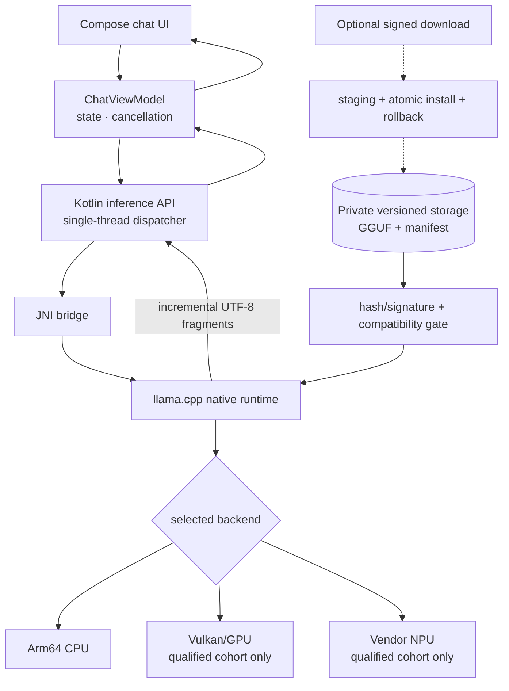
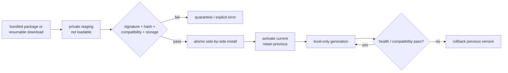

# Chapter 20 — Android Deployment

> **Illustrative values.** Concrete identifiers, dates, thresholds, hashes, account numbers, and endpoints in this file are teaching examples, not observed project results or deployable credentials. Before use, replace them with reviewed values from your own registry, preserve the required format, and rerun every stated validation.

**Research cut-off:** 2026-11-23  
**Documentation status:** Android and runtime statements tied to §20.25 are `DOC-VERIFIED`.  
**Execution status:** **AUTHORED / NOT EXECUTED.** No Android project was compiled, no model was converted, and no
emulator or physical device was used for this chapter. Every code block, command, dependency set, API composition, and
test is therefore **`UNVERIFIED IMPLEMENTATION`** unless the text explicitly says only that an official document was
reviewed. No listing is claimed to compile.

This chapter turns the runtime analysis in [Chapter 18](ch-18-edge-inference-frameworks.md) and optimization rules in
[Chapter 19](ch-19-mobile-inference-optimization.md) into one practical Android path. The reference application uses
**llama.cpp + GGUF + Kotlin `Flow` + JNI**, with CPU execution as the correctness baseline. It is intentionally small
enough to audit, but it is not production-ready until §20.21 is executed.

## 20.1 Learning outcomes and evidence boundary

After completing this chapter, the reader should be able to:

1. create an Android Studio project that packages a native SLM runtime;
2. distinguish Kotlin/Java bindings, JNI, native libraries, and model artifacts;
3. convert a supported source checkpoint to GGUF and preserve tokenizer/template semantics;
4. install, authenticate, load, stream from, cancel, and unload an offline model;
5. evaluate CPU, GPU, and NPU paths without inferring acceleration from a selectable backend;
6. design around Android process lifecycle, memory pressure, background limits, battery, and thermal state;
7. choose among bundled, Play-delivered, and application-downloaded model distribution;
8. implement signed, atomic model updates with rollback;
9. diagnose Java/Kotlin, JNI, native, model, and compatibility failures; and
10. replace the demonstration model with a domain-trained model without silently changing its tokenizer or chat
    contract.

The evidence labels follow the [evidence standard](../../00-governance/evidence-and-citation-standard.md). A documented
capability is not a tested model/runtime/device tuple. Exact checkpoint support, conversion, ABI packaging, memory fit,
accelerator placement, throughput, energy, thermals, and release readiness remain `TEST-REQUIRED`.

## 20.2 The deployment problem

A checkpoint directory is not an Android application. A complete local chat product is:

\[ \boxed{ \text{product}= \text{weights}+\text{tokenizer}+\text{template}+\text{runtime}+ \text{native
ABI}+\text{policy}+\text{lifecycle}+\text{delivery} } \tag{EQ-CH20-01} \]

The components form one semantic contract. A model can load yet answer incorrectly because the tokenizer differs, the
wrong chat template is applied, an end-of-turn token is ignored, or the KV cache is reused after history changed. A
model can be correct on a desktop yet fail on Android because its file is compressed inside an APK, a native ABI is
missing, an unsupported graph falls back repeatedly, or the process is killed while backgrounded.

The reference design has three boundaries:

- **UI boundary:** Compose and a `ViewModel` own user-visible state and cancellation.
- **runtime boundary:** Kotlin calls a single-threaded inference interface; JNI owns native handles.
- **artifact boundary:** a read-only, versioned model directory contains a GGUF and manifest verified before native
  parsing.

## 20.3 Architecture

<a id="fig-19"></a> **FIG-19 — Mobile inference pipeline (`ILLUSTRATIVE`).** Alt text: a signed model package is
verified in private storage, loaded by a Kotlin-to-JNI runtime path, executed on a qualified CPU, GPU, or NPU backend,
and streamed to the UI; an optional update path is separate from the offline answer path. The network is used only by an
optional update control plane; it is absent from per-answer inference. Not measured; arrows show conceptual
relationships only.



**Figure CH20-2 — Thread and lifecycle ownership (`ILLUSTRATIVE`).**

```text
main thread:       input → UI state ← coalesced streamed text
                                  │
ViewModel scope:             coroutine/job/cancel
                                  │
single worker:      verify → load → prefill → decode loop → unload
                                  │
native heap:          model/context/KV/batch/sampler/backend

Activity recreation keeps ViewModel state.
Process death destroys every native handle; recreation must verify and reload.
Backgrounding does not guarantee continued execution.
```

## 20.4 Choose the runtime before writing the app

<!-- markdownlint-disable MD013 -->
| Path               | Artifact                                   | Kotlin/Java surface                                          | Best initial use                                                 | Binding constraint                                          |
| ------------------ | ------------------------------------------ | ------------------------------------------------------------ | ---------------------------------------------------------------- | ----------------------------------------------------------- |
| llama.cpp          | GGUF                                       | JNI or official example library                              | broad Arm CPU baseline; integrated tokenizer/template/generation | fast-moving native API; exact architecture support          |
| ExecuTorch         | backend `.pte` + tokenizer                 | Android bindings; experimental high-level LLM API at cut-off | PyTorch-owned, backend-specific export                           | one export per backend; partition/fallback proof            |
| LiteRT-LM          | `.litertlm` package                        | stable Kotlin API at cut-off                                 | supported Google/Android generative path                         | finite exporter/model/device matrix                         |
| ORT GenAI          | ONNX/ORT graphs + config                   | Java/native integration                                      | ONNX estate and explicit EP plan                                 | GenAI/mobile/provider maturity and static-shape constraints |
| MLC LLM            | converted weights + compiled model library | Android SDK                                                  | cross-platform GPU/compiler strategy                             | compiler/runtime/artifact version coupling                  |
| MNN/ncnn           | runtime-specific graph/weights             | Java/JNI/C++                                                 | concrete footprint or backend hypothesis                         | more product orchestration and evolving LLM support         |
| Qualcomm Genie/QNN | target binaries + config                   | vendor SDK                                                   | controlled Snapdragon cohort                                     | SoC/SDK/firmware/legal coupling                             |
<!-- markdownlint-restore -->

This chapter selects llama.cpp because its official Android example documents JNI, GGUF loading, chat templates, KV
state, and streaming. It is not declared fastest or universally compatible. Start with CPU; admit GPU/NPU only through
§20.21.

## 20.5 Android Studio, Kotlin/Java, JNI, and native libraries

Android Studio can link Gradle to CMake or `ndk-build`; Gradle then builds and packages `.so` libraries. Kotlin and Java
call C/C++ through JNI. This is `DOC-VERIFIED` Android behavior, not proof that the chapter project builds [A1–A3].

The call chain is:

```text
ChatViewModel.send()
  → InferenceEngine.sendUserPrompt(): Flow<String>
    → external processUserPrompt()/generateNextToken()
      → JNI symbol Java_com_example_slmbench_MainActivity_illustrative-method
        → llama.cpp model/context/sampler
```

JNI rules for this workload:

- do not retain a `JNIEnv*` across calls or threads;
- release strings and local references;
- serialize access unless the native session is explicitly thread-safe;
- translate native status into typed Kotlin errors;
- make `close()` idempotent;
- never execute load, hash, prefill, or decode on the main thread;
- cancellation must be observed inside the native generation loop, not only by the UI;
- keep JNI package/class names synchronized with C++ symbols or use `RegisterNatives`;
- retain unstripped native symbols outside the shipped binary for crash symbolication.

Java can call the same Kotlin interface because Kotlin/JVM produces JVM classes. A Java-only UI may collect callbacks
instead of `Flow`; the native layer does not need to change.

## 20.6 Formats and conversion

### GGUF

GGUF is a typed, metadata-bearing, memory-map-friendly container used by llama.cpp. It is neither an inference engine
nor one quantization algorithm. A GGUF may contain weights, architecture metadata, tokenizer data, special tokens, and a
chat template. Exact support depends on the pinned converter and runtime.

### Other formats

- `.pte` belongs to ExecuTorch and is normally backend-specialized.
- `.tflite` is a LiteRT graph; `.litertlm` adds generative packaging/orchestration.
- ONNX/ORT graphs require a generation layer and provider-compatible cache representation.
- MLC, MNN, ncnn, and QNN use their own converted/compiled assets.
- Safetensors is suitable as a source tensor format but is not by itself an Android generation package.
- GPTQ/AWQ labels do not imply a llama.cpp Android kernel. Convert only through an officially supported path and
  re-evaluate quality.

### Conversion pipeline

**Listing CH20-L01 — conversion and quantization (`UNVERIFIED IMPLEMENTATION`).**

```powershell
# Run on a development workstation, not on the phone.
git clone https://github.com/ggml-org/llama.cpp.git third_party/llama.cpp
Set-Location third_party/llama.cpp
git checkout aaaaaaaaaaaaaaaaaaaaaaaaaaaaaaaaaaaaaaaa

python -m venv .venv
.\.venv\Scripts\Activate.ps1
python -m pip install --upgrade pip
python -m pip install -r requirements.txt

# SOURCE must be an immutable, locally available checkpoint supported by this commit.
python .\convert_hf_to_gguf.py C:\models\SOURCE `
  --outfile C:\artifacts\model-f16.gguf `
  --outtype f16

cmake -S . -B build -DGGML_NATIVE=OFF
cmake --build build --config Release --target llama-quantize llama-cli

# Replace Q4_K_M only if this exact build lists and supports it.
.\build\bin\Release\llama-quantize.exe `
  C:\artifacts\model-f16.gguf `
  C:\artifacts\model-q4_k_m.gguf Q4_K_M

Get-FileHash C:\artifacts\model-q4_k_m.gguf -Algorithm SHA256
.\build\bin\Release\llama-cli.exe `
  -m C:\artifacts\model-q4_k_m.gguf `
  -cnv -p "State the model release identifier."
```

Do not skip source-runtime comparison. Record source checkpoint/tokenizer revisions, converter commit, command,
quantizer, output hash, model license, template, context cap, and quality results. Quantize the merged domain model—not
an unmerged base—unless the runtime explicitly implements the adapter path and that path is validated.

## 20.7 Tokenization and chat templates

The app must use the tokenizer and template belonging to the deployed checkpoint. A typical logical rendering is:

```text
<system>domain policy and safety boundary</system>
<user>question</user>
<assistant>
```

The actual bytes and special tokens are model-specific; this example is not a template recommendation. Applying a
template twice is as wrong as applying none.

Release gates:

1. compare source and Android token IDs for domain terms, part numbers, drug names, whitespace, code, units, combining
   marks, emoji, and special tokens;
2. compare rendered chat bytes;
3. verify BOS, EOS, end-of-turn, padding, and stop IDs;
4. compare source/target logits or greedy tokens after short prefill, long prefill, cached decode, and reset;
5. incrementally detokenize because one token may contain only part of a UTF-8 sequence;
6. reject a model whose template metadata is absent unless an exact, versioned template is supplied by the model owner.

## 20.8 Cohesive minimal offline chat app

<a id="2026-honest-completion-record"></a>

### 20.8.1 Honest scope

The sample:

- loads one locally installed GGUF;
- verifies its SHA-256 against a manifest bundled in the signed app;
- uses llama.cpp's official Android library as a pinned source dependency;
- applies the GGUF chat template through that library;
- streams fragments with `Flow`;
- serializes native access;
- cancels on request and unloads when the `ViewModel` is cleared.

It does **not** implement network download, production signature rotation, GPU/NPU selection, conversation persistence,
or a safety-certified UI. Those production paths are specified later. The sample is an **`UNVERIFIED IMPLEMENTATION`**
and is not claimed to compile.

### 20.8.2 Extraction layout

Create an Android Studio **Empty Activity** project, then extract or create:

```text
offline-chat/
├── settings.gradle.kts
├── build.gradle.kts
├── gradle/libs.versions.toml
├── app/
│   ├── build.gradle.kts
│   └── src/main/
│       ├── AndroidManifest.xml
│       ├── assets/model-manifest.json
│       └── java/com/example/offlinechat/
│           ├── MainActivity.kt
│           ├── ChatViewModel.kt
│           └── ArtifactVerifier.kt
└── third_party/llama-lib/       # copied from pinned llama.cpp examples/llama.android/lib
    └── src/main/java/com/arm/aichat/internal/PublicEngineFactory.kt
```

Retain the pinned upstream library's license and notices. Do not copy only its `.so` files without preserving
source/build provenance and ABI identity.

### 20.8.3 Gradle files

Version pins below reflect documentation reviewed at the research cut-off where stated; Gradle/NDK/toolchain
compatibility was not tested. Replace illustrative values only through a reviewed dependency update.

**Listing CH20-L02 — `/settings.gradle.kts` (`UNVERIFIED IMPLEMENTATION`).**

```kotlin
pluginManagement {
    repositories {
        google()
        mavenCentral()
        gradlePluginPortal()
    }
}
dependencyResolutionManagement {
    repositoriesMode.set(RepositoriesMode.FAIL_ON_PROJECT_REPOS)
    repositories { google(); mavenCentral() }
}
rootProject.name = "OfflineChat"
include(":app", ":llamaLib")
project(":llamaLib").projectDir = file("third_party/llama-lib")
```

**Listing CH20-L03 — `/build.gradle.kts` (`UNVERIFIED IMPLEMENTATION`).**

```kotlin
plugins {
    alias(libs.plugins.android.application) apply false
    alias(libs.plugins.android.library) apply false
    alias(libs.plugins.kotlin.android) apply false
    alias(libs.plugins.kotlin.compose) apply false
}
```

**Listing CH20-L04 — `/gradle/libs.versions.toml` (`UNVERIFIED IMPLEMENTATION`).**

```toml
[versions]
# Resolve these two pins against the selected Android Studio stable release.
agp = "8.5.2"
kotlin = "2.0.21"
composeBom = "2026.09.00"
activityCompose = "1.13.0"
lifecycle = "2.11.0"
coroutines = "1.9.0"

[libraries]
compose-bom = { module = "androidx.compose:compose-bom", version.ref = "composeBom" }
compose-material3 = { module = "androidx.compose.material3:material3" }
compose-ui-tooling-preview = { module = "androidx.compose.ui:ui-tooling-preview" }
compose-ui-tooling = { module = "androidx.compose.ui:ui-tooling" }
activity-compose = { module = "androidx.activity:activity-compose", version.ref = "activityCompose" }
lifecycle-viewmodel-compose = { module = "androidx.lifecycle:lifecycle-viewmodel-compose", version.ref = "lifecycle" }
lifecycle-viewmodel-ktx = { module = "androidx.lifecycle:lifecycle-viewmodel-ktx", version.ref = "lifecycle" }
lifecycle-runtime-compose = { module = "androidx.lifecycle:lifecycle-runtime-compose", version.ref = "lifecycle" }
coroutines-android = { module = "org.jetbrains.kotlinx:kotlinx-coroutines-android", version.ref = "coroutines" }

[plugins]
android-application = { id = "com.android.application", version.ref = "agp" }
android-library = { id = "com.android.library", version.ref = "agp" }
kotlin-android = { id = "org.jetbrains.kotlin.android", version.ref = "kotlin" }
kotlin-compose = { id = "org.jetbrains.kotlin.plugin.compose", version.ref = "kotlin" }
```

**Listing CH20-L05 — `/app/build.gradle.kts` (`UNVERIFIED IMPLEMENTATION`).**

```kotlin
plugins {
    alias(libs.plugins.android.application)
    alias(libs.plugins.kotlin.android)
    alias(libs.plugins.kotlin.compose)
}

android {
    namespace = "com.example.offlinechat"
    compileSdk = 36

    defaultConfig {
        applicationId = "com.example.offlinechat"
        minSdk = 28
        targetSdk = 36
        versionCode = 1
        versionName = "0.1.0"
        ndk { abiFilters += listOf("arm64-v8a", "x86_64") }
    }
    buildFeatures { compose = true }
    buildTypes {
        release {
            isMinifyEnabled = true
            ndk.debugSymbolLevel = "SYMBOL_TABLE"
            proguardFiles(
                getDefaultProguardFile("proguard-android-optimize.txt"),
                "proguard-rules.pro"
            )
        }
    }
    packaging {
        jniLibs { useLegacyPackaging = false }
        resources.excludes += "/META-INF/{AL2.0,LGPL2.1}"
    }
}

dependencies {
    implementation(project(":llamaLib"))
    implementation(platform(libs.compose.bom))
    implementation(libs.compose.material3)
    implementation(libs.compose.ui.tooling.preview)
    implementation(libs.activity.compose)
    implementation(libs.lifecycle.viewmodel.compose)
    implementation(libs.lifecycle.viewmodel.ktx)
    implementation(libs.lifecycle.runtime.compose)
    implementation(libs.coroutines.android)
    debugImplementation(libs.compose.ui.tooling)
}
```

`arm64-v8a` is the intended physical-device target. `x86_64` is for emulator control-flow/UI testing only; it does not
establish phone performance, thermals, or Arm correctness. The vendored library's CMake currently controls its own
supported ABIs and native options; reconcile those settings with `abiFilters`.

### 20.8.4 Manifest and model manifest

**Listing CH20-L06 — `/app/src/main/AndroidManifest.xml` (`UNVERIFIED IMPLEMENTATION`).**

```xml
<manifest xmlns:android="http://schemas.android.com/apk/res/android">
    <!-- No INTERNET permission: the minimal app is offline by construction. -->
    <application
        android:allowBackup="false"
        android:extractNativeLibs="false"
        android:label="Offline Chat"
        android:theme="@android:style/Theme.Material.Light.NoActionBar">
        <activity
            android:name=".MainActivity"
            android:exported="true">
            <intent-filter>
                <action android:name="android.intent.action.MAIN" />
                <category android:name="android.intent.category.LAUNCHER" />
            </intent-filter>
        </activity>
    </application>
</manifest>
```

**Listing CH20-L07 — `/app/src/main/assets/model-manifest.json` (`UNVERIFIED IMPLEMENTATION`).**

```json
{
  "schema": "offline-slm-artifact/v1",
  "id": "replace-with-domain-model-id",
  "version": "0.0.0-dev",
  "file": "model.gguf",
  "sha256": "aaaaaaaaaaaaaaaaaaaaaaaaaaaaaaaaaaaaaaaaaaaaaaaaaaaaaaaaaaaaaaaa",
  "bytes": 0,
  "runtime": "llama.cpp",
  "runtimeCommit": "aaaaaaaaaaaaaaaaaaaaaaaaaaaaaaaaaaaaaaaa",
  "minimumAppVersionCode": 1,
  "contextTokens": 2048,
  "templateSource": "gguf-metadata",
  "licenseId": "Apache-2.0",
  "knowledgeCutoff": "2026-01-15",
  "safetyProfile": "educational-assistant"
}
```

For this sample, the manifest is part of the APK/AAB and is protected by the app's signing chain. A remotely downloaded
manifest needs an independent signature and anti-rollback policy (§20.16).

### 20.8.5 Public facade over the pinned upstream library

The reviewed upstream implementation keeps `InferenceEngineImpl` internal. Add this one facade inside the vendored
module; do not expose native handles to the app.

**Listing CH20-L08 — `/third_party/llama-lib/src/main/java/com/arm/aichat/internal/PublicEngineFactory.kt`
(`UNVERIFIED IMPLEMENTATION`).**

```kotlin
package com.arm.aichat.internal

import android.content.Context
import com.arm.aichat.InferenceEngine

object PublicEngineFactory {
    @JvmStatic
    fun create(context: Context): InferenceEngine =
        InferenceEngineImpl.getInstance(context.applicationContext)
}
```

The upstream `ai_chat.cpp`, `InferenceEngine.kt`, `InferenceEngineImpl.kt`, CMake file, common sources, and llama.cpp
tree are dependency code, not reproduced here. Pin the exact commit; its JNI API changes rapidly. The official
implementation reviewed for this chapter initializes backends, loads a GGUF, creates a context/sampler, formats chat
through model templates, batches prefill, emits UTF-8 fragments, and exposes cleanup.

### 20.8.6 Artifact verification

Install the model at:

```text
<context.noBackupFilesDir>/models/current/model.gguf
```

**Listing CH20-L09 — `/app/src/main/java/com/example/offlinechat/ArtifactVerifier.kt` (`UNVERIFIED IMPLEMENTATION`).**

```kotlin
package com.example.offlinechat

import android.content.Context
import org.json.JSONObject
import java.io.File
import java.io.FileInputStream
import java.security.MessageDigest

data class VerifiedArtifact(
    val file: File,
    val id: String,
    val version: String,
    val contextTokens: Int
)

object ArtifactVerifier {
    fun verify(context: Context): VerifiedArtifact {
        val manifestText = context.assets.open("model-manifest.json")
            .bufferedReader().use { it.readText() }
        val manifest = JSONObject(manifestText)
        require(manifest.getInt("minimumAppVersionCode") <= BuildConfig.VERSION_CODE)

        val model = File(
            File(context.noBackupFilesDir, "models/current"),
            manifest.getString("file")
        )
        require(model.isFile && model.canRead()) { "Model is not installed" }
        require(model.length() == manifest.getLong("bytes")) { "Model size mismatch" }

        val digest = MessageDigest.getInstance("SHA-256")
        FileInputStream(model).use { input ->
            val buffer = ByteArray(1024 * 1024)
            while (true) {
                val n = input.read(buffer)
                if (n < 0) break
                digest.update(buffer, 0, n)
            }
        }
        val actual = digest.digest().joinToString("") { "%02x".format(it) }
        require(actual == manifest.getString("sha256").lowercase()) {
            "Model digest mismatch"
        }
        return VerifiedArtifact(
            file = model,
            id = manifest.getString("id"),
            version = manifest.getString("version"),
            contextTokens = manifest.getInt("contextTokens")
        )
    }
}
```

Hashing a multi-gigabyte model is I/O-intensive; perform it on a worker dispatcher and cache only a result bound to
immutable file identity, app version, and verified manifest. Reverify after any write, move across trust boundaries,
update, or suspicious failure.

### 20.8.7 ViewModel and streaming

**Listing CH20-L10 — `/app/src/main/java/com/example/offlinechat/ChatViewModel.kt` (`UNVERIFIED IMPLEMENTATION`).**

```kotlin
package com.example.offlinechat

import android.app.Application
import androidx.lifecycle.AndroidViewModel
import androidx.lifecycle.viewModelScope
import com.arm.aichat.InferenceEngine
import com.arm.aichat.internal.PublicEngineFactory
import kotlinx.coroutines.Job
import kotlinx.coroutines.flow.MutableStateFlow
import kotlinx.coroutines.flow.StateFlow
import kotlinx.coroutines.flow.asStateFlow
import kotlinx.coroutines.launch

data class ChatUiState(
    val ready: Boolean = false,
    val busy: Boolean = false,
    val answer: String = "",
    val status: String = "Model not loaded"
)

class ChatViewModel(app: Application) : AndroidViewModel(app) {
    private val engine: InferenceEngine = PublicEngineFactory.create(app)
    private val _ui = MutableStateFlow(ChatUiState())
    val ui: StateFlow<ChatUiState> = _ui.asStateFlow()
    private var generation: Job? = null

    fun load() {
        if (_ui.value.busy || _ui.value.ready) return
        generation = viewModelScope.launch {
            _ui.value = ChatUiState(busy = true, status = "Verifying model")
            runCatching {
                val artifact = ArtifactVerifier.verify(getApplication())
                _ui.value = _ui.value.copy(status = "Loading ${artifact.id}")
                engine.loadModel(artifact.file.absolutePath)
                engine.setSystemPrompt(
                    "You are an offline educational domain assistant. " +
                    "State uncertainty. Do not invent exact safety specifications. " +
                    "Require authoritative verification for consequential actions."
                )
                artifact
            }.onSuccess {
                _ui.value = ChatUiState(
                    ready = true,
                    status = "Ready: ${it.id} ${it.version}"
                )
            }.onFailure {
                _ui.value = ChatUiState(status = "Load failed: ${it.javaClass.simpleName}")
            }
        }
    }

    fun send(prompt: String) {
        if (!_ui.value.ready || prompt.isBlank()) return
        generation = viewModelScope.launch {
            _ui.value = _ui.value.copy(busy = true, answer = "", status = "Generating")
            runCatching {
                val out = StringBuilder()
                engine.sendUserPrompt(prompt, predictLength = 256).collect { fragment ->
                    out.append(fragment)
                    _ui.value = _ui.value.copy(answer = out.toString())
                }
            }.onSuccess {
                _ui.value = _ui.value.copy(busy = false, status = "Ready")
            }.onFailure {
                _ui.value = _ui.value.copy(
                    busy = false,
                    status = "Generation failed: ${it.javaClass.simpleName}"
                )
            }
        }
    }

    fun cancel() {
        generation?.cancel()
        _ui.value = _ui.value.copy(busy = false, status = "Cancelled")
    }

    override fun onCleared() {
        generation?.cancel()
        runCatching { engine.destroy() }
    }
}
```

This simple answer string causes repeated copies and UI layout work. A production app should coalesce fragments per
frame or short interval, keep structured messages, cap retained text, and implement native cancellation that is checked
between decode steps. Cancelling collection alone may not interrupt a long native call immediately.

### 20.8.8 Compose UI

**Listing CH20-L11 — `/app/src/main/java/com/example/offlinechat/MainActivity.kt` (`UNVERIFIED IMPLEMENTATION`).**

```kotlin
package com.example.offlinechat

import android.os.Bundle
import androidx.activity.ComponentActivity
import androidx.activity.compose.setContent
import androidx.compose.foundation.layout.*
import androidx.compose.foundation.rememberScrollState
import androidx.compose.foundation.verticalScroll
import androidx.compose.material3.*
import androidx.compose.runtime.*
import androidx.compose.ui.Modifier
import androidx.compose.ui.unit.dp
import androidx.lifecycle.compose.collectAsStateWithLifecycle
import androidx.lifecycle.viewmodel.compose.viewModel

class MainActivity : ComponentActivity() {
    override fun onCreate(savedInstanceState: Bundle?) {
        super.onCreate(savedInstanceState)
        setContent {
            MaterialTheme {
                val vm: ChatViewModel = viewModel()
                val state by vm.ui.collectAsStateWithLifecycle()
                var prompt by rememberSaveable { mutableStateOf("") }

                Column(
                    Modifier.fillMaxSize().padding(16.dp),
                    verticalArrangement = Arrangement.spacedBy(12.dp)
                ) {
                    Text("Offline specialist chat", style = MaterialTheme.typography.titleLarge)
                    Text(state.status)
                    OutlinedTextField(
                        value = prompt,
                        onValueChange = { prompt = it },
                        modifier = Modifier.fillMaxWidth(),
                        label = { Text("Question") },
                        enabled = state.ready && !state.busy
                    )
                    Row(horizontalArrangement = Arrangement.spacedBy(8.dp)) {
                        Button(onClick = vm::load, enabled = !state.ready && !state.busy) {
                            Text("Load model")
                        }
                        Button(
                            onClick = { vm.send(prompt) },
                            enabled = state.ready && !state.busy && prompt.isNotBlank()
                        ) { Text("Send") }
                        OutlinedButton(onClick = vm::cancel, enabled = state.busy) {
                            Text("Cancel")
                        }
                    }
                    Text(
                        text = state.answer,
                        modifier = Modifier.weight(1f).verticalScroll(rememberScrollState())
                    )
                    Text(
                        "Offline output may be stale or wrong. Verify consequential advice.",
                        style = MaterialTheme.typography.bodySmall
                    )
                }
            }
        }
    }
}
```

### 20.8.9 Build and install

**Listing CH20-L12 — build/install procedure (`UNVERIFIED IMPLEMENTATION`).**

```powershell
# 1. Copy the official library from the exact pinned llama.cpp checkout.
Copy-Item -Recurse `
  .\third_party\llama.cpp\examples\llama.android\lib `
  .\third_party\llama-lib

# 2. Add PublicEngineFactory.kt and the app files above.
# 3. Resolve explicit AGP/Kotlin/coroutines pins and install the required SDK/NDK/CMake.
.\gradlew.bat :app:assembleDebug

# 4. Install first, then place the already converted model in private debug storage.
adb install -r .\app\build\outputs\apk\debug\app-debug.apk
adb shell run-as com.example.offlinechat mkdir -p no_backup/models/current
adb push C:\artifacts\model-q4_k_m.gguf /data/local/tmp/model.gguf
adb shell run-as com.example.offlinechat cp `
  /data/local/tmp/model.gguf no_backup/models/current/model.gguf
adb shell rm /data/local/tmp/model.gguf

# 5. Put exact lowercase SHA-256 and byte length in model-manifest.json,
# rebuild/reinstall, then launch. This two-build debug flow is intentionally awkward.
```

`run-as` is a debug workflow, not production delivery. Paths are device/tool dependent and must be verified. A
production app installs through §20.16 or Play delivery.

### 20.8.10 Reading the application as one flow

The listings are intentionally separated by file, but they implement one state machine:

1. **Launch:** `MainActivity` creates a lifecycle-owned `ChatViewModel`. No native model loads on the UI thread.
2. **Load:** the Load button calls `ChatViewModel.load()`. `ArtifactVerifier` reads the trusted manifest, checks the
   installed file's length and SHA-256, and returns an immutable path and model identity.
3. **Native initialization:** `PublicEngineFactory` hides the upstream internal implementation. `engine.loadModel()`
   crosses Kotlin/JNI once and creates model, context, cache, and sampler state in native memory.
4. **Policy:** `setSystemPrompt()` establishes the sample safety boundary. A production app must use the exact
   checkpoint chat template; the prose itself does not repair a wrong template or unsafe model.
5. **Generation:** `sendUserPrompt()` performs template rendering, tokenization, prefill, and repeated decode.
   `Flow<String>` carries complete runtime-supplied fragments back to Kotlin. The `ViewModel` owns the job and exposes
   immutable UI state.
6. **Rendering:** Compose observes `StateFlow`. The sample app appends fragments for clarity; production should
   coalesce updates to avoid repeated string copies and layout.
7. **Cancellation and teardown:** the UI cancels the coroutine, but production additionally needs a native flag checked
   during prefill/decode. `onCleared()` destroys the native session. Process death destroys it regardless.

Expected first-run behavior:

| User-visible state | Internal checkpoint | Failure shown without guessing |
| --- | --- | --- |
| Model not loaded | no native allocation | none |
| Verifying model | manifest, size, and digest being checked off main thread | missing, size mismatch, or digest mismatch |
| Loading model ID | native parser and allocations active | unsupported architecture, OOM, or native initialization error |
| Ready | tokenizer/template/runtime session initialized | generation enabled |
| Generating | one serialized session owns KV state | cancellation remains available |
| Cancelled/failed | no second request admitted concurrently | reset/reload if native state is uncertain |

The sample's most important code is not the button layout. It is the ownership rule: one `ViewModel` → one serialized
engine → one native session. This prevents two coroutines from mutating the same KV cache. The verifier's digest check
precedes native parsing, reducing exposure to partial or substituted artifacts. The manifest's context value is not yet
enforced by the sample API, so production code must reserve prompt, output, and special tokens before generation.

Troubleshoot in pipeline order. A Gradle or ABI failure precedes JNI; `UnsatisfiedLinkError` precedes model parsing;
load failure precedes tokenization; fluent nonsense points to tokenizer/template/tensor/cache parity; delayed Stop
points to native cancellation; a warm-device slowdown requires token, clock, and thermal traces. Changing models before
locating the failing boundary destroys the evidence.

## 20.9 Replacing the base model with a domain-trained model

1. Freeze the domain checkpoint, tokenizer, config, chat template, adapter/merge lineage, license, and evaluation
   record.
2. If training produced LoRA, merge into the exact base in a high-precision environment unless the target runtime has a
   tested adapter mechanism.
3. Run source-framework domain, general-retention, calibration, refusal, and safety suites.
4. Convert with the same pinned llama.cpp commit used by Android.
5. Quantize only to formats implemented by that runtime/backend.
6. Compare tokenizer vectors, template bytes, logits/greedy tokens, context boundary, and stop behavior.
7. Re-run all quality and safety suites on the final GGUF.
8. Update `model-manifest.json`: immutable ID/version/hash/bytes/context/license/cut-off/safety profile.
9. Verify storage, load peak, max-context peak, cold/warm TTFT, sustained decode, battery, thermals, cancellation,
   backgrounding, process death, corruption, and rollback.
10. Release only to qualified device cohorts.

Changing only the filename is insufficient. A domain model can use a different tokenizer, template, architecture,
context policy, license, and RAM envelope. Training knowledge into parameters does not guarantee exact recall; the app
uses no runtime retrieval and therefore cannot fetch a current manual, formulary, or regulation to repair an answer.

## 20.10 Inference execution and streaming correctness

One turn is:

1. render the exact chat template;
2. tokenize appended text;
3. prefill new tokens into KV state;
4. sample a token from logits;
5. append the token to KV state;
6. incrementally detokenize;
7. emit only valid text fragments;
8. stop on EOS/end-of-turn, user cancellation, context policy, thermal policy, or output cap;
9. commit the assistant turn only if state remains consistent.

Do not hold JNI/native locks while waiting for UI rendering. Bound the UI queue; otherwise a fast producer can grow
memory while the main thread is busy. On cancellation, distinguish:

- **soft cancel:** stop after the current token and retain a valid completed prefix;
- **hard reset:** discard partial assistant text and clear/rebuild affected KV state;
- **process death:** native state is gone; load from durable conversation messages if policy permits.

## 20.11 CPU, GPU, and NPU

<!-- markdownlint-disable MD013 -->
| Backend                     | Integration                            | Advantages                                   | Main risks                                             | Required proof                                                |
| --------------------------- | -------------------------------------- | -------------------------------------------- | ------------------------------------------------------ | ------------------------------------------------------------- |
| Arm64 CPU                   | llama.cpp CPU variants/Neon kernels    | broadest coverage; flexible decode           | bandwidth, threads, heat                               | CPU features, kernel selection, sustained thread sweep        |
| Vulkan GPU                  | llama.cpp/MLC/MNN/ncnn/ExecuTorch path | prefill and supported matrices               | driver variance, shader compile, UI contention, copies | operator placement, cold/warm split, memory, sustained energy |
| Qualcomm HTP                | QNN/Genie or documented delegate       | potential efficiency on supported Snapdragon | static shapes, vendor quantization, SDK/SoC lock       | exact support list, partition trace, whole-device comparison  |
| MediaTek/Samsung/Google NPU | documented vendor runtime              | potential target efficiency                  | fragmented public access and artifacts                 | exact SoC/OS/SDK qualification                                |
| historical NNAPI            | legacy systems                         | existing deployed compatibility              | deprecated in Android 15; future path unsuitable       | maintain only behind existing evidence                        |
<!-- markdownlint-restore -->

`DOC-VERIFIED`: Android documents NNAPI as deprecated in Android 15 and directs performance-sensitive new work toward
maintained alternatives such as LiteRT [A18]. NPU does not mean a universal Android interface. Export one artifact per
backend when required.

Never claim “GPU/NPU enabled” from a flag. Capture partitions and processor activity; compare end-to-end load, prefill,
decode, memory, energy, thermal behavior, and quality with optimized CPU. Partial offload can lose through casts,
copies, synchronization, and fallback.

## 20.12 Memory handling

Peak memory is:

\[ M_\text{peak}=M_W+M_{KV}+M_A+M_\text{workspace}+M_\text{runtime}+ M_\text{UI}+M_\text{temporary}+M_\text{margin}.
\tag{EQ-CH20-02} \]

For \(L\) layers, \(T\) cached tokens, \(H_{kv}\) KV heads, head width \(d_h\), batch \(B\), and \(b\) bytes per cache
value:

\[ M_{KV}\approx 2LBTH_{kv}d_hb. \tag{EQ-CH20-03} \]

Memory rules:

- configure a product context cap, not the model-card maximum;
- measure RSS/PSS and native allocations at pre-load, load peak, post-load, prefill peak, decode, max context, reset,
  and unload;
- memory-map an uncompressed compatible artifact when supported, but remember touched pages become resident;
- avoid copying GGUF from assets on every launch;
- never hold old and new loaded models simultaneously during update;
- use one session initially; multi-session multiplies KV and state;
- release model/context/sampler deterministically;
- handle allocation failure before entering a partially initialized state;
- do not put model bytes or full transcripts in `SavedStateHandle`;
- process death is normal; reconstruct from small durable identifiers and explicitly retained messages.

`ViewModel` survives configuration change, not process death. Saved state is for small serializable UI state; large
durable data belongs in private storage. These lifecycle properties are `DOC-VERIFIED` [A8–A10].

## 20.13 App lifecycle and background restrictions

Recommended policy:

- **foreground/resumed:** permit interactive generation;
- **temporarily paused but visible:** optionally finish the current token, then pause;
- **stopped/backgrounded:** cancel generation and retain only policy-approved message state;
- **process recreation:** show “model unloaded,” verify artifact, then reload on user action;
- **trim-memory/critical thermal:** reduce optional work, safely stop, unload if required;
- **screen lock:** follow privacy policy; do not keep generating sensitive text invisibly.

Interactive generation is foreground UI work. Do not disguise it as a background service. Model download is distinct:

- use a user-visible, resumable transfer path;
- use WorkManager for deferrable persistent work;
- use a long-running worker/foreground service only when the documented conditions and user-visible notification apply;
- on Android 16, WorkManager/JobScheduler work is subject to runtime quotas even when associated with a foreground
  service;
- consider user-initiated data-transfer jobs for eligible user-triggered downloads.

These are `DOC-VERIFIED` platform constraints [A11–A13]. No API guarantees that a background process remains alive.

## 20.14 Battery and thermal management

Battery percentage is not a short-run energy meter. Measure whole-device or declared subsystem energy and subtract an
idle baseline where valid:

\[ E_\text{token}= \frac{E_\text{inference interval}-E_\text{idle baseline}} {N_\text{generated tokens}}.
\tag{EQ-CH20-04} \]

Engineering controls:

- cap prompt, output, and context;
- tune prefill and decode threads separately;
- monitor Android thermal status/headroom at documented rates;
- at severe state, reduce optional workers/offload/output budget;
- at critical state, stop truthfully after a safe boundary;
- do not remove safety instructions to save tokens;
- do not silently switch to cloud;
- benchmark charging and non-charging separately because charging adds heat;
- record ambient temperature, case, display, radios, start battery, and prior workload.

Never disable thermal protection. Sustained performance, not a cold 20-second burst, determines release qualification.

## 20.15 Offline behavior and privacy

The minimal manifest omits `INTERNET`, which makes accidental network use harder but does not prove that every library
is free of IPC, logs, or external data flow. Test offline behavior by:

1. installing the model;
2. denying network and enabling airplane mode;
3. cold-starting after force-stop and reboot;
4. loading, tokenizing, generating, cancelling, and reopening;
5. inspecting network traffic and dependency manifests;
6. checking logs, backups, clipboard, screenshots, keyboard, analytics, and crash payloads;
7. confirming there is no cloud fallback.

Prompts and outputs should not be logged by default. Store conversation history only with explicit retention and
deletion policy. Offline inference improves data locality but does not prevent model extraction, screenshots,
compromised devices, memorized training data, or incorrect answers.

## 20.16 Storage, updates, encryption, and integrity

### Storage

`DOC-VERIFIED`: `filesDir` and `noBackupFilesDir` are private app-specific locations; app-specific files are removed on
uninstall. Internal app storage is encrypted on Android 10+ according to current Android guidance [A4]. Use
`noBackupFilesDir` for large model artifacts that must not enter Auto Backup. Query free space before download and
account for staging plus rollback.

Use:

```text
no_backup/models/
├── current -> version-0007/       # logical pointer; implement with metadata, not assumed symlink
├── previous -> version-0006/
├── staging-00000000-0000-4000-8000-000000000001/
└── install-state.json
```

### Signed atomic update protocol

<a id="fig-25"></a> **FIG-25 — Offline installation and inference (`ILLUSTRATIVE`).** Alt text: a bundled or resumably
downloaded package enters non-loadable staging, passes signature, hash, compatibility, and storage checks, activates
atomically while retaining the previous version, and then supports local-only generation with rollback. Not measured;
arrows show conceptual relationships only.



1. fetch a small signed manifest over authenticated transport;
2. verify signature against a pinned public key;
3. reject unknown schema, runtime, architecture, ABI, context, app version, or downgrade;
4. reserve space for download, verified install, and previous rollback;
5. download to a unique staging file with range/resume metadata;
6. enforce declared byte limit while streaming;
7. hash during download and compare length/digest;
8. verify manifest signature again;
9. fsync file and directory as applicable;
10. rename the complete version atomically within one filesystem;
11. run load/template/smoke/quality checks;
12. switch the small current-version record atomically;
13. retain the previous qualified version until health gates pass;
14. delete staging on failure; never load partial bytes.

SHA-256 detects accidental or malicious modification only when the expected digest comes from an authenticated manifest.
A hash downloaded beside the model from the same compromised source is not authentication. Use an offline root or
release signing key; the app embeds only public verification keys. Plan key rotation and revocation.

### Encryption

Android Keystore can keep cryptographic key material non-exportable and may bind it to secure hardware; this is
`DOC-VERIFIED` [A14]. Encryption at rest can reduce casual extraction but cannot make locally usable weights secret from
a determined attacker controlling the app/device. The runtime eventually needs plaintext or directly consumable pages.

For mmap-oriented GGUF:

- per-file AES-GCM ciphertext must usually be decrypted to a private plaintext file before mmap, increasing storage and
  update peak;
- decrypting the full file into RAM is generally unacceptable;
- custom random-access chunk encryption requires authenticated chunks and runtime integration;
- filesystem/device encryption plus private storage often preserves mmap and is the practical baseline;
- never embed a universal decryption secret in native code and call it protection.

Integrity and authenticity are mandatory; model encryption is a threat-model-dependent additional control.

## 20.17 APK, AAB, and model download strategy

<!-- markdownlint-disable MD013 -->
| Strategy                | Use when                                                       | Benefits                                          | Costs/limits                                        |
| ----------------------- | -------------------------------------------------------------- | ------------------------------------------------- | --------------------------------------------------- |
| Bundle in base APK/AAB  | very small fixed model, guaranteed first-run offline           | simplest atomic app/model install                 | huge app/update; asset compression/mmap issues      |
| Install-time asset pack | Play-distributed asset needed immediately                      | delivered with install                            | storage/install overhead; read-only asset semantics |
| Fast-follow asset pack  | model may arrive shortly after install                         | Play-hosted delivery                              | app must handle absence/movement                    |
| On-demand asset pack    | optional model/domain                                          | user chooses download                             | Play dependency; eligibility/policy; read-only pack |
| App-managed download    | non-Play store, private entitlement, independent model cadence | full manifest, resumable update, rollback control | CDN/auth/updater/security/quotas are yours          |
| Sideload/MDM preload    | controlled enterprise/fleet                                    | deterministic cohort and artifact                 | fleet tooling and policy burden                     |
<!-- markdownlint-restore -->

An AAB is an upload artifact; Google Play generates device-specific APKs. App Bundles reduce native-library download by
delivering the matching ABI. Android requires installable APKs to be signed; Play App Signing signs APKs generated from
an uploaded, upload-key-signed AAB [A5–A7].

Play Asset Delivery documents install-time, fast-follow, and on-demand packs, but its product guidance is game-oriented
and must be checked against the app's Play category and current policy [A15–A17]. Asset-pack locations may change and
should be treated read-only. A model that requires writable KV state does not write into its weight file; store state
separately.

Recommended default: small AAB with one `arm64-v8a` CPU runtime, then an app-managed or policy-eligible on-demand signed
model download. Keep models out of the base bundle when their size or update cadence would force every app update to
redownload them.

## 20.18 Crash handling and diagnostics

Failure classes:

- **managed:** bad state, missing file, digest mismatch, coroutine failure;
- **native:** SIGSEGV/SIGABRT, illegal instruction, JNI misuse, parser/kernel defect;
- **resource:** allocation failure, low-memory kill, thermal/resource termination;
- **ANR:** load/hash/decode on main thread or blocked lifecycle callback;
- **semantic:** wrong tokenizer/template/cache with plausible output.

Controls:

- fail before native parsing if manifest, length, hash, runtime, or context is invalid;
- never retry an OOM load in a tight loop;
- capture only model ID/version, app/runtime version, device cohort, phase, error class, and redacted counters by
  default;
- do not upload prompts/outputs without explicit consent and necessity;
- preserve mapping files and native symbols keyed to build ID;
- run AddressSanitizer/UndefinedBehaviorSanitizer in feasible test builds and fuzz manifest/model parsers;
- use `ndk-stack`, LLDB, tombstones, and Play native symbols;
- from API 31, `ApplicationExitInfo.getTraceInputStream()` can expose a native-crash tombstone, subject to availability
  [A19–A21];
- `StrictMode` helps find managed main-thread I/O but does not reliably observe JNI I/O [A22].

After native corruption, terminate/recreate the process rather than pretending the same native session is safe.

## 20.19 Device compatibility

A release target is:

```text
app version + runtime commit + model hash + ABI + backend +
device/SoC cohort + OS/firmware/driver + context/profile
```

Admission checks should cover:

- 64-bit ABI and required CPU features;
- exact native library availability;
- device free storage and tested allocatable memory headroom;
- model architecture/tokenizer/template/runtime compatibility;
- Vulkan/vendor backend capability only when that artifact is selected;
- minimum OS and app version;
- thermal/battery policy;
- known denylist/allowlist derived from evidence, not marketing tier.

Graceful unsupported behavior is a product feature: explain the constraint, do not crash, do not download an unusable
artifact, and do not violate offline promises through cloud fallback.

## 20.20 Supported test configurations

The following are targets to execute, not supported configurations already proven.

<!-- markdownlint-disable MD013 -->
| Configuration                       | Purpose                                    | Model/backend                               | Evidence required                            |
| ----------------------------------- | ------------------------------------------ | ------------------------------------------- | -------------------------------------------- |
| x86_64 emulator, API 28             | UI, lifecycle, missing/corrupt model paths | tiny GGUF/CPU if native library supports it | functional only; no performance claim        |
| x86_64 emulator, API 36             | current behavior/background/API checks     | tiny GGUF/CPU                               | functional only                              |
| Arm64 low-capability physical phone | minimum cohort                             | smallest qualified GGUF/CPU                 | peak RAM, storage, 20-min sustained, quality |
| Arm64 mid cohort                    | portable baseline and Vulkan candidate     | same GGUF CPU vs GPU                        | placement, parity, energy, thermal           |
| supported Snapdragon                | vendor experiment                          | CPU vs exact QNN/Genie/delegate artifact    | fixed-shape/partition/SDK/license evidence   |
| supported MediaTek/Google/Samsung   | vendor experiment                          | documented target artifact                  | independent qualification                    |
<!-- markdownlint-restore -->

At minimum test Android 9/API 28, the minimum supported OS; the latest stable Android/API 36 at the cut-off; one
low-memory real device; one mid/flagship real device; no-network; low-storage; memory pressure; rotation; multi-window;
lock/unlock; background/foreground; process death; update interruption; corruption; and rollback.

## 20.21 Validation, benchmarking, security, and release gates

### Functional suite (`PLANNED EXPERIMENT`)

1. clean install with no model;
2. valid, missing, truncated, oversized, wrong-hash, unsupported-architecture model;
3. tokenizer/template golden vectors;
4. load, first turn, multi-turn, cancel during prefill/decode, reset, unload/reload;
5. context boundary and overlong input;
6. Unicode split, emoji, combining marks, code, and domain identifiers;
7. rotation, recreation, background, lock, process kill, and restart;
8. offline proof and no cloud fallback;
9. interrupted/resumed update, low disk, downgrade, bad signature, rollback;
10. repeated load/unload and concurrent-send rejection.

### Benchmark protocol (`PLANNED EXPERIMENT`)

Freeze model/tokenizer/runtime hashes, app build, device/SoC/RAM, OS/firmware, backend, context, threads, prompts,
output lengths, sampler, ambient/start temperature, charging, display, radios, and background activity.

Measure:

- model/download/installed/update-peak bytes;
- verification, map/load, prepare, cold/warm TTFT;
- prefill and decode separately;
- every token timestamp and p50/p95 inter-token gap;
- RSS/PSS/native peak at each phase;
- crashes/OOM/ANR and denominator;
- CPU/GPU/NPU placement/utilization;
- whole-device energy scope and temperature/thermal state;
- early/late sustained throughput;
- domain/general/safety quality after conversion.

Run randomized repeated trials and a 10–30 minute sustained test. Preserve raw results. Never compare emulator
performance, different prompts, server batch throughput, or vendor TOPS with phone batch-one tokens/s.

### Security and release checklist

- [ ] source, tokenizer, adapter/merge, converter, runtime, app, and artifact revisions immutable;
- [ ] licenses/notices reviewed for model, data, runtime, SDK, tokenizer, and distribution;
- [ ] signed manifest, pinned key, hash, size limit, anti-rollback, and atomic install tested;
- [ ] malformed-model/parser testing completed;
- [ ] ABI libraries, symbols, mapping files, SBOM, and dependency scan archived;
- [ ] app signing/upload keys separated and protected;
- [ ] no secrets in model/native binary;
- [ ] private storage, backup, logs, crash, analytics, screenshot, and deletion policy reviewed;
- [ ] unsupported device and corrupted update fail safely;
- [ ] offline/network-denial test passes;
- [ ] domain expert and safety gates pass for the exact final quantized artifact;
- [ ] rollback drill passes;
- [ ] release cohort and known limitations are user-visible.

## 20.22 Domain safety and no-runtime-RAG boundary

The model's capability is learned into weights; the app does not retrieve documents at answer time. That supports
offline use but creates a hard currency/precision limit.

**Automotive/industrial:** never invent torque values, wiring pinouts, pressure limits, lifting points, or
revision-specific procedures. Require service-information verification, de-energization, lockout/tagout, PPE, and
qualified escalation where applicable.

**Pharmacy:** educational information is not prescribing. Block autonomous diagnosis, dosing changes, contraindication
clearance, or emergency triage. Test exact names, formulation, route, units, decimal errors, interactions,
pregnancy/age/organ-function qualifiers, uncertainty, and professional escalation.

**Beekeeping/animal care:** state region/season/species limits; verify legal treatment and veterinary/regulatory
escalation.

For every domain:

- display model version and knowledge cut-off;
- train and test “unknown/verify/escalate” behavior;
- use authoritative material offline for evaluation;
- make safety failures non-compensable by speed or average quality;
- require qualified human review for consequential use;
- incident-response and model withdrawal must work even while inference remains offline.

## 20.23 Troubleshooting

<!-- markdownlint-disable MD013 -->
| Symptom                              | Likely cause                                          | Action                                                           |
| ------------------------------------ | ----------------------------------------------------- | ---------------------------------------------------------------- |
| Gradle cannot configure native build | AGP/NDK/CMake/llama commit mismatch                   | pin the supported matrix; inspect vendored CMake requirements    |
| `UnsatisfiedLinkError`               | missing ABI/library/dependency or symbol              | inspect APK splits and `lib/arm64-v8a`; compare device ABI           |
| JNI method not found                 | package/class/signature changed                       | regenerate/check JNI names or use `RegisterNatives`              |
| `illegal instruction`                | CPU variant dispatched incorrectly                    | verify feature detection and packaged backend variants           |
| model load returns null              | unsupported architecture, corrupt GGUF, OOM           | desktop-load same hash; inspect logs; lower model/context        |
| fluent nonsense                      | tokenizer/template/RoPE/tensor/cache mismatch         | golden IDs, rendered bytes, logits, greedy tokens                |
| answer never stops                   | EOS/EOT/template mismatch                             | inspect special IDs and stop policy                              |
| broken Unicode                       | per-token string conversion                           | buffer bytes/fragments until valid incremental text              |
| first token very slow                | hash, page faults, native load, compile, long prefill | instrument each stage; distinguish cold/warm                     |
| small file, large RAM                | dequant/repack, KV, duplicate buffers                 | phase memory trace; verify loaded representation                 |
| rotation reloads/crashes             | model owned by Activity or duplicate singleton        | scope session above UI; serialize initialization                 |
| background generation vanishes       | process/background restrictions                       | make generation foreground-only; persist small recoverable state |
| GPU/NPU slower                       | fallback, transfer, compile, poor shape, thermals     | placement trace and identical CPU comparison                     |
| update consumes 3× size              | old + staging + new/decryption                        | calculate peak; stream safely; retain only required rollback     |
| native crash lacks symbols           | stripped/unmatched build IDs                          | archive/upload exact native symbols                              |
| emulator passes, phone fails         | ABI/driver/memory/thermal difference                  | test exact physical cohort                                       |
| app works online only                | hidden download/analytics/fallback                    | network-denial and dependency audit                              |
<!-- markdownlint-restore -->

## 20.24 Exercises

1. Calculate ideal weights and KV memory for one 0.5B–2B candidate at 2K and 4K context; add measured runtime/app
   headroom.
2. Build tokenizer golden vectors for one domain and compare source versus Android IDs and bytes.
3. Extract the sample files, pin all illustrative values, and document every compile error without claiming success until
   resolved.
4. Add a native cancellation flag checked each decode step; test cancellation latency during prefill and decode.
5. Replace the sample model with a merged domain SFT artifact and run paired source/GGUF quality tests.
6. Compare bundled, Play-delivered, and app-downloaded storage peaks for a 1 GiB artifact.
7. Implement signed manifests with key rotation, downgrade prevention, interrupted download, and rollback.
8. Execute CPU thread sweeps under a 20-minute sustained workload.
9. Compare CPU and one documented GPU/NPU path with placement evidence.
10. Force activity recreation and process death; prove there are no stale native handles.
11. Symbolicate a controlled native test crash using the exact build symbols.
12. Conduct an offline/privacy audit including logs, crash reports, backups, screenshots, and network denial.
13. Build a domain safety slice with rare hazards and require zero critical failures under a pre-registered policy.
14. Produce a release evidence package containing manifests, hashes, build environment, raw benchmarks, failures,
    quality results, and rollback record.

## 20.25 Official sources

Sources were accessed or recency-checked 2026-11-23. `DOC-VERIFIED` means the documentation states the behavior; it does
not mean this project reproduced it.

### Android build, storage, lifecycle, security, and delivery

- **[A1] Android Developers.** [Add C and C++ code](https://developer.android.com/studio/projects/add-native-code).
- **[A2] Android Developers.**
  [Link Gradle to a native library](https://developer.android.com/studio/projects/gradle-external-native-builds).
- **[A3] Android Developers.** [Android ABIs](https://developer.android.com/ndk/guides/abis).
- **[A4] Android Developers.** [App-specific storage](https://developer.android.com/training/data-storage/app-specific).
- **[A5] Android Developers.** [Sign your app](https://developer.android.com/studio/publish/app-signing).
- **[A6] Android Developers.**
  [Android App Bundle format](https://developer.android.com/guide/app-bundle/app-bundle-format).
- **[A7] Android Developers.** [`apksigner`](https://developer.android.com/tools/apksigner).
- **[A8] Android Developers.** [ViewModel](https://developer.android.com/topic/libraries/architecture/viewmodel).
- **[A9] Android Developers.**
  [Save UI state](https://developer.android.com/topic/libraries/architecture/saving-states).
- **[A10] Android Developers.**
  [Processes and app lifecycle](https://developer.android.com/guide/components/activities/process-lifecycle).
- **[A11] Android Developers.**
  [Long-running workers](https://developer.android.com/develop/background-work/background-tasks/persistent/how-to/long-running).
- **[A12] Android Developers.**
  [Power-management resource limits](https://developer.android.com/topic/performance/power/power-details).
- **[A13] Android Developers.**
  [Android 16 foreground-service/job changes](https://developer.android.com/develop/background-work/services/fgs/changes).
- **[A14] Android Developers.** [Android Keystore](https://developer.android.com/privacy-and-security/keystore).
- **[A15] Android Developers.** [Play Asset Delivery](https://developer.android.com/guide/playcore/asset-delivery).
- **[A16] Android Developers.**
  [Native asset-delivery integration](https://developer.android.com/guide/playcore/asset-delivery/integrate-native).
- **[A17] Android Developers.**
<!-- markdownlint-disable MD013 -->

  [`AssetPackLocation`](https://developer.android.com/reference/com/google/android/play/core/assetpacks/AssetPackLocation).

<!-- markdownlint-restore -->
- **[A18] Android Developers.**
  [NNAPI migration guide](https://developer.android.com/ndk/guides/neuralnetworks/migration-guide).
- **[A19] Android Developers.** [Debug native Android projects](https://developer.android.com/ndk/guides/debug).
- **[A20] Android Developers.**
  [`ApplicationExitInfo`](https://developer.android.com/reference/android/app/ApplicationExitInfo).
- **[A21] Android Developers.** [Native debug symbols](https://developer.android.com/build/include-native-symbols).
- **[A22] Android Developers.** [`StrictMode`](https://developer.android.com/reference/android/os/StrictMode).
- Android Developers.
  [Compose setup](https://developer.android.com/develop/ui/compose/setup-compose-dependencies-and-compiler),
  [Compose BOM](https://developer.android.com/develop/ui/compose/bom),
  [Thermal API](https://developer.android.com/games/optimize/adpf/thermal), and
  [memory guidance](https://developer.android.com/topic/performance/memory/guide/app-code).

### Runtime and format documentation

- **ggml-org.** [llama.cpp](https://github.com/ggml-org/llama.cpp/),
  [Android guide](https://github.com/ggml-org/llama.cpp/blob/HEAD/docs/android.md),
  [official Android example](https://github.com/ggml-org/llama.cpp/tree/master/examples/llama.android),
  [build guide](https://github.com/ggml-org/llama.cpp/blob/HEAD/docs/build.md), and
  [GGUF specification](https://github.com/ggml-org/ggml/blob/master/docs/gguf.md).
- **PyTorch.** [ExecuTorch Android](https://docs.pytorch.org/executorch/stable/using-executorch-android.html),
  [LLM on Android](https://docs.pytorch.org/executorch/stable/llm/run-on-android.html), and
  [backend overview](https://docs.pytorch.org/executorch/stable/backends-overview.html).
- **Google AI Edge.** [LiteRT](https://developers.google.com/edge/litert) and
  [LiteRT-LM](https://developers.google.com/edge/litert-lm/overview).
- **Microsoft.** [ONNX Runtime Mobile](https://onnxruntime.ai/docs/tutorials/mobile/),
  [ORT GenAI](https://onnxruntime.ai/docs/genai/), and
  [QNN EP](https://onnxruntime.ai/docs/execution-providers/QNN-ExecutionProvider.html).
- **MLC.** [Model compilation](https://llm.mlc.ai/docs/compilation/compile_models.html) and
  [Android deployment](https://github.com/mlc-ai/mlc-llm/blob/main/docs/deploy/android.rst).
- **Alibaba / Tencent.** [MNN-LLM](https://mnn-docs.readthedocs.io/en/latest/transformers/llm.html) and
  [ncnn](https://github.com/Tencent/ncnn).
- **Qualcomm.**
  [Genie generative workflow](https://docs.qualcomm.com/doc/80-80020-15B/topic/use-genai-model-with-genie.html).

The broader dated evidence and license/maintenance matrix is in the
[edge runtime survey](../../04-research-comparison-report/edge-runtime-survey.md).

## 20.26 Verification note

The chapter supplies the complete reference listings and explains their control/data flow, but no Android build or
physical-device run was performed. Template fields in dependency and artifact manifests are deliberate release inputs,
not evidence that any arbitrary version or model is compatible.

Before using the sample as a product baseline, pin every template field, compile the exact Gradle/NDK/native tuple, and
execute §20.21. Archive tokenizer/logit parity, raw functional and sustained-device results, placement traces, update
and rollback tests, and domain-safety review. Qualify only the exact model/runtime/app/device cohort tested.

## Cross-links

- [Part V index](README.md)
- [CH-16: Edge AI Fundamentals](ch-16-edge-ai-fundamentals.md)
- [CH-17: Mobile Hardware Architecture](ch-17-mobile-hardware-architecture.md)
- [CH-18: Edge Inference Frameworks](ch-18-edge-inference-frameworks.md)
- [CH-19: Mobile Inference Optimization](ch-19-mobile-inference-optimization.md)
- [CH-20 assessment](../../13-assessments/ch-20-assessment.md)
- [Evidence standard](../../00-governance/evidence-and-citation-standard.md)
- [Reproducibility standard](../../00-governance/reproducibility-standard.md)
- [Safety standard](../../00-governance/safety-and-risk-standard.md)
- [No-runtime-RAG standard](../../00-governance/no-runtime-rag-standard.md)
