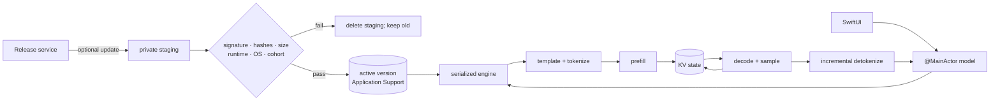

# Chapter 21 — iOS Deployment

> **Illustrative values.** Concrete identifiers, dates, thresholds, hashes, account numbers, and endpoints in this file are teaching examples, not observed project results or deployable credentials. Before use, replace them with reviewed values from your own registry, preserve the required format, and rerun every stated validation.

## 21.1 Scope and evidence boundary

**Research cut-off:** 2026-11-23  
**Status:** **AUTHORED / NOT COMPILED / NOT DEVICE-TESTED.**  
All listings are `UNVERIFIED IMPLEMENTATION`; all proposed measurements are `PLANNED EXPERIMENT`.

This chapter develops an offline specialist Small Language Model (SLM) application for iPhone. It covers Swift/SwiftUI,
Core ML, Metal, MLX Swift, ExecuTorch and alternative runtimes, conversion, quantization, tokenization, initialization,
streaming, memory, thermals, lifecycle, storage, signed updates, offline operation, acceleration, compatibility,
signing, testing, security, benchmarking, and domain safety. It uses no runtime Retrieval-Augmented Generation (RAG).

`DOC-VERIFIED` means a cited first-party source documented a capability. It does not prove that this project reproduced
it or that an arbitrary checkpoint works. No Xcode project, converter, model, simulator, iPhone, benchmark, or App Store
workflow was executed. There are no compilation, installation, performance, or physical-device claims.

Prerequisites are [CH-16](ch-16-edge-ai-fundamentals.md), [CH-17](ch-17-mobile-hardware-architecture.md),
[CH-18](ch-18-edge-inference-frameworks.md), [CH-19](ch-19-mobile-inference-optimization.md), and the
[edge runtime survey](../../04-research-comparison-report/edge-runtime-survey.md).

## 21.2 What must be deployed

A release concerns the tuple

$$
D=(W,T,C,F,R,B,O,H,P), \tag{EQ-CH21-01}
$$

where $W$=weights, $T$=tokenizer, $C$=chat/stop contract, $F$=converted format and quantization, $R$=runtime,
$B$=backend and actual placement, $O$=iOS version, $H$=hardware, and $P$=product policy. Changing one member can
change correctness, memory, or performance.

An offline app must authenticate and locate assets; initialize off the main thread; preserve tokenizer/template
semantics; prefill, cache, decode, sample, and incrementally detokenize; stream with cancellation and UI backpressure;
remain inside memory/thermal/storage limits; survive lifecycle events; update atomically; and fail truthfully on
unsupported devices. Offline means no network is required per answer. Downloading a signed model update while connected
is compatible with offline inference; hidden cloud fallback is not.

**FIG-CH21-01 — Offline inference and update architecture (`ILLUSTRATIVE`).**  
_Alt text:_ A signed package is verified and atomically activated. SwiftUI talks to a serialized local runtime that <!-- markdownlint-disable-line MD013 MD049 -->
tokenizes, prefills, decodes, and streams; no network participates in an answer.



## 21.3 Runtime selection

**TBL-CH21-01 — iOS runtime matrix (`DOC-VERIFIED`; exact tuples are `TEST-REQUIRED`)**

<!-- markdownlint-disable MD013 -->
| Path             | Artifact                                    | Compute                                                 | Generation layer             | Boundary                                         |
| ---------------- | ------------------------------------------- | ------------------------------------------------------- | ---------------------------- | ------------------------------------------------ |
| Core ML          | `.mlmodel`/`.mlpackage`                     | CPU/GPU/Apple Neural Engine (ANE), subject to placement | app-owned                    | converter/operators/shapes; not a chat engine    |
| MLX Swift LM     | MLX/Safetensors-style weights + Swift model | Apple CPU/GPU                                           | tokenizer, caches, streaming | exact architecture required; no claimed ANE path |
| ExecuTorch       | backend `.pte` + tokenizer                  | XNNPACK, Core ML, experimental MLX                      | experimental `TextLLMRunner` | export per backend; API subject to change        |
| llama.cpp        | GGUF                                        | ARM CPU/Metal                                           | integrated                   | C/C++ integration; GGUF/tokenizer parity         |
| MLC LLM          | weights/config/compiled library             | Metal                                                   | integrated                   | compiler/runtime/library coupled                 |
| LiteRT-LM        | `.litertlm`                                 | CPU/GPU                                                 | integrated                   | Swift was early preview at cut-off               |
| ORT Mobile/GenAI | ONNX/ORT + config                           | CPU/XNNPACK/Core ML EP                                  | GenAI                        | GenAI iOS remained preview/test-required         |
| MNN/ncnn         | runtime assets                              | CPU/Metal or portability layers                         | integrated/app-owned         | exact model and lifecycle maturity               |
<!-- markdownlint-restore -->

No documentation-only winner exists. Bake off a portable CPU baseline, Core ML, and one Metal/MLX path on the same
checkpoint and devices.

### Core ML

`DOC-VERIFIED`: Core ML can schedule supported operations across CPU, GPU, and ANE. `MLModelConfiguration.computeUnits`
defines eligible categories, not observed placement. On iOS 18+, `MLModel.makeState()` allocates zero-initialized
model-declared state, enabling stateful KV designs [S1–S5].

Core ML does not define the tokenizer, chat template, sampler, stop logic, Unicode streaming, or conversation policy.
Export efficient prefill and decode behavior; invoking a one-token graph for every prompt token can make ingestion
unusable. Older deployment targets need explicit cache I/O or another runtime.

Core ML Tools documents palettization, INT4/INT8 weight quantization, INT8 activations, and pruning. It warns that
results depend on model, hardware, and compute unit; a backend may decompress weights [S6]. A 4-bit package is not proof
of 4-bit arithmetic, lower peak memory, ANE placement, or speed.

### Metal and MLX Swift

Metal creates GPU pipelines, binds buffers, and submits asynchronous command buffers. Pipeline construction should be
cached [S7]. Writing transformer kernels directly requires substantial shader, packing, cache, synchronization, and
numerical work; use a maintained runtime unless custom-kernel ownership is intentional.

`DOC-VERIFIED`: MLX targets Apple CPU/GPU unified memory; MLX Swift LM supplies supported model implementations,
tokenizer integration, generation, streaming, and several cache strategies. Its official chat example targets iOS 17+
[S8–S11]. Unified memory avoids some copies, not capacity or bandwidth pressure. MLX does not imply ANE execution.

### ExecuTorch and alternatives

ExecuTorch captures PyTorch with `torch.export`, lowers for a backend, and writes `.pte`. XNNPACK and Core ML programs
are separate artifacts. Its Apple package publishes XCFramework products for the runtime, `executorch_llm`, XNNPACK,
Core ML, MLX, and kernel packages. `TextLLMRunner` initializes from model/tokenizer paths, explicitly loads, generates
through a token callback, stops, and resets; the API is experimental [S12–S14]. Its MLX backend links in Simulator but
is unavailable there because that environment has no usable Metal device for it [S12].

The sample uses ExecuTorch because this API is concise—not because it is proven fastest. llama.cpp is a strong CPU/Metal
baseline; MLC is useful for compiler-owned cross-platform GPU deployment; LiteRT-LM Swift and ORT GenAI iOS require
maturity checks; MNN/ncnn require exact integration evidence.

## 21.4 Conversion, formats, and quantization

Conversion is semantic compilation:

```text
checkpoint + tokenizer + config + chat template
  -> architecture capture
  -> quantization/backend lowering
  -> artifact + tokenizer + immutable manifest
  -> token parity -> logit parity -> quality/safety parity
  -> placement -> memory -> sustained physical-device tests
```

Inventory architecture, dimensions, tied weights, normalization, activation, MHA/GQA/MQA/sliding attention, RoPE, KV
update, tokenizer normalization/added tokens, template/stops, context, and target OS before export. A converter
supporting a model-family name does not prove support for every checkpoint.

<!-- markdownlint-disable MD013 -->
| Artifact          | Quantization examples                                                | Main trap                                                 |
| ----------------- | -------------------------------------------------------------------- | --------------------------------------------------------- |
| Core ML           | 1–8-bit palettization, INT4/INT8 weights, INT8 activations, sparsity | compressed representation may expand or place differently |
| ExecuTorch `.pte` | backend/TorchAO recipe, mixed precision                              | recipe and linked kernel package must match               |
| GGUF              | GGML block formats; runtime KV types                                 | “Q4” is not one universal layout                          |
| MLX/MLC/MNN/ncnn  | runtime-specific grouped/packed formats                              | similarly named bit widths are not interchangeable        |
<!-- markdownlint-restore -->

Weight, activation, accumulator, and KV precision are separate. For $P$ parameters and effective $b$ bits:

$$
M_{W,\mathrm{ideal}}=Pb/8. \tag{EQ-CH21-02}
$$

An `ILLUSTRATIVE` 1B-parameter artifact at 4.5 effective bits has 562.5 MB decimal payload before metadata, mixed
tensors, copies, KV, workspaces, and app memory.

Release gates:

1. freeze source/tokenizer revisions, licenses, toolchain, commands, and hashes;
2. export independently per backend;
3. compare tokenizer IDs and rendered template bytes;
4. compare logits for short/long prefill, first decode, cache reuse/reset, and context boundary;
5. rerun domain/general/safety tests after every conversion or quantization;
6. inspect placement/fallback; and
7. measure cold/warm load, prefill, decode, memory, and sustained operation.

**Listing CH21-L01 — `release/model-release.yaml` (`UNVERIFIED IMPLEMENTATION`).**

```yaml
schema: specialist-ios-model/v1
source:
  checkpoint_revision: "aaaaaaaaaaaaaaaaaaaaaaaaaaaaaaaaaaaaaaaa"
  checkpoint_sha256: "aaaaaaaaaaaaaaaaaaaaaaaaaaaaaaaaaaaaaaaaaaaaaaaaaaaaaaaaaaaaaaaa"
  tokenizer_revision: "aaaaaaaaaaaaaaaaaaaaaaaaaaaaaaaaaaaaaaaa"
  tokenizer_sha256: "aaaaaaaaaaaaaaaaaaaaaaaaaaaaaaaaaaaaaaaaaaaaaaaaaaaaaaaaaaaaaaaa"
  chat_template_sha256: "aaaaaaaaaaaaaaaaaaaaaaaaaaaaaaaaaaaaaaaaaaaaaaaaaaaaaaaaaaaaaaaa"
conversion:
  runtime: executorch
  exporter_revision: "aaaaaaaaaaaaaaaaaaaaaaaaaaaaaaaaaaaaaaaa"
  command: "<exact backend/quantization command>"
artifact:
  file: specialist.pte
  sha256: "aaaaaaaaaaaaaaaaaaaaaaaaaaaaaaaaaaaaaaaaaaaaaaaaaaaaaaaaaaaaaaaa"
  bytes: 0
  backend: xnnpack
  weight_activation_kv_precision: "illustrative-exact-value"
contract:
  minimum_ios: "17.0"
  context_tokens: 2048
  special_tokens: ["illustrative-exact-value"]
qualification:
  parity_results_sha256: null
  quality_safety_results_sha256: null
  device_results_sha256: null
```

illustrative values are intentional; no arbitrary model has a truthful universal export command.

## 21.5 Tokenizer, initialization, streaming, and lifecycle

Tokenizer mismatch can produce plausible but wrong text. Golden cases must cover whitespace, code, composed/decomposed
Unicode, combining marks, emoji, domain units/identifiers/drug names/fault codes, all special tokens, and full
single-/multi-turn prompts. Compare IDs, decoded bytes, and template bytes against the source implementation.

Incremental detokenization must buffer incomplete Unicode. Determine whether a runtime callback supplies token text,
byte fragments, or display-safe strings. Coalesce UI updates to avoid re-layout for every callback.

Reserve output and special tokens:

$$
T_\text{history}+T_\text{input}+T_\text{special}+T_\text{output} \le T_\text{context}. \tag{EQ-CH21-03}
$$

Reject or explicitly compact overlong conversations; silent truncation can remove identity, units, or safety
constraints.

Initialization verifies assets; opens/maps weights; initializes tokenizer/runtime/backend; specializes pipelines;
allocates cache/workspace; and optionally warms up. It must not block SwiftUI's main actor. Use one actor or serial
executor around runtime and KV state; publish UI state on `@MainActor`. Cancellation must stop and quiesce native work
before reset/reuse.

Observe `scenePhase`: allow work while active, avoid new work while inactive, and cancel foreground generation on
backgrounding. iOS may suspend or terminate the process. Background `URLSessionDownloadTask` can continue downloads
while suspended/not running, but local generation is a foreground workload [S15]. Do not persist KV by default: it can
encode sensitive conversation state and is runtime/version-specific.

## 21.6 Memory, thermal behavior, and acceleration

$$
M_\text{peak}=M_W+M_\text{KV}+M_A+M_\text{workspace} +M_\text{compiled}+M_\text{runtime}+M_\text{UI}+M_\text{margin}.
\tag{EQ-CH21-04}
$$

$$
M_\text{KV}\approx2LBT H_{kv}d_hb. \tag{EQ-CH21-05}
$$

For 24 layers, batch one, 4,096 tokens, 8 KV heads, width 64, and FP16, ideal KV payload is about 192 MiB
(`ILLUSTRATIVE`). Doubling context doubles it. Runtime overhead is additional.

Control memory with a capable small model, native GQA/MQA, bounded context/output, runtime-native low-bit weights,
independently tested KV quantization, bounded prefill chunks, one resident domain model, and measured headroom. Total
device RAM is not app-available RAM.

Use the immutable app bundle for a fallback, `Library/Application Support` for durable downloads, `Library/Caches` for
reproducible caches, and temporary storage for staging. Apple documents Application Support and file-protection
attributes [S16–S17]. Choose protection deliberately; `.complete` makes locked-device access unavailable. Exclude
re-downloadable assets from backup where appropriate.

`ProcessInfo.thermalState` is documented on iOS; Apple directs apps to reduce resource use at higher states [S18]. At
fair, reduce optional work; at serious, finish/cancel safely and shorten later output; at critical, stop and release
optional state. Never remove safety prompts, disable thermal controls, or silently use cloud.

Prove acceleration:

- Core ML: inspect reports/Instruments; `.all` is permission, not ANE evidence;
- Metal/MLX: capture Metal traces and include pipeline compilation/UI contention;
- ExecuTorch: capture partition diagnostics/ETDump and compare artifacts;
- all runtimes: compare identical CPU and accelerated workloads, including fallback, cold start, energy, and a sustained
  run.

## 21.7 Downloads, updates, offline proof, and security

Signed update protocol:

1. fetch a small signed manifest over HTTPS;
2. verify it with a public key pinned in the signed app;
3. enforce schema, runtime, OS/cohort, anti-downgrade, size, context, and license policy;
4. preflight space for old, download, staging, new, and rollback copies;
5. download to a private random staging directory;
6. verify byte count and incremental SHA-256;
7. reject extra files, path traversal, wrong tokenizer/template, or incompatible versions;
8. run a local smoke test;
9. atomically activate via a small pointer/manifest;
10. retain the previous qualified version until health gates pass.

SHA-256 binds bytes to an authenticated manifest; it does not authenticate an attacker-supplied manifest. Keep signing
private keys outside the app and define key rotation/revocation. Code signing protects the app bundle, not downloaded
assets. Do not download executable code or native frameworks as a “model update.”

File protection and optional encryption raise extraction cost but cannot guarantee model confidentiality on a
user-controlled device. Never hide secrets in weights.

Offline proof: deny network, cold-launch, load and generate, run multi-turn/reset/cancel/background tests, and audit
analytics, crash reporters, fonts, tokenizers, model fetchers, and fallback code for connection attempts. Missing assets
must produce an explicit unavailable state.

## 21.8 Compatibility, signing, and tests

Define cohorts by minimum iOS, exact tested devices, backend availability, free storage, measured memory headroom,
context tier, sustained thermals, and lifecycle/update results. `UIRequiredDeviceCapabilities` includes `arm64`,
`metal`, and an A12-or-later key, but Apple says to require only capabilities that are essential; updates may maintain
or relax requirements, not add them [S19]. A capability key is not an SLM-performance guarantee.

Simulator is useful for SwiftUI, template/manifest tests, and failures, but Apple says it does not reproduce all
hardware behavior [S20]. It cannot prove ANE/Metal performance, Jetsam behavior, energy, or thermals.

Physical-device development needs a unique bundle ID, team, and provisioning profile; Xcode can manage signing.
TestFlight/App Store distribution uses the Apple Developer Program, archives, and validation [S20–S21].

Test pyramid:

1. unit: manifest/signature/hash failures, template bytes, context and stop logic, Unicode, state machine;
2. simulator: SwiftUI/accessibility, missing/corrupt assets, cancellation, rollback/storage failures;
3. physical functional: load/generate/reset, parity, offline proof, lock/lifecycle/memory pressure;
4. physical performance: cold/warm, TTFT, prefill/decode, memory, UI health, energy, thermal soak;
5. distribution: Release build, TestFlight install/update, privacy/telemetry and archive validation.

XCTest supports unit, UI, and performance tests; Xcode 16+ also offers Swift Testing for new unit tests [S22].

## 21.9 Minimal offline SwiftUI app

The extractable sample uses ExecuTorch's documented experimental `TextLLMRunner`. It loads bundled assets, templates the
prompt, initializes on a serial queue, exposes callbacks as an `AsyncThrowingStream`, updates SwiftUI on the main actor,
cancels/resets, and blocks generation at serious/critical thermal state. It contains no network code.

It omits a real model, tokenizer, project file, download service, signing identity, and validated template. It was
authored on Windows and not compiled. API, concurrency, linkage, special-token, metadata, and callback semantics must be
checked against the pinned release.

```text
OfflineSpecialist/
├── OfflineSpecialist.xcodeproj
├── OfflineSpecialist/
│   ├── OfflineSpecialistApp.swift
│   ├── ContentView.swift
│   ├── ChatViewModel.swift
│   ├── ChatTemplate.swift
│   ├── ExecuTorchEngine.swift
│   └── Resources/{specialist.pte,tokenizer.model}
└── OfflineSpecialistTests/ChatTemplateTests.swift
```

**Listing CH21-L02 — `OfflineSpecialist/OfflineSpecialistApp.swift` (`UNVERIFIED IMPLEMENTATION`).**

```swift
import SwiftUI

@main struct OfflineSpecialistApp: App {
    @Environment(\.scenePhase) private var phase
    @StateObject private var model = ChatViewModel()
    var body: some Scene {
        WindowGroup {
            ContentView().environmentObject(model)
                .task { await model.prepareIfNeeded() }
                .onChange(of: phase) { _, value in model.sceneChanged(value) }
        }
    }
}
```

**Listing CH21-L03 — `OfflineSpecialist/ChatTemplate.swift` (`UNVERIFIED IMPLEMENTATION`).**

```swift
enum ChatTemplate {
    static let bos = "<|begin_of_text|>", sh = "<|start_header_id|>"
    static let eh = "<|end_header_id|>", eot = "<|eot_id|>"
    static func render(system: String, user: String) -> String {
        bos + sh + "system" + eh + "\n\n" + system + eot
        + sh + "user" + eh + "\n\n" + user + eot
        + sh + "assistant" + eh + "\n\n"
    }
}
```

These strings are illustrative values and must match the checkpoint exactly.

**Listing CH21-L04 — `OfflineSpecialist/ExecuTorchEngine.swift` (`UNVERIFIED IMPLEMENTATION`).**

```swift
import ExecuTorchLLM
import Foundation

enum EngineError: LocalizedError {
    case missing(String), notLoaded
    var errorDescription: String? {
        switch self {
        case .missing(let x): "Missing bundled resource: \(x)"
        case .notLoaded: "The local model is not loaded."
        }
    }
}

final class ExecuTorchEngine: @unchecked Sendable {
    private let queue = DispatchQueue(label: "book.specialist.inference")
    private var runner: TextLLMRunner?

    func load() async throws {
        try await withCheckedThrowingContinuation { c in
            queue.async {
                do {
                    guard let m = Bundle.main.path(forResource: "specialist",
                                                   ofType: "pte")
                    else { throw EngineError.missing("specialist.pte") }
                    guard let t = Bundle.main.path(forResource: "tokenizer",
                                                   ofType: "model")
                    else { throw EngineError.missing("tokenizer.model") }
                    let r = TextLLMRunner(
                        modelPath: m, tokenizerPath: t,
                        specialTokens: [ChatTemplate.bos, ChatTemplate.sh,
                                        ChatTemplate.eh, ChatTemplate.eot])
                    try r.load()
                    self.runner = r
                    c.resume()
                } catch { c.resume(throwing: error) }
            }
        }
    }

    func stream(_ prompt: String) -> AsyncThrowingStream<String, Error> {
        AsyncThrowingStream { c in
            queue.async {
                guard let r = self.runner else {
                    c.finish(throwing: EngineError.notLoaded); return
                }
                do {
                    try r.generate(prompt, Config {
                        $0.temperature = 0.2
                        $0.sequenceLength = 2048
                    }) { fragment in
                        _ = c.yield(fragment)
                    }
                    c.finish()
                } catch { c.finish(throwing: error) }
            }
            c.onTermination = { @Sendable _ in
                self.queue.async { self.runner?.stop() }
            }
        }
    }
    func stop() { queue.async { self.runner?.stop() } }
    func reset() { queue.async { self.runner?.reset() } }
}
```

**Listing CH21-L05 — `OfflineSpecialist/ChatViewModel.swift` (`UNVERIFIED IMPLEMENTATION`).**

```swift
import Foundation
import SwiftUI

@MainActor final class ChatViewModel: ObservableObject {
    enum State: Equatable { case idle, loading, ready, generating, failed(String) }
    @Published private(set) var state: State = .idle
    @Published var prompt = ""
    @Published private(set) var answer = ""
    private let engine = ExecuTorchEngine()
    private var task: Task<Void, Never>?

    func prepareIfNeeded() async {
        guard state == .idle else { return }
        state = .loading
        do { try await engine.load(); state = .ready }
        catch { state = .failed(error.localizedDescription) }
    }
    func send() {
        let q = prompt.trimmingCharacters(in: .whitespacesAndNewlines)
        guard state == .ready, !q.isEmpty, thermalOK else { return }
        prompt = ""; answer = ""; state = .generating
        let rendered = ChatTemplate.render(
            system: "Offline educational specialist. State uncertainty. "
                  + "Never invent exact specifications; escalate hazardous "
                  + "or consequential decisions to authoritative sources and "
                  + "a qualified professional.",
            user: q)
        task = Task {
            do {
                for try await fragment in engine.stream(rendered) {
                    if Task.isCancelled { break }
                    answer += fragment
                    if !thermalOK {
                        engine.stop()
                        answer += "\n\n[Stopped because the device is warm.]"
                        break
                    }
                }
                state = .ready
            } catch { state = .failed(error.localizedDescription) }
        }
    }
    func cancel() { task?.cancel(); task = nil; engine.stop(); state = .ready }
    func reset() { cancel(); engine.reset(); answer = ""; prompt = "" }
    func sceneChanged(_ phase: ScenePhase) {
        if phase == .background, state == .generating { cancel() }
    }
    private var thermalOK: Bool {
        switch ProcessInfo.processInfo.thermalState {
        case .nominal, .fair: true
        case .serious, .critical: false
        @unknown default: false
        }
    }
}
```

**Listing CH21-L06 — `OfflineSpecialist/ContentView.swift` (`UNVERIFIED IMPLEMENTATION`).**

```swift
import SwiftUI

struct ContentView: View {
    @EnvironmentObject private var model: ChatViewModel
    var body: some View {
        NavigationStack {
            VStack {
                ScrollView {
                    Text(model.answer.isEmpty ? status : model.answer)
                        .frame(maxWidth: .infinity, alignment: .leading)
                        .textSelection(.enabled).padding()
                }
                TextEditor(text: $model.prompt).frame(height: 110)
                    .overlay(RoundedRectangle(cornerRadius: 8).stroke(.secondary))
                    .disabled(model.state == .loading || model.state == .generating)
                HStack {
                    Button("Reset", action: model.reset); Spacer()
                    if model.state == .generating {
                        Button("Stop", role: .destructive, action: model.cancel)
                    } else {
                        Button("Send", action: model.send)
                            .buttonStyle(.borderedProminent)
                            .disabled(model.state != .ready)
                    }
                }
            }.padding().navigationTitle("Offline Specialist")
        }
    }
    private var status: String {
        switch model.state {
        case .idle: "Waiting to initialize."
        case .loading: "Loading local model…"
        case .ready: "Ready; inference needs no network."
        case .generating: "Generating locally…"
        case .failed(let x): "Unavailable: \(x)"
        }
    }
}
```

**Listing CH21-L07 — `OfflineSpecialistTests/ChatTemplateTests.swift` (`UNVERIFIED IMPLEMENTATION`).**

```swift
import XCTest
@testable import OfflineSpecialist

final class ChatTemplateTests: XCTestCase {
    func testStableBytes() {
        let x = ChatTemplate.render(system: "S", user: "U")
        XCTAssertEqual(x, "<|begin_of_text|>"
          + "<|start_header_id|>system<|end_header_id|>\n\nS<|eot_id|>"
          + "<|start_header_id|>user<|end_header_id|>\n\nU<|eot_id|>"
          + "<|start_header_id|>assistant<|end_header_id|>\n\n")
    }
    func testTemplateDoesNotNormalizeUnicode() {
        let x = "e\u{301}"
        XCTAssertTrue(ChatTemplate.render(system: "S", user: x).contains(x))
    }
}
```

### Build, dependencies, and model replacement

All steps are unverified and require macOS/Xcode:

1. Create a SwiftUI iOS App named `OfflineSpecialist`; set iOS 17+, the documented current ExecuTorch package minimum
   [S12].
2. Add `https://github.com/pytorch/executorch.git`; pin an immutable tested revision or exact `swiftpm-0.1.0-illustrative`
   branch. Official docs demonstrated `swiftpm-1.5.1`; do not float a production dependency.
3. Link `executorch_llm`, core runtime, chosen backend (for example XNNPACK), and exact LLM/optimized/quantized kernels.
   Follow current linkage guidance, including `-all_load` where required for registration.
4. Add both resources to target membership/Copy Bundle Resources. Replace template/special tokens with validated values.
5. Build Release for arm64 physical hardware. Debug libraries add logging overhead.
6. Run unit tests, deny network, then execute the physical-device matrix. Simulator is UI-only evidence.

```bash
# UNVERIFIED — unsigned compile/link probe, not an install/device test.
xcodebuild -project OfflineSpecialist.xcodeproj \
  -scheme OfflineSpecialist -configuration Release \
  -destination 'generic/platform=iOS' CODE_SIGNING_ALLOWED=NO build

# UNVERIFIED — replace with an installed, pinned simulator destination.
xcodebuild -project OfflineSpecialist.xcodeproj \
  -scheme OfflineSpecialist \
  -destination 'platform=iOS Simulator,name=iPhone 16' test
```

Supported validation configurations are: simulator for template/UI/failure tests; the oldest supported physical iPhone
for admission; one median and one high-capability physical iPhone for correctness/performance; minimum and current iOS
versions; Debug only for diagnosis; and signed Release/TestFlight for qualification. A missing device/OS cell must be
reported as untested, not inferred.

To replace the model: freeze the domain checkpoint/tokenizer/template/license and adapter lineage; verify architecture
support; export separate backend artifacts with intended KV/context metadata; replace resources; update template/tokens;
run token/logit/generation parity; rerun domain/general/safety, reset/cancel/context/lifecycle tests; record
manifest/hashes; and re-sign the app or updater package. No checkpoint is declared compatible here.

Troubleshooting:

| Symptom                 | Likely cause/action                                                                    |
| ----------------------- | -------------------------------------------------------------------------------------- |
| package links fail      | matching products missing or registration stripped; follow pinned `-all_load` guidance |
| resource path nil       | target membership/name/case mismatch                                                   |
| load fails              | backend artifact/kernel/op/metadata mismatch; use matching debug logs                  |
| fluent nonsense         | tokenizer/template/RoPE/tensor/cache mismatch; compare IDs/logits                      |
| slow first token        | specialization, paging, or inefficient prefill; split phase timings                    |
| MLX fails in Simulator  | use physical hardware; backend has no usable Metal device there                        |
| memory termination      | expanded/duplicate weights, KV, temporaries, context; trace each phase                 |
| broken characters       | callback is not display-safe Unicode; add incremental buffering                        |
| delayed stop/state leak | serialize stop/reset and test native cancellation/session isolation                    |

### 21.9.1 Reading the SwiftUI sample as one flow

The seven listings form one actor/queue ownership design:

1. `OfflineSpecialistApp` owns one `ChatViewModel` and forwards `scenePhase`.
2. `prepareIfNeeded()` changes UI state on `@MainActor`, then awaits loading without blocking rendering.
3. `ExecuTorchEngine` confines `TextLLMRunner` and its KV state to one serial dispatch queue. This is the central
   correctness rule: generation, stop, and reset cannot mutate one session concurrently.
4. `ChatTemplate.render()` creates the exact text presented to the tokenizer. Its sample tokens are deliberately not
   universal; replacing the model requires replacing and golden-testing this contract.
5. `stream()` bridges the callback API to `AsyncThrowingStream`. The view model consumes fragments, updates visible
   state on the main actor, and can request `stop()` when the task ends.
6. `sceneChanged()` cancels foreground generation on backgrounding. iOS may suspend or terminate the process, so the
   app does not pretend that native state survives.
7. `reset()` stops work before resetting the runner and clearing visible state.

Expected behavior:

| Event | Expected state transition | Verification |
| --- | --- | --- |
| Launch with valid bundled assets | idle → loading → ready | UI stays responsive; one load occurs |
| Missing `.pte` or tokenizer | loading → failed with explicit resource name | no crash or cloud fallback |
| Send | ready → generating → ready | fragments are ordered and session ownership is serialized |
| Stop | generating → ready | native callback ceases within a measured bound |
| Background | generating → ready via cancellation | no hidden background generation |
| Serious/critical thermal state | new send is blocked or current work stops safely | safety prompt and offline policy remain unchanged |

Important limitations are visible in the code. `@unchecked Sendable` is an assertion by the author, not compiler-proven
safety; the serial queue must remain the only runner access path. `answer += fragment` repeatedly copies growing text
and should be coalesced for long output. The callback is assumed to return display-safe fragments; if it returns token
bytes, an incremental UTF-8 decoder is required. `sequenceLength = 2048` must reserve prompt, output, and special tokens
rather than silently truncating. Thermal state is checked at fragment boundaries, so stop latency depends on callback
frequency.

Troubleshoot from outside inward: package products and linker registration → bundled-resource membership → runner load
and matching kernels → tokenizer/template parity → prefill/decode timing → callback Unicode → cancellation/reset →
physical-device memory and thermal behavior. Simulator success validates none of the final three hardware properties.

## 21.10 Android versus iOS

<a id="tbl-15"></a> **TBL-15 — Android versus iOS deployment (`DOC-VERIFIED` platform capabilities plus engineering
recommendations; exact tuples remain `TEST-REQUIRED`).**

<!-- markdownlint-disable MD013 -->
| Dimension    | iOS strategy                                               | Android strategy                                                                              |
| ------------ | ---------------------------------------------------------- | --------------------------------------------------------------------------------------------- |
| estate       | smaller Apple-controlled cohorts, still device/OS-specific | wide SoC/driver/RAM/OS fragmentation                                                          |
| native ML    | Core ML scheduler for CPU/GPU/ANE                          | LiteRT plus explicit Qualcomm/MediaTek/Google/Samsung paths; NNAPI deprecated from Android 15 |
| GPU/NPU      | Metal/MLX; ANE generally through Core ML                   | Vulkan/OpenCL/vendor compilers and NPU SDKs                                                   |
| CPU          | Apple arm64 kernels                                        | heterogeneous arm64 cores/optional ISA                                                        |
| affinity     | no general app CPU-affinity contract                       | native affinity is possible but device-specific                                               |
| lifecycle    | suspension/background task limits                          | activity recreation/service/background restrictions                                           |
| artifacts    | Core ML/MLX/Metal plus portable fallback                   | portable CPU plus GPU/vendor-specialized artifacts                                            |
| distribution | app signing/App Store/TestFlight; sign downloaded data     | APK/AAB/Play assets; ABI/device delivery; sign downloaded data                                |
<!-- markdownlint-restore -->

On iOS, test Core ML early when ANE efficiency matters, but compare CPU and Metal. On Android, establish ARM CPU
correctness and add vendor NPU artifacts only for named cohorts. Android usually needs a larger device/driver matrix and
may benefit from measured topology tuning; iOS offers less scheduler control, so emphasize model/context/backend. Source
quality tests can be shared, but formats, kernels, lifecycle, energy tools, and packages usually cannot.

## 21.11 Benchmark, safety, and exercises

`PLANNED EXPERIMENT`: test source/two quantizations and optional KV formats across CPU, Core ML, and Metal/MLX on the
oldest supported, median, and high-capability devices at minimum/current iOS. Freeze all hashes/builds/device state.
Correctness gates—token/template, logits, deterministic tokens, domain/general/safety, reset/session isolation—precede
timing.

Measure download/install/update bytes; verification/cold specialization/load; warm load; TTFT; prefill and every token
timestamp; memory by phase; placement/fallback; UI stalls; energy boundary; thermal trace; cancellation; and failures
over repeated randomized blocks plus a 10–30 minute sustained run. Report raw trials, medians, dispersion/tails, and
exclusions. Never combine simulator and device results.

Offline privacy does not make learned knowledge current or correct. Require qualified review, authoritative offline
ground truth, uncertainty/refusal/escalation gates, and regression after every model/format/runtime/template change.
Automotive/industrial output must not invent specifications or bypass lockout/high-voltage/pressure/lifting controls.
Pharmacy use is educational only: no autonomous prescribing/dose changes; escalate interactions, contraindications,
special populations, and emergencies. Animal-care outputs require species/region/legal qualifiers and veterinary
escalation.

Exercises:

1. Calculate KV for 28 layers, 4 KV heads, width 128, batch one, 8,192 FP16 tokens; repeat for ideal INT8.
2. Build tokenizer goldens for one domain and all special tokens.
3. Distinguish `.all` eligibility from ANE placement with a trace-based test.
4. Implement signed-manifest, streaming SHA-256, atomic activation, downgrade prevention, and rollback tests.
5. Prove offline operation under denied networking.
6. Compare bundled versus downloaded delivery, including peak update space.
7. Run one CPU, Core ML, and Metal/MLX path with parity and placement evidence.
8. Test foreground/background, lock, pressure, relaunch, and cancellation.
9. Build Android/iOS plans from one source model and identify nonportable optimizations.
10. Create a safety suite where one critical failure blocks release despite higher average accuracy.

<a id="2112-official-sources-and-honest-completion"></a>

## 21.12 Official sources and verification note

Official sources, accessed/recency-checked 2026-11-23 (`DOC-VERIFIED`, not executed):

- **[S1–S6] Apple Core ML/Core ML Tools:** <https://developer.apple.com/documentation/coreml> ;
  <https://developer.apple.com/documentation/coreml/mlmodelconfiguration> ;
  <https://developer.apple.com/documentation/coreml/mlmodel/makestate()> ;
  <https://developer.apple.com/videos/play/wwdc2024/10159/> ; <https://developer.apple.com/videos/play/wwdc2024/10161/>
  ; <https://apple.github.io/coremltools/docs-guides/source/opt-overview.html>
- **[S7] Apple Metal:** <https://developer.apple.com/documentation/metal/performing-calculations-on-a-gpu>
- **[S8–S11] MLX:** <https://github.com/ml-explore/mlx> ;
  <https://github.com/ml-explore/mlx/blob/main/docs/src/usage/unified_memory.rst> ;
  <https://github.com/ml-explore/mlx-swift-lm> ;
  <https://github.com/ml-explore/mlx-swift-examples/blob/main/Applications/MLXChatExample/README.md>
- **[S12–S14] ExecuTorch:** <https://docs.pytorch.org/executorch/stable/using-executorch-ios.html> ;
  <https://docs.pytorch.org/executorch/stable/llm/run-on-ios.html> ;
  <https://docs.pytorch.org/executorch/stable/backends-overview.html>
- **Other runtimes:** <https://github.com/ggml-org/llama.cpp/> ;
  <https://github.com/ggml-org/ggml/blob/master/docs/gguf.md> ;
  <https://github.com/mlc-ai/mlc-llm/blob/main/docs/deploy/ios.rst> ;
  <https://developers.google.com/edge/litert-lm/overview> ; <https://onnxruntime.ai/docs/tutorials/mobile/> ;
  <https://onnxruntime.ai/docs/genai/>
- **[S15–S18] Lifecycle/storage/thermal:** <https://developer.apple.com/documentation/foundation/urlsessiondownloadtask>
  ; <https://developer.apple.com/documentation/foundation/filemanager/searchpathdirectory/applicationsupportdirectory> ;
  <https://developer.apple.com/documentation/foundation/fileprotectiontype> ;
  <https://developer.apple.com/documentation/foundation/processinfo/thermalstate-swift.property>
- **[S19–S22] Compatibility/testing/distribution:**
  <https://developer.apple.com/documentation/bundleresources/information_property_list/uirequireddevicecapabilities> ;
  <https://developer.apple.com/documentation/xcode/running-your-app-in-simulator-or-on-a-device> ;
  <https://developer.apple.com/documentation/xcode/distributing-your-app-for-beta-testing-and-releases> ;
  <https://developer.apple.com/documentation/xctest>
- **Security:** <https://developer.apple.com/documentation/cryptokit/sha256>

The complete Swift/SwiftUI reference listings and their flow are provided, but they were authored on Windows and were
not compiled or device-tested. Before qualification, pin the package/export tuple; compile and sign on macOS; verify
tokenizer, template, logits, placement, lifecycle, updater, and domain safety; then run the repeated physical-device
memory, latency, energy, and thermal protocol. Simulator results remain functional evidence only. The aligned
[CH-21 assessment](../../13-assessments/ch-21-assessment.md) should use the archived results.

## Cross-links

- [Part V index](README.md)
- [CH-16](ch-16-edge-ai-fundamentals.md)
- [CH-17](ch-17-mobile-hardware-architecture.md)
- [CH-18](ch-18-edge-inference-frameworks.md)
- [CH-19](ch-19-mobile-inference-optimization.md)
- [CH-20](ch-20-android-deployment.md)
- [Evidence standard](../../00-governance/evidence-and-citation-standard.md)
- [Reproducibility standard](../../00-governance/reproducibility-standard.md)
- [Safety standard](../../00-governance/safety-and-risk-standard.md)
- [No-runtime-RAG standard](../../00-governance/no-runtime-rag-standard.md)
