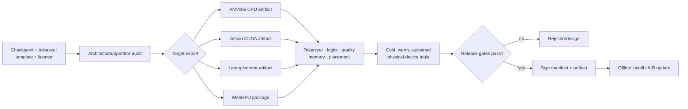
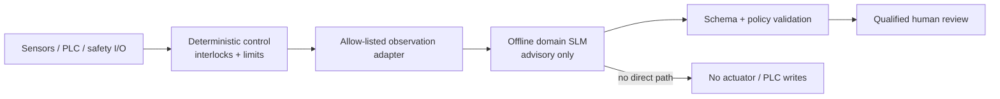
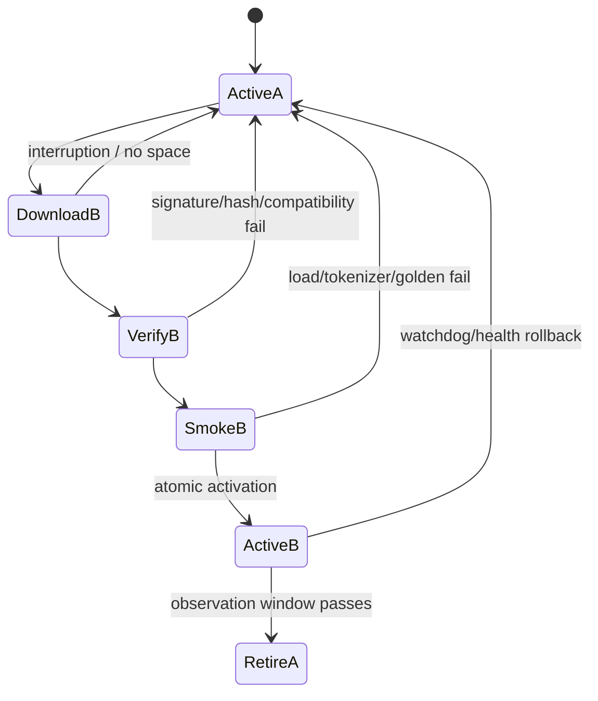

# Chapter 22 — Other Edge Devices

> **Illustrative values.** Concrete identifiers, dates, thresholds, hashes, account numbers, and endpoints in this file are teaching examples, not observed project results or deployable credentials. Before use, replace them with reviewed values from your own registry, preserve the required format, and rerun every stated validation.

<a id="ch22-status"></a>

## 22.1 Scope, outcomes, and evidence boundary

**Research freeze:** 2026-11-23.  
**Status:** **AUTHORED / NOT EXECUTED.** This chapter covers Raspberry Pi-class Arm computers, NVIDIA Jetson, general
ARM64 Linux, industrial edge computers, laptops, browser inference through WebGPU, and microcontroller-adjacent designs.
No model was converted or run, no container was built, and no physical device was benchmarked for this chapter.

Official documentation statements are `DOC-VERIFIED`; planning calculations and ranges are `ESTIMATE`; diagrams are
`ILLUSTRATIVE`; commands and code are `UNVERIFIED IMPLEMENTATION`; test procedures are `PLANNED EXPERIMENT`. A
documented runtime or accelerator does not prove that an exact checkpoint works, fits, is fast, or remains thermally
stable. No device-performance number is fabricated here.

The systems foundation is developed in [CH-16](ch-16-edge-ai-fundamentals.md), runtime details in
[CH-18](ch-18-edge-inference-frameworks.md), and controlled benchmarking in
[CH-31](../part-08-evaluation-benchmarking-and-research-experiments/ch-31-compression-and-edge-benchmarking.md).

After completing this chapter, the reader should be able to:

1. distinguish storage-fit, memory-fit, interactive-fit, and sustained-fit;
2. estimate—not assert—model envelopes from parameters, precision, context, and architecture;
3. choose CPU, GPU, NPU, native, container, or browser paths for a specific target;
4. qualify an exact model–runtime–backend–device tuple;
5. design secure offline installation, update, and rollback; and
6. recognize where microcontrollers can assist a generative system but cannot realistically host it.

<a id="ch22-problem"></a>

## 22.2 What is being deployed?

“Edge computer” covers radically different systems: a passively cooled single-board computer (SBC), a CUDA-capable
Jetson module, a sealed factory gateway, a battery laptop, or a browser tab. The useful deployment unit is:

\[ \boxed{\mathcal{D}=(M,T,Q,R,B,H,O,X,P,S)} \tag{EQ-CH22-01} \]

where \(M\) is model architecture and weights, \(T\) tokenizer and chat template, \(Q\) numerical representation, \(R\)
runtime/converter, \(B\) backend and actual operator placement, \(H\) hardware, \(O\) operating system/drivers/firmware,
\(X\) workload, \(P\) power/thermal policy, and \(S\) security/update state.

The same nominal “1B INT4 model” can have different loaded memory, cache growth, correctness, and speed in llama.cpp on
an Arm CPU, a CUDA runtime on Jetson, OpenVINO on an Intel laptop, or WebLLM in a browser. A model-family name and bit
width are not a benchmark record.

Autoregressive generation has two different phases:

- **prefill** processes prompt tokens in parallel and creates the key–value (KV) cache;
- **decode** repeatedly reads weights and an expanding cache to produce a token, usually at batch one.

Prefill favors parallel arithmetic. Decode often stresses memory traffic, small-shape kernels, and launch overhead. One
accelerator can improve one phase without improving the other.

<a id="fig-ch22-01"></a> **FIG-CH22-01 — Target-specific deployment path (`ILLUSTRATIVE`).**  
_Alt text:_ A checkpoint is converted to target-specific artifacts, checked for semantic parity and operator placement, <!-- markdownlint-disable-line MD013 MD049 -->
benchmarked on physical cohorts, signed, and installed with rollback.



This distributes learned parameters. It does not retrieve domain documents per answer and complies with the
[no-runtime-RAG standard](../../00-governance/no-runtime-rag-standard.md).

<a id="ch22-sizing"></a>

## 22.3 Planning the model and workload envelope

### Weight payload

For \(N\) parameters, average code width \(b_w\) bits, group size \(g\), and \(b_m\) metadata bits per group:

\[ \boxed{M_W^{ideal}=\frac{N}{8}\left(b_w+\frac{b_m}{g}\right)} \tag{EQ-CH22-02} \]

This excludes tensor headers, alignment, unquantized tensors, runtime repacking, duplicate buffers, tokenizer files, and
application memory.

**Worked `ESTIMATE`:** \(N=1.0\) billion, 4-bit codes, one 16-bit scale per 32 weights:

\[ b_{\mathrm{eff}}=4+\frac{16}{32}=4.5\text{ bits},\qquad M_W^{ideal}=562.5\text{ MB}\approx536.4\text{ MiB}. \]

An actual file and resident set must be measured. “4-bit” does not establish 0.5 bytes per parameter when metadata and
exceptions exist.

### KV-cache payload

For \(L\) layers, batch \(B\), cached tokens \(T_c\), \(H_{kv}\) KV heads, head dimension \(d_h\), and \(b_{kv}\) bytes
per element:

\[ \boxed{M_{KV}^{ideal}\approx2LB T_cH_{kv}d_hb_{kv}} \tag{EQ-CH22-03} \]

The factor 2 represents keys and values. Runtime reservation, alignment, paging, and quantization metadata add overhead.

**Worked `ESTIMATE`:** \(L=24\), \(B=1\), \(T_c=4096\), \(H_{kv}=8\), \(d_h=64\), FP16 cache:

\[ M_{KV}^{ideal}=192\text{ MiB}. \]

Doubling context doubles this cache term. Replacing 8 KV heads with 32 multiplies it by four. Weight quantization does
not reduce KV memory unless the runtime separately supports a lower-precision cache.

### Peak memory, update storage, bandwidth, and energy

\[ \boxed{ M_{\mathrm{peak}}=M_W+M_{KV}+M_A+M_{\mathrm{workspace}}+
M_{\mathrm{runtime}}+M_{\mathrm{app}}+M_{\mathrm{copies}}+M_{\mathrm{margin}} } \tag{EQ-CH22-04} \]

\[ \boxed{ S_{\mathrm{update}}=S_{\mathrm{old}}+S_{\mathrm{download}}+S_{\mathrm{new}}+
S_{\mathrm{unpack}}+S_{\mathrm{rollback}} } \tag{EQ-CH22-05} \]

Memory mapping can avoid an eager copy but does not make touched pages free. Atomic updates can need old, staged, and
new artifacts concurrently.

If decode moves at least \(Q_t\) bytes through a path sustaining \(BW\) bytes/s:

\[ t_{\mathrm{token}}\ge Q_t/BW. \tag{EQ-CH22-06} \]

This is a lower bound, not a latency prediction. Dequantization, arithmetic, synchronization, cache misses, and kernel
launches add time.

When measured at a declared boundary:

\[ E_{\mathrm{token}}= \frac{\int_{t_0}^{t_1}(P(t)-P_{\mathrm{idle}})\,dt}{N_g}. \tag{EQ-CH22-07} \]

If calibrated energy measurement is unavailable, report it as unavailable rather than infer it from latency.

<a id="tbl-ch22-01"></a> **TBL-CH22-01 — Initial dense-model search ranges (`ESTIMATE`, not measured or universal)**

<!-- markdownlint-disable MD013 -->
| Target                          | First candidates to investigate | First workload                                       | Binding concern                       |
| ------------------------------- | ------------------------------- | ---------------------------------------------------- | ------------------------------------- |
| 2–4 GiB Arm SBC                 | 0.1B–0.5B low-bit               | classification, extraction, short constrained output | OS/runtime/cache reserve              |
| 8 GiB Arm SBC                   | 0.5B–1.5B low-bit               | short batch-one assistant                            | CPU bandwidth and cooling             |
| 16 GiB Arm SBC/gateway          | 1B–3B low-bit                   | richer one-session assistant                         | sustained thermal and context         |
| 8–16 GiB Jetson                 | 0.5B–3B supported low-bit       | GPU-assisted chat or multimodal pipeline             | shared memory and stack compatibility |
| 32–64 GiB Jetson/industrial GPU | 3B–8B experiment                | richer assistant, vision+language                    | power, workspace, concurrency         |
| 8–16 GiB laptop                 | 0.5B–3B low-bit first           | personal offline assistant                           | OS reserve, battery, backend          |
| 24–64 GiB laptop/workstation    | 3B–8B low-bit first             | long-form local assistant                            | thermals and accelerator memory       |
| WebGPU browser                  | 0.5B–3B quantized first         | opt-in chat/extraction/summarization                 | download, quota, GPU limits           |
| Microcontroller                 | no general generative SLM       | wake word, anomaly, sensor classifier                | fundamental SRAM/flash/operator gap   |
<!-- markdownlint-restore -->

These are candidate-search bands. They do not claim that a named model fits, runs interactively, or retains quality. A
3B model can fail on a 16 GiB machine because of context, copies, format, or backend limits.

<a id="ch22-platforms"></a>

## 22.4 Platform engineering

### 22.4.1 Raspberry Pi-class Arm computers

Pi-class systems are general-purpose Linux SBCs with shared DRAM, removable or attached storage, modest cooling, and no
assumption of a supported Transformer NPU. Their strengths are Linux tooling, GPIO/camera/network integration, and local
operation.

`DOC-VERIFIED`: Raspberry Pi 5 uses a 64-bit Arm Cortex-A76 CPU and has several memory capacities; the official brief
documents LPDDR4X, microSD, USB 3, and PCIe [S1]. Raspberry Pi recommends a capable 5 V/5 A supply for
high-load/peripheral use and active cooling for sustained heavy workloads [S1–S3]. These facts establish no SLM
performance.

Practical guidance:

- use a 64-bit OS and build CPU kernels for the actual Arm feature set;
- start with llama.cpp/GGUF as a broad CPU baseline;
- cap context and output explicitly;
- investigate SSD/NVMe for model storage and update staging where supported;
- use active cooling during sustained qualification;
- record throttling, undervoltage, temperature, clock, and peripheral power;
- do not infer an efficient LLM GPU path merely because the board exposes Vulkan.

Useful first workloads are intent routing, structured extraction, bounded workshop guidance, and short local assistance.
Multi-user serving, long context, large-model reasoning, and autonomous safety-critical control are poor initial
targets.

### 22.4.2 General ARM64 Linux

ARM64 Linux is an ISA/OS category, not a performance tier. Devices differ in NEON, dot-product, i8mm or SVE support,
cache, memory channels, GPU/NPU drivers, kernel, and thermal design.

`DOC-VERIFIED`: llama.cpp publishes Linux ARM64 CPU images and documents ARM64 CUDA/Vulkan variants; its Docker guide
warns that GPU images are built but not fully runtime-tested by CI [S8]. OpenVINO publishes ARM64 CPU packages; this is
not evidence of Intel NPU support on Arm [S16].

Qualification sequence:

1. inventory distribution, libc, kernel, CPU flags, RAM, storage, firmware, and accelerator driver;
2. build a native optimized CPU baseline;
3. verify tokenizer/template/logits and maximum context;
4. add Vulkan, CUDA, or vendor NPU only with placement evidence;
5. compare native and container paths under one power mode;
6. test restart, watchdog, update, rollback, and network-denied operation.

A generic ARM64 binary may omit newer instructions. A native build can improve the target but creates more artifacts.
Never ship a native-tuned binary across an unqualified heterogeneous fleet.

### 22.4.3 NVIDIA Jetson

Jetson combines Arm CPUs with an NVIDIA GPU and a tightly versioned JetPack/CUDA/cuDNN/TensorRT stack. Some modules
expose Deep Learning Accelerators, but DLA presence does not prove efficient autoregressive Transformer support.

Candidate paths include:

- llama.cpp CUDA for GGUF reuse and mixed CPU/GPU offload;
- TensorRT-LLM/TensorRT when the exact architecture, plugins, precision, and JetPack release are supported;
- PyTorch/CUDA for prototyping, with a usually larger production footprint;
- ONNX Runtime or managed containers when their exact release matrices fit.

`DOC-VERIFIED`: NVIDIA documents Jetson power modes through `nvpmodel`; modes constrain clocks and active resources, and
MAXN is not guaranteed to be the best sustained mode because power/thermal throttling can intervene [S4]. Container use
requires a compatible host driver and NVIDIA Container Toolkit [S5]. TensorRT/JetPack compatibility is release-specific;
desktop packages cannot be assumed compatible [S6].

Jetson unified memory avoids a discrete PCIe copy boundary, but GPU allocations, CUDA contexts, page pinning,
workspaces, KV cache, camera pipelines, and display consume the same finite capacity. “16 GB Jetson” does not mean 16 GB
available to weights.

Jetson is especially relevant to camera/audio/sensor plus text systems. Benchmark those pipelines together; an isolated
SLM result hides contention.

### 22.4.4 Industrial edge computers

Industrial systems add extended temperature, vibration, dust, fanless thermal design, brownout handling, watchdogs, long
component lifecycles, maintenance windows, field buses, fleet identity, and long offline periods.

The SLM should be advisory. It must not bypass interlocks, write programmable logic controller (PLC) logic, energize
equipment, prescribe maintenance, or authorize hazardous work. Deterministic control and safety systems remain
independent.

<a id="fig-ch22-02"></a> **FIG-CH22-02 — Industrial control separation (`ILLUSTRATIVE`).**  
_Alt text:_ Deterministic safety control supplies allow-listed observations to an advisory SLM. Generated output passes <!-- markdownlint-disable-line MD013 MD049 -->
schema, policy, and human review and has no direct actuator path.



Use signed read-only artifacts, secure/measured boot where supported, encrypted local data, least-privilege services,
disabled inbound interfaces by default, watchdog-managed health, staged A/B updates, and rollback. Certification belongs
to the complete product, not the model file.

### 22.4.5 Laptops

Laptops offer x86-64 CPUs, Apple silicon, discrete or integrated GPUs, several vendor NPUs, and native or WebGPU
applications. CPU llama.cpp is a broad baseline. NVIDIA systems can use CUDA runtimes. Apple laptops can use
Metal/MLX/Core ML. OpenVINO GenAI documents Intel CPU/GPU/NPU paths with model, precision, driver, and shape constraints
[S16–S18].

A laptop is not a server:

- battery mode changes clocks and backend policy;
- discrete GPU VRAM may be absent or limited;
- integrated GPU and CPU share memory;
- fans, skin temperature, and user applications compete with inference;
- suspend/resume can invalidate accelerator state;
- an “AI PC” label does not prove model/compiler support.

Benchmark AC and battery separately. Record power profile, GPU selection, fan/thermal state, and background workload. A
short demonstration does not establish quiet, battery-suitable, or sustained operation.

### 22.4.6 Browser inference with WebGPU

WebGPU exposes GPU compute through a browser security model. `DOC-VERIFIED`: it requires a secure context, must be
feature-detected through `navigator.gpu`, and exposes adapter limits at runtime; MDN did not classify it as universally
available across major browsers at the research freeze [S11–S13].

WebLLM is an MLC/WebGPU generative runtime with streaming and persistent cache backends. Its documentation supports
workers and service workers but warns that service-worker lifetime remains browser controlled [S14–S15].

Advantages:

- no native installer;
- prompts can remain local after artifact download;
- one web application can reach several desktop operating systems;
- workers can keep computation off the UI thread.

Constraints:

- multi-gigabyte first-use downloads and per-origin quota;
- cache eviction and private-browsing restrictions;
- browser/GPU/driver fragmentation and adapter limits;
- tab suspension, device loss, reload, and memory pressure;
- no native NPU assumption;
- content-security policy, origin isolation, integrity, and dependency supply chain.

“Offline after first load” requires network-denied testing after browser restart, cache pressure, service-worker
termination, and update. A progressive web app manifest does not prove model availability.

### 22.4.7 Microcontroller-adjacent systems

Microcontrollers commonly have kilobytes to a few megabytes of SRAM/flash, deterministic duties, and limited operators.
A general autoregressive SLM requires weights, tokenizer, repeated matrix operations, KV cache, sampling, and text
buffers. Even a 100M-parameter 4-bit payload is:

\[ \frac{100\times10^6\times4}{8}=50\text{ MB} \tag{EQ-CH22-08} \]

before metadata, runtime memory, or cache. This is already beyond ordinary MCU SRAM and often impractical for flash
bandwidth. A much smaller Transformer may generate narrow sequences, but that is not a useful domain conversational SLM.

`DOC-VERIFIED`: TensorFlow Lite for Microcontrollers targets tiny statically allocated models, limited operators, and
bare-metal use; its documentation points more capable Linux systems such as Raspberry Pi toward the standard runtime
[S19]. Suitable MCU tasks include keyword spotting, anomaly detection, sensor classification, and compact regression.

Honest adjacent designs:

1. MCU detects an event and wakes an Arm/Jetson host.
2. MCU extracts sensor features and sends a compact record.
3. MCU enforces deterministic actuator limits while the SLM remains advisory.
4. A Linux module runs the SLM; the MCU owns real-time control.
5. If the host is unavailable, the MCU enters a safe degraded mode.

State where inference actually runs; do not call remote inference “on-microcontroller.”

<a id="ch22-runtime-choice"></a>

## 22.5 Runtime and acceleration choices

<a id="tbl-ch22-02"></a> **TBL-CH22-02 — Runtime decision matrix (`DOC-VERIFIED` roles; exact tuple `TEST-REQUIRED`)**

<!-- markdownlint-disable MD013 -->
| Runtime/path          | Strong role                                 | Acceleration                           | Main boundary                                      |
| --------------------- | ------------------------------------------- | -------------------------------------- | -------------------------------------------------- |
| llama.cpp/GGUF        | Pi, ARM64, laptops, Jetson baseline         | CPU; CUDA/Metal/Vulkan where built     | explicit architectures and target kernels          |
| TensorRT-LLM/TensorRT | supported Jetson/NVIDIA systems             | NVIDIA GPU; release-specific DLA cases | JetPack/CUDA/TensorRT/plugin coupling              |
| OpenVINO GenAI        | Intel laptops/industrial; ARM CPU candidate | Intel CPU/GPU/NPU; Arm CPU package     | Intel NPU is not Arm NPU; export/shape constraints |
| ONNX Runtime/GenAI    | mixed laptop/edge estates                   | provider-specific                      | generic ONNX is not an efficient generation stack  |
| MLX/Core ML           | Apple laptops                               | Apple CPU/GPU; Core ML may use ANE     | Apple-only; placement/model support must be proven |
| MLC LLM/WebLLM        | cross-platform GPU/browser                  | CUDA/Metal/Vulkan/OpenCL/WebGPU        | compiler/runtime/artifact lockstep                 |
| ExecuTorch            | PyTorch-owned edge paths                    | XNNPACK and target delegates           | capture, backend export, partial fallback          |
| Vendor NPU SDK        | controlled industrial/laptop cohort         | device-specific NPU                    | narrow device/driver/precision/legal matrix        |
<!-- markdownlint-restore -->

No row is a performance ranking.

<a id="tbl-ch22-03"></a> **TBL-CH22-03 — Native versus container (`STATICALLY REVIEWED`)**

| Concern              | Native                    | Container                                  |
| -------------------- | ------------------------- | ------------------------------------------ |
| CPU tuning           | easiest to target host    | image may be generic unless rebuilt        |
| GPU access           | direct host integration   | host driver/toolkit/device pass-through    |
| Reproducibility      | package and OS discipline | digest captures user space                 |
| Footprint/startup    | usually smaller           | image layers and daemon cost               |
| Updates              | signed bundle/packages    | signed image rollout                       |
| Jetson compatibility | align packages to JetPack | base image must align to host              |
| Industrial audit     | smaller SBOM possible     | isolation helps but supply chain is larger |

Containers do not virtualize the kernel or GPU driver. They can improve reproducibility while failing on host driver,
JetPack, architecture, or device access. Native is often simpler on a single-purpose Pi; containers can suit managed
Jetson/industrial fleets.

An acceleration claim requires:

1. successful conversion with the pinned architecture;
2. tokenizer and logit parity;
3. operator/partition placement evidence;
4. synchronized end-to-end timing;
5. memory from every allocator;
6. quality after precision changes;
7. cold compilation and warm execution; and
8. sustained power/thermal evidence.

Selectable CUDA, Vulkan, WebGPU, or NPU is not proof of useful execution.

<a id="ch22-lifecycle"></a>

## 22.6 Deployment, offline operation, and updates

Bind these fields in a signed manifest:

- source model/tokenizer/template revisions and licenses;
- adapter/merge lineage and domain knowledge date;
- converter/runtime commits and commands;
- target OS, driver/firmware, backend, and device cohort;
- weight, activation, and KV precision;
- context/output limits and memory requirements;
- hashes, sizes, signatures, and format version;
- validation result identifiers;
- updater minimum version, rollback target, and deprecation policy.

Offline means no hidden dependency. After installation, deny the network and test cold boot, first load,
tokenizer/template, generation, cancellation, reboot, long offline duration, analytics/crash reporting, license checks,
update failure, and corrupted/missing artifact behavior. Never silently route a failed local request to cloud.

<a id="fig-ch22-03"></a> **FIG-CH22-03 — Signed A/B update (`ILLUSTRATIVE`).**  
_Alt text:_ The inactive slot receives an update, verifies signature, hash, space, compatibility, and smoke tests, then <!-- markdownlint-disable-line MD013 MD049 -->
activates atomically or rolls back.



Changing model, runtime, OS, driver, firmware, browser, or power policy changes the tuple and requires proportionate
requalification.

<a id="ch22-security"></a>

## 22.7 Security, privacy, and safety

Threats include malicious/corrupt models and tokenizers, vulnerable parsers, shared-library or container compromise,
downgrade, stolen media, exposed local APIs, logs/backups, unbounded prompts, physical debug interfaces, and model
extraction.

Controls:

- verify signature and hash before loading; reject incompatible manifests;
- run unprivileged with filesystem, device, network, and system-call restrictions;
- bind local servers to loopback or authenticated encrypted interfaces;
- cap bytes, tokens, context, output, concurrency, and execution time;
- encrypt sensitive local state and define deletion;
- pin dependencies/image digests and generate a software bill of materials;
- use secure boot, full-disk encryption, and hardware-backed keys where supported;
- stage cohorts, rotate keys, and test rollback without allowing downgrade;
- disable production debug services and default credentials.

`DOC-VERIFIED`: NVIDIA documents Jetson secure boot, LUKS-based disk encryption, and update paths [S7]. Raspberry Pi
documents verified boot and LUKS2 provisioning with customer key identity in one-time-programmable storage [S20–S21].
Provisioning can be irreversible or operationally sensitive; follow current manufacturing guidance and retain recovery
procedures.

An offline specialist cannot fetch a current manual, regulation, formulary, or service bulletin at answer time. Learned
parameters can be stale, incomplete, conflicting, or hallucinated. Therefore:

- display knowledge date and scope;
- verify revision-specific claims against authoritative sources;
- train/test uncertainty, refusal, and escalation;
- keep deterministic safety controls independent;
- prohibit autonomous prescribing, hazardous repair authorization, and interlock bypass;
- require qualified review for consequential releases and outputs.

Local execution improves data locality; it does not make an answer correct.

<a id="ch22-practical"></a>

## 22.8 Practical examples and verification expectations

All illustrative values are intentional. These listings prove nothing until executed and recorded.

<a id="listing-ch22-01"></a> **Listing CH22-L01 — Native ARM64 llama.cpp smoke test (`UNVERIFIED IMPLEMENTATION`).**

```bash
git clone https://github.com/ggml-org/llama.cpp.git
cd llama.cpp
git checkout aaaaaaaaaaaaaaaaaaaaaaaaaaaaaaaaaaaaaaaa
cmake -S . -B build -DCMAKE_BUILD_TYPE=Release
cmake --build build --config Release -j 4
sha256sum automotive-demo-q4-k-m.gguf
./build/bin/llama-cli \
  -m automotive-demo-q4-k-m.gguf -c 2048 -n 128 \
  --threads 4 -p "Explain the purpose of a wheel chock."
```

Prerequisites include a supported architecture, pinned compiler/CMake, sufficient storage/RAM/cooling, and validated
GGUF. Expected failures include unsupported architecture, illegal instruction, out of memory, template mismatch, and
throttling.

<a id="listing-ch22-02"></a> **Listing CH22-L02 — Jetson inventory and container probe (`UNVERIFIED IMPLEMENTATION`).**

```bash
uname -a
cat /etc/nv_tegra_release
sudo nvpmodel -q --verbose
sudo jetson_clocks --show
free -h
df -h

docker pull example.invalid/slm/runtime@sha256:aaaaaaaaaaaaaaaaaaaaaaaaaaaaaaaaaaaaaaaaaaaaaaaaaaaaaaaaaaaaaaaa
docker run --rm --gpus all --read-only \
  --mount type=bind,src=./models,dst=/models,readonly \
  --security-opt=no-new-privileges \
  example.invalid/slm/runtime@sha256:aaaaaaaaaaaaaaaaaaaaaaaaaaaaaaaaaaaaaaaaaaaaaaaaaaaaaaaaaaaaaaaa \
  slm-runner --model /models/automotive-demo-q4_k_m.gguf --context 2048 --max-new-tokens 128
```

Do not select a power-mode number blindly; identifiers and reboot requirements are SKU-specific.

<a id="listing-ch22-03"></a> **Listing CH22-L03 — WebGPU capability gate (`UNVERIFIED IMPLEMENTATION`).**

```javascript
export async function requireWebGPU(minBufferBytes) {
  if (!globalThis.isSecureContext || !navigator.gpu) {
    throw new Error("WebGPU unavailable; do not download the model.");
  }
  const adapter = await navigator.gpu.requestAdapter({
    powerPreference: "high-performance",
  });
  if (!adapter) throw new Error("No WebGPU adapter.");
  if (adapter.limits.maxBufferSize < minBufferBytes) {
    throw new Error("Reported maxBufferSize is insufficient.");
  }
  const device = await adapter.requestDevice();
  device.lost.then((info) => {
    console.error("WebGPU device lost", info.reason);
    // Cancel generation, invalidate state, and offer a controlled reload.
  });
  return { adapter, device };
}
```

Browser-reported limits may be privacy-tiered and do not equal free memory. Also test quota, integrity, cache
persistence, and a small real allocation before a large download.

<a id="listing-ch22-04"></a> **Listing CH22-L04 — Portable run record (`UNVERIFIED IMPLEMENTATION`).**

```yaml
schema: ch22.edge-run/v1
evidence: PLANNED_EXPERIMENT
identity:
  source_model_revision: "aaaaaaaaaaaaaaaaaaaaaaaaaaaaaaaaaaaaaaaa"
  tokenizer_template_revision: "aaaaaaaaaaaaaaaaaaaaaaaaaaaaaaaaaaaaaaaa"
  converter_runtime_commits: ["illustrative-exact-value"]
  artifact_sha256: "aaaaaaaaaaaaaaaaaaaaaaaaaaaaaaaaaaaaaaaaaaaaaaaaaaaaaaaaaaaaaaaa"
target:
  device_sku: "illustrative-exact-value"
  cpu_gpu_npu_ram_storage: "illustrative-exact-value"
  os_kernel_firmware_driver: "illustrative-exact-value"
  power_mode_cooling: "illustrative-exact-value"
backend:
  runtime_and_build_flags: "illustrative-exact-value"
  requested_backend: "<CPU/CUDA/Vulkan/WebGPU/NPU>"
  placement_trace: null
workload:
  prompt_set_sha256: "aaaaaaaaaaaaaaaaaaaaaaaaaaaaaaaaaaaaaaaaaaaaaaaaaaaaaaaaaaaaaaaa"
  prompt_tokens: [128, 512, 2048]
  output_tokens: 128
  context_cap: 4096
  batch: 1
  decoding: greedy
protocol:
  ambient_start_band_c: "20-25"
  warmups: 3
  measured_trials: 30
  sustained_minutes: 20
results:
  storage_bytes: null
  memory_phase_bytes_raw: []
  load_ttft_token_timestamps_raw: []
  energy_scope_and_joules_raw: null
  temperature_clock_trace: null
  quality_safety_result_id: null
  failures: []
notes: "Null means unmeasured, never zero."
```

### 22.8.1 Worked target-selection walkthroughs

These examples end in experiments, not fabricated recommendations.

**Workshop gateway.** Requirements are offline operation, one user, short diagnostic turns, no actuator control, and an
8 GiB Arm SBC already in the fleet. Start with a 0.5B–1.5B low-bit candidate and llama.cpp CPU because the target has a
general Arm64 processor but no proven Transformer accelerator path. For the 1B, 4.5-bit illustrative payload in §22.3,
weights are about 536 MiB and the example 4K KV cache is 192 MiB. A 1 GiB planning allowance for runtime, application,
OS pressure, and margin gives roughly 1.71 GiB before measurement. That arithmetic admits a test; it does not prove
interactive speed. Expected checks are native build feature dispatch, model/template parity, active cooling,
undervoltage/thermal flags, and a 20-minute token timeline.

**Camera plus language appliance.** Requirements include local vision and text on a Jetson. The binding resource is not
SLM memory alone: camera buffers, vision models, CUDA context, workspaces, display, and KV share memory. Compare a GGUF
CPU/CUDA baseline with a TensorRT path only if the exact architecture and JetPack release are supported. Run the camera
pipeline concurrently. If isolated chat is fast but combined operation OOMs or throttles, the tuple fails the actual
workload.

**Technician laptop.** Requirements include AC and battery use across heterogeneous hardware. Begin with a portable CPU
artifact and add one vendor-native path per cohort: CUDA for qualified NVIDIA systems, MLX/Core ML for Apple systems, or
OpenVINO for qualified Intel systems. Record AC/battery power policy separately. A single artifact is less important
than a common source revision, tokenizer, safety suite, and release manifest.

**Browser field tool.** Requirements are zero native installation and offline use after first download. WebLLM/WebGPU
is a candidate only after secure-context, adapter-limit, quota, cache-persistence, worker, device-loss, and
network-denial tests. “Model downloaded once” is not “offline ready”: the browser can evict origin data or terminate a
worker. The UI must display readiness only after an integrity check and a cold network-denied generation test.

**Microcontroller-connected sensor.** A 100M 4-bit payload is already 50 MB before runtime/cache, so move generation to
a Linux host. The MCU detects events and enforces deterministic safe limits; it sends a bounded observation record to
the host. If the host is unavailable, the MCU continues its safe control function without generated advice.

Across all five cases, troubleshoot in the same order: artifact identity → semantic parity → resource fit → actual
placement → sustained operation → lifecycle/fault recovery. This common method is more transferable than memorizing a
device catalog.

<a id="ch22-validation"></a>

## 22.9 Capability validation and benchmarking

This procedure is a `PLANNED EXPERIMENT`.

### Gate 1 — Identity and legal fit

Freeze source, tokenizer, template, adapter, converter, runtime, OS, driver, firmware, licenses, commands, and hashes.
Verify redistribution for weights, tokenizer, containers, and vendor SDKs.

### Gate 2 — Semantic correctness

1. Compare tokenizer IDs/bytes for whitespace, Unicode, code, part numbers, units, domain terms, and special tokens.
2. Compare rendered chat templates byte-for-byte.
3. Compare source/target logits for short and long prefill, first decode, cache reuse, and context boundary under
   declared tolerances.
4. Compare greedy token sequences.
5. Rerun domain, general-retention, hallucination, uncertainty, refusal, and safety suites after
   conversion/quantization.

### Gate 3 — Resource fit

Measure:

- download, artifact, installed, staging, and rollback storage;
- memory before load, peak load, idle loaded, peak prefill, early/late decode, maximum context, reset, and unload;
- CPU/GPU/NPU allocations and copies;
- load, first-ready, time to first token (TTFT), prefill, every emitted-token timestamp, cancellation, and end-to-end
  latency;
- cold compilation/page-cache and warm behavior.

### Gate 4 — Placement and acceleration

Capture runtime logs, profilers, and counters. Compare accelerated and optimized CPU paths under equivalent workloads.
Count transfer/fallback boundaries. Reject a backend that merely initializes an accelerator but executes material work
on CPU unless it still wins the declared objective.

### Gate 5 — Sustained operation

Start within a temperature band, randomize candidate order, and run a pre-registered duration. Record AC/charging, power
profile, cooling, ambient/device temperatures, clocks, power mode, token timeline, context growth, and failures. Use
traces before attributing slowdown to heat.

### Gate 6 — Lifecycle and faults

Test reboot, suspend/resume, process kill, insufficient space/RAM, context overflow, cancellation, corrupt/incompatible
artifact, interrupted update, rollback, missing GPU device, browser cache eviction, service-worker death, WebGPU device
loss, network denial, watchdog recovery, and log redaction.

<a id="2215-honest-completion-record"></a>

### Gate 7 — Honest reporting

Report raw trials, failures, median, supported tail percentiles, dispersion/confidence intervals, and exclusions. Never
compare:

- vendor TOPS with tokens/s;
- burst Pi CPU with sustained cooled Jetson;
- server batch throughput with batch-one interaction;
- different prompt/output/context lengths as one result;
- browser and native artifacts as if numerically identical;
- paper/vendor results with local measurements without labels.

<a id="tbl-ch22-04"></a> **TBL-CH22-04 — Platform decision matrix (`STATICALLY REVIEWED`; performance unresolved)**

<!-- markdownlint-disable MD013 -->
| Requirement              | Pi Arm                | Jetson                             | Industrial PC           | Laptop native         | WebGPU                  | MCU-adjacent             |
| ------------------------ | --------------------- | ---------------------------------- | ----------------------- | --------------------- | ----------------------- | ------------------------ |
| CPU baseline             | strong                | strong                             | strong                  | strong                | no                      | TinyML only              |
| CUDA                     | no                    | strong/version-coupled             | NVIDIA only             | NVIDIA only           | no                      | no                       |
| Cross-OS reach           | Linux                 | Jetson Linux                       | SKU-specific            | runtime-specific      | strongest               | firmware-specific        |
| Hard real-time control   | no                    | no                                 | separate controller     | no                    | no                      | deterministic code only  |
| Long offline use         | good                  | good                               | primary use             | good                  | cache risk              | narrow tasks             |
| Multimodal sensors       | constrained           | strongest candidate                | platform-specific       | peripheral-specific   | browser-limited         | front end only           |
| First model search range | 0.1B–1.5B             | 0.5B–3B; higher-memory experiments | 0.5B–3B                 | 0.5B–8B by cohort     | 0.5B–3B                 | no general SLM           |
| Main risk                | bandwidth/thermal/RAM | stack/shared RAM/power             | lifecycle/certification | fragmentation/battery | quota/support/lifecycle | fundamental capacity gap |
<!-- markdownlint-restore -->

Model ranges are `ESTIMATE`, not fit or performance claims.

Selection process:

1. define hard offline, quality/safety, storage, RAM, latency, sustained, energy, licensing, and lifecycle gates;
2. reject unsupported architectures/cohorts;
3. establish one CPU correctness baseline;
4. add an accelerator only for a concrete hypothesis;
5. optimize the binding constraint;
6. select a Pareto set, not a universal winner.

<a id="ch22-failures"></a>

## 22.10 Common failures

<!-- markdownlint-disable MD013 -->
| Symptom                        | Likely cause                                  | Evidence/action                            |
| ------------------------------ | --------------------------------------------- | ------------------------------------------ |
| File fits, process dies        | expansion, copies, KV/workspace, OS pressure  | phase memory and allocator trace           |
| Pi slows after minutes         | heat, undervoltage, context growth            | flags, temperature, clocks, token timeline |
| Jetson GPU enabled but slow    | fallback, copies, wrong mode, little offload  | placement/profile and CPU comparison       |
| Container cannot use GPU       | host driver/toolkit/device mismatch           | host/container compatibility audit         |
| Generic Arm build is slow      | conservative CPU features                     | compare pinned native build                |
| Native build crashes elsewhere | unsupported instructions                      | fleet feature inventory/cohort binary      |
| Laptop differs on battery      | power/discrete-GPU policy                     | AC/battery trials with backend recorded    |
| Web model redownloads          | eviction, origin/version change, private mode | quota/cache/offline test                   |
| WebGPU device lost             | driver reset, pressure, lifecycle             | cancel, discard state, bounded reload      |
| Browser UI freezes             | generation on main thread                     | worker path with cancellation              |
| SLM controls equipment         | broken safety boundary                        | remove write path; independent interlock   |
| MCU cannot host model          | weights/cache/operator mismatch               | byte ledger; move SLM to Linux host        |
| Fluent wrong output            | tokenizer/template/RoPE/cache/export fault    | IDs, prompt bytes, logits, greedy sequence |
| Update bricks fleet            | no A/B, bad signing, incompatible runtime     | staged cohort, smoke test, rollback        |
<!-- markdownlint-restore -->

<a id="ch22-domain"></a>

## 22.11 Domain deployment patterns

**Workshop/agricultural gateway:** investigate a cooled 8–16 GiB Arm SBC or Jetson for a bounded offline assistant.
Treat exact torque, wiring, safety procedure, and diagnostic-code claims as verification-required. Use
schema-constrained suggestions followed by deterministic validation.

**Industrial maintenance:** segregate the advisory service, allow-list equipment observations, redact production data,
and prohibit PLC writes. Lockout/tagout, stored energy, high voltage, pressure, and rotating machinery require qualified
review.

**Pharmacy education laptop:** local execution can reduce central prompt exposure but is not prescribing. Test names,
formulation, route, population, interaction, units/decimals, jurisdiction, freshness, refusal, and escalation. A
critical safety failure cannot be compensated by speed.

**Browser field tool:** preflight before download, display storage requirements, verify integrity, and show “offline
ready” only after a network-denied self-test. Provide an explicit unsupported-browser outcome.

<a id="ch22-review"></a>

## 22.12 Review questions

1. Why is ARM64 Linux not a performance class?
2. Distinguish model-file size, resident weights, peak memory, and update storage.
3. Derive EQ-CH22-03 and list excluded overheads.
4. Why can prefill and decode prefer different backends?
5. Why does accelerator TOPS not predict token generation?
6. What does unified memory change, and what does it not?
7. When can native outperform a generic container, and at what cost?
8. Why are JetPack, CUDA, TensorRT, and container versions one compatibility unit?
9. Why is MAXN not automatically best for sustained Jetson operation?
10. What proves useful accelerator work rather than fallback?
11. Why can WebGPU fail offline after one successful run?
12. What must be checked before browser model download?
13. Why is a 100M 4-bit model generally unrealistic for an MCU?
14. Give three valid MCU-adjacent roles.
15. Why separate industrial generation from deterministic control?
16. How do secure boot and disk encryption address different threats?
17. Why does local inference not guarantee privacy or correctness?
18. What does safe A/B updating require?
19. Why are TBL-CH22-01 ranges estimates rather than claims?
20. What evidence qualifies a production tuple?

<a id="ch22-exercises"></a>

## 22.13 Engineering exercises

All are `PLANNED EXPERIMENT` until raw evidence is archived.

1. **Memory ledger:** calculate weight and KV payloads for one immutable 0.5B–3B model at 512/2,048/8,192 tokens; label
   allowances `ESTIMATE`.
2. **Pi feasibility:** define a CPU experiment across two RAM capacities, including build flags, cooling, power,
   storage, context sweep, and throttle evidence.
3. **Jetson bake-off:** compare CPU and one CUDA path at two supported power modes; capture placement, memory, TTFT,
   token timestamps, energy scope, temperature, and quality.
4. **Native/container:** compare storage, cold start, CPU features, memory, device access, and reproducibility on ARM64.
5. **Laptop cohort:** qualify CPU and one documented accelerator in AC and battery modes without pooling devices.
6. **WebGPU preflight:** implement capability, quota, cache, integrity, worker, cancellation, device-loss, and offline
   tests.
7. **Update fault injection:** interrupt every FIG-CH22-03 state, corrupt artifacts, exhaust storage, and prove
   rollback.
8. **Offline proof:** deny networking after install and test cold boot, generation, logs, restart, and update failure.
9. **Industrial threat model:** map trust boundaries and remove every generative actuator path.
10. **MCU partitioning:** design an event-detection MCU plus Linux SLM host with degraded mode and privacy boundary.
11. **Conversion quality:** compare tokenizer, logits, greedy output, domain quality, and safety. Reject a fast unsafe
    conversion.
12. **Pareto selection:** choose separate Pi, Jetson, laptop, and browser candidates; leave unmeasured cells unresolved.

<a id="ch22-references"></a>

## 22.14 Official sources and research

Official documentation is `DOC-VERIFIED`, not execution evidence.

1. **Raspberry Pi.** [Raspberry Pi 5](https://www.raspberrypi.com/products/raspberry-pi-5/) and
   [product brief](https://pip-assets.raspberrypi.com/categories/892-raspberry-pi-5/documents/RP-008348-DS-6-raspberry-pi-5-product-brief.pdf).
   Hardware, power, and operating specifications. **DOC-VERIFIED.**
2. **Raspberry Pi.** [Introducing Raspberry Pi 5](https://www.raspberrypi.com/news/introducing-raspberry-pi-5/). Power
   discussion. **VENDOR-REPORTED.**
3. **Raspberry Pi.**
   [Heating and cooling Raspberry Pi 5](https://www.raspberrypi.com/news/heating-and-cooling-raspberry-pi-5/) and
   [thermal white paper](https://pip-assets.raspberrypi.com/categories/685-app-notes-guides-whitepapers/documents/RP-010139-WP-1-Use-case-specific%20thermal%20performance%20of%20Raspberry%20Pi%20SBCs.pdf).
   Not SLM benchmarking. **VENDOR-REPORTED.**
4. **NVIDIA.**
   [Jetson power and performance](https://docs.nvidia.com/jetson/archives/r39.2/DeveloperGuide/SD/PlatformPowerAndPerformance/JetsonOrinNanoSeriesJetsonOrinNxSeriesAndJetsonAgxOrinSeries.html).
   `nvpmodel` and power modes. **DOC-VERIFIED.**
5. **NVIDIA.** [Jetson Docker setup](https://docs.nvidia.com/jetson/agx-orin-devkit/user-guide/latest/setup_docker.html)
   and
   [TensorRT containers](https://docs.nvidia.com/deeplearning/tensorrt/latest/installing-tensorrt/install-container.html).
   **DOC-VERIFIED.**
6. **NVIDIA.**
   [TensorRT Jetson/JetPack support](https://docs.nvidia.com/deeplearning/tensorrt/latest/api/migration/tensorrt-10x-to-11x-jetson.html).
   **DOC-VERIFIED.**
7. **NVIDIA.**
   [Jetson disk encryption](https://docs.nvidia.com/jetson/archives/r39.2.2/DeveloperGuide/SD/Security/DiskEncryption.html)
   and [secure boot](https://docs.nvidia.com/jetson/archives/r38.4/DeveloperGuide/SD/Security/SecureBoot.html).
   **DOC-VERIFIED.**
8. **ggml-org.** [llama.cpp](https://github.com/ggml-org/llama.cpp/),
   [build](https://github.com/ggml-org/llama.cpp/blob/master/docs/build.md), and
   [Docker](https://github.com/ggml-org/llama.cpp/blob/master/docs/docker.md). **DOC-VERIFIED.**
9. **ggml-org.** [GGUF specification](https://github.com/ggml-org/ggml/blob/master/docs/gguf.md). **DOC-VERIFIED.**
10. **MLC team.** [MLC LLM](https://github.com/mlc-ai/mlc-llm/) and
    [compilation](https://llm.mlc.ai/docs/compilation/compile_models.html). **DOC-VERIFIED.**
11. **MDN.** [`Navigator.gpu`](https://developer.mozilla.org/en-US/docs/Web/API/Navigator/gpu) and
    [WebGPU API](https://developer.mozilla.org/en-US/docs/Web/API/WebGPU_API). **DOC-VERIFIED.**
12. **MDN.** [`GPUSupportedLimits`](https://developer.mozilla.org/en-US/docs/Web/API/GPUSupportedLimits).
    **DOC-VERIFIED.**
13. **W3C.** [WebGPU specification](https://www.w3.org/TR/webgpu/). **DOC-VERIFIED.**
14. **MLC team.** [WebLLM](https://github.com/mlc-ai/web-llm) and
    [advanced usage](https://github.com/mlc-ai/web-llm/blob/main/docs/user/advanced_usage.rst). **DOC-VERIFIED.**
15. **MDN.**
    [Storage quotas and eviction](https://developer.mozilla.org/en-US/docs/Web/API/Storage_API/Storage_quotas_and_eviction_criteria).
    **DOC-VERIFIED.**
16. **Intel.**
    [OpenVINO GenAI install](https://docs.openvino.ai/2026/get-started/install-openvino/install-openvino-genai.html) and
    [requirements](https://docs.openvino.ai/2026/about-openvino/release-notes-openvino/system-requirements.html).
    **DOC-VERIFIED.**
17. **Intel.**
    [OpenVINO GenAI on NPU](https://docs.openvino.ai/2026/openvino-workflow-generative/inference-with-genai/inference-with-genai-on-npu.html).
    **DOC-VERIFIED.**
18. **Intel.**
    [NPU device](https://docs.openvino.ai/2026/openvino-workflow/running-inference/inference-devices-and-modes/npu-device.html).
    **DOC-VERIFIED.**
19. **Google.** [TensorFlow Lite for Microcontrollers](https://www.tensorflow.org/lite/microcontrollers).
    **DOC-VERIFIED.**
20. **Raspberry Pi.**
    [Secure Boot Provisioner](https://www.raspberrypi.com/documentation/security/secure-boot-provisioner.html).
    **DOC-VERIFIED.**
21. **Raspberry Pi.**
    [Security architecture](https://www.raspberrypi.com/documentation/security/security-architecture.html).
    **DOC-VERIFIED.**
22. **David, R. et al. (2021).** “TensorFlow Lite Micro: Embedded Machine Learning for TinyML Systems.” _MLSys 2021_. <!-- markdownlint-disable-line MD013 MD049 -->
    [Proceedings](https://proceedings.mlsys.org/paper_files/paper/2021/hash/6c44dc73014d66ba49b28d483a8f8b0d-Abstract.html).
    Not generative-SLM evidence. **PAPER-REPORTED.**
23. **Williams, S.; Waterman, A.; Patterson, D. (2009).** “Roofline.” _CACM_ 52(4). <!-- markdownlint-disable-line MD013 MD049 -->
    [DOI](https://doi.org/10.1145/1498765.1498785). **PAPER-REPORTED.**
24. **Sze, V. et al. (2017).** “Efficient Processing of Deep Neural Networks.” _Proceedings of the IEEE_ 105(12). <!-- markdownlint-disable-line MD013 MD049 -->
    [DOI](https://doi.org/10.1109/JPROC.2017.2761740). **PAPER-REPORTED.**

See the dated [edge runtime survey](../../04-research-comparison-report/edge-runtime-survey.md) for the wider source
register.

<a id="ch22-completion"></a>

## 22.15 Verification note

The commands, manifests, model ranges, and worked selections are planning material; no target was executed or
qualified. Replace each command/template field with an immutable release value, then run §22.9 on the intended physical
cohort and archive semantic parity, placement, memory, latency, sustained power/thermal, lifecycle, update, and safety
evidence. Planning ranges are not release recommendations. The resulting evidence should feed the
[CH-22 assessment](../../13-assessments/ch-22-assessment.md).

## Cross-links

- [Part V index](README.md)
- [CH-16: Edge AI Fundamentals](ch-16-edge-ai-fundamentals.md)
- [CH-18: Edge Inference Frameworks](ch-18-edge-inference-frameworks.md)
- [CH-19: Mobile Inference Optimization](ch-19-mobile-inference-optimization.md)
- [CH-31: Compression and Edge Benchmarking](../part-08-evaluation-benchmarking-and-research-experiments/ch-31-compression-and-edge-benchmarking.md)
- [CH-42: Model Security and Reliability](../part-12-production-engineering-safety-and-maintenance/ch-42-model-security-and-reliability.md)
- [Evidence standard](../../00-governance/evidence-and-citation-standard.md)
- [Reproducibility standard](../../00-governance/reproducibility-standard.md)
- [Safety standard](../../00-governance/safety-and-risk-standard.md)
- [No-runtime-RAG standard](../../00-governance/no-runtime-rag-standard.md)
