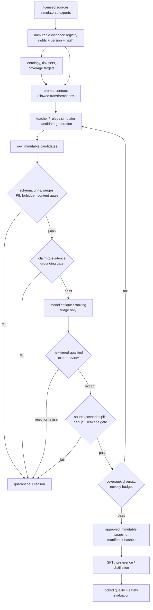
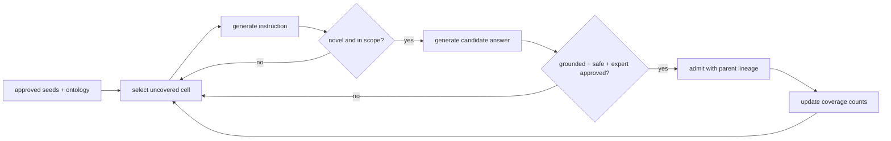
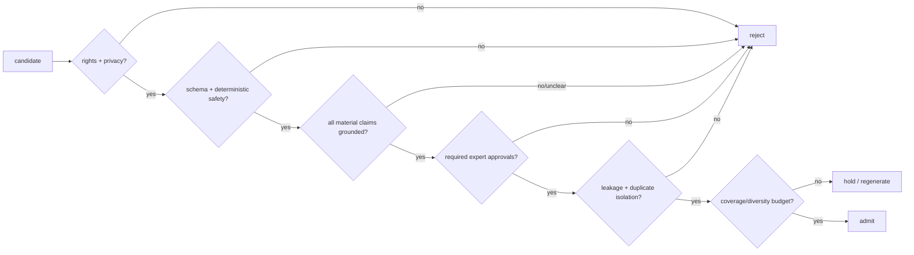

# CH-26: Synthetic Data and Knowledge Generation

> **Illustrative values.** Concrete identifiers, dates, thresholds, hashes, account numbers, and endpoints in this file are teaching examples, not observed project results or deployable credentials. Before use, replace them with reviewed values from your own registry, preserve the required format, and rerun every stated validation.

## 26.0 Chapter contract, status, and evidence notation

Synthetic data are records created or materially transformed by an algorithm rather than copied directly from an
observed human-authored record. For language-model training, the generator is often another language model, but it can
also be a simulator, rule engine, template system, perturbation function, or combination of these. Synthetic data can
expand coverage and lower the cost of drafting examples. They do **not** create ground truth merely by being fluent,
internally consistent, or produced by a strong teacher.

**Research freeze:** 2026-11-23. **Status: AUTHORED / NOT EXECUTED.** No teacher endpoint was called, dataset generated,
expert review performed, model trained, or benchmark run for this chapter. Code is `UNVERIFIED IMPLEMENTATION`;
protocols are `PLANNED EXPERIMENT`; diagrams and worked records are `ILLUSTRATIVE`; cited empirical findings are
`PAPER-REPORTED`. Local and live HTTP links were checked on 2026-11-24; that check does not replace bibliographic or
content review. No project result is reported.

Evidence labels follow the repository [standard](../../00-governance/evidence-and-citation-standard.md):

- `PAPER-REPORTED`: the cited publication reports a result; this project has not reproduced it.
- `DOC-VERIFIED`: an official interface was checked in documentation, not run.
- `UNVERIFIED IMPLEMENTATION`: executable-looking code was not executed.
- `PLANNED EXPERIMENT`: a preregisterable protocol with no observations.
- `ILLUSTRATIVE` and `ESTIMATE`: educational material, not measurement.

After this chapter, the reader should be able to design teacher Q&A, self-instruct, multi-turn, scenario, diagnostic,
counterfactual, negative, and preference-data pipelines; preserve record-level provenance; apply deterministic, model,
and expert gates; measure coverage, diversity, novelty, and grounding without confusing proxies for truth; and run
controlled ablations against expert-authored data.

## 26.1 The engineering problem

Low-resource specialist domains present a coverage problem. A small collection of manuals or expert notes may contain
reliable facts but few user questions, diagnostic dialogues, hard boundary cases, safe refusals, or stylistic
variations. Experts are expensive and scarce. A teacher can rapidly draft candidate records around a domain ontology.

The same convenience creates a circularity problem:

1. a model proposes a question;
2. the same or another model proposes the answer;
3. a model scores that answer;
4. the student learns the accepted answer;
5. later generations are treated as evidence that the answer was correct.

None of those steps independently establishes truth. A generated claim must be supported by a legally usable
authoritative source, deterministic oracle, or qualified expert decision that is independent of the generator. Teacher
agreement is corroboration at most; shared training data and shared failure modes make it weak evidence.

Synthetic generation should therefore be treated as **candidate construction under governance**, not autonomous
knowledge creation:

$$
\text{trusted evidence} \rightarrow \text{bounded transformation} \rightarrow \text{candidate} \rightarrow
\text{independent gates} \rightarrow \text{training record}.
$$

This chapter concerns offline dataset engineering. The released specialist SLM still answers from trained parameters or
adapters. It does not retrieve source documents or call a teacher at runtime, consistent with the
[no-runtime-RAG standard](../../00-governance/no-runtime-rag-standard.md). Consequently, stale knowledge, imperfect
recall, conflicts, and hallucination remain deployment risks even after a well-governed synthetic pipeline.

## 26.2 Taxonomy: what is actually being synthesized?

<!-- markdownlint-disable MD013 -->
| Family                   | Generated object                    | Independent anchor             | Useful role           | Principal risk                |
| ------------------------ | ----------------------------------- | ------------------------------ | --------------------- | ----------------------------- |
| Surface transformation   | paraphrase, format, tone            | approved source record         | linguistic robustness | meaning drift                 |
| Controlled composition   | Q&A, explanation, summary           | cited evidence spans           | instruction coverage  | unsupported joining of facts  |
| Scenario synthesis       | context, actors, symptoms           | validated constraints/oracle   | situational coverage  | impossible cases              |
| Diagnostic synthesis     | observations and branch sequence    | fault model, simulator, expert | process supervision   | unsafe order                  |
| Counterfactual/contrast  | one controlled change               | causal/domain rule             | boundary learning     | invalid intervention          |
| Negative generation      | wrong, incomplete, unsafe candidate | explicit violated rule         | error recognition     | teaching plausible falsehoods |
| Preference generation    | chosen/rejected pair                | rubric plus adjudication       | behavior optimization | style bias                    |
| Open knowledge expansion | new facts or relations              | later independent verification | discovery queue only  | hallucinated “knowledge”      |
<!-- markdownlint-restore -->

The safest low-resource starting point is surface transformation of already approved records. Open knowledge expansion
is the highest-risk mode and must enter a quarantine queue, never a training split, until independently verified.

## 26.3 A governed end-to-end pipeline

**FIG-CH26-01 — Evidence-bounded synthetic-data pipeline (`ILLUSTRATIVE`).** Alt text: licensed sources and experts
create an evidence registry and ontology; generators propose records; deterministic, grounding, model-triage, expert,
leakage, and diversity gates precede a versioned dataset.



Split assignment should be determined from source, scenario, and near-duplicate groups before generation; otherwise
paraphrases of one case can cross train and test. Model scoring occurs only after cheap deterministic rejection. Expert
time is spent on plausible candidates with the evidence and validation trail visible.

Mandatory artifacts are:

1. an evidence registry with source, version, rights, jurisdiction, spans, content hash, and supersession state;
2. an ontology and coverage plan with tasks, hazards, difficulty, languages, rare strata, and target counts;
3. a prompt contract with allowed evidence, prohibited inference, output schema, and uncertainty behavior;
4. an immutable generation log with teacher revision, settings, response, and errors;
5. a validation log with every rule, critique, reviewer decision, and edit;
6. a split manifest with source, scenario, parent, and duplicate groups; and
7. a dataset manifest with record hashes, generator mixture, acceptance funnel, rights, risk distribution, and metrics.

## 26.4 Teacher-generated question–answer data

A teacher can transform an approved evidence unit into questions that users might ask and candidate answers that cite
the unit. This is response distillation when the answer becomes an SFT target, as discussed in
[CH-13](../part-04-model-compression-and-optimization/ch-13-knowledge-distillation-complete-research-and-implementation.md).

A good generation unit is narrow enough to verify. Instead of passing an entire manual and asking for “100 questions,”
choose one versioned section, extract atomic evidence claims, specify permitted reasoning operations, and request a
small number of different task types. Require claim-level evidence references and `insufficient_evidence` instead of gap
supplying.

Teacher Q&A can supply explanations, comparisons, procedural ordering, troubleshooting questions, structured extraction,
and safe escalation. It is weak at facts absent from evidence and answers that vary by product, jurisdiction, species,
patient, or model year.

### 26.4.1 Prompt contract

**Listing CH26-L01 — Grounded Q&A generation contract (`UNVERIFIED IMPLEMENTATION`).** Input: one approved evidence
packet. Output: JSON matching the contract. Pin the selected local checkpoint or API revision before use. This prompt
has not been evaluated against any model.

```text
SYSTEM
You draft candidate training records; you do not establish truth.
Use only EVIDENCE items below. Do not add facts from memory.
Every factual claim must cite one or more evidence_id values.
If the answer is not fully supported, set
answerability="insufficient_evidence" and identify missing evidence.
Preserve qualifiers, units, jurisdiction, population, product/model, and date.
Do not convert descriptive material into personalized diagnosis, prescribing,
repair authorization, or animal-treatment advice.
Return only JSON conforming to OUTPUT_SCHEMA.

TASK
Create at most 4 non-duplicate questions spanning the requested task_types.
Vary wording, but not meaning. Include one boundary or uncertainty case.

EVIDENCE
{{EVIDENCE_PACKETS_INSERTED_OFFLINE}}

OUTPUT_SCHEMA
{
  "candidates": [{
    "question": "string",
    "answer": "string",
    "answerability": "supported|insufficient_evidence",
    "claims": [{
      "claim": "one atomic proposition",
      "evidence_ids": ["string"],
      "support": "entailed|unclear"
    }],
    "task_type": "explain|compare|procedure|diagnose|refuse",
    "risk_tier": "low|moderate|high|safety_critical",
    "uncertainties": ["string"]
  }]
}
```

The contract reduces unconstrained invention; it does not force compliance or prove entailment. Every returned field is
untrusted input.

## 26.5 Self-instruct and iterative instruction evolution

Self-Instruct generates instructions, classifies them, produces instances, and filters near duplicates before
fine-tuning [R1]. The paper reports instruction-following improvements in its setting (`PAPER-REPORTED`), not factual
validation for specialist domains. Alpaca demonstrated a compact implementation based on Self-Instruct-style data [R2],
while documenting limitations.

A governed specialist adaptation is:

1. seed with expert-approved task templates and ontology nodes;
2. sample an uncovered `(concept, task, difficulty, risk)` cell;
3. generate an instruction under a source-bounded contract;
4. reject semantic duplicates and out-of-scope instructions;
5. generate the response separately when practical;
6. verify each claim and safety action;
7. admit only approved records and update the coverage ledger.

Separate generator roles can reduce direct self-consistency bias, but do not make the outputs independent evidence.
Models may share data or misconceptions.

Evol-Instruct iteratively makes instructions deeper, broader, or more constrained; WizardLM reports this approach [R3]
(`PAPER-REPORTED`). Difficulty must be measured after generation. Longer prompts are not necessarily harder, and
evolution can change the answer or create impossible combinations. Keep parent–child lineage and verify semantic
continuity.

**FIG-CH26-02 — Coverage-directed self-instruct loop (`ILLUSTRATIVE`).** Alt text: coverage gaps drive bounded prompt
generation, validation, deduplication, and reviewed admission until stop criteria are reached.



## 26.6 Synthetic multi-turn conversations

Single-turn Q&A does not train clarification, state tracking, correction, or safe escalation. Generate a multi-turn
record from an explicit latent state, not by asking two agents to chat freely:

$$
z=(g,f,u,h), \qquad d_1,\ldots,d_T,
$$

where $g$ is the user goal, $f$ verified facts, $u$ unknown facts, $h$ hazards, and $d_t$ the allowed action
at turn $t$: ask, answer, summarize, correct, refuse, or escalate. A validator checks that later turns do not
contradict facts, reveal unknown state without user input, or skip safety.

Useful patterns are clarification, incremental disclosure, correction after a changed premise, missing-tool or
applicability constraints, concise handoff, and adversarial pressure to bypass safety. Do not train fabricated user
confirmation as evidence. “That fixed it” in a synthetic chat is not an observed outcome. UltraChat is a large synthetic
conversational-data example [R4], but its reported chat results (`PAPER-REPORTED`) do not validate specialist facts or
safety.

### 26.6.1 Multi-turn schema

```json
{
  "record_id": "repair-dialogue-000042",
  "record_type": "multi_turn_diagnostic",
  "domain": "equipment_repair",
  "risk_tier": "high",
  "scenario_group_id": "starter-circuit-family-007",
  "latent_state": {
    "verified_facts": ["fact-crank-no-start"],
    "unknowns": ["cranking-voltage"],
    "hazards": ["stored-energy"],
    "allowed_actions": ["clarify", "isolate", "measure", "escalate"]
  },
  "messages": [
    { "role": "user", "content": "The starter turns, but the engine does not start." },
    { "role": "assistant", "content": "What applicable measurements and fault codes are available while cranking?" }
  ],
  "turn_checks": [{ "turn": 1, "action": "clarify", "state_consistent": true }],
  "evidence_refs": ["source-id#section"],
  "generation": { "teacher_revision": "approved-teacher-revision-7f2a", "prompt_hash": "aaaaaaaaaaaaaaaaaaaaaaaaaaaaaaaaaaaaaaaaaaaaaaaaaaaaaaaaaaaaaaaa" },
  "review": { "decision": "awaiting_review", "reviewer_role": "qualified-repair-expert" },
  "split": "train",
  "content_sha256": "bbbbbbbbbbbbbbbbbbbbbbbbbbbbbbbbbbbbbbbbbbbbbbbbbbbbbbbbbbbbbbbb"
}
```

Values are `ILLUSTRATIVE`. Keep latent validation state out of exported SFT text when exposing it would create
unrealistic assistant behavior.

## 26.7 Expansion, scenario, and diagnostic-case generation

### 26.7.1 Knowledge expansion

“Expand this topic” invites unsupported facts. Expansion should mean:

1. **coverage expansion:** render existing evidence as another task;
2. **compositional expansion:** combine compatible evidence under an explicit join rule; or
3. **hypothesis expansion:** propose facts for a research queue, marked unverified and excluded from training.

Combining a general procedure with a product-specific limit is invalid unless applicability is established. An ontology
can enumerate candidates but does not certify truth. Teacher explanation traces such as those studied by Orca [R5] can
add process supervision (`PAPER-REPORTED`), but an explanation can be plausible, unfaithful, or factually wrong.

### 26.7.2 Scenario generation

A scenario is structured state rendered into language. Sample typed fields and constraints first:

```json
{
  "scenario_id": "animal-care-00031",
  "domain": "animal_care",
  "species": "controlled_taxon_example",
  "life_stage": "adult",
  "environment": { "region": "temperate-example", "season": "winter" },
  "observations": ["reduced food intake recorded during two observations"],
  "excluded_observations": ["no respiratory sign recorded in the scenario"],
  "urgency_class": "qualified_review_required",
  "required_action": "observe|isolate|contact_veterinarian|emergency_escalation",
  "constraint_rule_ids": ["rule-17", "rule-44"],
  "evidence_refs": ["source-id#section"]
}
```

Constraint rules reject impossible combinations before rendering. Parse or compare generated language back against the
sampled state to detect dropped or added facts. Large synthetic “textbook” corpora have been explored in work such as
_Textbooks Are All You Need_ [R6] (`PAPER-REPORTED`); code-domain results do not remove the need for claim-level <!-- markdownlint-disable-line MD013 MD049 -->
validation in specialist safety domains.

### 26.7.3 Diagnostic generation

A diagnosis dataset must teach process, not just labels:

1. start from a validated fault tree, causal graph, simulator, or expert case;
2. sample a latent cause and context;
3. derive compatible observations from the oracle;
4. expose only an initial subset;
5. enumerate safe, discriminating next actions;
6. create plausible non-discriminating or unsafe alternatives;
7. verify branch logic, test order, costs, and hazards; and
8. obtain qualified expert adjudication for high-risk cases.

Distinguish **possible causes**, **next discriminating action**, and **confirmed diagnosis**. A symptom rarely proves a
unique cause. Direct symptom-to-diagnosis targets can train unsafe overconfidence.

## 26.8 Transformations and contrastive records

### 26.8.1 Paraphrases and difficulty

A valid paraphrase preserves entities, negation, quantities, units, temporal order, modality (“may” versus “must”), and
answerability. Generate controlled axes—technical/lay phrasing, terse/verbose, typo/noise, active/passive—not
unconstrained rewrites. Embedding similarity is triage, not proof.

Difficulty can vary through relevant facts, distractors, composition depth, ambiguity, rare terminology, competing
hypotheses, constraints, missing information, and output structure. Assign intended difficulty before generation and
observed difficulty after expert and baseline-model pilots. Longer does not mean harder.

### 26.8.2 Counterfactuals

A counterfactual changes one causally meaningful variable while holding others fixed and updates the valid answer.
Counterfactually augmented data and contrast sets expose decision boundaries in studied settings [R7, R8]
(`PAPER-REPORTED`).

For $(x,y)$ and intervention $do(v\leftarrow v')$, create $(x',y')$ only if domain rules justify the change.
Record changed and invariant fields. Changing model year, voltage, life stage, contraindication status, or guard state
may be valid; a random premise swap may create an impossible world.

### 26.8.3 Negative examples

Negatives include insufficient-evidence cases, hard but wrong answers, unsafe processes, wrong
units/jurisdictions/species/models, invalid schemas, unnecessary refusals, and unsafe compliance. Attach the violated
rule and corrected target. Never put unlabeled false text into completion data. Use classification, preference,
critique-and-correction, or masked fields suited to the training objective.

### 26.8.4 Preference pairs

A preference record contains prompt $x$, chosen $y^+$, rejected $y^-$, and the reason. DPO learns from such pairs
[R9]; UltraFeedback demonstrates model-generated feedback at scale [R10] (`PAPER-REPORTED`). Neither validates synthetic
preferences for a new specialist domain.

```json
{
  "record_id": "pref-00018",
  "prompt_id": "case-0012",
  "chosen": "Preserve the fault evidence and complete the applicable isolation and test sequence before replacement.",
  "rejected": "Replace the most likely component immediately.",
  "preference_dimensions": {
    "factual_support": "chosen",
    "safety_order": "chosen",
    "uncertainty": "chosen",
    "style": "tie"
  },
  "rejection_reason_codes": ["UNSUPPORTED_CLAIM", "SKIPPED_ISOLATION"],
  "evidence_refs": ["source-id#section"],
  "adjudicators": [{ "role": "qualified-expert", "decision": "chosen" }]
}
```

Keep dimensions separate. Position-swap candidates to detect order bias; blind reviewers to generator identity; allow
ties and “both unacceptable”; measure agreement; adjudicate safety disagreements.

## 26.9 Provenance and record contracts

Provenance must reconstruct what evidence and transformation produced each target. Dataset-level “generated with model
X” is insufficient.

| Group          | Required fields                                                      |
| -------------- | -------------------------------------------------------------------- |
| Identity       | record ID, parent IDs, scenario/duplicate group, schema version      |
| Source         | evidence IDs/spans, source version/hash, rights, jurisdiction        |
| Generation     | generator revision, prompt/raw hashes, decoding, seed if supported   |
| Transformation | operation, changed/invariant fields, ontology/rule IDs               |
| Risk           | domain, hazards, tier, intended/prohibited use                       |
| Validation     | rule results, grounding, critiques, reviewer role/ID, edits, reasons |
| Splitting      | immutable split, grouping, contamination checks                      |
| Release        | content hash, dataset snapshot, supersession/removal state           |

### 26.9.1 Canonical governed record

```json
{
  "$schema": "https://json-schema.org/draft/2020-12/schema",
  "title": "SyntheticTrainingCandidate",
  "type": "object",
  "required": [
    "record_id",
    "record_type",
    "domain",
    "risk_tier",
    "content",
    "evidence_refs",
    "generation",
    "validation",
    "split_group"
  ],
  "properties": {
    "record_id": { "type": "string", "minLength": 1 },
    "parent_ids": { "type": "array", "items": { "type": "string" } },
    "record_type": {
      "enum": ["qa", "multi_turn", "scenario", "diagnostic", "preference"]
    },
    "domain": { "type": "string" },
    "risk_tier": {
      "enum": ["low", "moderate", "high", "safety_critical"]
    },
    "content": { "type": "object" },
    "claims": {
      "type": "array",
      "items": {
        "type": "object",
        "required": ["text", "evidence_refs", "grounding_decision"],
        "properties": {
          "text": { "type": "string" },
          "evidence_refs": {
            "type": "array",
            "minItems": 1,
            "items": { "type": "string" }
          },
          "grounding_decision": {
            "enum": ["supported", "unsupported", "conflicting", "unclear"]
          }
        }
      }
    },
    "evidence_refs": {
      "type": "array",
      "minItems": 1,
      "items": { "type": "string" }
    },
    "generation": {
      "type": "object",
      "required": ["generator_revision", "prompt_sha256", "raw_sha256"]
    },
    "validation": {
      "type": "object",
      "required": ["deterministic_gates", "decision"]
    },
    "split_group": { "type": "string", "minLength": 1 }
  },
  "additionalProperties": false
}
```

This is an `ILLUSTRATIVE` interchange schema, not a validated repository API. Sensitive source text, personal data, or
dangerous raw generations require stricter access control than released training records.

## 26.10 Validation gates

No single validator is reliable. Layer independent checks.

### 26.10.1 Deterministic gates

Run cheap, reproducible checks first:

- schema, encoding, length, role order, and required fields;
- exact hashes and duplicate IDs;
- controlled vocabulary and ontology membership;
- unit syntax, dimensions, ranges, and conversions;
- identifiers, dates, jurisdiction, product/species applicability;
- prohibited personal data, secrets, and unauthorized source text;
- required warnings, escalation actions, and stop conditions;
- consistency between structured state and rendered conversation;
- source-, scenario-, parent-, and near-duplicate split isolation; and
- forbidden benchmark/test references and memorized answer strings.

Rules have false positives and encode only anticipated failures. Version and unit-test them. Passing means “no encoded
violation found,” not “correct.”

### 26.10.2 Grounding gates

Decompose answers into atomic claims. For each claim:

$$
g_i \in \{\text{supported},\text{unsupported}, \text{conflicting},\text{unclear}\}.
$$

An entailment model can prioritize claims, but source inspection or a trusted oracle decides admission. Citations are
not grounding if fabricated, wrong version, or merely topically related. A descriptive score is:

$$
G_{\mathrm{claim}}= \frac{\sum_i w_i\mathbf 1[g_i=\text{supported}]}{\sum_i w_i},
$$

where $w_i$ reflects risk. A safety-critical unsupported claim causes rejection even if the average is high; the score
is not compensatory.

### 26.10.3 Model filtering

Models can classify topic, flag contradictions, compare candidates, extract claims, estimate answerability, and route
records. Log model revision, prompt, candidate ordering, and raw scores. Calibrate each filter against an expert-labeled
audit set.

Do not use an opaque “quality ≥ 8” as truth. Model judges are sensitive to position, verbosity, and self-preference;
MT-Bench judge work documents utility and limitations [R11] (`PAPER-REPORTED`). A teacher grading itself is especially
circular. Model filters reduce workload; they do not waive expertise.

### 26.10.4 Expert validation

<!-- markdownlint-disable MD013 -->
| Tier            | Example                                          | Minimum handling                                                          |
| --------------- | ------------------------------------------------ | ------------------------------------------------------------------------- |
| Low             | terminology paraphrase                           | sampled expert audit after grounding                                      |
| Moderate        | maintenance explanation                          | trained reviewer plus escalation                                          |
| High            | diagnostic sequence                              | domain expert; second review for disputes                                 |
| Safety-critical | medication, hazardous repair, urgent animal care | qualified specialist approval plus independent second review/adjudication |
<!-- markdownlint-restore -->

Reviewers need the source excerpt and version, structured state, raw and normalized candidate, rules, and rubric. Blind
teacher identity where possible. Capture accept/revise/reject, reason codes, edits, confidence, and time. Report raw and
suitable chance-corrected agreement by risk. Low agreement triggers rubric or evidence revision, not majority-vote
release.

**FIG-CH26-03 — Non-compensatory admission logic (`ILLUSTRATIVE`).** Alt text: a synthetic record is rejected if any
non-compensatory rights, provenance, factuality, safety, leakage, or review gate fails.



## 26.11 Diversity, novelty, coverage, and grounding metrics

No metric proves usefulness. Inspect distributions by domain, task, risk, language, source, and generator.

### 26.11.1 Coverage

For target cells $c\in C$, importance $a_c$, accepted count $n_c$, and minimum $m_c$:

$$
\text{weighted coverage}= \frac{\sum_{c\in C}a_c\mathbf 1[n_c\ge m_c]}{\sum_{c\in C}a_c}.
$$

Counts do not measure correctness or depth. Track uncovered safety cells separately; common questions cannot compensate
for missing hazards.

### 26.11.2 Diversity

- **Distinct-$n$:** unique $n$-grams divided by all $n$-grams [R12]. It grows with length and noise.
- **Self-BLEU:** each sample is compared with others [R13]. Lower can indicate diversity, but required domain
  terminology creates legitimate overlap.
- **Embedding dispersion/cluster entropy:** semantic spread under a declared encoder. It inherits encoder blind spots
  and can reward off-topic text.
- **MAUVE:** distribution comparison in a learned representation [R14]. It is sample-, model-, and parameter-sensitive
  and does not verify facts.

Report preprocessing, encoder/revision, sampling, and uncertainty. Compare matched lengths and tasks.

### 26.11.3 Novelty and duplication

For candidate $x$ and corpus $D$:

$$
N_k(x)=1-\max_{d\in D}\operatorname{sim}_k(x,d),
$$

where $\operatorname{sim}_k$ is a declared lexical or embedding similarity. High novelty can mean a valuable case,
nonsense, or an unsupported claim. Low novelty may be a necessary safety paraphrase. Use exact hashes, normalized
hashes, MinHash/LSH, token overlap, semantic search, and manual boundary review.

Measure novelty against validation/test and known benchmarks. A paraphrased benchmark answer is contamination despite
lexical novelty.

### 26.11.4 Grounding and correctness

Report claim-weighted support, unsupported-claim rate, citation precision and completeness, conflicts, expert factual
accuracy with intervals, answerability/abstention precision and recall, safety/escalation correctness, and confidence
calibration. Automated NLI, overlap, and judge scores are screening proxies; they can miss numbers, time, negation, and
specialist errors.

**Worked funnel (`ILLUSTRATIVE`).** If 1,000 raw records yield 920 schema passes, 760 grounded records, and 700 expert
approvals, the raw acceptance is 70%. This says little without strata: terminology might pass at 95% and hazardous
diagnostics at 20%. Report the funnel by risk, source, task, and generator, plus review time and rejection reasons.

## 26.12 Contamination and leakage

Contamination includes:

1. benchmark prompts, answers, or paraphrases entering training;
2. siblings from one source/scenario crossing splits;
3. a teacher reproducing memorized benchmark content;
4. repeated seeds creating overlap across generation runs;
5. test errors becoming training data without a fresh untouched test; and
6. inherited private, copyrighted, or disallowed material.

Freeze tests and salted fingerprints before generation; assign groups to splits first; block benchmark names and known
fragments; run exact, fuzzy, semantic, and sampled manual audits; hold out whole source families, products, species, or
time windows; retain parent IDs across rounds; never send secret test answers to a training-data teacher; and create a
fresh test after test-informed development.

No detector proves absence. Black-box teacher training data may be unknowable. Publish methods, thresholds, audit
samples, and blind spots rather than claim a perfectly “clean” benchmark.

## 26.13 Recursive synthetic training and model collapse

Repeatedly training generators on generated output can create feedback loops: rare modes disappear, errors reinforce,
and style narrows. Shumailov et al. analyze model collapse under recursive generated-data training [R15]; Alemohammad et
al. study self-consuming loops [R16] (`PAPER-REPORTED`). Their settings neither imply every mixed dataset collapses nor
establish a universal safe synthetic ratio.

Mechanisms include sampling truncation, selection for conventional easy-to- judge text, error reinforcement, one-teacher
style homogenization, ontology lock-in, and generator/judge coupling. Retain a durable human/source-authored core,
measure every generation against it, limit recursive depth, preserve rare strata and rejected records for audits, mix
generators/settings, sample coverage gaps, and refresh from independent real data. Generator diversity is not evidence
diversity.

Track generation depth $r$ and synthetic-only ancestry:

$$
\rho_r=\frac{\text{accepted tokens with only synthetic ancestors at round }r} {\text{all accepted tokens at round
}r}.
$$

$\rho_r$ is a lineage statistic, not a collapse threshold. Plot it against rare-stratum recall, duplication, factual
error, calibration, and style concentration. Stop at preregistered regression limits.

## 26.14 Low-resource bootstrapping without unsupported facts

A defensible sequence is:

1. define intended and prohibited uses;
2. recruit a qualified domain owner and escalation path;
3. collect a small legally usable authoritative evidence set;
4. atomize it into versioned claims and applicability constraints;
5. build an ontology and risk-weighted coverage matrix;
6. author a small expert seed and untouched expert evaluation set;
7. generate bounded transformations first;
8. admit records through deterministic, grounding, and expert gates;
9. train a pilot with real/synthetic provenance preserved;
10. compare expert-only, mixed, and unfiltered controls;
11. expand only strata with measured benefit; and
12. refresh from independent human or observed data.

If no authoritative evidence or qualified reviewer exists, generate questions, templates, or hypotheses for a collection
queue—not factual answers for training. “Low resource” does not relax truth requirements.

For low-resource languages, translate an approved semantic record under terminology constraints; check entities, units,
negation, and locale; and obtain domain-competent bilingual review. Back-translation agreement is not proof. Preserve
the source-language parent.

## 26.15 Safety-critical domain controls

### 26.15.1 Pharmacy

Synthetic pharmacy data may support education, classification, extraction, interaction-risk recognition, refusal, and
escalation. They must not convert general references into patient-specific prescribing, dosing, substitution,
contraindication clearance, or emergency decisions.

Require authoritative versioned jurisdictional sources; explicit population, formulation, route, units, timing, and
applicability; approved deterministic dose/unit checks where possible; source-edition conflict detection; qualified
pharmacist/clinician review; independent second review for safety-critical records; missing-context and escalation
behavior; and non-compensatory rejection of unsupported dose, interaction, allergy, pregnancy, pediatric, geriatric,
renal/hepatic, or emergency claims. An experimental model is not an autonomous prescriber.

### 26.15.2 Vehicle, electrical, and industrial repair

Encode energy isolation, lockout/tagout where applicable, protective equipment, fire/chemical/high-voltage/stored-energy
hazards, service-information applicability, tool limits, and competence boundaries. A plausible step fails if its order
is dangerous.

Model year, variant, voltage, torque, fluid, fastener, and regulatory facts need exact source/version matching.
Qualified technicians review high-risk sequences. Do not train authorization to bypass interlocks, emissions or safety
systems, live-work controls, lifting requirements, or unresolved critical faults.

### 26.15.3 Animal care, beekeeping, and zoo/husbandry

Species, life stage, sex, weight, social structure, season, climate, jurisdiction, and veterinary context can change an
answer. Do not generalize treatment across species because symptoms appear similar.

Require welfare-first escalation, zoonosis/biosecurity, quarantine, handling competence, protected-species and
medication constraints, and qualified veterinarian or species-care review for consequential records. Urgent signs
trigger professional or emergency escalation; generated diagnoses or treatments are not observed clinical truth.

## 26.16 Practical pipeline listings

All listings are `UNVERIFIED IMPLEMENTATION`: not run, type-checked, security- reviewed, or connected to a teacher. They
use Python 3 standard-library APIs only. Pin Python and all provider/model, prompt, schema, and rule revisions. Expected
failures include invalid JSON, noncompliance, hash drift, PII, unsafe content, and leakage. Raw data may be sensitive;
do not log secrets.

### Listing CH26-L02 — Hashable generation envelope

Purpose: preserve prompt, evidence, generator, and raw-output lineage. Input: approved evidence and a `Generator`.
Output: append-only quarantine JSONL.

```python
# UNVERIFIED IMPLEMENTATION — intentionally not executed.
from __future__ import annotations
from dataclasses import asdict, dataclass
from datetime import datetime, timezone
from hashlib import sha256
import json
from pathlib import Path
from typing import Any, Protocol

def canonical_sha256(value: Any) -> str:
    payload = json.dumps(
        value, ensure_ascii=False, sort_keys=True, separators=(",", ":")
    ).encode("utf-8")
    return sha256(payload).hexdigest()

class Generator(Protocol):
    revision: str
    def generate(self, prompt: str, *, seed: int) -> str: ...

@dataclass(frozen=True)
class GenerationEnvelope:
    record_id: str
    generator_revision: str
    prompt_sha256: str
    evidence_sha256: str
    raw_response: str
    raw_sha256: str
    seed: int
    created_at: str
    status: str = "quarantine"

def generate_one(generator: Generator, prompt_template: str,
                 evidence: dict[str, Any], record_id: str,
                 seed: int) -> GenerationEnvelope:
    evidence_json = json.dumps(evidence, ensure_ascii=False, sort_keys=True)
    prompt = prompt_template.replace("{{EVIDENCE_JSON}}", evidence_json)
    raw = generator.generate(prompt, seed=seed)
    return GenerationEnvelope(
        record_id=record_id,
        generator_revision=generator.revision,
        prompt_sha256=canonical_sha256(prompt),
        evidence_sha256=canonical_sha256(evidence),
        raw_response=raw,
        raw_sha256=canonical_sha256(raw),
        seed=seed,
        created_at=datetime.now(timezone.utc).isoformat(),
    )

def append_envelope(path: Path, envelope: GenerationEnvelope) -> None:
    path.parent.mkdir(parents=True, exist_ok=True)
    with path.open("a", encoding="utf-8", newline="\n") as handle:
        handle.write(json.dumps(asdict(envelope), ensure_ascii=False) + "\n")
```

Production code also needs atomic writes, locks, retries, rate limits, secret management, request IDs, decoding
settings, encryption, and policy handling. Treat evidence as data, not executable prompt instructions.

### Listing CH26-L03 — Deterministic admission pre-gates

Purpose: reject records lacking provenance, support, approvals, or isolation. Input: reviewed JSONL. Output: accepted
JSONL and rejection log. Hardware: CPU.

```python
# UNVERIFIED IMPLEMENTATION — intentionally not executed.
from __future__ import annotations
import json
from pathlib import Path
from typing import Any

SAFETY_TIERS = {"high", "safety_critical"}

def rejection_reasons(record: dict[str, Any],
                      forbidden_eval_groups: set[str]) -> list[str]:
    reasons: list[str] = []
    required = {
        "record_id", "record_type", "risk_tier", "content", "claims",
        "evidence_refs", "generation", "validation", "split_group",
    }
    if missing := required - record.keys():
        return [f"MISSING_FIELDS:{','.join(sorted(missing))}"]
    if record["split_group"] in forbidden_eval_groups:
        reasons.append("EVALUATION_GROUP_LEAKAGE")
    if not record["evidence_refs"]:
        reasons.append("NO_EVIDENCE")
    for index, claim in enumerate(record["claims"]):
        if not claim.get("evidence_refs"):
            reasons.append(f"CLAIM_{index}_NO_EVIDENCE")
        if claim.get("grounding_decision") != "supported":
            reasons.append(f"CLAIM_{index}_NOT_SUPPORTED")
    validation = record["validation"]
    if validation.get("decision") != "accept":
        reasons.append("REVIEW_NOT_ACCEPTED")
    gates = validation.get("deterministic_gates", [])
    if not gates or any(g.get("result") != "pass" for g in gates):
        reasons.append("DETERMINISTIC_GATE_FAILURE")
    approvals = validation.get("expert_approvals", [])
    if record["risk_tier"] in SAFETY_TIERS:
        qualified = {
            a.get("reviewer_id") for a in approvals
            if a.get("qualified") is True and a.get("decision") == "accept"
        }
        if len(qualified) < 2:
            reasons.append("INSUFFICIENT_QUALIFIED_APPROVALS")
    return reasons

def materialize(reviewed_path: Path, accepted_path: Path,
                rejected_path: Path,
                forbidden_eval_groups: set[str]) -> None:
    seen_ids: set[str] = set()
    with reviewed_path.open(encoding="utf-8") as src, \
         accepted_path.open("w", encoding="utf-8") as accepted, \
         rejected_path.open("w", encoding="utf-8") as rejected:
        for line_number, line in enumerate(src, 1):
            record = json.loads(line)
            rid = record.get("record_id", f"line-{line_number}")
            reasons = rejection_reasons(record, forbidden_eval_groups)
            if rid in seen_ids:
                reasons.append("DUPLICATE_RECORD_ID")
            seen_ids.add(rid)
            destination = rejected if reasons else accepted
            destination.write(json.dumps(
                {"record": record, "reasons": reasons},
                ensure_ascii=False,
            ) + "\n")
```

This omits JSON Schema, PII, units, near duplicates, rights, reviewer authorization, and atomic output. It cannot
determine whether a `supported` label is honest.

### Listing CH26-L04 — Lineage-aware split assignment

Purpose: keep connected source/scenario/parent/duplicate groups in one split.

```python
# UNVERIFIED IMPLEMENTATION — intentionally not executed.
from hashlib import sha256

def assign_split(group_id: str, salt: str) -> str:
    if not group_id or not salt:
        raise ValueError("non-empty group_id and project salt required")
    value = int.from_bytes(
        sha256(f"{salt}:{group_id}".encode()).digest()[:8], "big"
    ) / 2**64
    if value < 0.80:
        return "train"
    if value < 0.90:
        return "validation"
    return "test"
```

The group should be a connected-component ID over all lineage relations. Hash splitting is not stratification; inspect
allocation while preserving isolation.

### 26.16.1 Worked example: generate, reject, repair, and admit one record

Start from this fictional approved evidence packet:

```json
{
  "evidence_id": "ev-code-condition-017",
  "text": "A diagnostic code identifies a monitored condition. It does not by itself confirm a failed component.",
  "scope": {"domain": "automotive", "jurisdiction": "general-educational"},
  "rights_basis_id": "permission-042",
  "source_version": "2026-02",
  "risk_tier": "high",
  "split_group": "family-code-not-cause-017"
}
```

A teacher receives only this packet and the CH26-L01 contract. It returns:

```json
{
  "question": "The code mentions a sensor. Should it be replaced?",
  "answer": "Yes. The code confirms the sensor failed, so replace it.",
  "answerability": "supported",
  "claims": [
    {
      "claim": "The code confirms sensor failure.",
      "evidence_ids": ["ev-code-condition-017"],
      "support": "entailed"
    }
  ],
  "task_type": "diagnose",
  "risk_tier": "high",
  "uncertainties": []
}
```

This is syntactically valid and cites a real evidence ID, yet it says the opposite of the evidence. Citation presence
is therefore not grounding. The claim gate marks it `unsupported`; the record is rejected before expert review, with
reason codes `CONTRADICTS_EVIDENCE` and `PREMATURE_REPLACEMENT`.

The pipeline may ask the teacher for a repair while preserving the rejected output:

```json
{
  "question": "The code mentions a sensor. Should it be replaced?",
  "answer": "No component replacement is justified by the code alone. Preserve the code and obtain the applicable test evidence before deciding.",
  "answerability": "supported",
  "claims": [
    {
      "claim": "The code alone does not confirm component failure.",
      "evidence_ids": ["ev-code-condition-017"],
      "support": "entailed"
    }
  ],
  "task_type": "diagnose",
  "risk_tier": "high",
  "uncertainties": ["The applicable asset variant and test results are unknown."]
}
```

Deterministic gates now check schema, the evidence ID, required uncertainty, prohibited replacement language, PII, and
split inheritance. A qualified reviewer checks that the response remains educational and does not invent a procedure.
A second qualified approval is required by the illustrative CH26-L03 policy for high-risk records. The accepted record
inherits `family-code-not-cause-017`; any paraphrase, preference pair, or dialogue generated from it remains in the same
split.

Now create one controlled counterfactual:

```json
{
  "parent_record_id": "synthetic-code-case-017",
  "changed_field": "additional_test_evidence",
  "old_value": "absent",
  "new_value": "independent applicable test confirms the component fault",
  "invariants": ["same asset variant", "same code", "same safety prerequisites"],
  "expected_boundary_change": "replacement may be considered only under the applicable procedure"
}
```

The counterfactual is admitted only if an independent rule or expert confirms that the added evidence is sufficient.
The generator cannot declare its own intervention valid.

This one-record trace exposes four common mistakes:

1. **Fluency is not support:** the rejected answer sounds decisive but contradicts its evidence.
2. **A citation is not entailment:** evidence IDs must resolve to text that actually supports each claim.
3. **A corrected answer is a new derivative:** preserve the rejected raw output and the repair lineage.
4. **More variants are not more independent facts:** all descendants stay in one split and count as one evidence root.

The admitted record can improve answer format or boundary behavior, but it does not prove that a student will remember
the fact. CH-27 uses measured domain tests—not synthetic-record counts—to compare independent, adapter-based, joint,
routed, and distilled model strategies.

## 26.17 Cost, resource, and risk trade-offs

$$
C_{\mathrm{total}}= C_{\mathrm{sources}}+C_{\mathrm{generation}}+C_{\mathrm{engineering}}
+C_{\mathrm{filtering}}+C_{\mathrm{expert}}+C_{\mathrm{training}} +C_{\mathrm{evaluation}}+C_{\mathrm{maintenance}}.
$$

For API teachers, use actual input/output tokens and contemporaneous prices. For local teachers, report
accelerator-hours, utilization, measured energy, labor, and amortization. No dollar estimate is supplied here.

<!-- markdownlint-disable MD013 -->
| Design                | Cost profile             | Diversity           | Auditability       | Main risk                 |
| --------------------- | ------------------------ | ------------------- | ------------------ | ------------------------- |
| Templates/rules       | low marginal, high setup | narrow              | high               | rule omissions            |
| One black-box teacher | token-priced             | teacher-limited     | revision-dependent | systematic errors         |
| Open-weight teacher   | hardware/operations      | teacher-limited     | high with hashes   | license/security          |
| Multi-generator       | higher generation/review | potentially broader | complex            | disagreement is not truth |
| Simulator + renderer  | high setup               | controlled states   | high               | misspecified simulator    |
| Expert authoring      | scarce labor             | expert-limited      | high               | inconsistent coverage     |
<!-- markdownlint-restore -->

Track accepted-record yield, reviewer minutes, cost per grounded claim, and downstream quality—not raw tokens. Generate
to the review budget and stop producing candidates that cannot be responsibly validated. Filtering can homogenize style
and remove unusual correct cases.

## 26.18 Experimental program and ablations

All experiments are `PLANNED EXPERIMENT`. Fix model/tokenizer/template, optimizer search budget, accepted training
tokens, source/evaluation snapshots, seeds, and selection rule. Prefer at least three seeds where feasible. Keep an
untouched expert test and report paired intervals and safety strata.

| ID  | Training data                       | Question isolated                    |
| --- | ----------------------------------- | ------------------------------------ |
| B0  | no domain training                  | pretrained baseline                  |
| B1  | expert/source-authored only         | direct-data baseline                 |
| S1  | validated synthetic only            | substitution value                   |
| S2  | expert + validated synthetic        | augmentation value                   |
| S3  | expert + unfiltered synthetic       | filter value; isolated research only |
| S4  | expert + model-filtered synthetic   | model filter versus expert gate      |
| S5  | expert + expert-validated synthetic | full governance                      |

Match B1/S1 by accepted tokens and separately by acquisition budget. Sweep preregistered S2 mixtures; no universal ratio
should be inferred.

Ablate Q&A versus multi-turn; random versus coverage-directed sampling; one teacher versus a mixture; decoding settings;
paraphrases; counterfactuals; final answers versus verified process labels; controlled-corruption versus sampled
preference negatives; duplicate-audit layers; and recursive rounds with or without human-source replay.

Dataset metrics include acceptance funnel, claim support, contradictions, overlap, coverage, diversity, novelty,
source/generator concentration, reviewer time/agreement, and cost. Model metrics include factual accuracy, unsupported
claims, next-action quality, multi-turn consistency, answerability, calibration, safety/escalation, general retention,
and paraphrase/counterfactual/noise robustness.

Synthetic data do not directly shrink a model. They can change response length or help a smaller student reach a target.
Measure artifact size, peak RAM, startup, TTFT, prefill/decode throughput, response length, energy where instrumented,
and thermal stability. Architecture, quantization, runtime, and hardware—not data provenance alone—determine edge
performance.

Safety minima are non-compensatory. Select on validation only, use paired tests, report effect sizes/uncertainty and all
strata, qualify multiple comparisons, and choose a quality–safety–cost Pareto frontier.

| Variant | Domain score (CI) | Unsupported claims | Safety failures | Rare recall | Expert hours | Cost | Status  |
| ------- | ----------------: | -----------------: | --------------: | ----------: | -----------: | ---: | ------- |
| B0      |      not measured |       not measured |    not measured | not measured | not measured | not priced | not run |
| B1      |      not measured |       not measured |    not measured | not measured | not measured | not priced | not run |
| S1      |      not measured |       not measured |    not measured | not measured | not measured | not priced | not run |
| S2      |      not measured |       not measured |    not measured | not measured | not measured | not priced | not run |
| S3      |      not measured |       not measured |    not measured | not measured | not measured | not priced | not run |
| S4      |      not measured |       not measured |    not measured | not measured | not measured | not priced | not run |
| S5      |      not measured |       not measured |    not measured | not measured | not measured | not priced | not run |

Do not draw empirical charts until raw results and provenance exist.

## 26.19 Failure modes

<!-- markdownlint-disable MD013 -->
| Failure               | Symptom                            | Cause                          | Correction                            |
| --------------------- | ---------------------------------- | ------------------------------ | ------------------------------------- |
| fluent falsehood      | repeated confident error           | teacher treated as source      | independent evidence/expert gate      |
| citation laundering   | irrelevant valid-looking reference | fabricated/misapplied citation | registry resolution and support check |
| semantic drift        | changed negation/unit              | paraphrase freedom             | invariant checks and review           |
| impossible scenario   | contradictory state                | free-form generation           | typed state and solver                |
| premature diagnosis   | symptom maps to cause              | label-only design              | uncertainty and next-action targets   |
| unsafe process        | right endpoint, dangerous order    | endpoint scoring               | process/hazard gates                  |
| judge bias            | verbose answer always wins         | opaque score                   | dimensions, swaps, calibration        |
| leakage               | implausibly high evaluation        | lineage overlap                | grouping and overlap audit            |
| rare-mode loss        | tail performance falls             | sampling/filter bias           | weighted coverage targets             |
| recursive collapse    | repetition/error rises             | synthetic-only ancestry        | source core and stop rules            |
| diversity theater     | lexical spread, same semantics     | paraphrase inflation           | semantic/coverage audit               |
| stale facts           | old answer persists                | version drift                  | supersession and revalidation         |
| rights/privacy breach | protected data reproduced          | uncontrolled inputs/logs       | minimization, access, removal         |
<!-- markdownlint-restore -->

## 26.20 Decision framework and summary

Start with authoritative evidence and expert seeds. Select the objective and schema, group splits before generation,
prefer bounded transformations, require claim evidence, run deterministic checks before model/expert review, scale
review with risk, measure coverage/diversity/novelty/grounding jointly, compare expert-only/mixed/unfiltered controls,
preserve removal-ready lineage, stop recursive rounds on regression, and release only after independent tests.

Self-instruct and Q&A generation are **foundational**; evidence-bounded generation, provenance, deterministic gates, and
expert validation are **core practical**; constrained simulators, counterfactuals, and calibrated model triage are
**advanced practical**; open knowledge expansion, recursive self-training, and synthetic-only bootstrapping are
**experimental/high-risk**.

The central rule is simple: synthetic output is a proposal, not truth. Multi-turn and diagnostic data require latent
state and safe action logic. Metrics can reward noise and cannot replace grounding. Low-resource domains should
transform verified evidence first; unverifiable facts remain outside training. Synthetic data affect behavior, not model
size by themselves.

## 26.21 Review questions and exercises

1. Why is teacher–judge agreement not independent evidence?
2. Distinguish surface transformation, composition, and open expansion.
3. Write a paraphrase contract that forbids new claims.
4. Extend the schema with supersession and removal fields.
5. Test preservation of negation, units, entities, and model year.
6. Explain why group splitting precedes paraphrase generation.
7. Design a three-turn diagnostic state machine with a safety action.
8. Give one valid and invalid repair counterfactual and the causal rule.
9. Build a preference pair where the shorter answer is safer.
10. Explain one failure each for Distinct-$n$, Self-BLEU, embeddings, MAUVE.
11. Design an expert-calibration set for a model filter by risk.
12. Audit 100 candidates and report funnel and reviewer agreement.
13. Unit-test CH26-L03 for missing evidence, conflicts, duplicates, and one high-risk approval.
14. Build connected split groups from source, parent, scenario, and duplicate edges.
15. Preregister B0–S5 with token- and budget-matched comparisons.
16. Track $\rho_r$, tail recall, duplicates, and factual error for 3 rounds.
17. Specify pharmacy records rejected regardless of average quality.
18. Design animal-care schema controls against cross-species transfer.
19. Estimate observed generation/review cost with current prices and explicit assumptions.
20. Explain why more synthetic data can make a specialist SLM worse.

## 26.22 Sources

All findings are `PAPER-REPORTED`; project pages do not imply reproduction.

**[R1]** Yizhong Wang et al. “Self-Instruct: Aligning Language Models with Self-Generated Instructions.” ACL 2023. DOI:
10.18653/v1/2023.acl-long.754. <https://aclanthology.org/2023.acl-long.754/>. Limitation: instruction following does not
establish specialist correctness.

**[R2]** Rohan Taori et al. “Stanford Alpaca.” 2023 project report. <https://crfm.stanford.edu/2023/03/13/alpaca.html>.
Limitation: project report with evaluation, safety, and terms constraints.

**[R3]** Can Xu et al. “WizardLM: Empowering Large Language Models to Follow Complex Instructions.” ICLR 2024.
<https://openreview.net/forum?id=CfXh93NDgH>. Limitation: evolution can drift meaning and does not verify facts.

**[R4]** Ning Ding et al. “Enhancing Chat Language Models by Scaling High-quality Instructional Conversations.”
EMNLP 2023. DOI: 10.18653/v1/2023.emnlp-main.218. <https://aclanthology.org/2023.emnlp-main.218/>. UltraChat.
Limitation: simulated conversation quality is not specialist truth or safety.

**[R5]** Subhabrata Mukherjee et al. “Orca: Progressive Learning from Complex Explanation Traces of GPT-4.”
arXiv:2306.02707, 2023. <https://arxiv.org/abs/2306.02707>. Limitation: explanation traces may be unfaithful and claims
still require verification.

**[R6]** Suriya Gunasekar et al. “Textbooks Are All You Need.” arXiv:2306.11644, 2023.
<https://arxiv.org/abs/2306.11644/>. Limitation: code-domain results do not validate safety-critical synthesis.

**[R7]** Divyansh Kaushik, Eduard Hovy, and Zachary C. Lipton. “Learning the Difference That Makes a Difference with
Counterfactually-Augmented Data.” ICLR 2020. <https://openreview.net/forum?id=Sklgs0NFvr>. Limitation: classification
results do not directly transfer to generative SLMs.

**[R8]** Matt Gardner et al. “Evaluating Models' Local Decision Boundaries via Contrast Sets.” Findings of EMNLP 2020.
DOI: 10.18653/v1/2020.findings-emnlp.117. <https://aclanthology.org/2020.findings-emnlp.117/>. Limitation: expert
construction is required and the work focuses on evaluation.

**[R9]** Rafael Rafailov et al. “Direct Preference Optimization: Your Language Model is Secretly a Reward Model.”
NeurIPS 2023. arXiv:2305.18290. <https://arxiv.org/abs/2305.18290>. Limitation: DPO cannot repair erroneous preferences.

**[R10]** Ganqu Cui et al. “UltraFeedback: Boosting Language Models with Scaled AI Feedback.” ICML 2024.
arXiv:2310.01377. <https://arxiv.org/abs/2310.01377/>. Limitation: model feedback inherits judge and rubric biases.

**[R11]** Lianmin Zheng et al. “Judging LLM-as-a-Judge with MT-Bench and Chatbot Arena.” NeurIPS 2023. arXiv:2306.05685.
<https://arxiv.org/abs/2306.05685>. Limitation: chat preference agreement does not establish specialist factual
validity.

**[R12]** Jiwei Li et al. “A Diversity-Promoting Objective Function for Neural Conversation Models.” NAACL 2016. DOI:
10.18653/v1/N16-1014. <https://aclanthology.org/N16-1014/>. Limitation: lexical diversity is not semantic coverage or
correctness.

**[R13]** Yaoming Zhu et al. “Texygen: A Benchmarking Platform for Text Generation Models.” SIGIR 2018.
arXiv:1802.01886. <https://arxiv.org/abs/1802.01886>. Limitation: Self-BLEU is not factuality.

**[R14]** Krishna Pillutla et al. “MAUVE: Measuring the Gap Between Neural Text and Human Text using Divergence
Frontiers.” NeurIPS 2021. arXiv:2102.01454. <https://arxiv.org/abs/2102.01454>. Limitation: representation/sample
dependent and not a grounding metric.

**[R15]** Ilia Shumailov et al. “AI Models Collapse When Trained on Recursively Generated Data.” _Nature_ 631, 755–759 <!-- markdownlint-disable-line MD013 MD049 -->
(2024). DOI: 10.1038/s41586-024-07566-y. <https://www.nature.com/articles/s41586-024-07566-y>. Limitation: studied
settings do not define a universal safe synthetic ratio.

**[R16]** Sina Alemohammad et al. “Self-Consuming Generative Models Go MAD.” ICLR 2024.
<https://openreview.net/forum?id=ShjMHfmPs0>. Limitation: studied settings do not imply inevitable collapse for every
governed mixed corpus.

## 26.23 Honest completion status and cross-links

**Completed:** required concepts; three diagrams; prompt contract; multi-turn, scenario, preference, and provenance
schemas; deterministic/model/expert gates; metrics and limitations; contamination and collapse analysis; pharmacy,
repair, and animal-care controls; three unexecuted pipeline listings; planned experiments/ablations; references; and
exercises.

**Not completed:** no source/license received legal approval; model APIs, package versions, or licenses were not
execution-verified; no listing was run; no data, expert panel, model, cost measurement, AWS job, or edge benchmark
exists; no improvement or safe synthetic ratio is claimed. The assessment and audit ledgers were not modified because
scope was this chapter only. Revalidate sources, laws, clinical/veterinary/repair requirements, terms, APIs, and prices
immediately before implementation.

- [Part VI index](README.md)
- [CH-23: Finding domain data](ch-23-finding-domain-specific-training-data.md)
- [CH-24: Collection and processing](ch-24-dataset-collection-and-processing.md)
- [CH-25: Dataset design](ch-25-dataset-design-for-different-training-objectives.md)
- [CH-13: Knowledge distillation](../part-04-model-compression-and-optimization/ch-13-knowledge-distillation-complete-research-and-implementation.md)
- [CH-26 assessment](../../13-assessments/ch-26-assessment.md)
- [Evidence standard](../../00-governance/evidence-and-citation-standard.md)
- [Code-listing standard](../../00-governance/code-listing-standard.md)
- [Safety standard](../../00-governance/safety-and-risk-standard.md)
- [Reproducibility standard](../../00-governance/reproducibility-standard.md)
- [No-runtime-RAG standard](../../00-governance/no-runtime-rag-standard.md)
