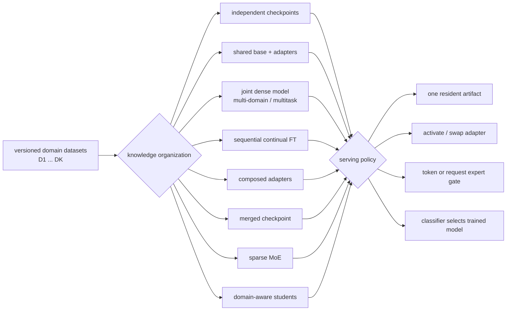
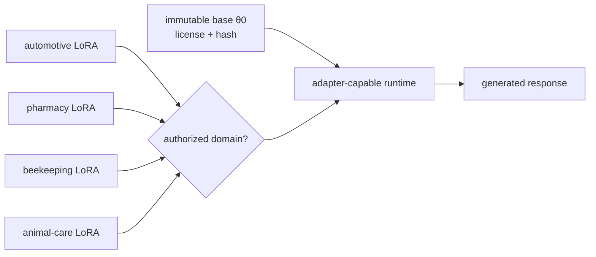
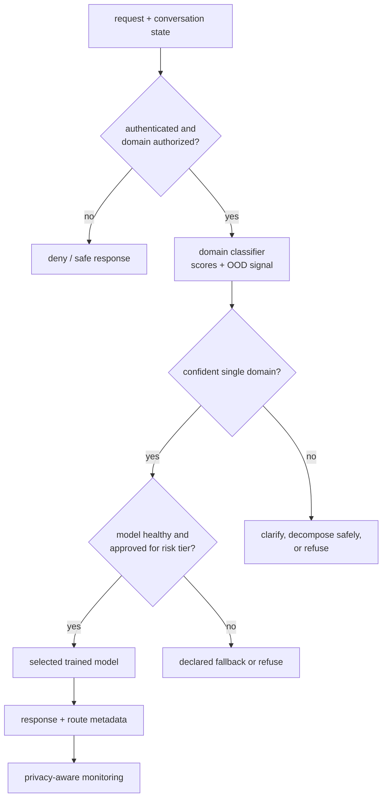

# CH-27: Single-Domain Versus Multi-Domain Strategies

## 27.0 Chapter contract, status, and evidence notation

A multi-domain product can separate knowledge by checkpoint, adapter, expert, student, or no artifact boundary at all.
It can also use one artifact while training and another at deployment. These are not interchangeable choices: the design
that minimizes stored bytes may increase interference, the design that isolates licenses may increase mobile switching
delay, and the design that improves average accuracy may conceal a safety regression in one domain.

**Research freeze:** 2026-11-23. **Status: AUTHORED / NOT EXECUTED.** No model was trained, merged, distilled, routed,
served on AWS, or run on a physical device for this chapter. All numerical capacity examples are `ILLUSTRATIVE` planning
calculations, not measured footprints. The experiment is `PLANNED EXPERIMENT`; cited findings are `PAPER-REPORTED`;
bibliographic metadata was `STATICALLY REVIEWED`, and local/live HTTP links were checked on 2026-11-24. Automated
checks received a 403 from one publisher page; that DOI still requires manual publication review. No strategy is
declared the winner.

Evidence labels follow the repository [standard](../../00-governance/evidence-and-citation-standard.md). In particular,
a paper's result does not establish that the result transfers to this project's models, domains, data, runtimes, or
hardware.

After this chapter, the reader should be able to:

1. distinguish training-time knowledge organization from inference-time routing;
2. explain all ten strategy mechanisms;
3. calculate first-order parameter storage and distinguish it from peak RAM;
4. identify forgetting, interference, routing, licensing, and safety risks;
5. design a controlled comparison on AWS and target edge devices; and
6. select a Pareto set under explicit constraints without inventing a winner.

This chapter obeys the [no-runtime-RAG standard](../../00-governance/no-runtime-rag-standard.md). Domain capability is
learned in weights, adapters, experts, or students. Routing selects an already-trained artifact; it does not retrieve
documents or call a teacher to answer the request.

## 27.1 The engineering problem: three decisions, not one

Suppose a product must support automotive repair, motorcycles, heavy trucks, pharmacy, beekeeping, zookeeping,
agricultural machinery, and electronics. The phrase “multi-domain model” hides three independent decisions:

- **representation:** where domain knowledge resides;
- **training:** whether domains are optimized separately, jointly, or in sequence; and
- **serving:** whether one resident artifact answers every request or a router selects among artifacts.

**FIG-CH27-01 — Training and serving choices are orthogonal (`ILLUSTRATIVE`).** Alt text: domain datasets enter
separate, joint, sequential, composed, merged, expert, or distilled training paths; deployment then uses one resident
artifact, adapter activation, expert gating, or model routing.

Strategies can therefore be combined. A request-level classifier may choose between pharmacy and mechanical model
families, while the mechanical family uses one base with three adapters. A distilled mobile student may be produced from
an AWS multi-task teacher. Treat the ten strategies as design primitives, not mutually exclusive product names.

### 27.1.1 Accuracy, forgetting, and interference

For domains $d\in\{1,\ldots,K\}$, let $Q_d(\theta)$ be a domain evaluation score where larger is better. A weighted
aggregate is

$$
Q_{\mathrm{macro}}=\sum_{d=1}^{K}w_dQ_d,\qquad w_d\ge 0,\quad \sum_dw_d=1.
$$

The weights must be declared. Equal-domain macro averaging prevents a large automotive test from silently dominating a
small pharmacy test, but safety cannot be compensated by an average.

For a sequentially trained model, forgetting on earlier domain $i$ after learning through domain $t$ can be reported
as

$$
F_{i,t}=\max_{s\in\{i,\ldots,t-1\}}Q_i(\theta_s)-Q_i(\theta_t).
$$

This measures loss relative to the best earlier checkpoint. It does not say why performance changed. **Interference** is
broader: gradients or representations useful for one domain harm another during joint or composed training. One
diagnostic is cosine similarity between per-domain gradients:

$$
\cos(g_i,g_j)=\frac{g_i^\top g_j}{\|g_i\|_2\|g_j\|_2}.
$$

A negative value identifies a local gradient conflict at the sampled batch; it does not prove that joint training will
reduce held-out quality. PCGrad projects conflicting task gradients in multi-task optimization [R9] (`PAPER-REPORTED`),
but its reported results do not establish a universal remedy for generative SLMs.

### 27.1.2 Storage is not mobile RAM

For $P$ stored parameters at $b$ bits, ideal weight storage is

$$
S_{\mathrm{weights}}=\frac{Pb}{8}.
$$

Peak inference memory is instead approximately

$$
M_{\mathrm{peak}} = M_{\mathrm{resident\ weights}}+M_{\mathrm{KV}}+M_{\mathrm{activations}}
+M_{\mathrm{runtime}}+M_{\mathrm{temporary}}+M_{\mathrm{loaded\ alternatives}}.
$$

File metadata, quantization scales, alignment, tokenizer assets, dequantized buffers, and allocator behavior make real
values differ. A checkpoint that fits in storage may not fit in RAM; two checkpoints stored on a phone need not be
resident simultaneously. Model-switch latency includes unloading, allocation, file mapping or reading, initialization,
warm-up, tokenizer/chat template changes, and lost caches. It must be measured, not inferred from file size.

## 27.2 Strategy 1 — independent specialist models

### Independent-model mechanism

Choose a base checkpoint $\theta_0$, make a distinct trainable copy for each domain, and optimize

$$
\theta_d^\_=\arg\min_{\theta_d} \mathbb{E}_{(x,y)\sim D_d}\mathcal{L}(y\mid x;\theta_d).
$$

Each released checkpoint has its own tokenizer/template compatibility record, training lineage, safety policy,
evaluation suite, and version. The models may share an ancestor but do not share trainable state after branching.

### Independent-model engineering assessment

- **Accuracy:** all adaptable capacity is dedicated to one domain, but more parameters do not guarantee better facts.
  Each domain still depends on data, optimization, and evaluation.
- **Forgetting/interference:** no cross-domain gradient interference after the branch. Within-domain fine-tuning can
  still forget general capabilities.
- **Storage/training/update:** storage grows approximately with $K P$. Full fine-tuning is repeated; a domain update
  affects one artifact but requires its own train/evaluate/export/release cycle.
- **Device/RAM/switching:** one model can be resident at a time under a tight RAM budget. Switching whole models is
  generally a larger operation than changing a small adapter, but actual latency is runtime- and device-specific.
- **Cloud management:** separate endpoints or a multi-model serving layer increase images, health checks, autoscaling
  policies, and cold-start cases. They also permit domain-specific scaling and rollback.
- **Isolation/licensing/access:** a direct per-domain artifact boundary. Separate encryption keys, accounts, regions,
  and entitlements are possible. A shared ancestor's license still applies to every derivative.
- **Safety:** a pharmacy release can use stricter gates and refusal behavior without directly changing mechanics.
  Isolation does not make either model safe and routing mistakes can still expose the wrong model.

**Use when:** hard legal or tenant isolation, different base licenses, sharply different safety policies, incompatible
tokenizers/architectures, or measured specialization gains justify duplication. **Do not assume:** independence
automatically produces the highest accuracy.

## 27.3 Strategy 2 — common base with independent LoRA adapters

### LoRA-adapter mechanism

Freeze a common base matrix $W_0$ and train a low-rank update per domain:

$$
W_d = W_0+s_dB_dA_d,
$$

where $A_d\in\mathbb{R}^{r\times k}$, $B_d\in\mathbb{R}^{m\times r}$, rank $r\ll\min(k,m)$, and $s_d$ is a
scaling factor. LoRA was introduced by Hu et al. [R1] (`PAPER-REPORTED`). At inference, the runtime applies one adapter
dynamically or uses an offline merged domain checkpoint.

 **FIG-21 — Multi-domain models and adapters (`ILLUSTRATIVE`).** Alt text: one immutable base
branches to small automotive, pharmacy, beekeeping, and animal care adapters; an entitlement-aware selector activates
one adapter. The surrounding strategy comparison also covers independent and unified models and routing. Not measured;
arrows show conceptual relationships only.

### LoRA-adapter engineering assessment

- **Accuracy:** often a strong baseline when the shared base already has relevant capacity, but rank, target modules,
  data, and domain distance matter. LoRA paper results are not guarantees for these domains.
- **Forgetting/interference:** independent adapters do not overwrite the frozen base or one another. Each adapter can
  still narrow behavior relative to the base; simultaneously activated adapters may interfere.
- **Storage/training/update:** one base plus small deltas; training optimizer state is needed only for adapter
  parameters. A domain update replaces one adapter, provided the exact base and target-module contract remain fixed.
- **Device/RAM/switching:** attractive when the runtime supports the exact architecture, quantization, and adapter
  operations. A small adapter does not guarantee negligible overhead: dynamic kernels, copies, and base/adaptor
  precision conversions matter. Offline merging duplicates full artifacts.
- **Cloud management:** fewer base artifacts, but adapter registries, compatibility matrices, cache policies, and tenant
  entitlements remain.
- **Isolation/licensing/access:** adapters are separable artifacts, yet they cannot generally operate without the base.
  Base and adapter licenses must both permit the intended use and distribution. Loading an unauthorized adapter is an
  access-control failure.
- **Safety:** domain-specific safety adapters can be versioned independently, but safety behavior may depend on the
  base. Evaluate base-plus-adapter as the released unit.

**Use when:** domains can share one legally and technically compatible base, small updates are valuable, and the target
runtimes have measured adapter support. **Do not assume:** adapter bytes equal total deployed bytes or that every mobile
backend supports dynamic LoRA.

## 27.4 Strategy 3 — one multi-domain dense model

### Joint-model mechanism

Train one parameter set on a mixture

$$
D_{\mathrm{mix}}=\sum_{d=1}^{K}\pi_dD_d,\qquad \mathcal{L}_{\mathrm{mix}}(\theta)= \sum_{d=1}^{K}\lambda_d\, <!-- markdownlint-disable-line MD013 MD049 -->
\mathbb{E}_{D_d}\mathcal{L}_d(\theta),
$$

where $\pi_d$ is the sampling share and $\lambda_d$ the loss weight. They need not be equal. Domain tags may be
supplied, but one dense set of weights answers every domain.

### Joint-model engineering assessment

- **Accuracy:** cross-domain transfer is possible when concepts overlap; capacity competition and negative transfer are
  possible when they do not. Aggregate quality can hide a weak domain.
- **Forgetting/interference:** simultaneous mixing avoids the simplest sequential overwrite, not interference. Batch
  composition, weighting, and gradient conflict require measurement.
- **Storage/training/update:** one artifact is storage-efficient. Joint runs process all selected domains; a
  single-domain update can change every domain and therefore triggers broad regression testing.
- **Device/RAM/switching:** one load, tokenizer, and cache; no model switch. The model may need more capacity than a
  specialist to meet all targets, so one file is not necessarily the smallest acceptable file.
- **Cloud management:** operationally simple endpoint topology, but release coupling and heterogeneous traffic make
  validation and rollback broader.
- **Isolation/licensing/access:** knowledge is entangled in one artifact. If one licensed corpus cannot serve a tenant,
  suppressing a domain name in the UI does not remove that corpus's influence from shared weights.
- **Safety:** policies can be conditioned by domain, but behavioral boundaries are probabilistic. Every release needs
  cross-domain safety and confusion tests.

**Use when:** one resident artifact and zero switch delay are hard constraints, licenses permit joint training, and
controlled experiments show acceptable per-domain quality. **Do not assume:** one model is cheaper after accounting for
joint retraining and full regression.

## 27.5 Strategy 4 — continually fine-tuned model

### Continual-training mechanism

Start with $\theta_0$, then update sequentially:

$$
\theta_t=\operatorname{Train}(\theta_{t-1},D_t\cup R_t; \mathcal{L}_t+\beta\Omega_t).
$$

$R_t$ is optional replay from prior domains and $\Omega_t$ is an optional retention regularizer. Replay,
regularization such as Elastic Weight Consolidation (EWC) [R4], parameter isolation, and rehearsal through generated
examples are continual-learning families. EWC's reported classification results do not establish effectiveness for this
SLM setting.

### Continual-training engineering assessment

- **Accuracy:** the newest domain receives direct optimization. Older-domain quality can decline; positive backward
  transfer is possible but must be measured.
- **Forgetting/interference:** catastrophic forgetting is the central risk identified by the continual-learning
  formulation [R18]. Replay can mitigate it but increases data governance and compute. Generated replay can reproduce
  errors.
- **Storage/training/update:** only the latest serving artifact is required, but reproducible rollback requires previous
  checkpoints, manifests, and evaluation history. Each update should replay and evaluate prior domains.
- **Device/RAM/switching:** one artifact and no switch at inference. Artifact size need not grow, although model
  capacity remains fixed.
- **Cloud management:** simple serving topology; difficult lineage and release qualification because behavior is
  order-dependent.
- **Isolation/licensing/access:** incompatible with strict domain removal if data influence is entangled. Deleting
  source records does not prove that their influence was removed from weights.
- **Safety:** a benign new domain can regress pharmacy refusal or repair hazard ordering. Safety suites from every
  retained domain are mandatory.

**Use when:** updates truly arrive sequentially, one artifact is required, and replay plus all-domain regression are
affordable. **Do not use as a shortcut** for “keep fine-tuning the same checkpoint” without retention measurement.

## 27.6 Strategy 5 — adapter composition

### Adapter-composition mechanism

Composition uses two or more trained adapters in one forward path. Common forms include:

- **stacking:** $h'=f_{a_2}(f_{a_1}(h))$;
- **parallel weighted sum:** $h'=h+\sum_j\alpha_j\Delta h_j$;
- **learned fusion:** attention or gates learn $\alpha_j(x,\ell)$ by input $x$ and layer $\ell$; and
- **task/domain plus safety adapter:** a domain delta is combined with a separately trained behavioral delta.

AdapterFusion learns to combine frozen task adapters [R2] (`PAPER-REPORTED`). Its NLU results neither guarantee
generative quality nor safe arbitrary LoRA composition.

### Adapter-composition engineering assessment

- **Accuracy:** composition may reuse complementary skills, but adapter order, scale, layer targets, and incompatible
  deltas can reduce quality.
- **Forgetting/interference:** original adapters remain unchanged; composition introduces inference-time interference
  and a new configuration to test.
- **Storage/training/update:** storage remains base plus adapters and possibly fusion parameters. Updating one adapter
  can invalidate previously approved compositions even if its individual tests pass.
- **Device/RAM/switching:** multiple active adapters and fusion operators add resident state and kernels. Backend
  support is narrower than plain merged checkpoints and must be verified on the target.
- **Cloud management:** composition manifests are first-class artifacts: ordered adapter hashes, scales, fusion weights,
  base hash, and policy.
- **Isolation/licensing/access:** access must authorize every component. A composed output may be a derivative use under
  all applicable licenses.
- **Safety:** a safety adapter is not an independent shield; domain deltas can counteract it. Test the exact composition
  and adversarial domain crossings.

**Use when:** skills are demonstrably compositional and the runtime supports the operation. **Do not infer:**
independently good adapters compose well.

## 27.7 Strategy 6 — model merging

### Model-merging mechanism

Model merging creates a new checkpoint without ordinary joint retraining. Simple interpolation is

$$
\theta_{\mathrm{merge}}=\sum_{j=1}^{J}\alpha_j\theta_j,\qquad \sum_j\alpha_j=1.
$$

When all models descend from the same base $\theta_0$, task vectors $\tau_j=\theta_j-\theta_0$ can be combined:

$$
\theta_{\mathrm{merge}}=\theta_0+\sum_j\alpha_j\tau_j.
$$

Model soups average fine-tuned models in a common basin [R5]; task arithmetic studies vector operations on fine-tuned
models [R6]; TIES-Merging trims small changes, resolves sign conflicts, and merges aligned updates [R7]
(`PAPER-REPORTED`). Fisher-weighted averaging is another studied merge construction [R8]. These findings are
conditional, not permission to merge unrelated architectures, tokenizers, parameter orderings, or licenses.

### Model-merging engineering assessment

- **Accuracy:** merging can combine useful changes or destructively cancel them. Coefficient selection on a validation
  set can overfit.
- **Forgetting/interference:** no sequential overwrite during construction, but parameter conflict is the
  mechanism-level risk. Sign agreement is only a proxy for functional compatibility.
- **Storage/training/update:** one final checkpoint; candidate checkpoints and search evaluations still consume
  development storage/compute. Any source update requires re-merging and complete requalification.
- **Device/RAM/switching:** a dense merged checkpoint is easy for runtimes that support the base architecture; one load
  and no adapter kernel. Its size is normally the base architecture's size, not the sum of source files.
- **Cloud management:** simple serving artifact, complex provenance. The merge recipe, source hashes, coefficients,
  evaluation set, and tool revision are release-critical.
- **Isolation/licensing/access:** poor post-merge separability. All source checkpoint and dataset terms must be
  compatible; a prohibited component cannot be disabled per request.
- **Safety:** merging can alter refusals and calibration without obvious domain-score loss. Safety tests cannot be
  replaced by weight-distance checks.

**Use when:** checkpoints have a verified compatible ancestry and a cheap, auditable candidate search is valuable. **Do
not assume:** “no training” means no compute, no data, or no regression risk.

## 27.8 Strategy 7 — multi-task instruction tuning

### Multi-task mechanism

Multi-task instruction tuning trains one model on explicit task instructions, inputs, and outputs from many tasks and
domains. A record may include a domain tag, task definition, demonstrations, and response schema. FLAN [R10] and T0
[R11] report improved zero-shot generalization in their evaluated settings (`PAPER-REPORTED`).

This strategy differs from generic multi-domain training by making **task semantics and response contracts** explicit.
It can still be implemented as a dense joint model and therefore shares many of Strategy 3's risks. Ruder surveys
shared-parameter multi-task designs and their trade-offs [R19].

### Multi-task engineering assessment

- **Accuracy:** shared instruction-following behavior and transfer can help; conflicting formats, labels, and answer
  styles can interfere. Task count is not evidence of task quality.
- **Forgetting/interference:** simultaneous mixture reduces order effects but not gradient conflict. Sampling
  temperature, per-task caps, and loss weighting determine which tasks dominate.
- **Storage/training/update:** one model; curation and balancing costs can be substantial. Adding a task normally
  requires joint tuning and broad tests.
- **Device/RAM/switching:** one resident model and no switching. Domain/task prefixes consume context tokens but
  generally not additional model files.
- **Cloud management:** one endpoint, plus prompt-contract versioning and task-specific monitoring.
- **Isolation/licensing/access:** task prefixes are not security boundaries. Joint weights cannot reliably enforce
  corpus- or tenant-level entitlement.
- **Safety:** explicit instructions can train abstention, escalation, and structured outputs. They remain learned
  behavior, vulnerable to conflicting tasks and adversarial inputs.

**Use when:** task transfer and one-artifact deployment are priorities and rights allow pooled training. **Do not
confuse:** instruction tuning with complete acquisition or exact recall of domain knowledge.

## 27.9 Strategy 8 — mixture of experts

### MoE mechanism

A Mixture-of-Experts (MoE) layer contains experts $E_j$ and a learned router. For token representation $h$,

$$
p=\operatorname{softmax}(W_gh),\qquad y=\sum_{j\in\operatorname{TopK}(p)}p_jE_j(h).
$$

Only selected experts execute per token, while all expert weights normally remain stored and available. A load-balancing
objective discourages collapse onto a few experts. Sparsely-Gated MoE [R12], GShard [R13], and Switch Transformer [R14]
establish important sparse-computation mechanisms (`PAPER-REPORTED`).

Experts need not align one-to-one with human domains. Emergent routing may specialize by syntax, token type, or layer
role rather than “pharmacy expert.”

### MoE engineering assessment

- **Accuracy:** increases total parameter capacity at limited active compute in suitable systems; router errors, expert
  undertraining, and capacity overflow can hurt rare domains.
- **Forgetting/interference:** experts can reduce shared-parameter contention, but the router, embeddings, attention,
  and any shared experts still couple domains. New-domain training can alter routes for old domains.
- **Storage/training/update:** total stored parameters can be much larger than active parameters. Training requires
  routing, load balancing, and often distributed communication. Updating one expert may still require router and global
  regression tests.
- **Device/RAM/switching:** a critical distinction: sparse FLOPs do not imply sparse RAM. If all experts must be
  resident, MoE is often unattractive for mobile. Expert paging can introduce unpredictable latency and backend
  complexity; measure it.
- **Cloud management:** well suited to specialized distributed serving only when the serving stack supports the
  architecture and expert parallelism. Monitor route share, overflow, imbalance, and tail latency.
- **Isolation/licensing/access:** token-level learned routing is not a hard access-control boundary. Do not place
  mutually unauthorized knowledge in experts and rely on the gate to hide it.
- **Safety:** safety behavior distributed across experts and router is harder to audit. Rare or adversarial prompts can
  activate poorly evaluated paths.

**Use when:** measured quality or capacity benefits justify sparse-serving complexity on supported cloud hardware.
**Treat mobile MoE as an experiment** until the complete model fits and sustained device results exist.

## 27.10 Strategy 9 — classifier/router among trained models

### Request-router mechanism

A request-level router predicts a domain or set of candidate models:

$$
\hat d=\arg\max_d p_\phi(d\mid x,c,u),
$$

where $x$ is the request, $c$ conversation state, and $u$ authorized domains. A policy then selects model
$M_{\hat d}$, asks for clarification, uses a permitted general fallback, or refuses. Unlike MoE, this gate usually
runs once per request or turn and selects whole already-trained models.

**FIG-CH27-03 — Entitlement- and uncertainty-aware request routing (`ILLUSTRATIVE`).** Alt text: an input passes
authentication and authorization, then a calibrated domain classifier; low confidence or mixed-domain requests clarify
or refuse, while accepted requests reach an approved trained model; logs feed monitoring, not runtime retrieval.

### Request-router engineering assessment

- **Accuracy:** preserves each specialist's potential quality if routed correctly. End-to-end quality is bounded by both
  routing and expert quality.
- **Forgetting/interference:** trained models are isolated; router updates can create apparent regressions without
  changing them.
- **Storage/training/update:** total artifacts may be large. The classifier is comparatively small, but labeled routing
  data, out-of-distribution (OOD) data, calibration, and policy tests are additional work.
- **Device/RAM/switching:** storing several models is possible while loading one at a time, but whole-model switches can
  dominate latency and can discard KV caches. Keeping several resident raises RAM. A sticky conversation route reduces
  churn but can preserve an early mistake.
- **Cloud management:** multiple deployments, route-aware autoscaling, health state, fallbacks, and trace correlation.
  It enables per-domain scaling and rollback.
- **Isolation/licensing/access:** strong only if authorization is enforced before loading/invocation and artifacts/keys
  are separately protected. Classification alone is not authorization.
- **Safety:** low confidence, mixed domains, and unavailable safe specialists need explicit behavior. The most fluent
  fallback may be the least safe.

### 27.10.1 Routing failure modes

<!-- markdownlint-disable MD013 -->
| Failure                   | Example symptom                          | Consequence                               | Required control                                          |
| ------------------------- | ---------------------------------------- | ----------------------------------------- | --------------------------------------------------------- |
| ambiguous request         | “interaction problem”                    | pharmacy vs mechanical confusion          | clarify before specialist invocation                      |
| mixed-domain request      | truck transports a medicine              | one label drops a relevant hazard         | detect multi-label/mixed intent; safe decomposition       |
| OOD input                 | legal or medical request outside catalog | confident wrong specialist                | OOD test set, abstention, deny-by-default policy          |
| adversarial wording       | user hides prohibited domain             | access-policy bypass                      | authorization independent of content classifier           |
| domain-code switching     | terminology changes mid-dialogue         | route oscillation                         | conversation-aware scores plus explicit re-route rule     |
| sticky-route error        | first turn misclassified                 | all later turns use wrong model           | re-evaluate on material intent change                     |
| route thrashing           | alternating specialists each turn        | latency, cache loss, inconsistent answers | hysteresis and switch budget                              |
| class imbalance           | automotive dominates training            | rare pharmacy recall collapses            | macro metrics, rare-class sampling, calibrated thresholds |
| confidence miscalibration | 0.99 on wrong class                      | unsafe automatic dispatch                 | calibration and selective-risk curves                     |
| specialist unavailable    | endpoint unhealthy                       | unsafe general fallback                   | risk-tiered fail-closed policy                            |
| artifact mismatch         | route points to wrong version/template   | malformed or regressed output             | signed route manifest and compatibility checks            |
| telemetry blind spot      | only final answer logged                 | route defects look like model defects     | privacy-aware route/model/version metadata                |
<!-- markdownlint-restore -->

Report a confusion matrix, per-class precision/recall, top-$k$ recall, coverage-versus-selective-risk curve,
calibration error, OOD performance, mixed-domain behavior, end-to-end task quality, safety failures, and switch latency.
Router accuracy alone is insufficient: a 1% error rate concentrated in pharmacy emergencies can be unacceptable.

## 27.11 Strategy 10 — domain-aware student distillation

### Distillation mechanism

Train one or more smaller students from domain teachers. For student logits $z_s$, teacher logits $z_t$, temperature
$T$, and supervised target $y$, a common objective is

$$
\mathcal{L} = \alpha T^2\operatorname{KL}
\left(\operatorname{softmax}(z_t/T)\,\|\,\operatorname{softmax}(z_s/T)\right)
+(1-\alpha)\operatorname{CE}(y,\operatorname{softmax}(z_s)).
$$

Domain-aware variants can use teacher $T_d$, domain-conditioned losses, domain-balanced batches, intermediate-feature
matching, or separate students. Hinton et al. [R15], DistilBERT [R16], and MiniLM [R17] provide foundational
distillation mechanisms and reported results. They do not establish results for this project's decoder-only specialist
models.

### Distillation engineering assessment

- **Accuracy:** a smaller student may retain useful teacher behavior but is capacity-limited and inherits teacher
  errors. Distillation is not lossless compression and does not create verified facts.
- **Forgetting/interference:** a joint student can suffer domain competition; separate students isolate it. Balanced
  teacher targets and expert data are still required.
- **Storage/training/update:** deployed students can be smaller, but training requires teacher inference or stored
  logits/responses plus student training. A teacher update may require re-distillation.
- **Device/RAM/switching:** directly targets a smaller architecture and can produce dense, runtime-compatible artifacts.
  One joint student avoids switches; separate students preserve isolation but retain switching.
- **Cloud management:** teachers can remain in controlled training infrastructure while students serve edge or low-cost
  endpoints. Registry lineage must connect every student to teacher, data, and loss configuration.
- **Isolation/licensing/access:** teacher and synthetic-output terms must permit distillation and deployment. A joint
  student entangles domains; separate students are easier to license independently.
- **Safety:** teacher safety failures can be amplified or compressed away. Mix expert-grounded targets,
  refusal/escalation cases, and direct safety evaluation; never use teacher confidence as ground truth.

**Use when:** target hardware needs a materially smaller architecture and the full distillation lifecycle is legal and
affordable. **Do not assume:** a distilled 400M model equals a quantized 1.5B model merely because file sizes are
similar.

## 27.12 Complete comparison matrix

The following tables are engineering priors, not empirical rankings. “Potential” and “risk” mean “must be tested under
the project protocol.”

 **TBL-18 — Independent domain models versus adapter-based systems and alternatives (`ILLUSTRATIVE`;
engineering priors, not a measured ranking).**

<!-- markdownlint-disable MD013 -->
|   # | Strategy                      | Knowledge accuracy                     | Forgetting / interference                              | Storage                               | Training cost                                          | Update complexity                            | Isolation, licensing, access                            |
| --: | ----------------------------- | -------------------------------------- | ------------------------------------------------------ | ------------------------------------- | ------------------------------------------------------ | -------------------------------------------- | ------------------------------------------------------- |
|   1 | Independent models            | dedicated specialization potential     | no cross-model interference; within-model forgetting   | $K$ full artifacts                  | repeated adaptation, potentially full FT               | isolated release, repeated export/test       | direct per-domain boundary; repeated base terms         |
|   2 | Base + independent LoRA       | strong if base/rank fit                | adapters isolated; composition can conflict            | one base + $K$ deltas               | low trainable-parameter count; still needs data/eval   | easy per adapter; strict base compatibility  | separable deltas, shared-base dependency                |
|   3 | One multi-domain model        | transfer or capacity competition       | joint interference                                     | one full artifact                     | joint training and balancing                           | every update triggers all-domain tests       | weak domain removal/access boundary                     |
|   4 | Continual FT                  | newest-domain emphasis                 | explicit sequential-forgetting concern                 | latest artifact plus rollback history | incremental run plus replay/regression                 | order-dependent; old domains retested        | knowledge entangled; deletion difficult                 |
|   5 | Adapter composition           | complementary or conflicting           | components preserved; combined path interferes         | base + adapters + fusion              | adapters plus optional fusion training                 | composition matrix expands                   | all component rights/entitlements apply                 |
|   6 | Model merging                 | candidate-dependent                    | weight/task-vector conflict                            | one serving artifact; many dev inputs | little/no gradient training; evaluation search remains | re-merge and requalify                       | source influence inseparable after merge                |
|   7 | Multi-task instruction tuning | transfer with explicit task contracts  | task gradient and format conflict                      | one full artifact                     | joint curation/training                                | broad regression and prompt-contract updates | task tags are not access control                        |
|   8 | MoE                           | high total-capacity potential          | shared router/weights and expert imbalance             | often many expert weights             | high systems/training complexity                       | expert and router coupling                   | learned gate is not a hard boundary                     |
|   9 | Router among models           | specialist quality times route quality | models isolated; router can regress                    | router + $K$ artifacts              | specialist training plus router data                   | independent models plus routing manifest     | strong if authorization precedes routing                |
|  10 | Domain-aware distillation     | capacity- and teacher-dependent        | joint student can interfere; separate students isolate | one/some smaller students             | teacher generation/logits + student training           | teacher change can require redistillation    | depends on joint vs separate students and teacher terms |
<!-- markdownlint-restore -->

**TBL-CH27-02 — Deployment, operations, and safety comparison (`ILLUSTRATIVE`).**

<!-- markdownlint-disable MD013 -->
|   # | Strategy                      | Device compatibility                                    | Mobile RAM                                         | Model-switch latency                            | AWS/cloud management                              | Safety characteristic                            |
| --: | ----------------------------- | ------------------------------------------------------- | -------------------------------------------------- | ----------------------------------------------- | ------------------------------------------------- | ------------------------------------------------ |
|   1 | Independent models            | ordinary dense runtime per model                        | one model if loaded serially; multiple if resident | whole-model load/warm-up                        | many endpoints or multi-model server              | policy isolation; routing remains hazardous      |
|   2 | Base + LoRA                   | requires exact adapter/runtime support or offline merge | base + active adapter + runtime                    | usually adapter activation, unless merged files | shared base cache plus adapter registry           | evaluate exact base-adapter pair                 |
|   3 | One multi-domain model        | ordinary dense runtime                                  | one model                                          | none by domain                                  | one endpoint; coupled release                     | cross-domain confusion and policy leakage        |
|   4 | Continual FT                  | ordinary dense runtime                                  | one model                                          | none                                            | one endpoint; complex lineage                     | old safety behavior can regress                  |
|   5 | Adapter composition           | backend-dependent composition support                   | base + all active adapters/fusion                  | activation/configuration cost                   | composition registry and combinatorial tests      | safety adapter can be counteracted               |
|   6 | Model merging                 | ordinary dense runtime after merge                      | one model                                          | none                                            | simple serving, complex provenance                | refusals/calibration can shift                   |
|   7 | Multi-task instruction tuning | ordinary dense runtime                                  | one model                                          | none                                            | one endpoint plus task monitoring                 | explicit safety tasks, probabilistic enforcement |
|   8 | MoE                           | architecture and sparse-kernel dependent                | often all experts resident                         | token routing; paging if used                   | expert parallelism, balancing, tail monitoring    | rare routes poorly covered                       |
|   9 | Router among models           | each model/runtime must be supported                    | one or many resident models                        | potentially high whole-model switch             | routing, health, scaling, fallback                | route errors are safety errors                   |
|  10 | Domain-aware distillation     | dense student can target common runtimes                | lower only if student is measured smaller          | none for joint; whole-student for separate      | teacher/student lineage; cheaper serving possible | teacher errors and capacity loss                 |
<!-- markdownlint-restore -->

No row dominates every column. Independent models offer a clean boundary but duplicate artifacts. A joint dense model
offers one load but weak isolation. Adapters save stored parameters but depend on runtime support. MoE saves active
compute in suitable implementations, not necessarily storage or RAM. Distillation changes architecture size but adds an
offline training lifecycle.

## 27.13 Worked capacity examples

Every value below is `ILLUSTRATIVE`. It excludes tokenizer files, metadata, quantization scales, KV cache, activations,
runtime buffers, alignment, and temporary allocations. It predicts neither speed nor deployability.

### 27.13.1 Eight domains around a 1.5B-parameter base

Assume $K=8$, $P=1.5\times10^9$, and ideal 4-bit weight storage:

$$
S_{\mathrm{base}}=1.5\times10^9\times4/8=0.75\text{ GB}.
$$

<!-- markdownlint-disable MD013 -->
| Design                      |                          Ideal stored weight payload | What must be resident for one request             |
| --------------------------- | ---------------------------------------------------: | ------------------------------------------------- |
| 8 independent 1.5B models   |                                  $8(0.75)=6.00$ GB | typically one 0.75 GB payload plus runtime memory |
| 1 multi-domain 1.5B model   |                                              0.75 GB | one 0.75 GB payload plus runtime memory           |
| latest continual 1.5B model |               0.75 GB serving; rollback copies extra | one 0.75 GB payload plus runtime memory           |
| 1 merged 1.5B model         | 0.75 GB serving; source candidates extra in registry | one 0.75 GB payload plus runtime memory           |
| 8 separate 0.4B students    |                $8(0.4\times10^9\times4/8)=1.60$ GB | typically one 0.20 GB payload plus runtime memory |
<!-- markdownlint-restore -->

The table does not establish quality equivalence. A 0.4B student and a 1.5B quantized model have different architecture,
capacity, kernels, KV-cache geometry, and training history.

### 27.13.2 LoRA parameter calculation

Assume 24 layers, hidden width 2,048, rank $r=16$, and LoRA on square query and value projections only. Each adapted
matrix has

$$
r(k+m)=16(2048+2048)=65{,}536
$$

trainable parameters. Two matrices across 24 layers give

$$
P_{\mathrm{LoRA}}=2\times24\times65{,}536=3{,}145{,}728.
$$

At FP16, the ideal adapter payload is $3{,}145{,}728\times2=6{,}291{,}456$ bytes, about 6.0 MiB. Eight adapters are
about 48 MiB, plus the shared base. Targeting key/output/MLP projections, adding biases, using another rank, or storing
optimizer/checkpoint metadata changes this value.

### 27.13.3 KV cache can dominate the strategy delta

For a simplified decoder cache with $L$ layers, sequence length $n$, $h_{\mathrm{kv}}$ key/value heads, head
dimension $d_h$, and $b_{\mathrm{kv}}$ bytes per element:

$$
M_{\mathrm{KV}}=2Lnh_{\mathrm{kv}}d_hb_{\mathrm{kv}}.
$$

With $L=24$, $n=4096$, $h_{\mathrm{kv}}=8$, $d_h=128$, and FP16 ($b_{\mathrm{kv}}=2$), the ideal
single-sequence cache is 402,653,184 bytes, or 384 MiB. Thus a 6 MiB adapter difference may be minor beside context
memory. Exact cache layout, batching, padding, quantization, and runtime allocation must be measured.

## 27.14 Edge and mobile implications

### 27.14.1 Storage, residency, and switching

An edge decision must separately record:

1. installed artifact bytes;
2. download/update bytes;
3. memory after load;
4. peak prefill and decode memory;
5. cold and warm startup;
6. same-domain and cross-domain time to first token;
7. sustained decode rate, energy, and thermal behavior; and
8. out-of-memory/crash rate under OS pressure.

For a low-RAM phone, a joint dense student may be viable where eight specialists are not. For an offline field tablet
with ample storage but tight RAM, multiple files loaded serially may provide isolation. A base-plus-adapter design is
attractive only if the selected runtime can apply adapters without material conversion, memory duplication, or
unsupported kernels. MoE active parameter counts must never be used as RAM estimates.

Mobile routing needs an offline classifier, signed route manifest, safe fallback, and no assumption of cloud
availability. If a model must be downloaded after routing, report network latency separately; the primary offline target
should define which domains are usable without connectivity. Encrypting files at rest does not prevent extraction from a
compromised client while weights are usable in memory.

### 27.14.2 Practical edge shortlist gates

- If only one artifact can be installed: test joint multi-domain, multi-task, merged, continual, or joint distilled
  candidates.
- If one base fits and dynamic adapters are supported: test independent LoRA against the best single-artifact candidate.
- If domains require hard entitlement on an untrusted client: do not claim that model packaging alone provides a hard
  boundary; reconsider which artifacts are delivered.
- If whole-model cold switching violates latency: keep the likely model resident, pre-load under a measured memory
  budget, use adapters, or use one artifact.
- If the device cannot hold all MoE experts: expert paging is a separate experiment, not an assumed optimization.

## 27.15 AWS and cloud implications

Cloud infrastructure changes constraints but not the evidence burden.

### Independent models or request routing

Use separate model versions/endpoints when isolation, scaling, or rollback is valuable. A routing service should
authenticate, authorize, classify, check model health, invoke, and record route/model/version metadata. Domain-specific
traffic can scale independently. Costs include idle replicas, duplicated weights, cold loads, router operations, and
observability. No dollar figure is given because instance, region, runtime, and pricing were not verified here.

### Shared base and adapters

A worker can cache one base and activate tenant/domain adapters, subject to runtime support. Guard against adapter/base
hash mismatch, cross-tenant cache leakage, unauthorized adapter enumeration, and unbounded adapter cache growth.
Blue/green release must version the pair, not only the adapter.

### One dense model, merged model, or joint student

These simplify endpoint topology and batching across domains. They couple releases, access, scaling, and rollback.
Per-domain metrics and safety strata remain mandatory even when all requests share a fleet.

### MoE

MoE may exploit cloud accelerators and distributed expert placement, but communication, expert imbalance, capacity
limits, and tail latency become first-class metrics. Confirm that the exact serving runtime supports the exact
architecture and quantization. “Sparse model” is not a deployment plan.

### Governance controls common to all

Maintain immutable model, adapter, merge, router, tokenizer, dataset, license, and evaluation manifests; least-privilege
artifact access; encryption and signature verification; per-domain release gates; rollback; route-aware monitoring; and
privacy-limited logs. AWS service choice is deferred to
[CH-33](../part-09-aws-training-optimization-and-deployment/ch-33-aws-infrastructure-for-slm-development.md) and serving
to [CH-35](../part-09-aws-training-optimization-and-deployment/ch-35-aws-inference-serving.md).

## 27.16 Licensing, access control, removal, and provenance

Licensing is an architecture constraint, not a final checklist. For every candidate record:

- base checkpoint license and acceptable-use terms;
- each fine-tuned/merged teacher checkpoint's terms;
- dataset rights, jurisdiction, and attribution;
- whether trained weights, adapters, synthetic outputs, and students may be created and redistributed;
- commercial, field-of-use, geography, and user restrictions;
- required notices and source offers; and
- termination, deletion, and model-removal obligations.

Do not infer legal compatibility from technical compatibility. A merge of same-shaped tensors can still be prohibited. A
joint model cannot reliably prove that one domain's influence is disabled for an unauthorized user. Router labels and
prompt tags are not access control. Enforce authorization before artifact access or invocation.

Removal difficulty generally rises as knowledge becomes entangled: deleting an independent adapter or checkpoint is
operationally clearer than removing one domain from a joint model, continual checkpoint, merged checkpoint, MoE, or
joint student. This is not a proof of machine unlearning. Preserve record-to-dataset-to-training-run-to-artifact lineage
and obtain legal review for the intended deployment.

## 27.17 Safety architecture

Training knowledge into parameters means exact recall, freshness, and faithfulness are not guaranteed. Without runtime
retrieval, every strategy can hallucinate, retain stale facts, confuse model years/species/formulations, or produce
unsupported certainty.

Safety requirements are non-compensatory:

- **pharmacy:** no autonomous prescribing or patient-specific clearance; recognize contraindication/interaction risk,
  missing context, uncertainty, and professional/emergency escalation;
- **repair:** preserve hazard ordering, energy isolation, model applicability, competence limits, and refusal to bypass
  safety systems;
- **animal care:** preserve species/life-stage context, welfare, biosecurity, and veterinary escalation;
- **routing:** wrong-domain and low-confidence routes are safety events;
- **updates:** pass every retained domain's locked safety suite; and
- **release:** require qualified domain review, incident response, monitoring, and rollback under the repository
  [safety standard](../../00-governance/safety-and-risk-standard.md).

Average quality cannot compensate for a critical-dose hallucination or an unsafe high-voltage sequence. Use per-domain
hard gates before Pareto ranking. Isolation reduces blast radius; it does not establish correctness.

## 27.18 Worked example: choose an initial automotive–pharmacy architecture

Consider a product with two offline domains:

- automotive education and bounded diagnostic sequencing, updated quarterly;
- pharmacy label education, updated monthly, with stricter review and no autonomous prescribing.

The target tablet can keep one 1.5B INT4 base resident. It can store several adapters, but a prototype confirms that the
chosen runtime cannot activate LoRA dynamically. The pharmacy corpus license permits a separately distributed
derivative but not an inseparable joint artifact delivered to every automotive-only customer.

### Step 1 — eliminate technically or legally infeasible options

A single joint model and a merged checkpoint fail the license/isolation requirement because pharmacy influence would be
entangled in every copy. Dynamic adapters fail the current runtime gate. A mobile MoE fails the storage/residency gate.
Continual fine-tuning also entangles domains and makes monthly pharmacy updates a regression risk for automotive.

This is why strategy selection begins with vetoes, not an average score.

### Step 2 — retain feasible candidates

Two candidates remain:

1. **independent quantized specialists**, loading one at a time; and
2. **separate distilled students**, also loaded one at a time, if they meet the quality floor.

A cloud variant may use a request router over the same independent specialists, but the router is not required for a
user who explicitly opens an authorized domain package.

### Step 3 — calculate planning storage without confusing it with RAM

For two 1.5B models at ideal 4-bit weight payload:

$$

2\times1.5\times10^9\times4/8=1.5\text{ GB}.

$$

Only one 0.75 GB payload need be resident at a time, but peak RAM must add KV cache, activations, runtime buffers, and
temporary allocations. If two 0.4B students are feasible, ideal stored weight payload becomes:

$$

2\times0.4\times10^9\times4/8=0.4\text{ GB}.

$$

This does not establish equivalent quality. It defines what the device experiment must compare.

### Step 4 — define the end-to-end measurements

For each domain and candidate, measure domain score, unsupported claims, critical safety failures, peak RAM, cold load,
TTFT, sustained decode, energy, and update effort. For the two-specialist design, also measure:

$$

T_{\mathrm{switch}}=T_{\mathrm{unload}}+T_{\mathrm{map/load}}+
T_{\mathrm{initialize}}+T_{\mathrm{warmup}}.

$$

Each term is observed separately. File size alone cannot predict it.

For any routed cloud deployment, estimate end-to-end correctness rather than router accuracy:

$$

P(\text{correct})=\sum_d P(\hat d=d\mid d)\,
P(\text{specialist correct}\mid \hat d=d,d),

$$

with explicit terms for abstention and wrong-domain safety failures. If the pharmacy router recall is 99% overall but
misses emergency-language cases, the system fails its safety gate.

### Step 5 — make a conditional decision

Suppose no results exist yet. The defensible conclusion is:

> Prototype independent specialists first because they satisfy the current rights and runtime constraints. Prototype
> separate distilled students as the edge-size challenger. Do not select between them until quality, safety, RAM, and
> switching are measured.

**Anti-example:** “Use one multi-domain model because it stores fewer bytes.” This ignores the pharmacy distribution
restriction, coupled updates, per-domain safety regression, and the possibility that a joint model needs more capacity
to meet both quality floors.

If a later runtime gains verified dynamic-adapter support and rights permit a shared base, base-plus-independent
adapters become a new candidate; architecture is revisited through evidence, not treated as a permanent doctrine.

## 27.19 A controlled experiment comparing all ten strategies

Everything in this section is a `PLANNED EXPERIMENT`.

### 27.19.1 Research questions

1. Under a fixed base family and accepted-token budget, do independent specialists outperform shared alternatives per
   domain?
2. Which strategy gives the best feasible quality–RAM–latency–maintenance frontier for the target devices?
3. How much sequential forgetting and joint interference occurs?
4. How much end-to-end loss comes from request routing?
5. Which designs satisfy licensing, isolation, and safety gates?

### 27.19.2 Fixed inputs and controls

Freeze:

- exact base/model/tokenizer revisions and licenses;
- eight domain dataset snapshots with source-group-isolated train, validation, and untouched test splits;
- accepted training tokens per domain, with a second compute-budget-matched analysis;
- shared instruction format where technically valid;
- optimizer-search budget, stopping rule, seeds, and checkpoint selection;
- decoding, prompt, context/output lengths, and evaluation harness;
- AWS hardware/runtime/container and each physical device/OS/runtime;
- expert rubrics, raters, adjudication, and safety thresholds; and
- quantization/export method within each deployment tier.

Equal tokens do not equal equal compute; equal compute does not equal equal trainable capacity. Report both controlled
views instead of calling either perfectly fair.

### 27.19.3 Candidate matrix

| ID  | Strategy implementation                                                     |
| --- | --------------------------------------------------------------------------- |
| B0  | untouched base; calibration reference, not one of the ten                   |
| S1  | eight independently fine-tuned specialists                                  |
| S2  | one frozen base plus eight independently trained LoRA adapters              |
| S3  | one jointly trained dense multi-domain model                                |
| S4  | one sequential model, with preregistered replay/regularization variants     |
| S5  | preregistered adapter stacks/fusion compositions                            |
| S6  | same-ancestry task-vector/validated merge candidates                        |
| S7  | joint multi-task instruction tuning with explicit task contracts            |
| S8  | one declared MoE architecture and router/load-balance configuration         |
| S9  | calibrated request router over S1 models; oracle-route upper bound included |
| S10 | joint and, budget permitting, separate domain-aware students                |

S3 and S7 may share an architecture but differ in record/task formulation. S5 and S6 must use source artifacts from
compatible controlled runs. S8 may require a different architecture; label architectural confounding rather than hiding
it.

### 27.19.4 Measurements

**Quality:** domain factual accuracy, exact/structured correctness, diagnostic next-action quality, unsupported-claim
rate, calibration, abstention, multi-turn consistency, general-retention score, and expert ratings with confidence
intervals.

**Forgetting/interference:** $F_{i,t}$, per-domain learning curves, joint versus independent deltas,
gradient-conflict diagnostics on a fixed probe set, and domain confusion tests.

**Resources:** stored bytes for serving and rollback, trainable/total/active parameters, accelerator-hours, peak
training memory, training energy where instrumented, export time, peak device RAM, startup, same/cross-domain time to
first token, prefill/decode throughput, energy/token where supported, thermal sustained performance, and failures.

**Operations:** number of release artifacts, deployment units, compatibility edges, update steps, rollback duration,
route switches, and observed engineer and reviewer time. Do not replace observed labor with an invented dollar price.

**Isolation/licensing/safety:** legal-review decision, entitlement penetration tests, artifact access tests,
domain-removal procedure, per-domain critical safety failures, refusal/escalation correctness, route safety failures,
and incident rollback drill.

### 27.19.5 Routing ablations

For S9 compare:

1. oracle domain labels (upper bound on specialist system);
2. predicted route;
3. predicted route with confidence abstention;
4. conversation-sticky routing;
5. turn-level routing with hysteresis; and
6. entitlement-aware policy with unavailable-model simulations.

The difference between oracle and predicted end-to-end scores estimates the routing penalty under the test distribution.
Also report coverage lost to abstention. Include ambiguous, mixed-domain, typo/noise, OOD, adversarial, mid-dialogue
domain-shift, and rare safety cases.

### 27.19.6 Statistical and release plan

Use at least three training seeds where affordable; otherwise label single-seed uncertainty. Apply paired bootstrap or
an appropriate paired test to item-level differences, report effect sizes and intervals, and correct or qualify multiple
comparisons. Analyze every domain and risk stratum. Select hyperparameters on validation only and reveal the untouched
test once.

First reject candidates that fail license, device, access, or critical safety gates. Among feasible candidates, report a
Pareto frontier over quality, peak RAM, latency, training/update burden, and cloud cost. Do not collapse these into one
score unless stakeholder weights and uncertainty are declared.

**TBL-CH27-03 — Result schema (`PLANNED EXPERIMENT`; no values exist).**

<!-- markdownlint-disable MD013 -->
| Variant | Domain macro (CI) | Worst domain | Forgetting | Critical failures | Stored GiB | Peak RAM GiB | Cross-domain switch ms | Train accelerator-h | Update engineer-h | Status  |
| ------- | ----------------: | -----------: | ---------: | ----------------: | ---------: | -----------: | ---------------------: | ------------------: | ----------------: | ------- |
| S1–S10  |      not measured | not measured | not measured |      not measured | not measured |   not measured |           not measured |        not measured |      not measured | not run |
<!-- markdownlint-restore -->

Do not draw quality or performance charts until raw results, conditions, and artifact hashes exist.

## 27.20 Decision framework

### Step 1 — define non-negotiable gates

Specify domains, intended/prohibited uses, target devices, offline requirement, maximum installed bytes, peak RAM,
cold/switch latency, AWS concurrency and availability, update interval, tenant/license boundaries, and per-domain safety
minima.

### Step 2 — choose the required knowledge boundary

- **Hard artifact/tenant boundary:** begin with independent models, separate students, or separately authorized
  adapters; request routing can connect them.
- **Shared base allowed, domains independently updated:** begin with independent adapters.
- **One inseparable artifact mandatory:** test joint dense, multi-task, continual, merged, MoE, or joint student
  candidates; acknowledge weak domain removal.
- **Cross-domain skill composition required:** test multi-task training or adapter composition against a joint baseline.

### Step 3 — check runtime feasibility before training at scale

Run minimal export/load probes for dense, adapter, composition, MoE, and student architectures on every target runtime.
Measure load and peak RAM. Reject unsupported paths early. A framework feature documented on desktop is not proof of
mobile backend support.

### Step 4 — model update and traffic patterns

- Independent domain cadence favors isolated artifacts/adapters.
- Frequent global updates may favor one jointly managed artifact if regression cost is acceptable.
- Highly skewed cloud traffic can favor routed specialists with independent scaling.
- Tight mobile switch latency favors a resident joint artifact, adapter activation, or a small joint student.

### Step 5 — run the controlled comparison

Compare at least one isolation-first design, one shared-base design, one single-artifact design, and one smaller
student. Add composition, merging, MoE, and routing when their hypotheses match actual constraints.

### Step 6 — apply safety and legal gates, then Pareto selection

There is no supported universal winner. A plausible shortlist is conditional:

- independent models for direct operational isolation;
- shared base plus adapters for compact per-domain updates;
- one multi-task model for one-load simplicity;
- routed specialists for cloud scaling and domain-specific rollback; or
- distilled students for the tightest edge architecture budget.

These are experiment priorities, not conclusions. Select measured non-dominated candidates and document why stakeholder
weights choose one. Retain a fallback and rollback path.

## 27.21 Common reasoning failures

<!-- markdownlint-disable MD013 -->
| Claim                                               | Why it is wrong                                                         | Better test                                   |
| --------------------------------------------------- | ----------------------------------------------------------------------- | --------------------------------------------- |
| “One file is cheapest.”                             | retraining/regression and capacity may dominate                         | lifecycle cost and per-domain quality         |
| “LoRA uses almost no RAM.”                          | base, KV cache, buffers, and kernels remain                             | measured peak RAM and switch path             |
| “MoE has few active parameters, so it fits mobile.” | inactive experts may still be stored/resident                           | installed bytes and peak resident memory      |
| “Separate models cannot interfere.”                 | router, shared data, and base ancestry can create system-level coupling | oracle-route and real-route evaluation        |
| “Joint training prevents forgetting.”               | it avoids pure sequence order but permits negative transfer             | independent versus joint per-domain deltas    |
| “Merging is free training.”                         | candidate search and full evaluation cost compute                       | end-to-end development ledger                 |
| “A safety adapter guarantees safety.”               | composition can override behavior                                       | exact-composition adversarial tests           |
| “Domain tags enforce access.”                       | learned behavior is not authorization                                   | deny-before-load penetration test             |
| “Distillation transfers knowledge.”                 | it transfers selected teacher behavior imperfectly                      | expert-grounded student evaluation            |
| “Highest average score wins.”                       | a low-volume safety domain may fail                                     | hard safety gates plus worst-domain reporting |
<!-- markdownlint-restore -->

## 27.22 Review questions and engineering exercises

1. Distinguish representation, training, and serving decisions with one hybrid architecture.
2. Calculate ideal storage for six 2B-parameter INT4 specialists and explain why it is not peak RAM.
3. Derive LoRA parameters for query/key/value/output projections at a declared layer count, width, and rank.
4. Explain catastrophic forgetting versus joint-domain interference.
5. Design a replay ablation for three sequential domains using $F_{i,t}$.
6. Give two cases where independent models are legally preferable but operationally expensive.
7. Specify the base/adapter compatibility manifest required for rollback.
8. Compare adapter stacking, weighted parallel composition, and learned fusion.
9. State the ancestry conditions required before attempting model merging.
10. Explain why multi-task instructions are not an access-control boundary.
11. Design metrics to detect MoE expert collapse and rare-domain starvation.
12. Build an ambiguous/mixed/OOD routing test set without leaking evaluation cases into router training.
13. Quantify oracle-route versus predicted-route quality and selective coverage.
14. Design a fail-closed policy for an unavailable pharmacy specialist.
15. Compare one joint 0.5B student against five separate 0.5B students on storage, switching, isolation, and
    interference.
16. Produce an AWS deployment diagram for routed specialists with authorization, health checks, canary release, and
    rollback.
17. Produce a mobile test protocol that distinguishes cold model switching from warm adapter switching.
18. Audit a hypothetical merge for base, checkpoint, dataset, and output licensing compatibility.
19. Preregister S1–S10 with token-matched and compute-matched analyses.
20. Construct a Pareto frontier after applying non-compensatory safety gates; explain why the highest macro score may
    not be selected.

## 27.23 Sources

All empirical statements attributed to publications are `PAPER-REPORTED`. Applicability to this project remains
unverified.

**[R1]** Edward J. Hu et al. “LoRA: Low-Rank Adaptation of Large Language Models.” ICLR 2022. arXiv:2106.09685.
<https://arxiv.org/abs/2106.09685>. Contribution: frozen weights plus trainable low-rank updates. Limitation: reported
models/tasks do not establish rank, quality, or mobile-runtime behavior here. Code: <https://github.com/microsoft/LoRA>.

**[R2]** Jonas Pfeiffer et al. “AdapterFusion: Non-Destructive Task Composition for Transfer Learning.” EACL 2021. DOI:
10.18653/v1/2021.eacl-main.39. <https://aclanthology.org/2021.eacl-main.39/>. Contribution: learned composition of
frozen task adapters. Limitation: NLU transfer does not establish safe composition for decoder-only domain SLMs. Code:
<https://github.com/Adapter-Hub/adapter-transformers>.

**[R3]** Sylvestre-Alvise Rebuffi, Hakan Bilen, and Andrea Vedaldi. “Learning Multiple Visual Domains with Residual
Adapters.” NeurIPS 2017.
<https://proceedings.neurips.cc/paper/2017/hash/e7b24b112a44fdd9ee93bdf998c6ca0e-Abstract.html>. Contribution: shared
parameters with compact domain-specific residual adapters. Limitation: computer-vision results are conceptual precedent,
not language-model evidence.

**[R4]** James Kirkpatrick et al. “Overcoming Catastrophic Forgetting in Neural Networks.” *Proceedings of the National
Academy of Sciences* 114(13), 2017. DOI: 10.1073/pnas.1611835114. <https://www.pnas.org/doi/10.1073/pnas.1611835114>.
Contribution: EWC penalizes changes to parameters estimated important for prior tasks. Limitation: reported tasks and
Fisher approximation do not establish generative SLM retention.

**[R5]** Mitchell Wortsman et al. “Model Soups: Averaging Weights of Multiple Fine-Tuned Models Improves Accuracy
without Increasing Inference Time.” ICML 2022. arXiv:2203.05482. <https://arxiv.org/abs/2203.05482>. Contribution:
weight averaging of related fine-tuned models. Limitation: vision results and common-basin assumptions do not license
arbitrary language-model merging. Code: <https://github.com/mlfoundations/model-soups>.

**[R6]** Gabriel Ilharco et al. “Editing Models with Task Arithmetic.” ICLR 2023. arXiv:2212.04089.
<https://arxiv.org/abs/2212.04089>. Contribution: task vectors formed from fine-tuning deltas. Limitation: vector
operations can interfere and require compatible ancestry plus evaluation. Code:
<https://github.com/mlfoundations/task_vectors>.

**[R7]** Prateek Yadav et al. “TIES-Merging: Resolving Interference When Merging Models.” NeurIPS 2023.
arXiv:2306.01708. <https://arxiv.org/abs/2306.01708>. Contribution: trim, elect signs, and merge task parameters.
Limitation: benchmark gains do not establish licensing, safety, or universal merge compatibility. Code:
<https://github.com/prateeky2806/ties-merging>.

**[R8]** Michael Matena and Colin Raffel. “Merging Models with Fisher-Weighted Averaging.” NeurIPS 2022.
arXiv:2111.09832. <https://arxiv.org/abs/2111.09832>. Contribution: parameter averaging weighted by Fisher information.
Limitation: Fisher estimates add data/compute and do not eliminate functional conflict.

**[R9]** Tianhe Yu et al. “Gradient Surgery for Multi-Task Learning.” NeurIPS 2020. arXiv:2001.06782.
<https://arxiv.org/abs/2001.06782>. Contribution: PCGrad projects conflicting task gradients. Limitation: reported tasks
do not prove benefits for autoregressive multi-domain SLM training. Code: <https://github.com/tianheyu927/PCGrad>.

**[R10]** Jason Wei et al. “Finetuned Language Models Are Zero-Shot Learners.” ICLR 2022. arXiv:2109.01652.
<https://arxiv.org/abs/2109.01652>. Contribution: FLAN instruction tuning across tasks. Limitation: reported zero-shot
gains do not guarantee specialist factual accuracy or safety.

**[R11]** Victor Sanh et al. “Multitask Prompted Training Enables Zero-Shot Task Generalization.” ICLR 2022.
arXiv:2110.08207. <https://arxiv.org/abs/2110.08207>. Contribution: T0 multi-task prompted training. Limitation: task
generalization is not domain-license isolation or exact knowledge recall. Code:
<https://github.com/bigscience-workshop/t-zero>.

**[R12]** Noam Shazeer et al. “Outrageously Large Neural Networks: The Sparsely-Gated Mixture-of-Experts Layer.”
ICLR 2017. <https://openreview.net/forum?id=B1ckMDqlg>. Contribution: trainable sparse expert gating. Limitation:
large-scale compute findings do not establish mobile suitability.

**[R13]** Dmitry Lepikhin et al. “GShard: Scaling Giant Models with Conditional Computation and Automatic Sharding.”
ICLR 2021. arXiv:2006.16668. <https://arxiv.org/abs/2006.16668>. Contribution: distributed conditional computation and
sharding. Limitation: infrastructure assumptions differ substantially from single-user edge inference.

**[R14]** William Fedus, Barret Zoph, and Noam Shazeer. “Switch Transformers: Scaling to Trillion Parameter Models with
Simple and Efficient Sparsity.” *Journal of Machine Learning Research* 23(120), 2022.
<https://jmlr.org/papers/v23/21-0998.html>. Contribution: simplified top-1 expert routing and scale study. Limitation:
sparse compute does not imply that all weights fit mobile RAM. Code:
<https://github.com/tensorflow/mesh/blob/master/mesh_tensorflow/transformer/moe.py>.

**[R15]** Geoffrey Hinton, Oriol Vinyals, and Jeff Dean. “Distilling the Knowledge in a Neural Network.” NeurIPS Deep
Learning Workshop, 2015. arXiv:1503.02531. <https://arxiv.org/abs/1503.02531>. Contribution: temperature- scaled
soft-target distillation. Limitation: workshop evidence does not define a domain-safe generative distillation recipe.

**[R16]** Victor Sanh et al. “DistilBERT, a Distilled Version of BERT: Smaller, Faster, Cheaper and Lighter.” NeurIPS
EMC2 Workshop, 2019. arXiv:1910.01108. <https://arxiv.org/abs/1910.01108>. Contribution: pretraining- stage distillation
of an encoder. Limitation: encoder results do not directly transfer to autoregressive specialist SLMs. Code:
<https://github.com/huggingface/transformers-research-projects>. The examples moved from the main Transformers
repository in 2025; verify the retained project's revision and maintenance status before reuse.

**[R17]** Wenhui Wang et al. “MiniLM: Deep Self-Attention Distillation for Task-Agnostic Compression of Pre-Trained
Transformers.” NeurIPS 2020. arXiv:2002.10957. <https://arxiv.org/abs/2002.10957>. Contribution: attention- relation
distillation. Limitation: architecture/task differences and feature alignment constrain transfer. Code:
<https://github.com/microsoft/unilm/tree/master/minilm>.

**[R18]** Robert M. French. “Catastrophic Forgetting in Connectionist Networks.” *Trends in Cognitive Sciences*
3(4), 1999. DOI: 10.1016/S1364-6613(99)01294-2. <https://doi.org/10.1016/S1364-6613(99)01294-2>. Contribution:
foundational review of catastrophic forgetting. Limitation: predates modern Transformers.

**[R19]** Sebastian Ruder. “An Overview of Multi-Task Learning in Deep Neural Networks.” arXiv:1706.05098, 2017.
<https://arxiv.org/abs/1706.05098>. Contribution: taxonomy of hard/soft sharing and multi-task mechanisms. Limitation:
survey evidence predates current generative SLM deployment.

## 27.24 Summary, transition, and honest completion status

Representation, training, and serving are separate choices. Independent models maximize artifact separation; adapters
share a base while preserving updateable deltas; joint models simplify loading but entangle knowledge; continual
training risks forgetting; composition and merging create new configurations that require full qualification; MoE
reduces active compute rather than necessarily storage; routing adds an end-to-end classifier failure mode; and
distillation trades offline cost for a potentially smaller architecture. None wins without constraints and
measurements.

CH-28 turns the selected strategy into repeatable platform contracts. It must preserve every dataset, model, adapter,
router, evaluation, export, approval, and rollback dependency so adding a domain does not mean rebuilding the process
by hand.

**Completed in this file:** all ten required strategies; mechanism equations; three architecture/workflow diagrams; two
complete criterion matrices covering knowledge accuracy, catastrophic forgetting/interference, storage, training,
updates, device compatibility, mobile RAM, switch latency, cloud management, domain isolation, licensing/access, and
safety; worked base, adapter, and KV capacity calculations; routing failure analysis; edge and AWS implications;
licensing and safety gates; a controlled S1–S10 experiment; decision framework; sources; and exercises.

**Not completed:** no latest-library/API verification or legal opinion; no model, dataset, expert panel, training job,
merge, distillation, AWS deployment, router, runtime export, physical-device test, cost observation, or benchmark was
executed. No empirical chart, performance number, strategy ranking, or universal winner is claimed. The separate
assessment and audit ledgers were not modified because the authorized scope was only this chapter. Before
implementation, revalidate source metadata, licenses, applicable laws, package/runtime support, AWS
services/prices, model cards, and physical-device compatibility.

- [Part VII index](README.md)
- [CH-13: Knowledge distillation](../part-04-model-compression-and-optimization/ch-13-knowledge-distillation-complete-research-and-implementation.md)
- [CH-14: Model merging](../part-04-model-compression-and-optimization/ch-14-additional-model-compression-techniques.md)
- [CH-26: Synthetic data](../part-06-data-acquisition-and-dataset-engineering/ch-26-synthetic-data-and-knowledge-generation.md)
- [CH-28: Reusable platform](ch-28-reusable-domain-training-platform.md)
- [CH-29: Model quality evaluation](../part-08-evaluation-benchmarking-and-research-experiments/ch-29-model-quality-evaluation.md)
- [CH-31: Edge benchmarking](../part-08-evaluation-benchmarking-and-research-experiments/ch-31-compression-and-edge-benchmarking.md)
- [CH-27 assessment](../../13-assessments/ch-27-assessment.md)
- [Evidence standard](../../00-governance/evidence-and-citation-standard.md)
- [Reproducibility standard](../../00-governance/reproducibility-standard.md)
- [Safety standard](../../00-governance/safety-and-risk-standard.md)
- [No-runtime-RAG standard](../../00-governance/no-runtime-rag-standard.md)
