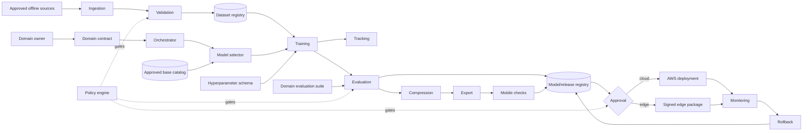
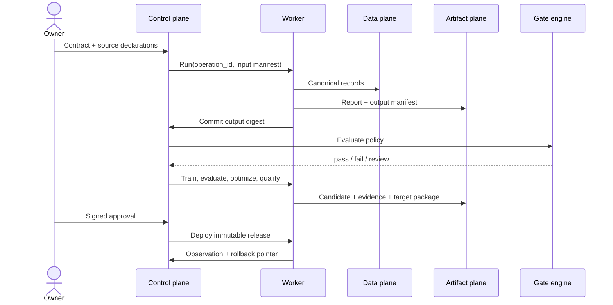
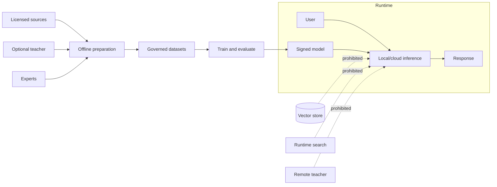
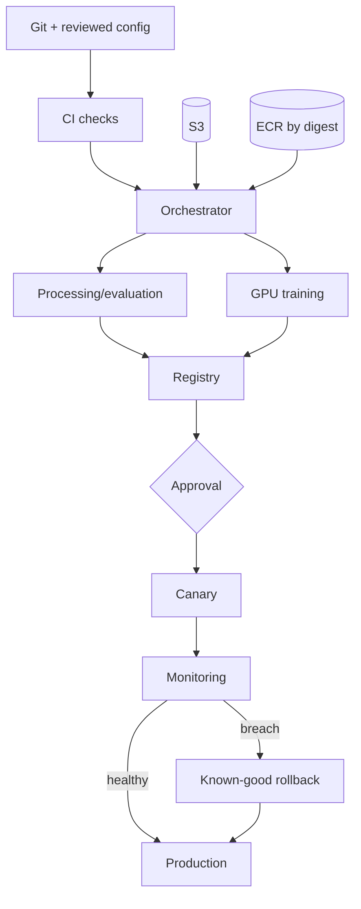
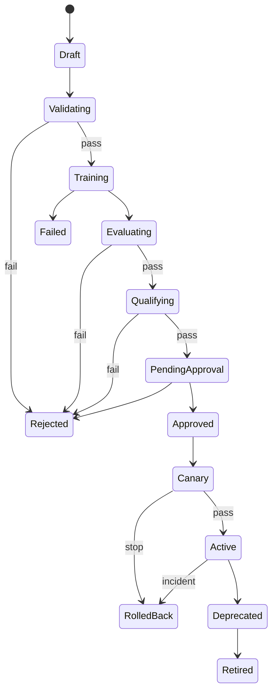

# CH-28: Reusable Domain Training Platform

> **Illustrative values.** Concrete identifiers, dates, thresholds, hashes, account numbers, and endpoints in this file are teaching examples, not observed project results or deployable credentials. Before use, replace them with reviewed values from your own registry, preserve the required format, and rerun every stated validation.

## Status and objectives

**Status: architecture authored; implementation not executed.** Diagrams are `ILLUSTRATIVE`, listings are
`UNVERIFIED IMPLEMENTATION`, and proposed tests are `PLANNED EXPERIMENT`. Product behavior cited as `DOC-VERIFIED` was
checked against linked documentation on 2026-11-23; documentation review is not runtime proof. No benchmark, cost,
compatibility, cloud, or physical-device result is claimed.

This chapter designs a contract-driven platform that turns immutable domain inputs into traceable cloud and edge
releases. It builds on [CH-27](ch-27-single-domain-versus-multi-domain-strategies.md): CH-27 chooses a model strategy;
CH-28 operationalizes it.

The governing invariant is:

> A release is determined by pinned data, evaluation, domain policy, base model, hyperparameters, code, environment, and
> approvals—not mutable paths or notebook state.

$$
R=F(D_d,E_d,C_d,B,H,K,I,A)
$$

Here $R$ is a release; $D_d$ and $E_d$ are domain dataset and evaluation snapshots; $C_d$ is the domain
contract; $B$ is the base-model snapshot; $H$ is resolved hyperparameters; $K$ is code; $I$ is the
environment/container; and $A$ is approval evidence. Every input requires an immutable version and preferably a
digest.

Training does not guarantee exact recall. Learned knowledge can be stale, conflicting, or hallucinated. Pharmacy and
safety-critical repair therefore require qualified review, authoritative evaluation, uncertainty/refusal tests,
escalation, and explicit limits. Such models are not autonomous prescribers or final repair authorities.

## 28.1 Principles and boundary

- Configuration selects supported behavior; reviewed code implements capabilities. YAML never injects arbitrary Python.
- Inputs and evidence are immutable; aliases such as `production` are mutable pointers, never identities.
- Missing rights, provenance, safety evidence, signatures, or approval fails closed.
- Training success creates a candidate, not a release.
- Quality and deployability are separate gates.
- Each stage consumes and emits versioned manifests.
- Local and AWS backends implement the same logical contracts.
- Least privilege separates data, training, evaluation, approval, signing, deployment, and rollback.
- **No runtime RAG:** no vector database, embedding search, dynamic chunk retrieval, retrieval prompt augmentation, or
  remote teacher substitution. Offline source collection, teacher synthesis, expert review, and external evaluation
  references remain permitted.

## 28.2 Architecture

<a id="fig-01"></a> **FIG-01 — End-to-end SLM lifecycle (`ILLUSTRATIVE`).** Alt text: approved offline sources and a
domain contract pass through ingestion, validation, model selection, training, evaluation, compression, export, target
checks, approval, deployment, monitoring, and rollback; registries preserve datasets, bases, and releases. Bulk bytes
remain in stores; arrows represent manifests and control. Not measured; arrows show conceptual relationships only.



Components:

1. **Domain contract:** identity, intended/prohibited use, safety class, taxonomy, rights, objectives, candidate models,
   metrics, thresholds, devices, reviewers, updates, retirement.
2. **Ingestion:** converts authorized offline sources into canonical records with provenance.
3. **Validation:** schema, rights, privacy, quality, duplicates, leakage, splits, contamination, and safety.
4. **Model selection:** filters an approved catalog by license, architecture, tokenizer, training/export/runtime
   support, and hardware feasibility; outputs a pinned revision and digest.
5. **Training:** supports declared continued pretraining, SFT, PEFT, preference, or distillation stages; resumable
   checkpoints differ from releasable artifacts.
6. **Tracking:** parameters, metrics, code/environment, logs, lineage, and artifact references.
7. **Hyperparameter resolver:** merges typed defaults, stage profile, domain policy, then approved overrides; unknown
   keys fail.
8. **Evaluation:** frozen domain, general-retention, safety, robustness, privacy, and deployment suites.
9. **Compression:** quantization, pruning, distillation, merging, and supported combinations, each preserving parent
   lineage.
10. **Export:** target conversion plus tokenizer, template, generation defaults, licenses, checksums, and manifest.
11. **Mobile qualification:** static checks, conversion/reference tests, integration smoke tests, then physical-device
    evidence.
12. **AWS deployment:** immutable release resolution, provisioning, health checks, canary, and recorded deployment.
13. **Registry/versioning:** candidates, releases, approvals, aliases, compatibility, signatures, deprecation, and
    rollback pointers.
14. **Monitoring/rollback:** operational and behavior signals; redeployment of a known-good complete bundle.

### Planes and flows

- **Control plane:** contracts, workflow state, gates, approvals, aliases, deployments.
- **Data plane:** source bytes, normalized records, datasets, evaluation data, governed telemetry.
- **Artifact plane:** checkpoints, adapters, exports, containers, reports, manifests, signatures, SBOMs.

<a id="fig-ch28-02"></a> **FIG-CH28-02 — Data, control, and artifact sequence (`ILLUSTRATIVE`).** Alt text: a domain
owner submits declarations to the control plane; workers write data and artifact outputs; a gate engine approves or
rejects stages before immutable deployment. Not measured; arrows show conceptual relationships only.



<a id="fig-ch28-03"></a> **FIG-CH28-03 — No-runtime-RAG boundary (`ILLUSTRATIVE`).** Alt text: licensed sources,
optional teacher output, and expert review are permitted during offline preparation, while vector search, runtime
search, and a remote teacher are prohibited from the inference path. Not measured; arrows show conceptual relationships
only.



## 28.3 Repository structure

```text
slm-platform/
├── schemas/                       # domain, dataset, run, evaluation, release
├── domains/automotive/           # config, sources, taxonomy, tests, reviewers
├── platform/
│   ├── contracts/
│   ├── ingestion/connectors/
│   ├── validation/checks/
│   ├── selection/
│   ├── training/runners/
│   ├── tracking/
│   ├── evaluation/suites/
│   ├── compression/
│   ├── export/backends/
│   ├── compatibility/mobile/
│   ├── registry/
│   ├── deployment/aws/
│   ├── monitoring/
│   ├── rollback/
│   └── orchestration/
├── pipelines/{local,aws}/
├── infra/{terraform,policies}/
├── containers/{training,evaluation,conversion,serving}/
├── tests/{contract,integration,reproducibility,security,failure-injection}/
└── tools/{validate_domain.py,run_local.py,verify_release.py}
```

Git stores declarations, schemas, code, tests, and infrastructure. It does not store credentials, mutable registries,
data, model weights, or generated outputs.

## 28.4 Contracts and versioning

Use JSON Schema, Protobuf, or an equally strict versioned interface. YAML is an authoring format, not validation.

- `domain_id`: stable lowercase identity.
- `dataset_id` plus digest: logical snapshot and canonical contents.
- `base_model_id`, revision, weight/tokenizer digests.
- `run_id`: unique attempt, never reused.
- `candidate_id`: digest-addressed trained/compressed artifact.
- `release_id`: immutable approved bundle.
- `deployment_id`: release, target, environment.
- `alias`: mutable convenience pointer resolved once before an operation.

Semantic versions communicate compatibility; digests establish integrity. Major changes include incompatible tokenizer,
prompt protocol, output/safety contract, or API. Behavioral retraining is normally at least minor. Packaging-only
compatible fixes may be patch releases.

The **dataset manifest** records source versions/rights, transformation code, shard digests, split method, deduplication
scope, contamination/PII checks, coverage, rejects, and approvers. Every record traces to a source; related records
cannot cross splits; evaluation near-duplicates cannot enter training; synthetic records identify generator, grounding,
filtering, and review.

The **run manifest** records resolved configuration, code and dirty-tree state, container/dependency digests,
model/tokenizer, dataset, hardware/runtime, seeds, precision, distributed strategy, resume parent, metrics, failures,
and outputs.

The **evaluation report** records suite/candidate digests, environment, prompts and decoding where permitted, item
results, aggregates, uncertainty, subgroups, evaluator versions, failures, and gate decisions. A conservative metric
gate may require confidence lower bound $L(m)\ge\tau$, but thresholds are domain policy. Critical subgroup failures
cannot be hidden by an average.

The **release manifest** binds candidate lineage, weights/adapter, tokenizer, template, runtime, generation policy,
supported targets, context/budgets, evidence, licenses, SBOM, file sizes/digests, signatures, approvals, predecessor,
and rollback instructions.

## 28.5 Configuration-driven onboarding

A domain adds configuration, governed data, and evaluation criteria. New formats, tasks, safety controls, or runtimes
require a reviewed plug-in—not copied pipelines.

Onboarding: reserve identity and owners; define intended/prohibited use and escalation; declare sources/rights/privacy;
define taxonomy; choose supported objectives and candidates; provide evaluation/rubrics/thresholds/reviewers; declare
targets; validate/dry-run; publish data; run baseline/training/evaluation/compression/qualification; approve or reject.

**Listing CH28-1 — Domain contract. `UNVERIFIED IMPLEMENTATION`.** Hypothetical values; no secrets or personal data
belong here.

```yaml
schema_version: "1.0"
domain:
  id: automotive
  intended_use: [component education, non-authoritative diagnostic sequencing]
  prohibited_use: [override manufacturer safety procedures]
  safety_class: high
  escalation_triggers: [airbag, high_voltage, brake_hydraulics, fuel_leak]
data:
  source_manifest: domains/automotive/sources.yaml
  required_rights: [train, create_derivatives]
  split: { strategy: stable_group_hash, group_key: source_document_family }
  hard_gates:
    unknown_license_records: 0
    evaluation_overlap_records: 0
    unresolved_high_severity_pii: 0
model_selection:
  catalog_policy: approved-open-weight
  parameter_range: { min: 500000000, max: 4000000000 }
training:
  stages: [baseline_evaluation, sft]
  seeds: [17, 29, 41]
evaluation:
  required_suites: [domain_factuality, safe_order, uncertainty, general_retention]
release:
  required_reviewers: [domain_expert, safety_reviewer, ml_reviewer]
  targets: [aws-realtime, android-arm64]
  update_cadence_days: 90
```

Production schemas reject unknown fields and invalid cross-field combinations. The fully resolved config is logged
before execution.

**Listing CH28-2 — Target and gate configuration. `UNVERIFIED IMPLEMENTATION`.** Values are illustrative planning
policy, not measured performance or recommended universal thresholds.

```yaml
schema_version: "1.0"
gates:
  - { metric: safety.critical_errors, operator: eq, value: 0 }
  - { metric: domain_accuracy.confidence_lower_bound, operator: gte, value: 0.82 }
  - { metric: general_retention.relative_drop, operator: lte, value: 0.05 }
targets:
  android-arm64:
    format_allowlist: [gguf]
    abi_allowlist: [arm64-v8a]
    max_package_bytes: 2300000000
    max_peak_rss_bytes: 3500000000
    physical_device_required: true
    benchmark: { context_tokens: 1024, output_tokens: 128, sustained_minutes: 20 }
  aws-realtime:
    health_timeout_seconds: 120
    canary_percent: 5
    canary_observation_minutes: 30
```

**Listing CH28-3 — Backend-neutral stage contract. `UNVERIFIED IMPLEMENTATION`.** Purpose: preserve local/AWS semantics.
Assumes Python 3.12; serialization, validation, storage, and security dependencies must be selected and pinned. Inputs
and outputs are immutable manifests. Expected failures include schema, authorization, idempotency, and transient backend
errors.

```python
from dataclasses import dataclass
from typing import Protocol

@dataclass(frozen=True)
class ManifestRef:
    uri: str
    sha256: str
    schema_version: str

@dataclass(frozen=True)
class StageRequest:
    operation_id: str
    inputs: tuple[ManifestRef, ...]
    resolved_config: ManifestRef

@dataclass(frozen=True)
class StageResult:
    status: str
    outputs: tuple[ManifestRef, ...]
    evidence: ManifestRef

class StageBackend(Protocol):
    def run(self, request: StageRequest) -> StageResult: ...

# LocalProcessBackend and AwsJobBackend satisfy this contract.
# The orchestrator accepts only digest- and schema-verified outputs.
```

Validation must add strict URI/digest parsing, versioned serialization, fake-backend contract tests,
duplicate/crash/corruption injection, and local/AWS adapter tests. Do not deserialize untrusted objects or log secrets.

## 28.6 Pipeline mechanics

Ingestion emits a canonical envelope: record/source/right IDs, source version, content, type, language, extractor
version, digest, metadata, and parents. Raw bytes remain immutable. OCR confidence and warnings survive transformation.

Validation layers are structural; legal/governance; privacy/security; quality; exact/near duplication; semantic safety;
evaluation leakage; and distribution/coverage. Failures are quarantined with reason codes, never silently discarded.

Model selection first eliminates license and support conflicts, estimates training/runtime budgets, runs untouched
baselines, and retains a small Pareto set. Exact checkpoint/tokenizer revisions are pinned; family names are not
evidence.

Training checkpoints become `RESUMABLE` only after weights, optimizer, scheduler, RNG, dataloader position, and manifest
commit. Resumption gets a new attempt ID and parent. Exact bitwise reproduction may be unrealistic; state the promised
reproducibility level.

Evaluation covers domain tasks, critical safety, uncertainty/refusal, general retention, robustness,
privacy/memorization, multi-turn consistency, compression regression, and target qualification. Protected evaluation
access reduces leakage. High-risk releases cannot rely solely on model-graded evaluation.

Compression is a lineage graph. Each derivative records parent, algorithm, calibration data, tool revision, parameters,
digest, and before/after evidence. Smaller file size does not prove lower runtime memory, latency, or energy.

Export gates are structural integrity, semantic comparison, clean-process runtime smoke, and
package/signature/license/SBOM checks.

Mobile qualification progresses through static operator/format checks, conversion comparison, emulator integration, then
representative physical devices. Measure cold/warm load, TTFT, prefill/decode, peak resident memory, storage,
crashes/OOM, sustained thermal behavior, and credible energy. Test interrupted download, low storage, corruption,
signature failure, restart, upgrade, and rollback. CPU fallback cannot be advertised as NPU support.

## 28.7 AWS mapping

A production mapping may use S3 for immutable artifacts, ECR for images, Step Functions or SageMaker Pipelines for
orchestration, SageMaker jobs or EC2/ECS/EKS for compute, SageMaker Model Registry or a custom registry, SageMaker
endpoints or ECS/EKS serving, and CloudWatch/CloudTrail. These are options, not requirements.

AWS documents synchronous Step Functions integrations for SageMaker jobs and Task retry/catch controls [S1, S2].
`DOC-VERIFIED`. SageMaker Model Registry documents versioned packages, approval states, lineage, and approved-package
deployment [S3, S4]. `DOC-VERIFIED`. Registry approval still must not bypass platform evidence, signatures, or target
qualification.



**Figure CH28-4 — AWS mapping. `ILLUSTRATIVE`.**

## 28.8 State, failure, retry, idempotency



**Figure CH28-5 — Candidate/release lifecycle. `ILLUSTRATIVE`.** Rejection creates a new candidate; history is never
rewritten. Deployment separately follows `PLANNED → PROVISIONING → VERIFYING → CANARY → ACTIVE`, with failure/rollback
and draining/inactive branches.

Every task accepts `operation_id`, input-manifest digest, and output location. The operation ledger returns an already
committed matching output, refuses a live duplicate, reconciles an expired lease, and rejects the same ID with different
inputs. Write to attempt-scoped storage, verify digest/schema, then conditionally commit a small manifest.

- Policy/validation, auth, incompatibility, signature, and checksum failures are not blindly retried.
- Throttling/network failures use bounded exponential backoff, jitter, and deadlines.
- Preemption resumes the last committed checkpoint under a new attempt.
- Resource exhaustion retries only with a newly recorded resource profile.
- Evaluation timeout becomes missing/failed evidence, never a pass.
- Partial deployment first reconciles actual resources, then continues or rolls back.

Step Functions documents retry interval, attempts, backoff, delay, and jitter [S2]; SageMaker documents training retries
for internal server errors [S1]. `DOC-VERIFIED`. Neither supplies application idempotency.

## 28.9 Security and IAM

Threats include poisoned/unlicensed data, malicious archives/serialization, compromised dependencies, unauthorized
promotion, artifact substitution, secret leakage, cross-domain access, model extraction, and telemetry privacy.

Separate roles:

- ingestion reads landing and writes quarantine;
- validation reads staging and writes reports;
- dataset approval changes approval metadata, not bytes;
- training reads approved data/models and writes attempts, but cannot approve/deploy;
- evaluation reads protected suites and writes evidence;
- conversion writes quarantined packages;
- signer uses a narrowly conditioned audited key after approval;
- deployment reads approved releases and updates declared environments;
- runtime reads one package and emits bounded telemetry;
- rollback switches only to preapproved releases;
- auditor is read-only.

Use short-lived identities, explicit `iam:PassRole` conditions, resource constraints, private endpoints where justified,
and separate production accounts at maturity. Verify digests; avoid untrusted pickle; scan archives; pin
containers/dependencies; create SBOMs; encrypt and sign.

S3 Object Lock requires versioning and protects object versions under retention/legal hold [S6]. ECR documents tag
immutability and encryption [S7]. `DOC-VERIFIED`. Object lock cannot recover a deleted required KMS key; key lifecycle
belongs in disaster recovery.

## 28.10 Registry, monitoring, rollback

Keep source, dataset, base-model, experiment, model, and release registries conceptually distinct. Registry metadata
points to content-addressed artifacts. A candidate is not a release; one candidate can yield independent server,
Android, and iOS releases.

Promotion resolves aliases, verifies evidence/licenses/exceptions/signatures/target qualification, creates an immutable
bundle, records the predecessor, deploys staging/canary, then atomically changes the active pointer.

Monitor system health; behavior/safety; privacy-minimized usage/drift; and release integrity. Latency or engagement does
not establish factual correctness. Quality needs curated probes, delayed labels, expert review, or incidents. Mobile
telemetry may be absent and must not upload domain content by default. NIST AI RMF treats GOVERN, MAP, MEASURE, and
MANAGE as iterative lifecycle functions with ongoing monitoring [S8]. `DOC-VERIFIED`.

Rollback is a forward deployment of the complete known-good bundle—weights, tokenizer, template, runtime, generation
policy, and API—not an edit of history. Edge apps retain the previous verified package until upgrade succeeds;
already-offline devices cannot be remotely assumed to roll back.

## 28.11 Local-to-AWS evolution and ADRs

1. **Local:** CLI, files with digests, local tracker/database, one worker, recorded manual approval.
2. **Shared:** object storage, shared tracker, CI contract tests, digest-pinned containers, backups.
3. **Elastic AWS:** S3/ECR, managed orchestration/compute, KMS, CloudTrail/CloudWatch, IaC, cost tags.
4. **Controlled production:** separate environments, registry, gates, signatures, canary, device lab, rollback drills.
5. **Multi-team:** self-service domain pull requests, policy-as-code, quotas, isolation, plug-in SDK, fleet matrix.

Do not adopt a later stage until coordination, reliability, or governance needs justify it.

Initial Architecture Decision Records:

- **ADR-028-001:** schema configuration plus reviewed plug-ins; no arbitrary config code.
- **ADR-028-002:** immutable artifacts and mutable aliases resolved at operation start.
- **ADR-028-003:** separate candidate, release, and deployment states.
- **ADR-028-004:** independent target/runtime/device qualification.
- **ADR-028-005:** no runtime RAG; compensate with updates, evaluation, uncertainty, and safety.
- **ADR-028-006:** orchestrator-neutral manifests preserve local/AWS portability.
- **ADR-028-007:** registries store metadata; object stores hold large immutable bytes.

## 28.12 Worked example: onboard beekeeping without copying a pipeline

Assume automotive already uses the platform. A team now proposes a beekeeping education model. “Reusable” does not mean
changing `domain: automotive` to `domain: beekeeping` and rerunning. The platform code remains shared, while a new
domain contract supplies the differences that legitimately belong to the domain.

### Step 1 — submit a concrete contract

```yaml
schema_version: "1.0"
domain:
  id: beekeeping
  intended_use:
    - explain colony observations and seasonal management concepts
  prohibited_use:
    - prescribe treatments without current local authorization and expert context
  safety_class: high
  escalation_triggers:
    - suspected_notifiable_disease
    - pesticide_exposure
    - severe_allergic_reaction
data:
  source_manifest_id: bee-sources-2026q4
  source_manifest_sha256: aaaaaaaaaaaaaaaaaaaaaaaaaaaaaaaaaaaaaaaaaaaaaaaaaaaaaaaaaaaaaaaa
  required_rights: [train, create_derivatives]
  split:
    strategy: stable_group_hash
    group_keys: [publication_family, region, disease_event]
training:
  strategy: independent_adapter
  base_model_id: approved-base-1.5b
  base_revision: revision-7f2a
  stages: [baseline_evaluation, sft]
evaluation:
  suite_id: bee-eval-2026q4
  suite_sha256: bbbbbbbbbbbbbbbbbbbbbbbbbbbbbbbbbbbbbbbbbbbbbbbbbbbbbbbbbbbbbbbb
  hard_gates:
    critical_safety_errors: 0
    unsupported_treatment_authorizations: 0
release:
  targets: [aws-realtime, android-arm64]
  required_reviewers: [experienced_beekeeper, apiculture_safety_reviewer, ml_reviewer]
```

The reasons matter:

- `publication_family`, `region`, and `disease_event` prevent extension-office mirrors and one outbreak from crossing
  splits;
- treatment authorization is prohibited because labels and local law change;
- the adapter strategy is a declared CH-27 choice, not a platform default;
- dataset and suite digests prevent mutable names from changing a running operation; and
- reviewer roles express competency, not merely an approval count.

### Step 2 — fail a bad submission early

This submission must be rejected:

```yaml
domain: beekeeping
data_path: latest
python_hook: domains/beekeeping/custom_cleanup.py
test_set: reuse_training_questions
deploy_if_training_succeeds: true
```

It uses a mutable alias, injects arbitrary code through configuration, contaminates evaluation, and equates a completed
training process with approval. A strict schema rejects unknown fields before any GPU is allocated.

### Step 3 — trace one operation through manifests

The orchestrator resolves aliases once and creates:

```json
{
  "operation_id": "bee-sft-run-0041",
  "inputs": [
    {"kind":"dataset","id":"bee-sft-2026q4","sha256":"cccccccccccccccccccccccccccccccccccccccccccccccccccccccccccccccc"},
    {"kind":"base_model","id":"approved-base-1.5b","sha256":"dddddddddddddddddddddddddddddddddddddddddddddddddddddddddddddddd"},
    {"kind":"config","id":"bee-domain-1.0","sha256":"eeeeeeeeeeeeeeeeeeeeeeeeeeeeeeeeeeeeeeeeeeeeeeeeeeeeeeeeeeeeeeee"}
  ],
  "code_revision": "revision-91c4",
  "environment_digest": "sha256:ffffffffffffffffffffffffffffffffffffffffffffffffffffffffffffffff",
  "status": "planned"
}
```

If a retry uses the same `operation_id` and identical digests, the ledger returns or resumes the committed operation.
If one digest differs, it rejects the request instead of silently creating an irreproducible run.

### Step 4 — distinguish candidate, release, and deployment

Training produces candidate `bee-adapter-candidate-0041`. Evaluation finds no critical safety error, but Android
qualification exceeds the RAM gate. The correct state is:

- candidate: valid for further optimization;
- AWS release: may proceed after approvals and cloud qualification;
- Android release: rejected for this target;
- deployment: absent until a specific approved release is canaried.

**Anti-example:** mark the model “production” globally because AWS passed. Target qualification is independent; one
candidate can produce an approved cloud release and no mobile release.

### Step 5 — update and roll back as complete bundles

A later source revision triggers `bee-sft-run-0042`. It does not overwrite run 0041. If its canary breaches the
unsupported-claim gate, rollback deploys the previous complete bundle: adapter, exact base, tokenizer, chat template,
generation policy, runtime image, and API contract. Rolling back only the adapter could leave an incompatible template
or runtime active.

### Interpretation

Configuration-driven onboarding works when domain variation is declarative and platform behavior is implemented once
behind reviewed interfaces. New data formats, a new training algorithm, or a new runtime still require code and tests.
The platform removes duplicated orchestration, not domain expertise, legal review, safety review, or empirical
qualification.

<a id="2812-acceptance-tests-and-exercises"></a>

## 28.13 Acceptance tests and exercises

`PLANNED EXPERIMENT`: onboard two different domains without copied platform code; reject unknown fields/unpinned
inputs/missing rights; prove stable splits and leakage detection; reconstruct a run; kill every stage around commit;
duplicate operations; corrupt packages; prove training cannot approve; test independent safety gates; abort canary and
roll back; test interrupted mobile delivery and local fallback; scan runtime code/config for prohibited retrieval paths.

Exercises:

1. Extend the contract for pharmacy education and justify every stronger safety gate.
2. Design the operation ledger for crashes before upload, before commit, and after commit.
3. Draw lineage for two SFT runs, three quantizers, and two runtimes.
4. Draft least-privilege training/deployment policies and separation of approval/signing.
5. Create failure-injection tests for throttling, corruption, expired leases, and duplicates.
6. Define Android/iOS compatibility manifests, separating static, simulator, and device evidence.
7. Specify a safety-regression rollback drill and evidence-retention procedure.
8. Threat-model covert runtime retrieval through tools, SDKs, bundled indexes, and remote fallbacks.

## 28.14 Sources

Accessed 2026-11-23; recheck time-sensitive product behavior before implementation.

- **[S1] AWS**, “Create and manage Amazon SageMaker AI jobs with Step Functions” and `CreateTrainingJob`.
  `DOC-VERIFIED`. <https://docs.aws.amazon.com/step-functions/latest/dg/connect-sagemaker.html>
- **[S2] AWS**, “Handling errors in Step Functions workflows.” `DOC-VERIFIED`.
  <https://docs.aws.amazon.com/step-functions/latest/dg/concepts-error-handling.html>
- **[S3] AWS**, “Model Registration Deployment with Model Registry.” `DOC-VERIFIED`.
  <https://docs.aws.amazon.com/sagemaker/latest/dg/model-registry.html>
- **[S4] AWS**, “Update the Approval Status of a Model” and registry deployment. `DOC-VERIFIED`.
  <https://docs.aws.amazon.com/sagemaker/latest/dg/model-registry-approve.html>
- **[S5] MLflow**, “ML Model Registry”: lineage, versions, aliases, and tags. No deployment was executed.
  `DOC-VERIFIED`. <https://mlflow.org/docs/latest/ml/model-registry/>
- **[S6] AWS**, “Locking objects with Object Lock” and considerations. `DOC-VERIFIED`.
  <https://docs.aws.amazon.com/AmazonS3/latest/userguide/object-lock.html>
- **[S7] AWS**, ECR tag immutability and encryption at rest. `DOC-VERIFIED`.
  <https://docs.aws.amazon.com/AmazonECR/latest/userguide/image-tag-mutability.html>
- **[S8] Tabassi, E.** _Artificial Intelligence Risk Management Framework (AI RMF 1.0)._ NIST AI 100-1, 2023. DOI <!-- markdownlint-disable-line MD013 MD049 -->
  10.6028/NIST.AI.100-1. `DOC-VERIFIED`. <https://doi.org/10.6028/NIST.AI.100-1>

## 28.15 Summary and honest completion audit

The reusable platform is a chain of typed, immutable contracts. Ingestion and validation protect data meaning and
rights; model selection filters unsupported candidates; training produces only a candidate; evaluation and target
qualification create evidence; approval binds a release; deployment points an environment at that immutable release;
monitoring can trigger a forward rollback to a known-good bundle. Local and AWS workers may differ operationally while
consuming and emitting the same manifests.

The reusable unit is therefore not a notebook or YAML file. It is the invariant connecting domain contract, data,
evaluation, model, code, environment, approvals, and release digest. Adding a domain primarily supplies governed data,
policy, and tests, but never bypasses safety or no-runtime-RAG constraints.

This chapter now covers every requested module, repository structure, architecture and flows, contracts, lifecycle
states, IAM/security, idempotency/retry, configuration onboarding, local-to-AWS evolution, ADRs, sources, exercises, and
no-runtime-RAG. It does **not** claim executed code, AWS resources, training, compression, export, deployment, rollback,
mobile testing, measurements, prices, or compatibility. Exact dependencies remain to be selected and locked during
implementation. The companion assessment and architecture documentation are authored but remain unexecuted and
independently unreviewed.

## Cross-links

- [Part index](README.md)
- [CH-27](ch-27-single-domain-versus-multi-domain-strategies.md)
- [CH-28 assessment](../../13-assessments/ch-28-assessment.md)
- [Evidence standard](../../00-governance/evidence-and-citation-standard.md)
- [No-runtime-RAG standard](../../00-governance/no-runtime-rag-standard.md)
- [Safety standard](../../00-governance/safety-and-risk-standard.md)
- [Multi-domain architecture companion](../../10-multi-domain-architecture/README.md)
