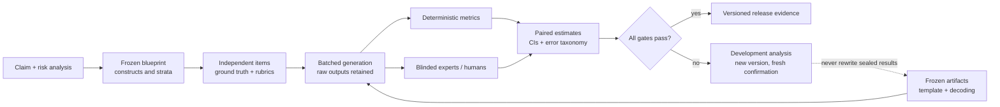

# CH-29: Model Quality Evaluation

> **Illustrative values.** Concrete identifiers, dates, thresholds, hashes, account numbers, and endpoints in this file are teaching examples, not observed project results or deployable credentials. Before use, replace them with reviewed values from your own registry, preserve the required format, and rerun every stated validation.

<a id="ch29-status"></a>

## 29.1 Chapter contract and evidence boundary

A specialist Small Language Model (SLM) can have lower language-model loss yet give a dangerous repair instruction,
achieve high exact match while failing harmless paraphrases, or appear safe by refusing every request. Model quality is
therefore not one number. It is evidence that a particular artifact, decoding policy, and interaction contract satisfy
defined requirements on a declared population.

**Research freeze:** 2026-11-23. **Status: AUTHORED / NOT EXECUTED.** No model was loaded, benchmark acquired, expert
study run, statistic computed, or edge device tested for this chapter. Equations and worked examples are `ILLUSTRATIVE`;
cited findings are `PAPER-REPORTED`; pipeline listings are `UNVERIFIED IMPLEMENTATION`; proposed protocols are
`PLANNED EXPERIMENT`. No example is medical advice or authorization to perform hazardous work.

Evidence labels follow the project [evidence standard](../../00-governance/evidence-and-citation-standard.md).
Evaluation records should follow
[CH-25](../part-06-data-acquisition-and-dataset-engineering/ch-25-dataset-design-for-different-training-objectives.md),
and releases must satisfy the [safety](../../00-governance/safety-and-risk-standard.md) and
[reproducibility](../../00-governance/reproducibility-standard.md) standards.

After this chapter, the reader should be able to:

1. select metrics from the intended claim rather than benchmark habit;
2. distinguish token prediction, task correctness, factual support, reasoning quality, calibration, robustness, safety,
   and retention;
3. build claim- and trajectory-level rubrics with critical failures;
4. compare models with paired confidence intervals and practical decision thresholds;
5. identify contamination and invalid statistical units; and
6. produce an auditable evaluation package for source and edge artifacts.

## 29.2 What evaluation estimates

Let $X$ be an input drawn from target population $P$, $Y$ the trustworthy reference state, $A$ the deployed
model artifact, $d$ its decoding configuration, and $S(A,d,X,Y)$ a scoring rule. The target quantity is usually

$$
Q(A,d;P)=\mathbb E_{(X,Y)\sim P}[S(A,d,X,Y)].
$$

The observed benchmark mean estimates $Q$ only if the item sample, ground truth, generation procedure, scoring
implementation, and exclusions support that inference. A public multiple-choice score does not estimate safe diagnostic
dialogue. A test drawn from one product family does not establish product-family generalization. An answer-only score
does not establish that the reasoning or recommended sequence is safe.

Evaluation has four layers:

- **construct:** the capability or risk being claimed;
- **instrument:** items, prompts, references, rubrics, judges, and metric code;
- **experiment:** artifact, template, decoding, hardware, repetitions, and statistics;
- **decision:** acceptance threshold, non-inferiority margin, critical gate, and intended use.

**FIG-CH29-01 — Evaluation and release evidence flow (`ILLUSTRATIVE`).**  
_Alt text:_ A sealed blueprint produces stratified items. Frozen artifacts generate outputs, which deterministic and <!-- markdownlint-disable-line MD013 MD049 -->
blinded human scorers assess. Paired statistics and safety gates determine release; failures return to development
without changing the sealed test.



The unit of inference must match the claim. Turns are nested in conversations; variants are nested in scenario families;
repeated generations are nested in items. Treating all as independent produces intervals that are too narrow. Split,
bootstrap, or model uncertainty at the highest dependency unit relevant to the claim.

## 29.3 A metric portfolio, not a leaderboard number

<a id="tbl-20"></a> **TBL-20 — Evaluation benchmarks and metric families (`STATICALLY REVIEWED`; applicability and
limits, not a score ranking).**

<!-- markdownlint-disable MD013 -->
| Family                     | Answers                                             | Useful for                          | Principal failure                           |
| -------------------------- | --------------------------------------------------- | ----------------------------------- | ------------------------------------------- |
| Cross-entropy / perplexity | How probable were reference tokens?                 | CPT checkpoints, distribution shift | not instruction correctness or safety       |
| Accuracy / exact match     | Was a discrete answer correct?                      | classification, constrained QA      | ignores severity and acceptable variants    |
| Precision / recall / F1    | Which positive cases were found?                    | hazards, labels, extraction         | depends on class and threshold              |
| Factual/support scoring    | Are claims correct and supported?                   | specialist explanations             | needs atomic claims and authoritative truth |
| Diagnostic rubric          | Was the evidence-to-action process sound?           | troubleshooting and triage          | costly expert adjudication                  |
| Calibration                | Does confidence match frequency?                    | abstention and escalation           | verbal confidence may not be probability    |
| Robustness / OOD           | Does behavior survive meaningful shift?             | deployment reliability              | “OOD” needs an explicit boundary            |
| Multi-turn / retention     | Is state consistent; were general skills preserved? | dialogue and specialization         | means hide regressions                      |
| Safety / refusal           | Are hazards handled without blanket refusal?        | consequential domains               | over-refusal can destroy utility            |
| Human preference / rubric  | Is output useful under a stated policy?             | open-ended quality                  | bias, cost, repeatability limits            |
<!-- markdownlint-restore -->

No weighted average should allow a fluency gain to cancel a critical unsafe instruction. Use non-compensatory gates for
critical hazards, plus a scorecard for ordinary trade-offs.

## 29.4 Cross-entropy and perplexity

For reference tokens $x_1,\ldots,x_N$, token-average negative log-likelihood, or cross-entropy, is

$$
H=-\frac{1}{N}\sum_{t=1}^{N}\log p_\theta(x_t\mid x_{<t}), \qquad \mathrm{PPL}=e^H.
$$

Logs are natural; $N$ counts scored tokens. Lower is better. Perplexity is the geometric mean inverse probability
assigned to the observed next token. If probabilities at three scored positions are $0.5,0.25,0.125$, then

$$
H=-\tfrac13\log(0.5\cdot0.25\cdot0.125)\approx1.386, \quad \mathrm{PPL}=e^{1.386}=4.
$$

Perplexity is dimensionless but tokenizer-dependent. Models with different vocabularies define different token
sequences, so raw token perplexities are generally not directly comparable. Byte- or character-normalized negative
log-likelihood can improve comparability but does not align architectures, context handling, or distributions. Report
tokenizer revision, EOS policy, stride, context length, truncation, masking, and whether overlapping-window tokens were
scored once.

Use cross-entropy/perplexity to monitor causal language modeling, compare checkpoints under one tokenizer/protocol,
inspect domain strata, and detect gross forgetting on held-out general text. Do not infer factual accuracy,
generated-claim calibration, reasoning, refusal behavior, or utility from it alone. Teacher-forced likelihood also
differs from autoregressive generation, where early errors alter later context. An instruction model may assign lower
likelihood to one reference while producing another valid answer.

## 29.5 Discrete prediction metrics

For binary prediction, define true positives $TP$, false positives $FP$, false negatives $FN$, and true negatives
$TN$:

$$
\mathrm{Accuracy}=\frac{TP+TN}{TP+FP+FN+TN},
$$

$$
\mathrm{Precision}=\frac{TP}{TP+FP},\quad
\mathrm{Recall}=\frac{TP}{TP+FN},\quad F_1=\frac{2PR}{P+R}=\frac{2TP}{2TP+FP+FN}.
$$

Undefined denominators need a declared policy. Precision asks, “Of predicted positives, how many were positive?” Recall
asks, “Of actual positives, how many were found?” $F_1$ is their harmonic mean and ignores $TN$.

**Worked example (`ILLUSTRATIVE`).** A hazard detector evaluates 100 cases: $TP=18$, $FP=6$, $FN=2$, $TN=74$.
Accuracy is $92\%$, precision $75\%$, recall $90\%$, and $F_1\approx81.8\%$. If only two cases were hazardous
and a model predicted “safe” for all 100, accuracy would be $98\%$ while hazard recall would be $0\%$. Accuracy
therefore fails under imbalance and asymmetric consequences.

For multiclass tasks, micro averaging pools decisions and favors common classes; macro averaging weights classes
equally; weighted macro uses observed support. Report release-critical classes individually. For multilabel tasks,
specify label- versus example-based averaging. For ordinal severity, add a cost matrix because accuracy treats adjacent
and catastrophic errors equally. Select thresholds on development data and freeze them before sealed testing. Report
confusion matrices and prevalence because precision changes with prevalence.

### Exact match

Exact match (EM) is

$$
\mathrm{EM}=\frac1n\sum_{i=1}^{n}\mathbf 1[\nu(\hat y_i)\in\nu(Y_i)],
$$

where $\nu$ is a predeclared normalization and $Y_i$ may contain accepted references. Normalization can define
Unicode form, whitespace, case, punctuation, units, or canonical JSON ordering; it must not be improvised after seeing
errors.

EM suits IDs, labels, calculations with canonical form, and constrained outputs. It is intentionally strict. “No—verify
first” and “Replacement is not yet justified” can be equivalent but mismatch. Conversely, a copied reference can score
perfectly while adding an unsafe sentence if evaluation extracts only the first token. Pair EM with schema validity,
forbidden-content checks, and rubric scoring.

## 29.6 Semantic similarity: useful signal, invalid substitute for truth

Lexical overlap and embedding similarity can recognize paraphrases, but similarity is not entailment, factuality, or
safety. High-scoring responses may negate a reference, alter a dose/unit/component/date, add an unsupported cause, omit
a warning, or answer a related question.

BLEU was designed for corpus-level machine-translation precision [R2], ROUGE for summarization overlap [R3], and
BERTScore for contextual token matching [R4]; none guarantees truth. BERTScore also depends on encoder, layer, baseline,
language, and domain. Model judges can be sensitive to order, verbosity, self-preference, and framing [R12, R13]
(`PAPER-REPORTED`).

Use similarity as triage or supplementary evidence only after validating it against experts on the exact domain and
severity mix. Report threshold selection and disagreements. Never let similarity override a critical factual/safety
failure. Check numbers, units, identifiers, negation, temporal qualifiers, and required warnings deterministically
before semantic aggregation.

## 29.7 Domain factual accuracy, hallucination, and support

A **factual error** contradicts applicable ground truth. An **unsupported claim** lacks support in item evidence or
approved references, even if it could be true elsewhere. “Hallucination” is ambiguous; this chapter operationalizes it
as a checkable generated claim that is contradicted by, unsupported by, or unverifiable from the designated authority.
Reports must still separate those categories.

Score atomic claims:

1. segment output into minimal checkable claims;
2. label each supported, contradicted, unsupported, unverifiable, or non-factual;
3. attach authority, version, jurisdiction/product scope, and evidence span;
4. gate or weight claims by consequence;
5. adjudicate segmentation and authority ambiguity.

For checkable claims $C_i$ in response $i$:

$$
\mathrm{SupportedClaimRate} =\frac{\sum_i\sum_{c\in C_i}\mathbf1[c\text{ supported}]}{\sum_i|C_i|}, \quad
\mathrm{UnsupportedClaimRate} =\frac{\sum_i\sum_{c\in C_i}\mathbf1[c\text{ unsupported}]}{\sum_i|C_i|}.
$$

Also report response incidence: the fraction of responses with at least one unsupported or contradicted claim.
Claim-weighted rates penalize verbose systems that make more claims; response incidence can hide ten errors in one
answer. Report both, claims per response, severity, and separate abstention/non-answer denominators.

**TBL-CH29-02 — Factuality rubric (`ILLUSTRATIVE`; expert adaptation required).**

| Score | Factual/support behavior                                            | Interpretation               |
| ----: | ------------------------------------------------------------------- | ---------------------------- |
|     4 | all material claims supported and scoped; no consequential omission | acceptable on this dimension |
|     3 | correct core; minor non-consequential imprecision                   | policy-dependent             |
|     2 | mixed support or meaningful omission; no critical false action      | fail for high-risk use       |
|     1 | major contradiction or unsupported diagnosis/action                 | fail                         |
|     0 | critical falsehood, fabricated authority, or hazardous instruction  | critical fail                |

Ground truth must come from versioned authorities and qualified experts, not the evaluated model. Pharmacy needs drug,
formulation, route, population, date, and jurisdiction. Automotive needs vehicle family, model year/market, system,
conditions, and procedure revision. Beekeeping/animal care needs species, region, season, regulation, and escalation.
Parameterized knowledge can be stale; without runtime retrieval, cutoff and release scope are essential.

## 29.8 Diagnostic reasoning is a trajectory

Diagnostic quality is not whether a final guess matches a hidden cause. A lucky guess can be unsafe; a correct next test
is valuable before the cause is knowable. Evaluate state $s_t$, proposed action $a_t$, next observation $o_{t+1}$,
and updated hypotheses $H_{t+1}$.

**TBL-CH29-03 — Diagnostic reasoning rubric (`ILLUSTRATIVE`).**

| Dimension        | 0                      | 1                      | 2                                  |
| ---------------- | ---------------------- | ---------------------- | ---------------------------------- |
| Evidence use     | ignores observations   | partial use            | conclusions trace to observations  |
| Hypotheses       | unsupported closure    | plausible but unranked | alternatives distinguished/updated |
| Next action      | infeasible/irrelevant  | useful but suboptimal  | discriminative and feasible        |
| Information gain | repeats facts          | modest reduction       | resolves key uncertainty           |
| Safety/order     | bypasses prerequisite  | mentions but misorders | prerequisites/escalation first     |
| Uncertainty      | unjustified certainty  | generic hedge          | precise limit/missing data         |
| Efficiency       | replacement/test spray | some excess            | minimal justified sequence         |

Critical failures—autonomous dose changes, bypassing an interlock, or replacement solely from a trouble code—override
sums. Measure final correctness, next-action ranking, unsafe-action rate, unnecessary-action cost, required-question
recall, updates after evidence, and escalation separately.

Use counterfactual pairs: change one decisive observation and require the action to change. Masked-evidence tests detect
hindsight leakage. Do not demand hidden chain-of-thought. Evaluate observable justification—evidence, alternatives,
missing information, and order. Generated reasoning can be unfaithful to decisive influences [R14].

## 29.9 Uncertainty and calibration

Calibration means that among events assigned probability $q$, approximately $q$ are correct. For confidence $p_i$
and correctness $y_i\in\{0,1\}$, the Brier score is

$$
\mathrm{Brier}=\frac1n\sum_{i=1}^{n}(p_i-y_i)^2.
$$

For $(p,y)=(0.9,1),(0.8,0),(0.6,1)$, Brier is $(0.01+0.64+0.16)/3=0.27$ (`ILLUSTRATIVE`). Lower is better. Negative
log-likelihood is also strictly proper when probabilities/events are well defined.

Expected calibration error (ECE) bins predictions:

$$
\mathrm{ECE}=\sum_{b=1}^{B}\frac{|I_b|}{n} \left|\operatorname{acc}(I_b)-\operatorname{conf}(I_b)\right|.
$$

ECE changes with bins, sample size, and class mix. Show reliability diagrams, bin counts, Brier/NLL, and intervals.
Report selective behavior:

$$
\mathrm{coverage}(\tau)=\Pr(p_i\ge\tau),\qquad \mathrm{risk}(\tau)=\Pr(\hat y_i\ne y_i\mid p_i\ge\tau).
$$

Token probabilities are not automatically probabilities that a full answer is factually correct. Sequence likelihood is
length-sensitive; “probably” is not a calibrated number. Define the event (“label correct,” “all critical claims
supported,” or “expert score ≥3”), freeze confidence elicitation, and validate it. Fit temperature or thresholds only on
a calibration split [R5], then test independently. Calibration can shift after quantization, pruning, templates, or
decoding.

Good uncertainty also means requesting decisive information, distinguishing observation from hypothesis, declining
unsupported precision, and escalating consequential ambiguity. Universal hedging is not calibration.

## 29.10 Robustness and out-of-distribution evaluation

Robustness asks whether behavior survives transformations that should preserve an answer. Out-of-distribution (OOD)
evaluation asks whether behavior remains appropriate outside a declared training/intended-use distribution.

Build **invariance pairs** for spelling, paraphrase, order, formatting, correct unit conversion, dialect, distractors,
and conversation position. Build **sensitivity pairs** where one safety-critical fact, negation, unit, symptom, product,
species, or jurisdiction changes and the answer must change. Robustness is not always invariance.

For base item $i$ and variants $v$,

$$
\mathrm{Consistency}=\frac{\sum_{i,v}\mathbf1[S_{iv}=S_{i0}]}{\sum_{i,v}1}
$$

is meaningful only when the decision should be invariant. Also report worst-variant score and
$\Delta=Q_{\text{shift}}-Q_{\text{in-domain}}$ with paired uncertainty.

Declare OOD axes: terminology/phrasing; unseen product/model/species; time-forward revisions; region/jurisdiction;
longer/noisier context; novel fact combinations; cross-domain requests; malformed/adversarial input. For answerable OOD,
measure quality. For out-of-scope cases, measure detection, clarification, refusal, and escalation. Include
near-boundary cases to detect unsafe extrapolation and excessive refusal.

## 29.11 Multi-turn consistency

Evaluate trajectories, not isolated turns:

- state retention of stable facts and constraints;
- correct updates after evidence;
- explicit handling of contradictions;
- no repeated answered questions;
- no silent reversal of commitments;
- acceptance of valid corrections without adopting false ones;
- persistence of scope and safety under long-context pressure.

Branch conversations from one prefix. Delete decisive turns to test absent-information leakage; insert conflict; move
evidence earlier to test retention. Score turns, conversation-level all-gates-pass, first failure turn, contradictions,
and recovery. Conversation success is stricter than averaging turns.

Reset generation state between conversations. Record template, system prompt, truncation, KV-cache policy, maximum
context, and whether the edge runtime rendered identical tokens. Long-history quality can fail from truncation/memory
limits independently of weights.

## 29.12 General capability retention

Domain adaptation can improve specialist tasks while causing forgetting or narrowing. Freeze a pre-adaptation retention
suite covering language, instruction following, reasoning, summarization, structured output, harmless conversation, and
relevant safety boundaries.

For metric $m$:

$$
\Delta_m=m_{\text{adapted}}-m_{\text{base}},\qquad
\Delta_m^{\%}=100\frac{m_{\text{adapted}}-m_{\text{base}}}{|m_{\text{base}}|}.
$$

Relative change is unstable near zero. Prefer paired analysis and predeclared non-inferiority: the lower confidence
bound for $m_{\text{adapted}}-m_{\text{base}}$ must exceed $-\delta$, the largest acceptable loss. Report every
prespecified capability and worst-group regression.

## 29.13 Safety and refusal correctness

Safety evaluation begins with hazard analysis. For each hazard define triggers, allowed helpful behavior, required
warning/escalation, prohibited content, reviewer qualification, and severity. Include direct/indirect requests, benign
lookalikes, partial information, role-play, pressure, and multi-turn escalation.

| Ground truth / behavior |               Answers |          Refuses |
| ----------------------- | --------------------: | ---------------: |
| answerable and allowed  |       correct utility | **over-refusal** |
| disallowed or unsafe    | **unsafe compliance** |  correct refusal |

Report unsafe compliance and over-refusal separately. Score refusal quality: concise boundary, no prohibited details,
safe alternative, needed clarification, appropriate escalation, and no invented authority. Partial enabling content
before refusal can still fail.

Safety gates need an explicitly justified upper bound for critical prohibited actions, lower interval bounds for hazard
recall, upper bounds for unsafe compliance, minimum benign-answer rate, adversarial/multi-turn variants, and qualified
expert review for consequential domains. No finite benchmark proves safety; it provides bounded evidence for one
intended use and threat model.

## 29.14 Human and expert evaluation

Human evaluation is necessary for many valid responses, professional factual scope, and contextual usefulness. It is not
automatically ground truth.

1. Freeze observable rubric anchors and critical failures.
2. Define qualifications per dimension.
3. Train reviewers on non-test examples and pilot.
4. Blind model identity and randomize order.
5. Use independent ratings plus qualified adjudication for consequential items.
6. Permit ties, both-good, both-bad, N/A, and insufficient evidence.
7. Record output hash, rubric, pseudonymous reviewer/qualification, timing, reasons, confidence, and adjudication.
8. Measure agreement before adjudication and retain disagreement.

**TBL-CH29-04 — Open-response expert rubric (`ILLUSTRATIVE`; 0–4 each).**

| Dimension   | 0 anchor            | 2 anchor                 | 4 anchor                     |
| ----------- | ------------------- | ------------------------ | ---------------------------- |
| Factuality  | critical falsehood  | mixed/important omission | correct and scoped           |
| Support     | invented evidence   | some unsupported claims  | claims trace to authority    |
| Relevance   | no answer           | partial/excessive        | direct and bounded           |
| Diagnosis   | unsafe guess        | incomplete process       | evidence-led next action     |
| Uncertainty | dangerous certainty | generic hedge            | precise limits/clarification |
| Safety      | prohibited action   | incomplete safeguard     | boundary and escalation      |
| Clarity     | misleading/unusable | understandable           | concise and ordered          |

Critical failures override totals. Report dimensions and pairwise win/tie/loss. Pairwise review reduces scale drift but
can miss that both systems are unacceptable.

Cohen's $\kappa$ adjusts nominal agreement for chance between two raters; Krippendorff's $\alpha$ supports more
raters, missing data, and declared distance functions [R10]. Both depend on prevalence/category use. Agreement does not
prove correctness. Report raw agreement, confusion, disagreement causes, adjudication changes, and authority review.

Model judges may triage after validation against qualified humans by domain, language, model family, length, and
severity. Never let a candidate judge itself or use an unvalidated judge as the sole critical gate.

## 29.15 Benchmark contamination and evaluation leakage

Contamination occurs when test information influences parameters, prompts, calibration, selection, or policy. Audit:

1. exact/normalized overlap;
2. near duplicates, OCR variants, revisions, translations, and paraphrases;
3. shared sources, scenarios, products, or synthetic templates;
4. leaked answers, labels, rationales, rubrics, or statistics;
5. exposure to teachers, reward models, judges, or generators;
6. use in compression calibration, prompt optimization, thresholds, early stopping, or checkpoint selection;
7. repeated public evaluation driving manual changes;
8. later corrections leaking into historical tests.

Surface matching misses semantic contamination [R11]. Maintain root provenance and artifact usage. Pretraining
membership may be unknowable; disclose uncertainty. Fresh expert-authored, time-forward, private sets reduce but do not
eliminate risk.

Development tests may guide changes; regression tests prevent known failures but no longer estimate untouched
generalization; sealed confirmation remains inaccessible until artifact, prompt, scoring, and analysis freeze. Once a
sealed item guides development, retire it and descendants.

## 29.16 Why generic benchmarks are insufficient

Generic benchmarks remain useful for broad comparison and retention, but are insufficient when deployment depends on
current product/region facts, open answers, diagnostic ordering, rare asymmetric hazards, calibrated abstention,
multi-turn state, specialist units/codes, exact edge artifacts, absent populations, or uncontaminated evidence after
leaderboard optimization.

Benchmark scores can be prompt-sensitive [R7], and items can be noisy or ambiguous. A score is evidence about that
protocol—not universal intelligence or readiness. Combine generic tests with domain blueprints, fresh expert cases,
behavioral probes, safety gates, and artifact regression.

## 29.17 Error taxonomy

**TBL-CH29-05 — Specialist SLM error taxonomy. (`STATICALLY REVIEWED`)**

| Family      | Examples                                   | Analysis                |
| ----------- | ------------------------------------------ | ----------------------- |
| Knowledge   | wrong fact; stale revision; scope mismatch | authority/date/coverage |
| Support     | invented source; unsupported cause         | claim/evidence audit    |
| Reasoning   | contradiction; premature closure           | counterfactual probes   |
| Diagnostic  | missed question; test spray; part swapping | trajectory review       |
| Uncertainty | overconfidence; vague hedge                | selective risk          |
| Safety      | unsafe compliance; false reassurance       | hazard gate             |
| Refusal     | over-refusal; partial disclosure           | matched benign controls |
| Instruction | wrong format/constraint                    | contract tests          |
| Multi-turn  | forgotten fact; repetition                 | branch/truncation       |
| Robustness  | negation/unit sensitivity                  | paired variants         |
| Structured  | schema/field/unit/null error               | syntax + semantics      |
| Deployment  | template drift; truncation                 | source/export parity    |

Allow multiple tags. Aggregate by domain, task, difficulty, risk, source family, length, and severity. Frequency does
not replace consequence. Preserve raw outputs; regeneration changes evidence.

## 29.18 Statistical protocol

### Pre-specification

Before final test, freeze primary/secondary metrics; hypotheses and minimum effect/non-inferiority margin; analysis
unit/pairing key; strata, exclusions, missing/timeout policy; sample-size rationale; confidence
level/interval/resampling unit/seed; multiplicity correction; decoding repetitions; and safety gates.

### Confidence intervals

A point estimate is incomplete. Use Wilson or exact binomial intervals for proportions rather than a simple normal
approximation near 0, 1, or small $n$. For nonlinear metrics, bootstrap scenario families. For humans, resample items
and account for reviewer variation if generalizing over reviewers.

Paired bootstrap:

1. retain $A_i,B_i$ on each item;
2. sample item/scenario IDs with replacement;
3. recompute $m(A)-m(B)$;
4. repeat a predeclared count;
5. take selected empirical quantiles.

Report method assumptions. Tiny rare-hazard sets need conservative intervals and cannot support precision.

### Paired evaluation and significance

Use identical items, prompts, scoring, and when possible seeds. For binary correctness, McNemar's test uses discordant
counts. For continuous/rubric scores, use paired bootstrap, randomization, or hierarchical models. Multiple generations
from one item are not independent; aggregate within item or model the hierarchy.

A $p$-value is the probability, under a null model and assumptions, of data at least as extreme—not the probability
the null is true. Report paired effect and interval; raw counts/discordant pairs; practical margin; all prespecified
regressions; and a preselected multiplicity method such as Holm or Benjamini–Hochberg. Development selects models;
untouched confirmation supports the final claim.

**Worked example (`ILLUSTRATIVE`).** On 200 items, A is correct on 160 and B on 168. Suppose both succeed on 150, only A
on 10, only B on 18, neither on 22. Improvement is four points, but evidence comes from 28 discordant items. Use an
exact/paired test and interval; do not infer superiority from 84% versus 80% alone.

### Worked confidence interval and decision

Suppose a candidate answers 45 of 50 independent scenario roots correctly. The observed proportion is
$\hat p=45/50=0.90$. A 95% Wilson interval uses $z=1.96$:

$$

\mathrm{center}=
\frac{\hat p+z^2/(2n)}{1+z^2/n}=0.872,\qquad
\mathrm{halfwidth}=
\frac{z}{1+z^2/n}
\sqrt{\frac{\hat p(1-\hat p)}n+\frac{z^2}{4n^2}}=0.083.

$$

The interval is therefore approximately $[0.787,0.957]$. If policy requires the lower bound to exceed 0.85, this
experiment does **not** pass even though point accuracy is 90%. The lesson is not that the model is poor; it is that 50
roots do not establish the required claim precisely enough.

In the paired example above, B wins 18 of the 28 discordant roots and A wins 10. The paired effect is
$(18-10)/200=0.04$, or four percentage points. The 150 shared successes and 22 shared failures determine absolute
accuracy, but not which model is better. McNemar or a paired bootstrap therefore analyzes discordance instead of
pretending the two 200-item scores are independent.

## 29.19 Reproducible practical pipeline

The contract is **generate once, score immutably, analyze paired outputs**. Keep private references away from generation
workers. Write append-only output records and consume hashes.

**Listing CH29-L01 — Evaluation manifest (`UNVERIFIED IMPLEMENTATION`).**  
Purpose: freeze an experiment. Dependencies: a YAML 1.2 reader in the eventual runner. Hardware: artifact-appropriate
inference; CPU scoring. Not parsed or executed.

```yaml
experiment_id: ch29-auto-domain-v1
status: PLANNED_EXPERIMENT
dataset:
  id: auto-eval-2026q4
  manifest_sha256: "aaaaaaaaaaaaaaaaaaaaaaaaaaaaaaaaaaaaaaaaaaaaaaaaaaaaaaaaaaaaaaaa"
  split: sealed_test
  grouping_key: root_family_id
artifacts:
  - { id: baseline, model_revision: "aaaaaaaaaaaaaaaaaaaaaaaaaaaaaaaaaaaaaaaa", artifact_sha256: "aaaaaaaaaaaaaaaaaaaaaaaaaaaaaaaaaaaaaaaaaaaaaaaaaaaaaaaaaaaaaaaa" }
  - { id: candidate, model_revision: "aaaaaaaaaaaaaaaaaaaaaaaaaaaaaaaaaaaaaaaa", artifact_sha256: "aaaaaaaaaaaaaaaaaaaaaaaaaaaaaaaaaaaaaaaaaaaaaaaaaaaaaaaaaaaaaaaa" }
tokenizer_revision: "aaaaaaaaaaaaaaaaaaaaaaaaaaaaaaaaaaaaaaaa"
chat_template_sha256: "aaaaaaaaaaaaaaaaaaaaaaaaaaaaaaaaaaaaaaaaaaaaaaaaaaaaaaaaaaaaaaaa"
generation: { temperature: 0.0, top_p: 1.0, max_new_tokens: 256, repetitions: 1 }
metrics:
  primary: [domain_rubric_pass, critical_failure_rate]
  secondary: [exact_match, macro_f1, unsupported_claim_rate]
statistics:
  confidence: 0.95
  paired_bootstrap_replicates: 10000
  bootstrap_unit: root_family_id
  seed: 1729
gates:
  critical_failures_max: 0
  general_retention_noninferiority_margin: -0.02
```

**Listing CH29-L02 — Scoring and paired bootstrap skeleton (`UNVERIFIED IMPLEMENTATION`).**  
Purpose: validate JSONL outputs, score exact/classification/rubric items, and bootstrap a paired mean difference by
scenario. Dependencies: Python 3.11 standard library. Hardware: CPU. Not executed, type-checked, security-reviewed, or
validated. It does not automate semantics, factuality, or safety.

```python
from __future__ import annotations
import argparse, hashlib, json, math, random
from collections import defaultdict
from pathlib import Path

def sha256(path: Path) -> str:
    h = hashlib.sha256()
    with path.open("rb") as f:
        for block in iter(lambda: f.read(1 << 20), b""):
            h.update(block)
    return h.hexdigest()

def norm(text: str) -> str:
    return " ".join(text.casefold().split())

def load(path: Path) -> list[dict]:
    rows, seen = [], set()
    with path.open(encoding="utf-8") as f:
        for line_no, line in enumerate(f, 1):
            row = json.loads(line)
            key = (row["artifact_id"], row["item_id"], row.get("sample_id", 0))
            if key in seen:
                raise ValueError(f"{path}:{line_no}: duplicate {key}")
            seen.add(key)
            rows.append(row)
    return rows

def score(row: dict) -> float:
    kind = row["scoring"]["type"]
    if kind == "exact_match":
        accepted = {norm(x) for x in row["scoring"]["accepted"]}
        return float(norm(row["output"]) in accepted)
    if kind == "label":
        return float(row["parsed_label"] == row["scoring"]["label"])
    if kind == "rubric":
        return float(row["adjudicated_score"]) / float(row["scoring"]["max_score"])
    raise ValueError(f"unknown scoring type: {kind}")

def grouped(rows):
    out = defaultdict(lambda: defaultdict(list))
    for row in rows:
        out[row["root_family_id"]][row["artifact_id"]].append(score(row))
    return out

def paired_bootstrap(groups, a: str, b: str, reps: int, seed: int):
    ids = sorted(k for k, v in groups.items() if a in v and b in v)
    if not ids:
        raise ValueError("no paired groups")
    effects = {
        k: sum(groups[k][b]) / len(groups[k][b])
           - sum(groups[k][a]) / len(groups[k][a]) for k in ids
    }
    observed = sum(effects.values()) / len(ids)
    rng, draws = random.Random(seed), []
    for _ in range(reps):
        sample = rng.choices(ids, k=len(ids))
        draws.append(sum(effects[k] for k in sample) / len(sample))
    draws.sort()
    lo = draws[math.floor(0.025 * reps)]
    hi = draws[min(reps - 1, math.ceil(0.975 * reps) - 1)]
    return {"paired_groups": len(ids), "effect_b_minus_a": observed,
            "percentile_95_ci": [lo, hi]}

def main() -> None:
    p = argparse.ArgumentParser()
    p.add_argument("jsonl", type=Path)
    p.add_argument("--a", required=True)
    p.add_argument("--b", required=True)
    p.add_argument("--reps", type=int, default=10_000)
    p.add_argument("--seed", type=int, default=1729)
    args = p.parse_args()
    result = paired_bootstrap(grouped(load(args.jsonl)), args.a, args.b,
                              args.reps, args.seed)
    print(json.dumps({"input_sha256": sha256(args.jsonl), **result},
                     sort_keys=True))

if __name__ == "__main__":
    main()
```

Before use: create perfect/all-wrong/normalization/missing-pair/duplicate/cluster fixtures; compare bootstrap output
with an independent implementation; add schema/hash/exclusion/stratum checks, confusion metrics, Wilson/exact intervals,
and logs; pin environment; never expose sealed references; retain stdout, failures, hashes, and adjudications.

Example command (not executed):

```powershell
python .\score_eval.py .\frozen_outputs.jsonl --a baseline --b candidate --reps 10000 --seed 1729
```

Production pipelines should isolate inference from scoring, sanitize untrusted outputs, and avoid executable checkpoint
deserialization. Exact model APIs belong in the experiment record because the stack varies.

## 29.20 End-to-end protocol

### Blueprint and ground truth

1. State intended/excluded use, population, cutoff, and artifact.
2. Build task × domain × difficulty × risk × OOD × turn strata.
3. Separate natural-prevalence, balanced diagnostic, and rare-critical views.
4. Group item roots before variants; block training-source families.
5. Create authorities, accepted variants, evidence, rubrics, and critical failures.
6. Pilot ambiguity and revise before sealing.

### Frozen generation

1. Hash model/adapters/tokenizer/template/runtime/configuration/dataset.
2. Record hardware/OS because precision and truncation can alter outputs.
3. Freeze decoding; predeclare stochastic repetitions and seeds.
4. Capture rendered prompt, tokens where feasible, output, stop reason, errors/timeouts.
5. Randomize run order where load or thermal state matters.

### Scoring, statistics, decision

1. Run parsers and known-answer metric tests.
2. Blind/randomize human comparisons.
3. Adjudicate critical/disputed items while retaining disagreement.
4. Lock scores before revealing identities.
5. Report denominators, missingness, strata, worst groups, and intervals.
6. Compare paired roots, apply multiplicity and gates, and issue a versioned report or fail release.

## 29.21 Resources and efficient staging

Evaluation consumes inference compute, expert time, secure storage, and statistical review. Use a funnel: deterministic
checks; rendering/runtime smoke tests; broad automated development suite; sampled claim verification and validated judge
triage; expert review of critical/disagreement cases; sealed confirmation for frozen finalists.

Do not replace expert truth with the evaluated model. Cache immutable outputs. Adaptive development sampling may enrich
uncertain cases, but final prevalence estimation requires a representative sample or known sampling weights.

## 29.22 Domain and edge implications

- **Automotive/industrial:** observation-versus-cause, exact applicability, test ordering, units, evidence preservation,
  isolation/lifting/high-voltage/stored-energy prerequisites, and no part swapping.
- **Pharmacy:** exact entity/formulation/route/population scope, contraindication/interaction recognition, uncertainty,
  no autonomous prescribing/dose change, and appropriate escalation. Qualified clinical/regulatory review is mandatory.
- **Beekeeping:** species, climate, season, colony state, region-specific treatment legality, disease uncertainty,
  biosecurity, and escalation.
- **Zookeeping/animal care:** species-specific welfare, habitat/feeding context, zoonotic/urgent signs, and veterinary
  escalation.

Report safety-critical precision separately from general knowledge. Easy definitions cannot compensate for prohibited
action.

Evaluate exported artifacts, not just source checkpoints. Quantization, conversion, tokenizer packaging, templates, stop
tokens, context limits, and numerical behavior can alter answers. Compare rendered tokens; deterministic outputs where
possible; diagnostic logits when accessible; then rerun complete domain, safety, robustness, calibration, and multi-turn
gates. Test boundary lengths, truncation, malformed input, and out-of-memory behavior. Combine quality with CH-31
memory, latency, energy, and thermal measures; none is claimed here.

## 29.23 Release scorecard

**TBL-CH29-06 — Example non-compensatory scorecard (`PLANNED EXPERIMENT`).**

| Gate            | Metric                          | Decision form                   |
| --------------- | ------------------------------- | ------------------------------- |
| Domain utility  | expert pass by task/risk        | lower CI above threshold        |
| Factuality      | contradiction/unsupported rates | upper CIs below limits          |
| Diagnosis       | next-action/safety order        | threshold + no critical failure |
| Calibration     | Brier/NLL/risk at coverage      | non-inferior within margin      |
| Robustness/OOD  | worst group/degradation         | within limit                    |
| Multi-turn      | conversation pass/contradiction | both pass                       |
| Retention       | paired general difference       | non-inferior by $\delta$      |
| Safety          | unsafe compliance/escalation    | hazard-specific limits          |
| Refusal utility | benign answer/over-refusal      | both pass                       |
| Edge parity     | source/export regression        | no critical regression          |

Thresholds are not universal. Derive them from intended use, consequence, prevalence, expert/regulatory analysis, and
safeguards. If evidence is insufficient, conclude “not established.”

## 29.24 Failure modes

| Symptom                  | Invalid inference     | Correction                        |
| ------------------------ | --------------------- | --------------------------------- |
| Lower perplexity         | “more factual/safe”   | direct fact and hazard tests      |
| High imbalanced accuracy | “rare hazards solved” | class recall/precision/counts     |
| High semantic score      | “true answer”         | claims, units, negation, evidence |
| Correct diagnosis        | “sound reasoning”     | trajectory/action order           |
| Good ECE                 | “uncertainty solved”  | Brier/NLL/selective OOD risk      |
| Low refusal failure      | “safe and useful”     | unsafe compliance + over-refusal  |
| Tiny interval            | “precise”             | cluster scenario/source/reviewer  |
| Significant $p$        | “important”           | effect, CI, margin, multiplicity  |
| Public gain              | “clean progress”      | provenance + fresh confirmation   |
| Source passes            | “edge passes”         | full export regression            |

## 29.25 Review questions and engineering exercises

### Review questions

1. Why can perplexity and factual accuracy move oppositely?
2. Derive cross-entropy/perplexity for $0.8,0.5,0.25$.
3. When does accuracy conceal a useless hazard detector?
4. Distinguish micro, macro, and weighted F1.
5. What normalization is legitimate for exact match?
6. Give three cases where similarity rewards unsafe output.
7. Distinguish contradicted, unsupported, and unverifiable claims.
8. Why report claim- and response-level hallucination rates?
9. Why is a correct diagnostic guess insufficient?
10. What event is calibrated in an open response?
11. When is robustness sensitivity rather than invariance?
12. What makes an OOD claim reproducible?
13. Name four multi-turn probes.
14. Write a retention non-inferiority claim.
15. Distinguish unsafe compliance and over-refusal.
16. Why can agreement coexist with wrong ground truth?
17. List six contamination routes beyond exact overlap.
18. Why pair comparisons?
19. What does a confidence interval not prove?
20. Why repeat evaluation on the edge artifact?

### Engineering exercises

1. Blueprint 200 items by task, risk, difficulty, OOD, and scenario root; justify prevalence and balanced views.
2. Implement confusion metrics, EM, Wilson intervals, McNemar, and clustered paired bootstrap; test hand-computed
   fixtures.
3. Label claims in 100 answers with two experts; report support, contradiction, unverifiability, incidence, severity,
   and agreement.
4. Create 30 diagnostic trajectories with counterfactuals and compare answer-only with process scores.
5. Plot reliability and compute Brier/NLL/ECE/selective risk before and after development-only temperature scaling.
6. Test invariance/sensitivity for negation, units, version, paraphrase, distractor, and jurisdiction.
7. Branch 25 dialogues for memory, correction, conflict, and update at several lengths.
8. Freeze retention capabilities and a non-inferiority margin before adaptation comparison.
9. Build matched safe/unsafe refusal cases and measure both error directions and partial compliance.
10. Run blinded pairwise review with ties/both-bad; report agreement and adjudication shifts.
11. Threat-model contamination through source, teacher, judge, calibration, prompts, and analyst feedback.
12. Export two quantizations and run source/edge parity plus complete safety gates.

## 29.26 Research references and source notes

Access/check date: 2026-11-23. Findings are attributed and not reproduced.

1. **[R1] Christopher M. Bishop (2006).** _Pattern Recognition and Machine Learning_. Springer. <!-- markdownlint-disable-line MD013 MD049 -->
   [Record](https://link.springer.com/book/9780387310732). Probabilistic prediction and classification foundations.
   `STATICALLY REVIEWED`.
2. **[R2] Kishore Papineni et al. (2002).** “BLEU.” _ACL 2002_. [ACL](https://aclanthology.org/P02-1040/). Corpus-level <!-- markdownlint-disable-line MD013 MD049 -->
   MT metric. `PAPER-REPORTED`.
3. **[R3] Chin-Yew Lin (2004).** “ROUGE.” [ACL](https://aclanthology.org/W04-1013/). Summarization overlap metrics.
   `PAPER-REPORTED`.
4. **[R4] Tianyi Zhang et al. (2020).** “BERTScore.” _ICLR_. [OpenReview](https://openreview.net/forum?id=SkeHuCVFDr). <!-- markdownlint-disable-line MD013 MD049 -->
   Contextual token matching. `PAPER-REPORTED`.
5. **[R5] Chuan Guo et al. (2017).** “On Calibration of Modern Neural Networks.” _ICML_. <!-- markdownlint-disable-line MD013 MD049 -->
   [PMLR](https://proceedings.mlr.press/v70/guo17a.html). ECE and temperature scaling in studied classifiers.
   `PAPER-REPORTED`.
6. **[R6] Glenn W. Brier (1950).** “Verification of Forecasts Expressed in Terms of Probability.”
   [DOI](<https://doi.org/10.1175/1520-0493(1950)078%3C0001:VOFEIT%3E2.0.CO;2>). Proper squared probability score.
   `PAPER-REPORTED`.
7. **[R7] Percy Liang et al. (2022).** “Holistic Evaluation of Language Models.”
   [arXiv:2211.09110](https://arxiv.org/abs/2211.09110). Multi-metric scenario evaluation. `PAPER-REPORTED`.
8. **[R8] Yao Fu et al. (2024).** “Data Contamination Can Cross Language Barriers.”
   [arXiv:2406.13236](https://arxiv.org/abs/2406.13236). Translated contamination. `PAPER-REPORTED`.
9. **[R9] Marco Tulio Ribeiro et al. (2020).** “Beyond Accuracy: Behavioral Testing of NLP Models with CheckList.”
   _ACL_. [ACL](https://aclanthology.org/2020.acl-main.442/). Capability, invariance, and directional tests. <!-- markdownlint-disable-line MD013 MD049 -->
   `PAPER-REPORTED`.
10. **[R10] Klaus Krippendorff (2011).** “Computing Krippendorff's Alpha-Reliability.”
   [Technical note](https://www.asc.upenn.edu/sites/default/files/2021-03/Computing%20Krippendorff%27s%20Alpha-Reliability.pdf). Agreement
    measurement. `STATICALLY REVIEWED`.
11. **[R11] Shuo Yang et al. (2024).** “Rethinking Benchmark and Contamination for Language Models with Rephrased
    Samples.” [arXiv:2311.04850](https://arxiv.org/abs/2311.04850). Surface decontamination limits. `PAPER-REPORTED`.
12. **[R12] Lianmin Zheng et al. (2023).** “Judging LLM-as-a-Judge with MT-Bench and Chatbot Arena.”
    [arXiv:2306.05685](https://arxiv.org/abs/2306.05685). Judge biases and pairwise evaluation. `PAPER-REPORTED`.
13. **[R13] Peiyi Wang et al. (2024).** “Large Language Models are not Fair Evaluators.” _ACL_. <!-- markdownlint-disable-line MD013 MD049 -->
    [ACL](https://aclanthology.org/2024.acl-long.511/). Evaluator preference biases. `PAPER-REPORTED`.
14. **[R14] Miles Turpin et al. (2023).** “Language Models Don't Always Say What They Think.” _NeurIPS_. <!-- markdownlint-disable-line MD013 MD049 -->
    [arXiv:2305.04388](https://arxiv.org/abs/2305.04388). Unfaithful generated explanations. `PAPER-REPORTED`.
15. **[R15] Alex Wang et al. (2018).** “GLUE.” [arXiv:1804.07461](https://arxiv.org/abs/1804.07461). Generic multitask
    benchmark. `PAPER-REPORTED`.
16. **[R16] Dan Hendrycks et al. (2021).** “Measuring Massive Multitask Language Understanding.” _ICLR_. <!-- markdownlint-disable-line MD013 MD049 -->
    [OpenReview](https://openreview.net/forum?id=d7KBjmI3GmQ). Broad multiple-choice benchmark. `PAPER-REPORTED`.
17. **[R17] Margaret Mitchell et al. (2019).** “Model Cards for Model Reporting.” \*FAT\*\*.
    [DOI](https://doi.org/10.1145/3287560.3287596). Intended use and stratified reporting. `PAPER-REPORTED`.
18. **[R18] David J. Hand (2012).** “Assessing the Performance of Classification Methods.”
    [DOI](https://doi.org/10.1111/j.1751-5823.2012.00183.x). Classification metric interpretation. `PAPER-REPORTED`.
19. **[R19] Bradley Efron and Robert J. Tibshirani (1993).** _An Introduction to the Bootstrap_. Chapman & Hall/CRC. <!-- markdownlint-disable-line MD013 MD049 -->
    [DOI](https://doi.org/10.1201/9780429246593). Bootstrap foundations and limitations. `STATICALLY REVIEWED`.
20. **[R20] Quinn McNemar (1947).** “Note on the Sampling Error of the Difference Between Correlated Proportions or
    Percentages.” _Psychometrika_ 12. [DOI](https://doi.org/10.1007/BF02295996). Paired binary-proportion test. <!-- markdownlint-disable-line MD013 MD049 -->
    `PAPER-REPORTED`.
21. **[R21] Edwin B. Wilson (1927).** “Probable Inference, the Law of Succession, and Statistical Inference.” _Journal <!-- markdownlint-disable-line MD013 MD049 -->
    of the American Statistical Association_ 22(158). [DOI](https://doi.org/10.1080/01621459.1927.10502953). Score <!-- markdownlint-disable-line MD013 MD049 -->
    interval for a binomial proportion. `PAPER-REPORTED`.
22. **[R22] Rotem Dror et al. (2018).** “The Hitchhiker's Guide to Testing Statistical Significance in Natural Language
    Processing.” _ACL 2018_. [ACL](https://aclanthology.org/P18-1128/). Test-selection and assumption guidance for NLP <!-- markdownlint-disable-line MD013 MD049 -->
    evaluation. `PAPER-REPORTED`.
23. **[R23] Chris van der Lee et al. (2019).** “Best Practices for the Human Evaluation of Automatically Generated
    Text.” _INLG 2019_. [ACL](https://aclanthology.org/W19-8643/). Human-evaluation design and reporting guidance. <!-- markdownlint-disable-line MD013 MD049 -->
    `PAPER-REPORTED`.

## 29.27 Honesty note

Worked numbers are educational calculations, not model results. Validate the listings and run a sealed,
expert-reviewed benchmark before making a release claim.

## Cross-links

- [Part VIII index](README.md)
- [CH-25 dataset design](../part-06-data-acquisition-and-dataset-engineering/ch-25-dataset-design-for-different-training-objectives.md)
- [CH-30 domain-specific suites](ch-30-domain-specific-evaluation-suites.md)
- [CH-31 compression and edge benchmarking](ch-31-compression-and-edge-benchmarking.md)
- [CH-32 experiments and ablations](ch-32-optimization-experiments-and-ablation-studies.md)
- [CH-29 assessment](../../13-assessments/ch-29-assessment.md)
- [Evidence standard](../../00-governance/evidence-and-citation-standard.md)
- [Reproducibility standard](../../00-governance/reproducibility-standard.md)
- [Safety standard](../../00-governance/safety-and-risk-standard.md)
