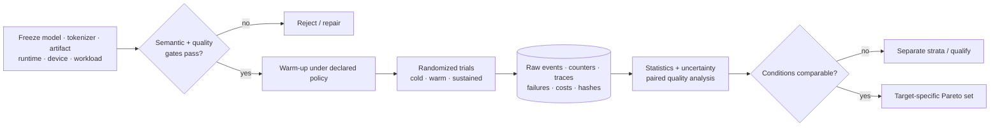

# Chapter 31 — Compression and Edge Benchmarking

> **Illustrative values.** Concrete identifiers, dates, thresholds, hashes, account numbers, and endpoints in this file are teaching examples, not observed project results or deployable credentials. Before use, replace them with reviewed values from your own registry, preserve the required format, and rerun every stated validation.

<a id="ch31-status"></a>

## 31.1 Scope and evidence boundary

**Research freeze:** 2026-11-23.

**Status:** **AUTHORED / NOT EXECUTED.** No checkpoint was converted, no benchmark program was run, no physical device
or AWS instance was measured, and no price was queried for this chapter. Listings are `UNVERIFIED IMPLEMENTATION`;
procedures are `PLANNED EXPERIMENT`; formulas and worked values are `ILLUSTRATIVE` or `ESTIMATE`. Officially documented
tool capabilities are `DOC-VERIFIED`, not runtime results. No number below is presented as a measured model result.

This chapter turns the deployment mechanics in [Chapters 16–22](../part-05-edge-ai-and-mobile-inference/README.md) and
the quality requirements of [CH-29](ch-29-model-quality-evaluation.md) into one auditable benchmark contract. Evidence
labels follow the project [evidence standard](../../00-governance/evidence-and-citation-standard.md).

After completing this chapter, the reader should be able to:

1. define every required storage, memory, latency, throughput, utilization, energy, thermal, reliability, quality,
   conversion, and cost metric;
2. distinguish startup, first model token, user-visible Time to First Token (TTFT), prefill, decode, and end-to-end
   latency;
3. control device, OS, processor, RAM, ambient, charge, background, warm-up, prompt, output, and repetition conditions;
4. collect Android, iOS, Linux, and AWS evidence without claiming unsupported precision;
5. include crashes and out-of-memory (OOM) events in the denominator;
6. quantify quality loss and quantization overhead against an immutable parent;
7. calculate dated AWS inference and training costs without inventing prices; and
8. decide whether results are directly comparable, conditionally comparable, or incomparable.

<a id="ch31-problem"></a>

## 31.2 The problem: a smaller file is not a deployment result

Compression can reduce stored bytes while increasing conversion time, startup work, temporary memory, or runtime
dequantization. It can preserve average quality while breaking rare terminology or safety behavior. A model can win a
30-second burst and lose after thermal throttling. A cloud server can report high aggregate throughput while one request
has poor TTFT.

Performance belongs to the complete test unit:

\[ \boxed{\mathcal{U}=(M,T,A,Q,R,B,H,O,W,S,P)} \tag{EQ-CH31-01} \]

where \(M\)=model and adapter lineage, \(T\)=tokenizer/chat/stop contract, \(A\)=artifact, \(Q\)=weight/activation/KV
precision, \(R\)=runtime and build, \(B\)=backend and actual placement, \(H\)=hardware, \(O\)=OS/driver/firmware,
\(W\)=workload, \(S\)=device/service state, and \(P\)=protocol. Change a member and the result belongs to another test
unit.

The objective is not merely “maximize tokens/s.” It is to identify non-dominated candidates subject to quality, safety,
memory, reliability, and compatibility gates:

\[ \min(S_\text{disk},M_\text{peak},T_\text{startup},T_\text{TTFT}, T_\text{E2E},E_\text{token},C_\text{request})
\quad\text{and}\quad \max(r_\text{prefill},r_\text{decode},Q_\text{domain}). \tag{EQ-CH31-02} \]

A critical safety failure is not compensated by lower latency.

<a id="fig-23"></a> **FIG-23 — Benchmark and evaluation workflow (`ILLUSTRATIVE`).**

_Alt text:_ An approved immutable model/runtime/device/workload tuple passes correctness gates, randomized cold, warm, <!-- markdownlint-disable-line MD013 MD049 -->
and sustained trials, raw generation capture, quality and system scoring, failure accounting, paired statistics,
comparability review, and target-specific release selection. Not measured; arrows show conceptual relationships only.



<a id="ch31-stage-model"></a>

## 31.3 The generation timeline

Instrument the runtime with a monotonic clock at:

- \(t_0\): launch or request submitted, according to the metric;
- \(t_\text{ready}\): model and session ready;
- \(t_\text{ps}\), \(t_\text{pe}\): prefill start/end;
- \(t_1\): first model token selected;
- \(t_v\): first valid text fragment rendered;
- \(t_i\): every emitted token;
- \(t_f\): response complete, cancelled, or failed.

**Startup time**

\[ T_\text{startup}=t_\text{ready}-t_\text{launch} \tag{EQ-CH31-03} \]

must state whether it includes verification, mapping, repacking, graph compilation, tokenizer setup, KV allocation, and
warm-up. Report process-cold, page-cache-cold where reproducibly achievable, and warm/cached startup separately.

**First-token latency** is request submission to \(t_1\). **User-visible TTFT** is request submission to \(t_v\):

\[ T_\text{TTFT}=t_v-t_0. \tag{EQ-CH31-04} \]

They differ because sampling, detokenization, transport, and rendering intervene. Do not use them as synonyms unless
boundaries are identical.

For \(N_p\) input tokens and \(N_g\) generated tokens:

\[ r_\text{prefill}=\frac{N_p}{t_\text{pe}-t_\text{ps}}, \qquad r_\text{decode}=\frac{N_g-1}{t_{N_g}-t_1}.
\tag{EQ-CH31-05} \]

Here \(t_{N_g}\) is the final generated-token timestamp; \(t_f\) can include later rendering and teardown. Decode rate
is undefined for fewer than two generated tokens. If a runtime counts the first sampled token differently, record the
convention. Never divide all input and output tokens by total wall time and call it decode throughput.

\[ T_\text{E2E}=t_f-t_0. \tag{EQ-CH31-06} \]

Product E2E includes queueing and rendering. Also retain component times. For streaming, report the inter-token latency
distribution \(t_i-t_{i-1}\).

Input context length is the **actual token count presented to prefill**, including template, system, specials, and
history. Output length is generated token IDs before display filtering. Record requested and actual output; early
end-of-sequence otherwise biases latency.

<a id="ch31-metrics"></a>

## 31.4 Canonical metric dictionary

<a id="tbl-ch31-01"></a> **TBL-CH31-01 — Required metric definitions (`STATICALLY REVIEWED`)**

<!-- markdownlint-disable MD013 -->
| Metric                 |                 Unit | Canonical definition                                                                           | Frequent error                            |
| ---------------------- | -------------------: | ---------------------------------------------------------------------------------------------- | ----------------------------------------- |
| Parameter count        |                count | Unique learned scalars; also active parameters/token for MoE and adapter parameters separately | double-counting tied weights              |
| On-disk model size     |       bytes, MiB/GiB | Exact artifact bytes; tokenizer, runtime, app/container, installed, and update peak separate   | using ideal bits × parameters             |
| Artifact download size |                bytes | Bytes transferred, including required shards and metadata; compressed and expanded reported    | substituting local file size              |
| Memory after load      |                bytes | Process PSS/RSS/footprint after ready and before request, with pre-load baseline               | treating virtual mapping as resident      |
| Peak runtime memory    |                bytes | Maximum across load, prefill, decode, and max context; scope named                             | omitting GPU/NPU/driver or short peaks    |
| Startup                |                   ms | EQ-CH31-03 with cold/warm policy                                                               | hiding compile/hash/warm-up               |
| First model token      |                   ms | request submit to token selection                                                              | calling rendered text the model token     |
| TTFT                   |                   ms | request submit to first valid visible fragment                                                 | silently excluding queue/network/UI       |
| Prefill throughput     |       input tokens/s | EQ-CH31-05                                                                                     | mixing prompt lengths/tokenizers          |
| Decode throughput      |   generated tokens/s | EQ-CH31-05, excluding prefill                                                                  | using aggregate server throughput         |
| End-to-end latency     |                   ms | submit to terminal success/failure                                                             | timing only model kernels                 |
| Context/output         |               tokens | actual source-tokenizer counts, requested and actual                                           | characters used as tokens                 |
| CPU utilization        |         % and core-s | sampled process/system CPU with normalization                                                  | incompatible 100% definitions             |
| GPU utilization        |          % and trace | engine utilization, memory, clocks, and placement over interval                                | assuming backend selection proves use     |
| NPU utilization        |       %/time or null | vendor counter with scope; otherwise placement only                                            | inventing a value from lower CPU use      |
| Battery drain          | mAh/Wh or long-run % | controlled start/end charge with duration and uncertainty                                      | short one-percent deltas                  |
| Energy/token           |    J/generated token | incremental measured energy divided by actual output tokens                                    | treating subsystem energy as whole device |
| Thermal behavior       | °C/state/time series | ambient, identified sensors/state, clocks, and time                                            | comparing unnamed sensors                 |
| Sustained performance  |  tok/s and retention | early/late windows and complete timeline                                                       | cold burst only                           |
| Crash/OOM frequency    |    failures/attempts | categorized terminal failures divided by all attempts                                          | deleting failed trials                    |
| Quality degradation    |         metric delta | candidate minus immutable parent on identical examples                                         | different model or test split             |
| Quantization overhead  |         time/bytes/J | offline conversion, load-time repack, and runtime dequant/cast separately                      | assuming smaller disk means none          |
| AWS cost/inference     |     currency/request | dated allocated service cost per attempted and successful request                              | price × kernel seconds only               |
| Training cost          |  currency/resource-h | compute, storage, transfer, service, failed/recovery, and human review                         | excluding failures/idle setup             |
| Conversion time        |                    s | source-open to verified artifact, with sub-stages                                              | timing only quantizer kernel              |
<!-- markdownlint-restore -->

### 31.4.1 Parameters, size, and download

For tensors \(j\) with \(n_j\) logical elements:

\[ N_\text{unique}=\sum_j n_j-\text{aliased/tied duplicates}. \tag{EQ-CH31-07} \]

For adapters, report base, adapter, merged unique, and trainable counts. For structured pruning, report logical and
stored counts. For unstructured sparsity, report nonzero fraction and encoded bytes; zeros in dense tensors do not
guarantee speed.

Always report raw bytes and units:

\[ 1\ \text{MiB}=2^{20}\text{ bytes},\qquad1\ \text{MB}=10^6\text{ bytes}. \]

Hash every artifact. Scales, zero points, high-precision exceptions, alignment, and metadata make \(Nb/8\) only an
estimate.

Download size includes required weights, tokenizer, configuration, manifests, signatures, and runtime delta. Report
network compression and installed expansion separately. For updates, measure old + staged + new + rollback peak and
retransmitted bytes.

### 31.4.2 Memory

\[ M_\text{peak}=M_W+M_\text{KV}+M_A+M_\text{workspace}
+M_\text{temporary}+M_\text{runtime}+M_\text{app}+M_\text{driver}. \tag{EQ-CH31-08} \]

Capture pre-load, load peak, post-load, prefill peak, early decode, late/max-context decode, reset, and unload.
Distinguish virtual memory, Resident Set Size (RSS), Proportional Set Size (PSS), Apple memory footprint, and
accelerator allocations. Report each platform-native metric by name; do not force false equivalence.

EQ-CH31-08 is a resource ledger, not an instruction to add counters that overlap. Unified/shared-memory accelerator
pages may already appear in process or system memory; identify ownership and avoid double-counting.

### 31.4.3 Utilization

Utilization is diagnostic, not an objective. Record interval, aggregation, process/system scope, and missing samples. A
process CPU percentage can define 100% as one logical CPU or the whole machine; state which. GPU/NPU percentages are
vendor-defined and are not a cross-vendor efficiency scale.

Operator placement can be more informative than one NPU percentage. If no public counter exists, record `null` and
`not_measurable`; zero means measured zero.

### 31.4.4 Reliability

\[ \hat p_\text{failure}= \frac{n_\text{crash}+n_\text{OOM}+n_\text{timeout}+n_\text{other
terminal}}{n_\text{attempted}}. \tag{EQ-CH31-09} \]

Report categories and denominator. An OS kill can be an OOM/resource failure without an in-process exception. A trial
that emits fewer required tokens due to an error is not a successful fast trial.

### 31.4.5 Quality degradation and quantization overhead

For a higher-is-better quality metric:

\[ \Delta q=q_\text{candidate}-q_\text{parent},\qquad R_q=q_\text{candidate}/q_\text{parent}. \tag{EQ-CH31-10} \]

For error rates, preserve direction. Evaluate paired example-level differences, domain strata, safety subsets, general
retention, long context, refusal, and calibration. Report absolute and relative change; averages can hide critical
regressions.

Quantization overhead has three ledgers:

1. **offline:** calibration preparation/inference, quantization, conversion, verification, temporary disk, host
   RAM/VRAM, and compute;
2. **load-time:** validation, unpacking, repacking, graph compilation, and duplicate buffers;
3. **per-inference:** dequantization/casts, metadata traffic, fallback, workspace, latency, and energy.

Compare with a runtime-equivalent higher-precision baseline. One-time conversion and per-token overhead have different
economics.

<a id="ch31-energy"></a>

## 31.5 Energy, battery, thermal, and sustained performance

\[ E=\int_{t_0}^{t_1}P(t)\,dt,\qquad E_\text{token}=\frac{E_\text{active}-E_\text{idle-matched}}{N_g}. \tag{EQ-CH31-11}
\]

State the boundary:

- whole device at wall or battery rail;
- system-on-chip/package estimate;
- CPU/GPU/NPU rail;
- process-attributed software model; or
- cloud accelerator board power.

These are not interchangeable. Rail sums can omit display, DRAM, regulators, and host CPU. Wall power includes supply
loss and unrelated components. Software estimates inherit model error. If subtracting idle, match display, radios,
samplers, thermal state, and duration; publish gross and incremental values.

**Battery percentage is not an energy meter.** It is quantized, filtered, temperature-dependent, and may update after
the interval. Prefer charge counters or external instrumentation. If only percentage exists, use long randomized
discharge experiments, report resolution, and leave J/token unavailable.

Charging changes energy flow and heat. Do not infer battery drain while plugged in. Treat charging and battery operation
as separate conditions.

Pre-register early and late windows:

\[ \rho_\text{sustain}=\frac{r_\text{late}}{r_\text{early}}. \tag{EQ-CH31-12} \]

Also report absolute rates and the timeline. Decline can arise from thermal policy, context growth, background work, or
battery policy; temperature alone does not prove causality. Record clocks, context position, thermal state, and
utilization.

<a id="ch31-controls"></a>

## 31.6 Controlled benchmark protocol

This protocol is a `PLANNED EXPERIMENT`.

### 31.6.1 Freeze identity

Record:

- immutable source model, tokenizer, template, adapter/merge, evaluation snapshot, licenses, and SHA-256 hashes;
- quantizer/converter commit, command, calibration manifest, seed, weight/activation/KV types, grouping, scales,
  exceptions;
- runtime, compiler, build flags, native libraries, backend/delegate, placement report, app/container hash;
- device SKU, SoC, CPU topology, GPU/NPU, installed and **available** RAM, storage/free space, OS build, kernel,
  firmware, drivers, and power mode;
- AWS Region, instance, tenancy/purchase model, AMI/container, storage, network, replicas, scaling, batch, and
  concurrency;
- prompt-set hash, token IDs/counts, requested/actual output, context, cache state, decoding, and stops.

Available RAM is measured immediately before each block; total RAM is metadata, not the app budget.

### 31.6.2 Required controlled conditions

| Control    | Required record or rule                                                |
| ---------- | ---------------------------------------------------------------------- |
| Device     | exact model/SKU, not “Android” or “iPhone”                             |
| OS         | full build; kernel/firmware/driver where observable                    |
| Processor  | exact SoC/CPU/GPU/NPU and backend                                      |
| RAM        | installed, available before block, competing allocations               |
| Ambient    | measured °C, airflow, case/cooling, start-temperature band             |
| Charge     | battery %, health if available, plugged state, charger/power mode      |
| Background | allow-list, radios, display brightness/state, indexing/telemetry       |
| Warm-up    | fixed count or stability criterion; values and exclusion rule retained |
| Prompts    | immutable text/token IDs; short/medium/long/domain/safety strata       |
| Outputs    | fixed-length performance and natural-completion quality runs           |
| Repeats    | pre-registered count; randomized or balanced order                     |

Do not disable thermal or safety controls. Cool to the same start band or model carryover statistically. Alternate order
rather than always running the parent first.

### 31.6.3 Workload matrix

At minimum:

1. process-cold startup and first request;
2. warm loaded request;
3. short, medium, and long prefill;
4. fixed 32/128/512-token output strata where safe;
5. early and late-context decode;
6. maximum approved context and overflow behavior;
7. 10–30 minute sustained session, or a registered product-derived duration;
8. cancellation, reset, unload/reload, background/foreground, and pressure on edge;
9. concurrency 1 and production-relevant offered loads on AWS;
10. unchanged domain, retention, uncertainty, refusal, and safety suites.

Use greedy decoding for paired timing/parity where supported. Forced output is useful for timing but cannot replace
natural completion tests.

### 31.6.4 Procedure

1. Verify hashes, tokenizer/template parity, source-target correctness, and quality.
2. Inventory state; reject or record deviations before the block.
3. Start samplers and synchronized traces.
4. Perform declared warm-up; retain its raw records.
5. Run repeated trials in randomized/balanced order.
6. Record every stage and token timestamp with a monotonic clock.
7. Capture memory, utilization, energy, temperature, clocks, placement, and failures.
8. Run sustained work from the declared start band.
9. Re-run quality after every format, cache precision, context, or backend change.
10. Archive raw logs, manifests, commands, versions, hashes, and deviations read-only.

<a id="ch31-platforms"></a>

## 31.7 Platform measurement procedures

### 31.7.1 Android

Use a release/profileable app on a physical device; emulator results are functional only.

1. Record `getprop`, SKU, SoC, RAM, OS/build, battery/charging, app thermal state, display/radio/background policy, and
   ambient/start temperature.
2. Add monotonic in-app events for load, ready, prefill, model token, rendered fragment, every token, and completion.
3. Use Perfetto/System Trace for scheduling, process stats, frequencies, and supported power rails. Use
   `dumpsys meminfo com_example_slmbench` at phase boundaries and sampled traces for peaks.
4. Use `dumpsys batterystats` only for long-run diagnostics under a declared reset policy. Android describes approximate
   per-UID/component power, not a calibrated joulemeter.
5. On devices exposing On-Device Power Rails Monitor (ODPM), report rail coverage and device-level scope.
6. Capture backend partitions/delegation. Unmeasurable NPU use is `null`.
7. Force-stop between process-cold trials; do not imply that force-stop clears Linux page cache.
8. Run unplugged for battery/whole-device energy unless external instrumentation defines another boundary. Charging is a
   separate thermal stratum.
9. Retrieve exit reasons/logs for crash/OOM classification without retaining private prompts.

**Listing CH31-L01 — Android capture skeleton (`UNVERIFIED IMPLEMENTATION`).**

```powershell
# Prerequisites: pinned platform-tools, authorized physical device,
# profileable release app, and app-owned deterministic benchmark intent.
$Package = "com.example.slmbench"
$RunId = "illustrative-run-001"
$Config = "/data/misc/perfetto-configs/slm-benchmark.pbtxt"
$Out = "results/android/$RunId"
New-Item -ItemType Directory -Force $Out | Out-Null

adb shell getprop > "$Out/getprop.txt"
adb shell dumpsys battery > "$Out/battery-before.txt"
adb shell dumpsys meminfo $Package > "$Out/mem-before.txt"
adb shell dumpsys batterystats --reset

# Run Perfetto with a reviewed config containing sched/frequency/process stats
# and android.power only where exposed. The config must have a bounded duration.
$Trace = Start-Job -ArgumentList $Config, $RunId -ScriptBlock {
  param($Config, $RunId)
  adb shell perfetto -c $Config `
    -o "/data/misc/perfetto-traces/$RunId.perfetto-trace" --txt
}

# The benchmark activity must wait in an armed state until this explicit trigger.
adb shell am force-stop $Package
adb shell am start -W -n "com.example.slmbench/com.example.slmbench.BenchmarkActivity" `
  --es benchmark_manifest "/sdcard/benchmark-manifest.json" `
  --ez wait_for_trigger true > "$Out/am-start.txt"
adb shell am broadcast -a "$Package.RUN_BENCHMARK"
Wait-Job $Trace | Receive-Job > "$Out/perfetto-console.txt"

adb shell dumpsys meminfo $Package > "$Out/mem-after.txt"
adb shell dumpsys battery > "$Out/battery-after.txt"
adb shell dumpsys batterystats --charged $Package > "$Out/batterystats.txt"
adb pull "/data/misc/perfetto-traces/$RunId.perfetto-trace" $Out
adb pull "/sdcard/Android/data/$Package/files/$RunId.jsonl" $Out
```

Paths and permissions are device/version dependent. Do not automate changes that bypass normal thermal or power
safeguards.

### 31.7.2 iOS and iPadOS

Use a signed Release build on physical hardware.

1. Record device, OS build, battery/charging, Low Power Mode, free storage, ambient/start thermal state,
   display/background policy, model/runtime hashes, and backend eligibility.
2. Wrap load, prefill, decode, and request spans with `os_signpost` or equivalent monotonic events.
3. Use Instruments Time Profiler for CPU/call stacks; Allocations and VM Tracker for memory; Core ML and Metal
   instruments for placement/activity where applicable.
4. Record `ProcessInfo.thermalState` transitions and token timestamps. Thermal state is not temperature.
5. Use Energy Diagnostics/Energy Log as a relative diagnostic. Apple's Energy Usage level is subjective; do not convert
   it to joules/token.
6. For calibrated joules, use a validated external boundary or report unavailable. Wireless profiling avoids USB
   charging but is itself a controlled condition.
7. Use MetricKit for field CPU, peak memory, and memory-limit termination evidence, not short per-run timing; reports
   aggregate system-captured periods.
8. Test background, lock, cancellation, pressure, and relaunch. Simulator data stays outside performance tables.

**Listing CH31-L02 — iOS signpost shape (`UNVERIFIED IMPLEMENTATION`).**

```swift
import OSLog

let log = OSLog(subsystem: "book.slm.benchmark", category: .pointsOfInterest)
let id = OSSignpostID(log: log)
os_signpost(.begin, log: log, name: "Request", signpostID: id,
            "prompt_tokens=%d requested_output=%d", promptTokens, requestedOutput)
os_signpost(.begin, log: log, name: "Prefill", signpostID: id)
try engine.prefill(tokens)
os_signpost(.end, log: log, name: "Prefill", signpostID: id)
for (index, token) in try engine.generate() {
    os_signpost(.event, log: log, name: "Token", signpostID: id,
                "index=%d token_id=%d", index, token.id)
}
os_signpost(.end, log: log, name: "Request", signpostID: id)
```

The runtime API is abstract. Add first-render instrumentation in the UI; this listing alone measures neither visible
TTFT nor energy.

### 31.7.3 Linux, ARM64 Linux, Raspberry Pi, Jetson, and laptops

1. Record manifests plus `uname`, distribution, kernel, CPU flags/topology, RAM, storage, GPU/NPU/driver, governor/power
   mode, cooling, AC/battery, and ambient.
2. Use monotonic runtime events. Use `/usr/bin/time -v`, `/proc/1234`, cgroups, or a pinned sampler for RSS/CPU/page
   faults; use PSS where shared mappings matter.
3. NVIDIA: capture `nvidia-smi` or Jetson-supported telemetry at a declared interval; distinguish GPU/board from
   whole-system power. Record `nvpmodel` on Jetson.
4. Map Linux `hwmon`/thermal sensors to identified components. Do not compare unnamed `temp1` values across machines.
5. Intel RAPL, when available through powercap, exposes energy by zone. Handle wraparound with `max_energy_range_uj`;
   package energy is not whole-device energy.
6. On battery laptops, use stable charge/energy interfaces only for long runs. AC and battery are separate strata.
7. Run native and container paths separately; include container startup and host-driver compatibility.

**Listing CH31-L03 — Linux process/RAPL sampler (`UNVERIFIED IMPLEMENTATION`).**

```python
#!/usr/bin/env python3
"""Linux only. Dependencies: Python 3.11+ and a pinned psutil release.
RAPL is optional; null means unavailable. Runtime event parsing is separate.
"""
import argparse, glob, json, os, subprocess, time
import psutil

def zones():
    out = []
    for energy in glob.glob("/sys/class/powercap/**/energy_uj", recursive=True):
        base = os.path.dirname(energy)
        try:
            out.append({"name": open(base + "/name").read().strip(),
                        "energy": energy,
                        "range": int(open(base + "/max_energy_range_uj").read())})
        except (OSError, ValueError):
            pass
    return out

def energy(zs):
    out = {}
    for z in zs:
        try: out[z["name"]] = int(open(z["energy"]).read())
        except (OSError, ValueError): out[z["name"]] = None
    return out

ap = argparse.ArgumentParser()
ap.add_argument("--out", required=True)
ap.add_argument("--interval-ms", type=int, default=100)
ap.add_argument("command", nargs=argparse.REMAINDER)
a = ap.parse_args()
if not a.command: ap.error("command required after --")

zs = zones(); e0 = energy(zs); t0 = time.monotonic_ns()
p = subprocess.Popen(a.command); root = psutil.Process(p.pid); samples = []
while p.poll() is None:
    rss = cpu = 0
    for x in [root] + root.children(recursive=True):
        try:
            rss += x.memory_info().rss
            c = x.cpu_times(); cpu += c.user + c.system
        except (psutil.NoSuchProcess, psutil.AccessDenied):
            pass
    samples.append({"monotonic_ns": time.monotonic_ns(),
                    "rss_bytes_process_tree": rss, "cpu_seconds": cpu})
    time.sleep(a.interval_ms / 1000)
t1 = time.monotonic_ns(); e1 = energy(zs); rapl = {}
for z in zs:
    x, y = e0.get(z["name"]), e1.get(z["name"])
    rapl[z["name"]] = None if x is None or y is None else (
        y - x if y >= x else z["range"] - x + y)
with open(a.out, "w") as f:
    json.dump({"schema":"ch31.linux-sampler/v1", "returncode":p.returncode,
               "start_ns":t0, "end_ns":t1, "samples":samples,
               "rapl_energy_uj_by_zone":rapl}, f, indent=2)
```

Limitations: 100 ms can miss peaks; RSS can double-count shared pages; RAPL scope varies; CPU values are cumulative.
Retain runtime events and native profiler output too.

### 31.7.4 AWS inference

Separate **client-observed**, **service**, and **accelerator** time.

1. Freeze Region, instance, AMI/container, driver/runtime, artifact, topology, storage, networking, purchase model,
   replicas, batch/concurrency, scaling, and server config.
2. Declare load-generator and endpoint locations. Record DNS/TLS/auth/network or test both in-Region and user-path
   clients.
3. Warm model/kernels under a fixed policy; measure cold provisioning/load separately.
4. Generate a fixed offered-load schedule. Report concurrency, arrivals/s, successes/s, queue, batch occupancy, TTFT,
   inter-token latency, E2E, errors, and throttling.
5. Capture CPU, memory, network, and accelerator telemetry. AWS documents CloudWatch/DCGM NVIDIA utilization, memory,
   temperature, and power metrics; telemetry itself can cost money.
6. Synchronize accelerator work before service timing. Map client/server traces with request IDs.
7. Run through autoscaling and steady state. Do not divide peak tokens/s by price unless sustained at the stated
   latency/error objective.
8. Query dated prices or actual billing. Record currency, tax, discounts, Spot interruption, Savings Plan/Reserved
   allocation, storage, transfer, load balancer, observability, and idle time.

\[ C_\text{request}^{attempted}=\frac{C_\text{allocated}}{N_\text{attempted}}, \qquad
C_\text{request}^{successful}=\frac{C_\text{allocated}}{N_\text{successful}}. \tag{EQ-CH31-13} \]

\[ C_\text{allocated}=C_\text{compute}+C_\text{storage}+C_\text{network}
+C_\text{LB/API}+C_\text{observability}+C_\text{managed}. \tag{EQ-CH31-14} \]

Include idle replicas and failures. Report cost/1,000 requests and cost/million generated tokens. Prices depend on
Region, date, and purchase model; this chapter supplies no dollar price.

**Listing CH31-L04 — AWS cost arithmetic (`UNVERIFIED IMPLEMENTATION`).**

```python
from decimal import Decimal
import json, sys

# Values must come from a dated Price List/Calculator/contract or allocated bill.
x = json.load(open(sys.argv[1], encoding="utf-8"))
cost = sum(Decimal(str(x["cost"][k])) for k in (
    "compute", "storage", "network", "load_balancer_api",
    "observability", "managed_service"))
attempted = Decimal(x["requests"]["attempted"])
successful = Decimal(x["requests"]["successful"])
tokens = Decimal(x["tokens"]["generated_successful"])
print(json.dumps({
  "currency": x["currency"],
  "pricing_effective_date": x["pricing_effective_date"],
  "allocated_total": str(cost),
  "cost_per_attempt": str(cost / attempted),
  "cost_per_success": None if not successful else str(cost / successful),
  "cost_per_million_generated_tokens":
      None if not tokens else str(cost * Decimal(1_000_000) / tokens)
}, indent=2))
```

The allocation method is part of the result. Cost Explorer can lag and mix unrelated tagged resources; experiment
accounts/tags and billing reconciliation reduce ambiguity.

<a id="ch31-costs"></a>

## 31.8 Training, conversion, quantization, and delivery costs

### Training cost

Record allocated wall time, accelerator-hours, CPU-hours, orchestration, storage, checkpoints, transfer, tracking,
failed/recovery runs, teacher generation, and human/expert review:

\[ C_\text{training}=\sum_i h_i p_i+C_\text{storage}+C_\text{transfer} +C_\text{service}+C_\text{failed}+C_\text{human}.
\tag{EQ-CH31-15} \]

\(h_i\) is billed resource time and \(p_i\) the dated effective unit price. Disclose shared-cluster allocation. Spot
savings and interruption costs both appear. Report resource quantities when currency is confidential. Carbon/energy
estimates are separate and require their own boundaries.

### Conversion and quantization

Instrument source validation, calibration loading, calibration inference, quantization, serialization,
hash/verification, target compilation, parity/quality evaluation, and upload separately. Record peak host RAM/VRAM,
temporary disk, failures, and output bytes. A fast incorrect conversion fails.

### Delivery

Measure source checkpoint, converted artifact, compressed network payload, tokenizer/config/manifest/signature, runtime
delta, installed expansion, and update peak. For resumable delivery, record retransmitted bytes and completion rate. CDN
transfer/request/egress is distribution cost unless the declared product objective combines it with inference.

<a id="ch31-schema"></a>

## 31.9 Standard result schema and tables

Use one row per trial, not one row per average. `null` means unavailable/unmeasured and requires a reason. Zero is a
measurement.

**Listing CH31-L05 — canonical JSON trial record (`UNVERIFIED IMPLEMENTATION`).**

```json
{
  "schema": "slm-benchmark.ch31/v1",
  "evidence": "PLANNED_EXPERIMENT",
  "run_id": "00000000-0000-4000-8000-000000000001",
  "trial_index": 0,
  "timestamps": { "utc_start": "2026-01-15T12:00:00Z", "monotonic_clock": "illustrative-name" },
  "identity": {
    "model_revision": "aaaaaaaaaaaaaaaaaaaaaaaaaaaaaaaaaaaaaaaa",
    "tokenizer_revision": "aaaaaaaaaaaaaaaaaaaaaaaaaaaaaaaaaaaaaaaa",
    "artifact_sha256": "aaaaaaaaaaaaaaaaaaaaaaaaaaaaaaaaaaaaaaaaaaaaaaaaaaaaaaaaaaaaaaaa",
    "runtime_revision": "aaaaaaaaaaaaaaaaaaaaaaaaaaaaaaaaaaaaaaaa",
    "app_or_container_sha256": "aaaaaaaaaaaaaaaaaaaaaaaaaaaaaaaaaaaaaaaaaaaaaaaaaaaaaaaaaaaaaaaa"
  },
  "model": {
    "parameters_unique": null,
    "parameters_active_per_token": null,
    "adapter_parameters": null,
    "weight_type": "illustrative-exact-value",
    "activation_type": "illustrative-exact-value",
    "kv_type": "illustrative-exact-value",
    "artifact_bytes": null,
    "download_bytes": null
  },
  "target": {
    "class": "android|ios|linux|aws",
    "device_or_instance": "illustrative-exact-value",
    "os_build": "illustrative-exact-value",
    "processor": "illustrative-exact-value",
    "ram_installed_bytes": null,
    "ram_available_before_bytes": null,
    "backend": "illustrative-exact-value",
    "placement_evidence_uri": null
  },
  "conditions": {
    "ambient_c": null,
    "start_temperature_c": null,
    "battery_percent": null,
    "charging": null,
    "power_mode": "illustrative-exact-value",
    "background_policy": "illustrative-exact-value",
    "display_radios": "illustrative-exact-value",
    "warmup_index": null,
    "cold_definition": "illustrative-exact-value"
  },
  "workload": {
    "prompt_id": "illustrative-id-001",
    "prompt_set_sha256": "aaaaaaaaaaaaaaaaaaaaaaaaaaaaaaaaaaaaaaaaaaaaaaaaaaaaaaaaaaaaaaaa",
    "input_tokens": null,
    "requested_output_tokens": null,
    "generated_tokens": null,
    "context_limit": null,
    "batch": 1,
    "concurrency": 1,
    "decoding": "illustrative-exact-value",
    "cache_state": "illustrative-exact-value"
  },
  "timing": {
    "startup_ms": null,
    "first_model_token_ms": null,
    "ttft_visible_ms": null,
    "prefill_ms": null,
    "decode_ms": null,
    "e2e_ms": null,
    "prefill_tokens_s": null,
    "decode_tokens_s": null,
    "token_monotonic_ns_uri": "<raw artifact>"
  },
  "resources": {
    "memory_before_bytes": null,
    "memory_after_load_bytes": null,
    "peak_runtime_memory_bytes": null,
    "memory_metric_name": "<RSS|PSS|footprint>",
    "cpu_utilization_definition": "illustrative-exact-value",
    "cpu_samples_uri": null,
    "gpu_utilization_uri": null,
    "npu_utilization_uri": null
  },
  "energy_thermal": {
    "measurement_boundary": "<exact|unavailable>",
    "gross_energy_j": null,
    "idle_baseline_energy_j": null,
    "energy_per_generated_token_j": null,
    "battery_delta_mah": null,
    "thermal_trace_uri": null,
    "sustained_early_tokens_s": null,
    "sustained_late_tokens_s": null
  },
  "outcome": {
    "status": "success|crash|oom|timeout|cancelled|invalid_output",
    "failure_phase": null,
    "exit_diagnostic_uri": null
  },
  "quality": {
    "evaluation_snapshot": "aaaaaaaaaaaaaaaaaaaaaaaaaaaaaaaaaaaaaaaa",
    "parent_result_id": "illustrative-id-001",
    "metric_values_uri": "<paired per-example results>",
    "critical_failures": null
  },
  "cost": {
    "currency": null,
    "pricing_effective_date": null,
    "allocated_cost": null,
    "allocation_method": null
  },
  "deviations": [],
  "raw_manifest_uri": "<immutable artifact>",
  "reviewer": null
}
```

Validate against a machine-readable schema before analysis. Keep high-frequency traces externally and reference them by
hash/URI.

<a id="tbl-ch31-02"></a> **TBL-CH31-02 — Environment and workload template (`PLANNED EXPERIMENT`)**

<!-- markdownlint-disable MD013 -->
| Group  | Model/artifact hash | Runtime/backend | Device/instance/OS | RAM available | Ambient/start | Charge/power | Background/display/radios | Prompt/output/context | Warm-ups × trials |
| ------ | ------------------- | --------------- | ------------------ | ------------: | ------------- | ------------ | ------------------------- | --------------------- | ----------------: |
| `illustrative-id-001` | `aaaaaaaaaaaaaaaaaaaaaaaaaaaaaaaaaaaaaaaaaaaaaaaaaaaaaaaaaaaaaaaa`            | `illustrative-exact-value`       | `illustrative-exact-value`          |             — | —             | —            | —                         | —                     |                 — |
<!-- markdownlint-restore -->

<a id="tbl-ch31-03"></a> **TBL-CH31-03 — Worked storage and reliability dataset (`ILLUSTRATIVE`)**

<!-- markdownlint-disable MD013 -->
| Variant | Params unique/active | Artifact/download | Post-load memory | Peak memory | Conversion time | Quant peak RAM/VRAM | Success/crash/OOM/timeout |
| ------- | -------------------: | ----------------: | ---------------: | ----------: | --------------: | ------------------: | ------------------------: |
| FP16-A  |          1.0B / 1.0B | 1.90 / 1.90 GiB   |         2.35 GiB |    3.10 GiB |             n/a |                 n/a |                `20/0/0/0` |
| INT8-A  |          1.0B / 1.0B | 1.02 / 1.02 GiB   |         1.42 GiB |    2.08 GiB |          14 min |     5.2 / 2.1 GiB |                `20/0/0/0` |
| INT4-A  |          1.0B / 1.0B | 0.58 / 0.58 GiB   |         1.01 GiB |    1.72 GiB |          19 min |     5.6 / 2.3 GiB |                `18/0/2/0` |
<!-- markdownlint-restore -->

The table teaches three distinctions. First, artifact reduction is larger than loaded-memory reduction because runtime
buffers and the KV cache remain. Second, quantization itself consumes temporary host and accelerator memory. Third,
INT4 is not automatically the winner: its two OOMs remain in the denominator.

<a id="tbl-ch31-04"></a> <a id="tbl-21"></a> **TBL-21 — Worked inference dataset (`ILLUSTRATIVE`; not measured)**

<!-- markdownlint-disable MD013 -->
| Variant/stratum |  n | Startup median | TTFT median/p95 | Prefill tok/s | Decode tok/s; p95 ITL | E2E median/p95 | Early→late tok/s | Failures |
| --------------- | -: | -------------: | --------------: | ------------: | --------------------: | -------------: | ---------------: | -------: |
| FP16-A / warm   | 20 |         820 ms |   410 / 520 ms  |           118 |        18.0; 72 ms    | 7.5 / 8.3 s    |      18.4 → 16.9 |        0 |
| INT8-A / warm   | 20 |         690 ms |   360 / 470 ms  |           126 |        20.5; 64 ms    | 6.7 / 7.5 s    |      20.8 → 19.2 |        0 |
| INT4-A / warm   | 20 |         610 ms |   390 / 780 ms  |           121 |        21.3; 91 ms    | 6.6 / 9.8 s    |      21.9 → 16.0 |        2 |
<!-- markdownlint-restore -->

INT8 is the balanced candidate in this invented dataset: it improves every displayed latency statistic without
failures. INT4 has the best median decode rate but worse p95 TTFT, larger late-run degradation
\((16.0/21.9)=0.73\), and a 10% OOM rate. Reporting only its 21.3 tok/s median would reverse the engineering decision.

<a id="tbl-ch31-05"></a> <a id="tbl-22"></a> **TBL-22 — Worked quality/energy dataset (`ILLUSTRATIVE`; not measured)**

<!-- markdownlint-disable MD013 -->
| Variant | Energy boundary | Gross/incremental J/token | Thermal observation | Domain score | Domain Δ | Critical failures |
| ------- | --------------- | ------------------------: | ------------------- | -----------: | -------: | ----------------: |
| FP16-A  | whole device    |               2.40 / 1.70 | stable test band    |         0.82 | baseline |                 0 |
| INT8-A  | whole device    |               2.05 / 1.36 | stable test band    |         0.81 |    -0.01 |                 0 |
| INT4-A  | whole device    |               1.88 / 1.20 | late slowdown       |         0.76 |    -0.06 |                 1 |
<!-- markdownlint-restore -->

If the predeclared quality margin is \(-0.02\), INT8 remains eligible and INT4 fails before Pareto analysis. The
critical failure independently blocks INT4. Energy numbers share one boundary, so subtraction is meaningful; they
still must not be compared with package-only or accelerator-rail measurements. Never place unlike conditions in one
unqualified row.

<a id="ch31-statistics"></a>

## 31.10 Statistical handling

### Pre-registration and repetitions

Define primary metrics, minimum relevant effects, trial count, warm-up exclusion, outlier policy, failure handling, and
stopping rule before final results. Use pilots only to estimate variance/instrumentation and label them separately.

There is no universal repetition count. Short microbenchmarks may need many trials; long thermal runs may have fewer
independent blocks. Repeated prompts on one phone do not establish a device-population effect.

### Summaries

- Publish raw trials.
- For skewed latency, report median, IQR, supported p90/p95, and bootstrap confidence intervals.
- Report mean/standard deviation when the estimand is the arithmetic mean, including aggregated cost/energy.
- Compute per-trial throughput before summarizing.
- For failures, report counts and exact or Wilson binomial intervals.
- Retain example-level quality scores and strata.

### Pairing and blocking

Use the same prompt/example for each candidate and analyze paired differences. On devices, use randomized blocks or
AB/BA crossover within start-temperature bands. Device is a block; do not pool phones as repeated samples from one
device.

Use a paired \(t\)-interval only when assumptions are defensible; otherwise use paired bootstrap/permutation. Use
McNemar-style analysis for paired binary outcomes. Report effect and interval, not only a \(p\)-value.

Distinguish **statistical significance** from **engineering significance**. A precisely estimated 1 ms improvement can
be irrelevant to the product, while an uncertain but large OOM reduction may justify more trials. Pre-register minimum
practically important differences and decide with effect sizes, confidence intervals, hard gates, and total
trade-offs—not \(p<0.05\) alone.

### Multiple comparisons

Predefine a primary comparison or control family-wise/false-discovery error when screening variants. A staged
design—correctness, quality, memory, latency, energy—reduces expensive comparisons. Label exploratory findings.

### Missingness, failures, and outliers

Never silently remove OOMs, crashes, thermal aborts, early EOS, or malformed outputs. Conditional-on-success performance
is allowed only beside failure rate and a decision rule using both. Exclude only pre-registered instrumentation faults;
retain reason. Do not apply generic “three sigma” deletion to heavy-tailed latency.

### Sustained time series

Tokens within one run are autocorrelated, not independent trials. Summarize registered run-level windows or use a
declared time-series/mixed model. Report context growth because late decode can slow without heat.

<a id="ch31-comparability"></a>

## 31.11 Comparability rules

### Directly comparable

Material controls match: source/tokenizer and task, runtime semantics, hardware/OS/power, prompt token IDs, output
policy, context/cache, batch/concurrency, warm state, measurement boundary, and statistical unit. The intended
compression/runtime change is the independent variable.

### Conditionally comparable

Conditions differ but a qualified product statement remains useful—for example each platform's best native runtime, or
models with different tokenizers. Report separate token counts, quality, and boundaries; do not attribute the whole
difference to compression.

### Incomparable for ranking

Do not rank:

- different prompts, tokenizers, output lengths, contexts, or sampling policies as raw tokens/s;
- cold startup against warm requests;
- burst against sustained;
- simulator/emulator against physical-device energy/thermals;
- server aggregate batched throughput against mobile batch-one latency;
- vendor peak TOPS against generated tokens/s;
- process/package/rail/wall energy as one quantity;
- RSS, PSS, Apple footprint, accelerator allocation, and total system RAM without qualification;
- different AWS Regions, dates, purchase models, concurrency/SLOs, or allocations;
- paper/vendor results and local measurements on one unlabeled series;
- quality from different snapshots or rubrics.

Token rate is tokenizer-dependent. Cross-family product comparisons should emphasize equal source tasks, E2E, quality,
visible output, memory, energy, and cost, while reporting token counts.

<a id="ch31-domain"></a>

## 31.12 Domain-specific SLM and safety implications

Compression can disproportionately affect rare tokens, identifiers, numbers, units, uncertainty, and long state.
Benchmark:

- automotive/industrial codes, part numbers, measurement-first diagnosis, and lockout/high-voltage/pressure/lifting
  warnings;
- pharmacy names, formulations, routes, interactions, contraindications, decimals/units, special populations, refusal,
  and escalation;
- beekeeping/animal-care species, region, season, treatment legality, uncertainty, and veterinary/regulatory escalation.

Use authoritative ground truth offline; deployed inference still uses no runtime retrieval. An experimental SLM must not
prescribe, alter dosage, authorize hazardous repair, bypass interlocks, or replace a qualified professional. Critical
error classes need pre-registered non-compensable gates.

For multi-domain artifacts, report by domain. Templates/adapters change prompt tokens, startup, memory, and switch
latency. Measure one resident model, adapter switch, and model switch separately.

<a id="ch31-decision"></a>

## 31.13 Decision and release gates

1. **Correctness:** tokenizer/template, logits/greedy parity, cache reset, stops, Unicode.
2. **Quality/safety:** paired domain, retention, calibration, refusal, critical strata.
3. **Storage:** artifact, download, installed, update, rollback.
4. **Memory/reliability:** post-load/peak at max approved context; OOM/crash.
5. **Interaction:** cold/warm startup, TTFT, prefill, decode, E2E, cancellation, UI.
6. **Sustained edge:** energy/battery/thermal and early-to-late retention.
7. **Cloud:** offered-load tails, errors, utilization, scaling, allocated dated cost.
8. **Lifecycle:** background, pressure, corruption, interrupted update, rollback, offline proof.
9. **Evidence:** manifests, raw data, statistics, deviations, costs, reviewer.

Construct separate Pareto sets for low-end Android, flagship Android, iPhone, ARM/Linux edge, laptop, and AWS. Dominance
is meaningful only within one target/requirement set.

<a id="ch31-failures"></a>

## 31.14 Failure modes

| Symptom                      | Likely explanation                          | Required evidence                      |
| ---------------------------- | ------------------------------------------- | -------------------------------------- |
| Tiny artifact, high RAM      | expansion, repack, mixed tensors, residency | allocation/RSS/PSS timeline and dtypes |
| Peak missed                  | slow polling                                | allocator/profiler trace               |
| Great tok/s, poor TTFT       | load/prefill/queue                          | stage events                           |
| Fast prefill, slow decode    | shape/kernel mismatch                       | phase trace                            |
| NPU selected, CPU busy       | partial fallback                            | partition/boundary evidence            |
| Battery result reverses      | charge/ambient/background/resolution        | randomized long trials                 |
| Late slowdown                | heat, context growth, contention            | token/context/clock/thermal traces     |
| “Never OOMs”                 | failures excluded or short outputs          | attempt denominator and output counts  |
| Average quality stable       | rare/safety tail hidden                     | paired strata                          |
| AWS cost negligible          | idle/telemetry/network/failures omitted     | allocated bill                         |
| Conversion free              | calibration/evaluation/upload omitted       | stage ledger                           |
| Cross-model tok/s misleading | tokenizers differ                           | equal-text E2E and counts              |

<a id="ch31-exercises"></a>

## 31.15 Review questions and engineering exercises

### Review questions

1. Why does performance belong to \(\mathcal{U}\)?
2. Distinguish first model token, visible TTFT, and E2E.
3. Why separate prefill and decode?
4. What counts should be reported for tied-weight MoE plus adapter?
5. Why can disk size be smaller than loaded memory?
6. Distinguish RSS, PSS, Apple footprint, and accelerator memory.
7. When is NPU utilization legitimately unavailable?
8. Why is battery percentage unsuitable for a short energy test?
9. Name valid energy boundaries.
10. Why does late slowdown not prove throttling?
11. Define offline, load-time, and per-inference quantization overhead.
12. Why report attempted and successful AWS cost denominators?
13. Why are rates across tokenizers only conditionally comparable?
14. How do OOM trials enter statistics?
15. Why are critical safety metrics non-compensable?

### Engineering exercises

1. Implement a JSON Schema for CH31-L05; reject missing units/reasons.
2. Add monotonic load/prefill/token/render events to one runtime.
3. Compare file bytes, post-load memory, phase peak, and max-context peak for two precisions.
4. Execute CH31-L01 on one physical Android device; document unavailable rails/counters.
5. Collect iOS signposts, Time Profiler, VM Tracker, and placement evidence; explain why Energy Impact is not J/token.
6. Audit CH31-L03, test RAPL wraparound, and compare with `/usr/bin/time -v`.
7. Randomize two variants in temperature blocks; separate heat and context-growth hypotheses.
8. Compute paired domain/safety deltas for parent and quantized artifacts.
9. Measure all conversion stages, host peaks, temporary disk, and upload.
10. Run AWS concurrency steps with client/service/GPU traces, errors, tails, and allocated cost.
11. Derive break-even volume symbolically from instance-hour, idle fraction, output length, and delivery cost—without
    fake prices.
12. Classify published/local comparisons as direct, conditional, or incomparable.
13. Inject malformed artifact, overflow, cancellation, allocation failure, and timeout.
14. Select separate edge/AWS Pareto candidates; leave missing energy unresolved.

Unexecuted exercises are `PLANNED EXPERIMENT`. Promotion requires immutable manifests, raw results, failures, protocol
conformance, and review.

<a id="ch31-sources"></a>

## 31.16 Sources and official documentation

Sources were accessed or recency-checked 2026-11-23. `DOC-VERIFIED` verifies documentation, not project execution.

### Design and statistics

1. **MLCommons.** [MLPerf Inference policies](https://github.com/mlcommons/inference_policies). Scenario, accuracy, run,
   and reporting discipline; freeze the exact version. **DOC-VERIFIED.**
2. **Georges, A.; Buytaert, D.; Eeckhout, L. (2007).** “Statistically Rigorous Java Performance Evaluation.” _OOPSLA <!-- markdownlint-disable-line MD013 MD049 -->
   2007_. DOI [10.1145/1297027.1297033](https://doi.org/10.1145/1297027.1297033). Warm-up and uncertainty principles; <!-- markdownlint-disable-line MD013 MD049 -->
   not an SLM specification. **PAPER-REPORTED.**
3. **Kalibera, T.; Jones, R. (2013).** “Rigorous Benchmarking in Reasonable Time.” _ISMM 2013_. DOI <!-- markdownlint-disable-line MD013 MD049 -->
   [10.1145/2464157.2464160](https://doi.org/10.1145/2464157.2464160). Hierarchical variability. **PAPER-REPORTED.**
4. **Hoefler, T.; Belli, R. (2015).** “Scientific Benchmarking of Parallel Computing Systems.” _SC 2015_. DOI <!-- markdownlint-disable-line MD013 MD049 -->
   [10.1145/2807591.2807644](https://doi.org/10.1145/2807591.2807644). Reproducible performance claims.
   **PAPER-REPORTED.**

### Android and Apple

1. **Android Developers.** [Perfetto](https://developer.android.com/tools/perfetto),
   [System tracing](https://developer.android.com/topic/performance/tracing), and
   [dumpsys](https://developer.android.com/tools/dumpsys). Traces, `meminfo`, and battery diagnostics. **DOC-VERIFIED.**
2. **Android Developers.** [Power Profiler](https://developer.android.com/studio/profile/power-profiler),
   [Thermal API](https://developer.android.com/games/optimize/adpf/thermal), and
   [`PowerManager`](https://developer.android.com/reference/android/os/PowerManager). ODPM scope and thermal signals.
   **DOC-VERIFIED.**
3. **Perfetto.** [Official documentation](https://perfetto.dev/docs/). Trace configuration and analysis.
   **DOC-VERIFIED.**
4. **Apple Developer.** [Instruments](https://help.apple.com/instruments/mac/current/),
   [memory use](https://developer.apple.com/documentation/xcode/reducing-your-app-s-memory-use), and
   [Energy Efficiency Guide](https://developer.apple.com/library/archive/documentation/Performance/Conceptual/EnergyGuide-iOS/).
   Profiling workflows. **DOC-VERIFIED.**
5. **Apple Developer.**
<!-- markdownlint-disable MD013 -->

   [`ProcessInfo.thermalState`](https://developer.apple.com/documentation/foundation/processinfo/thermalstate-swift.property),

<!-- markdownlint-restore -->
   [`os_signpost`](https://developer.apple.com/documentation/os/os_signpost(_:dso:log:name:signpostid:)-2oz8u), and
   [MetricKit](https://developer.apple.com/documentation/metrickit). Thermal, signposts, and field metrics.
   **DOC-VERIFIED.**

### Linux and accelerators

1. **Linux Kernel.** [Powercap](https://docs.kernel.org/power/powercap/powercap.html),
   [thermal sysfs](https://docs.kernel.org/driver-api/thermal/sysfs-api.html), and
   [hwmon](https://docs.kernel.org/hwmon/sysfs-interface.html). Energy counters and sensors. **DOC-VERIFIED.**
2. **Linux manual pages.** [`proc_pid_status(5)`](https://man7.org/linux/man-pages/man5/proc_pid_status.5.html),
   [`proc_pid_smaps(5)`](https://man7.org/linux/man-pages/man5/proc_pid_smaps.5.html), and
   [`time(1)`](https://man7.org/linux/man-pages/man1/time.1.html). Process resources. **DOC-VERIFIED.**
3. **NVIDIA.** [nvidia-smi](https://docs.nvidia.com/deploy/nvidia-smi/),
   [DCGM](https://docs.nvidia.com/datacenter/dcgm/latest/), and
   [Jetson power/performance](https://docs.nvidia.com/jetson/archives/r39.2/DeveloperGuide/SD/PlatformPowerAndPerformance.html).
   NVIDIA telemetry and power modes. **DOC-VERIFIED.**

### AWS

1. **AWS.** [EC2 On-Demand Pricing](https://aws.amazon.com/ec2/pricing/on-demand/) and
   [Price List API](https://docs.aws.amazon.com/awsaccountbilling/latest/aboutv2/price-changes.html). Dated Regional
   prices; none copied here. **DOC-VERIFIED.**
2. **AWS.** [Cost Explorer](https://docs.aws.amazon.com/cost-management/latest/userguide/ce-what-is.html),
   [Cost and Usage Reports](https://docs.aws.amazon.com/cur/latest/userguide/what-is-cur.html), and
   [cost allocation tags](https://docs.aws.amazon.com/awsaccountbilling/latest/aboutv2/cost-alloc-tags.html). Actual
   cost evidence. **DOC-VERIFIED.**
3. **AWS.**
   [CloudWatch NVIDIA GPU on EC2](https://docs.aws.amazon.com/AmazonCloudWatch/latest/monitoring/Solution-NVIDIA-GPU-On-EC2.html)
   and
   [Accelerated Compute Insights](https://docs.aws.amazon.com/AmazonCloudWatch/latest/monitoring/Accelerated-Compute-Insights.html).
   Accelerator telemetry and observability-cost caveats. **DOC-VERIFIED.**
4. **AWS.** [EC2 instance metadata](https://docs.aws.amazon.com/AWSEC2/latest/UserGuide/ec2-instance-metadata.html) and
   [CloudWatch Agent](https://docs.aws.amazon.com/AmazonCloudWatch/latest/monitoring/Install-CloudWatch-Agent.html).
   Environment and host metrics. **DOC-VERIFIED.**

### Foundations

1. **Williams, S.; Waterman, A.; Patterson, D. (2009).** “Roofline.” _CACM_ 52(4). DOI <!-- markdownlint-disable-line MD013 MD049 -->
   [10.1145/1498765.1498785](https://doi.org/10.1145/1498765.1498785). Compute/bandwidth interpretation, not an E2E
   predictor. **PAPER-REPORTED.**
2. **Sze, V. et al. (2017).** “Efficient Processing of Deep Neural Networks.” _Proceedings of the IEEE_ 105(12). DOI <!-- markdownlint-disable-line MD013 MD049 -->
   [10.1109/JPROC.2017.2761740](https://doi.org/10.1109/JPROC.2017.2761740). Data movement and energy.
   **PAPER-REPORTED.**
3. **Kwon, W. et al. (2023).** “Efficient Memory Management for Large Language Model Serving with PagedAttention.” _SOSP <!-- markdownlint-disable-line MD013 MD049 -->
   2023_. DOI [10.1145/3600006.3613165](https://doi.org/10.1145/3600006.3613165). Server evidence; not mobile proof. <!-- markdownlint-disable-line MD013 MD049 -->
   **PAPER-REPORTED.**

<a id="ch31-completion"></a>

<a id="3117-honest-completion-record"></a>

## 31.17 Honesty note

The populated tables are invented teaching datasets, not benchmark claims. The scripts and platform procedures must be
executed on named hardware, with raw trials and dated cost evidence, before any deployment decision is reported as
measured.

## Cross-links

- [Part VIII index](README.md)
- [CH-29](ch-29-model-quality-evaluation.md)
- [CH-32](ch-32-optimization-experiments-and-ablation-studies.md)
- [CH-16](../part-05-edge-ai-and-mobile-inference/ch-16-edge-ai-fundamentals.md)
- [CH-19](../part-05-edge-ai-and-mobile-inference/ch-19-mobile-inference-optimization.md)
- [CH-20](../part-05-edge-ai-and-mobile-inference/ch-20-android-deployment.md)
- [CH-21](../part-05-edge-ai-and-mobile-inference/ch-21-ios-deployment.md)
- [CH-22](../part-05-edge-ai-and-mobile-inference/ch-22-other-edge-devices.md)
- [Experiment framework](../../06-experiment-framework/README.md)
- [Evidence standard](../../00-governance/evidence-and-citation-standard.md)
- [Reproducibility standard](../../00-governance/reproducibility-standard.md)
