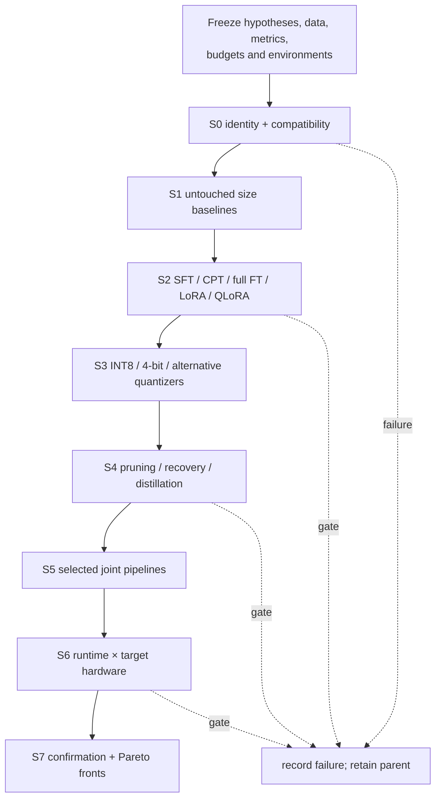

# CH-32: Optimization Experiments and Ablation Studies

> **Illustrative values.** Concrete identifiers, dates, thresholds, hashes, account numbers, and endpoints in this file are teaching examples, not observed project results or deployable credentials. Before use, replace them with reviewed values from your own registry, preserve the required format, and rerun every stated validation.

## 32.1 Contract and honest status

Optimization is a multi-objective experiment, not a contest for the smallest file. A useful candidate must preserve
domain and safety behavior while fitting a named model–runtime–hardware–workload envelope. This chapter defines the
canonical comparison of adaptation, quantization, pruning, distillation, model scale, combined optimization, and runtime
backends without requiring an impossible Cartesian product.

**Research freeze:** 2026-11-23. **Status: AUTHORED / NOT EXECUTED.** No model was trained, compressed, converted, or
benchmarked for this chapter. Runs are `PLANNED EXPERIMENT`; listings/configurations are `UNVERIFIED IMPLEMENTATION`;
diagrams/examples are `ILLUSTRATIVE`; cited findings are `PAPER-REPORTED` or interfaces `DOC-VERIFIED`. There are no
project results, prices, winners, or performance claims.

This chapter applies the project [evidence](../../00-governance/evidence-and-citation-standard.md),
[reproducibility](../../00-governance/reproducibility-standard.md),
[safety](../../00-governance/safety-and-risk-standard.md), and
[no-runtime-RAG](../../00-governance/no-runtime-rag-standard.md) standards. Chapters
[11–15](../part-04-model-compression-and-optimization/README.md) define transformations. Chapters
[29](ch-29-model-quality-evaluation.md), [30](ch-30-domain-specific-evaluation-suites.md), and
[31](ch-31-compression-and-edge-benchmarking.md) provide the authored evaluation and systems-measurement foundations.
Their protocols, like this chapter's, remain unexecuted.

## 32.2 Problem, intuition, and definition

An **experiment** changes a pre-registered independent variable, preserves declared controls, and observes held-out
outcomes. An **ablation** removes, restores, or changes one component of a qualified parent to estimate its
contribution. Comparing unrelated checkpoints or devices is a product comparison, not a causal ablation.

The governing question is:

> Which deployable candidate is non-inferior on required quality and safety, satisfies target constraints, and is
> non-dominated in memory, latency, energy, cost, and operational complexity?

The intuition is a tournament with lineage. Cheap tests reject invalid candidates first. Expensive training,
physical-device tests, and thermal soaks are reserved for survivors. Every child links to its direct parent so a
regression can be attributed.

**FIG-CH32-01 — Staged evidence funnel (`ILLUSTRATIVE`).**  
_Alt text:_ model-size and adaptation candidates enter cheap screens; progressively fewer enter compression, physical <!-- markdownlint-disable-line MD013 MD049 -->
deployment, and Pareto analysis.



## 32.3 Hypotheses and controls

These are hypotheses, not findings.

<!-- markdownlint-disable MD013 -->
| ID  | Hypothesis (`PLANNED EXPERIMENT`)                                                                            | Direct control                                   | Falsification/stop                                                        |
| --- | ------------------------------------------------------------------------------------------------------------ | ------------------------------------------------ | ------------------------------------------------------------------------- |
| H1  | Domain SFT improves domain tasks without unacceptable general/safety loss.                                   | untouched checkpoint                             | effect misses the minimum important difference (MID) or a hard gate fails |
| H2  | CPT+SFT improves knowledge-heavy strata over SFT alone at justified cost.                                    | identical SFT without CPT                        | no meaningful gain, forgetting, or budget failure                         |
| H3  | LoRA or QLoRA is non-inferior to full FT within a declared margin and uses fewer training resources.         | full FT from same initialization                 | lower confidence bound crosses margin or merge parity fails               |
| H4  | Supported INT8/4-bit reduces deployed memory within the quality-loss margin.                                 | direct FP/BF16 parent on same runtime            | quality, safety, memory, placement, or stability failure                  |
| H5  | Quantizer identity matters after nominal bit width is controlled.                                            | same parent, calibration, and executable runtime | no meaningful difference or cells are technically incomparable            |
| H6  | Dense structured pruning improves portable latency more reliably than dense tensors containing zeros.        | dense parent and dense-zero control              | no target gain or unsupported rewrite                                     |
| H7  | Recovery restores enough pruned-model quality to justify its compute.                                        | same pruned artifact before recovery             | margin missed or native-small control dominates                           |
| H8  | A distilled student beats direct adaptation of the same student under a fixed accepted-token/compute budget. | native student direct SFT                        | no gain, error transfer, or budget failure                                |
| H9  | Distill→quantize remains non-inferior to the FP student and improves deployment objectives.                  | distilled FP parent                              | compounded loss or systems failure                                        |
| H10 | A joint pipeline improves a target Pareto frontier over every direct parent.                                 | every immediate parent                           | child is dominated or improvement is negligible                           |
| H11 | Backend choice changes deployment behavior for one immutable artifact.                                       | same artifact/workload                           | import failure or semantic mismatch                                       |
| H12 | No universal winner exists across cloud and edge targets.                                                    | separate fronts per target                       | reject only if one candidate demonstrably dominates everywhere            |
<!-- markdownlint-restore -->

Within a causal comparison, freeze exact model/tokenizer revisions and hashes; config, license and chat template; data
manifests; evaluator/rubric; prompts and decoding; optimizer/token budget/search allowance where method permits; seeds;
context and output lengths; runtime/compiler/kernel; hardware/OS/power state; warm-up, synchronization, repetition, and
failure rules. A necessary change becomes a declared factor. GPTQ on CUDA versus GGUF on ARM is a valid tuple
comparison, not a quantizer-only ablation.

## 32.4 Formal required matrix

`Required` means attempt at least one compatible realization and retain failures. `Conditional` means run only after
compatibility and budget gates. Every row uses the identical sealed evaluation suite.

<a id="tbl-23"></a> **TBL-23 — Optimization quality-retention matrix (`PLANNED EXPERIMENT`; no results).**

<!-- markdownlint-disable MD013 -->
| IDs                       | Required variants                                                                                                                                                 | Isolated factor                | Parent/control                                   | Gate                                         |
| ------------------------- | ----------------------------------------------------------------------------------------------------------------------------------------------------------------- | ------------------------------ | ------------------------------------------------ | -------------------------------------------- |
| `M-S/M/L`                 | at least three feasible size bands, preferably one family                                                                                                         | scale/architecture             | untouched checkpoint per size                    | license, runtime, baseline quality           |
| `B0-*`                    | baseline pretrained/base or instruction SLM                                                                                                                       | no domain adaptation           | none                                             | deterministic load/generation and provenance |
| `A-SFT`                   | domain SFT                                                                                                                                                        | supervised adaptation          | `B0`                                             | H1                                           |
| `A-CPT-SFT`               | CPT then identical SFT                                                                                                                                            | CPT stage                      | `A-SFT`                                          | H2                                           |
| `A-FFT/LORA/QLORA`        | full FT, LoRA, QLoRA                                                                                                                                              | update/training-storage method | same initialization/data/budget                  | H3; adapter/merge parity                     |
| `Q-FP/Q8/Q4`              | FP/BF16, supported 8-bit, supported 4-bit                                                                                                                         | deployed precision             | same qualified parent                            | H4                                           |
| `Q-ALT-*`                 | at least two supported alternatives at common nominal precision where feasible (for example AWQ, GPTQ, GGUF/runtime-native); W8A8 is a separate activation factor | algorithm/layout               | same parent/calibration                          | H5; exact format/kernel                      |
| `P-STRUCT-*`              | architecture-valid layer, MLP-width, head/KV-group, or hidden-width pruning                                                                                       | dense structure/ratio          | dense and native-small controls                  | H6; physical rewrite                         |
| `P-REC-*`                 | same pruned artifact before/after fixed-budget recovery                                                                                                           | recovery                       | unrecovered child                                | H7                                           |
| `D-DIRECT/RESP/MIX/LOGIT` | direct student; validated teacher response; mixed expert/teacher; aligned soft targets if feasible                                                                | teacher signal                 | same student initialization                      | H8; report infeasible alignment              |
| `D-Q8/Q4`                 | selected distilled FP student plus supported INT8/4-bit children                                                                                                  | PTQ after KD                   | distilled FP                                     | H9                                           |
| `J-*`                     | FT→PTQ; QLoRA→clean merge→PTQ; prune→recover→PTQ; distill→PTQ; optional joint pruning+KD or exact-target QAT                                                      | ordered interaction            | all direct/single-technique parents              | H10                                          |
| `R-*`                     | finalists on compatible AWS, Android CPU, iOS or justified equivalent, and another edge target where available                                                    | runtime/backend                | same artifact when portable, else same FP parent | H11; parity/placement                        |
<!-- markdownlint-restore -->

**TBL-CH32-02 — Attribution cells. (`PLANNED EXPERIMENT`)**

<!-- markdownlint-disable MD013 -->
| Ablation      | Required cells                                    | Invalid shortcut                                         |
| ------------- | ------------------------------------------------- | -------------------------------------------------------- |
| adaptation    | untouched / SFT / CPT+SFT                         | different tests or base revisions                        |
| update method | full FT / LoRA / QLoRA                            | published checkpoints                                    |
| precision     | FP / INT8 / 4-bit                                 | changing runtime and calling it bit-width                |
| quantizer     | algorithm A / B / native                          | “4-bit” without group/layout/kernel                      |
| pruning       | dense / pruned / pruned+recovered                 | omitting unrecovered child                               |
| KD            | direct / teacher / mixed / soft targets           | unequal budgets without separate cost analysis           |
| interaction   | neither / A / B / A+B                             | baseline versus A+B only                                 |
| runtime       | one immutable artifact across compatible backends | unlabelled artifact changes                              |
| scale         | untouched/adapted sizes                           | treating cross-family differences as parameter causality |
<!-- markdownlint-restore -->

For outcome $Y$, the two-factor interaction is

$$
I_{AB}=(Y_{AB}-Y_A)-(Y_B-Y_0).
$$

`ILLUSTRATIVE`: with quality $80,78,79,74$ for neither, A, B, and both, $I_{AB}=-3$ points. This explains the
calculation; it is not a project result.

## 32.5 Staged elimination and budget tiers

Three sizes × four adaptation methods × five quantizers × four pruning ratios × four distillation choices × four
runtimes × three devices × three seeds equals 34,560 cells before latency repeats (`ILLUSTRATIVE`). Many are unsupported
or scientifically meaningless.

<!-- markdownlint-disable MD013 -->
| Stage | Candidates                                     | Gate                                                    |      Survivor cap |
| ----- | ---------------------------------------------- | ------------------------------------------------------- | ----------------: |
| S0    | every proposed tuple                           | license, hash, load, generation, operator compatibility |    supported only |
| S1    | untouched model sizes                          | pilot quality, memory, tokenizer correctness            |         2–3 sizes |
| S2    | SFT/CPT/full FT/LoRA/QLoRA                     | domain/general/safety and training budget               | 3 adapted parents |
| S3    | FP, INT8, two supported 4-bit/alternatives     | quality margin, executable memory gain                  |    2–3 per target |
| S4    | native-small, structured, recovered, distilled | hard gates, export, pilot latency                       |           3 total |
| S5    | pre-registered compatible combinations         | marginal Pareto gain over parents                       |      2 per target |
| S6    | finalists × named runtime/hardware             | load, placement, RAM, SLO, crashes                      |      2 per target |
| S7    | finalists only                                 | confirmatory statistics, energy/thermal, rollback       |      approved set |
<!-- markdownlint-restore -->

Eliminate on validation/pilot sets, never sealed tests. “Not run after gate” differs from failure. Crashes remain
reliability outcomes.

<!-- markdownlint-disable MD013 -->
| Tier     | Envelope                                                                                                        | Repetition/device scope                                                                                   |
| -------- | --------------------------------------------------------------------------------------------------------------- | --------------------------------------------------------------------------------------------------------- |
| Small    | one family, two sizes, SFT/LoRA/QLoRA, FP+INT8+one 4-bit, one structured or distilled branch                    | three finalist training seeds; pilot then confirmatory timing; one AWS class and one physical edge device |
| Medium   | two families or three sizes, feasible full FT, CPT, two quantizers, pruning+recovery, KD, selected combinations | 3–5 seeds; powered quality design; AWS plus representative Android and iOS/ARM                            |
| Research | expanded interactions, aligned logit KD, QAT/joint methods, calibration/recovery sweeps                         | sequentially powered seeds/device blocks; several SKUs and energy instrumentation                         |
<!-- markdownlint-restore -->

Each tier pre-registers accelerator-hours, teacher tokens, expert hours, storage, device-hours, and retry allowance.
Currency uses dated, region-specific evidence only. Budget exhaustion creates an incomplete cell, never an estimate.

## 32.6 Identical data and evaluation

Freeze non-overlapping `train-domain`, `train-cpt`, `general-replay`, `train-distill`, `recover-train`, `cal-quant`,
`cal-prune`, `validation`, sealed `test-domain/general/safety/OOD`, and `perf-prompts` manifests. Group by source
document, underlying scenario, entity/template family, and near-duplicate cluster before paraphrasing or synthesis.
Store IDs, content hashes, source/license lineage, code commit, counts, token distributions, domain/risk strata,
reviewer decisions, and overlap audit.

Identical evaluation means the same item IDs, rendered prompts, references, decoding, stop rules, evaluator, and rubric.
A short-context model fails that workload or enters a separately labelled comparison; never silently truncate. Prompt
text remains identical for systems tests, while tokenizer-specific token counts are reported. Perplexity is compared
only under genuinely comparable token accounting.

No runtime retrieval or remote teacher may answer tests. Trusted documents and experts may define offline ground truth.
Pharmacy and hazardous repair require qualified review and non-compensatory safety gates.

<a id="3217-completion-record"></a>

## 32.7 Metrics

<!-- markdownlint-disable MD013 -->
| Family                 | Required measurements                                                                                                          |
| ---------------------- | ------------------------------------------------------------------------------------------------------------------------------ |
| Domain                 | accuracy/F1/exact match as appropriate; rubric score; factual support; diagnostic/procedural order; per stratum                |
| Reliability            | unsupported claims, contradictions, consistency, malformed/empty/repetition/stop failures                                      |
| Calibration/robustness | Brier/ECE where valid; abstention coverage-risk; paraphrase/noise/OOD delta                                                    |
| Retention/safety       | general retention; unsafe compliance; correct refusal/escalation; warnings; contraindication/interaction recognition           |
| Representation         | dense/unique parameters, nonzeros, effective bits/weight, artifact/download bytes                                              |
| Memory                 | before/after load; peak load/prefill/decode; KV growth at context                                                              |
| Performance            | cold/warm startup, TTFT, prefill/decode, end-to-end, p50/tails, utilization and placement                                      |
| Energy/thermal         | joules/token where instrumented; battery; temperature and throughput time series                                               |
| Reliability systems    | conversion/load failures, crash/OOM/timeout/fallback/output-mismatch rates                                                     |
| Development/operations | training/conversion time, accelerator-hours, peak VRAM, teacher tokens, reviewer hours, dependencies/custom ops, rollback time |
| AWS economics          | dated region/instance inputs; cost/request and output token at declared offered load                                           |
<!-- markdownlint-restore -->

Define one primary domain metric before execution. Report disaggregated metrics; a composite is secondary and requires
pre-approved weights.

## 32.8 Repetition, power, and uncertainty

Separate evaluation-sample, training-seed, and systems-trial uncertainty. Thirty inferences from one checkpoint are not
30 training runs.

- Smoke-test one seed, then run at least three independent training seeds for finalists; use identical seed lists where
  possible.
- Record initialization, sampler, framework, generation, and systems seeds plus deterministic-kernel settings.
- Use paired item bootstrap intervals; McNemar’s test for paired binary outcomes where valid; blinded randomized human
  review with agreement/adjudication.
- Correct pre-registered confirmatory families (for example Holm) or label analyses exploratory.
- If full FT has one seed, call it exploratory—not equivalent.

For higher-is-better quality $Q$, candidate $C$, baseline $B$, and non-inferiority margin $\delta>0$:

$$
\Delta=Q_C-Q_B,\qquad C\text{ is non-inferior only if } \operatorname{LCB}_{1-\alpha}(\Delta)>-\delta.
$$

Safety uses stricter risk-approved rules and may require no observed critical failures plus a confidence bound.

Power logic:

1. declare MID, error/multiplicity policy, and target power before confirmation;
2. estimate paired variance from a pilot, not sealed test;
3. for a continuous paired approximation,

$$
n\approx\left(\frac{(z_{1-\alpha}+z_{1-\beta})\sigma_d}{\Delta_{\min}}\right)^2;
$$

1. use simulation/hierarchical methods for clustered items, bounded scores, rare hazards, and seed variation;
2. increase repetitions only at pre-specified interim points with valid sequential control;
3. report underpowered outcomes as inconclusive.

For systems tests, pilot variance/autocorrelation determines repeats needed for an operationally narrow interval.
Randomize/block candidate order; separate cold, warm, and thermal-soak runs; retain per-token traces. Missing, OOM,
timeout, and crash outcomes remain in primary analysis.

## 32.9 Exact identity contract

Each training run records exact accelerator vendor/model/count/memory; CPU/RAM/storage/interconnect;
firmware/OS/kernel/driver/toolkit; container digest; Python/compiler; PyTorch, Transformers, Datasets, PEFT, Accelerate,
quantizer, runtime and kernel versions/commits; clocks/power; distributed topology; commands; config hash; seeds;
start/end; deviations; and logs.

Each deployment adds exact cloud instance/region or device SKU/SoC/RAM/storage; OS build; battery health/level/charging;
power mode; ambient/start/end temperature; screen/network/background policy; app/runtime build; operator placement;
threads/affinity; filesystem/model path; context/cache settings; and compile/cache state.

Hardware differs across targets, but within-target comparisons use the same machine and conditions. Cross-target results
receive separate panels/fronts.

## 32.10 Plan, result, artifact, and failure schemas

**Listing CH32-L01 — Plan/config (`UNVERIFIED IMPLEMENTATION`).** Replace every illustrative value, validate, hash, and review
before execution.

```yaml
schema: ch32.experiment/v1
status: PLANNED_EXPERIMENT
experiment:
  id: "illustrative-id-001"
  hypothesis: "H1"
  primary_metric_mid_margin: "illustrative-exact-value"
  alpha_power_multiplicity: "illustrative-exact-value"
variant: { id: "matrix-illustrative-001", parent_artifact: "illustrative-id-001", factors: {} }
source:
  model:
    {
      repository: "illustrative-id-001",
      revision: "aaaaaaaaaaaaaaaaaaaaaaaaaaaaaaaaaaaaaaaa",
      manifest_sha256: "aaaaaaaaaaaaaaaaaaaaaaaaaaaaaaaaaaaaaaaaaaaaaaaaaaaaaaaaaaaaaaaa",
      config_sha256: "aaaaaaaaaaaaaaaaaaaaaaaaaaaaaaaaaaaaaaaaaaaaaaaaaaaaaaaaaaaaaaaa",
      license_sha256: "aaaaaaaaaaaaaaaaaaaaaaaaaaaaaaaaaaaaaaaaaaaaaaaaaaaaaaaaaaaaaaaa",
    }
  tokenizer: { revision: "aaaaaaaaaaaaaaaaaaaaaaaaaaaaaaaaaaaaaaaa", files_sha256: "aaaaaaaaaaaaaaaaaaaaaaaaaaaaaaaaaaaaaaaaaaaaaaaaaaaaaaaaaaaaaaaa", chat_template_sha256: "aaaaaaaaaaaaaaaaaaaaaaaaaaaaaaaaaaaaaaaaaaaaaaaaaaaaaaaaaaaaaaaa" }
datasets:
  train: { revision: "aaaaaaaaaaaaaaaaaaaaaaaaaaaaaaaaaaaaaaaa", manifest_sha256: "aaaaaaaaaaaaaaaaaaaaaaaaaaaaaaaaaaaaaaaaaaaaaaaaaaaaaaaaaaaaaaaa" }
  calibration: { revision: "aaaaaaaaaaaaaaaaaaaaaaaaaaaaaaaaaaaaaaaa", manifest_sha256: "aaaaaaaaaaaaaaaaaaaaaaaaaaaaaaaaaaaaaaaaaaaaaaaaaaaaaaaaaaaaaaaa" }
  validation: { revision: "aaaaaaaaaaaaaaaaaaaaaaaaaaaaaaaaaaaaaaaa", manifest_sha256: "aaaaaaaaaaaaaaaaaaaaaaaaaaaaaaaaaaaaaaaaaaaaaaaaaaaaaaaaaaaaaaaa" }
  domain_general_safety_tests: ["aaaaaaaaaaaaaaaaaaaaaaaaaaaaaaaaaaaaaaaaaaaaaaaaaaaaaaaaaaaaaaaa", "aaaaaaaaaaaaaaaaaaaaaaaaaaaaaaaaaaaaaaaaaaaaaaaaaaaaaaaaaaaaaaaa", "aaaaaaaaaaaaaaaaaaaaaaaaaaaaaaaaaaaaaaaaaaaaaaaaaaaaaaaaaaaaaaaa"]
training:
  optimizer_scheduler_lr_steps_tokens: "illustrative-exact-value"
  sequence_batch_accumulation_precision: "illustrative-exact-value"
  seeds: [101, 202, 303]
environment:
  git_commit: "aaaaaaaaaaaaaaaaaaaaaaaaaaaaaaaaaaaaaaaa"
  container_digest: "aaaaaaaaaaaaaaaaaaaaaaaaaaaaaaaaaaaaaaaaaaaaaaaaaaaaaaaaaaaaaaaa"
  lockfile_sha256: "aaaaaaaaaaaaaaaaaaaaaaaaaaaaaaaaaaaaaaaaaaaaaaaaaaaaaaaaaaaaaaaa"
  software_versions: {}
hardware:
  training_gpu_cpu_ram_storage: "illustrative-exact-value"
  deployment_device_os_power_thermal: "illustrative-exact-value"
evaluation:
  config_sha256: "aaaaaaaaaaaaaaaaaaaaaaaaaaaaaaaaaaaaaaaaaaaaaaaaaaaaaaaaaaaaaaaa"
  decoding: { strategy: greedy, max_new_tokens: 128, stop: "illustrative-exact-value" }
  workload: { input_tokens: 512, output_tokens: 128, batch: 1, concurrency: 1 }
  repetitions: { training_seeds: 3, systems_pilot: "30", confirmation: "120" }
gates:
  domain_non_inferiority: "illustrative-exact-value"
  safety_by_stratum: "illustrative-exact-value"
  peak_memory_ttft_decode: "p95 <= 2000 ms on the named target"
  operator_fallback_allowed: false
budget:
  accelerator_teacher_expert_device_limits: "illustrative-exact-value"
```

**Listing CH32-L02 — Result/artifact record (`UNVERIFIED IMPLEMENTATION`).** Null means unmeasured, never zero; raw
files remain authoritative.

```json
{
  "schema": "ch32.result/v1",
  "evidence": "EXECUTED",
  "experiment_run_variant": ["illustrative-id-001", "00000000-0000-4000-8000-000000000001", "matrix-illustrative-001"],
  "parent_run_ids": [],
  "model_tokenizer_dataset_config_environment_hashes": {},
  "hardware_conditions_seed_deviations": {},
  "raw_quality_uri_sha256": ["s3://slm-private-illustrative-111122223333/example/artifact.bin", "aaaaaaaaaaaaaaaaaaaaaaaaaaaaaaaaaaaaaaaaaaaaaaaaaaaaaaaaaaaaaaaa"],
  "raw_system_uri_sha256": ["s3://slm-private-illustrative-111122223333/example/artifact.bin", "aaaaaaaaaaaaaaaaaaaaaaaaaaaaaaaaaaaaaaaaaaaaaaaaaaaaaaaaaaaaaaaa"],
  "aggregates": {
    "domain_score": { "estimate": null, "ci": [null, null] },
    "unsafe_compliance": { "estimate": null, "ci": [null, null] },
    "peak_memory_bytes": { "estimate": null, "ci": [null, null] },
    "ttft_p95_ms": { "estimate": null, "ci": [null, null] },
    "sustained_decode_tokens_s": { "estimate": null, "ci": [null, null] },
    "energy_j_per_token": { "estimate": null, "ci": [null, null] }
  },
  "costs": { "accelerator_hours": null, "teacher_tokens": null, "expert_hours": null },
  "failures": [],
  "artifact": {
    "id": null,
    "sha256": null,
    "bytes": null,
    "format_precision": null,
    "lineage_manifest_sha256": null,
    "release_state": "research-only"
  },
  "decision_reviewer": ["unreviewed", null]
}
```

Artifact manifests also record tensor shapes; dense/unique/nonzero counts; effective bits; adapter/merge state; pruning
masks/indices; quantization scales, groups and exclusions; calibration hash; converter/runtime commit; license lineage;
signature; retention; and rollback parent.

**Listing CH32-L03 — Failure record (`UNVERIFIED IMPLEMENTATION`).**

```yaml
schema: ch32.failure/v1
failure_id: "00000000-0000-4000-8000-000000000001"
experiment_run_variant: ["experiment-illustrative-001", "run-illustrative-001", "variant-a"]
stage: "<train|convert|load|evaluate|benchmark|package>"
expected_observed: ["process exits with code 0", "process exited with code 1"]
environment_hardware_hashes: ["aaaaaaaaaaaaaaaaaaaaaaaaaaaaaaaaaaaaaaaaaaaaaaaaaaaaaaaaaaaaaaaa", "aaaaaaaaaaaaaaaaaaaaaaaaaaaaaaaaaaaaaaaaaaaaaaaaaaaaaaaaaaaaaaaa"]
reproducibility: { attempts: 1, repeated: false }
logs: [{ uri: "s3://slm-private-illustrative-111122223333/restricted/log.txt", sha256: "aaaaaaaaaaaaaaaaaaaaaaaaaaaaaaaaaaaaaaaaaaaaaaaaaaaaaaaaaaaaaaaa" }]
impact: "<cell/risk impact>"
suspected_cause: "memory pressure caused the failure"
classification: "<method|compatibility|resource|infrastructure|protocol|unknown>"
remediation_retest: "reduce batch size and rerun the same protocol"
resolved: false
unresolved_risk: "illustrative unresolved-risk description"
```

## 32.11 Procedure and failure handling

1. Pre-register hypotheses, metrics, margins, gates, comparisons, budgets, analysis, and retry rules.
2. Freeze/hash models, tokenizer/template, datasets, evaluator, code, environment, runtime, and hardware contract.
3. Audit rights, provenance, duplicates, leakage, strata, and contamination.
4. Run S0 token/template, finite-logit, deterministic-generation, exporter, and placement checks.
5. Evaluate untouched size baselines.
6. Train adaptation cells; preserve every seed, selection trace, OOM, and divergence.
7. Eliminate on validation only.
8. Transform one stage at a time; preserve FP parent, reduced/recovered FP, quantized child, and package.
9. Benchmark parity, cold/warm, fixed/max context, and sustained conditions with synchronized timing.
10. Execute frozen paired statistics, non-inferiority, multiplicity, uncertainty, and Pareto scripts.
11. Conduct stratified domain/safety and engineering review.
12. Release only hard-gate-qualified non-dominated candidates with signed lineage and rollback; “no qualified candidate”
    is valid.

| Failure                | Primary handling                            | Forbidden                             |
| ---------------------- | ------------------------------------------- | ------------------------------------- |
| OOM/crash/timeout      | failed outcome unless retry rule applies    | deletion or silent workload reduction |
| preemption/network     | classify from logs; bounded retry           | unlimited favored retries             |
| NaN/divergence         | retain seed/checkpoint                      | seed replacement after outcome        |
| unsupported conversion | mark tuple unsupported                      | substitute artifact as same cell      |
| CPU/NPU fallback       | report placement; reject acceleration claim | calling conversion acceleration       |
| rater disagreement     | blinded adjudication                        | preferred-rater selection             |
| no energy instrument   | unavailable                                 | infer joules from latency             |
| short context          | fail workload or separate target            | prompt truncation                     |
| critical safety error  | hard gate/incident review                   | averaging away                        |
| exhausted budget       | not run/inconclusive                        | imputation                            |

Outlier rules must be pre-written; removed trials remain raw and primary/sensitivity analyses are both reported.
Deviations are timestamped before unblinding where possible.

## 32.12 Pareto frontier and selection

### Worked ablation dataset

The following numbers are `ILLUSTRATIVE`; they are internally consistent teaching data, not project measurements.

| Variant | Changed factor | Domain score | Peak GiB | p95 TTFT ms | J/token | Critical failures |
| ------- | -------------- | -----------: | -------: | -----------: | ------: | ----------------: |
| B0      | untouched      |         0.62 |      3.2 |          620 |    1.80 |                 0 |
| SFT     | domain SFT     |         0.79 |      3.2 |          625 |    1.82 |                 0 |
| SFT-Q8  | INT8           |         0.78 |      2.2 |          520 |    1.42 |                 0 |
| SFT-Q4  | INT4           |         0.73 |      1.6 |          480 |    1.20 |                 1 |
| KD-Q4   | distilled INT4 |         0.76 |      1.2 |          410 |    0.96 |                 0 |
| LARGE   | larger SFT     |         0.83 |      5.9 |          910 |    2.75 |                 0 |

Read the table in lineage order. SFT adds 0.17 domain-score points at nearly unchanged systems cost. SFT-Q8 loses 0.01
while reducing peak memory by $1.0/3.2=31.25\%$ and p95 TTFT by 105 ms. SFT-Q4 is excluded before optimization
because one critical failure is non-compensatory. KD-Q4 is not a quantization-only ablation of SFT because distillation
also changed the model; it is a deployable-tuple comparison against both its direct student parent and native-small
controls. LARGE has the highest quality, but it pays the largest cost on every displayed deployment objective.

<a id="fig-13"></a> **FIG-13 — Quality versus parameter count interpretation (`ILLUSTRATIVE`).** Parameter count is
useful for comparing B0, SFT, a distilled student, and LARGE, but it does not express bit width or runtime buffers.
Therefore a point with fewer parameters can still consume more memory than a better-packed competitor.

<a id="fig-14"></a> **FIG-14 — Quality versus latency interpretation (`ILLUSTRATIVE`).** Plotting the table's domain score
against p95 TTFT leaves SFT-Q8, KD-Q4, and LARGE as preference-relevant candidates. SFT is dominated by SFT-Q8 because
Q8 is no worse within the illustrative 0.02 quality margin and is faster; SFT-Q4 is ineligible because of safety.

<a id="fig-15"></a> **FIG-15 — Quality versus memory interpretation (`ILLUSTRATIVE`).** KD-Q4 owns the low-memory corner,
LARGE owns the quality corner, and SFT-Q8 is the middle option. A two-dimensional memory plot must still carry TTFT,
energy, and hard-gate annotations or it can conceal domination.

After hard gates, $a$ dominates $b$ when no worse on every objective and better on at least one. Mobile objectives
may maximize domain-score lower bound and sustained decode while minimizing upper bounds for peak RAM, p95 TTFT, and
joules/token. AWS may add throughput and cost/output token.

Build separate fronts for each hardware, runtime semantics, workload, context, and concurrency. Use **conservative
uncertain dominance**: confidence bounds must establish no-worse behavior on every objective and meaningful improvement
on one; otherwise candidates are unresolved. Joint bootstrap over items, seeds, and appropriate trial blocks can
estimate frontier-membership frequency.

<a id="fig-24"></a> **FIG-24 — Target-specific Pareto analysis (`PLANNED EXPERIMENT`; no data or plotted points).** Alt
text: after hard-gate exclusions, separate target-specific projections will show objective directions, units,
uncertainty, dominance, and the non-dominated set; preference-sensitive choices remain explicit.

- A: peak resident GiB versus domain-score lower bound.
- B: p95 TTFT ms versus domain-score lower bound.
- C: sustained J/token versus domain-score lower bound.
- Shape = size; color = pipeline; label = exact artifact/runtime.
- Include uncertainty and raw-run/analysis hashes.
- Plot qualified candidates only; account for failed/unsupported cells separately.

Do not draw points until measurements exist. Two-dimensional projections can hide domination on other objectives;
machine-readable multi-objective analysis is authoritative.

For the illustrative table, first remove SFT-Q4. Under strict point dominance, B0 and SFT are dominated by SFT-Q8;
SFT-Q8, KD-Q4, and LARGE remain non-dominated because each preserves a different advantage. Under a 0.02
non-inferiority margin, KD-Q4 cannot be called equivalent to SFT-Q8 without uncertainty bounds: its point difference is
exactly $-0.02$, and a lower confidence bound would be smaller. The correct decision is “unresolved until
intervals,” not “KD-Q4 wins.”

Selection order:

1. remove identity, safety, compatibility, memory, reliability, and SLO failures;
2. apply pre-registered non-inferiority;
3. compute target-specific uncertain Pareto sets;
4. for unresolved candidates, prefer fewer custom operators, dependencies, conversions, and rollback steps unless target
   preferences say otherwise;
5. name role-specific winners—quality, low memory, sustained edge, AWS low-batch, operational simplicity—not a universal
   winner.

Weighted scores are secondary; weights/normalization must be pre-approved and sensitivity reported. If small weight
changes reverse selection, state that it is preference-sensitive.

## 32.13 Domain and deployment implications

Report rare and hazardous strata. Automotive/industrial evaluation includes diagnostic order, code-versus-cause, units,
high voltage, pressure, lifting, fuel, rotating machinery, stored energy, lockout/tagout, and escalation. Pharmacy
education includes formulation, route, population, interactions, contraindications, decimal/unit errors, jurisdiction,
uncertainty, refusal, and professional escalation. Animal/beekeeping suites include species, disease, season, region,
legal treatment, welfare, and veterinary escalation.

Compression cannot make knowledge current or guaranteed. Under no runtime RAG, lost/stale parameterized knowledge is not
repaired at inference. Every transformation reruns safety/uncertainty tests. Experimental models do not prescribe or
authorize hazardous work.

File fit, load fit, interaction, and sustained behavior are separate edge gates. Physical devices are required for
battery/thermal claims. Accelerator selection is not placement proof. AWS and edge may need different children from one
FP parent. Cloud tests separate batch-one decode from offered-load throughput and use dated cost evidence; edge tests
separate cold, warm, and thermal-soak behavior.

## 32.14 Strengths, limitations, and priority

The design covers every required variant, retains parents/failures, bounds cost, supports attribution, and produces
uncertainty-aware target decisions. Limitations remain: staged elimination can miss favorable interactions; validation
noise biases survival; compatibility restricts common cells; human/energy evidence is expensive; cross-family scale is
confounded; and no protocol eliminates contamination or deployment shift.

Mitigate with nested validation, independent confirmation, gate/margin sensitivity, and a small pre-registered rescue
budget for one scientifically justified eliminated branch.

- **Core:** baseline, SFT/LoRA/QLoRA, FP/INT8/4-bit native PTQ, native-small control, identical quality/safety, physical
  target, Pareto selection.
- **Advanced:** CPT, feasible full FT, alternative quantizers, structured pruning/recovery, validated response KD, mixed
  precision, multiple runtimes.
- **Experimental:** aligned logit KD, joint pruning+KD, QAT after isolated PTQ failure, broad hardware-aware search.
- **Stop:** when a simple candidate passes all gates and added transformations do not robustly improve its target
  frontier.

## 32.15 Exercises

1. Distinguish causal ablation from deployable tuple comparison.
2. Draw lineage for CPT→SFT→prune→recover→INT4→mobile export.
3. Design the four-cell pruning×quantization factorial.
4. Calculate a Cartesian count for four sizes, five adaptations, six quantizers, three ratios, three runtimes, four
   devices, and five seeds; stage it.
5. Define falsification for H2, H7, and H10.
6. Justify different non-inferiority/safety margins for low-risk and pharmacy tasks.
7. Perform a pilot-based paired power calculation and critique the Normal approximation.
8. Separate sampler, initialization, generation, and systems seeds.
9. Populate CH32-L01 without mutable revisions; keep it unverified until run.
10. Build a grouped leakage audit for sources, scenarios, and synthetic paraphrases.
11. Validate CH32-L02 so null cannot become zero.
12. Report an NPU export that falls back to CPU.
13. Design randomized phone thermal blocks with cooldown.
14. Bootstrap Pareto-front membership from measured data.
15. Show how a 2-D front hides energy domination.
16. Select separate AWS, Android, and iOS candidates without a universal winner.
17. Audit comparability of a paper-reported speedup.
18. Define a rescue rule that prevents cherry-picking.

## 32.16 Sources

These sources establish design/reporting principles or method identities, not project results.

1. Fisher, R. A. (1935). _The Design of Experiments_. Oliver & Boyd. Randomization, replication, and control. <!-- markdownlint-disable-line MD013 MD049 -->
2. Montgomery, D. C. (2017). _Design and Analysis of Experiments_, 9th ed. Wiley. Factorials, blocking, interactions, <!-- markdownlint-disable-line MD013 MD049 -->
   and sequential design.
3. Demšar, J. (2006). “Statistical Comparisons of Classifiers over Multiple Data Sets.” _JMLR_ 7. <!-- markdownlint-disable-line MD013 MD049 -->
   <https://www.jmlr.org/papers/v7/demsar06a.html>. `PAPER-REPORTED`; setting differs from paired generation.
4. Dror, R. et al. (2018). “The Hitchhiker’s Guide to Testing Statistical Significance in NLP.” _ACL_. <!-- markdownlint-disable-line MD013 MD049 -->
   <https://aclanthology.org/P18-1128/>. `PAPER-REPORTED`.
5. Dodge, J. et al. (2019). “Show Your Work.” _EMNLP-IJCNLP_. <https://aclanthology.org/D19-1224/>. `PAPER-REPORTED`; <!-- markdownlint-disable-line MD013 MD049 -->
   distributions and compute reporting.
6. Bouthillier, X. et al. (2021). “Accounting for Variance in Machine Learning Benchmarks.” _MLSys_. <!-- markdownlint-disable-line MD013 MD049 -->
   <https://proceedings.mlsys.org/paper/2021/hash/0184b0cd3cfb185989f858a1d9f5c1eb-Abstract.html>. `PAPER-REPORTED`.
7. Henderson, P. et al. (2020). “Systematic Reporting of Energy and Carbon Footprints.” _JMLR_ 21(248). <!-- markdownlint-disable-line MD013 MD049 -->
   <https://www.jmlr.org/papers/v21/20-312.html>. `PAPER-REPORTED`.
8. Deb, K. et al. (2002). “NSGA-II.” _IEEE Transactions on Evolutionary Computation_ 6(2). DOI:10.1109/4235.996017. <!-- markdownlint-disable-line MD013 MD049 -->
   Multi-objective dominance background; this chapter does not require that search algorithm.
9. Pineau, J. et al. (2021). “Improving Reproducibility in Machine Learning Research.” _JMLR_ 22(164). <!-- markdownlint-disable-line MD013 MD049 -->
   <https://www.jmlr.org/papers/v22/20-303.html>. `PAPER-REPORTED`.
10. MLCommons. MLPerf Inference rules. <https://mlcommons.org/benchmarks/inference/> and
    <https://github.com/mlcommons/inference>. `DOC-VERIFIED` conceptually; recheck exact version.
11. Hu, E. et al. (2022). “LoRA.” _ICLR_. <https://arxiv.org/abs/2106.09685>; Dettmers, T. et al. (2023). “QLoRA.” <!-- markdownlint-disable-line MD013 MD049 -->
    _NeurIPS_. <https://arxiv.org/abs/2305.14314>. `PAPER-REPORTED`. <!-- markdownlint-disable-line MD013 MD049 -->
12. Frantar, E. et al. (2023). “GPTQ.” _ICLR_. <https://arxiv.org/abs/2210.17323>; Lin, J. et al. (2024). “AWQ.” <!-- markdownlint-disable-line MD013 MD049 -->
    _MLSys_. <https://arxiv.org/abs/2306.00978>. `PAPER-REPORTED`. <!-- markdownlint-disable-line MD013 MD049 -->
13. Frantar, E. and Alistarh, D. (2023). “SparseGPT.” _ICML_. <https://proceedings.mlr.press/v202/frantar23a.html>; Sun, <!-- markdownlint-disable-line MD013 MD049 -->
    M. et al. (2024). “Wanda.” _ICLR_. <https://openreview.net/forum?id=PxoFut3dWW>. `PAPER-REPORTED`; no portable speed <!-- markdownlint-disable-line MD013 MD049 -->
    guarantee.
14. Hinton, G., Vinyals, O., and Dean, J. (2015). “Distilling the Knowledge in a Neural Network.”
    <https://arxiv.org/abs/1503.02531>; Kim, Y. and Rush, A. (2016). “Sequence-Level Knowledge Distillation.”
    <https://aclanthology.org/D16-1139/>. `PAPER-REPORTED`.

## 32.17 Honesty note

The worked matrix demonstrates ablation and Pareto reasoning only. Replace it with immutable run data, uncertainty
intervals, and exact artifact/runtime identities before selecting a real candidate.

## Cross-links

- [Part index](README.md)
- [CH-29](ch-29-model-quality-evaluation.md)
- [CH-30](ch-30-domain-specific-evaluation-suites.md)
- [CH-31](ch-31-compression-and-edge-benchmarking.md)
- [CH-15](../part-04-model-compression-and-optimization/ch-15-combining-optimization-techniques.md)
- [Experiment framework](../../06-experiment-framework/README.md)
- [CH-32 assessment](../../13-assessments/ch-32-assessment.md)
