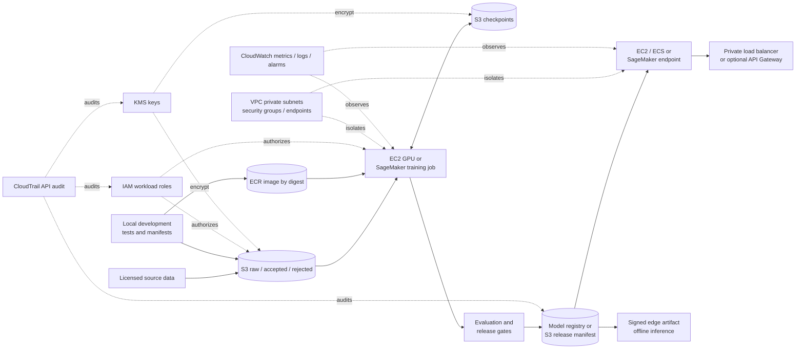
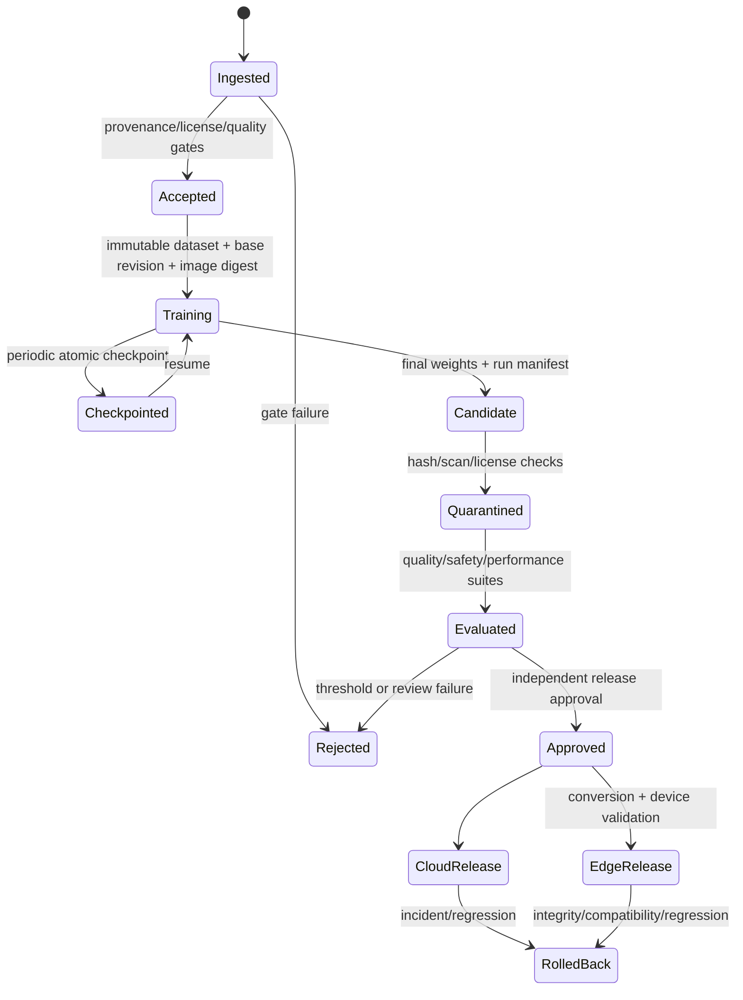
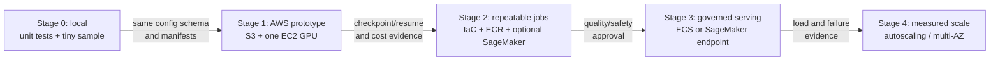

# CH-33: AWS Infrastructure for SLM Development

> **Illustrative values.** Concrete identifiers, dates, thresholds, hashes, account numbers, and endpoints in this file are teaching examples, not observed project results or deployable credentials. Before use, replace them with reviewed values from your own registry, preserve the required format, and rerun every stated validation.

**Research date:** 2026-11-23  
**Chapter status:** **DOC-VERIFIED / UNVERIFIED IMPLEMENTATION.** The service capabilities and constraints in this
chapter were checked against the linked official AWS documentation on the research date. No AWS account was provisioned,
no listing was deployed, no quota or capacity was confirmed, and no performance or price was reproduced. All diagrams
are `ILLUSTRATIVE`; all fenced configuration and Infrastructure as Code (IaC) listings are `UNVERIFIED IMPLEMENTATION`.

## 33.1 The infrastructure problem

A domain-specific small language model (SLM) project needs more than a GPU. It must move licensed data and model
artifacts through preparation, training, evaluation, approval, serving, and edge release while preserving:

- reproducibility: every result binds to immutable code, data, model, image, and configuration revisions;
- confidentiality and integrity: datasets, adapters, weights, prompts, and secrets are protected;
- recoverability: an interrupted accelerator job can resume from durable state;
- auditability: infrastructure and artifact changes are attributable;
- cost control: idle accelerators and unmanaged logs do not become open-ended liabilities;
- portability: the cloud pipeline can publish approved artifacts for offline mobile use without introducing runtime
  retrieval-augmented generation (RAG).

The useful intuition is a **secured artifact factory**. Amazon Simple Storage Service (Amazon S3) is the durable source
of truth; Amazon Elastic Compute Cloud (Amazon EC2) or Amazon SageMaker AI supplies temporary compute; AWS Identity and
Access Management (IAM), AWS Key Management Service (KMS), and Amazon Virtual Private Cloud (VPC) form the trust
boundary; Amazon CloudWatch observes operations; AWS CloudTrail records AWS API activity; and IaC makes the boundary
reproducible.

This chapter designs that factory. Chapters 34–36 implement training, inference, and cloud-to-edge delivery in detail.

### Learning objectives

After completing this chapter, the reader should be able to:

1. choose an intentionally small AWS service set rather than adopting every managed service;
2. select a GPU family by measured memory, compatibility, availability, and quota rather than marketing generation or a
   stale price;
3. design IAM, network, encryption, audit, data, and artifact boundaries;
4. identify Region, Availability Zone (AZ), account, and application failure domains;
5. compare EC2, SageMaker AI, containers, orchestration, and Amazon Bedrock without treating them as interchangeable;
6. represent the architecture in AWS Cloud Development Kit (AWS CDK) or Terraform and estimate total cost from dated
   official rates;
7. evolve a local experiment into a governed production system without introducing runtime RAG.

## 33.2 Evidence vocabulary

The following labels have the meanings defined by the project
[evidence standard](../../00-governance/evidence-and-citation-standard.md):

- `DOC-VERIFIED`: official documentation supports the capability or constraint; runtime behavior was not reproduced.
- `VENDOR-REPORTED`: AWS reports a performance or savings claim; this project did not reproduce it.
- `ILLUSTRATIVE`: an educational design or numerical example, not measured evidence.
- `UNVERIFIED IMPLEMENTATION`: configuration has not been applied to an AWS account.
- `PLANNED EXPERIMENT`: a proposed validation procedure with no result yet.

An AWS service being documented does not prove that a particular feature, instance type, model, quota, or capacity is
available to a particular account. Availability is the tuple:

> **service + feature + instance type + accelerator + Region + AZ + account quota + date**

## 33.3 Minimum viable architecture

<a id="fig-20"></a> **FIG-20 — AWS model training and deployment architecture (`ILLUSTRATIVE`).** Alt text: approved
data moves through S3 to private training compute, evaluation, a release area, cloud serving, and an independently
operating edge application; IAM, KMS, CloudWatch, and CloudTrail span the system. Not measured; arrows show conceptual
relationships only.



**Provenance:** author-designed synthesis of the official sources in §33.18. It depicts logical flow, not measured
throughput or a deployed topology.

The diagram deliberately separates four planes:

1. **Data plane:** dataset shards, checkpoints, weights, reports, images, and requests.
2. **Control plane:** job creation, workflow transitions, deployment changes, approvals, and cleanup.
3. **Security plane:** identity, key use, network paths, policy, and audit.
4. **Observability plane:** operational logs, metrics, alarms, traces, and cost records.

CloudTrail does not replace application observability, and CloudWatch does not replace an AWS API audit trail.

## 33.4 Service selection for a small project

<a id="tbl-24"></a> **TBL-24 — AWS service selection.** Evidence: `DOC-VERIFIED` capabilities plus explicit project
recommendations. “Essential choice” means the capability is essential but competing services can provide it.

<!-- markdownlint-disable MD013 -->
| Service or capability                | Small-scale classification                    | Initial role                                                             | Adopt when                                                           | Defer or reject when                                                               |
| ------------------------------------ | --------------------------------------------- | ------------------------------------------------------------------------ | -------------------------------------------------------------------- | ---------------------------------------------------------------------------------- |
| Amazon S3                            | Essential                                     | Durable datasets, checkpoints, evaluations, release artifacts, manifests | From the first remote experiment                                     | Never use local GPU disk as the only copy                                          |
| IAM                                  | Essential                                     | Workload roles and least privilege                                       | From account setup                                                   | Never embed long-lived access keys in images or scripts                            |
| KMS                                  | Essential for controlled sensitive artifacts  | Customer-controlled encryption and separated key administration          | Data/model sensitivity or governance requires key control            | An AWS managed key can be adequate for non-sensitive prototypes, subject to policy |
| VPC and security groups              | Essential                                     | Private workload boundary and explicit traffic rules                     | From first shared or sensitive workload                              | A laptop-only experiment has no AWS VPC                                            |
| CloudWatch                           | Essential                                     | Logs, metrics, alarms, dashboards                                        | Every remote job and service                                         | Do not log raw sensitive prompts by default                                        |
| CloudTrail                           | Essential                                     | AWS API and configuration audit                                          | Account baseline                                                     | It is not token latency or GPU telemetry                                           |
| EC2 **or** SageMaker AI training     | Essential choice                              | Accelerator compute                                                      | Every cloud training run                                             | Using both is optional                                                             |
| Encrypted Amazon EBS                 | Essential with most EC2 hosts                 | OS and host-attached working storage                                     | EC2 lifecycle                                                        | Not the authoritative artifact registry                                            |
| Amazon ECR                           | Essential with containers; otherwise optional | Immutable training/inference image registry                              | Containerized jobs or services                                       | AMI/virtual-environment-only prototype                                             |
| IaC: CDK or Terraform                | Essential before repeatable/shared use        | Reproducible resources and reviewable changes                            | Before a second environment or collaborator                          | A one-time sandbox may begin manually, then must be captured                       |
| Secrets Manager                      | Optional; conditionally essential             | Non-IAM API tokens and rotatable secrets                                 | A real runtime secret exists                                         | Do not invent secrets to justify it                                                |
| AWS Step Functions                   | Optional                                      | Durable multi-step workflow, retries, catches, timeouts                  | Several asynchronous stages need state and recovery                  | A script/job scheduler is sufficient                                               |
| AWS Lambda                           | Optional                                      | Short control-plane validation, notification, cleanup                    | Event-driven glue fits Lambda quotas                                 | Never host the GPU model process in Lambda                                         |
| Amazon ECS                           | Optional                                      | Managed container service lifecycle on EC2 capacity                      | A container service needs replacement/deployment management          | One directly managed EC2 host is enough                                            |
| Amazon EKS                           | Usually unnecessary initially                 | Kubernetes platform                                                      | Organization already operates Kubernetes or needs its APIs/ecosystem | Do not adopt solely because a runtime offers a Helm chart                          |
| Amazon API Gateway                   | Optional                                      | Public API authentication integration, throttling, routing               | API-management requirements and streaming constraints are validated  | Private tests or direct load balancer are simpler                                  |
| SageMaker Model Registry/endpoints   | Optional                                      | Version/approval governance and managed hosting                          | Managed lifecycle justifies constraints and price                    | S3 manifests and one host suffice                                                  |
| Amazon Bedrock                       | Optional and conditional                      | Managed model customization/import/inference                             | Exact model, Region, method, license, and feature matrix fit         | Low-level runtime/kernel experimentation is required                               |
| Amazon FSx for Lustre / Amazon EFS   | Usually unnecessary initially                 | Shared filesystems                                                       | Measured multi-node/shared-I/O bottleneck                            | One accelerator can stage from S3 to EBS                                           |
| Multi-node P-class/Trainium clusters | Unnecessary initially                         | Large distributed training                                               | A measured single-node limit justifies complexity                    | Default 0.5B–8B PEFT experiments                                                   |
<!-- markdownlint-restore -->

The smallest defensible starting point is S3 + IAM + KMS + VPC + CloudWatch + CloudTrail + one right-sized EC2 GPU,
adding ECR only if containers are used. SageMaker AI is an alternative managed compute path, not a compulsory layer over
EC2.

### Worked service-selection walkthrough

Assume one engineer will run four monthly QLoRA experiments on confidential data, with no public endpoint. Start from
the workload, not the service catalog:

1. S3 stores immutable dataset manifests and checkpoints because the GPU host is replaceable.
2. IAM gives the host a short-lived role scoped to those prefixes; KMS controls decryption.
3. A VPC private subnet and security group define the network boundary. VPC endpoints are added for S3 and required
   AWS APIs when controlled egress is preferable to a NAT path.
4. One EC2 G-family candidate supplies the GPU. EBS is working storage, not the durable source of truth.
5. CloudWatch captures job and GPU telemetry; CloudTrail captures AWS API changes.
6. ECR is included only if the environment is containerized. Terraform or CDK records the resources.

ECS, EKS, API Gateway, Bedrock, and a persistent endpoint add no value to this stated workload, so they remain absent.
Step Functions becomes useful only when several asynchronous stages need durable retries. SageMaker becomes a candidate
when managed job teardown and isolation save more operational effort than its service constraints impose.

Read FIG-20 from left to right as a custody chain. Solid arrows move data or artifacts; dotted arrows show controls that
authorize, isolate, encrypt, observe, or audit those movements. The evaluation node is deliberately between training
and both release targets: neither a cloud server nor a phone may consume an unapproved checkpoint. The edge branch ends
in local inference, so AWS distributes the artifact but does not answer each prompt.

## 33.5 Compute: EC2 and GPU family selection

### 33.5.1 What EC2 provides

EC2 exposes virtual machines with selected CPU, memory, storage, network, accelerator, operating-system, purchasing, and
tenancy characteristics. It gives direct control over the Amazon Machine Image (AMI), driver, CUDA or AWS Neuron stack,
container runtime, filesystem, process, and serving engine. The cost of this control is responsibility for patching,
shutdown, recovery, image pinning, monitoring, and capacity handling.

For EC2 training:

- use encrypted EBS for the root and persistent work volume;
- treat instance-store NVMe as optional scratch only;
- copy valid checkpoints and run manifests to S3;
- deploy immutable AMI IDs and container image digests, not “latest”;
- prefer AWS Systems Manager access to publicly exposed SSH;
- terminate or stop idle compute automatically, while remembering that stopped instances can still incur storage and
  other attached-resource cost.

### 33.5.2 Current accelerator families

AWS's [accelerated-computing specification](https://docs.aws.amazon.com/ec2/latest/instancetypes/ac.html),
[current instance list](https://docs.aws.amazon.com/ec2/latest/instancetypes/instance-types.html), and
[Region table](https://docs.aws.amazon.com/ec2/latest/instancetypes/ec2-instance-regions.html) are the authority at
launch time.

<!-- markdownlint-disable MD013 -->
| Family group                  | Accelerator documented by AWS                                                                | Plausible SLM role                                                       | Small-project judgment               |
| ----------------------------- | -------------------------------------------------------------------------------------------- | ------------------------------------------------------------------------ | ------------------------------------ |
| G4dn                          | NVIDIA T4                                                                                    | Compatibility, modest inference, older CUDA path                         | Optional legacy baseline             |
| G5                            | NVIDIA A10G                                                                                  | Single-GPU parameter-efficient fine-tuning (PEFT), conversion, inference | Core candidate                       |
| G6                            | NVIDIA L4                                                                                    | Smaller-model PEFT and inference                                         | Core candidate                       |
| G6e                           | NVIDIA L40S                                                                                  | Larger memory/throughput requirement than G6                             | Advanced candidate                   |
| G7 / G7e                      | Blackwell-generation graphics/inference GPUs; G7e uses RTX PRO 6000 Blackwell Server Edition | Newer training/inference path                                            | Advanced; verify software and Region |
| P4d / P4de                    | NVIDIA A100                                                                                  | Memory-heavy or multi-GPU training                                       | Usually unnecessary initially        |
| P5 / P5e / P5en               | NVIDIA H100/H200 variants                                                                    | Large/distributed training or high-throughput serving                    | Usually unnecessary initially        |
| P6-B200 / P6-B300 / P6e-GB200 | NVIDIA Blackwell/Blackwell Ultra systems                                                     | Very large training/inference                                            | Unnecessary for initial SLM work     |
| Trn1 / Trn1n / Trn2           | AWS Trainium                                                                                 | Training through the AWS Neuron software path                            | Optional qualification experiment    |
| Inf2                          | AWS Inferentia2                                                                              | Inference through the Neuron path                                        | Optional qualification experiment    |
<!-- markdownlint-restore -->

`DOC-VERIFIED`: these families are listed by AWS as accelerated-computing options. The table does **not** assert that
every size supports Spot, a given operating system, a given precision, or the same accelerator memory. Check the exact
subtype.

AWS silicon is not a drop-in CUDA substitute. The exact model architecture and operators must fit the current
[AWS Neuron documentation](https://awsdocs-neuron.readthedocs-hosted.com/en/latest/) and
[Neuron model architecture-fit guidance](https://awsdocs-neuron.readthedocs-hosted.com/en/v2.14.1/general/arch/model-architecture-fit.html).
Compilation behavior, dynamic shapes, adapters, quantization, and serving features require their own tests.

### 33.5.3 Selection algorithm

Do not select a GPU from parameter count alone. Training memory includes:

\[ M_{\text{train}} \approx M_w + M_g + M_o + M_a + M_t + M_f \]

where \(M_w\) is weights, \(M_g\) gradients, \(M_o\) optimizer state, \(M_a\) activations, \(M_t\) temporary workspaces,
and \(M_f\) framework fragmentation/overhead. Inference replaces most gradient and optimizer state with runtime buffers
and a key-value (KV) cache:

\[ M_{\text{serve}} \approx M_w + M_{KV}(B,L) + M_t + M_f \]

Here \(B\) is concurrent sequence count and \(L\) is active context length. These are planning decompositions, not exact
estimators.

**`ILLUSTRATIVE` example:** a nominal 3-billion-parameter model stored at 2 bytes per weight has roughly
\(3\times10^9\times2=6\times10^9\) bytes of weight payload before allocator, quantization metadata, activations,
optimizer states, gradients, or KV cache. “The weight file fits” therefore does not establish that training or serving
fits.

Use this decision sequence:

1. Freeze exact model and tokenizer revisions, training method, precision, optimizer, sequence length, microbatch,
   gradient accumulation, serving concurrency, and maximum context.
2. Estimate each memory component separately and leave headroom.
3. Eliminate families whose driver, kernel, precision, quantizer, or runtime path does not support the exact artifact.
4. Check the target Region and candidate AZs. A family available in a Region may not be available in every AZ.
5. Check current
   [EC2 instance-type quotas](https://docs.aws.amazon.com/ec2/latest/instancetypes/ec2-instance-quotas.html). AWS
   currently documents separate per-Region On-Demand and Spot vCPU quota groups; accelerator group defaults can be zero
   and are adjustable.
6. Request quota increases before the experiment date; quota approval does not guarantee launch capacity.
7. Look up the exact dated rate using §33.15, then run the least expensive candidate that satisfies memory and
   compatibility.
8. Measure out-of-memory behavior, wall time, utilization, throughput, latency, and billed resources on a representative
   short job.
9. Escalate from G-class to P-class, multi-GPU, or multi-node only when measurements establish the bottleneck.

For 0.5B–8B experiments, single-GPU G5/G6/G6e types are first candidates, not guaranteed solutions.

### 33.5.4 On-Demand, Spot, and interruption correctness

On-Demand capacity is appropriate for non-resumable or deadline-bound stages. Spot is appropriate for
interruption-tolerant training, conversion, evaluation, and batch work.

A correct Spot job:

- writes atomic checkpoints at a measured interval;
- persists model, optimizer, scheduler, random-number-generator, and resume-cursor state;
- validates hashes before resuming;
- transfers authoritative state from local disk to S3;
- consumes EC2 interruption/rebalance signals where applicable;
- starts idempotently and can discover the newest valid checkpoint;
- retains an On-Demand path for a deadline or failed capacity search.

AWS documents that a
[rebalance recommendation](https://docs.aws.amazon.com/AWSEC2/latest/UserGuide/rebalance-recommendations.html) is best
effort and is not guaranteed to precede the two-minute interruption notice. Capacity diversification does not compensate
for a broken checkpoint.

## 33.6 SageMaker AI: managed jobs and endpoints

SageMaker AI manages job provisioning and teardown around a container contract. A training job receives input channels,
hyperparameters, environment settings, an execution role, network configuration, output locations, and stopping
conditions; it writes logs/metrics and uploads outputs to S3. Bring-your-own-container preserves substantial software
control, but not the unrestricted host lifecycle of EC2.

<!-- markdownlint-disable MD013 -->
| Decision             | Self-managed EC2                               | SageMaker AI                                                               |
| -------------------- | ---------------------------------------------- | -------------------------------------------------------------------------- |
| Host/runtime control | Highest                                        | Container and service contract                                             |
| Lifecycle            | Team provisions, patches, stops, and recovers  | Service provisions/releases job infrastructure                             |
| Reproducibility      | Requires disciplined IaC and manifests         | Job specification helps; inputs still need immutable revisions             |
| Spot                 | Team implements notice handling and relaunch   | Managed Spot coordinates interruption/restart when configured              |
| Debugging            | Direct host access                             | Logs and managed job interfaces                                            |
| Serving              | Any compatible host/container topology         | Managed real-time, async, serverless, or batch modes with different limits |
| Cost comparison      | Raw resources plus operations                  | Managed rates plus attached resources                                      |
| Best first use       | Runtime/kernel research and one-host prototype | Repeatable isolated jobs or managed endpoints                              |
<!-- markdownlint-restore -->

`DOC-VERIFIED`:
[Managed Spot Training](https://docs.aws.amazon.com/sagemaker/latest/dg/model-managed-spot-training.html) requires
explicit enablement and `MaxWaitTimeInSeconds`; it does not automatically fall back to On-Demand. With a checkpoint
configuration, SageMaker synchronizes the local checkpoint path to S3 and restores it on restart. The application still
must produce complete, loadable checkpoints.

For hosting, SageMaker documents
[real-time, serverless, asynchronous, and batch inference](https://docs.aws.amazon.com/sagemaker/latest/dg/deploy-model-options.html):

- **Real-time:** persistent endpoint; relevant managed baseline for an interactive GPU SLM.
- **Serverless:** intermittent traffic and cold starts. The current
  [feature matrix](https://docs.aws.amazon.com/sagemaker/latest/dg/model-deploy-feature-matrix.html) must be checked; do
  not present serverless as GPU LLM hosting without exact support.
- **Asynchronous:** queued, larger, or longer-running requests and scale-to-zero behavior.
- **Batch Transform:** offline inference without a persistent endpoint.

The SageMaker Model Registry can track model versions, lineage, and approval status. It is useful governance, but an
immutable S3 manifest can be sufficient for a one-person prototype.

For sensitive jobs, pass a KMS key for storage encryption, specify private subnets/security groups in `VpcConfig`, and
consider `EnableNetworkIsolation=True`. AWS documents that network isolation removes outbound calls and does not expose
AWS credentials to the container; SageMaker performs required S3 transfer outside the container. See
[SageMaker storage encryption](https://docs.aws.amazon.com/sagemaker/latest/dg/encryption-at-rest-nbi.html),
[VPC access](https://docs.aws.amazon.com/sagemaker/latest/dg/infrastructure-give-access.html), and
[internet-free mode](https://docs.aws.amazon.com/sagemaker/latest/dg/mkt-algo-model-internet-free.html).

## 33.7 Storage, images, and artifact lineage

### 33.7.1 S3 as the source of truth

Use separate accounts or at least clearly separated buckets/prefixes for:

```text
s3://slm-illustrative-data-dev/
  raw/source-2026-01-15/
  accepted/dataset-illustrative-001/
  rejected/review-illustrative-001/
  eval/benchmark-illustrative-001/

s3://slm-illustrative-models-dev/
  runs/run-illustrative-001/manifest.json
  checkpoints/run-illustrative-001/1000/
  candidates/model-illustrative-001/
  releases/automotive/0.1.0-illustrative/
    model-or-adapter
    tokenizer/
    evaluation.json
    checksums.sha256
    signature
    release-manifest.json
```

This layout is `ILLUSTRATIVE`, not an AWS requirement. Enable S3 Block Public Access, deny non-TLS requests, prefer
bucket policies over object access control lists, enable versioning where recovery is required, configure
lifecycle/retention deliberately, and use least-privilege access.
[S3 security best practices](https://docs.aws.amazon.com/AmazonS3/latest/userguide/security-best-practices.html) are the
primary reference.

S3 is object storage, not a POSIX training filesystem. Stage or stream measured data layouts to encrypted EBS or
instance store. Do not assume that many small S3 objects, a monolithic archive, EFS, or FSx for Lustre will have the
right throughput without a workload test.

### 33.7.2 EBS, instance store, EFS, and FSx for Lustre

- **EBS:** persistent, host-attached block storage for EC2. Record volume type, size, provisioned performance, KMS key,
  snapshot policy, and delete-on-termination. An EBS snapshot is not automatically an application-consistent model
  checkpoint.
- **Instance store:** fast local scratch on supported types; data is ephemeral across stop/terminate/hardware events.
  Never make it the sole checkpoint store.
- **EFS:** optional shared filesystem for modest shared content; benchmark its access pattern.
- **FSx for Lustre:** optional high-throughput shared filesystem when multiple accelerator nodes establish a shared-I/O
  need. It is not a default for one GPU.

### 33.7.3 ECR and software provenance

When using containers, store images in private ECR repositories, enable scanning and tag immutability, and deploy by
digest. A reproducible run manifest should record:

- Git commit and dirty-tree status;
- dataset and base-model immutable revisions and licenses;
- image digest, base-image digest, package lock, driver, CUDA/Neuron, framework, compiler, and kernel versions;
- instance type, accelerator count, Region, AZ, storage, and network settings;
- seed, command, configuration, checkpoint hash, output hash, and evidence label.

AWS [Deep Learning AMIs](https://docs.aws.amazon.com/dlami/latest/devguide/what-is-dlami.html) and
[Deep Learning Containers](https://docs.aws.amazon.com/deep-learning-containers/latest/devguide/what-is-dl-containers.html)
can reduce setup work. Pin the AMI ID or image digest; “latest” is not reproducible.

## 33.8 IAM, network, encryption, secrets, and audit

### 33.8.1 Identity design

Use short-lived role credentials and separate roles for data preparation, training, evaluation, release approval,
deployment, runtime, and IaC. A runtime role should not be able to overwrite training data; a trainer should not approve
its own release; an IaC plan role need not hold production apply permissions.

Least privilege has three dimensions:

1. **actions** — for example, `s3:GetObject` rather than `s3:*`;
2. **resources** — exact bucket prefixes, repositories, keys, and model groups;
3. **conditions** — account, organization, VPC endpoint, encryption context, tags, and TLS where supported.

Review [IAM security best practices](https://docs.aws.amazon.com/IAM/latest/UserGuide/best-practices.html). Avoid
long-lived IAM user keys for workloads.

### 33.8.2 Network design

Place training and serving resources in private subnets across at least two AZs when availability requirements justify
it. Security groups are stateful allow rules; network access control lists are subnet-level controls and should not
substitute for workload identity.

Private service access commonly uses VPC endpoints:

- S3 gateway endpoint for artifact traffic;
- interface endpoints for ECR API/Docker, CloudWatch Logs, Systems Manager, Secrets Manager, KMS, SageMaker APIs, and
  other required services.

An endpoint does not itself grant access; IAM, endpoint, resource, and key policies must agree. Private subnets that
download arbitrary internet dependencies need a controlled egress path such as a NAT gateway, which adds cost and
exfiltration surface. A better governed training image resolves dependencies before the job and uses network isolation
where feasible.

### 33.8.3 Encryption and secret handling

- Encrypt S3 objects, EBS volumes, ECR repositories, logs, state, and SageMaker data volumes according to
  classification.
- Use customer-managed KMS keys where key-policy control, cross-account use, or separation of duties is required.
- Separate key administration from key usage and restrict key policies; monitor use through CloudTrail.
- Enforce TLS in transit. For distributed training, verify framework/NCCL traffic protection requirements rather than
  assuming every intra-cluster byte is application-encrypted.
- Store actual API tokens and non-IAM credentials in Secrets Manager; rotate where supported.
- Never place a Hugging Face token, signing key, or API key in an AMI, container layer, model artifact, notebook,
  Terraform state value, command history, or log.

Secrets Manager is unnecessary when no secret exists: EC2, ECS, Lambda, and SageMaker should use execution/task/workload
roles for AWS access.

### 33.8.4 Audit versus telemetry

CloudTrail records AWS control-plane activity and selected data events; configure trails, protected S3 delivery,
log-file validation, KMS encryption, retention, and alerts appropriate to the organization. Consider S3 object-level
data events for sensitive model artifacts, recognizing their cost and volume.

CloudWatch should collect:

- host/container CPU, memory, disk, network, process, and GPU telemetry;
- job loss, utilization, checkpoint age, interruption, and out-of-memory events;
- model-load, readiness, request, queue, time-to-first-token, inter-token latency, generated-token, error, and restart
  metrics;
- bounded-cardinality model ID, artifact hash, image digest, and deployment ID;
- privacy-reviewed application logs with explicit retention.

GPU metrics generally require an exporter/agent such as NVIDIA Data Center GPU Manager integration; they do not appear
automatically in every CloudWatch setup. See
[CloudWatch agent NVIDIA GPU metrics](https://docs.aws.amazon.com/AmazonCloudWatch/latest/monitoring/CloudWatch-Agent-NVIDIA-GPU.html).

### 33.8.5 Threat/control mapping

<!-- markdownlint-disable MD013 -->
| Threat or failure                 | Primary control                                                                               | Detection/evidence                                | Residual risk                                          |
| --------------------------------- | --------------------------------------------------------------------------------------------- | ------------------------------------------------- | ------------------------------------------------------ |
| Stolen long-lived credentials     | Workload roles, short-lived sessions, MFA for humans, no embedded keys                        | CloudTrail and identity alerts                    | Valid role session can still be abused                 |
| Over-permissive trainer role      | Prefix-scoped IAM, permission boundaries, policy review                                       | Access Analyzer/CloudTrail review                 | Policy semantics and service changes                   |
| Public dataset/model exposure     | S3 Block Public Access, restrictive bucket policy, private endpoints                          | Security checks and CloudTrail data events        | Authorized principal can exfiltrate                    |
| Malicious dependency/container    | Digest pinning, ECR scanning, software bill of materials, isolated build, egress restrictions | Scan findings, image attestations, runtime alerts | Scanners miss novel or logic-level attacks             |
| Poisoned or mislabeled data       | Immutable source snapshots, provenance, review, hash and acceptance gates                     | Dataset manifest and evaluation regressions       | Legitimate-looking poisoned content                    |
| Model/artifact substitution       | Hash, signature, immutable release path, separated approval                                   | Manifest verification and object audit            | Compromised signing/approval authority                 |
| KMS misuse or key deletion        | Restricted key policy, separated admins/users, deletion safeguards                            | CloudTrail key-use alarms                         | Authorized destructive action                          |
| Secret leakage in logs/state      | Secrets Manager, redaction, sensitive IaC handling                                            | Secret scanning and log review                    | Application can reveal a fetched secret                |
| Unauthorized model API use        | Private ingress or authorizer, rate limits, scoped credentials                                | Access logs, usage alarms                         | Credential sharing, extraction through queries         |
| Prompt/personal-data leakage      | Data minimization, redaction, retention, access controls                                      | Privacy review and sampled audit                  | Model memorization and operator access                 |
| Disabled/tampered audit           | Centralized protected trail, validation, restricted trail changes                             | Alarm on trail/config changes                     | Privileged account compromise                          |
| GPU cryptomining/cost runaway     | Least privilege, quotas, budgets, anomaly alerts, automatic shutdown                          | Cost and utilization alarms                       | Billing data delay; alerts do not guarantee prevention |
| Spot or host loss                 | Complete atomic checkpoints in S3 and idempotent startup                                      | Forced-interruption recovery test                 | Lost work since last valid checkpoint                  |
| AZ outage                         | Multi-AZ serving and durable regional storage                                                 | Health checks and failover exercises              | Regional dependencies remain                           |
| Region outage                     | Explicit cross-Region recovery design and replicated approved artifacts                       | Recovery exercise                                 | Cost, lag, key/policy divergence                       |
| Hallucinated unsafe domain answer | Curated training/evaluation, uncertainty behavior, expert release gate                        | Safety benchmark and incident review              | Infrastructure cannot make model knowledge exact       |
<!-- markdownlint-restore -->

Infrastructure controls do not make a pharmaceutical or repair model authoritative. Sensitive-domain releases still
require expert review, intended-use limits, escalation behavior, and the
[safety standard](../../00-governance/safety-and-risk-standard.md).

## 33.9 Containers and orchestration

### ECS

Amazon Elastic Container Service (ECS) is the preferred orchestration step before Kubernetes for many small
containerized deployments. On EC2 capacity it can schedule GPU-aware tasks, replace failed tasks, maintain desired
count, and support service deployments. The team still manages capacity, GPU-compatible AMIs/drivers, scaling policy,
artifact loading, health checks, and graceful model shutdown.

Use ECS when one manually managed host has become operationally fragile but Kubernetes is not an organizational
requirement. Run non-privileged containers, avoid public task IPs, use read-only root filesystems where the runtime
permits, and deliver secrets through supported secret mechanisms rather than plaintext environment values.

### EKS

Amazon Elastic Kubernetes Service (EKS) manages the Kubernetes control plane, not the whole platform. The customer still
owns node groups, GPU device plugins/operators, autoscaling, drivers, storage/network drivers, ingress, policies,
observability, upgrades, pod security, and runtime compatibility.

EKS is justified by an existing Kubernetes platform team, Kubernetes API/ecosystem needs, a shared multi-tenant serving
platform, or scheduling requirements demonstrated by workload evidence. It is usually unnecessary for a one-model or
one-team prototype.

### Lambda and Step Functions

AWS Lambda is appropriate for short control-plane work: validating a manifest, reacting to an object event, sending a
notification, updating release metadata, or triggering cleanup. Its quotas and lack of general GPU instances make it
inappropriate for hosting the SLM process. Check
[Lambda quotas](https://docs.aws.amazon.com/lambda/latest/dg/gettingstarted-limits.html).

AWS Step Functions provides durable state machines with service integrations, retries, catches, timeouts, and execution
history. Keep dataset/model payloads in S3 and pass URIs plus hashes, because orchestration state is not an artifact
store. It is useful for:

```text
validate data -> train -> evaluate -> safety gate -> convert
              -> edge compatibility test -> approve -> deploy
```

This workflow is `ILLUSTRATIVE`. Human approval, rollback, and failure states must be explicit. See
[Step Functions service integrations](https://docs.aws.amazon.com/step-functions/latest/dg/integrate-services.html).

### API Gateway

Amazon API Gateway can supply managed API authentication integration, authorization, throttling, usage controls,
routing, and access logging. Before placing it before token streaming, verify the selected REST/HTTP/WebSocket API type,
integration, timeout, payload, and response-streaming behavior on the implementation date. A private Application Load
Balancer or direct SageMaker endpoint can be simpler. See
[API types](https://docs.aws.amazon.com/apigateway/latest/developerguide/api-gateway-api-types.html) and
[quotas](https://docs.aws.amazon.com/apigateway/latest/developerguide/limits.html).

## 33.10 Amazon Bedrock: conditional managed path

Bedrock is not a generic GPU rental or an unrestricted container host.

`DOC-VERIFIED`: Bedrock fine-tuning supports only the models and Regions in its current
[fine-tuning table](https://docs.aws.amazon.com/bedrock/latest/userguide/custom-model-fine-tuning.html). Model IDs are
time-sensitive; do not copy a family name into architecture without checking the exact row.

`DOC-VERIFIED`:
[Custom Model Import](https://docs.aws.amazon.com/bedrock/latest/userguide/model-customization-import-model.html)
accepts documented architectures and configurations in documented Regions. On the research date, the page lists selected
Mistral/Mixtral, Flan, Llama, GPTBigCode, Qwen, and GPT-OSS architecture paths, with architecture-specific limits. It
also documents feature exclusions, including no CloudFormation support for Custom Model Import. Check the live page
rather than treating this list as permanent.

Bedrock can fit:

- managed baseline or teacher generation, subject to model terms and data governance;
- managed customization when the exact base model, method, hyperparameters, and Region fit;
- serving of a supported imported model when Bedrock's operating model is preferable.

It does not fit:

- comparative kernel/runtime research requiring vLLM, llama.cpp, ONNX Runtime, TensorRT-LLM, or SGLang control;
- arbitrary custom architectures or unsupported quantization;
- an assumption that any external LoRA adapter can be imported or switched dynamically;
- avoidance of model licensing, quotas, Regions, prices, or compatibility testing;
- runtime RAG for this project's primary product.

## 33.11 Data and artifact flows

**FIG-33A — Training-to-release artifact state machine (`ILLUSTRATIVE`).** Alt text: immutable inputs produce a
quarantined candidate; independent evaluations and approval promote it to cloud and edge releases, while failures
preserve evidence without promotion.



Every transition should write an append-only event or versioned manifest containing actor/role, timestamp, input hashes,
output hashes, policy decision, and evidence links. The release manifest must distinguish:

- base model and license;
- domain adapter/merged model;
- tokenizer and chat template;
- quantization/conversion method;
- cloud image/runtime or edge format;
- evaluation result and safety sign-off;
- minimum compatible application/runtime;
- checksum/signature and rollback target.

No inference-stage document retrieval appears in this flow. Domain knowledge is learned into weights or adapters.
Offline source material may be used for training and evaluation, but production inference remains independent of a
vector database or dynamic document selection. This constraint increases the importance of model versioning,
stale-knowledge warnings, uncertainty behavior, and safe escalation.

## 33.12 Failure domains and recovery

<!-- markdownlint-disable MD013 -->
| Failure domain    | Example                                         | Durable boundary                                                          | Design response                                            |
| ----------------- | ----------------------------------------------- | ------------------------------------------------------------------------- | ---------------------------------------------------------- |
| Process/container | CUDA error, out of memory, runtime crash        | Local atomic checkpoint plus S3 copy                                      | Health checks, bounded retry, preserve failure logs        |
| EC2 host          | Spot interruption, hardware retirement          | S3 checkpoint and run manifest                                            | Idempotent replacement and resume                          |
| EBS volume        | Corruption or accidental deletion               | S3 artifacts and tested snapshots where useful                            | Do not equate snapshots with logical checkpoints           |
| AZ                | Capacity shortage or AZ impairment              | Regional S3 and deployable image                                          | Multiple compatible AZs; serving redundancy where required |
| Region            | Regional service disruption                     | Deliberately replicated approved artifacts, keys/policies, and IaC        | Recovery time/recovery point objectives and exercises      |
| Account           | Misconfiguration or compromise                  | Separate security/log archive and backup/release accounts where justified | Multi-account isolation and break-glass procedure          |
| Artifact          | Bad checkpoint, poisoned image, wrong tokenizer | Immutable prior version and signed manifest                               | Quarantine, approval, rollback                             |
| Workflow          | Duplicate event, retry after partial completion | Idempotency key and external state in S3/database                         | Explicit retry/catch/compensation semantics                |
| Model quality     | Regression or unsafe answer                     | Fixed evaluation suite and prior approved model                           | Block promotion, canary, rollback, incident review         |
| Cost control      | Forgotten endpoint or excessive logs            | Budget/anomaly alarms plus tags                                           | Automatic nonproduction expiry; manual emergency stop      |
<!-- markdownlint-restore -->

High availability is not automatic because S3 is regional or because a service is managed. Define recovery time
objective (RTO) and recovery point objective (RPO), then test them. A small research project may accept single-AZ
compute because jobs resume from S3; a production synchronous API may require multi-AZ serving. Cross-Region replication
is an explicit cost/security design, not a default checkbox.

## 33.13 Infrastructure as Code

IaC converts intent into reviewable, repeatable resource definitions. It does not eliminate drift, dangerous
permissions, or destructive changes. Choose one primary owner for each resource; do not allow CDK, Terraform, console
edits, and service-generated resources to compete silently.

### CDK versus Terraform

<!-- markdownlint-disable MD013 -->
| Dimension       | AWS CDK                                               | Terraform                                                      |
| --------------- | ----------------------------------------------------- | -------------------------------------------------------------- |
| Authoring model | General-purpose languages                             | HashiCorp Configuration Language                               |
| Execution model | Synthesizes AWS CloudFormation templates              | Terraform plans/applies through providers                      |
| Strong fit      | AWS-first team wanting typed code and constructs      | Team standardizing across providers or already using Terraform |
| State           | CloudFormation stacks                                 | External state; secure remote backend required                 |
| Review artifact | Synthesized template and change set                   | Plan file/output                                               |
| Main risk       | Hidden construct defaults or broad generated policies | Sensitive state, provider/module drift, broad plans            |
<!-- markdownlint-restore -->

See the [AWS CDK v2 Guide](https://docs.aws.amazon.com/cdk/v2/guide/home.html),
[AWS Terraform guidance](https://docs.aws.amazon.com/prescriptive-guidance/latest/choose-iac-tool/terraform.html),
and official [Terraform AWS Provider](https://registry.terraform.io/providers/hashicorp/aws/latest/docs).

### Listing 33-1: minimal CDK storage/security skeleton

**Status:** `UNVERIFIED IMPLEMENTATION`. **Purpose:** illustrate encrypted, versioned, private artifact storage and an
immutable/scanned image registry. **Prerequisites:** Node.js, AWS CDK v2, TypeScript, bootstrapped account/Region, and
an authenticated deployment role. Exact dependency versions, generated policies, removal behavior, and target account
controls must be pinned and reviewed before use. No deployment was attempted.

```ts
import * as cdk from "aws-cdk-lib";
import * as ecr from "aws-cdk-lib/aws-ecr";
import * as kms from "aws-cdk-lib/aws-kms";
import * as s3 from "aws-cdk-lib/aws-s3";
import { Construct } from "constructs";

export class SlmFoundationStack extends cdk.Stack {
  constructor(scope: Construct, id: string, props?: cdk.StackProps) {
    super(scope, id, props);

    const artifactKey = new kms.Key(this, "ArtifactKey", {
      enableKeyRotation: true,
      removalPolicy: cdk.RemovalPolicy.RETAIN,
    });

    new s3.Bucket(this, "ArtifactBucket", {
      blockPublicAccess: s3.BlockPublicAccess.BLOCK_ALL,
      bucketKeyEnabled: true,
      encryption: s3.BucketEncryption.KMS,
      encryptionKey: artifactKey,
      enforceSSL: true,
      versioned: true,
      removalPolicy: cdk.RemovalPolicy.RETAIN,
    });

    new ecr.Repository(this, "WorkloadImages", {
      encryption: ecr.RepositoryEncryption.KMS,
      encryptionKey: artifactKey,
      imageScanOnPush: true,
      imageTagMutability: ecr.TagMutability.IMMUTABLE,
      removalPolicy: cdk.RemovalPolicy.RETAIN,
    });
  }
}
```

Validation: run dependency audit, `cdk synth`, policy/security scanning, template diff, and a nonproduction deployment;
verify public-access blocks, TLS denial, key policy, rotation, versioning, scan configuration, deletion behavior, tags,
and CloudTrail visibility. This skeleton intentionally omits VPC, workload roles, trails, lifecycle rules, log
destinations, and compute.

### Listing 33-2: Terraform remote state backend

**Status:** `UNVERIFIED IMPLEMENTATION`. **Purpose:** illustrate encrypted S3 remote state and native state locking.
**Prerequisites:** Terraform 1.11 or later, a separately bootstrapped private/versioned state bucket, customer-managed
KMS key, and narrowly scoped backend role. Values are illustrative values; backend credentials must not be committed.

```hcl
terraform {
  required_version = ">= 1.11"

  backend "s3" {
    bucket       = "REPLACE-ME-slm-terraform-state"
    key          = "foundation/dev/terraform.tfstate"
    region       = "REPLACE-ME"
    encrypt      = true
    kms_key_id   = "REPLACE-ME-KMS-KEY-ARN"
    use_lockfile = true
  }

  required_providers {
    aws = {
      source  = "hashicorp/aws"
      version = "REPLACE-WITH-REVIEWED-CONSTRAINT"
    }
  }
}
```

AWS currently recommends S3 remote state with native S3 locking and documents `use_lockfile = true` for Terraform 1.11+.
It also recommends versioning and SSE-KMS controls. See
[AWS backend best practices](https://docs.aws.amazon.com/prescriptive-guidance/latest/terraform-aws-provider-best-practices/backend.html)
and
[security best practices](https://docs.aws.amazon.com/prescriptive-guidance/latest/terraform-aws-provider-best-practices/security.html).
Do not reuse old examples that present DynamoDB locking as the preferred new design.

### IaC release gates

For either tool:

1. pin tool, provider, module/construct, and dependency versions;
2. lint, synth/validate, and security-scan;
3. review IAM, KMS, public exposure, egress, logging, deletion, and replacement;
4. generate and preserve the plan/change set;
5. apply through a short-lived environment role;
6. test controls and record outputs;
7. detect drift and prohibit unreviewed console mutation;
8. separate development, staging, and production accounts/states;
9. never put plaintext secrets in code, context, outputs, or state;
10. require explicit approval for destructive or public-access changes.

## 33.14 Observability and operational acceptance

Define service-level indicators before dashboards:

- job completion and checkpoint freshness;
- endpoint availability and readiness;
- request rate, queue time, error rate, and cancellation;
- time to first token, inter-token latency, and generated-token count;
- CPU/GPU memory/utilization and out-of-memory events;
- artifact/model/image identity;
- cost per successful run and cost per defined inference unit.

Avoid unbounded high-cardinality metric labels such as raw user ID, prompt, or request UUID. Store sensitive payloads
only when explicitly necessary, encrypted, access-controlled, redacted, and retained for a defined period.

An alarm is useful only with an owner and response:

<!-- markdownlint-disable MD013 -->
| Alarm            | Example trigger                                               | Response                                               |
| ---------------- | ------------------------------------------------------------- | ------------------------------------------------------ |
| Idle accelerator | Low GPU utilization with no active job for a defined interval | Verify, checkpoint, then stop/terminate                |
| Stale checkpoint | Age exceeds tolerated lost-work interval                      | Pause risky stage or page operator                     |
| Endpoint errors  | Error/timeout rate exceeds threshold                          | Remove unhealthy task, rollback if release-correlated  |
| Memory pressure  | GPU/host memory approaches tested limit                       | Reject/admit fewer requests or reduce context          |
| Audit mutation   | Trail, key, bucket, IAM, or release policy change             | Security review and containment                        |
| Cost anomaly     | Spend deviates from expected pattern                          | Identify resource/tag/principal; stop unauthorized use |
<!-- markdownlint-restore -->

Thresholds are workload-specific and must be derived from tests, not copied from this chapter.

## 33.15 Cost engineering without stale prices

This chapter intentionally contains no EC2, SageMaker, Bedrock, storage, or networking dollar rate. Rates vary by
service, Region, purchase model, operating system/tenancy, date, and billing unit. A copied price becomes false evidence
quickly.

For one experiment, compute:

\[ C_{\text{run}} = t_c r_c + \sum_i q_i r_i + C_{\text{storage}} + C_{\text{requests}} + C_{\text{network}} +
C_{\text{observability}} + C_{\text{orchestration}} \]

where \(t_c\) is measured compute duration, \(r_c\) is the dated exact compute unit rate, and each \(q_i r_i\)
represents another metered resource. For interrupted work, include all billable productive intervals and repeated work.
For persistent inference:

\[ C_{\text{request}} = \frac{C_{\text{fixed period}} + C_{\text{variable period}}} {N_{\text{successful requests}}} \]

State the request/token distribution, latency objective, utilization, and period; otherwise the ratio is not comparable.

### Price-verification procedure

1. Record UTC timestamp, Region, exact service/SKU, purchase option, operating system/tenancy, and billing unit.
2. Check the official service pricing page: [EC2 On-Demand](https://aws.amazon.com/ec2/pricing/on-demand/),
   [EC2 Spot](https://aws.amazon.com/ec2/spot/pricing/), [SageMaker AI](https://aws.amazon.com/sagemaker/ai/pricing/),
   [Bedrock](https://aws.amazon.com/bedrock/pricing/), [S3](https://aws.amazon.com/s3/pricing/),
   [EBS](https://aws.amazon.com/ebs/pricing/), [ECR](https://aws.amazon.com/ecr/pricing/),
   [ECS](https://aws.amazon.com/ecs/pricing/), and [EKS](https://aws.amazon.com/eks/pricing/).
3. Reproduce catalog rates with
   [AWS Pricing Calculator](https://docs.aws.amazon.com/pricing-calculator/latest/userguide/what-is-pricing-calculator.html)
   or the [AWS Price List API](https://docs.aws.amazon.com/awsaccountbilling/latest/aboutv2/price-changes.html). The
   Price List API does not supply EC2 Spot or Savings Plans prices.
4. Save the calculator export or SKU/rate code with the run record.
5. Add EBS, snapshots, S3 capacity/requests, data transfer, public IPv4, NAT gateway, load balancer/API Gateway,
   CloudWatch, ECR, orchestration, support, idle endpoints, failed work, and applicable taxes. “Serverless” does not
   mean free.
6. For SageMaker, use the exact `ml.*` managed-service rate; do not substitute a similarly named EC2 rate.
7. Multiply dated rates by measured usage and report sensitivity to utilization, interruption, traffic, and retention.

### Cost controls

- activate cost-allocation tags such as project, domain, environment, owner, run ID, and expiry;
- use [AWS Budgets](https://docs.aws.amazon.com/cost-management/latest/userguide/budgets-managing-costs.html) for
  threshold/forecast alerts;
- use [Cost Explorer](https://docs.aws.amazon.com/cost-management/latest/userguide/ce-what-is.html) for cost and usage
  analysis;
- use [Cost Anomaly Detection](https://docs.aws.amazon.com/cost-management/latest/userguide/manage-ad.html) for unusual
  spending;
- set conservative accelerator quotas and service scaling bounds;
- expire nonproduction hosts/endpoints automatically;
- apply S3/ECR/CloudWatch lifecycle policies only after retention and reproducibility review;
- review NAT, cross-AZ, and data-transfer paths, which architecture diagrams often omit.

Alerts can arrive after spend has occurred; they are not hard caps. Automatic budget actions can also disrupt work and
therefore need checkpoint-aware, safety-reviewed behavior.

## 33.16 Local-to-production evolution

**FIG-33B — Evolution path (`ILLUSTRATIVE`).** Alt text: a local deterministic experiment becomes a one-GPU AWS
prototype, then repeatable managed jobs, then production serving, while preserving the same manifests and release gates.



### Stage 0 — local

Run data-schema tests, tiny CPU/GPU smoke tests, deterministic evaluation, manifest generation, and container builds
locally. Do not upload restricted data until its license, classification, and destination are approved.

### Stage 1 — one-domain cloud prototype

Add S3, IAM, KMS, VPC, CloudWatch, CloudTrail, encrypted EBS, and one EC2 G-class candidate. Add ECR if containerized.
Manually trigger the run, but provision durable resources with IaC and enforce automatic expiry.

Exit gates:

- exact instance launches in the Region/AZ and quota is confirmed;
- artifact access is private and least-privileged;
- forced termination and resume succeeds;
- the final run manifest and hashes reproduce artifact identity;
- a dated all-in cost record exists.

### Stage 2 — repeatable experiments

Add SageMaker training jobs if managed isolation/lifecycle is valuable, Managed Spot only after resume is correct, and
Step Functions only when durable multi-stage orchestration is needed. Introduce independent evaluation and release
approval.

### Stage 3 — first production service

Compare one EC2/ECS service against a SageMaker real-time endpoint with equivalent artifacts and workload. Add private
ingress by default, API Gateway only for validated API-management needs, runtime secrets only when real secrets exist,
canary/blue-green release, rollback, and incident runbooks.

### Stage 4 — measured scaling

Add autoscaling, multi-AZ replicas, optimized serving engines, shared filesystems, EKS, multi-node training,
Trainium/Inferentia, or Bedrock import only after a named bottleneck and total-cost experiment. “Production” does not
inherently require Kubernetes.

The edge branch begins after approval: convert the exact candidate, run quality-regression and physical-device tests,
sign and publish a versioned artifact, and let the application verify compatibility and integrity before activation.
After download, inference remains offline and independent of AWS availability.

## 33.17 Engineering exercises

### Review questions

1. Why is CloudTrail not a substitute for CloudWatch, and vice versa?
2. Explain why “the model weights fit in GPU memory” is insufficient for both training and serving.
3. Under what measured conditions should an initial project move from EC2 to SageMaker AI, ECS, EKS, or Bedrock?
4. Why do Region support, account quota, and launch capacity answer different questions?
5. Distinguish an EBS snapshot, a framework checkpoint, an S3 release artifact, and a model-registry entry.
6. Why can a private subnet with a NAT gateway still expose data-exfiltration risk and substantial cost?
7. What state must a Spot-interrupted training job preserve for a scientifically defensible resume?
8. Why should Terraform state and model artifacts use separate access policies?
9. Name three ways an apparently inexpensive GPU architecture can acquire hidden cost.
10. How does this architecture enforce the no-runtime-RAG requirement while still permitting offline training-source
    use?

### Exercise 33.1 — essential-service challenge

Given one engineer, one 3B model, confidential domain data, four monthly PEFT runs, and no public endpoint, produce the
minimum service list. For every optional service, identify the concrete requirement that would trigger adoption. Reject
services whose only justification is “production best practice.”

**Deliverable:** one-page decision record labeled `ILLUSTRATIVE` or supported by account evidence.

### Exercise 33.2 — GPU qualification

Choose two exact G-family candidates and one alternative path. Record:

- immutable model/training configuration and memory decomposition;
- target Region/AZs and current quota;
- exact driver/framework/runtime compatibility;
- dated official rate evidence without embedding an undated rate in the chapter;
- a 15–30 minute representative benchmark protocol;
- promotion and rejection thresholds.

**Evidence status before execution:** `PLANNED EXPERIMENT`. A completed report may use `EXECUTED` only with raw logs,
manifests, and bills/usage records.

### Exercise 33.3 — threat model

Extend §33.8.5 for a pharmacy SLM. Add insider release approval, memorized personal data, unsafe answer, stolen mobile
artifact, signing-key compromise, and audit-log retention. Assign an owner and test to every control. Explain which
risks infrastructure cannot eliminate.

### Exercise 33.4 — IaC review

Implement either Listing 33-1 or 33-2 in a disposable account. Add VPC endpoints, scoped workload roles, CloudTrail, log
retention, tags, and cleanup. Capture:

1. tool/provider versions and lock files;
2. synth/plan and security-scan results;
3. approval record;
4. control tests;
5. destroy/retain results;
6. actual cost and unresolved resources.

Do not change the listing's status to `EXECUTED` unless the declared target was actually applied and verified.

### Exercise 33.5 — failure injection

During a disposable training run, force process termination and then instance loss. Verify the resumed run's model,
optimizer, scheduler, random state, data cursor, and metrics. Compare with an uninterrupted control under fixed software
and seeds; document expected nondeterminism.

### Exercise 33.6 — cost worksheet

Create an editable estimate with compute, EBS, S3, requests, snapshots, ECR, data transfer, NAT/public IPv4/load
balancer or API, logs/metrics, orchestration, interruption, and idle time. Attach official dated source evidence and
compare:

- EC2 On-Demand;
- EC2 Spot with two interruption scenarios;
- SageMaker training;
- one persistent and one scale-to-zero inference design where technically supported.

No option may be called “cheapest” until the same workload and success criteria are used.

## 33.18 Official sources

All links were checked for relevance on 2026-11-23. Dynamic tables must be rechecked at implementation time.

### Compute, Regions, quotas, and interruption

- AWS, [Amazon EC2 instance types](https://docs.aws.amazon.com/ec2/latest/instancetypes/instance-types.html).
- AWS,
  [Specifications for accelerated-computing instances](https://docs.aws.amazon.com/ec2/latest/instancetypes/ac.html).
- AWS, [EC2 instance types by Region](https://docs.aws.amazon.com/ec2/latest/instancetypes/ec2-instance-regions.html).
- AWS, [EC2 instance type quotas](https://docs.aws.amazon.com/ec2/latest/instancetypes/ec2-instance-quotas.html).
- AWS, [EC2 service quotas](https://docs.aws.amazon.com/AWSEC2/latest/UserGuide/ec2-resource-limits.html).
- AWS,
  [EC2 rebalance recommendations](https://docs.aws.amazon.com/AWSEC2/latest/UserGuide/rebalance-recommendations.html).
- AWS, [AWS Neuron documentation](https://awsdocs-neuron.readthedocs-hosted.com/en/latest/).

### SageMaker AI and Bedrock

- AWS, [SageMaker AI inference options](https://docs.aws.amazon.com/sagemaker/latest/dg/deploy-model-options.html).
- AWS,
  [SageMaker AI inference feature matrix](https://docs.aws.amazon.com/sagemaker/latest/dg/model-deploy-feature-matrix.html).
- AWS, [Managed Spot Training](https://docs.aws.amazon.com/sagemaker/latest/dg/model-managed-spot-training.html).
- AWS, [SageMaker AI checkpoints](https://docs.aws.amazon.com/sagemaker/latest/dg/model-checkpoints.html).
- AWS, [SageMaker storage encryption](https://docs.aws.amazon.com/sagemaker/latest/dg/encryption-at-rest-nbi.html).
- AWS, [SageMaker VPC access](https://docs.aws.amazon.com/sagemaker/latest/dg/infrastructure-give-access.html).
- AWS, [SageMaker network isolation](https://docs.aws.amazon.com/sagemaker/latest/dg/mkt-algo-model-internet-free.html).
- AWS,
  [Bedrock fine-tuning support](https://docs.aws.amazon.com/bedrock/latest/userguide/custom-model-fine-tuning.html).
- AWS,
  [Bedrock Custom Model Import](https://docs.aws.amazon.com/bedrock/latest/userguide/model-customization-import-model.html).

### Storage, containers, security, orchestration, and operations

- AWS, [Amazon S3 documentation](https://docs.aws.amazon.com/s3/) and
  [security best practices](https://docs.aws.amazon.com/AmazonS3/latest/userguide/security-best-practices.html).
- AWS, [Amazon EBS documentation](https://docs.aws.amazon.com/ebs/).
- AWS, [Amazon ECR documentation](https://docs.aws.amazon.com/ecr/).
- AWS,
  [Choosing an AWS container service](https://docs.aws.amazon.com/decision-guides/latest/decision-guides/choosing-aws-container-service.html).
- AWS, [Amazon EKS security best practices](https://docs.aws.amazon.com/eks/latest/best-practices/security.html).
- AWS, [IAM security best practices](https://docs.aws.amazon.com/IAM/latest/UserGuide/best-practices.html).
- AWS, [KMS best practices](https://docs.aws.amazon.com/prescriptive-guidance/latest/aws-kms-best-practices/).
- AWS, [VPC security best practices](https://docs.aws.amazon.com/vpc/latest/userguide/vpc-security-best-practices.html).
- AWS,
  [Secrets Manager best practices](https://docs.aws.amazon.com/secretsmanager/latest/userguide/best-practices.html).
- AWS,
  [CloudTrail security best practices](https://docs.aws.amazon.com/awscloudtrail/latest/userguide/best-practices-security.html).
- AWS,
  [CloudWatch NVIDIA GPU metrics](https://docs.aws.amazon.com/AmazonCloudWatch/latest/monitoring/CloudWatch-Agent-NVIDIA-GPU.html).
- AWS, [Lambda quotas](https://docs.aws.amazon.com/lambda/latest/dg/gettingstarted-limits.html).
- AWS,
  [Step Functions service integrations](https://docs.aws.amazon.com/step-functions/latest/dg/integrate-services.html).
- AWS, [API Gateway API types](https://docs.aws.amazon.com/apigateway/latest/developerguide/api-gateway-api-types.html).

### IaC and cost

- AWS, [AWS CDK v2 Guide](https://docs.aws.amazon.com/cdk/v2/guide/home.html).
- AWS,
  [Terraform backend best practices](https://docs.aws.amazon.com/prescriptive-guidance/latest/terraform-aws-provider-best-practices/backend.html).
- HashiCorp, [Terraform AWS Provider](https://registry.terraform.io/providers/hashicorp/aws/latest/docs).
- AWS,
  [AWS Pricing Calculator](https://docs.aws.amazon.com/pricing-calculator/latest/userguide/what-is-pricing-calculator.html).
- AWS, [AWS Cost Explorer](https://docs.aws.amazon.com/cost-management/latest/userguide/ce-what-is.html).
- AWS, [AWS Budgets](https://docs.aws.amazon.com/cost-management/latest/userguide/budgets-managing-costs.html).
- AWS, [AWS Cost Anomaly Detection](https://docs.aws.amazon.com/cost-management/latest/userguide/manage-ad.html).

## 33.19 Honesty note

The architecture and service capabilities are documentation-based. Account quota, launch capacity, applied controls,
compatibility, performance, and cost require an actual AWS qualification run.

## Cross-links

- [Part index](README.md)
- [CH-34: Training SLMs on AWS](ch-34-training-slms-on-aws.md)
- [CH-35: AWS Inference Serving](ch-35-aws-inference-serving.md)
- [CH-36: AWS-to-Edge Model Delivery](ch-36-aws-to-edge-model-delivery.md)
- [CH-33 assessment](../../13-assessments/ch-33-assessment.md)
- [No-runtime-RAG standard](../../00-governance/no-runtime-rag-standard.md)
- [Reproducibility standard](../../00-governance/reproducibility-standard.md)
