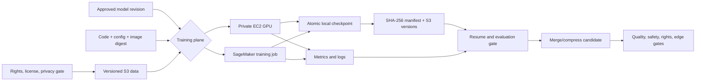

# CH-34: Training SLMs on AWS

## Status and evidence boundary

**AUTHORED, NOT EXECUTED.** No command in this chapter was run, no AWS resource was created, and no compatibility,
performance, reliability, savings, or model-quality result was reproduced. Every listing is therefore
**`UNVERIFIED IMPLEMENTATION`**. Statements checked against linked official documentation are **`DOC-VERIFIED`**;
proposed tests are **`PLANNED EXPERIMENT`**; the diagram is **`ILLUSTRATIVE`**.

This chapter provides one end-to-end reference path for self-managed Amazon EC2 and managed Amazon SageMaker AI
training. It covers GPU provisioning, CUDA/PyTorch and Docker, S3 datasets/checkpoints, rights-controlled pretrained
downloads, continued pretraining (CPT), LoRA/QLoRA supervised fine-tuning (SFT), distillation, compression handoff,
save/resume, tracking/versioning, distributed training, Spot recovery, cleanup, and cost monitoring. It quotes no
volatile price.

## 34.1 The system being built

A training run is a binding among immutable data, model/tokenizer revision, code, image, configuration,
hardware/software environment, mutable optimizer state, and durable outputs. The design principle is:

> **Immutable inputs + replaceable compute + durable, verified state.**

### FIG-CH34-20 — AWS training state flow

**Evidence:** `ILLUSTRATIVE`. Alt text: approved data and model snapshots enter an EC2 or SageMaker training plane;
checkpoints, metrics, and lineage return to S3; evaluation gates precede compression and release.



A canonical run manifest records:

- run/attempt ID, code commit and dirty-tree state;
- image registry and digest; dependency lock and software bill of materials;
- model/tokenizer IDs, immutable revisions, hashes, and license decision;
- S3 object version IDs, SHA-256 dataset manifest, split and mixture policy;
- configuration hash, overrides, seeds, and exact command;
- instance type, GPU inventory, driver, CUDA, PyTorch, and kernel versions;
- UTC times, exit reason, checkpoints, raw metrics, and evaluation versions.

An S3 key is not immutable by naming convention. Enable versioning and record `VersionId` plus an independent SHA-256;
an ETag is not a general SHA-256 integrity proof.

## 34.2 EC2 versus SageMaker AI

<!-- markdownlint-disable MD013 -->
| Decision                   | Self-managed EC2                              | SageMaker AI training                                                                  |
| -------------------------- | --------------------------------------------- | -------------------------------------------------------------------------------------- |
| Host/driver/kernel control | Maximum                                       | Container and job contract                                                             |
| Lifecycle                  | Operator provisions, patches, stops, recovers | Service provisions/releases job instances                                              |
| Checkpoints                | Script must upload and restore                | Configured local path synchronizes with S3; script must still save/load coherent state |
| Spot                       | Operator handles notice, durability, relaunch | Managed interruption/restart; no automatic On-Demand fallback                          |
| Reproducibility            | Requires disciplined IaC and pinning          | Job request helps, but inputs/image/code still need immutable revisions                |
| Debugging                  | Direct host access                            | Logs/metrics and managed interfaces                                                    |
| Cost comparison            | Compute plus attached services and operations | Managed rate plus attached services and operations                                     |
<!-- markdownlint-restore -->

**`DOC-VERIFIED`:** SageMaker can synchronize `/opt/ml/checkpoints` (or another configured local path) with S3 and
restore existing files when a job starts. Managed Spot Training can restart an interrupted job, but it does not fall
back to On-Demand when Spot is unavailable.

**Engineering recommendation, not a measured result:** start with one GPU. Choose EC2 when host control and low-level
diagnosis are central; choose SageMaker when isolated jobs, managed lifecycle, and checkpoint synchronization justify
the managed layer. Do not infer memory, availability, quota, capacity, or compatibility from a family name. Check the
exact subtype, Region/AZ, account quota, image, driver, and workload.

## 34.3 Security and rights gates

Fail closed before allocating a GPU if any gate is unresolved:

1. **Dataset rights:** owner, provenance, license/contract, transformations, commercial/redistribution limits,
   attribution, retention, geography, and deletion duties. Public access is not training permission.
2. **Model rights:** exact model card/license, gated-access approval, use restrictions, derivative-weight and
   redistribution rules.
3. **Privacy:** reject or remediate unapproved personal, health, customer, credential, and secret data.
4. **Supply chain:** prefer `safetensors`; use `trust_remote_code=False` unless reviewed code is pinned and sandboxed;
   never load an untrusted pickle checkpoint.
5. **Identity:** use EC2 instance profiles or SageMaker execution roles. Never bake AWS keys or Hugging Face tokens into
   code, images, user data, logs, or artifacts.
6. **Network/encryption:** private subnets, restricted egress/VPC endpoints where practical, IMDSv2, encrypted
   S3/EBS/logs, Block Public Access, narrow KMS policy, and Systems Manager instead of open SSH.
7. **Promotion:** treat outputs as untrusted until provenance, hash, license, serialization, quality, and safety checks
   pass.

For pharmacy and safety-critical repair models, training completion is not release approval. Qualified experts must
review ground truth, uncertainty/refusal behavior, escalation, intended use, and residual hazards.

## 34.4 Reference project

```text
slm-aws/
├── infra/ec2/main.tf
├── infra/sagemaker/launch.py
├── docker/Dockerfile
├── docker/{requirements.in,requirements.txt}
├── configs/{cpt,qlora-sft}.yaml
├── src/{materialize_s3,acquire_model,train,distill_logits}.py
├── src/{merge_adapter,integrity}.py
├── scripts/{run_job,watch_spot}.sh
└── manifests/                         # generated; no secrets
```

Paths above and below are intended paths for the contained listings.

## 34.5 Provision a private EC2 GPU worker

### Listing 34-1 — Terraform baseline

**Path:** `infra/ec2/main.tf`  
**Status:** `UNVERIFIED IMPLEMENTATION`  
**Prerequisites:** existing private subnet, versioned private S3 bucket, KMS key, approved GPU AMI, and encrypted/locked
remote Terraform state. Verify the provider version and lock file at implementation time.

```hcl
terraform {
  required_version = ">= 1.7.0"
  required_providers {
    aws = { source = "hashicorp/aws", version = "~> 6.0" }
  }
}
variable "region"          { type = string }
variable "project" {
  type    = string
  default = "slm-training"
}
variable "run_id"          { type = string }
variable "owner"           { type = string }
variable "vpc_id"          { type = string }
variable "subnet_id"       { type = string }
variable "ami_id"          { type = string } # approved exact AMI
variable "instance_type"   { type = string } # measured exact subtype
variable "artifact_bucket" { type = string }
variable "kms_key_arn"     { type = string }

data "aws_iam_policy_document" "assume" {
  statement {
    actions = ["sts:AssumeRole"]
    principals { type = "Service", identifiers = ["ec2.amazonaws.com"] }
  }
}
resource "aws_iam_role" "worker" {
  name = "${var.project}-${var.run_id}"
  assume_role_policy = data.aws_iam_policy_document.assume.json
}
data "aws_iam_policy_document" "worker" {
  statement {
    actions = ["s3:GetObject", "s3:GetObjectVersion", "s3:PutObject",
               "s3:ListBucket", "s3:GetBucketVersioning"]
    resources = [
      "arn:aws:s3:::${var.artifact_bucket}",
      "arn:aws:s3:::${var.artifact_bucket}/datasets/*",
      "arn:aws:s3:::${var.artifact_bucket}/models/*",
      "arn:aws:s3:::${var.artifact_bucket}/runs/${var.run_id}/*"
    ]
  }
  statement {
    actions = ["kms:Decrypt", "kms:Encrypt", "kms:GenerateDataKey",
               "kms:DescribeKey"]
    resources = [var.kms_key_arn]
  }
  statement {
    actions = ["ecr:GetAuthorizationToken"]
    resources = ["*"] # ECR authorization API requires this scope
  }
  statement {
    actions = ["ecr:BatchGetImage", "ecr:GetDownloadUrlForLayer",
               "ecr:BatchCheckLayerAvailability"]
    resources = ["arn:aws:ecr:${var.region}:*:repository/${var.project}"]
  }
}
resource "aws_iam_role_policy" "worker" {
  role = aws_iam_role.worker.id
  policy = data.aws_iam_policy_document.worker.json
}
resource "aws_iam_instance_profile" "worker" {
  name = "${var.project}-${var.run_id}"
  role = aws_iam_role.worker.name
}
resource "aws_security_group" "worker" {
  name = "${var.project}-${var.run_id}"
  vpc_id = var.vpc_id
  # No inbound rule. Replace broad HTTPS egress with endpoints/proxy if feasible.
  egress {
    from_port = 443
    to_port = 443
    protocol = "tcp"
    cidr_blocks = ["0.0.0.0/0"]
  }
}
resource "aws_instance" "worker" {
  ami = var.ami_id
  instance_type = var.instance_type
  subnet_id = var.subnet_id
  vpc_security_group_ids = [aws_security_group.worker.id]
  iam_instance_profile = aws_iam_instance_profile.worker.name
  associate_public_ip_address = false
  monitoring = true
  metadata_options {
    http_endpoint = "enabled"
    http_tokens   = "required"
  }
  root_block_device {
    encrypted = true
    kms_key_id = var.kms_key_arn
    volume_type = "gp3"
    volume_size = 200 # planning value; replace from measured staging need
    delete_on_termination = true
  }
  tags = {
    Project = var.project, RunId = var.run_id, Owner = var.owner,
    Environment = "research", AutoStop = "true"
  }
}
output "instance_id" { value = aws_instance.worker.id }
```

Review `terraform plan`, exact AMI publisher/ID, IAM wildcards, S3/KMS resource policies, quota, egress, disk, tags, and
deletion before apply. The compute stack must not own the authoritative bucket or key.

## 34.6 CUDA, PyTorch, Docker, and environment pinning

CUDA compatibility spans the host driver, container runtime, CUDA user-space libraries, PyTorch build, GPU compute
capability, and extension kernels. `nvidia-smi` alone does not prove that PyTorch, bitsandbytes, FlashAttention, or a
quantizer works.

### Listing 34-2 — Container contract

**Paths:** `docker/Dockerfile`, `docker/requirements.in`; generate `docker/requirements.txt`  
**Status:** `UNVERIFIED IMPLEMENTATION`. Replace the base tag with an approved immutable digest. Dependency illustrative values
intentionally prevent an unreviewed build.

```dockerfile
# docker/Dockerfile
ARG BASE_IMAGE=pytorch/pytorch:2.7.1-cuda12.8-cudnn9-runtime
FROM ${BASE_IMAGE}
ENV PYTHONDONTWRITEBYTECODE=1 PYTHONUNBUFFERED=1 PIP_NO_CACHE_DIR=1 \
    HF_HOME=/opt/slm/cache/huggingface TOKENIZERS_PARALLELISM=false
RUN groupadd --gid 10001 trainer \
 && useradd --uid 10001 --gid trainer --create-home trainer \
 && mkdir -p /workspace /opt/slm/{cache,work,checkpoints,outputs} \
 && chown -R trainer:trainer /workspace /opt/slm
COPY docker/requirements.txt /tmp/requirements.txt
RUN python -m pip install --require-hashes -r /tmp/requirements.txt
COPY --chown=trainer:trainer src /workspace/src
COPY --chown=trainer:trainer configs /workspace/configs
COPY --chown=trainer:trainer scripts /workspace/scripts
USER trainer
WORKDIR /workspace
ENTRYPOINT ["/workspace/scripts/run_job.sh"]
```

```text
# docker/requirements.in
# Resolve every illustrative value, then generate requirements.txt with hashes.
accelerate==0.0.0
boto3==0.0.0
datasets==0.0.0
huggingface-hub==0.0.0
peft==0.0.0
pyyaml==0.0.0
safetensors==0.0.0
tensorboard==0.0.0
transformers==0.0.0
bitsandbytes==0.0.0
```

The illustrative values are an explicit safety stop, not executable pseudocode. Record PyTorch from the base image in the SBOM.
Scan/sign the built image and deploy its ECR digest.

GPU admission test:

```bash
docker run --rm --gpus all --entrypoint python IMAGE@sha256:DIGEST - <<'PY'
import json, platform, torch
assert torch.cuda.is_available()
x = torch.randn((1024, 1024), device="cuda", dtype=torch.bfloat16)
print(json.dumps({"python": platform.python_version(), "torch": torch.__version__,
 "torch_cuda": torch.version.cuda, "cudnn": torch.backends.cudnn.version(),
 "gpus": [torch.cuda.get_device_name(i)
          for i in range(torch.cuda.device_count())],
 "matmul_shape": list((x @ x).shape)}, indent=2))
PY
```

Passing is not proof that BF16 training is stable; test representative forward/backward/save/load behavior.

## 34.7 S3 datasets and pretrained checkpoints

Stage immutable, reasonably sized shards to encrypted local storage and verify before training. Do not stream many tiny
objects on the critical GPU path without measurement.

### Listing 34-3 — Version-aware S3 materialization

**Path:** `src/materialize_s3.py`  
**Status:** `UNVERIFIED IMPLEMENTATION`

```python
import argparse, hashlib, json
from pathlib import Path
from urllib.parse import urlparse
import boto3

def digest(p):
    h = hashlib.sha256()
    with open(p, "rb") as f:
        for b in iter(lambda: f.read(8 * 1024 * 1024), b""): h.update(b)
    return h.hexdigest()

ap = argparse.ArgumentParser()
ap.add_argument("--manifest", required=True) # [{s3_uri,version_id,sha256,path}]
ap.add_argument("--output", required=True)
a = ap.parse_args()
root = Path(a.output).resolve(); root.mkdir(parents=True, exist_ok=True)
s3 = boto3.client("s3")
for r in json.loads(Path(a.manifest).read_text()):
    u = urlparse(r["s3_uri"])
    if u.scheme != "s3" or not r.get("version_id") or not r.get("sha256"):
        raise SystemExit("invalid immutable input record")
    out = (root / r["path"]).resolve()
    if root not in out.parents: raise SystemExit("path escape")
    out.parent.mkdir(parents=True, exist_ok=True)
    tmp = out.with_suffix(out.suffix + ".partial")
    s3.download_file(u.netloc, u.path.lstrip("/"), str(tmp),
                     ExtraArgs={"VersionId": r["version_id"]})
    if digest(tmp) != r["sha256"]:
        tmp.unlink(missing_ok=True); raise SystemExit("hash mismatch")
    tmp.replace(out)
```

### Listing 34-4 — Rights-gated model acquisition

**Path:** `src/acquire_model.py`  
**Status:** `UNVERIFIED IMPLEMENTATION`. The rights record is an approval artifact; `snapshot_download` does not grant
rights. Supply `HF_TOKEN` at runtime through an approved secret path.

```python
import argparse, hashlib, json, os
from pathlib import Path
from huggingface_hub import snapshot_download

ap = argparse.ArgumentParser()
ap.add_argument("--model-id", required=True)
ap.add_argument("--revision", required=True) # immutable commit, never "main"
ap.add_argument("--rights-record", required=True)
ap.add_argument("--output", required=True)
a = ap.parse_args()
rights = json.loads(Path(a.rights_record).read_text())
if rights.get("approved") is not True or rights.get("model_id") != a.model_id:
    raise SystemExit("rights gate failed")
root = Path(snapshot_download(
    repo_id=a.model_id, revision=a.revision, local_dir=a.output,
    token=os.environ.get("HF_TOKEN"),
    allow_patterns=["*.json", "*.model", "*.txt", "*.safetensors",
                    "tokenizer.*", "LICENSE*", "README*"]))
sums = {}
for p in sorted(x for x in root.rglob("*") if x.is_file()):
    h = hashlib.sha256(p.read_bytes()).hexdigest()
    sums[str(p.relative_to(root))] = h
(root / "SHA256SUMS.json").write_text(json.dumps(sums, indent=2))
```

For restricted egress, import the model through a controlled scanner and publish the approved snapshot to private S3.

## 34.8 CPT, LoRA, and QLoRA SFT

CPT learns next-token prediction over accepted domain text. SFT learns from rendered instruction/chat sequences. LoRA
learns low-rank updates to frozen weights:

$$
W'=W+\frac{\alpha}{r}BA
$$

where rank $r$, scaling $\alpha$, and target modules are experiment variables. QLoRA keeps a quantized frozen base
while training adapters; this does not make the training representation a release artifact.

### Listing 34-5 — Configuration

**Paths:** `configs/cpt.yaml`, `configs/qlora-sft.yaml`  
**Status:** `UNVERIFIED IMPLEMENTATION`; values are starting hypotheses.

```yaml
# configs/cpt.yaml
objective: cpt
model_path: /opt/slm/cache/base
train_file: /opt/slm/work/data/cpt-train.jsonl
validation_file: /opt/slm/work/data/cpt-validation.jsonl
output_dir: /opt/slm/checkpoints
max_length: 2048
learning_rate: 0.00002
epochs: 1
microbatch: 1
gradient_accumulation: 16
bf16: true
seed: 3401
save_steps: 100
```

```yaml
# configs/qlora-sft.yaml
objective: sft
model_path: /opt/slm/cache/base
train_file: /opt/slm/work/data/sft-train.jsonl
validation_file: /opt/slm/work/data/sft-validation.jsonl
output_dir: /opt/slm/checkpoints
max_length: 2048
learning_rate: 0.0001
epochs: 2
microbatch: 1
gradient_accumulation: 16
bf16: true
seed: 3401
save_steps: 100
lora:
  { enabled: true, qlora: true, rank: 16, alpha: 32, dropout: 0.05, target_modules: [q_proj, k_proj, v_proj, o_proj] }
```

Target module names are architecture-specific. Fail if requested modules are absent.

### Listing 34-6 — Unified trainer

**Path:** `src/train.py`  
**Status:** `UNVERIFIED IMPLEMENTATION`. CPT rows use `{"text":"..."}`; SFT rows use `{"messages":[...]}`. This compact
path applies loss to the full rendered SFT sequence. Assistant-only loss requires a separately validated template-aware
collator and is not claimed.

```python
import argparse
from pathlib import Path
import torch, yaml
from datasets import load_dataset
from peft import LoraConfig, TaskType, get_peft_model, prepare_model_for_kbit_training
from transformers import (AutoModelForCausalLM, AutoTokenizer,
 BitsAndBytesConfig, DataCollatorForLanguageModeling, Trainer,
 TrainingArguments, set_seed)

ap = argparse.ArgumentParser()
ap.add_argument("--config", required=True)
ap.add_argument("--resume", choices=["auto", "never"], default="auto")
a = ap.parse_args()
c = yaml.safe_load(Path(a.config).read_text()); set_seed(c["seed"])
lora = c.get("lora", {})
quant = BitsAndBytesConfig(load_in_4bit=True, bnb_4bit_quant_type="nf4",
 bnb_4bit_use_double_quant=True, bnb_4bit_compute_dtype=torch.bfloat16
) if lora.get("qlora") else None
tok = AutoTokenizer.from_pretrained(c["model_path"], local_files_only=True,
 trust_remote_code=False)
if tok.pad_token_id is None: tok.pad_token = tok.eos_token
model = AutoModelForCausalLM.from_pretrained(c["model_path"],
 local_files_only=True, trust_remote_code=False, quantization_config=quant,
 torch_dtype=torch.bfloat16 if c["bf16"] else torch.float32, device_map=None)
if lora.get("enabled"):
    if lora.get("qlora"):
        model = prepare_model_for_kbit_training(model,
          use_gradient_checkpointing=True)
    model = get_peft_model(model, LoraConfig(task_type=TaskType.CAUSAL_LM,
      r=lora["rank"], lora_alpha=lora["alpha"], lora_dropout=lora["dropout"],
      target_modules=lora["target_modules"], bias="none"))
    if model.get_nb_trainable_parameters()[0] == 0:
        raise SystemExit("zero trainable parameters")
ds = load_dataset("json", data_files={"train": c["train_file"],
                                      "validation": c["validation_file"]})
def encode(row):
    if c["objective"] == "cpt": text = row["text"]
    else:
        if tok.chat_template is None: raise ValueError("chat template required")
        text = tok.apply_chat_template(row["messages"], tokenize=False,
                                       add_generation_prompt=False)
    return tok(text, truncation=True, max_length=c["max_length"])
tokenized = ds.map(encode, remove_columns=ds["train"].column_names)
args = TrainingArguments(output_dir=c["output_dir"],
 learning_rate=c["learning_rate"], num_train_epochs=c["epochs"],
 per_device_train_batch_size=c["microbatch"],
 per_device_eval_batch_size=c["microbatch"],
 gradient_accumulation_steps=c["gradient_accumulation"],
 gradient_checkpointing=True, bf16=c["bf16"],
 save_strategy="steps", save_steps=c["save_steps"],
 eval_strategy="steps", eval_steps=c["save_steps"], logging_steps=5,
 save_total_limit=3, report_to=["tensorboard"], seed=c["seed"],
 data_seed=c["seed"], ddp_find_unused_parameters=False)
trainer = Trainer(model=model, args=args, train_dataset=tokenized["train"],
 eval_dataset=tokenized["validation"],
 data_collator=DataCollatorForLanguageModeling(tok, mlm=False))
checkpoints = sorted(Path(c["output_dir"]).glob("checkpoint-*"),
 key=lambda p: int(p.name.rsplit("-", 1)[1]))
resume = str(checkpoints[-1]) if a.resume == "auto" and checkpoints else None
trainer.train(resume_from_checkpoint=resume)
trainer.save_model(str(Path(c["output_dir"]) / "final"))
tok.save_pretrained(str(Path(c["output_dir"]) / "final"))
```

Validate EOS/template behavior, truncation statistics, loss masking, packing, replay mixture, dataloader resume, exact
APIs, and distributed saves. CPT general-data replay must be materialized and manifested in preprocessing; it is not
silently implemented here.

## 34.9 Distillation and compression

**Response distillation:** generate with an authorized teacher; preserve teacher revision, prompt, sampling policy,
rights, and sources; have experts accept/reject/correct outputs; then use the SFT path. This may copy teacher errors and
terms may restrict output reuse.

**Logit distillation:** only compare tokenwise distributions after proving tokenizer/vocabulary alignment:

$$
\mathcal L=(1-\lambda)\mathcal L_{CE}+\lambda T^2 D_{KL}(\mathrm{softmax}(z_T/T)\parallel\mathrm{softmax}(z_S/T)).
$$

### Listing 34-7 — Distillation loss core

**Path:** `src/distill_logits.py`  
**Status:** `UNVERIFIED IMPLEMENTATION`

```python
import torch
import torch.nn.functional as F
from transformers import Trainer
class DistillationTrainer(Trainer):
    def __init__(self, *args, teacher_model, temperature=2.0,
                 kd_weight=0.5, **kwargs):
        super().__init__(*args, **kwargs)
        self.teacher = teacher_model.eval()
        self.temperature, self.kd_weight = temperature, kd_weight
        for p in self.teacher.parameters(): p.requires_grad_(False)
    def compute_loss(self, model, inputs, return_outputs=False,
                     num_items_in_batch=None):
        labels = inputs["labels"]; student = model(**inputs)
        with torch.no_grad():
            teacher = self.teacher(**{k:v for k,v in inputs.items()
                                      if k != "labels"})
        if student.logits.shape != teacher.logits.shape:
            raise ValueError("tokenizer/logit mismatch")
        s, t, T = student.logits[:, :-1], teacher.logits[:, :-1], self.temperature
        mask = labels[:, 1:].ne(-100)
        per_token = F.kl_div(F.log_softmax(s/T, -1),
                             F.softmax(t/T, -1), reduction="none").sum(-1)
        kd = (per_token * mask).sum() / mask.sum().clamp_min(1)
        loss = (1-self.kd_weight)*student.loss + self.kd_weight*T*T*kd
        return (loss, student) if return_outputs else loss
```

Compression must be target-specific: evaluate adapter, merge into the exact base, save safely, hash/evaluate merged
weights, quantize separately per runtime/hardware, then repeat quality, safety, memory, latency, and compatibility
gates.

### Listing 34-8 — Non-destructive adapter merge

**Path:** `src/merge_adapter.py`  
**Status:** `UNVERIFIED IMPLEMENTATION`

```python
import argparse
from pathlib import Path
import torch
from peft import PeftModel
from transformers import AutoModelForCausalLM, AutoTokenizer
ap = argparse.ArgumentParser()
ap.add_argument("--base", required=True); ap.add_argument("--adapter", required=True)
ap.add_argument("--output", required=True); a = ap.parse_args()
out = Path(a.output)
if out.exists() and any(out.iterdir()): raise SystemExit("refusing overwrite")
base = AutoModelForCausalLM.from_pretrained(a.base, local_files_only=True,
 trust_remote_code=False, torch_dtype=torch.bfloat16, device_map="cpu")
merged = PeftModel.from_pretrained(base, a.adapter).merge_and_unload()
merged.save_pretrained(out, safe_serialization=True, max_shard_size="4GB")
AutoTokenizer.from_pretrained(a.base, local_files_only=True,
 trust_remote_code=False).save_pretrained(out)
```

AWQ, GPTQ, GGUF, TorchAO, and vendor quantizers have different calibration, kernel, architecture, and export contracts.
Pin one tool/commit and official recipe for the exact target; preserve calibration hashes. There is no honest universal
quantization command.

## 34.10 Checkpoint integrity, resume, and tracking

A resumable checkpoint includes model/adapter, optimizer, scheduler, scaler, global step/accumulation, RNG states,
sampler/dataloader progress, configuration, and manifest. Write to a temporary directory, close/fsync, write the hash
manifest last, and rename atomically locally. Upload to a unique S3 prefix and retain the prior accepted checkpoint.

### Listing 34-9 — Integrity manifest

**Path:** `src/integrity.py`  
**Status:** `UNVERIFIED IMPLEMENTATION`

```python
import argparse, hashlib, json
from pathlib import Path
def build(root):
    out = {}
    for p in sorted(x for x in root.rglob("*") if x.is_file()
                    and x.name != "CHECKPOINT.sha256.json"):
        h = hashlib.sha256()
        with p.open("rb") as f:
            for b in iter(lambda: f.read(8*1024*1024), b""): h.update(b)
        out[str(p.relative_to(root))] = {"sha256": h.hexdigest(),
                                         "bytes": p.stat().st_size}
    return {"schema": 1, "files": out}
ap = argparse.ArgumentParser(); ap.add_argument("mode", choices=["write","verify"])
ap.add_argument("directory"); a = ap.parse_args(); root = Path(a.directory)
manifest = root / "CHECKPOINT.sha256.json"
if a.mode == "write":
    manifest.write_text(json.dumps(build(root), indent=2, sort_keys=True))
elif json.loads(manifest.read_text()) != build(root):
    raise SystemExit("checkpoint integrity failure")
```

TensorBoard is useful for metrics; MLflow or SageMaker Experiments may index runs. None replaces the immutable run
manifest, raw logs, hashes, and evaluations. Never log secrets or sensitive training examples.

## 34.11 Launch, durable sync, and automatic stop

### Listing 34-10 — Job wrapper

**Path:** `scripts/run_job.sh`  
**Status:** `UNVERIFIED IMPLEMENTATION`. The broad sync must be replaced by accepted-checkpoint publication before
production.

```bash
#!/usr/bin/env bash
set -Eeuo pipefail; umask 027
: "${RUN_ID:?}" "${ARTIFACT_BUCKET:?}" "${KMS_KEY_ID:?}"
: "${DATA_MANIFEST:?}" "${TRAIN_CONFIG:?}" "${IMAGE_DIGEST:?}" "${CODE_COMMIT:?}"
RUN_PREFIX="s3://${ARTIFACT_BUCKET}/runs/${RUN_ID}"
WORK=/opt/slm/work; CKPT=/opt/slm/checkpoints
mkdir -p "$WORK/manifests" "$CKPT"
finish() {
  rc=$?; set +e
  python /workspace/src/integrity.py write "$CKPT"
  aws s3 sync "$CKPT/" "$RUN_PREFIX/checkpoints/" \
    --sse aws:kms --sse-kms-key-id "$KMS_KEY_ID"
  printf '{"run_id":"%s","exit_code":%d,"ended":"%s"}\n' \
    "$RUN_ID" "$rc" "$(date -u +%FT%TZ)" > "$WORK/manifests/exit.json"
  aws s3 cp "$WORK/manifests/exit.json" "$RUN_PREFIX/manifests/exit.json" \
    --sse aws:kms --sse-kms-key-id "$KMS_KEY_ID"
  [[ "${AUTO_STOP_EC2:-false}" == true ]] && sudo /sbin/shutdown -h now
  exit "$rc"
}
trap finish EXIT INT TERM
python - <<'PY' > "$WORK/manifests/environment.json"
import json, os, platform, torch
print(json.dumps({"run_id":os.environ["RUN_ID"],
 "code_commit":os.environ["CODE_COMMIT"],"image":os.environ["IMAGE_DIGEST"],
 "python":platform.python_version(),"torch":torch.__version__,
 "cuda":torch.version.cuda,"gpus":[torch.cuda.get_device_name(i)
 for i in range(torch.cuda.device_count())]}, indent=2))
PY
aws s3 cp "$WORK/manifests/environment.json" "$RUN_PREFIX/manifests/environment.json" \
  --sse aws:kms --sse-kms-key-id "$KMS_KEY_ID"
python /workspace/src/materialize_s3.py --manifest "$DATA_MANIFEST" \
  --output "$WORK/data"
(while sleep 60; do aws s3 sync "$CKPT/" "$RUN_PREFIX/checkpoints/" \
 --sse aws:kms --sse-kms-key-id "$KMS_KEY_ID" || true; done) & SYNC_PID=$!
if [[ "${NPROC_PER_NODE:-1}" -gt 1 ]]; then
  torchrun --standalone --nproc_per_node="$NPROC_PER_NODE" \
    /workspace/src/train.py --config "$TRAIN_CONFIG" --resume auto
else
  python /workspace/src/train.py --config "$TRAIN_CONFIG" --resume auto
fi
kill "$SYNC_PID" 2>/dev/null || true; wait "$SYNC_PID" 2>/dev/null || true
```

### Listing 34-10A — Operator sequence

**Path:** operator shell/history captured with the run record  
**Status:** `UNVERIFIED IMPLEMENTATION`. Resolve illustrative values from reviewed outputs; never paste secrets into shell
history. The EC2 AMI/bootstrap must already provide Docker, NVIDIA Container Toolkit, AWS CLI, and Systems Manager.

```bash
# 1. Resolve and lock dependencies; build, scan, sign, then push.
pip-compile --generate-hashes docker/requirements.in -o docker/requirements.txt
docker build --pull -t "$ECR_REPOSITORY:$CODE_COMMIT" -f docker/Dockerfile .
docker inspect "$ECR_REPOSITORY:$CODE_COMMIT"
aws ecr get-login-password --region "$AWS_REGION" |
  docker login --username AWS --password-stdin "$ECR_REGISTRY"
docker push "$ECR_REPOSITORY:$CODE_COMMIT"
# Query ECR and record IMAGE@sha256:DIGEST; do not deploy the mutable tag.

# 2. Review and create the isolated EC2 compute stack.
terraform -chdir=infra/ec2 init
terraform -chdir=infra/ec2 validate
terraform -chdir=infra/ec2 plan -out=reviewed.tfplan
terraform -chdir=infra/ec2 apply reviewed.tfplan

# 3. Through an audited Systems Manager session/Run Command, authenticate ECR
# and start the pinned image. These variables contain IDs/paths, not secrets.
docker run --rm --gpus all --name "slm-$RUN_ID" \
  -e RUN_ID -e ARTIFACT_BUCKET -e KMS_KEY_ID \
  -e DATA_MANIFEST -e TRAIN_CONFIG -e IMAGE_DIGEST -e CODE_COMMIT \
  -e AUTO_STOP_EC2=true \
  -v /opt/slm:/opt/slm \
  "$ECR_REPOSITORY@$IMAGE_DIGEST"

# 4. After independent artifact verification, review compute destruction.
terraform -chdir=infra/ec2 plan -destroy -out=reviewed-destroy.tfplan
terraform -chdir=infra/ec2 apply reviewed-destroy.tfplan
```

The wrapper's shutdown is defense in depth, not cleanup proof. If the process never starts, an external
maximum-runtime/idle-control path must still stop the instance.

### 34.11.1 Reading the operator sequence

Each command establishes a different part of the evidence chain:

- `pip-compile --generate-hashes` resolves abstract dependency requests into exact distributions and hashes. Review the
  resulting lock; resolution success is not a security approval.
- `docker build --pull` refreshes the declared base reference, while the recorded image digest—not the local tag—is the
  deployment identity. A reproducible release should ultimately pin the base by digest too.
- `aws ecr get-login-password | docker login` obtains a short-lived registry credential. It must run in an authorized
  session and should not be copied into logs.
- `terraform plan -out=reviewed.tfplan` freezes the reviewed infrastructure change. Applying that file avoids silently
  recomputing a different plan after review.
- `docker run --gpus all` exposes qualified host GPUs to the pinned container. The environment variables are IDs and
  paths; secrets use an approved runtime channel.
- `terraform plan -destroy` makes cleanup reviewable. Destruction follows independent artifact verification so a failed
  upload does not erase the only usable checkpoint.

Follow one run end to end. The materializer downloads exact S3 object versions and checks SHA-256. The trainer renders
CPT text or SFT chat records, writes periodic local checkpoints, and the background loop copies them to a run-specific
S3 prefix. On exit, the trap records status and performs a final sync. A replacement host may resume only after the
checkpoint's model, data, config, and environment lineage match. Exit code zero advances the candidate to evaluation;
it does not establish model quality.

## 34.12 SageMaker equivalent

### Listing 34-11 — Submit managed training

**Path:** `infra/sagemaker/launch.py`  
**Status:** `UNVERIFIED IMPLEMENTATION`. Validate the current API, exact `ml.*` type, quota, image, VPC, role, KMS, and
S3 prefixes.

```python
import argparse, boto3, json
ap = argparse.ArgumentParser(); ap.add_argument("--spec", required=True)
a = ap.parse_args(); s = json.load(open(a.spec, encoding="utf-8"))
required = ["job_name","role_arn","image_uri","instance_type","volume_gb",
 "kms_key_id","checkpoint_s3_uri","output_s3_uri","subnets",
 "security_group_ids","max_runtime_seconds","max_wait_seconds","environment"]
if [k for k in required if k not in s]: raise SystemExit("incomplete spec")
if "@sha256:" not in s["image_uri"]: raise SystemExit("digest required")
if s["max_wait_seconds"] <= s["max_runtime_seconds"]:
    raise SystemExit("Spot max wait must exceed max runtime")
request = {
 "TrainingJobName":s["job_name"], "RoleArn":s["role_arn"],
 "AlgorithmSpecification":{"TrainingImage":s["image_uri"],
                            "TrainingInputMode":"File"},
 "ResourceConfig":{"InstanceType":s["instance_type"],
   "InstanceCount":s.get("instance_count",1),"VolumeSizeInGB":s["volume_gb"],
   "VolumeKmsKeyId":s["kms_key_id"]},
 "StoppingCondition":{"MaxRuntimeInSeconds":s["max_runtime_seconds"],
                      "MaxWaitTimeInSeconds":s["max_wait_seconds"]},
 "EnableManagedSpotTraining":s.get("managed_spot",True),
 "CheckpointConfig":{"S3Uri":s["checkpoint_s3_uri"],
                     "LocalPath":"/opt/ml/checkpoints"},
 "OutputDataConfig":{"S3OutputPath":s["output_s3_uri"],
                     "KmsKeyId":s["kms_key_id"]},
 "VpcConfig":{"Subnets":s["subnets"],
              "SecurityGroupIds":s["security_group_ids"]},
 "Environment":s["environment"], "EnableNetworkIsolation":True,
 "EnableInterContainerTrafficEncryption":True,
 "Tags":[{"Key":"Project","Value":"slm-training"},
         {"Key":"RunId","Value":s["environment"]["RUN_ID"]}]}
boto3.client("sagemaker").create_training_job(**request)
```

SageMaker synchronization is not application-level checkpoint correctness. For multi-instance jobs use collision-free
rank paths. Deleting local checkpoint files can propagate deletion to the synchronized S3 prefix; use unique run
prefixes and an external accepted copy.

## 34.13 Distributed training

Scale in this order:

1. one GPU plus gradient accumulation;
2. activation checkpointing and PEFT where scientifically appropriate;
3. single-node DistributedDataParallel (DDP);
4. FSDP/ZeRO when model/optimizer state needs sharding;
5. multi-node only after communication and I/O measurements justify it.

DDP replicates the model and synchronizes gradients; it does not make an oversized model fit each GPU. FSDP/ZeRO reduce
state memory at the cost of communication and checkpoint complexity. Multi-node NVIDIA training additionally requires
verified `torchrun` rendezvous, NCCL, EFA where selected, placement, ports/security groups, topology, storage, and
coordinated rank failure. Only a designated rank publishes shared outputs.

Report exact topology, tokens and sequence distribution, effective batch, precision, loader/storage throughput, step and
communication time, convergence at fixed token budget, failures, and every billed resource.

## 34.14 Spot and failure recovery

**`DOC-VERIFIED`:** EC2 Spot interruption notices are best effort and generally arrive two minutes before
stop/terminate; hibernation differs. Notices are available through EventBridge and IMDS. The warning is not the
durability mechanism.

### Listing 34-12 — IMDSv2 watcher

**Path:** `scripts/watch_spot.sh`  
**Status:** `UNVERIFIED IMPLEMENTATION`. The trainer must implement `SIGUSR1` as an atomic checkpoint request.

```bash
#!/usr/bin/env bash
set -euo pipefail; : "${TRAIN_PID:?}"
while sleep 5; do
  token="$(curl -fsS -X PUT -H 'X-aws-ec2-metadata-token-ttl-seconds: 30' \
    http://169.254.169.254/latest/api/token)" || continue
  if notice="$(curl -fsS -H "X-aws-ec2-metadata-token: $token" \
    http://169.254.169.254/latest/meta-data/spot/instance-action 2>/dev/null)"
  then printf 'Spot interruption: %s\n' "$notice" >&2
       kill -USR1 "$TRAIN_PID"; exit 0
  fi
done
```

Checkpoint periodically, preserve the prior verified checkpoint, use unique run/attempt IDs, validate model/config/data
identity on resume, and retain an On-Demand path for deadline-bound/non-resumable work. Test process kill, host loss,
disk-full, S3 denial, hash failure, OOM, and exhausted Spot wait.

### Failure runbook

<!-- markdownlint-disable MD013 -->
| Symptom           | Contain and diagnose                                   | Recovery/prevention                                          |
| ----------------- | ------------------------------------------------------ | ------------------------------------------------------------ |
| CUDA unavailable  | Abort; inspect driver/runtime/device/image             | Replace pinned AMI/image; rerun smoke test                   |
| CUDA OOM          | Preserve logs; inspect peaks/lengths/other processes   | Lower microbatch/context, checkpoint activations, PEFT/shard |
| NaN/loss spike    | Stop promotion; inspect inputs, precision, LR          | Resume prior checkpoint after reviewed change                |
| S3 `AccessDenied` | Inspect role, bucket/KMS/endpoint policies             | Fix narrow policy; never grant `s3:*` reflexively            |
| Hash mismatch     | Quarantine; inspect partial/wrong version/tampering    | Restore prior version; atomic write + SHA-256                |
| Resume failure    | Compare image/config/model/data and state completeness | Use matching lineage or explicit restart                     |
| NCCL hang         | Stop ranks; inspect topology/ports/rank failure        | Correct network/config; restart verified checkpoint          |
| Disk full         | Stop writes; protect accepted state                    | Clean disposable cache or expand; add alarms/retention       |
| Rights issue      | Freeze run and derivatives                             | Trace/quarantine/delete per policy and counsel               |
<!-- markdownlint-restore -->

## 34.15 GPU and cost monitoring

**`DOC-VERIFIED`:** the CloudWatch agent can collect NVIDIA GPU utilization, memory, temperature, power, and clock
metrics on Linux with an NVIDIA driver. They are not universally automatic.

Collect GPU/CPU/RAM/disk/network, data-loader wait, loss, learning rate, tokens, step time, checkpoint age/sync lag,
OOM/NaN/restart/interruption, and bounded run/model/image identifiers. Do not log secrets or sensitive examples.

$$
C=\sum_i q_i r_i
$$

Here $q_i$ is measured usage and $r_i$ is a dated, Region-specific official unit rate. Include EC2/SageMaker
compute, EBS/snapshots, S3 storage/requests, transfer, public IPv4/NAT, ECR, CloudWatch, KMS, and failed/interrupted
work. Capture timestamp, Region, SKU/rate or calculator export, billing unit, credits/taxes assumptions, and
sensitivity. Use official EC2, Spot, SageMaker, and Cost Management sources at experiment time.

Use required project/run/owner tags, maximum runtime, AWS Budgets, Cost Explorer, anomaly detection, low-utilization
notification, and a reviewed stop workflow scoped to nonproduction resources. A budget alert is not an immediate kill
switch.

## 34.16 Cleanup and retention

1. stop writes; upload metrics/logs/manifests and accepted checkpoints;
2. verify hashes and object versions from a separate path;
3. mark run status and retention class;
4. terminate job/instance;
5. remove ephemeral volumes, ENIs, temporary secrets, and unused images per policy;
6. retain IaC state, audit trail, rights records, manifests, and approved artifacts;
7. expire rejected/temporary data under legal policy; and
8. prove no billable GPU job/endpoint remains.

Review `terraform plan -destroy` before applying it. SageMaker releases training instances at terminal state, but S3,
ECR, logs, snapshots, networking, and registry artifacts remain governed separately.

## 34.17 Qualification exercises

All are `PLANNED EXPERIMENT` until evidence is attached.

1. Write an ADR choosing EC2 or SageMaker without using a price.
2. Prove separate reader/trainer/evaluator/release roles; the trainer cannot delete source data or write releases.
3. Build dataset/model rights manifests and demonstrate a denied run.
4. Train, checkpoint, kill, replace compute, resume, and compare to an uninterrupted control.
5. Compare CPT+SFT with SFT-only at fixed data/evaluation and report general retention.
6. Compare LoRA and QLoRA under equivalent effective batch/data order.
7. Compare direct student SFT, reviewed response distillation, and logit distillation only after tokenizer proof.
8. Evaluate pre-merge, merged, and every target quantization independently.
9. Inject process kill, host loss, S3 denial, and checkpoint corruption.
10. Scale one to multiple GPUs only after identifying a measured bottleneck.
11. Audit cleanup and explain every retained resource.
12. Multiply measured usage by dated official rates; include interrupted work.

Evidence must include exact commands, raw logs/metrics, environment, manifests, hashes, configs, failures, evaluations,
and decision record. Exit code zero is not model-quality evidence.

## 34.18 Honesty note

The listings form a reference path, not a deployment claim. Resolve pins and illustrative values, then test rights gates,
checkpoint/resume, Spot loss, cleanup, quality, and dated cost in a disposable AWS environment.

## 34.19 Official sources

Consulted 2026-11-23; recency must be rechecked at implementation time.

### AWS

- EC2 accelerated computing: <https://docs.aws.amazon.com/ec2/latest/instancetypes/ac.html>
- EC2 instance types by Region: <https://docs.aws.amazon.com/ec2/latest/instancetypes/ec2-instance-regions.html>
- Spot interruption notices:
  <https://docs.aws.amazon.com/AWSEC2/latest/UserGuide/spot-instance-termination-notices.html>
- Rebalance recommendations: <https://docs.aws.amazon.com/AWSEC2/latest/UserGuide/rebalance-recommendations.html>
- SageMaker Managed Spot: <https://docs.aws.amazon.com/sagemaker/latest/dg/model-managed-spot-training.html>
- SageMaker checkpoints: <https://docs.aws.amazon.com/sagemaker/latest/dg/model-checkpoints.html>
- SageMaker distributed training:
  <https://docs.aws.amazon.com/sagemaker/latest/dg/distributed-training-get-started.html>
- SageMaker custom containers: <https://docs.aws.amazon.com/sagemaker/latest/dg/adapt-training-container.html>
- S3 security: <https://docs.aws.amazon.com/AmazonS3/latest/userguide/security-best-practices.html>
- IAM security: <https://docs.aws.amazon.com/IAM/latest/UserGuide/best-practices.html>
- ECR security: <https://docs.aws.amazon.com/AmazonECR/latest/userguide/security.html>
- CloudWatch NVIDIA metrics:
  <https://docs.aws.amazon.com/AmazonCloudWatch/latest/monitoring/CloudWatch-Agent-NVIDIA-GPU.html>
- Budgets: <https://docs.aws.amazon.com/cost-management/latest/userguide/budgets-managing-costs.html>
- Cost Explorer: <https://docs.aws.amazon.com/cost-management/latest/userguide/ce-what-is.html>
- Cost Anomaly Detection: <https://docs.aws.amazon.com/cost-management/latest/userguide/manage-ad.html>

### Framework/tooling

- PyTorch reproducibility: <https://docs.pytorch.org/docs/stable/notes/randomness.html>
- PyTorch distributed overview: <https://docs.pytorch.org/tutorials/beginner/dist_overview.html>
- Transformers Trainer: <https://huggingface.co/docs/transformers/main_classes/trainer>
- bitsandbytes: <https://huggingface.co/docs/transformers/quantization/bitsandbytes>
- PEFT LoRA: <https://huggingface.co/docs/peft/package_reference/lora>
- Hub downloads: <https://huggingface.co/docs/huggingface_hub/guides/download>
- Safetensors: <https://huggingface.co/docs/safetensors/>
- Terraform AWS provider: <https://registry.terraform.io/providers/hashicorp/aws/latest/docs>

## Cross-links

- [CH-33: AWS infrastructure](ch-33-aws-infrastructure-for-slm-development.md)
- [CH-35: AWS inference serving](ch-35-aws-inference-serving.md)
- [CH-36: AWS-to-edge delivery](ch-36-aws-to-edge-model-delivery.md)
- [CH-05: continued pretraining](../part-02-training-and-domain-adaptation/ch-05-continued-pretraining-and-domain-adaptation.md)
- [CH-06: SFT](../part-02-training-and-domain-adaptation/ch-06-supervised-fine-tuning.md)
- [CH-09: LoRA/QLoRA](../part-03-parameter-efficient-fine-tuning/ch-09-lora-and-its-evolution.md)
- [CH-13: distillation](../part-04-model-compression-and-optimization/ch-13-knowledge-distillation-complete-research-and-implementation.md)
- [Evidence standard](../../00-governance/evidence-and-citation-standard.md)
- [CH-34 assessment](../../13-assessments/ch-34-assessment.md)
