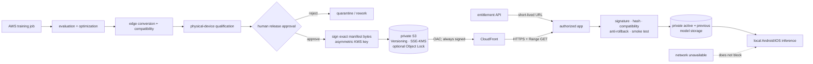
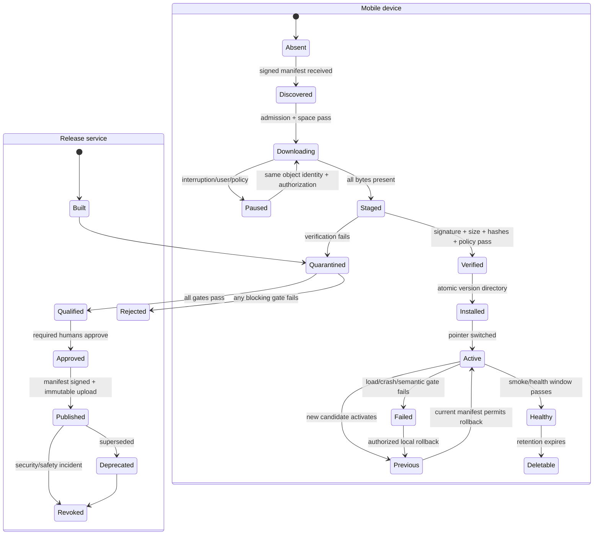

# Chapter 36 — AWS-to-Edge Model Delivery

> **Illustrative values.** Concrete identifiers, dates, thresholds, hashes, account numbers, and endpoints in this file are teaching examples, not observed project results or deployable credentials. Before use, replace them with reviewed values from your own registry, preserve the required format, and rerun every stated validation.

**Research cut-off:** 2026-11-23  
**Documentation status:** Statements tied to §36.19 first-party sources are `DOC-VERIFIED`.  
**Execution status:** **AUTHORED / NOT EXECUTED.** No AWS account, bucket, key, distribution, signing operation, mobile
build, download, or physical device was used for this chapter. Every command, schema, policy, listing, and pseudocode
block is therefore **`UNVERIFIED IMPLEMENTATION`** unless explicitly labeled otherwise. Proposed tests are
`PLANNED EXPERIMENTS`; diagrams and numerical examples are `ILLUSTRATIVE`.

This chapter connects the AWS training and serving work in [Chapters 33–35](README.md) to the Android and iOS clients in
[Chapters 20–21](../part-05-edge-ai-and-mobile-inference/README.md). It describes delivery of trained model weights,
tokenizers, templates, runtime metadata, licenses, and safety policy. It does **not** add runtime Retrieval-Augmented
Generation (RAG): after installation, prompts and answers require neither AWS nor any other network service.

## 36.1 Learning outcomes and trust boundary

After completing this chapter, the reader should be able to:

1. operate the exact twelve-step train-to-edge release workflow;
2. distinguish a checksum, a digital signature, TLS, storage encryption, and download authorization;
3. design an immutable manifest and package with reproducible lineage;
4. select S3, AWS Key Management Service (KMS), and CloudFront—or justify an alternative;
5. gate a release on model quality, safety, runtime compatibility, mobile performance, and human approval;
6. resume interrupted downloads without joining bytes from different object versions;
7. install atomically and roll back without enabling arbitrary downgrade attacks;
8. load qualified artifacts on Android and iOS;
9. rotate signing and encryption keys and respond to compromise; and
10. prove that local inference remains available after credentials, URLs, and network access expire.

The release trust boundary is:

\[ \boxed{ \text{trusted edge release}= \text{approved bytes}+ \text{authenticated manifest}+ \text{compatible runtime}+
\text{enforced policy} } \tag{EQ-CH36-01} \]

TLS protects one transfer. A SHA-256 digest detects byte changes only when the expected digest is authenticated. A
CloudFront signed URL authorizes temporary retrieval but says nothing about whether the model passed evaluation. SSE-KMS
protects an object at rest in AWS but does not authenticate bytes after they leave AWS. The **detached release signature
over exact manifest bytes** is the durable, offline-verifiable statement of approval.

## 36.2 Explicit reference architecture selection

**Selected production baseline:**

- **Amazon S3 general-purpose bucket** as the immutable artifact origin, with Versioning, Block Public Access,
  bucket-owner-enforced ownership, full-object checksums, and lifecycle rules.
- **SSE-KMS** with a symmetric customer-managed key (CMK) for at-rest encryption and auditable key policy. S3 encrypts
  new objects by default, but this project selects SSE-KMS where customer-controlled access policy and
  CloudTrail-visible KMS use are required [A1–A4].
- **S3 Object Lock in governance mode** for approved release objects where accidental or malicious deletion protection
  is worth the operational constraints. Compliance mode is reserved for a separately approved regulatory requirement.
  Object Lock protects object versions, requires Versioning, and does not prevent creation of a new version [A2].
- **CloudFront** in front of a non-website S3 origin, with Origin Access Control (OAC), `SigningBehavior=always`,
  HTTPS-only viewers, and a bucket policy restricted to the distribution. OAC is selected over legacy Origin Access
  Identity (OAI) [A5].
- **CloudFront signed URLs** minted only after application authentication and entitlement. Their lifetime is short, but
  long enough for a range request; the app can refresh authorization without discarding verified partial bytes.
- **AWS KMS asymmetric P-256 signing key** with `SIGN_VERIFY` usage and `ECDSA_SHA_256` for detached manifest
  signatures. The private key never enters the build worker; mobile apps embed an allowlist of exported public keys. The
  signing key is separate from the S3 encryption key.
- **A small entitlement API**—for example Amazon API Gateway plus AWS Lambda, or an existing product backend—to
  authenticate the user/device, select a compatible release, and mint a CloudFront signed URL. It is a control plane,
  not an inference dependency.

**FIG-CH36-01 — Selected AWS-to-edge architecture (`ILLUSTRATIVE`).**  
_Alt text:_ A release pipeline approves and signs an immutable manifest, stores encrypted artifacts in private S3, and <!-- markdownlint-disable-line MD013 MD049 -->
distributes them through CloudFront. Android and iOS verify and install locally; inference has no network path.



The reference architecture does not claim universal superiority. The explicit reasons for selecting it are large-object
range delivery, private origin access, global caching, AWS-native audit controls, and offline signature verification. It
avoids using SageMaker Model Registry as the phone download origin: a training registry is useful for lineage and
approval, while S3/CloudFront is better suited to large static edge packages.

Read the architecture as two trust decisions and one data transfer. The release gate decides **which bytes are
approved**; the KMS signature lets a disconnected app verify that decision. The entitlement API decides **which app may
download** those bytes; its URL can expire without invalidating an installed model. CloudFront transfers the bytes and
S3 preserves their origin versions. The phone then makes a third, local decision—compatibility and anti-rollback—before
activation. None of those components answers inference prompts.

**TBL-CH36-01 — Artifact-system alternatives (`DOC-VERIFIED` capabilities; suitability is an engineering
recommendation)**

<!-- markdownlint-disable MD013 -->
| Alternative                                              | Appropriate when                                                        | Main limitation for this chapter                                                                                             |
| -------------------------------------------------------- | ----------------------------------------------------------------------- | ---------------------------------------------------------------------------------------------------------------------------- |
| S3 + CloudFront + KMS (selected)                         | AWS estate, private large artifacts, global cohorts                     | more policy and updater work than an app-store bundle                                                                        |
| S3 presigned URL without CloudFront                      | small fleet or region-local prototype                                   | origin load and no CDN edge caching; authorization URL couples directly to S3                                                |
| Google Play Asset Delivery / Apple On-Demand Resources   | store-managed application assets fit platform policy                    | platform-specific packaging and cadence; still requires artifact compatibility controls                                      |
| MDM/private enterprise store                             | managed devices and deterministic preload                               | tied to fleet administration                                                                                                 |
| OCI registry/ECR or generic package registry             | existing artifact/SBOM tooling and modest client support                | mobile clients do not natively consume OCI layers; range/update UX may be awkward                                            |
| The Update Framework (TUF) or Sigstore-backed repository | multi-cloud, delegated roles, threshold signing, mature metadata design | additional infrastructure and client integration; often preferable when compromise resilience exceeds the simple scheme here |
<!-- markdownlint-restore -->

For a high-assurance product, use TUF-style root, targets, snapshot, and timestamp roles rather than extending the
simple detached-signature protocol ad hoc [S1]. The chapter baseline is deliberately understandable, not a replacement
for a reviewed software-update framework.

## 36.3 Artifact identity, package, and immutable manifest

An edge release is not one weight file. It is a closed set:

```text
release/
├── manifest.json                 # exact signed bytes; never rewritten
├── manifest.sig.json             # detached signature envelope
├── model.gguf | model.pte | model.mlpackage/...
├── tokenizer.json | tokenizer.model
├── chat-template.txt
├── LICENSES/
├── NOTICE.txt
├── sbom.spdx.json
└── qualification-summary.json
```

The manifest identifies every file by relative path, exact byte count, and SHA-256. Paths must be normalized UTF-8
relative paths with no drive, leading slash, `..`, backslash, duplicate, or normalization ambiguity. The package may be
a directory of independently downloaded objects or a non-executable archive. Independent objects avoid re-downloading
unchanged assets; an archive simplifies atomic package handling. Never treat a ZIP signature, S3 ETag, multipart ETag,
filename, or HTTPS URL as the release identity.

**Listing CH36-L01 — release manifest example (`UNVERIFIED IMPLEMENTATION`; JSON values are illustrative values).**

```json
{
  "schema": "offline-slm-release/v1",
  "releaseId": "auto-mechanic-edge-2026-11-r7",
  "releaseSequence": 107,
  "createdUtc": "2026-11-23T00:00:00Z",
  "domain": "automotive-educational",
  "channel": "stable",
  "status": "approved",
  "model": {
    "modelId": "auto-mechanic-slm",
    "semanticVersion": "2.3.0",
    "sourceCheckpointRevision": "aaaaaaaaaaaaaaaaaaaaaaaaaaaaaaaaaaaaaaaa",
    "sourceCheckpointSha256": "<64_LOWERCASE_HEX>",
    "datasetSnapshot": "dataset-snapshot-2026-01-15",
    "trainingRun": "run-2026-01-15-001",
    "knowledgeCutoff": "2026-01-15",
    "licenseIds": ["Apache-2.0"]
  },
  "artifactSet": "android-arm64-llamacpp-cpu-q4km",
  "compatibility": {
    "platform": "android",
    "architectures": ["arm64-v8a"],
    "minimumOs": "28",
    "minimumAppBuild": 120,
    "maximumAppBuild": null,
    "runtime": "llama.cpp",
    "runtimeRevision": "aaaaaaaaaaaaaaaaaaaaaaaaaaaaaaaaaaaaaaaa",
    "modelArchitecture": "decoder-only-transformer",
    "backend": "cpu",
    "quantization": "GGUF Q4_K_M",
    "contextTokensMaximum": 2048,
    "requiredRamBytes": 0,
    "requiredFreeStorageBytes": 0,
    "cohortAllow": ["qualified-arm64-baseline"],
    "cohortDeny": []
  },
  "artifacts": [
    {
      "path": "model.gguf",
      "mediaType": "application/octet-stream",
      "bytes": 0,
      "sha256": "<64_LOWERCASE_HEX>"
    },
    {
      "path": "tokenizer.json",
      "mediaType": "application/json",
      "bytes": 0,
      "sha256": "<64_LOWERCASE_HEX>"
    },
    {
      "path": "chat-template.txt",
      "mediaType": "text/plain; charset=utf-8",
      "bytes": 0,
      "sha256": "<64_LOWERCASE_HEX>"
    }
  ],
  "qualification": {
    "evaluationReportSha256": "<64_LOWERCASE_HEX>",
    "compatibilityReportSha256": "<64_LOWERCASE_HEX>",
    "physicalDeviceReportSha256": "<64_LOWERCASE_HEX>",
    "safetyReportSha256": "<64_LOWERCASE_HEX>",
    "approvals": [
      { "role": "model-owner", "recordId": "approval-illustrative-001" },
      { "role": "mobile-owner", "recordId": "approval-illustrative-001" },
      { "role": "safety-owner", "recordId": "approval-illustrative-001" }
    ]
  },
  "rollback": {
    "candidateReleaseId": "auto-mechanic-edge-2026-10-r6",
    "candidateManifestSha256": "<64_LOWERCASE_HEX>",
    "automaticRollbackAllowedUntilUtc": "2026-12-07T00:00:00Z"
  },
  "revocationEpoch": 12
}
```

`requiredRamBytes` and `requiredFreeStorageBytes` must come from measured qualification, not parameter-count arithmetic.
Use a separate manifest per platform/runtime/backend cohort even when releases share source weights. A universal
manifest tends to hide incompatible formats and weakens rollback clarity.

The exact UTF-8 bytes of `manifest.json` are signed. Producers must write deterministic JSON once—UTF-8, no byte-order
mark, stable key order, stable separators, no floating-point values—and never parse and reserialize it before
verification. Signing exact bytes avoids cross-language canonicalization mistakes. If independently generated equivalent
JSON must verify, adopt and test a formal canonicalization standard such as RFC 8785 rather than inventing one [S2].

## 36.4 Artifact state machine

<a id="fig-26"></a> **FIG-26 — Model update lifecycle (`ILLUSTRATIVE`).**  
_Alt text:_ Server artifacts progress from build through quarantine, qualification, approval, signing, publication, <!-- markdownlint-disable-line MD013 MD049 -->
deprecation, and revocation. Device artifacts progress through discovery, staged download, compatibility verification,
installation, activation, health checking, rollback, and deletion; installed local inference remains independent of
cloud availability. Not measured; states show a planned lifecycle only.



Invariants:

- only `Approved` material can become `Published`;
- only `Verified` material can become `Installed`;
- native parsers never see `Downloading`, `Staged`, or `Quarantined` bytes;
- `current` is a small activation record, not a mutable model filename;
- at least one known-good version remains until the candidate health window closes;
- `Revoked` prevents new installation and triggers incident policy, but an already-offline device cannot learn
  revocation until it reconnects;
- state transitions are journaled so process death can resume or safely clean up.

## 36.5 The exact twelve-step workflow

### Step 1 — Train on AWS

Freeze the base checkpoint, tokenizer, dataset snapshot, code revision, container digest, hyperparameters, seed,
instance/GPU type, library versions, training logs, checkpoints, and licenses. Store raw training outputs in a
restricted research prefix; they are **not** mobile releases. A training completion event creates a candidate record,
never an approval.

Exit evidence:

- immutable model/tokenizer/data/code identities;
- training and failure logs;
- final checkpoint checksums;
- data and model license review; and
- declared intended use and prohibited use.

### Step 2 — Evaluate the trained model

Run domain accuracy, general-retention, hallucination, calibration, adversarial, safety, refusal, privacy/memorization,
and regression suites on the trained checkpoint. Pharmacy, hazardous repair, high-voltage, lifting, pressure, and
animal-care critical slices are blocking rather than averaged away.

Exit gate: the source checkpoint meets pre-registered thresholds with raw results, denominators, uncertainty, evaluator
versions, and qualified human review. A release cannot inherit evidence from a different checkpoint hash.

### Step 3 — Optimize and compress it

Merge adapters when the target runtime requires merged weights; then apply the chosen quantization, pruning,
distillation, or graph optimization in a recorded order. Re-run quality and safety because compression can alter
outputs. Record converter, quantizer, calibration data, commands, CPU/GPU environment, and output hashes.

Exit gate: the compressed candidate meets quality, memory, storage, and latency objectives without unsupported kernels
or licenses.

### Step 4 — Convert to supported edge formats

Produce target-specific artifacts: for example GGUF for llama.cpp Android, `.pte` for ExecuTorch, or Core
ML/MLX-compatible assets for iOS. Preserve tokenizer normalization, special tokens, chat template, stop behavior,
RoPE/context settings, and KV-cache contract. One source checkpoint may produce several artifact sets; each receives a
different manifest and qualification.

Exit gate: the converter and runtime accept the exact architecture and all required files are in the package.

### Step 5 — Test compatibility

Before physical performance testing, compare source and target:

1. tokenizer IDs and decoded bytes;
2. rendered single- and multi-turn template bytes;
3. short/long prefill logits or deterministic greedy tokens;
4. first and repeated decode with KV reuse;
5. reset/session isolation;
6. context boundary and stop tokens;
7. malformed/truncated artifact rejection; and
8. runtime/backend operator placement or fallback.

Exit gate: all semantic parity thresholds and platform admission checks pass for the exact artifact hash.

### Step 6 — Benchmark on physical mobile devices

Use the oldest supported, median, and high-capability device cohorts, plus named vendor-accelerator cohorts. Fix
app/runtime/model hashes, OS/firmware, prompt/output lengths, context, sampling, threads, ambient temperature, charging
state, radios, display, and prior workload. Measure download and installed bytes, verification time, load peak, Time to
First Token (TTFT), prefill/decode, memory, energy boundary, battery, thermal state, UI responsiveness, cancellation,
and 10–30 minute sustained behavior. Emulator and simulator results do not qualify physical performance.

Exit gate: measured values populate compatibility/storage fields and meet cohort-specific thresholds. Missing cohort
evidence means “untested,” not “supported.”

### Step 7 — Publish approved model artifacts

Assemble the package, Software Bill of Materials (SBOM), notices, reports, and manifest. Require independent approvals
from model, mobile/runtime, security/supply-chain, licensing, and domain-safety owners as appropriate. The publisher
checks approval record identities, computes all hashes itself, signs exact manifest bytes, and writes an append-only
release record.

No build job may self-approve. Emergency releases may shorten timing but not signature, integrity, compatibility, or
safety gates.

### Step 8 — Store model versions in S3

Upload under immutable content/version paths such as:

```text
s3://private-edge-releases/releases/release-0.1.0-illustrative/android-arm64/aaaaaaaaaaaaaaaaaaaaaaaaaaaaaaaaaaaaaaaaaaaaaaaaaaaaaaaaaaaaaaaa/model.gguf
```

Enable Versioning before publication, specify a full-object checksum, use SSE-KMS, deny public access and non-TLS
requests, and optionally apply Object Lock retention. Record S3 bucket, key, version ID, checksum, KMS key ARN, and
retention state. Do not overwrite an approved key; a “latest” pointer, if used, is mutable discovery metadata and never
a trust anchor.

### Step 9 — Deliver securely to authorized mobile applications

The signed app authenticates to the product backend using the product's established identity flow. The entitlement
service selects only a compatible channel/cohort release and returns:

- exact signed manifest bytes and detached signature, or immutable URLs to them;
- a short-lived CloudFront signed URL/cookie for each artifact;
- object identity metadata needed for safe resume; and
- policy such as Wi-Fi-only, charging, or user-confirmed cellular transfer.

CloudFront serves only HTTPS; OAC prevents direct public S3 access. Authorization expiry is expected. It must not
invalidate already downloaded, correctly signed bytes.

### Step 10 — Verify integrity and compatibility before loading

The app first verifies the manifest signature using a pinned, non-revoked public key. It then validates schema, time
syntax, release sequence, revocation epoch, app/runtime/platform/ABI/OS/backend/cohort/context constraints, normalized
paths, file count, byte limits, free space, each exact length, and SHA-256. After an atomic install, it runs a
lightweight load/template/generation smoke test in an isolated session. Only then may the native runtime parse the
active model.

S3/CloudFront checksums are transport/storage defenses; the signed manifest's SHA-256 remains the end-to-end edge check.

### Step 11 — Support upgrades and rollback

Install side by side, never in place. Atomically replace a small activation record only after verification and smoke
testing. Retain the known-good predecessor through a health window. On load crash, repeated initialization failure, or a
pre-registered critical regression, switch back without network.

Anti-rollback and rollback coexist:

- reject an arbitrary manifest whose `releaseSequence` is below the device's durable highest accepted sequence;
- permit automatic rollback only to the exact predecessor digest named in the currently accepted signed manifest and
  only within its signed rollback window;
- for a fleet-wide rollback after that window, publish a **new, higher-sequence signed manifest** that references the
  earlier known-good artifact bytes;
- never lower the durable sequence floor merely because files were deleted or the app was restarted.

### Step 12 — Keep local inference independent of cloud connectivity

Once active, the app loads its model, tokenizer, template, runtime, and policy exclusively from private local storage.
It neither retrieves documents nor calls a remote teacher, entitlement service, or AWS inference endpoint per answer.
Expired download credentials, an unavailable CDN, revoked user login, airplane mode, and an AWS outage must not
interrupt an already authorized installation unless explicit enterprise policy requires time-limited offline
entitlement.

Offline independence does **not** mean indefinite safety currency. The UI exposes model version and knowledge cut-off;
consequential answers require authoritative verification and qualified escalation. Revocation can be enforced only after
connectivity or through app/MDM policy.

## 36.6 Release approval and evidence package

**TBL-CH36-02 — Blocking release gates (`PLANNED EXPERIMENT`)**

<!-- markdownlint-disable MD013 -->
| Gate                    | Required evidence                                          | Approver             | Blocking examples                         |
| ----------------------- | ---------------------------------------------------------- | -------------------- | ----------------------------------------- |
| lineage/reproducibility | immutable model, data, code, container, commands, hashes   | model owner          | unknown base revision or missing license  |
| quality                 | source and final-format domain/general results             | evaluation owner     | critical regression or contaminated test  |
| safety                  | hazard slices, refusal/escalation, expert review           | safety/domain owner  | one pre-defined critical unsafe answer    |
| conversion parity       | token/template/logit/greedy/cache tests                    | runtime owner        | wrong special token or unsupported op     |
| physical devices        | memory, latency, sustained thermal/energy, failures        | mobile owner         | OOM, thermal collapse, unsupported cohort |
| supply chain            | SBOM, dependency scan, parser tests, signature rehearsal   | security owner       | secret in package or malformed-file crash |
| delivery                | interrupted resume, bad URL, low disk, atomicity, rollback | release owner        | partial model becomes loadable            |
| legal/privacy           | model/data/runtime notices and telemetry review            | accountable reviewer | redistribution prohibited                 |
<!-- markdownlint-restore -->

Approval is attached to hashes, not names. If any weight, tokenizer, template, runtime, manifest field, app integration,
backend, or safety policy changes, the affected gates rerun. The release evidence package contains raw machine-readable
results and failure logs, not only a dashboard screenshot.

## 36.7 Checksums, signing, and publication

### Cryptographic roles

<!-- markdownlint-disable MD013 -->
| Control                    | Protects                                      | Does not prove                                                |
| -------------------------- | --------------------------------------------- | ------------------------------------------------------------- |
| SHA-256 in signed manifest | exact file bytes                              | who approved an unsigned manifest                             |
| ECDSA manifest signature   | manifest authenticity and integrity           | that testing was competent unless reports/approvals are bound |
| HTTPS/TLS                  | connection confidentiality/integrity          | long-term package authenticity                                |
| CloudFront signed URL      | temporary download authorization              | artifact quality or installed-byte identity                   |
| S3 checksum                | upload/download/storage integrity             | product release approval                                      |
| SSE-KMS                    | S3 at-rest confidentiality and access control | client-side authenticity or secrecy after download            |
| app code signing           | installed application code identity           | separately downloaded model authenticity                      |
<!-- markdownlint-restore -->

The baseline signs one SHA-256 digest of exact manifest bytes with KMS `ECDSA_SHA_256`. The signature envelope is
routing metadata; authenticity comes only from successful verification of `manifest.json`.

**Listing CH36-L02 — build manifest and hashes (`UNVERIFIED IMPLEMENTATION`).**  
Dependencies: Python 3.12+, standard library only. Inputs: a closed release directory and metadata assembled by the
approved pipeline. Output: deterministic `manifest.json`. Hardware: any controlled build worker. Security: run after
closing the package; reject links and unsafe paths.

```python
#!/usr/bin/env python3
"""UNVERIFIED IMPLEMENTATION: deterministic manifest writer."""
from __future__ import annotations
import hashlib, json, os
from pathlib import Path, PurePosixPath

CHUNK = 8 * 1024 * 1024
EXCLUDED = {"manifest.json", "manifest.sig.json"}

def sha256_file(path: Path) -> str:
    h = hashlib.sha256()
    with path.open("rb") as stream:
        while block := stream.read(CHUNK):
            h.update(block)
    return h.hexdigest()

def safe_relative(root: Path, path: Path) -> str:
    if path.is_symlink():
        raise ValueError(f"symbolic links are forbidden: {path}")
    relative = path.relative_to(root).as_posix()
    parsed = PurePosixPath(relative)
    if parsed.is_absolute() or ".." in parsed.parts or "\\" in relative:
        raise ValueError(f"unsafe path: {relative}")
    return relative

def artifact_records(root: Path) -> list[dict]:
    records = []
    for path in sorted(p for p in root.rglob("*") if p.is_file()):
        relative = safe_relative(root, path)
        if relative in EXCLUDED:
            continue
        records.append({
            "path": relative,
            "mediaType": "application/octet-stream",
            "bytes": path.stat().st_size,
            "sha256": sha256_file(path),
        })
    if not records:
        raise ValueError("release contains no artifacts")
    return records

def write_manifest(root: Path, metadata: dict) -> bytes:
    manifest = dict(metadata)
    manifest["artifacts"] = artifact_records(root)
    # Integer/string/null values only; prohibit floats in the producer schema.
    raw = json.dumps(
        manifest, ensure_ascii=False, allow_nan=False,
        sort_keys=True, separators=(",", ":")
    ).encode("utf-8")
    target = root / "manifest.json"
    if target.exists():
        raise FileExistsError("manifest is immutable; create a new release")
    with target.open("xb") as stream:
        stream.write(raw)
        stream.flush()
        os.fsync(stream.fileno())
    return raw
```

**Listing CH36-L03 — sign exact manifest bytes with AWS KMS (`UNVERIFIED IMPLEMENTATION`).**  
Dependencies: Python 3.12+, a project-pinned `boto3`/`botocore` pair verified at implementation time. AWS prerequisites:
an enabled P-256 asymmetric KMS key, least-privilege `kms:Sign`, CloudTrail, and a controlled release role. Input:
immutable `manifest.json`. Output: `manifest.sig.json`. Failure is closed; the private key is never exported.

```python
#!/usr/bin/env python3
"""UNVERIFIED IMPLEMENTATION: detached KMS ECDSA signature."""
import base64, hashlib, json, os
from pathlib import Path
import boto3

MANIFEST = Path("release/manifest.json")
SIGNATURE = Path("release/manifest.sig.json")
KEY_ARN = os.environ["RELEASE_SIGNING_KEY_ARN"]  # use full ARN, not mutable alias

raw = MANIFEST.read_bytes()
digest = hashlib.sha256(raw).digest()
kms = boto3.client("kms")
response = kms.sign(
    KeyId=KEY_ARN,
    Message=digest,
    MessageType="DIGEST",
    SigningAlgorithm="ECDSA_SHA_256",
)
if response["KeyId"] != KEY_ARN:
    raise RuntimeError("unexpected signing key")
envelope = {
    "schema": "offline-slm-signature/v1",
    "keyId": response["KeyId"],          # routing/audit hint, not trusted alone
    "algorithm": response["SigningAlgorithm"],
    "manifestSha256": digest.hex(),
    "signatureDerBase64": base64.b64encode(response["Signature"]).decode("ascii"),
}
encoded = json.dumps(
    envelope, sort_keys=True, separators=(",", ":")
).encode("utf-8")
with SIGNATURE.open("xb") as stream:
    stream.write(encoded)
    stream.flush()
    os.fsync(stream.fileno())
print(digest.hex())
```

**Listing CH36-L04 — independent pre-publication verification (`UNVERIFIED IMPLEMENTATION`).**  
Dependencies: Python 3.12+, project-pinned `cryptography`. Input: manifest, signature envelope, and a separately
obtained PEM public key whose SHA-256 SubjectPublicKeyInfo fingerprint is allowlisted. This listing verifies the
detached signature and all artifact hashes before upload.

```python
#!/usr/bin/env python3
"""UNVERIFIED IMPLEMENTATION: offline package verifier."""
import base64, hashlib, json
from pathlib import Path, PurePosixPath
from cryptography.exceptions import InvalidSignature
from cryptography.hazmat.primitives import hashes, serialization
from cryptography.hazmat.primitives.asymmetric import ec

ROOT = Path("release").resolve()
raw = (ROOT / "manifest.json").read_bytes()
envelope = json.loads((ROOT / "manifest.sig.json").read_text("utf-8"))
if envelope["algorithm"] != "ECDSA_SHA_256":
    raise ValueError("algorithm not allowed")
if hashlib.sha256(raw).hexdigest() != envelope["manifestSha256"]:
    raise ValueError("manifest digest mismatch")

public_key = serialization.load_pem_public_key(Path("release-key.pem").read_bytes())
signature = base64.b64decode(envelope["signatureDerBase64"], validate=True)
try:
    public_key.verify(signature, raw, ec.ECDSA(hashes.SHA256()))
except InvalidSignature as exc:
    raise SystemExit("invalid manifest signature") from exc

manifest = json.loads(raw)
seen: set[str] = set()
for item in manifest["artifacts"]:
    rel = item["path"]
    p = PurePosixPath(rel)
    if p.is_absolute() or ".." in p.parts or "\\" in rel or rel in seen:
        raise ValueError(f"unsafe or duplicate path: {rel}")
    seen.add(rel)
    file_path = (ROOT / Path(*p.parts)).resolve()
    if ROOT not in file_path.parents or not file_path.is_file():
        raise ValueError(f"missing artifact: {rel}")
    if file_path.stat().st_size != item["bytes"]:
        raise ValueError(f"size mismatch: {rel}")
    digest = hashlib.sha256()
    with file_path.open("rb") as stream:
        while block := stream.read(8 * 1024 * 1024):
            digest.update(block)
    if digest.hexdigest() != item["sha256"]:
        raise ValueError(f"hash mismatch: {rel}")
print(f"verified {manifest['releaseId']} ({len(seen)} artifacts)")
```

Publication must use conditional/immutable semantics, capture returned S3 Version IDs and checksums, and read back or
independently verify a sample/full object according to risk. Never infer SHA-256 from ETag; multipart ETags are not
full-object SHA-256.

### Reading the signing listings

CH36-L02 inventories a closed directory and writes deterministic manifest bytes. It does not sign or upload anything.
CH36-L03 hashes those exact bytes, asks the asymmetric KMS key to sign the digest, and stores the DER signature in an
envelope. `MessageType="DIGEST"` is essential: KMS signs the supplied digest rather than hashing it a second time.
CH36-L04 deliberately verifies with an independently obtained public key and then re-hashes every file. This separation
tests that publication does not depend on trusting the same role that built the package.

A successful signature check proves only that an allowed key signed those manifest bytes. The approval records and
qualification-report hashes inside the manifest connect the cryptographic statement to release governance. Conversely,
a file hash without a valid manifest signature can detect accidental corruption but cannot distinguish an attacker
who replaced both the file and the unsigned hash.

## 36.8 Secure, resumable download

CloudFront and S3 support byte-range requests. CloudFront may cache ranges; malformed or unsupported ranges can result
in a full `200` response rather than `206` [A6]. A robust client therefore validates status and headers rather than
blindly appending.

Resume record:

```text
release ID
artifact path and signed SHA-256
expected total bytes
immutable object URL path (authorization query excluded)
validator: strong ETag or Last-Modified when available
verified local length
temporary file identity
last update time
```

Resume algorithm:

1. verify the signed manifest before allocating the large download;
2. use a unique private staging directory and preallocate or enforce the signed byte ceiling;
3. on fresh download, require `200`, the expected total length, and an acceptable content type;
4. on resume at offset \(n\), request `Range: bytes=n-` and `If-Range: etag-illustrative-001`;
5. append only on `206` with `Content-Range` starting exactly at \(n\) and total equal to the signed size;
6. if the server returns `200`, truncate and restart—never append;
7. on `416`, verify the existing file only if its length equals the signed size; otherwise restart;
8. if URL authorization expires, acquire a new URL for the **same signed artifact identity** and retain partial bytes;
9. after completion, independently hash the entire file; a persisted incremental hash state is only an optimization and
   must not become a trust shortcut;
10. fsync, verify all package files, then atomically install.

Apple documents resumable `URLSession` downloads using range support, ETag/Last-Modified validators, and resume data;
resume data is metadata, not the partial file [I1–I2]. Android security guidance recommends an app-owned HTTP client and
retry scheduler instead of relying on `DownloadManager` for this sensitive path [D1].

**Listing CH36-L05 — platform-neutral resumable downloader pseudocode (`UNVERIFIED IMPLEMENTATION`; not executable).**

```text
function fetchArtifact(signedManifest, artifact, savedState):
    require verifyManifestSignatureExactly(signedManifest)
    require compatibilityAdmissionPasses(signedManifest)
    require artifact.bytes <= configuredHardLimit
    require freeSpace >= computedUpdatePeak

    temp = privateStagingFile(artifact.sha256)
    offset = durableLength(temp)
    if savedState does not bind (releaseId, path, sha256, bytes, temp):
        securelyDelete(temp); offset = 0

    while offset < artifact.bytes:
        url = entitlementService.authorizeSameArtifact(
                  releaseId, artifact.path, artifact.sha256)
        headers = {}
        if offset > 0:
            headers["Range"] = "bytes=" + offset + "-"
            headers["If-Range"] = savedState.strongValidator

        response = HTTPS_GET(url, headers, redirectPolicy=STRICT_ALLOWLIST)
        if offset == 0:
            require response.status == 200
            require response.declaredLength == artifact.bytes
            createOrTruncate(temp)
        else if response.status == 206:
            require response.contentRange.start == offset
            require response.contentRange.total == artifact.bytes
        else if response.status == 200:
            truncate(temp); offset = 0; continue
        else if response.status == 403 and authorizationCanRefresh:
            continue
        else if response.status == 416 and offset == artifact.bytes:
            break
        else:
            failWithoutActivation()

        streamAtMost(response.body, artifact.bytes - offset, append=temp)
        fsync(temp)
        offset = durableLength(temp)
        persistResumeStateBoundToSignedIdentity(offset, response.validator)

    require durableLength(temp) == artifact.bytes
    require SHA256_FULL_REREAD(temp) == artifact.sha256
    markStagedButNotLoadable(temp)
```

Android implementation should use private internal/no-backup storage, a validated HTTP client such as Cronet/OkHttp, and
WorkManager or an eligible user-initiated transfer mechanism under current platform rules. iOS should use background
`URLSession` where appropriate, move completed temporary files promptly, persist resume metadata in Application Support,
and protect files according to the product's locked-device policy. Neither platform should write model bytes to shared
Downloads.

## 36.9 Storage budgeting and atomic installation

The updater must budget peak bytes, not only final model size:

\[ S_\text{peak}= S_\text{active}+S_\text{previous}+S_\text{partial}+
S_\text{staged}+S_\text{unpacked}+S_\text{temporary}+S_\text{margin}. \tag{EQ-CH36-02} \]

If a 1.2 GiB active model, 1.1 GiB rollback model, 0.8 GiB partial download, and 1.0 GiB new artifact coexist, the
device already needs 4.1 GiB before unpacking, filesystem overhead, runtime cache, or safety margin (`ILLUSTRATIVE`).
Streaming directly from network into the active file is unacceptable.

**TBL-CH36-03 — Device storage layout (`ILLUSTRATIVE`)**

<!-- markdownlint-disable MD013 -->
| Path                              |              Mutability |                  Loadable? | Retention                             |
| --------------------------------- | ----------------------: | -------------------------: | ------------------------------------- |
| `models/staging/00000000-0000-4000-8000-000000000001/`          |     yes during transfer |                         no | delete on verification failure/expiry |
| `models/releases/aaaaaaaaaaaaaaaaaaaaaaaaaaaaaaaaaaaaaaaaaaaaaaaaaaaaaaaaaaaaaaaa/` | immutable after install | only after verified record | active, previous, or policy retention |
| `models/activation.json`          |          atomic replace |        selects one release | current + recovery copy/journal       |
| `models/download-state/`          |      resumable metadata |                         no | until completion/cancel               |
| `models/quarantine/`              |        diagnostics only |                      never | short, privacy-aware retention        |
<!-- markdownlint-restore -->

Atomic installation protocol:

1. acquire a single updater lock;
2. recover or clean an interrupted journal;
3. preflight storage using a pessimistic peak calculation;
4. verify manifest, files, paths, lengths, hashes, and compatibility;
5. fsync files and staging directory where the platform permits;
6. rename the complete version directory within the same filesystem;
7. run isolated load/template/smoke checks;
8. write a new activation record to a temporary file;
9. fsync and atomically replace the activation record;
10. mark the former active release as previous;
11. preserve candidate and previous through the signed health window;
12. garbage-collect only versions not referenced by active, previous, journal, or policy.

Do not assume cross-volume moves are atomic. Do not load directly from a cache directory that the operating system may
purge.

## 36.10 Compatibility admission and anti-rollback

Compatibility is a conjunction, not a model-family label:

\[ C= C_\text{app}\land C_\text{OS}\land C_\text{ABI}\land C_\text{runtime}\land C_\text{format}\land
C_\text{backend}\land C_\text{memory}\land C_\text{storage}\land C_\text{cohort}. \tag{EQ-CH36-03} \]

Admission order should reject cheaply before hashing/loading:

1. signature and schema;
2. release/channel/entitlement policy;
3. app build, OS, ABI/device cohort;
4. runtime revision and model architecture/format;
5. backend availability and context profile;
6. measured RAM and free-storage requirements;
7. release sequence/revocation epoch;
8. file lengths and hashes;
9. parser/load/template/generation smoke test.

Anti-rollback state contains the highest accepted `releaseSequence`, highest revocation epoch, and accepted manifest
digest. Store it in app-private durable storage and protect it with platform key facilities where practical.
Keystore/Keychain protection raises the cost of tampering but does not make a user-controlled device invulnerable. If
app data is cleared, the server can re-establish the floor on reconnection; a fully offline reset cannot distinguish
first install from rollback without hardware-backed monotonic state.

Clock time alone is not a safe anti-rollback counter: clocks can be wrong and offline devices cannot obtain trusted
current time. Use monotonically assigned signed sequence numbers. Signed expiration is useful for update authorization
policy, not as the sole integrity control.

## 36.11 Android installation and loading

The Android reference path aligns with
[Chapter 20](../part-05-edge-ai-and-mobile-inference/ch-20-android-deployment.md):

1. use `noBackupFilesDir/models` or another internal app-private persistent directory;
2. download through an app-owned client into `staging`, never shared storage;
3. verify the P-256 manifest signature with a pinned key using a platform/provider API such as
   `Signature.getInstance("SHA256withECDSA")`;
4. enforce release sequence and compatibility before hashing gigabytes;
5. stream SHA-256 with `MessageDigest`, compare constant-format lowercase hex, and enforce exact size;
6. atomically install and update the activation record;
7. open the exact active file read-only; memory-map only after verification;
8. initialize the pinned runtime off the main thread and reject runtime/model revision mismatch;
9. run token/template and tiny deterministic generation smoke checks;
10. on native crash/load failure, record only redacted identifiers and select the signed rollback candidate on next safe
    process start.

App signing protects bundled code and assets. It does not cover a post-install model; the release signature does.
Filesystem/device encryption and private storage are the baseline for at-rest protection. Optional application-layer
encryption complicates memory mapping and requires authenticated chunking or a private decrypted copy; it does not
prevent extraction from a compromised device.

**Listing CH36-L06 — Android manifest verification core (`UNVERIFIED IMPLEMENTATION`; incomplete integration
listing).**  
Dependencies: Android platform cryptography, no third-party library. Input: exact manifest bytes, DER ECDSA signature,
and an app-bundled X.509 SubjectPublicKeyInfo public key. Validate the key fingerprint and manifest schema separately.

```kotlin
import java.security.KeyFactory
import java.security.MessageDigest
import java.security.Signature
import java.security.spec.X509EncodedKeySpec

fun verifyReleaseManifest(
    manifestBytes: ByteArray,
    signatureDer: ByteArray,
    publicKeySpkiDer: ByteArray,
    expectedSpkiSha256: ByteArray
): Boolean {
    require(
        MessageDigest.isEqual(
            MessageDigest.getInstance("SHA-256").digest(publicKeySpkiDer),
            expectedSpkiSha256
        )
    ) { "Untrusted release key" }
    val key = KeyFactory.getInstance("EC")
        .generatePublic(X509EncodedKeySpec(publicKeySpkiDer))
    val verifier = Signature.getInstance("SHA256withECDSA")
    verifier.initVerify(key)
    verifier.update(manifestBytes)
    return verifier.verify(signatureDer) // KMS ECDSA signature is DER encoded
}
```

The listing does not parse JSON, pin a provider, validate a certificate chain, enforce key validity, or persist
anti-rollback state; production integration must add those gates and test on every minimum OS/provider cohort.

## 36.12 iOS installation and loading

The iOS path aligns with [Chapter 21](../part-05-edge-ai-and-mobile-inference/ch-21-ios-deployment.md):

1. place durable downloaded packages under `Library/Application Support`, not the bundle or purgeable cache;
2. use background `URLSessionDownloadTask` when product behavior requires transfer while suspended;
3. persist `resumeData` when supplied, but remain prepared to restart;
4. verify exact manifest bytes with an app-bundled P-256 public key and CryptoKit;
5. validate schema/sequence/compatibility and hash every artifact;
6. set an intentional file-protection class; locked-device availability is a product decision;
7. atomically move the completed directory and replace the activation record;
8. load only the active immutable Core ML, MLX, ExecuTorch, GGUF, or other qualified artifact;
9. initialize on a serial actor/queue, run a smoke test, and publish readiness on the main actor;
10. roll back on the next safe launch if load/health gates fail.

Downloaded artifacts must remain data. Do not deliver native frameworks, executable code, or scripts disguised as model
updates. Core ML custom operators and runtime binaries belong in the signed application build unless platform policy
explicitly provides another reviewed mechanism.

**Listing CH36-L07 — iOS manifest verification core (`UNVERIFIED IMPLEMENTATION`; incomplete integration listing).**  
Dependencies: iOS CryptoKit. Input: exact manifest bytes, DER ECDSA signature, and app-bundled ANSI X9.63 P-256
public-key bytes. The public-key bytes/fingerprint are release configuration, not fetched from the same untrusted
response.

```swift
import CryptoKit
import Foundation

func verifyReleaseManifest(
    manifest: Data,
    signatureDER: Data,
    publicKeyX963: Data
) throws -> Bool {
    let key = try P256.Signing.PublicKey(x963Representation: publicKeyX963)
    let signature = try P256.Signing.ECDSASignature(
        derRepresentation: signatureDER
    )
    return key.isValidSignature(signature, for: manifest)
}
```

This listing does not implement key fingerprints, multi-key rotation, JSON validation, file hashing, anti-rollback
storage, file protection, or atomic activation. Those remain mandatory integration work.

## 36.13 Bundled model versus post-install download

**TBL-CH36-04 — Distribution decision (`STATICALLY REVIEWED`)**

<!-- markdownlint-disable MD013 -->
| Criterion                    | Bundle inside app                                                     | Download after installation                           |
| ---------------------------- | --------------------------------------------------------------------- | ----------------------------------------------------- |
| first launch with no network | strongest                                                             | requires prior download                               |
| model size                   | suitable only when store/package/install budgets permit               | preferred for large artifacts                         |
| app review/release coupling  | every model change usually ships a new app                            | model cadence can be independent                      |
| rollback                     | app-store rollback is slow/limited; app can bundle fallback           | app controls active/previous versions                 |
| cohorts/domains              | every installer may receive the same asset unless store slicing helps | precise entitlement and device cohort                 |
| atomic trust                 | app signature covers bundled asset                                    | separate signed manifest/package required             |
| storage peak                 | often one installed copy, but app update can duplicate temporarily    | active + previous + partial + staged must be budgeted |
| licensing/entitlement        | weak fit for restricted per-domain assets                             | entitlement before download                           |
| emergency withdrawal         | store update/removal path                                             | stop new URLs and publish revocation/repair           |
| enterprise preload           | good for fixed fleet image                                            | good for MDM-managed staged delivery                  |
<!-- markdownlint-restore -->

Bundle when the model is small enough, nearly universal, changes with the app, and guaranteed first-run offline
operation outweighs package size. A bundled minimal/fallback model can also provide basic offline functionality while
optional specialist models download later.

Download post-install when models are large, optional, domain-specific, frequently updated, licensed to subsets of
users, or require hardware-specific formats. The recommended product pattern is a small signed app/runtime plus one
explicitly chosen, signed model artifact per compatible cohort.

Do not split one model arbitrarily across app bundle and network unless the runtime, signature, update, and rollback
protocol treats the combined set as one manifest-bound unit. Otherwise a partially updated tokenizer or template can
silently corrupt behavior.

## 36.14 Key rotation, revocation, and incident response

Use distinct keys and roles:

- **S3 encryption CMK:** symmetric; encrypts origin objects. Rotation and access are AWS-side concerns.
- **release signing key:** asymmetric P-256; signs manifests. KMS automatic/on-demand rotation is not available for
  asymmetric keys, so create a new key and migrate manually [K1–K3].
- **CloudFront URL-signing key:** authorizes delivery; compromise should not forge release manifests.
- **mobile app signing keys:** controlled by Apple/Android release processes; never reuse for model signing.

Signing-key rotation protocol:

1. create a new asymmetric signing key under separate administration;
2. export its public key and verify its fingerprint through an out-of-band review;
3. ship an app version that trusts both old and new key IDs/fingerprints;
4. begin signing new manifests with the new full key ARN;
5. retain the old public key in clients for existing installed manifests;
6. stop old-key signing and remove `kms:Sign` permissions;
7. after migration and rollback windows, ship an app that marks the old key verification-only or revoked;
8. never repoint a KMS alias and assume old asymmetric signatures verify—the original Key ID is required.

Do not disable/delete an S3 encryption key while retained objects still need decryption. Object Lock does not protect
against loss of the KMS decryption key [A2].

**Incident playbooks:**

<!-- markdownlint-disable MD013 -->
| Incident                                  | Immediate action                                                                 | Recovery                                                                                                         |
| ----------------------------------------- | -------------------------------------------------------------------------------- | ---------------------------------------------------------------------------------------------------------------- |
| model quality/safety defect               | stop new entitlement URLs; mark release revoked in control plane; notify owners  | publish higher-sequence repaired manifest or higher-sequence rollback manifest                                   |
| release signing key suspected compromised | disable signing permission/key as policy allows; preserve logs; stop publication | ship trust-store update through app signing channel; rotate key; re-sign qualified releases with higher sequence |
| CloudFront URL key compromised            | remove key from trusted group; invalidate/expire credentials                     | rotate URL signer; release signatures remain valid                                                               |
| S3 artifact modified/deleted              | block release; compare version IDs/Object Lock/CloudTrail                        | restore exact approved version or republish under new immutable record                                           |
| encryption CMK access loss                | stop lifecycle deletion and key changes; preserve evidence                       | restore policy/key access; do not overwrite artifacts                                                            |
| malicious/corrupt mobile download         | quarantine, never parse; capture redacted manifest/hash/error                    | refresh authorization and fetch exact signed identity                                                            |
| runtime parser vulnerability              | stop affected cohort; disable model update ingestion if needed                   | ship signed app/runtime update; requalify artifacts                                                              |
<!-- markdownlint-restore -->

Offline devices are a hard limitation: the service cannot remotely erase or instantly revoke a model that never
reconnects. Mitigations include a safe bundled fallback, visible version/cut-off, reconnection policy for high-risk
enterprise deployments, app-store/MDM urgent update, and conservative local safety boundaries. Do not claim
instantaneous global withdrawal.

## 36.15 Security and privacy analysis

Threats and controls:

- **bucket exposure:** S3 Block Public Access, OAC-only bucket policy, HTTPS denial, least privilege, access
  logging/CloudTrail as appropriate;
- **pipeline compromise:** separate build and approval roles, isolated signing role, immutable evidence, multi-person
  approval, provenance/SBOM;
- **manifest substitution:** pinned public keys, exact-byte signature, immutable release ID, anti-rollback sequence;
- **mix-and-match package:** hash every file and bind all semantic assets in one manifest;
- **path traversal/archive bomb:** normalized allowlisted paths, file-count and byte ceilings, reject links/special
  files, bounded decompression;
- **download theft:** short-lived entitlement and signed URL; accept that an authorized device can ultimately access
  usable weights;
- **device extraction:** private storage and platform encryption; optional application encryption only after
  threat-model review;
- **malicious model parser input:** verify before parse, sandbox/isolate where feasible, fuzz parsers, pin runtime, fail
  closed;
- **telemetry leakage:** log release IDs, phases, and error classes—not prompts, outputs, tokens, user files, URLs with
  credentials, or model bytes;
- **denial of storage:** signed size limits, pessimistic preflight, one updater lock, bounded retries and cleanup;
- **clock/URL expiry:** refresh authorization for the same signed artifact; do not weaken signature or sequence checks.

Model confidentiality on a consumer device is limited: if the runtime can use the model, a sufficiently capable device
owner or attacker may extract it. Delivery controls enforce authorization and raise extraction cost; they do not create
perfect digital-rights protection.

## 36.16 No-runtime-RAG and offline-independence test

The product's domain knowledge resides in trained weights/adapters. The delivery control plane may fetch model packages,
but answer generation must not fetch documents, embeddings, prompt augmentation, or remote teacher output.

**Offline qualification (`PLANNED EXPERIMENT`):**

1. install and activate the exact signed release;
2. force-stop/reboot the device;
3. deny all network permissions/routes or use controlled airplane mode;
4. set CloudFront/API credentials to expired and make AWS endpoints unreachable;
5. cold-launch, verify, load, generate, cancel, reset, and complete multi-turn tests;
6. cross a date boundary and repeat without trusted time;
7. inspect traffic and dependencies for DNS, analytics, fonts, model fetch, safety-service, and cloud fallback attempts;
8. prove missing network changes update status only, not local inference;
9. prove a missing/corrupt local model produces an explicit unavailable state—not a hidden cloud answer;
10. preserve the test capture and exact app/model hashes.

Training a model does not guarantee exact factual storage. Offline output can be stale, conflicting, hallucinated, or
wrong. Pharmacy models must not autonomously prescribe or alter dosage. Repair models must not invent torque, wiring,
pressure, lifting, lockout, or high-voltage instructions. Animal-care models require species/region and professional
escalation. Delivery integrity cannot convert an unsafe model into a safe one.

## 36.17 Validation matrix and failure injection

**TBL-CH36-05 — Required updater tests (`PLANNED EXPERIMENT`)**

<!-- markdownlint-disable MD013 -->
| Area          | Cases                                                                                                              |
| ------------- | ------------------------------------------------------------------------------------------------------------------ |
| manifest      | valid; malformed; duplicate keys; unknown schema; oversized; invalid UTF-8; altered whitespace after signing       |
| signature     | wrong key; wrong algorithm; truncated/non-DER; old revoked key; altered manifest; key rotation overlap             |
| paths/package | `..`; absolute; backslash; Unicode ambiguity; duplicate; symlink; extra file; archive bomb                         |
| transfer      | disconnect every range; expired URL; changed ETag; `200` on resume; wrong `206`; `416`; redirect to untrusted host |
| bytes         | zero length; truncation; extra bytes; hash mismatch; swapped tokenizer/template; stale partial                     |
| storage       | no space before/during; filesystem error; app killed after each journal transition; reboot; cleanup race           |
| compatibility | wrong OS/ABI/app/runtime/backend/architecture/context/cohort; insufficient measured RAM                            |
| rollback      | load crash; health timeout; previous missing/corrupt; arbitrary downgrade; signed higher-sequence rollback         |
| concurrency   | two updater jobs; inference during download; activation during load; user deletes model                            |
| offline       | first launch after install; reboot; expired auth; AWS outage; no DNS; no hidden cloud fallback                     |
| security      | public S3 denied; direct-origin denied; leaked URL expiry; parser fuzz; least-privilege denial                     |
<!-- markdownlint-restore -->

Release drills must include an actual rollback rehearsal and a signing-key rotation rehearsal before production. Record
expected and observed state transitions. A dashboard saying “download succeeded” is not evidence that fsync, process
death, activation, and rollback are correct.

## 36.18 Engineering exercises

1. Build two manifests from identical files and prove byte-for-byte determinism; then alter one whitespace byte and show
   signature failure.
2. Implement CH36-L02–L04 in an isolated account, pin dependencies, and preserve CloudTrail evidence without claiming
   success until executed.
3. Configure private S3, Versioning, SSE-KMS, OAC, and CloudFront; prove direct public and direct S3 reads fail.
4. Upload a multipart object with a full-object SHA-256 and explain why its ETag is not the release digest.
5. Implement the resumable downloader; inject failures after every 10 MiB and prove no mixed-version file activates.
6. Compute storage peaks for bundled, downloaded, archive, and side-by-side update strategies on a 1.5 GiB model.
7. Build Android and iOS signature-verification golden vectors from one KMS signature, including invalid DER and
   wrong-key cases.
8. Implement durable release-sequence state and a signed rollback candidate; test app-data loss and clock rollback.
9. Qualify one Android GGUF and one iOS artifact from the same source model; identify every non-shared gate.
10. Run the physical-device matrix and report cold/warm TTFT, peak memory, sustained decode, energy boundary, and
    thermal trace.
11. Execute the offline-independence test with DNS and all AWS endpoints blocked.
12. Rotate the asymmetric signing key using old+new trust overlap, then verify old installed releases remain loadable.
13. Simulate a compromised CloudFront URL key and show why artifact signatures still prevent forged activation.
14. Write an incident report for a safety-defective offline release, including the unavoidable disconnected-device
    limitation.
15. Compare this baseline with a TUF deployment using threshold/delegated signing and state which threats improve.

## 36.19 Official and normative sources

Sources were accessed or recency-checked on 2026-11-23. `DOC-VERIFIED` means the linked documentation states the
behavior; it does not mean this project reproduced it.

### AWS storage, integrity, encryption, and distribution

- **[A1] AWS.**
  [Checking object integrity in Amazon S3](https://docs.aws.amazon.com/AmazonS3/latest/userguide/checking-object-integrity.html).
- **[A2] AWS.** [S3 Object Lock](https://docs.aws.amazon.com/AmazonS3/latest/userguide/object-lock.html) and
  [Object Lock considerations](https://docs.aws.amazon.com/AmazonS3/latest/userguide/object-lock-managing.html).
- **[A3] AWS.** [Using versioning in S3 buckets](https://docs.aws.amazon.com/AmazonS3/latest/userguide/Versioning.html).
- **[A4] AWS.**
  [Using server-side encryption with AWS KMS keys](https://docs.aws.amazon.com/AmazonS3/latest/userguide/UsingKMSEncryption.html).
- **[A5] AWS.**
  [Restrict access to an S3 origin with CloudFront OAC](https://docs.aws.amazon.com/AmazonCloudFront/latest/DeveloperGuide/private-content-restricting-access-to-s3.html).
- **[A6] AWS.**
  [CloudFront Range GETs](https://docs.aws.amazon.com/AmazonCloudFront/latest/DeveloperGuide/RangeGETs.html).
- **[A7] AWS.**
  [CloudFront signed URLs](https://docs.aws.amazon.com/AmazonCloudFront/latest/DeveloperGuide/private-content-signed-urls.html).
- **[A8] AWS.** [S3 presigned URLs](https://docs.aws.amazon.com/AmazonS3/latest/userguide/using-presigned-url.html).
- **[A9] AWS.**
  [S3 Block Public Access](https://docs.aws.amazon.com/AmazonS3/latest/userguide/access-control-block-public-access.html).
- **[A10] AWS.**
  [S3 policy condition examples](https://docs.aws.amazon.com/AmazonS3/latest/userguide/amazon-s3-policy-keys.html).

### AWS signing, rotation, audit, and approval

- **[K1] AWS KMS.** [Sign API](https://docs.aws.amazon.com/kms/latest/APIReference/API_Sign.html),
  [Verify API](https://docs.aws.amazon.com/kms/latest/APIReference/API_Verify.html), and
  [GetPublicKey API](https://docs.aws.amazon.com/kms/latest/APIReference/API_GetPublicKey.html).
- **[K2] AWS KMS.** [Asymmetric keys](https://docs.aws.amazon.com/kms/latest/developerguide/symmetric-asymmetric.html).
- **[K3] AWS KMS.** [Rotate KMS keys](https://docs.aws.amazon.com/kms/latest/developerguide/rotate-keys.html) and
  [manual key rotation](https://docs.aws.amazon.com/kms/latest/developerguide/rotate-keys-manually.html).
- **AWS.**
  [Logging AWS KMS API calls with CloudTrail](https://docs.aws.amazon.com/kms/latest/developerguide/logging-using-cloudtrail.html).
- **AWS SageMaker AI.** [Model Registry](https://docs.aws.amazon.com/sagemaker/latest/dg/model-registry.html).

### Android and Apple delivery/storage/cryptography

- **[D1] Android Developers.**
  [Unsafe DownloadManager](https://developer.android.com/privacy-and-security/risks/unsafe-download-manager).
- **Android Developers.** [App-specific storage](https://developer.android.com/training/data-storage/app-specific),
  [WorkManager](https://developer.android.com/topic/libraries/architecture/workmanager),
  [Android Keystore](https://developer.android.com/privacy-and-security/keystore), and
  [app signing](https://developer.android.com/studio/publish/app-signing).
- **[I1] Apple.** [Build robust and resumable file transfers](https://developer.apple.com/videos/play/wwdc2023/10006/).
- **[I2] Apple.** [URLSession](https://developer.apple.com/documentation/foundation/urlsession) and
  [URLSessionDownloadTask](https://developer.apple.com/documentation/foundation/urlsessiondownloadtask).
- **Apple.**
  [Application Support directory](https://developer.apple.com/documentation/foundation/filemanager/searchpathdirectory/applicationsupportdirectory),
  [file protection](https://developer.apple.com/documentation/foundation/fileprotectiontype), and
  [CryptoKit P256.Signing](https://developer.apple.com/documentation/cryptokit/p256/signing).

### Normative update and serialization references

- **[S1] The Update Framework.** [Specification](https://theupdateframework.github.io/specification/latest/).
- **[S2] IETF.** [RFC 8785: JSON Canonicalization Scheme](https://www.rfc-editor.org/rfc/rfc8785).
- **IETF.** [RFC 9110: HTTP Semantics—Range Requests](https://www.rfc-editor.org/rfc/rfc9110.html#name-range-requests).
- **NIST.** [FIPS 180-4: Secure Hash Standard](https://csrc.nist.gov/pubs/fips/180-4/upd1/final) and
  [FIPS 186-5: Digital Signature Standard](https://csrc.nist.gov/pubs/fips/186-5/final).

## 36.20 Honesty note

This is a complete delivery walkthrough, not evidence of publication or device qualification. Execute the AWS controls,
signing vectors, interrupted downloads, atomic activation, rollback, physical-device benchmarks, and offline-network
test before shipping.

## Cross-links

- [Part IX index](README.md)
- [CH-20: Android Deployment](../part-05-edge-ai-and-mobile-inference/ch-20-android-deployment.md)
- [CH-21: iOS Deployment](../part-05-edge-ai-and-mobile-inference/ch-21-ios-deployment.md)
- [CH-33: AWS Infrastructure](ch-33-aws-infrastructure-for-slm-development.md)
- [CH-34: Training SLMs on AWS](ch-34-training-slms-on-aws.md)
- [CH-35: AWS Inference Serving](ch-35-aws-inference-serving.md)
- [CH-36 assessment](../../13-assessments/ch-36-assessment.md)
- [Evidence standard](../../00-governance/evidence-and-citation-standard.md)
- [Reproducibility standard](../../00-governance/reproducibility-standard.md)
- [Safety standard](../../00-governance/safety-and-risk-standard.md)
- [No-runtime-RAG standard](../../00-governance/no-runtime-rag-standard.md)
