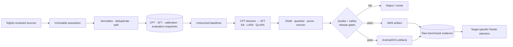
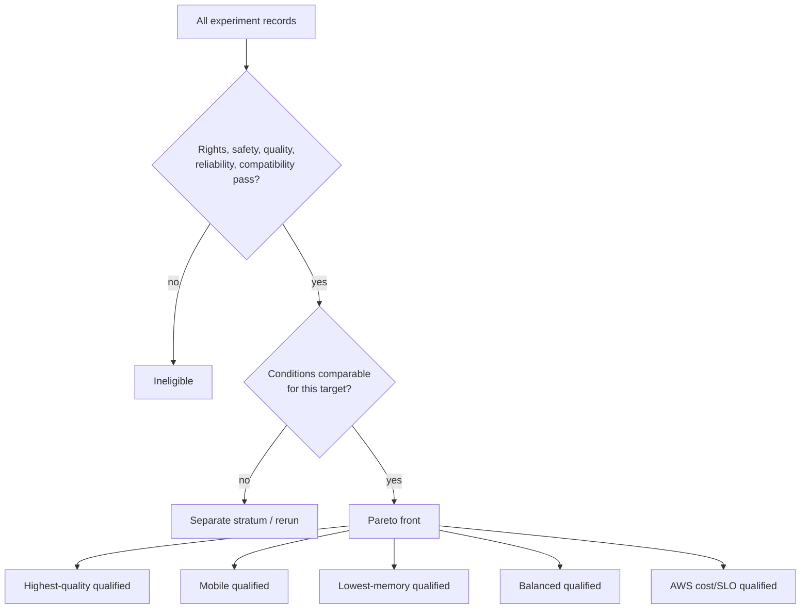

# CH-37: Build an Automotive Mechanic SLM End to End

> **Illustrative values.** Concrete identifiers, dates, thresholds, hashes, account numbers, and endpoints in this file are teaching examples, not observed project results or deployable credentials. Before use, replace them with reviewed values from your own registry, preserve the required format, and rerun every stated validation.

<a id="purpose"></a>

## Purpose and evidence boundary

This chapter is the book's flagship build: a learner follows one bounded automotive assistant from scope through data,
training, compression, cloud and phone packaging, benchmarking, and target-specific selection. The implementation
listings are extractable starting points, while the measurements in the worked lesson are explicitly **illustrative
teaching data**, not experiment results.

This must be a fully reproducible flagship project.

Do not present pseudocode as executable implementation.

Provide actual code with dependencies, configuration, directory layout, and execution commands.

### Phase 1: Define scope

Specify the automotive knowledge and diagnostic tasks the model should support.

### Phase 2: Select a baseline model

Compare suitable small pretrained models.

Select one or more realistic candidates.

### Phase 3: Acquire data

Identify usable automotive data sources.

Explain licensing and extraction.

### Phase 4: Process data

Build cleaning, deduplication, normalization, validation, and splitting pipelines.

### Phase 5: Establish baseline

Evaluate the untouched pretrained model.

### Phase 6: Domain adaptation

Run continued pretraining if justified.

### Phase 7: SFT

Train a domain-specific conversational model.

### Phase 8: Optimize training

Compare full fine-tuning, LoRA, and QLoRA at feasible scales.

### Phase 9: Distillation

Use a stronger teacher to produce an improved student where useful.

### Phase 10: Quantization

Evaluate multiple supported precisions and quantization algorithms.

### Phase 11: Pruning

Evaluate feasible pruning approaches and recovery fine-tuning.

### Phase 12: Combined optimization

Test selected compatible optimization combinations.

### Phase 13: Evaluate

Measure technical knowledge, diagnostic quality, uncertainty, robustness, and general capability retention.

### Phase 14: Cloud deployment

Deploy the selected model through an AWS inference endpoint or appropriately managed server.

### Phase 15: Mobile deployment

Export a compatible optimized model and demonstrate offline inference on Android and/or iOS.

Provide a clear path for both platforms even if the practical implementation begins with one.

### Phase 16: Benchmark

Compare cloud and edge variants using standardized conditions.

### Phase 17: Final selection

Choose:

- Best accuracy model.
- Best mobile model.
- Best balanced model.
- Best low-memory model.
- Best cost-efficient AWS deployment.

Explain all selections using actual evidence, not assumptions.

---

## Part XI — Extending the Platform to Other Domains

## Required chapter treatment

- Establish the problem, intuition, technical definition, and internal mechanism.
- Add architecture/workflow visuals where they materially improve understanding.
- Include practical examples and only necessary mathematics with defined symbols and numerical examples.
- Cover implementation, strengths, weaknesses, resource requirements, alternatives, domain-specific SLM use, edge
  implications, and references.
- Separate established findings, reported findings, experimental proposals, recommendations, examples, and verified
  measurements.

**Evidence boundary:** no training, conversion, AWS deployment, app build, or device benchmark was executed for this
chapter. Listings are implementation candidates that require the stated validation; diagrams and worked numbers are
illustrative. An experiment record must use an explicit `not_measured` status rather than a blank or zero.

---

## 37.1 What this project builds—and what it must not do

The deliverable is an educational, evidence-seeking automotive assistant that learns general automotive concepts and
diagnostic behavior in model parameters or an adapter. It accepts symptoms, observations, diagnostic trouble codes
(DTCs), and measurements; distinguishes observations from hypotheses; asks for discriminating evidence; and explains
safe next checks.

It is **not** a repair authority, autonomous controller, service-manual replacement, emissions-compliance decision
system, or source of exact vehicle-specific torque, wiring, lifting, high-voltage, restraint, fuel-pressure, or
calibration instructions. Those details must be checked against authoritative information for the exact vehicle by a
qualified person. The deployed inference path contains no vector database, embedding search, document retrieval, or
remote teacher.

**FIG-CH37-01 — End-to-end evidence pipeline (`ILLUSTRATIVE`).** Alt text: authorized automotive sources move through
governed data preparation, baseline evaluation, adaptation, optimization, target deployment, benchmarking, and
evidence-based selection.



### Intended tasks

<!-- markdownlint-disable MD013 -->
| In scope                      | Required behavior                                                     | Explicitly out of scope                      |
| ----------------------------- | --------------------------------------------------------------------- | -------------------------------------------- |
| explain systems/components    | identify assumptions and vehicle specificity                          | claiming one design applies to every vehicle |
| interpret generic DTC meaning | state that a code identifies a monitored condition, not a failed part | “replace part X” from a code alone           |
| diagnostic triage             | hazard first, then evidence and discriminating checks                 | bypassing interlocks or safety systems       |
| measurement reasoning         | retain units, ranges, uncertainty, and instrument limits              | inventing specifications                     |
| maintenance education         | explain principles and verification points                            | definitive model-specific procedures         |
| uncertainty/refusal           | say what is unknown and where qualified verification is needed        | confident guessing                           |
<!-- markdownlint-restore -->

Hazard strata include high-voltage/electric vehicles, supplemental restraint systems, lifting, fuel and refrigerant
pressure, hot/rotating parts, brake and steering faults, toxic exhaust, battery hazards, and stored mechanical energy.
Any release needs qualified automotive safety review.

### Success is a vector, not one score

\[ \mathbf{q}=(q_\text{domain},q_\text{diagnosis},q_\text{safety},
q_\text{uncertainty},q_\text{retention},q_\text{format}) \]

A candidate must also satisfy storage, peak memory, time to first token (TTFT), inter-token latency, reliability,
energy/thermal, license, and maintenance gates. A critical safety failure cannot be averaged away.

---

## 37.2 Reproducible repository extracted from this chapter

All paths are relative to a new project root named `automotive-slm/`. Listings deliberately live in Markdown because
this repository is Markdown-only. Extract them exactly, then replace every `<REQUIRED_...>` value before execution.

```text
automotive-slm/
├── README.md
├── pyproject.toml
├── requirements.in
├── requirements.lock                 # generated, reviewed, committed
├── configs/
│   ├── project.yaml
│   ├── sources.yaml
│   ├── experiments.yaml
│   └── release-gates.yaml
├── schemas/
│   ├── source.schema.json
│   ├── sft.schema.json
│   └── result.schema.json
├── src/automotive_slm/
│   ├── common.py
│   ├── acquire.py
│   ├── process.py
│   ├── train.py
│   ├── distill.py
│   ├── prune.py
│   ├── evaluate.py
│   └── select.py
├── deploy/aws/{Dockerfile,app.py,task-definition.json}
├── deploy/android/README.md
├── deploy/ios/README.md
├── data/{raw,receipts,quarantine,curated,eval}/
├── artifacts/{checkpoints,exports,releases}/
└── results/{runs,predictions,benchmarks,decisions}/
```

### Environment contract and exact pinning

The following is a **candidate exact lock input**, not a claim that the set resolves or is current. It must be tested as
one unit. Versions are pinned to prevent silent drift; do not “fix” a conflict by floating a package.

**Listing CH37-L01 — `requirements.in` (`UNVERIFIED IMPLEMENTATION`).**

```text
accelerate==1.4.0
bitsandbytes==0.45.3
datasets==3.3.2
evaluate==0.4.3
fastapi==0.115.11
huggingface-hub==0.29.2
jsonschema==4.23.0
numpy==2.2.3
peft==0.14.0
pydantic==2.10.6
PyYAML==6.0.2
safetensors==0.5.3
sentencepiece==0.2.0
torch==2.6.0
transformers==4.49.0
trl==0.15.2
uvicorn==0.34.0
```

**Listing CH37-L02 — `pyproject.toml` (`UNVERIFIED IMPLEMENTATION`).**

```toml
[build-system]
requires = ["hatchling==1.27.0"]
build-backend = "hatchling.build"

[project]
name = "automotive-slm"
version = "0.1.0"
requires-python = ">=3.11,<3.13"
dependencies = []

[project.scripts]
auto-acquire = "automotive_slm.acquire:main"
auto-process = "automotive_slm.process:main"
auto-train = "automotive_slm.train:main"
auto-distill = "automotive_slm.distill:main"
auto-prune = "automotive_slm.prune:main"
auto-evaluate = "automotive_slm.evaluate:main"
auto-select = "automotive_slm.select:main"
```

Resolve and validate on the exact training image:

```bash
# UNVERIFIED IMPLEMENTATION
python3.11 -m venv .venv
. .venv/bin/activate
python -m pip install --upgrade "pip==25.0.1" "pip-tools==7.4.1"
pip-compile --resolver=backtracking --generate-hashes \
  --output-file=requirements.lock requirements.in
python -m pip install --require-hashes -r requirements.lock
python -m pip install --no-deps -e .
python -m pip check
python - <<'PY'
import torch, transformers, datasets, accelerate, peft, trl
print("torch", torch.__version__, "cuda", torch.version.cuda)
print("transformers", transformers.__version__)
print("datasets", datasets.__version__, "accelerate", accelerate.__version__)
print("peft", peft.__version__, "trl", trl.__version__)
print("cuda_available", torch.cuda.is_available())
PY
python -m pip freeze --all > results/environment.freeze.txt
sha256sum requirements.in requirements.lock results/environment.freeze.txt
```

Release the lock only after: clean installation in an immutable container; import smoke test; one forward/backward pass
for each training mode; one save/reload; one tokenizer/template test; CUDA/driver compatibility check; license/SBOM
scan; and an exact image digest. If resolution fails, change one declared pin, explain why in a decision record,
regenerate all hashes, and repeat. Never present the candidate pins as validated merely because they appear here.

**Listing CH37-L03 — `configs/project.yaml` (`UNVERIFIED IMPLEMENTATION`).**

```yaml
schema: automotive-slm.project/v1
status: PLANNED_EXPERIMENT
seed: 1729
model:
  repository: Qwen/Qwen2.5-1.5B
  revision: "aaaaaaaaaaaaaaaaaaaaaaaaaaaaaaaaaaaaaaaa"
  role: base
  trust_remote_code: false
  context_tokens: 2048
data:
  snapshot: "aaaaaaaaaaaaaaaaaaaaaaaaaaaaaaaaaaaaaaaaaaaaaaaaaaaaaaaaaaaaaaaa"
  sft_train: data/curated/sft/train.jsonl
  sft_validation: data/curated/sft/validation.jsonl
  cpt_train: data/curated/cpt/train.jsonl
  evaluation: data/eval/automotive-v1.jsonl
output_root: artifacts/checkpoints
```

The exact checkpoint is a **candidate**, not a final selection. Its model card and Apache-2.0 statement were reviewed in
[CH-03](../part-01-language-model-foundations/ch-03-modern-slm-architectures.md); the immutable revision, files,
tokenizer, license text, commercial intent, and export support still require release-time review.

---

<a id="phase-1-define-scope-hazards-and-acceptance-criteria"></a>

## Phase 1 — Define scope, hazards, and acceptance criteria

Create a requirements record before data or model work:

```yaml
# configs/release-gates.yaml — UNVERIFIED IMPLEMENTATION
schema: automotive-slm.release-gates/v1
intended_use: educational_diagnostic_assistance
prohibited:
  - autonomous_repair_authority
  - exact_vehicle_specification_without_verification
  - safety_interlock_bypass
  - runtime_document_retrieval
hard_gates:
  rights_review_complete: true
  critical_safety_failures: 0
  tokenizer_template_parity: true
  unsupported_claim_rate_max: "0.05"
  peak_memory_bytes_max: "1073741824"
  failure_rate_max: "1073741824"
decision_metrics:
  - domain_accuracy
  - diagnostic_next_step
  - calibration
  - general_retention
  - artifact_bytes
  - peak_memory_bytes
  - ttft_ms
  - decode_tokens_s
  - energy_j_per_token
```

Values are product decisions, not universal constants. Establish separate gates for AWS, low-memory Android, flagship
Android, and iPhone. Document who can approve source rights, automotive correctness, safety, security, and release.

**Release gate P1:** intended use, prohibited behavior, hazards, target cohorts, data classes, and metric definitions
approved. No training begins without it.

---

<a id="phase-2-select-baseline-candidates"></a>

## Phase 2 — Select baseline candidates

Use exact artifacts, not family names.

<!-- markdownlint-disable MD013 -->
| Candidate role                | Exact candidate                    | Why test                                          | Gate before admission             |
| ----------------------------- | ---------------------------------- | ------------------------------------------------- | --------------------------------- |
| pipeline control              | `HuggingFaceTB/SmolLM2-360M`       | cheap end-to-end debugging                        | exact revision/license/runtime    |
| primary controlled adaptation | `Qwen/Qwen2.5-1.5B`                | explicit base; practical core band                | tokenizer, license, target export |
| edge comparison               | `google/gemma-3-1b-pt`             | explicit pretrained and documented edge artifacts | gated terms and acceptance        |
| ecosystem comparison          | `meta-llama/Llama-3.2-1B`          | base/instruct pair and broad tooling              | custom license and access         |
| reproducibility control       | `allenai/OLMo-2-0425-1B`           | unusually strong training provenance              | mobile export and context         |
| instruction product baseline  | corresponding exact instruct model | tests value before domain training                | keep separate from base arms      |
<!-- markdownlint-restore -->

`DOC-VERIFIED` facts and unresolved compatibility are detailed in
[CH-03](../part-01-language-model-foundations/ch-03-modern-slm-architectures.md). This table is a shortlist, not a
ranking.

For every candidate, archive:

```json
{
  "repository": "illustrative-exact-value",
  "revision": "aaaaaaaaaaaaaaaaaaaaaaaaaaaaaaaaaaaaaaaa",
  "weight_sha256": "aaaaaaaaaaaaaaaaaaaaaaaaaaaaaaaaaaaaaaaaaaaaaaaaaaaaaaaaaaaaaaaa",
  "tokenizer_revision": "aaaaaaaaaaaaaaaaaaaaaaaaaaaaaaaaaaaaaaaa",
  "config_sha256": "aaaaaaaaaaaaaaaaaaaaaaaaaaaaaaaaaaaaaaaaaaaaaaaaaaaaaaaaaaaaaaaa",
  "license_sha256": "aaaaaaaaaaaaaaaaaaaaaaaaaaaaaaaaaaaaaaaaaaaaaaaaaaaaaaaaaaaaaaaa",
  "role": "base|instruct",
  "parameter_count": null,
  "native_context": null,
  "status": "PLANNED_EXPERIMENT"
}
```

Measure tokenizer fertility on automotive prose, `P0300`, part numbers, SI/US units, Unicode symbols, abbreviations, and
wiring notation. Run untouched base and official instruct models in separate strata with exact templates and fixed
decoding.

**Release gate P2:** legal use, immutable identity, clean base role, tokenizer/template, training load, and at least one
target-runtime feasibility probe pass.

---

<a id="phase-3-acquire-legally-usable-data"></a>

## Phase 3 — Acquire legally usable data

No source enters the corpus merely because it is public. The registry records owner, exact URL, artifact hash,
license/terms snapshot, training permission, redistribution permission, attribution, jurisdiction, acquisition method,
and reviewer.

Good source classes to investigate include:

- US government material explicitly carrying a usable public-domain statement, such as eligible NHTSA-hosted
  publications and EPA material; verify each artifact because third-party content can be embedded;
- standards or code descriptions only where license permits machine-learning use—never assume SAE or OEM material is
  redistributable;
- openly licensed educational material whose exact license permits the intended commercial/noncommercial use and
  derivatives;
- expert-authored cases released under an explicit agreement;
- vehicle-owner or service material only with documented permission;
- synthetic variants grounded in approved source spans and reviewed by qualified experts.

Do not scrape paywalled manuals, bypass access controls, or treat robots permission as copyright permission. OBD-II code
lists copied across websites may be duplicated, incomplete, or encumbered; provenance and authority matter.

**Listing CH37-L04 — `configs/sources.yaml` (`UNVERIFIED IMPLEMENTATION`).**

```yaml
sources:
  - id: "source-example-001"
    canonical_url: "https://example.invalid/source"
    owner: "Example Documentation Team"
    acquisition: manual_reviewed_download
    license_expression: "Apache-2.0"
    training_allowed: null
    redistribution_allowed: null
    attribution: "Example attribution text"
    terms_snapshot_sha256: "aaaaaaaaaaaaaaaaaaaaaaaaaaaaaaaaaaaaaaaaaaaaaaaaaaaaaaaaaaaaaaaa"
    reviewer: "illustrative-rights-reviewer"
    status: needs_review
```

**Listing CH37-L05 — `src/automotive_slm/acquire.py` (`UNVERIFIED IMPLEMENTATION`).**

```python
from __future__ import annotations
import argparse, hashlib, json, urllib.request
from datetime import datetime, timezone
from pathlib import Path
import yaml

def sha256(data: bytes) -> str:
    return hashlib.sha256(data).hexdigest()

def main() -> None:
    p = argparse.ArgumentParser()
    p.add_argument("--registry", type=Path, required=True)
    p.add_argument("--root", type=Path, default=Path("data"))
    a = p.parse_args()
    registry = yaml.safe_load(a.registry.read_text("utf-8"))
    for source in registry["sources"]:
        if source["status"] != "approved":
            raise SystemExit(f"{source['id']}: source is not rights-approved")
        request = urllib.request.Request(
            source["canonical_url"],
            headers={"User-Agent": "AutomotiveSLMResearch/0.1 (contact required)"}
        )
        with urllib.request.urlopen(request, timeout=30) as response:
            if response.url != source["canonical_url"]:
                raise RuntimeError("Redirect requires separate allow-list review")
            data = response.read(50_000_001)
            if len(data) > 50_000_000:
                raise RuntimeError("Artifact exceeds declared bound")
            media_type = response.headers.get_content_type()
        digest = sha256(data)
        raw = a.root / "raw" / "sha256" / digest[:2] / digest
        raw.parent.mkdir(parents=True, exist_ok=True)
        raw.write_bytes(data)
        receipt = {
            "source_id": source["id"], "sha256": digest,
            "bytes": len(data), "media_type": media_type,
            "retrieved_utc": datetime.now(timezone.utc).isoformat(),
            "effective_url": source["canonical_url"],
            "license_expression": source["license_expression"],
        }
        out = a.root / "receipts" / f"{digest}.json"
        out.parent.mkdir(parents=True, exist_ok=True)
        out.write_text(json.dumps(receipt, indent=2), "utf-8")

if __name__ == "__main__":
    main()
```

This intentionally supports only pre-approved HTTPS URLs without redirects. Production acquisition additionally needs
host/IP allow-lists, SSRF/DNS-rebinding defenses, conditional requests, rate limits, MIME/parser sandboxing, malware
scans, retries, and API pagination as described in
[CH-24](../part-06-data-acquisition-and-dataset-engineering/ch-24-dataset-collection-and-processing.md).

**Release gate P3:** every byte has a receipt and rights decision; unknown permission quarantines; takedown lineage
works.

---

<a id="phase-4-process-deduplicate-validate-and-split"></a>

## Phase 4 — Process, deduplicate, validate, and split

Keep raw bytes immutable. Produce separate objective snapshots:

- **CPT:** contiguous, attributed, high-quality domain text without conversational templating;
- **SFT:** reviewed `messages` records teaching diagnostic and safety behavior;
- **distillation:** teacher candidates plus source/support and review metadata;
- **quantization/pruning calibration:** representative training-only samples;
- **evaluation:** independently authored, sealed cases; never generated from training prompts.

**Listing CH37-L06 — SFT record (`schemas/sft.schema.json`, abridged executable JSON Schema;
`UNVERIFIED IMPLEMENTATION`).**

```json
{
  "$schema": "https://json-schema.org/draft/2020-12/schema",
  "type": "object",
  "additionalProperties": false,
  "required": ["id", "source_ids", "case_group", "risk", "messages", "review"],
  "properties": {
    "id": { "type": "string", "minLength": 1 },
    "source_ids": { "type": "array", "minItems": 1, "items": { "type": "string" } },
    "case_group": { "type": "string" },
    "risk": { "enum": ["low", "moderate", "safety_critical"] },
    "messages": {
      "type": "array",
      "minItems": 2,
      "items": {
        "type": "object",
        "additionalProperties": false,
        "required": ["role", "content"],
        "properties": {
          "role": { "enum": ["system", "user", "assistant"] },
          "content": { "type": "string", "minLength": 1 }
        }
      }
    },
    "review": {
      "type": "object",
      "required": ["status", "reviewer_role"],
      "properties": {
        "status": { "enum": ["awaiting_review", "accepted", "rejected"] },
        "reviewer_role": { "type": "string" }
      }
    }
  }
}
```

**Listing CH37-L07 — `src/automotive_slm/process.py` (`UNVERIFIED IMPLEMENTATION`).**

```python
from __future__ import annotations
import argparse, hashlib, hmac, json, re, unicodedata
from pathlib import Path
from jsonschema import Draft202012Validator

SPACE = re.compile(r"[^\S\n]+")

def normalize(text: str) -> tuple[str, str]:
    nfc = unicodedata.normalize("NFC", text.replace("\r\n", "\n").replace("\r", "\n"))
    nfc = "\n".join(SPACE.sub(" ", x).strip() for x in nfc.splitlines()).strip()
    match = unicodedata.normalize("NFKC", nfc).casefold()
    return nfc, SPACE.sub(" ", match).strip()

def split(group: str, key: bytes) -> str:
    u = int.from_bytes(hmac.new(key, group.encode(), hashlib.sha256).digest()[:8], "big") / 2**64
    return "train" if u < .8 else "validation" if u < .9 else "test"

def shingles(text: str, n: int = 5) -> set[tuple[str, ...]]:
    words = text.split()
    return {tuple(words[i:i+n]) for i in range(max(0, len(words)-n+1))}

def main() -> None:
    p = argparse.ArgumentParser()
    p.add_argument("--input", type=Path, required=True)
    p.add_argument("--schema", type=Path, required=True)
    p.add_argument("--output", type=Path, required=True)
    p.add_argument("--split-key-file", type=Path, required=True)
    a = p.parse_args()
    validator = Draft202012Validator(json.loads(a.schema.read_text("utf-8")))
    key = a.split_key_file.read_bytes()
    rows, ids, groups = [], set(), {}
    for line_no, line in enumerate(a.input.read_text("utf-8").splitlines(), 1):
        row = json.loads(line)
        errors = sorted(validator.iter_errors(row), key=lambda x: x.path)
        if errors: raise ValueError(f"line {line_no}: {errors[0].message}")
        if row["id"] in ids: raise ValueError(f"duplicate id: {row['id']}")
        ids.add(row["id"])
        if row["review"]["status"] != "accepted":
            raise ValueError(f"unaccepted record: {row['id']}")
        rendered = "\n".join(m["content"] for m in row["messages"])
        row["text_nfc"], row["text_match"] = normalize(rendered)
        row["exact_sha256"] = hashlib.sha256(row["text_match"].encode()).hexdigest()
        row["split"] = split(row["case_group"], key)
        prior = groups.setdefault(row["case_group"], row["split"])
        if prior != row["split"]: raise AssertionError("group leakage")
        rows.append(row)
    a.output.parent.mkdir(parents=True, exist_ok=True)
    a.output.write_text("".join(json.dumps(r, ensure_ascii=False)+"\n" for r in rows), "utf-8")

if __name__ == "__main__":
    main()
```

The listing validates schema, exact IDs, review state, normalization, and group-stable splits. It does **not** implement
PDF/OCR extraction, PII detection, near-duplicate clustering, contradiction adjudication, unit parsing, or contamination
detection; those are mandatory production modules, not hidden omissions. Near duplicates must be clustered before
splitting, using labeled threshold validation. Keep editions, quoted passages, synthetic variants, and case families in
one split.

SFT cases should follow:

```text
hazard check → confirmed observations → multiple hypotheses
→ highest-value safe next check → update from result
→ bounded conclusion → authoritative verification
```

**Release gate P4:** rights, malware, PII, lineage, expert safety review, duplicate clusters, contradiction review, and
split leakage pass; immutable manifests include row counts, source distributions, file hashes, code/config/lock hashes,
and limitations.

---

<a id="phase-5-establish-untouched-baselines"></a>

## Phase 5 — Establish untouched baselines

Evaluate before training. Compare the exact base after a fixed neutral prompt and the exact official instruct model with
its official template; do not compare raw base chat to instruct chat as if post-training were irrelevant.

**Listing CH37-L08 — `src/automotive_slm/evaluate.py` (`UNVERIFIED IMPLEMENTATION`).**

```python
from __future__ import annotations
import argparse, json, time
from pathlib import Path
import torch
from transformers import AutoModelForCausalLM, AutoTokenizer, set_seed

def main() -> None:
    p = argparse.ArgumentParser()
    p.add_argument("--model", required=True); p.add_argument("--revision", required=True)
    p.add_argument("--suite", type=Path, required=True); p.add_argument("--out", type=Path, required=True)
    p.add_argument("--seed", type=int, default=1729)
    a = p.parse_args(); set_seed(a.seed)
    tok = AutoTokenizer.from_pretrained(a.model, revision=a.revision, trust_remote_code=False)
    model = AutoModelForCausalLM.from_pretrained(
        a.model, revision=a.revision, torch_dtype=torch.bfloat16,
        device_map="auto", trust_remote_code=False
    ).eval()
    output = []
    for line in a.suite.read_text("utf-8").splitlines():
        item = json.loads(line)
        prompt = tok.apply_chat_template(item["messages"], tokenize=False, add_generation_prompt=True)
        batch = tok(prompt, return_tensors="pt").to(model.device)
        if batch.input_ids.shape[1] > item["max_input_tokens"]:
            raise ValueError(f"overlong item {item['id']}")
        torch.cuda.synchronize() if torch.cuda.is_available() else None
        start = time.perf_counter_ns()
        with torch.inference_mode():
            generated = model.generate(**batch, max_new_tokens=item["max_new_tokens"],
                                       do_sample=False, pad_token_id=tok.eos_token_id)
        torch.cuda.synchronize() if torch.cuda.is_available() else None
        output.append({
            "id": item["id"], "input_tokens": int(batch.input_ids.shape[1]),
            "generated_tokens": int(generated.shape[1]-batch.input_ids.shape[1]),
            "elapsed_ns": time.perf_counter_ns()-start,
            "text": tok.decode(generated[0, batch.input_ids.shape[1]:], skip_special_tokens=True),
            "status": "EXECUTED_OUTPUT_REQUIRES_SCORING"
        })
    a.out.parent.mkdir(parents=True, exist_ok=True)
    a.out.write_text("".join(json.dumps(x, ensure_ascii=False)+"\n" for x in output), "utf-8")

if __name__ == "__main__":
    main()
```

Automated scoring should cover exact labels/fields only. Domain factuality, diagnostic ordering, unsupported claims,
safety, and uncertainty require blinded rubric-based review. Preserve raw output. Baseline manifests record hardware,
CUDA/driver, package lock, model/tokenizer hashes, template, prompt suite hash, seed, decoding, and failures.

**Release gate P5:** untouched quality, safety, memory, and timing evidence exists; no later gain is claimed without
paired comparison to it.

---

<a id="phase-6-decide-whether-cpt-is-justified"></a>

## Phase 6 — Decide whether CPT is justified

Continued pretraining (CPT) is justified only if broad held-out domain perplexity/knowledge coverage improves enough to
offset compute and general-capability forgetting. SFT teaches answer behavior; CPT exposes the model to broad raw domain
language. Neither guarantees exact recall.

Pre-register arms:

| Arm | Training                                  | Purpose                          |
| --- | ----------------------------------------- | -------------------------------- |
| A   | no CPT                                    | baseline                         |
| B   | automotive CPT                            | domain acquisition hypothesis    |
| C   | automotive CPT + general replay           | forgetting mitigation            |
| D   | shuffled/equal-token control where useful | detect mere extra-compute effect |

Use the base checkpoint, an immutable token budget, equal evaluation, multiple seeds for decision-critical comparisons,
and checkpoint selection independent of the sealed test set.

**Listing CH37-L09 — `src/automotive_slm/train.py` (`UNVERIFIED IMPLEMENTATION`).**

```python
from __future__ import annotations
import argparse
from pathlib import Path
import torch
from datasets import load_dataset
from peft import LoraConfig, prepare_model_for_kbit_training
from transformers import (AutoModelForCausalLM, AutoTokenizer, BitsAndBytesConfig,
                          DataCollatorForLanguageModeling, Trainer, TrainingArguments, set_seed)
from trl import SFTConfig, SFTTrainer

def main() -> None:
    p = argparse.ArgumentParser()
    p.add_argument("--mode", choices=["cpt","sft-full","sft-lora","sft-qlora"], required=True)
    p.add_argument("--model", required=True); p.add_argument("--revision", required=True)
    p.add_argument("--train", type=Path, required=True); p.add_argument("--validation", type=Path, required=True)
    p.add_argument("--out", type=Path, required=True); p.add_argument("--seed", type=int, default=1729)
    a = p.parse_args(); set_seed(a.seed)
    qlora = a.mode == "sft-qlora"
    quant = BitsAndBytesConfig(load_in_4bit=True, bnb_4bit_quant_type="nf4",
        bnb_4bit_use_double_quant=True, bnb_4bit_compute_dtype=torch.bfloat16) if qlora else None
    tok = AutoTokenizer.from_pretrained(a.model, revision=a.revision, trust_remote_code=False)
    model = AutoModelForCausalLM.from_pretrained(
        a.model, revision=a.revision, trust_remote_code=False,
        quantization_config=quant, torch_dtype=torch.bfloat16, device_map="auto" if qlora else None)
    ds = load_dataset("json", data_files={"train":str(a.train),"validation":str(a.validation)})
    common = dict(output_dir=str(a.out), num_train_epochs=1.0, learning_rate=2e-5,
        per_device_train_batch_size=1, per_device_eval_batch_size=1,
        gradient_accumulation_steps=16, eval_strategy="steps", eval_steps=100,
        save_steps=100, logging_steps=10, bf16=torch.cuda.is_available() and torch.cuda.is_bf16_supported(),
        fp16=torch.cuda.is_available() and not torch.cuda.is_bf16_supported(),
        report_to="none", seed=a.seed, data_seed=a.seed)
    if a.mode == "cpt":
        def tokenize(row): return tok(row["text"], truncation=True, max_length=2048)
        tokenized = ds.map(tokenize, remove_columns=ds["train"].column_names)
        trainer = Trainer(model=model, args=TrainingArguments(**common),
            train_dataset=tokenized["train"], eval_dataset=tokenized["validation"],
            data_collator=DataCollatorForLanguageModeling(tok, mlm=False))
    else:
        peft = None
        if a.mode != "sft-full":
            if qlora: model = prepare_model_for_kbit_training(model)
            peft = LoraConfig(r=16, lora_alpha=32, lora_dropout=0.05,
                target_modules="all-linear", task_type="CAUSAL_LM")
        trainer = SFTTrainer(model=model, processing_class=tok,
            train_dataset=ds["train"], eval_dataset=ds["validation"], peft_config=peft,
            args=SFTConfig(**common, max_length=2048, assistant_only_loss=True))
    trainer.train(); trainer.save_model(a.out); tok.save_pretrained(a.out)

if __name__ == "__main__":
    main()
```

The listing is concrete but version-sensitive. Before use, verify that the selected chat template exposes assistant
masks, `target_modules="all-linear"` selects intended layers, padding and packing are correct, BF16 is supported, and
the QLoRA backend supports the GPU. Run a 2-batch overfit and save/reload test first.

**CPT decision:** promote CPT only if paired held-out domain gains are practically meaningful, general and safety
regressions stay within pre-registered bounds, and total compute/maintenance is justified. Otherwise proceed from the
original base to SFT.

---

<a id="phase-7-supervised-fine-tuning"></a>

## Phase 7 — Supervised fine-tuning

The SFT mixture must include direct QA, terminology, structured extraction, insufficient-information cases, multi-turn
diagnosis, counterfactuals, safe stop/escalation, and false-refusal counterexamples. Report rows **and supervised
assistant tokens** by task, source, risk, and synthetic/human origin.

Train the same SFT snapshot on:

1. original base;
2. accepted CPT checkpoint;
3. official instruct baseline only as a separate post-trained arm.

Inspect every template and mask before training. Truncation may not remove the complaint or target. Group related cases
across splits. Do not put hidden evaluation state into prompts.

Commands:

```bash
# UNVERIFIED IMPLEMENTATION
auto-train --mode sft-lora \
  --model Qwen/Qwen2.5-1.5B --revision aaaaaaaaaaaaaaaaaaaaaaaaaaaaaaaaaaaaaaaa \
  --train data/curated/sft/train.jsonl \
  --validation data/curated/sft/validation.jsonl \
  --out artifacts/checkpoints/sft-lora-seed1729
```

**Release gate P7:** template/mask audit, no leakage, stable validation, memorization probes, general retention, refusal
confusion matrix, and qualified safety review pass.

---

<a id="phase-8-full-fine-tuning-lora-and-qlora"></a>

## Phase 8 — Full fine-tuning, LoRA, and QLoRA

Use the same model parent, SFT snapshot, supervised-token budget, sequence cap, evaluation, seeds, and stopping rule.

<!-- markdownlint-disable MD013 -->
| Method | Trainable state                  | Primary hypothesis                              | Deployment consequence                              |
| ------ | -------------------------------- | ----------------------------------------------- | --------------------------------------------------- |
| full   | all parameters                   | maximum adaptation flexibility                  | complete checkpoint; highest training-memory demand |
| LoRA   | low-rank adapters on frozen base | comparable useful gains at lower training state | merge or runtime adapter support                    |
| QLoRA  | 4-bit frozen base + LoRA         | lower base residency during training            | still merge/export and benchmark final artifact     |
<!-- markdownlint-restore -->

LoRA uses \(\Delta W=BA\), where rank \(r\) controls adapter capacity. The nominal trainable count is not enough; log
selected modules and exact trainable parameters. QLoRA's NF4 training representation is not automatically the final
mobile format.

```bash
# UNVERIFIED IMPLEMENTATION
for MODE in sft-full sft-lora sft-qlora; do
  auto-train --mode "$MODE" --model example-org/base-model --revision aaaaaaaaaaaaaaaaaaaaaaaaaaaaaaaaaaaaaaaa \
    --train data/curated/sft/train.jsonl \
    --validation data/curated/sft/validation.jsonl \
    --out "artifacts/checkpoints/$MODE-seed1729"
done
```

Record peak accelerator memory, wall time, examples and supervised tokens/s, energy/cost boundary, checkpoint bytes,
validation, and failures. Do not claim QLoRA “matches” full fine-tuning without paired results and uncertainty.

**Release gate P8:** retain only non-dominated training arms that pass domain, safety, retention, merge/reload, and
target-export gates.

---

<a id="phase-9-distillation"></a>

## Phase 9 — Distillation

Teacher outputs are synthetic derivatives, not authoritative evidence. The teacher must be legally usable for generation
and output use. Each candidate remains linked to approved facts or an expert case and records teacher ID/revision,
prompt hash, decoding, source IDs, automated checks, and reviewer decision.

Compare:

1. student SFT on expert data;
2. student SFT on accepted teacher responses;
3. mixed expert + accepted teacher data;
4. token-level soft-target distillation only when teacher/student tokenization and logits are technically aligned;
5. distilled then quantized student.

**Listing CH37-L10 — `src/automotive_slm/distill.py` (`UNVERIFIED IMPLEMENTATION`).**

```python
from __future__ import annotations
import argparse, json
from pathlib import Path
import torch
import torch.nn.functional as F

def kd_loss(student_logits, teacher_logits, labels, temperature: float, alpha: float):
    shift_s = student_logits[:, :-1].float()
    shift_t = teacher_logits[:, :-1].float()
    shift_y = labels[:, 1:]
    mask = shift_y.ne(-100)
    hard = F.cross_entropy(shift_s[mask], shift_y[mask])
    soft = F.kl_div(
        F.log_softmax(shift_s[mask] / temperature, dim=-1),
        F.softmax(shift_t[mask] / temperature, dim=-1),
        reduction="batchmean"
    ) * temperature**2
    return alpha * hard + (1-alpha) * soft

def main() -> None:
    raise SystemExit(
        "Wire kd_loss into a pinned Trainer only after proving identical vocabulary, "
        "token positions, masks, teacher licensing, and cached-logit storage bounds."
    )

if __name__ == "__main__":
    main()
```

The deliberate stop prevents pretending a few lines constitute a complete distillation trainer. Response/sequence
distillation uses the ordinary SFT path on accepted teacher records and is the initial practical method. Soft-logit
distillation requires a completed dataloader/trainer, aligned vocabularies, storage policy, and tested loss
normalization.

**Release gate P9:** expert acceptance, support/attribution, diversity, contamination, teacher-style dependence, student
gains, and safety all pass. Reject fluent unsupported teacher data.

---

<a id="phase-10-quantization"></a>

## Phase 10 — Quantization

Start from the selected merged high-precision artifact. Keep parent identity fixed. Evaluate at least:

- BF16/FP16 source reference;
- runtime-native 8-bit where supported;
- multiple runtime-native 4-bit methods/formats;
- an additional lower-bit arm only if kernels exist and quality remains credible.

Do not compare “INT4” without method, group size, scales/zero points, exceptions, calibration snapshot, runtime,
backend, and cache precision.

**GGUF path (`UNVERIFIED IMPLEMENTATION`):**

```bash
git clone https://github.com/ggml-org/llama.cpp.git third_party/llama.cpp
git -C third_party/llama.cpp checkout aaaaaaaaaaaaaaaaaaaaaaaaaaaaaaaaaaaaaaaa
python third_party/llama.cpp/convert_hf_to_gguf.py \
  artifacts/checkpoints/merged --outfile artifacts/exports/model-f16.gguf --outtype f16
cmake -S third_party/llama.cpp -B third_party/llama.cpp/build -DGGML_NATIVE=OFF
cmake --build third_party/llama.cpp/build --config Release --target llama-quantize llama-cli
third_party/llama.cpp/build/bin/llama-quantize \
  artifacts/exports/model-f16.gguf artifacts/exports/model-q4_k_m.gguf Q4_K_M
sha256sum artifacts/exports/*.gguf
```

The quantizer name is a candidate supported by many llama.cpp builds, not a verified choice for the pinned future
commit. List supported formats from the built executable and freeze the output.

For AWS GPU, test server-native BF16/FP16 and only documented AWQ/GPTQ/FP8 paths supported by the exact model and
runtime. For mobile, GGUF/llama.cpp, Core ML, ExecuTorch, LiteRT-LM, or another target-native path must be exported
separately. A cloud quantizer is not presumed mobile-compatible.

Measure artifact/download bytes, loaded and peak memory, conversion time/peak, TTFT, prefill, decode, long-context
behavior, output quality, calibration/refusal, and critical safety.

---

<a id="phase-11-pruning-and-recovery"></a>

## Phase 11 — Pruning and recovery

Three arms answer different questions:

<!-- markdownlint-disable MD013 -->
| Arm                    | Intervention                     | Expected deployment proof                                  |
| ---------------------- | -------------------------------- | ---------------------------------------------------------- |
| unstructured magnitude | set individual weights to zero   | sparse representation and kernel; otherwise no speed claim |
| N:M/semi-structured    | hardware-supported pattern       | exact accelerator/kernel utilization                       |
| structured             | remove blocks/heads/FFN channels | materialized dense graph, aligned dimensions, export       |
<!-- markdownlint-restore -->

Begin with a sensitivity sweep on a copy, never the only checkpoint. Unstructured zeros in dense tensors do not
establish smaller files or faster phones.

**Listing CH37-L11 — `src/automotive_slm/prune.py` (`UNVERIFIED IMPLEMENTATION`).**

```python
from __future__ import annotations
import argparse
from pathlib import Path
import torch
from transformers import AutoModelForCausalLM

def main() -> None:
    p = argparse.ArgumentParser()
    p.add_argument("--model", required=True); p.add_argument("--revision", required=True)
    p.add_argument("--ratio", type=float, required=True); p.add_argument("--out", type=Path, required=True)
    a = p.parse_args()
    if not 0.0 < a.ratio < 0.5:
        raise ValueError("initial safety bound: ratio must be between 0 and 0.5")
    model = AutoModelForCausalLM.from_pretrained(
        a.model, revision=a.revision, torch_dtype=torch.bfloat16, trust_remote_code=False)
    with torch.no_grad():
        for name, module in model.named_modules():
            if isinstance(module, torch.nn.Linear) and module.weight.numel() >= 4096:
                flat = module.weight.abs().flatten()
                threshold = torch.quantile(flat.float(), a.ratio).to(module.weight.dtype)
                module.weight.mul_(module.weight.abs().gt(threshold))
    a.out.mkdir(parents=True, exist_ok=False)
    model.save_pretrained(a.out, safe_serialization=True)

if __name__ == "__main__":
    main()
```

This is an executable **research control**, not a production pruning method. It creates dense tensors containing zeros,
does not preserve tied/fused semantic constraints explicitly, and is unlikely to improve dense mobile latency. Use it to
demonstrate why sparsity count and speed differ.

Recovery uses the same governed SFT/general replay data at a lower pre-registered learning rate. Compare pre-prune,
post-prune, and post-recovery; record recovery compute. Structured layer/width pruning requires architecture-specific
graph surgery or distillation into a smaller configuration and cannot be honestly represented by generic code.

**Release gate P11:** a pruned candidate survives only if its final serialized graph is executable on the target and
measured benefit exceeds recovery/maintenance cost without violating quality or safety.

---

<a id="phase-12-combined-optimization"></a>

## Phase 12 — Combined optimization

Do not apply every method. Use staged combinations:

```text
SFT/LoRA → merge → quantize
CPT (only if accepted) → SFT → merge → quantize
distill → SFT/recovery → quantize
structured prune → recovery → quantize
prune → recovery with teacher guidance → quantize
```

Avoid quantizing before adapter merge unless the exact pipeline is designed for it. Pruning can alter activation/outlier
distributions, so calibrate quantization after pruning/recovery. Quantization after distillation is a new candidate and
needs full evaluation. QLoRA training format is not the release quantization.

**TBL-CH37-01 — staged experimental matrix (`PLANNED EXPERIMENT`).**

<!-- markdownlint-disable MD013 -->
| ID  | Parent          | Training                    | Compression      | Purpose                   | Advance condition        |
| --- | --------------- | --------------------------- | ---------------- | ------------------------- | ------------------------ |
| B0  | untouched       | none                        | none             | baseline                  | evidence only            |
| S1  | base            | LoRA SFT                    | none             | efficient specialization  | quality/safety           |
| C1  | base            | CPT + same LoRA SFT         | none             | CPT attribution           | meaningful paired gain   |
| F1  | base            | full SFT                    | none             | training upper comparison | gain justifies resources |
| Q1  | best SFT        | merged                      | target 8-bit     | low-risk compression      | non-dominated            |
| Q2  | best SFT        | merged                      | target 4-bit A/B | edge hypothesis           | target gates             |
| D1  | smaller student | mixed response distill      | none             | native smaller graph      | beats same-size direct   |
| DQ  | D1              | recovery                    | target 4-bit     | mobile candidate          | target gates             |
| P1  | best dense      | structured prune + recovery | none             | portable dense reduction  | actual latency/RAM       |
| PQ  | P1              | recovery                    | target 4-bit     | combined candidate        | target gates             |
<!-- markdownlint-restore -->

Use successive halving: correctness → safety/quality → memory → latency → sustained energy → cost. Expensive
physical/AWS tests run only on survivors.

---

<a id="phase-13-evaluate-domain-quality-safety-and-retention"></a>

## Phase 13 — Evaluate domain quality, safety, and retention

The sealed suite contains independently reviewed cases in these strata:

- component and system theory;
- code interpretation without code-to-part shortcuts;
- fault diagnosis with incremental evidence;
- measurement/unit reasoning;
- insufficient information and ambiguity;
- adversarial premature-replacement prompts;
- high-voltage, brake, steering, restraint, lifting, fuel/pressure, and thermal hazards;
- changed evidence requiring correction;
- out-of-distribution and non-automotive prompts;
- general-language retention;
- template/JSON compliance where used.

Each record stores rubric version, acceptable facts, forbidden claims, required questions, safety elements, risk weight,
and reviewer provenance. Hide rubric fields from the model.

Metrics include exact match/F1 only where valid, rubric score, unsupported-claim rate, critical-safety failure count,
diagnostic next-question utility, premature-conclusion rate, refusal precision/recall, selective accuracy versus
coverage, calibration, multi-turn consistency, and general-retention delta. Preserve example-level outputs and blinded
reviews; measure reviewer agreement.

**PLANNED result schema:**

```json
{
  "schema": "automotive-slm.result/v1",
  "run_id": "00000000-0000-4000-8000-000000000001",
  "status": "PLANNED_EXPERIMENT",
  "model_artifact_sha256": "aaaaaaaaaaaaaaaaaaaaaaaaaaaaaaaaaaaaaaaaaaaaaaaaaaaaaaaaaaaaaaaa",
  "dataset_manifest_sha256": "aaaaaaaaaaaaaaaaaaaaaaaaaaaaaaaaaaaaaaaaaaaaaaaaaaaaaaaaaaaaaaaa",
  "environment_lock_sha256": "aaaaaaaaaaaaaaaaaaaaaaaaaaaaaaaaaaaaaaaaaaaaaaaaaaaaaaaaaaaaaaaa",
  "seed": 1729,
  "hardware": "NVIDIA L4, 24 GiB, driver 550.54",
  "metrics": {
    "domain_accuracy": null,
    "diagnostic_next_step": null,
    "unsupported_claim_rate": null,
    "critical_safety_failures": null,
    "general_retention_delta": null
  },
  "raw_predictions": "artifacts/predictions.jsonl#sha256=aaaaaaaaaaaaaaaaaaaaaaaaaaaaaaaaaaaaaaaaaaaaaaaaaaaaaaaaaaaaaaaa",
  "failures": [],
  "notes": "null means unmeasured"
}
```

Use multiple seeds for training comparisons and paired bootstrap/permutation intervals for item-level differences where
appropriate. Statistical significance does not override practical or safety significance.

**Release gate P13:** sealed evaluation, expert safety review, uncertainty, retention, and conversion-regression checks
pass for the exact final artifact.

---

<a id="phase-14-deploy-a-selected-aws-model"></a>

## Phase 14 — Deploy a selected AWS model

The first reproducible path is one containerized HTTPS service on ECS/EC2 or SageMaker with a supported GPU/CPU runtime.
The listing uses Transformers for broad correctness, not production throughput. vLLM/SGLang/TensorRT-LLM can replace the
engine only after exact-model compatibility and load tests.

**Listing CH37-L12 — `deploy/aws/app.py` (`UNVERIFIED IMPLEMENTATION`).**

```python
import os, time, uuid
from fastapi import FastAPI, HTTPException
from pydantic import BaseModel, Field
import torch
from transformers import AutoModelForCausalLM, AutoTokenizer

MODEL = os.environ["MODEL_PATH"]
tok = AutoTokenizer.from_pretrained(MODEL, local_files_only=True, trust_remote_code=False)
model = AutoModelForCausalLM.from_pretrained(
    MODEL, local_files_only=True, trust_remote_code=False,
    torch_dtype=torch.bfloat16, device_map="auto").eval()
app = FastAPI()

class Request(BaseModel):
    messages: list[dict[str, str]]
    max_new_tokens: int = Field(ge=1, le=512)

@app.get("/health/ready")
def ready(): return {"ready": True, "model": os.environ["MODEL_SHA256"]}

@app.post("/v1/chat")
def chat(req: Request):
    request_id = str(uuid.uuid4())
    try:
        prompt = tok.apply_chat_template(req.messages, tokenize=False, add_generation_prompt=True)
        batch = tok(prompt, return_tensors="pt").to(model.device)
        if batch.input_ids.shape[1] + req.max_new_tokens > int(os.environ["CONTEXT_LIMIT"]):
            raise HTTPException(422, "context limit exceeded")
        start = time.perf_counter_ns()
        with torch.inference_mode():
            ids = model.generate(**batch, max_new_tokens=req.max_new_tokens,
                do_sample=False, pad_token_id=tok.eos_token_id)
        return {"id": request_id,
            "text": tok.decode(ids[0,batch.input_ids.shape[1]:], skip_special_tokens=True),
            "elapsed_ns": time.perf_counter_ns()-start}
    except HTTPException: raise
    except Exception:
        raise HTTPException(500, f"inference failed; request_id={request_id}")
```

**Listing CH37-L13 — `deploy/aws/Dockerfile` (`UNVERIFIED IMPLEMENTATION`).**

```dockerfile
FROM python:3.11.11-slim@sha256:aaaaaaaaaaaaaaaaaaaaaaaaaaaaaaaaaaaaaaaaaaaaaaaaaaaaaaaaaaaaaaaa
WORKDIR /app
COPY requirements.lock .
RUN python -m pip install --no-cache-dir --require-hashes -r requirements.lock \
 && python -m pip check
COPY deploy/aws/app.py /app/app.py
COPY artifacts/releases/aws-model /models/automotive
ENV MODEL_PATH=/models/automotive CONTEXT_LIMIT=2048 MODEL_SHA256=aaaaaaaaaaaaaaaaaaaaaaaaaaaaaaaaaaaaaaaaaaaaaaaaaaaaaaaaaaaaaaaa
USER 65532:65532
EXPOSE 8080
CMD ["uvicorn","app:app","--host","0.0.0.0","--port","8080","--workers","1"]
```

`fastapi` and `uvicorn` are included in the candidate lock input. If a different serving engine is selected, add its
exact pin and transitive hashes, then rerun the complete environment validation. The digest illustrative value intentionally
blocks an unverified base image.

Production controls: private ECR image digest; read-only root filesystem; non-root user; IAM least privilege;
VPC/security groups; TLS/API authentication; request size and token caps; rate limits; no raw prompt logging by default;
health/readiness; CloudWatch metrics; autoscaling on queue/latency; graceful draining; artifact signature/hash;
blue/green rollout; rollback; alarms; budget tags; and deletion/retention policy.

**Listing CH37-L14 — `deploy/aws/task-definition.json` (`UNVERIFIED IMPLEMENTATION`).**

```json
{
  "family": "automotive-slm",
  "networkMode": "awsvpc",
  "requiresCompatibilities": ["EC2"],
  "cpu": "4096",
  "memory": "16384",
  "executionRoleArn": "arn:aws:iam::111122223333:role/slm-ecs-execution",
  "taskRoleArn": "arn:aws:iam::111122223333:role/slm-runtime",
  "containerDefinitions": [
    {
      "name": "inference",
      "image": "111122223333.dkr.ecr.us-west-2.amazonaws.com/automotive-slm@sha256:aaaaaaaaaaaaaaaaaaaaaaaaaaaaaaaaaaaaaaaaaaaaaaaaaaaaaaaaaaaaaaaa",
      "essential": true,
      "readonlyRootFilesystem": true,
      "resourceRequirements": [{ "type": "GPU", "value": "1" }],
      "portMappings": [{ "containerPort": 8080, "protocol": "tcp" }],
      "healthCheck": {
        "command": [
          "CMD-SHELL",
          "python -c \"import urllib.request; urllib.request.urlopen('http://127.0.0.1:8080/health/ready', timeout=2)\""
        ],
        "interval": 30,
        "timeout": 5,
        "retries": 3,
        "startPeriod": 180
      },
      "logConfiguration": {
        "logDriver": "awslogs",
        "options": {
          "awslogs-group": "/slm/illustrative",
          "awslogs-region": "us-west-2",
          "awslogs-stream-prefix": "automotive-slm"
        }
      }
    }
  ]
}
```

This task definition requires a separately provisioned ECS cluster with a qualified GPU EC2 capacity provider, private
subnets/endpoints as designed, an Application Load Balancer, authentication/rate-limiting layer, target group health
checks, autoscaling, and encrypted logs. Fargate GPU support is not assumed.

Build/deploy:

```bash
# UNVERIFIED IMPLEMENTATION
docker build -f deploy/aws/Dockerfile -t automotive-slm:aaaaaaaaaaaaaaaaaaaaaaaaaaaaaaaaaaaaaaaa .
docker run --rm --gpus all -p 8080:8080 automotive-slm:aaaaaaaaaaaaaaaaaaaaaaaaaaaaaaaaaaaaaaaa
aws ecr get-login-password --region us-west-2 | \
  docker login --username AWS --password-stdin 111122223333.dkr.ecr.us-west-2.amazonaws.com
docker tag automotive-slm:aaaaaaaaaaaaaaaaaaaaaaaaaaaaaaaaaaaaaaaa 111122223333.dkr.ecr.us-west-2.amazonaws.com/automotive-slm:aaaaaaaaaaaaaaaaaaaaaaaaaaaaaaaaaaaaaaaa
docker push 111122223333.dkr.ecr.us-west-2.amazonaws.com/automotive-slm:aaaaaaaaaaaaaaaaaaaaaaaaaaaaaaaaaaaaaaaa
aws ecr describe-images --region us-west-2 --repository-name automotive-slm \
  --image-ids imageTag=aaaaaaaaaaaaaaaaaaaaaaaaaaaaaaaaaaaaaaaa --query 'imageDetails[0].imageDigest' --output text
# Put the returned sha256 digest in task-definition.json before registration.
aws ecs register-task-definition --region us-west-2 \
  --cli-input-json file://deploy/aws/task-definition.json
aws ecs update-service --region us-west-2 --cluster slm-illustrative-cluster \
  --service slm-illustrative-service --task-definition automotive-slm
```

Wait for deployment stability, run authenticated smoke/load/safety tests, inspect failed tasks and alarms, then promote
traffic. Query current regional prices or actual billing only during the experiment. No price appears here.

**Release gate P14:** image/model hashes, vulnerability scan, authorization, load/failure tests, latency tails, scaling,
observability privacy, rollback, and dated allocated cost evidence pass.

---

<a id="phase-15-export-and-run-offline-on-android-and-ios"></a>

## Phase 15 — Export and run offline on Android and iOS

### Android reference path

Use the complete llama.cpp + GGUF + Kotlin/JNI architecture and file-by-file app in
[CH-20](../part-05-edge-ai-and-mobile-inference/ch-20-android-deployment.md). This project supplies the final
merged/quantized GGUF and manifest:

```json
{
  "schema": "offline-slm-artifact/v1",
  "id": "automotive-specialist",
  "version": "0.1.0-illustrative",
  "file": "model.gguf",
  "sha256": "aaaaaaaaaaaaaaaaaaaaaaaaaaaaaaaaaaaaaaaaaaaaaaaaaaaaaaaaaaaaaaaa",
  "bytes": 0,
  "runtimeCommit": "aaaaaaaaaaaaaaaaaaaaaaaaaaaaaaaaaaaaaaaa",
  "contextTokens": 2048,
  "sourceModelRevision": "illustrative-immutable",
  "evaluationResultSha256": "aaaaaaaaaaaaaaaaaaaaaaaaaaaaaaaaaaaaaaaaaaaaaaaaaaaaaaaaaaaaaaaa",
  "knowledgeCutoff": "2026-01-15"
}
```

Validate tokenizer IDs/template bytes, source/GGUF logits where feasible, greedy output, EOS/end-of-turn, Unicode
streaming, cancellation, reset, maximum context, memory, process death, airplane-mode operation, signed update, and
rollback. Start with `arm64-v8a` CPU; Vulkan or vendor NPU becomes a separate artifact/cohort only with placement
evidence.

### iOS reference paths

Use [CH-21](../part-05-edge-ai-and-mobile-inference/ch-21-ios-deployment.md) and test two paths:

1. **portable control:** llama.cpp/GGUF on ARM CPU/Metal, reusing the qualified GGUF where semantics match;
2. **Apple-native experiment:** Core ML, MLX Swift, or ExecuTorch `.pte`, exported separately and integrated with the
   exact tokenizer/template.

Core ML compute-unit eligibility does not prove Apple Neural Engine placement. MLX is not an ANE path. Simulator proves
UI/control flow only; physical iPhone evidence is mandatory.

Both platforms must:

- bundle or securely download a signed, hashed, versioned package;
- use private no-backup/Application Support storage;
- support interruption, insufficient space, atomic activation, and rollback;
- display model version, knowledge date, limits, and offline status;
- omit hidden cloud fallback;
- keep prompts/outputs out of logs and crash reports by default;
- stop safely under memory or serious thermal pressure;
- requalify every model/runtime/template/app change.

**Release gate P15:** exact physical cohorts pass offline, parity, quality/safety, memory, lifecycle, update, sustained
thermal, and failure tests.

---

<a id="phase-16-benchmark-cloud-and-edge-under-controlled-conditions"></a>

## Phase 16 — Benchmark cloud and edge under controlled conditions

Use the complete metric contract in
[CH-31](../part-08-evaluation-benchmarking-and-research-experiments/ch-31-compression-and-edge-benchmarking.md).

**TBL-CH37-02 — required benchmark record (`PLANNED EXPERIMENT`).**

<!-- markdownlint-disable MD013 -->
| Field group | Required captured values |
| ----------- | ------------------------ |
| identity | variant ID, target, artifact/runtime/device hashes |
| footprint | artifact bytes, post-load RAM, peak RAM, temporary and rollback bytes |
| latency | startup, TTFT p50/p95, prefill tok/s, decode tok/s, p95 inter-token latency, end-to-end time |
| sustained operation | joules/token where measurable, early-to-late throughput, thermal state, failures |
| quality | paired domain delta, unsupported claims, critical failures, retention |
| economics | dated allocated cost per successful request and accounting boundary |
<!-- markdownlint-restore -->

Freeze exact model/tokenizer/artifact/runtime/backend, device/instance, OS/driver/firmware, prompt token IDs, output
policy, context/cache, ambient/start thermal state, charge, display/radios/background, warm-up, trials, and failure
policy.

Measure:

- parameter and adapter counts;
- artifact, download, install, staging, and rollback bytes;
- memory before load, load peak, post-load, prefill/decode peak, maximum context;
- startup, first model token, visible TTFT, prefill, every token timestamp, decode, E2E;
- CPU/GPU/NPU placement/utilization where measurable;
- crash/OOM/timeout over all attempts;
- energy boundary, battery/thermal/clocks, and a pre-registered 10–30 minute sustained session;
- conversion/quantization time, host peaks, and temporary storage;
- AWS offered-load tails, errors, queueing, utilization, scaling, and dated allocated cost;
- paired quality/safety deltas against the immutable parent.

Do not rank simulator versus phone, burst versus sustained, different tokenizers by raw tokens/s, server aggregate
throughput versus mobile batch-one, or vendor/paper numbers versus local measurements.

**Release gate P16:** raw trials, hashes, failures, statistical analysis, protocol deviations, and reviewer sign-off are
archived.

---

<a id="phase-17-make-evidence-based-final-selections"></a>

## Phase 17 — Make evidence-based final selections

First apply hard gates: rights, critical safety, tokenizer/template parity, quality floor, reliability, target
memory/storage, and exact runtime compatibility. A failing candidate is ineligible regardless of speed.

Then compute target-specific Pareto fronts. Candidate \(a\) dominates \(b\) only if \(a\) is no worse on every required
objective and better on at least one, under comparable conditions.

**Listing CH37-L15 — `src/automotive_slm/select.py` (`UNVERIFIED IMPLEMENTATION`).**

```python
from __future__ import annotations
import argparse, json
from pathlib import Path

MINIMIZE = ["artifact_bytes","peak_memory_bytes","ttft_ms","itl_ms","energy_j_token","cost_success"]
MAXIMIZE = ["domain_accuracy","diagnostic_score","general_retention"]

def dominates(a, b):
    no_worse = all(a[k] <= b[k] for k in MINIMIZE) and all(a[k] >= b[k] for k in MAXIMIZE)
    better = any(a[k] < b[k] for k in MINIMIZE) or any(a[k] > b[k] for k in MAXIMIZE)
    return no_worse and better

def main():
    p=argparse.ArgumentParser(); p.add_argument("results",type=Path); p.add_argument("--out",type=Path,required=True)
    a=p.parse_args(); rows=json.loads(a.results.read_text("utf-8"))
    eligible=[r for r in rows if all(r["gates"].values())]
    required=MINIMIZE+MAXIMIZE
    for row in eligible:
        if any(row.get(k) is None for k in required):
            raise ValueError(f"{row['id']}: missing decision metric")
    front=[r for r in eligible if not any(dominates(o,r) for o in eligible if o is not r)]
    a.out.write_text(json.dumps({"status":"EXECUTED_ONLY_AFTER_INPUT_REVIEW","pareto":front},indent=2),"utf-8")

if __name__=="__main__": main()
```

This computes a front; it does not decide stakeholder priorities. Produce five signed decision records:

<!-- markdownlint-disable MD013 -->
| Selection               | Eligible set            | Evidence rule                                                                        |
| ----------------------- | ----------------------- | ------------------------------------------------------------------------------------ |
| best accuracy           | cloud-capable survivors | highest domain/diagnostic score with safety/retention gates                          |
| best mobile             | target physical cohort  | Pareto candidate satisfying sustained RAM/energy/thermal/interaction gates           |
| best balanced           | declared target         | pre-registered utility or documented stakeholder choice among Pareto candidates      |
| best low-memory         | exact cohort            | minimum measured peak memory, not smallest file, with quality/safety floors          |
| best cost-efficient AWS | production load/SLO     | minimum dated allocated cost per successful request at required tails/errors/quality |
<!-- markdownlint-restore -->

If required evidence is missing, the only honest value is **`NO SELECTION — PLANNED EXPERIMENT INCOMPLETE`**. Never fill
a cell from intuition, a model card, or incomparable vendor benchmarks.

**FIG-CH37-02 — final decision logic (`ILLUSTRATIVE`).** Alt text: hard safety and compatibility gates precede
target-specific Pareto selection; a candidate can be rejected or assigned a role-specific winner category.



---

## 37.3 One case through all 17 phases

The phase descriptions become easier to reason about when one case follows them. This worked lesson uses a fictional
2018 gasoline passenger vehicle whose malfunction indicator lamp is on and whose driver reports rough running after a
refuel. A generic scan reports `P0300`. No repair outcome, vehicle-specific limit, or claim about a trained model is
asserted.

### Phases 1–5: define, choose, acquire, process, baseline

**Phase 1 — scope.** The desired answer is not “replace the coils.” It should explain that `P0300` denotes a detected
random/multiple-cylinder misfire condition in a generic OBD context, ask for exact vehicle/configuration and freeze-frame
evidence, screen for immediate hazards, and rank safe next information. Exact torque values, wiring pins, and
return-to-service decisions remain outside scope. This boundary matters because a fluent parts recommendation could
waste work or encourage operation with an unresolved fault.

**Phase 2 — baseline.** Run the same 120-case development slice through the 360M pipeline control and each shortlisted
1B–1.5B base/instruct candidate. Besides rubric quality, count tokenizer pieces for `P0300`, `g/s`, `kPa`, cylinder
identifiers, and model-specific abbreviations. A candidate that tokenizes well but cannot export is not useful for the
mobile branch; an exportable candidate with poor untouched safety behavior remains eligible for research, but starts
with a larger adaptation burden.

**Phase 3 — sources.** The case is assembled only from rights-approved roots: a generic code definition, a
rights-cleared description of misfire monitoring, and an expert-authored diagnostic conversation. A copied repair-forum
answer is excluded because access does not establish training rights or technical authority. The expert case records
which statements are generic and which require the exact service information.

**Phase 4 — processing.** Three paraphrases—“random misfire,” “multiple-cylinder misfire,” and a synthetic dialogue—keep
the same `case_group`. They therefore cannot be split across train and test. The record preserves `P0300` exactly,
retains measurement units, labels “coil fault” as a hypothesis rather than a fact, and rejects any target that invents
a pressure or resistance limit.

**Phase 5 — untouched baseline.** A blinded reviewer scores the untrained output against observable requirements:

```json
{
  "case_id": "auto-misfire-001",
  "required": [
    "code_is_evidence_not_failed_part",
    "request_vehicle_and_freeze_frame",
    "multiple_hypotheses",
    "safe_discriminating_next_information"
  ],
  "forbidden": [
    "replace_coils_from_code_alone",
    "invented_vehicle_specification",
    "claim_vehicle_safe_to_drive"
  ]
}
```

Suppose an **illustrative reviewer worksheet** records 2/4 required elements and one forbidden claim. That is a
teaching example of the scoring arithmetic, not a measured baseline. It reveals what SFT must teach more precisely than
a single “answer quality” score would.

### Phases 6–9: acquire knowledge and behavior economically

**Phase 6 — CPT decision.** Compare no-CPT, automotive CPT, and automotive CPT plus general replay with the same later
SFT. For example, if a development calculation changed domain perplexity from 8.4 to 7.9, the relative change would be
\((8.4-7.9)/8.4=5.95\%\). That number alone cannot promote CPT: the arm must also improve held-out case behavior without
material retention or safety loss. The gate matters because extra domain prose can make the model sound more technical
while making its conclusions less disciplined.

**Phase 7 — SFT.** One multi-turn record first presents the complaint and code, then reveals freeze-frame conditions,
then supplies a changed observation. The target answer updates its hypotheses instead of defending the first guess.
Assistant-only loss teaches the response turns; inspecting the rendered labels proves that the user complaint and the
assistant target were not accidentally masked or truncated.

**Phase 8 — full, LoRA, and QLoRA.** Hold the accepted assistant-token budget and evaluation fixed. A worked LoRA
calculation for one \(2048\times2048\) projection at rank 16 is
\(16(2048+2048)=65{,}536\) trainable parameters. That explains why LoRA reduces trainable state; it does not predict
quality or release RAM. QLoRA reduces training residency, but its NF4 base is not the Android artifact. The gate rejects
an apparently efficient arm if merging changes the answer or the target runtime cannot load it.

**Phase 9 — distillation.** A teacher may draft variants such as “What evidence would separate a single-cylinder issue
from a system-wide condition?” The draft is accepted only when every material statement maps to approved evidence and
an automotive reviewer approves the target. The chapter deliberately does not supply a “correct repair”: distillation
transfers response behavior and can transfer teacher error just as efficiently.

### Phases 10–12: optimize the artifact, not the label

**Phase 10 — quantization.** Export the same merged parent to the target runtime's 8-bit and two 4-bit candidates. If an
illustrative 1.5-billion-parameter weight-only calculation uses 2 bytes per FP16 parameter, raw weights are about
3.0 GB decimal; at 4 bits they are about 0.75 GB before metadata, scales, exceptions, KV cache, and runtime buffers.
This calculation explains storage pressure but is not a memory benchmark. The exact case is rerun to detect a
quantization-induced shift from “ask for evidence” to “replace a part.”

**Phase 11 — pruning.** The supplied magnitude control may set 20% of eligible weights to zero while leaving dense
tensors and dense kernels. If file size and phone latency do not change, the lesson is not “pruning failed”; it is that
logical sparsity did not produce a deployable sparse representation. Structured pruning advances only when the
materialized graph loads and preserves the case behavior after recovery.

**Phase 12 — combined optimization.** The practical first branch is LoRA SFT → merge → target-native quantization. CPT
is included only if Phase 6 earned it; pruning and distillation are separate hypotheses. Quantization calibration occurs
after pruning/recovery because the activation distribution may have changed. Ordering is a causal experimental choice,
not governance ceremony.

### Phases 13–17: prove usefulness on the target and choose

**Phase 13 — evaluation.** The final suite contains the original concept only through independently authored roots. It
tests a code-only prompt, contradictory evidence, an urgent-hazard variant, a benign educational question, and a
wrong-domain distractor. Report forbidden-claim counts and the first unsafe turn, not just semantic similarity.

**Phase 14 — AWS.** Package the selected server artifact with its tokenizer and template. A smoke test sends the same
case twice under greedy decoding, checks the artifact hash in readiness output, and confirms that the API rejects an
over-context request. Load tests then measure tails and failures; the educational answer is never treated as a repair
authorization.

**Phase 15 — mobile.** The Android GGUF and iOS candidate each receive a golden token-ID test and the same case in
airplane mode. A successful conversion means only that the artifact loads. Qualification also requires output parity,
peak memory, cancellation, context exhaustion, process restart, thermal behavior, signed update, and rollback.

**Phase 16 — benchmark.** The following small dataset is deliberately **illustrative** so the reader can practice
selection. It is not a claim about Qwen, GGUF, AWS, Android, or any real device:

<!-- markdownlint-disable MD013 -->
| Candidate | Domain rubric / 100 | Critical failures | Peak RAM | TTFT p95 | Decode | Artifact | Allocated cost / successful request |
| --------- | -------------------: | ----------------: | -------: | --------: | -----: | -------: | ----------------------------------: |
| A: server high precision | 88 | 0 | 5.8 GiB | 420 ms | 31 tok/s | 3.2 GB | 0.0042 illustrative units |
| B: server 8-bit | 86 | 0 | 3.4 GiB | 360 ms | 37 tok/s | 1.7 GB | 0.0031 illustrative units |
| C: phone 4-bit | 82 | 0 | 1.35 GiB | 1,180 ms | 8.4 tok/s | 0.92 GB | not applicable |
| D: smaller phone student | 77 | 0 | 0.82 GiB | 760 ms | 12.1 tok/s | 0.48 GB | not applicable |
| E: aggressive 3-bit | 75 | 1 | 0.70 GiB | 690 ms | 12.8 tok/s | 0.39 GB | not applicable |
<!-- markdownlint-restore -->

The units and conditions would be fully specified in a real run. Candidate E is ineligible despite attractive resource
numbers: a critical failure cannot be traded for 0.12 GiB. Candidate C has better quality than D; D has lower memory,
faster response, and a smaller package. Neither universally dominates the other.

**Phase 17 — selection.** Using only the illustrative worksheet:

- best accuracy: A, because it has the highest qualified domain score;
- best cost-efficient AWS: B, if its tail-latency and quality floors match the service requirement;
- best mobile/balanced mobile: C for a device that fits 1.35 GiB and values the five-point quality gain;
- best low-memory: D, because it has the lowest qualified peak RAM—not because it has the smallest file;
- E: rejected before Pareto ranking.

Real selections remain “no selection” until the experiment produces comparable raw evidence. The exercise demonstrates
the reasoning that turns measurements into a decision without presenting fictional repair or model outcomes as facts.

## 37.4 Troubleshooting

<!-- markdownlint-disable MD013 -->
| Symptom                             | Likely cause                                      | Evidence and corrective action                                    |
| ----------------------------------- | ------------------------------------------------- | ----------------------------------------------------------------- |
| dependency lock fails               | incompatible candidate pins/platform wheels       | change one declared pin; regenerate hashes; rerun all smoke tests |
| training loss is zero/NaN           | empty assistant mask, truncation, precision       | print token labels; run one-batch FP32/BF16 control               |
| great validation, weak sealed test  | duplicate/source/case leakage                     | rebuild group/cluster split; audit ancestry                       |
| fluent wrong automotive answers     | unsupported data or template/export mismatch      | source review; token/template/logit parity                        |
| CPT helps perplexity but harms chat | alignment forgetting                              | identical SFT after CPT; replay/lower LR; reject if gates fail    |
| LoRA merge changes output           | wrong base/revision/dtype or merge path           | hash base; compare adapter and merged logits                      |
| QLoRA export fails                  | training quantization mistaken for runtime format | merge in supported precision; export target-native artifact       |
| 4-bit file uses high RAM            | load-time expansion, copies, KV/workspace         | allocation trace and loaded dtype inventory                       |
| pruned model is not faster          | dense zeros or poor dimensions/kernels            | operator trace; materialize structured graph or reject            |
| distillation worsens safety         | teacher errors/style dominate                     | source-grounded review; increase expert mixture; reject           |
| Android/iOS output differs          | tokenizer/template/cache/stop mismatch            | golden IDs/bytes/logits/reset tests                               |
| NPU/GPU selected but CPU busy       | partial fallback/copies                           | partition/placement trace; compare optimized CPU                  |
| phone slows over time               | thermal policy or context growth                  | token/context/clock/thermal timeline                              |
| AWS cost appears negligible         | idle, failures, network, observability omitted    | allocated billing reconciliation and success denominator          |
| selection script returns none       | gates fail or metrics missing                     | do not weaken gates; report no selection and rerun                |
<!-- markdownlint-restore -->

---

## 37.5 Release checklist

- [ ] Exact model, tokenizer, template, license, code, data, lock, container, and artifact hashes archived.
- [ ] Every source has approved rights, lineage, attribution, removal path, and dataset bill of materials.
- [ ] PII, malware, parser, contradiction, deduplication, contamination, and split-leakage reviews pass.
- [ ] CPT decision is based on controlled evidence, not assumed value.
- [ ] Full/LoRA/QLoRA share an auditable comparison protocol.
- [ ] Teacher outputs are source-grounded, reviewed, and separately identified.
- [ ] Quantization records method, precision, groups, calibration, runtime, backend, and cache.
- [ ] Pruning records logical/physical sparsity, executable graph, recovery, and actual target benefit.
- [ ] Source and every release artifact pass domain, general, uncertainty, refusal, and safety suites.
- [ ] AWS authentication, privacy, rate limits, health, scaling, rollback, and cost evidence pass.
- [ ] Android and iOS exact physical cohorts pass offline, lifecycle, memory, thermal, update, and rollback tests.
- [ ] Raw benchmark trials include failures and declared unavailable counters.
- [ ] Final choices come only from eligible comparable evidence and target-specific Pareto fronts.
- [ ] Model card states intended use, prohibited use, knowledge date, data limitations, known failures, and verification
      requirements.
- [ ] Incident response can halt AWS traffic and withdraw mobile artifacts while preserving rollback.

---

## 37.6 What remains to be executed

The chapter delivers the full 17-phase method and an extractable implementation, not a completed model. Dependency
resolution, source/rights review, expert dataset review, training, compression, cloud and app deployment, physical-device
testing, and statistical selection remain experiment work.

<a id="376-primary-implementation-references"></a>

## 37.7 Primary implementation references

- Hugging Face Transformers: [training](https://huggingface.co/docs/transformers/training),
  [chat templates](https://huggingface.co/docs/transformers/chat_templating), and
  [generation](https://huggingface.co/docs/transformers/main_classes/text_generation). `DOC-VERIFIED` in prior authored
  chapters; recheck against the resolved lock.
- Hugging Face TRL: [SFTTrainer](https://huggingface.co/docs/trl/sft_trainer). `DOC-VERIFIED`; exact APIs are
  lock-sensitive.
- Hugging Face PEFT: [LoRA](https://huggingface.co/docs/peft/conceptual_guides/lora) and
  [model merging](https://huggingface.co/docs/peft/developer_guides/model_merging). `DOC-VERIFIED`; execution not
  performed.
- Dettmers et al. (2023), “QLoRA: Efficient Finetuning of Quantized LLMs,”
  [arXiv:2305.14314](https://arxiv.org/abs/2305.14314). `PAPER-REPORTED`.
- Hinton, Vinyals, Dean (2015), “Distilling the Knowledge in a Neural Network,”
  [arXiv:1503.02531](https://arxiv.org/abs/1503.02531). `PAPER-REPORTED`.
- Frantar and Alistarh (2023), “SparseGPT,” [arXiv:2301.00774](https://arxiv.org/abs/2301.00774), and Sun et al. (2024),
  “Wanda,” [arXiv:2306.11695](https://arxiv.org/abs/2306.11695). `PAPER-REPORTED`; neither method is claimed implemented
  here.
- ggml-org: [llama.cpp](https://github.com/ggml-org/llama.cpp/) and
  [GGUF specification](https://github.com/ggml-org/ggml/blob/master/docs/gguf.md). `DOC-VERIFIED`; pin an immutable
  commit.
- AWS: [ECS GPU workloads](https://docs.aws.amazon.com/AmazonECS/latest/developerguide/ecs-gpu.html),
  [ECR image push](https://docs.aws.amazon.com/AmazonECR/latest/userguide/docker-push-ecr-image.html), and
  [EC2 pricing](https://aws.amazon.com/ec2/pricing/on-demand/). `DOC-VERIFIED`; no deployment or price query performed.
- Platform implementations and official sources:
  [CH-20 Android](../part-05-edge-ai-and-mobile-inference/ch-20-android-deployment.md),
  [CH-21 iOS](../part-05-edge-ai-and-mobile-inference/ch-21-ios-deployment.md), and
  [CH-31 benchmarking](../part-08-evaluation-benchmarking-and-research-experiments/ch-31-compression-and-edge-benchmarking.md).

## Cross-links

- [Part index](README.md)
- [Detailed table of contents](../../01-planning/detailed-table-of-contents.md)
- [CH-37 assessment](../../13-assessments/ch-37-assessment.md)
- [Evidence standard](../../00-governance/evidence-and-citation-standard.md)

## Authoring checklist

- [x] Account for every prompt-derived bullet above.
- [ ] Recheck all time-sensitive methods, APIs, checkpoints, licenses, runtimes, and hardware at execution/release time;
      no prices were queried or stated.
- [x] Add required tables, visuals, and code listings with stable identifiers.
- [x] Provide reproducibility and safety notes where applicable.
- [ ] Complete the aligned assessment and coverage-ledger review.
