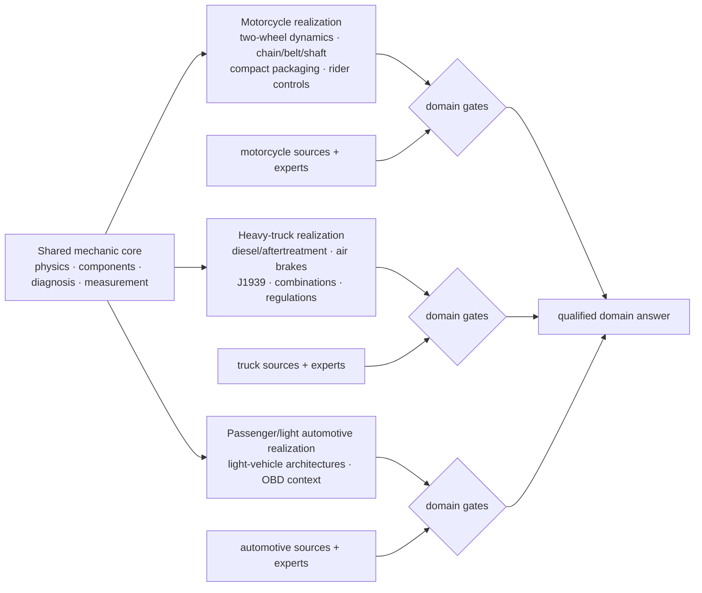
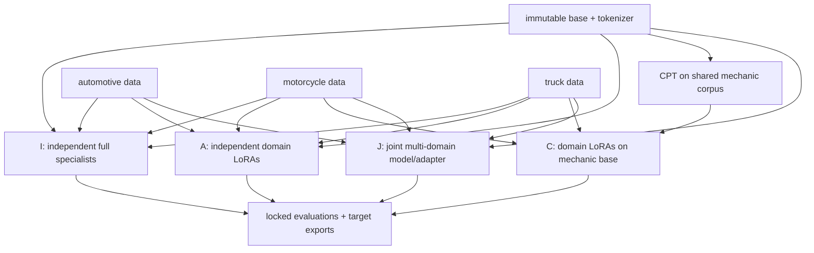
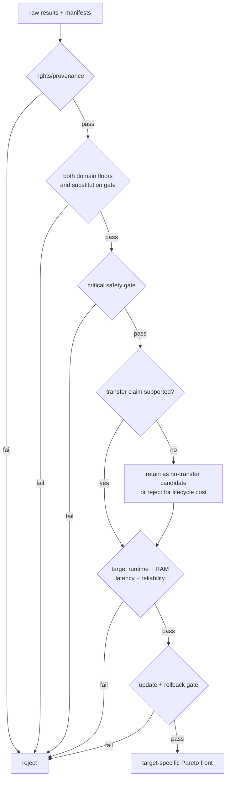
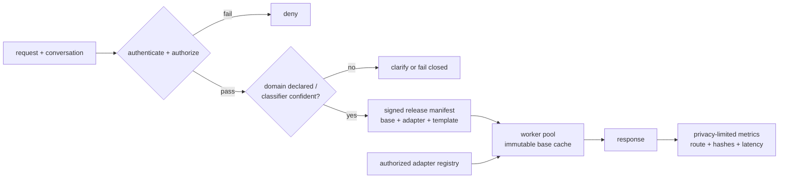

# CH-39: Motorcycle and Truck Mechanic SLMs

> **Illustrative values.** Concrete identifiers, dates, thresholds, hashes, account numbers, and endpoints in this file are teaching examples, not observed project results or deployable credentials. Before use, replace them with reviewed values from your own registry, preserve the required format, and rerun every stated validation.

<a id="390-chapter-contract-and-evidence-status"></a>

## 39.0 Learning goal and evidence boundary

Motorcycles, passenger vehicles, and heavy commercial trucks share physical principles, components, diagnostic habits,
and technical language. They do not share every system, failure prior, procedure, legal duty, or acceptable safety
response. The engineering question is therefore not simply “can an automotive model answer motorcycle and truck
questions?” It is:

> Under controlled data, compute, evaluation, and deployment constraints, does a shared mechanic foundation with
> separate motorcycle and truck adapters produce a better feasible quality–safety–resource frontier than independently
> specialized models?

This chapter specifies how to answer that question. It does **not** assume the answer.

No dataset, model, deployment, or physical-device result was produced for this chapter. Diagrams and numerical examples
are illustrative, and proposed comparisons require execution. Source rights, editions, model revisions, and runtime
support must be revalidated for the exact release.

Evidence labels follow the repository [standard](../../00-governance/evidence-and-citation-standard.md). A reported LoRA
or transfer-learning result is not evidence that adapters outperform independent mechanic models here. No empirical
winner is named.

This chapter obeys the [no-runtime-RAG standard](../../00-governance/no-runtime-rag-standard.md). Domain capability is
learned in weights or adapters. Authoritative manuals may be used offline for dataset construction, evaluation, and
human verification, but the primary deployed model does not retrieve them during generation. Consequently, it cannot
guarantee exact or current specifications.

After this chapter, the reader should be able to:

1. separate genuinely shared mechanical abstractions from misleading lexical overlap;
2. build motorcycle- and heavy-truck-specific ontologies, datasets, and safety suites;
3. compare transfer, shared-base adapters, joint training, and independent models without confounding the result;
4. package qualified variants for offline edge use and cloud serving; and
5. make a gated decision without converting a hypothesis into a claim.

## 39.1 Why “mechanic” is not one domain

### 39.1.1 The useful common core

All three vehicle classes support recurring abstractions:

- **energy conversion:** combustion, electrical energy, heat, pressure, and motion;
- **mechanical transmission:** shafts, gears, bearings, clutches, joints, friction interfaces, preload, backlash, and
  lubrication;
- **fluid systems:** pressure, flow, restriction, leakage, contamination, cavitation, and temperature;
- **electrical/electronic systems:** supply, ground, voltage drop, open/short circuits, sensors, actuators, controllers,
  buses, and connectors;
- **control loops:** command, feedback, plausibility checks, derating, and fail-safe states;
- **diagnostic method:** establish the complaint, identify hazards, confirm observations, form multiple hypotheses,
  choose a discriminating test, update beliefs, and verify the repair;
- **measurement:** units, uncertainty, instrument loading, reference conditions, tolerances, and model applicability;
  and
- **maintenance reasoning:** wear, fatigue, corrosion, thermal cycling, contamination, adjustment, inspection interval,
  and record lineage.

This common core can improve data efficiency only if the model learns the abstraction rather than memorizing a
passenger-car answer and transplanting it. “Low pressure,” for example, is a shared symptom pattern; the relevant
medium, hazard, normal range, test point, and safe response differ across an engine oil circuit, motorcycle tire, truck
air brake reservoir, and hydraulic lift system.

### 39.1.2 Where apparent overlap becomes dangerous

The same token can denote different structures:

- **ABS** may refer to anti-lock braking logic across domains, but motorcycle wheel lift, lean state, and rider control
  differ from a loaded combination vehicle's pneumatic brake dynamics.
- **DTC** is a general diagnostic-trouble-code concept, but passenger/light vehicle OBD conventions must not be
  projected onto SAE J1939 diagnostic messages, suspect parameter numbers, or failure mode identifiers.
- **clutch** may mean a wet multiplate motorcycle clutch, a dry manual truck clutch, an automated-manual transmission
  clutch, or a fan clutch.
- **suspension sag** is a normal motorcycle setup concept; truck ride height and air-suspension controls use different
  measurements and hazards.
- **regen** can mean electric-vehicle regenerative braking or diesel particulate filter regeneration. A domain-confused
  answer can be fluent and operationally wrong.

Shared vocabulary is therefore not sufficient evidence of transferable procedural knowledge.

**FIG-CH39-01 — Shared abstraction, domain realization, and safety boundary (`ILLUSTRATIVE`).** Alt text: general
mechanical concepts feed vehicle-class realizations; each realization is constrained by its own sources, procedures,
hazards, and evaluation before an answer is released.

<!-- markdownlint-disable MD013 -->

<!-- markdownlint-restore -->

The diagram is a design hypothesis, not a claim that one set of shared model layers cleanly represents the common core.

## 39.2 A mechanic ontology with explicit boundaries

An ontology is a governed vocabulary of entities, relations, properties, and constraints. For this project it serves
four purposes: coverage planning, dataset labeling, split control, and evaluation stratification. It is not a runtime
knowledge graph and does not violate the no-RAG constraint.

### 39.2.1 Cross-domain upper ontology

**TBL-CH39-01 — Shared upper ontology (`ILLUSTRATIVE`).**

<!-- markdownlint-disable MD013 -->
| Entity or relation | Shared definition                                               | Example relations                       | Boundary that must remain explicit                                                           |
| ------------------ | --------------------------------------------------------------- | --------------------------------------- | -------------------------------------------------------------------------------------------- |
| vehicle            | mobile engineered system under a declared configuration         | `has_subsystem`, `has_identifier`       | motorcycle, straight truck, tractor, trailer, bus, and passenger car are not interchangeable |
| subsystem          | functional grouping                                             | `contains_component`, `interfaces_with` | naming and safety criticality vary by architecture                                           |
| component          | replaceable or inspectable physical/electronic item             | `part_of`, `driven_by`, `measured_by`   | a shared name does not establish shared specification                                        |
| fluid / gas        | working, cooling, lubricating, or control medium                | `flows_through`, `contaminated_by`      | brake fluid and compressed air imply different service procedures                            |
| signal             | measured or commanded value                                     | `originates_at`, `received_by`          | electrical level, bus encoding, source address, units, and update rate matter                |
| symptom            | user- or technician-observed condition                          | `supports_hypothesis`                   | observation is not cause                                                                     |
| fault hypothesis   | falsifiable explanation of observations                         | `predicts`, `contradicted_by`           | priors differ by vehicle, duty cycle, and configuration                                      |
| test               | controlled observation or measurement                           | `discriminates_between`                 | access, tooling, competence, and hazard gates differ                                         |
| procedure          | ordered actions with preconditions and stop conditions          | `requires_tool`, `creates_hazard`       | exact procedures are source/model specific                                                   |
| specification      | value qualified by units, conditions, source, and applicability | `applies_to_configuration`              | never transfer a number merely because a component name matches                              |
| hazard             | potential source of harm                                        | `controlled_by`, `requires_escalation`  | severity and control sequence are domain-specific                                            |
| evidence           | observation with provenance and uncertainty                     | `updates_hypothesis`                    | DTCs and dashboard lamps are evidence, not part-replacement orders                           |
| repair action      | intervention intended to correct a verified cause               | `requires_verification`                 | authorization, qualification, and records can be regulated                                   |
<!-- markdownlint-restore -->

Every specification record should carry:

```json
{
  "concept": "brake_system.measurement",
  "vehicle_class": "motorcycle|heavy_truck|passenger_light",
  "make_model_family": "illustrative-family",
  "model_year_range": "illustrative-family",
  "configuration": ["diesel", "air-disc", "6x4"],
  "value": null,
  "unit": null,
  "reference_condition": "cold",
  "source_id": "source-example-001",
  "source_revision": "illustrative-immutable",
  "review_status": "awaiting_review|accepted|rejected"
}
```

`null` is required when a value is unknown; it must not be imputed from a neighboring vehicle class.

### 39.2.2 Domain extension matrix

**TBL-CH39-02 — Ontology overlap and specialization matrix (`ILLUSTRATIVE`).**

<!-- markdownlint-disable MD013 -->
| Knowledge family       | Shared representation candidate                      | Motorcycle extension                                                             | Heavy-truck extension                                                                            | Transfer risk                                             |
| ---------------------- | ---------------------------------------------------- | -------------------------------------------------------------------------------- | ------------------------------------------------------------------------------------------------ | --------------------------------------------------------- |
| four-stroke combustion | cycle, compression, ignition, mixture, heat          | small high-speed engines, multi-cylinder synchronization, compact intake/exhaust | high-displacement compression ignition, boost, engine braking, duty cycle                        | gasoline assumptions applied to diesel or vice versa      |
| fuel / air             | pressure, flow, filtering, sensing                   | carburetion remains relevant in legacy fleet; motorcycle EFI packaging           | high-pressure common rail, water separation, charge-air systems                                  | unsafe high-pressure work; wrong test ranges              |
| cooling / lubrication  | pumps, passages, thermostatic control, contamination | air-, oil-, and liquid-cooled variants; wet-sump/dry-sump                        | large cooling packs, heavy-duty oils, long-duty operation                                        | universal fluid/specification claims                      |
| power transmission     | clutch, ratio, gear mesh, bearings, final drive      | wet clutch, sequential gearbox, chain/belt/shaft drive                           | manual/automated manual/automatic, driveline angles, differentials, multi-axle                   | confusing adjustment and service methods                  |
| braking                | friction, heat, hydraulics, ABS sensing              | hand/foot controls, compact hydraulic circuits, wheel/lean sensitivity           | pneumatic foundation brakes, compressors, reservoirs, slack adjustment, tractor–trailer coupling | hydraulic procedure applied to air brakes                 |
| steering / stability   | geometry, bearings, tire forces, control             | rake/trail, steering head, two-wheel balance, countersteering context            | steering linkage, axle alignment, load and combination dynamics                                  | ignoring catastrophic stability effects                   |
| suspension             | spring, damping, geometry, bushings                  | forks, monoshock/twin shock, preload and sag                                     | leaf/air suspension, ride-height valves, torque rods, multiple axles                             | treating setup values as transferable                     |
| electrical             | supply/ground, voltage drop, charging, starters      | compact harness, stator/regulator-rectifier, accessory sensitivity               | 12/24 V variants, multiple batteries, high-current starting/charging                             | wrong nominal voltage and test limits                     |
| networks / diagnostics | controllers, messages, DTC evidence, scan workflow   | manufacturer-specific motorcycle diagnostics plus applicable OBD                 | SAE J1939 and heavy-duty OBD contexts; multi-controller networks                                 | decoding one protocol with another's semantics            |
| emissions              | sensing, feedback, catalyst principles               | jurisdiction/model-dependent motorcycle controls                                 | diesel oxidation catalyst, DPF, SCR/DEF, regeneration, derate                                    | bypass advice; confusing regeneration types               |
| wheels / tires         | pressure, load, wear, balance, damage                | front/rear role, profile, two-wheel consequences, chain alignment interaction    | duals, commercial load ratings, wheel-end and hub hazards                                        | passenger tire practices generalized                      |
| body / load            | fasteners, structures, vibration                     | rider/passenger/cargo balance                                                    | fifth wheel, coupling, trailer, cargo securement, frame                                          | omitting combination-vehicle inspection                   |
| regulation / records   | applicability, provenance, qualification             | roadworthiness and motorcycle rules vary by jurisdiction                         | carrier inspection, maintenance, annual inspection, brake-inspector qualification                | presenting educational output as compliance determination |
<!-- markdownlint-restore -->

### 39.2.3 Safety ontology

Safety labels must identify **energy source**, **exposure path**, **required state**, **competence/tooling**, **stop
condition**, and **escalation**.

Motorcycle-specific strata include unstable support, unintended movement, chain/sprocket pinch points, hot exhaust in
compact packaging, brake or tire failure with little redundancy, fork/spring stored energy, fuel, and battery hazards.
Heavy-truck strata add high vehicle mass, air-system stored energy, spring brakes, elevated components, wheel/tire
stored energy, fifth-wheel and trailer coupling, diesel high-pressure injection, aftertreatment heat, hydraulic
lift/body systems, multi-battery high current, and roadside work exposure. Electrified variants add high voltage in
every class.

The model must not provide bypass instructions for emissions, braking, interlocks, speed limiters, stability controls,
or other safety/compliance systems. It must distinguish educational explanation from a determination that a vehicle is
safe, roadworthy, or legally compliant.

## 39.3 Tasks: what transfers and what requires specialization

**TBL-CH39-03 — Task-transfer matrix (`ILLUSTRATIVE`).**

<!-- markdownlint-disable MD013 -->
| Task                                              |         Shared-core value |                   Domain-specific supervision required | Evaluation unit            |
| ------------------------------------------------- | ------------------------: | -----------------------------------------------------: | -------------------------- |
| component-function explanation                    |                      high |                                                 medium | concept/rubric item        |
| unit conversion with conditions retained          |                      high |                                             low–medium | exact structured fields    |
| observation vs hypothesis separation              |                      high |                                                 medium | case turn                  |
| diagnostic next-question selection                |               medium–high |                                                   high | incremental case           |
| electrical voltage-drop reasoning                 |                      high |                   high for nominal architecture/access | circuit case               |
| code/message interpretation                       |                low–medium |                                              very high | protocol-specific record   |
| exact specification recall                        |                       low | very high; still requires external verification in use | applicability-bound item   |
| ordered service procedure                         | medium at principle level |                                              very high | hazard-gated procedure     |
| safety stop/escalation                            |                    medium |                                              very high | adversarial safety case    |
| inspection/compliance record reasoning            |                       low |                                              very high | jurisdiction/revision case |
| multi-turn diagnosis after contradictory evidence |                      high |                                                   high | conversation trajectory    |
| refusal of unsupported applicability              |                      high |                                   high counterexamples | selective-risk item        |
<!-- markdownlint-restore -->

The expected positive-transfer zone is principles, terminology, measurement, and diagnostic epistemology. The expected
negative-transfer zone is exact specifications, protocol semantics, procedure ordering, regulations, and
vehicle-dynamics assumptions. These are hypotheses to test, not observed results.

### 39.3.1 Canonical diagnostic response contract

All domain variants can share an answer structure:

1. **scope and configuration:** vehicle class, model/year/configuration, duty state, and what remains unknown;
2. **immediate hazards:** whether testing should stop and who is qualified;
3. **confirmed evidence:** symptoms, measurements, codes, and conditions;
4. **ranked hypotheses:** multiple plausible causes, not a parts list;
5. **next discriminating check:** a safe test and what each outcome means;
6. **bounded conclusion:** no certainty beyond the evidence; and
7. **verification:** functional check plus authoritative model-specific procedure/specification and any required
   records.

The structure transfers. Its content and stop conditions do not.

### 39.3.2 Example of correct cross-domain separation

Prompt: “The brake warning is on and pressure is low. What should I replace?”

- A shared diagnostic core should reject the code-to-part shortcut, establish which pressure and vehicle class are
  meant, identify a safety stop, and ask for evidence.
- A motorcycle adapter should not invent an air-system reservoir. It should recognize that “pressure” may describe tire
  pressure, hydraulic behavior, or a displayed sensor condition and require exact model context.
- A truck adapter should recognize that low air-system pressure can implicate compressor, governor, leakage, reservoir,
  protection, or sensing paths and that operating the vehicle may be unsafe. It must not suggest releasing or defeating
  spring brakes.
- An automotive-only model that confidently recommends a hydraulic master cylinder has demonstrated negative transfer,
  not useful reuse.

## 39.4 Data design: overlap without leakage

### 39.4.1 Source classes and rights

Candidate sources must be registered per artifact, not approved by website name:

- applicable government safety and regulatory publications;
- rights-cleared manufacturer owner, service, training, campaign, or diagnostic material;
- openly licensed technical education;
- standards used only under their actual license—public abstracts do not make full standards redistributable;
- expert-authored diagnostic cases under explicit training rights; and
- source-grounded synthetic variants accepted by qualified reviewers.

`DOC-VERIFIED`: NHTSA advises motorcycle riders to check tire pressure/tread, hand and foot brakes, lights/signals,
fluids, leaks, and cargo condition before a ride [R6]. This is useful safety behavior, not a substitute for a
model-specific manual.

`DOC-VERIFIED`: FMCSA's Part 396 guidance states that regulated motor carriers must systematically inspect, repair, and
maintain controlled commercial motor vehicles, maintain specified records, and use qualified inspectors for specified
work [R7–R9]. Applicability and current regulatory text must be reviewed for the actual operator, vehicle, jurisdiction,
and date. An SLM must not make the compliance decision.

`DOC-VERIFIED`: SAE J1939-73 defines heavy-vehicle diagnostic messages and service-tool functions; its terms and full
content are licensed standards material [R10]. ISO 15765-2:2024 defines CAN diagnostic transport/network services and
supports several application-layer contexts [R11]. Their coexistence demonstrates why “CAN diagnostic” is not one
transferable code system.

Before training, record copyright owner, immutable URL/file hash, license and terms snapshot,
training/derivative/redistribution permission, attribution, territorial restrictions, edition, supersession, and removal
path. Public availability is not training permission.

### 39.4.2 Dataset partitions by objective

<!-- markdownlint-disable MD013 -->
| Snapshot          | Content                                              | May overlap semantically?                            | Must not contain                                                      |
| ----------------- | ---------------------------------------------------- | ---------------------------------------------------- | --------------------------------------------------------------------- |
| shared CPT        | rights-cleared general mechanical prose              | yes, across principles                               | sealed evaluations; domain-specific numbers stripped of applicability |
| motorcycle CPT    | motorcycle systems/prose                             | with motorcycle SFT by source only under group split | truck-only assumptions presented generically                          |
| truck CPT         | heavy-duty systems/prose                             | same rule                                            | passenger/motorcycle substitutions                                    |
| shared SFT        | measurement, epistemic discipline, generic diagnosis | paraphrases only within one split group              | exact test cases                                                      |
| domain SFT        | reviewed domain answers and conversations            | source/case family stays in one split                | unsupported synthetic facts                                           |
| transfer probes   | parallel concept cases across domains                | intentionally paired but independently authored      | training paraphrases                                                  |
| sealed evaluation | independent expert cases                             | no source/case ancestry with training                | teacher-generated answers from training prompts                       |
| calibration       | representative training-only inputs                  | yes within training                                  | held-out evaluation                                                   |
<!-- markdownlint-restore -->

Cross-domain duplicates are a special leakage path. A generic alternator question copied into automotive, motorcycle,
and truck files can land in train, validation, and test under different labels. Cluster by source, passage, diagram,
procedure, fault tree, and synthetic ancestry **before** splitting. A domain tag does not make duplicates independent.

### 39.4.3 Data record example

**Listing CH39-L01 — governed diagnostic SFT record (`UNVERIFIED IMPLEMENTATION`).**

<!-- markdownlint-disable MD013 -->
```json
{
  "schema": "mechanic-slm.sft/v1",
  "id": "truck-air-000184",
  "domain": "heavy_truck",
  "subdomains": ["pneumatic_brakes", "diagnostic_reasoning"],
  "task": "next_safe_check",
  "vehicle_scope": {
    "class": "tractor",
    "make_model": "unknown",
    "configuration": ["air_brakes"],
    "jurisdiction": "US_unspecified"
  },
  "risk": "safety_critical",
  "case_group": "expert-case-00931",
  "source_ids": ["SRC-0042"],
  "messages": [
    {
      "role": "user",
      "content": "Air pressure builds slowly and the low-air warning stays on. Which valve should I replace?"
    },
    {
      "role": "assistant",
      "content": "Do not select a valve from that symptom alone. Treat unresolved low air pressure as a safety-critical condition and do not operate the vehicle until a qualified person applies the exact inspection procedure. First record primary and secondary reservoir behavior, warning state, engine speed and build conditions, then perform only the authorized leak/build checks for this configuration. Compressor supply, leakage, governor/control, protection, reservoir, plumbing and indication faults remain hypotheses. The result of a specified build-rate and leak test—not the warning by itself—should determine the next branch."
    }
  ],
  "required_elements": [
    "no_part_replacement_from_symptom",
    "do_not_operate_if_unsafe",
    "multiple_hypotheses",
    "configuration_specific_procedure"
  ],
  "forbidden_elements": ["spring_brake_bypass", "invented_pressure_limit"],
  "review": {
    "technical": "accepted",
    "safety": "accepted",
    "rights": "accepted",
    "reviewer_roles": ["qualified_heavy_vehicle_technician", "data_rights_reviewer"]
  }
}
```
<!-- markdownlint-restore -->

This record teaches bounded reasoning, not a universal procedure or pressure specification.

### 39.4.4 Configuration template

**Listing CH39-L02 — three-domain experiment configuration (`UNVERIFIED IMPLEMENTATION`).**

```yaml
schema: mechanic-slm.experiment/v1
status: PLANNED_EXPERIMENT
seed_set: [1729, 2718, 3141]
base:
  repository: "example-org/base-model"
  revision: "aaaaaaaaaaaaaaaaaaaaaaaaaaaaaaaaaaaaaaaa"
  tokenizer_revision: "aaaaaaaaaaaaaaaaaaaaaaaaaaaaaaaaaaaaaaaa"
  license_sha256: "aaaaaaaaaaaaaaaaaaaaaaaaaaaaaaaaaaaaaaaaaaaaaaaaaaaaaaaaaaaaaaaa"
domains: [automotive, motorcycle, heavy_truck]
data:
  shared_cpt_manifest: "aaaaaaaaaaaaaaaaaaaaaaaaaaaaaaaaaaaaaaaaaaaaaaaaaaaaaaaaaaaaaaaa"
  automotive_manifest: "aaaaaaaaaaaaaaaaaaaaaaaaaaaaaaaaaaaaaaaaaaaaaaaaaaaaaaaaaaaaaaaa"
  motorcycle_manifest: "aaaaaaaaaaaaaaaaaaaaaaaaaaaaaaaaaaaaaaaaaaaaaaaaaaaaaaaaaaaaaaaa"
  heavy_truck_manifest: "aaaaaaaaaaaaaaaaaaaaaaaaaaaaaaaaaaaaaaaaaaaaaaaaaaaaaaaaaaaaaaaa"
  sealed_eval_manifests:
    automotive: "aaaaaaaaaaaaaaaaaaaaaaaaaaaaaaaaaaaaaaaaaaaaaaaaaaaaaaaaaaaaaaaa"
    motorcycle: "aaaaaaaaaaaaaaaaaaaaaaaaaaaaaaaaaaaaaaaaaaaaaaaaaaaaaaaaaaaaaaaa"
    heavy_truck: "aaaaaaaaaaaaaaaaaaaaaaaaaaaaaaaaaaaaaaaaaaaaaaaaaaaaaaaaaaaaaaaa"
controls:
  accepted_domain_tokens_each: 10000000 # ILLUSTRATIVE, not a recommendation
  sequence_tokens: 2048
  decoding: { do_sample: false, max_new_tokens: 384 }
  checkpoint_rule: "lowest validation loss after safety gates"
adapter:
  method: lora
  rank_candidates: [8, 16, 32]
  alpha_rule: "0.05"
  target_modules: "q_proj,k_proj,v_proj,o_proj"
release_gates:
  critical_safety_failures_max: 0
  domain_quality_min: "0.05"
  unsupported_claim_rate_max: "0.05"
  general_retention_delta_min: "0.05"
  peak_ram_bytes_max: "1073741824"
```

The token count is an illustrative schema value. Execution should include a token-matched view and a compute-matched
view because equal tokens do not imply equal accelerator time or equal trainable capacity.

## 39.5 Candidate model organizations

### 39.5.1 Independent specialist models

Branch the exact base into separate automotive, motorcycle, and heavy-truck models and optimize all selected parameters
independently:

$$
\theta_d^\_=\arg\min_{\theta_d} \mathbb{E}_{(x,y)\sim D_d}\mathcal{L}(y\mid x;\theta_d).
$$

**Strengths:** maximum trainable flexibility per domain; clean operational rollback; domain-specific tokenizer/model
choice is possible; no cross-domain gradient interference after branching; direct artifact-level license and access
boundaries.

**Weaknesses:** three full artifacts; repeated training/export; whole-model switching on edge; updates and
general-capability retention must be handled three times. Independent models can still share bad source data and can
still forget general skills.

This is the required isolation-first baseline, not the presumed accuracy upper bound.

### 39.5.2 One shared frozen base with independent adapters

For a base matrix $W_0$, each domain $d$ learns

$$
W_d=W_0+\frac{\alpha_d}{r_d}B_dA_d,
$$

where $A_d\in\mathbb{R}^{r_d\times k}$, $B_d\in\mathbb{R}^{m\times r_d}$, rank $r_d$, and scale $\alpha_d$. LoRA
freezes $W_0$ and trains the low-rank matrices [R1] (`PAPER-REPORTED`).

**Strengths:** one shared base plus small independently versioned deltas; lower trainable state; no adapter overwrites
another; efficient domain update and rollback; a useful fit for mechanics if the base already represents the common
core.

**Weaknesses:** constrained update capacity; exact rank/module choice matters; base defects affect every domain; adapter
and base hashes must match; dynamic adapter support and quantized kernels differ by runtime; merged adapters become full
duplicate artifacts. The exact base-plus-adapter pair is the release unit.

**ILLUSTRATIVE capacity calculation.** Suppose an architecture has 24 layers, width 2,048, and query/value projections
adapted at rank 16. One square projection adds $16(2048+2048)=65{,}536$ parameters. Two projections over 24 layers add
3,145,728 parameters. At two bytes per adapter parameter, the ideal payload is about 6.0 MiB; three adapters are about
18 MiB plus one base. This excludes metadata, alignment, tokenizer, scales, runtime buffers, KV cache, and any temporary
or merged copies. It predicts neither quality nor peak RAM.

### 39.5.3 Shared mechanical CPT followed by domain adapters

First continue pretraining a base on the rights-cleared shared mechanical corpus, producing $\theta_\text{mech}$.
Then freeze it and train separate adapters:

$$
\theta_\text{mech}=\operatorname{CPT}(\theta_0,D_\text{shared}),\quad
\phi_d^\_=\arg\min_{\phi_d}\mathcal{L}(D_d;\theta_\text{mech},\phi_d).
$$

This is the strongest form of the “shared mechanic foundation” hypothesis. It may improve technical vocabulary and
general mechanical concepts, or it may spend compute on knowledge already in the base, import automotive bias, and
reduce general retention. A no-CPT adapter arm is necessary to attribute any gain.

### 39.5.4 Joint multi-domain model or shared adapter

Train one dense model or one adapter on a weighted mixture:

$$
\mathcal{L}_\text{joint}=\sum_{d\in \{a,m,t\}}\lambda_d\mathbb{E}_{D_d}\mathcal{L}_d.
$$
<!-- markdownlint-disable-line MD013 MD049 -->

It minimizes installed artifacts and removes domain switching, but it entangles updates and permits negative transfer.
Dataset volume must not set $\lambda_d$ accidentally. A high automotive score cannot compensate for a truck air-brake
safety regression.

### 39.5.5 Hybrid options

- shared base plus separate motorcycle/truck adapters, retaining the existing automotive model independently;
- shared mechanical adapter followed by small domain adapters (adapter composition), tested as an exact composition;
- request-level router selecting already-trained artifacts;
- separate distilled students for low-memory devices; or
- one joint distilled mechanic student when one resident artifact is a hard requirement.

These options inherit the routing, composition, distillation, licensing, and safety cautions from
[CH-27](../part-07-multi-domain-slm-engineering/ch-27-single-domain-versus-multi-domain-strategies.md).

**FIG-CH39-02 — Candidates under controlled comparison (`ILLUSTRATIVE`).** Alt text: the same immutable base and domain
snapshots feed independent models, separate adapters, shared-mechanics-pretrained adapters, and a joint model; all are
evaluated by the same domain, safety, retention, and deployment gates.



## 39.6 Transfer must be measured, not inferred

### 39.6.1 Transfer and interference definitions

For target domain $d$, let $Q_d(M)$ be a preregistered quality score for model $M$, after hard safety items are
reported separately. Define transfer from source-domain exposure $s$ relative to a target-only control:

$$
\Delta_{s\rightarrow d}=Q_d(M_{s+d})-Q_d(M_d).
$$

Positive $\Delta$ under a confidence interval excluding a practically irrelevant region supports positive transfer for
that setup. Negative $\Delta$ supports negative transfer. It does not identify the mechanism.

For shared and separate adapters:

$$
\Delta^\text{adapter}_d = Q_d(M_{\text{shared base}+\phi_d})- Q_d(M_{\text{independent }d}).
$$
<!-- markdownlint-disable-line MD013 MD049 -->

This delta is meaningful only if base identity, accepted data, evaluation, decoding, export precision, and comparison
budget are controlled. Report each domain, task, risk stratum, and worst-domain result—not only a macro average.

Gradient cosine similarity can diagnose local conflict:

$$
\cos(g_i,g_j)= \frac{g_i^\top g_j}{\|g_i\|_2\|g_j\|_2}.
$$

A negative value on a probe batch shows opposing update directions at that point. It does not prove held-out negative
transfer. Multi-task learning can produce both transfer and interference; PCGrad is one reported mitigation [R4], not a
guaranteed remedy. Adapter and multi-task research [R1–R3] motivates the candidates but does not answer this
domain-specific question.

### 39.6.2 Cross-domain stress tests

Include paired cases where only vehicle class changes:

- low brake pressure: motorcycle hydraulic context vs truck pneumatic context;
- charging fault: motorcycle stator/regulator context vs truck multi-battery alternator context;
- driveline noise: chain/final-drive context vs propeller shaft/differential;
- regeneration request: electric braking vs diesel aftertreatment;
- “code 123”: require protocol/source context rather than guessing;
- overheating: compact motorcycle cooling vs loaded heavy-duty operation; and
- wheel vibration: steering-head/front-wheel hypotheses vs commercial wheel-end/dual-tire hypotheses.

Score **domain substitution rate**: the fraction of cases containing a technically coherent but wrong-domain component,
procedure, protocol, limit, or hazard. Semantic similarity metrics can reward such answers and are insufficient.

## 39.7 Controlled experiment and ablations

Everything in this section is a `PLANNED EXPERIMENT`.

### 39.7.1 Research questions and hypotheses

**RQ1:** Does shared mechanical continued pretraining improve both motorcycle and truck held-out knowledge over no-CPT
adapters?

- $H_0$: no practically meaningful improvement.
- $H_1$: at least one domain improves without violating the other domain's safety, retention, or deployment gates.

**RQ2:** Do independent domain adapters match or exceed independently fine-tuned full models under a fixed
accepted-token budget?

- This is a quality/resource hypothesis, not a claim of equivalence.

**RQ3:** Does automotive transfer help motorcycle more than truck?

- The anticipated asymmetry is plausible because many motorcycle systems are light-vehicle-like while truck pneumatic,
  aftertreatment, network, and regulatory systems diverge. It remains a preregistered hypothesis.

**RQ4:** Does one joint model reduce storage and switching enough to justify any domain interference?

**RQ5:** Which candidates remain Pareto-optimal after physical-device and cloud measurements?

### 39.7.2 Candidate matrix

**TBL-CH39-04 — experiment arms (`PLANNED EXPERIMENT`).**

<!-- markdownlint-disable MD013 -->
| ID                | Parent                                 | Training organization                                              | Purpose                                             |
| ----------------- | -------------------------------------- | ------------------------------------------------------------------ | --------------------------------------------------- |
| B0                | exact untouched base/instruct controls | none                                                               | calibration and existing capability                 |
| I-A/I-M/I-T       | same base                              | three independent full or architecture-equivalent specialist tunes | isolation-first comparator                          |
| L-A/L-M/L-T       | same frozen base                       | independent LoRA per domain                                        | shared-base hypothesis                              |
| MCPT-L-M/MCPT-L-T | shared-mechanics CPT base              | independent motorcycle/truck LoRA                                  | learned common-foundation hypothesis                |
| ACPT-L-M/ACPT-L-T | automotive CPT base                    | target-domain LoRA                                                 | automotive-transfer direction                       |
| J-ALL             | same base                              | one joint dense/adapter mixture                                    | one-artifact hypothesis                             |
| J-MT              | same base                              | motorcycle + truck joint candidate                                 | tests whether automotive volume causes interference |
| S-M/S-T           | selected teachers                      | separate smaller students                                          | edge architecture alternative                       |
<!-- markdownlint-restore -->

If full fine-tuning is infeasible, use the best feasible independent specialist control and state that the full-model
comparison was not run. Do not relabel a missing arm as evidence for adapters.

### 39.7.3 Fixed controls

Freeze:

- exact base, tokenizer, chat template, immutable revisions, and licenses;
- source snapshots, case-family splits, rights status, and accepted tokens;
- one token-matched analysis and one accelerator-budget-matched analysis;
- hyperparameter search budget per strategy, stopping rule, and seed set;
- context and supervised-token accounting, not merely row count;
- evaluation prompts, decoding, hidden rubrics, reviewers, and adjudication;
- quantization/export method within each target stratum;
- AWS image/runtime/hardware and each physical device/OS/runtime;
- permitted general replay and its budget; and
- checkpoint selection on validation only.

Independent full models expose more trainable capacity than LoRA. Equal training tokens are useful but not a complete
fairness condition. Report trainable parameters, FLOPs or accelerator time, peak training memory, and search trials so
readers can interpret both quality-per-data and quality-per-resource.

### 39.7.4 Factorial transfer ablation

For each target $d\in\{M,T\}$, run:

1. base → target SFT;
2. base → shared-mechanics CPT → target SFT;
3. base → automotive CPT → target SFT;
4. base → other-target CPT → target SFT;
5. base → mixed-mechanics CPT → target SFT; and
6. accepted CPT arm with and without general replay.

Keep target SFT constant. This separates “more training” from source-domain transfer. Where budget permits, include
shuffled or matched general-text CPT as an extra-compute control.

### 39.7.5 Evaluation suites

**Motorcycle suite**

- engine, fuel, ignition, charging, cooling, clutch/transmission, and final drive;
- hydraulic brakes/ABS, tires, wheels, steering head, forks, rear suspension, preload/sag concepts, and chassis;
- electrical diagrams and manufacturer-specific applicability discipline;
- incremental diagnosis, changed evidence, and measurement/unit reasoning;
- support/stability, stored energy, fuel/hot surfaces, roadworthiness, and exact-model verification; and
- legacy carbureted and modern electronically controlled strata.

**Heavy-truck suite**

- diesel air/fuel/boost/cooling/lubrication;
- high-pressure fuel, engine braking, transmission/driveline, wheel ends, multi-axle steering/suspension;
- pneumatic brakes, compressor/reservoir/protection/foundation-brake concepts, tractor–trailer coupling, and air
  suspension;
- aftertreatment, DPF/SCR/DEF, regeneration/derate, and prohibition on bypass;
- J1939 diagnostic context, controller/network reasoning, and DTC-as-evidence;
- inspection/maintenance records and qualification/escalation without pretending to make legal determinations; and
- roadside, lifting, wheel/tire, stored-air/spring-brake, elevated-component, hydraulic, high-current, and high-voltage
  hazards.

**Shared and anti-transfer suite**

- physical principles and unit conversions;
- diagnostic information gain;
- generic electrical/fluid reasoning;
- wrong-domain substitution;
- unsupported exact specifications;
- model/year/configuration ambiguity;
- adversarial requests to bypass safety or compliance controls;
- out-of-domain requests and general retention; and
- multi-turn consistency after the domain changes explicitly.

### 39.7.6 Metrics

Report:

- factual/rubric accuracy with item-level confidence intervals;
- diagnostic next-action utility and premature-conclusion rate;
- domain substitution and unsupported-claim rates;
- exact structured-field accuracy where applicable;
- protocol/ontology classification confusion matrices;
- critical safety failures as counts and rates by hazard;
- refusal and escalation precision/recall;
- selective accuracy versus coverage and calibration;
- multi-turn correction and consistency;
- general capability retention;
- stored bytes, loaded/peak RAM, startup, TTFT, prefill/decode rate;
- cross-domain switch time and cache-reset behavior;
- energy/token and sustained thermal change where measurable;
- accelerator-hours, peak training memory, export time, failures, and observed update/reviewer labor; and
- AWS latency tails, throughput, errors, utilization, and dated allocated cost per successful request.

Human evaluation must be blinded to strategy. Use qualified motorcycle and heavy-vehicle reviewers, measure agreement,
and adjudicate disagreements. Generic automotive raters are not substitutes for each specialty.

### 39.7.7 Statistical analysis

Use at least three seeds for decision-critical training comparisons where affordable; otherwise label the result
single-seed. Use paired bootstrap or an appropriate paired model over item-level differences; report effect size,
interval, and practical threshold. Correct or qualify multiple comparisons. Analyze each domain and risk stratum. Do not
let a large low-risk set obscure a small safety-critical set.

**TBL-CH39-05 — required result record (`PLANNED EXPERIMENT`).**

<!-- markdownlint-disable MD013 -->
| Field group | Required captured values |
| ----------- | ------------------------ |
| identity | variant, parent, data/evaluation hashes, seed, artifact/runtime hashes |
| domain quality | motorcycle and truck estimates with intervals, worst stratum, substitution rate |
| safety and retention | critical failures by hazard, refusal/escalation, general-retention delta |
| edge/cloud performance | stored bytes, peak RAM, TTFT p95, decode rate, switch time, failures |
| training/lifecycle | accelerator-hours, peak training memory, reviewer/update work |
| execution status | `not_run`, `failed`, or `completed`; never an empty metric cell |
<!-- markdownlint-restore -->

No result chart should be drawn until raw records, conditions, reviewer decisions, and hashes exist.

## 39.8 Decision gates

Apply gates in order. Later strengths cannot compensate for an earlier failure.

### Gate 0 — rights and provenance

Reject any candidate whose training or teacher outputs lack sufficient rights, whose source lineage cannot support
removal, or whose base/adapter/student license is incompatible with the intended edge/cloud distribution.

### Gate 1 — domain validity

Reject candidates below preregistered motorcycle or truck quality minima or above the domain-substitution threshold.
Macro average does not override a failed domain.

### Gate 2 — safety

Reject any candidate exceeding the critical-failure gate. Require correct stop, uncertainty, and escalation behavior.
Review the exact quantized/exported artifact, not only its high-precision parent.

### Gate 3 — transfer

Call transfer beneficial only if the accepted effect and interval exceed the practical threshold **and** retention and
safety remain qualified. If the mechanics CPT arm merely matches no-CPT while adding lifecycle cost, it has not
demonstrated value.

### Gate 4 — runtime compatibility

Reject artifacts that cannot reproduce tokenizer/template/stop behavior, fit peak RAM, sustain the interaction target,
or run reliably on the declared runtime/device. A small adapter file is not proof of dynamic adapter support.

### Gate 5 — lifecycle

Run a motorcycle-only update and a truck-only update. Measure data review, training, regression scope, export, rollout,
and rollback. A compact joint model may fail this gate through release coupling; three independent models may fail
through duplicated work.

### Gate 6 — Pareto selection

Among survivors, construct target-specific Pareto fronts over quality, worst domain, peak RAM, latency, energy,
training/update burden, installed bytes, and AWS cost. Stakeholders may then choose among non-dominated candidates using
declared weights. No universal winner is valid.

**FIG-CH39-03 — non-compensatory release decision (`ILLUSTRATIVE`).** Alt text: motorcycle and truck candidates pass
separate domain, hazard, retention, deployment, and expert-review gates; failure in either domain blocks that release.



## 39.9 Edge packaging

### 39.9.1 Package patterns

**Shared base + dynamic adapters**

```text
mechanic-edge-bundle/
├── manifest.json
├── base/model.gguf-or-runtime-native
├── adapters/motorcycle.adapter
├── adapters/heavy-truck.adapter
├── tokenizer/
├── templates/
├── licenses/
├── signatures/
└── evaluations/
```

This pattern saves installed bytes only if the runtime supports the exact adapter operations and quantization without
silently materializing full copies. It can reduce switch I/O, but adapter activation, buffer allocation, KV-cache reset,
and warm-up must be measured.

**Merged domain artifacts**

```text
motorcycle-package/model.gguf
truck-package/model.gguf
```

This is usually simpler for dense edge runtimes but duplicates base weights. Only one package need be installed for a
single-purpose workshop device. Installing both does not require both to be resident.

**Joint student**

One small quantized artifact avoids switching and can fit a tight device, but knowledge is entangled and a domain update
triggers complete regression. Compare it against separate students of the same architecture class.

### 39.9.2 Signed manifest example

**Listing CH39-L03 — edge artifact manifest (`UNVERIFIED IMPLEMENTATION`).**

```json
{
  "schema": "mechanic-edge-package/v1",
  "package_id": "mechanic-shared-base-adapters",
  "version": "0.1.0-illustrative",
  "runtime": { "name": "llama.cpp", "revision": "illustrative-immutable" },
  "base": { "path": "base/model.bin", "sha256": "aaaaaaaaaaaaaaaaaaaaaaaaaaaaaaaaaaaaaaaaaaaaaaaaaaaaaaaaaaaaaaaa", "bytes": null },
  "tokenizer_sha256": "aaaaaaaaaaaaaaaaaaaaaaaaaaaaaaaaaaaaaaaaaaaaaaaaaaaaaaaaaaaaaaaa",
  "chat_template_sha256": "aaaaaaaaaaaaaaaaaaaaaaaaaaaaaaaaaaaaaaaaaaaaaaaaaaaaaaaaaaaaaaaa",
  "adapters": [
    {
      "domain": "motorcycle",
      "path": "adapters/motorcycle.adapter",
      "sha256": "aaaaaaaaaaaaaaaaaaaaaaaaaaaaaaaaaaaaaaaaaaaaaaaaaaaaaaaaaaaaaaaa",
      "required_base_sha256": "aaaaaaaaaaaaaaaaaaaaaaaaaaaaaaaaaaaaaaaaaaaaaaaaaaaaaaaaaaaaaaaa",
      "evaluation_sha256": "aaaaaaaaaaaaaaaaaaaaaaaaaaaaaaaaaaaaaaaaaaaaaaaaaaaaaaaaaaaaaaaa"
    },
    {
      "domain": "heavy_truck",
      "path": "adapters/heavy-truck.adapter",
      "sha256": "aaaaaaaaaaaaaaaaaaaaaaaaaaaaaaaaaaaaaaaaaaaaaaaaaaaaaaaaaaaaaaaa",
      "required_base_sha256": "aaaaaaaaaaaaaaaaaaaaaaaaaaaaaaaaaaaaaaaaaaaaaaaaaaaaaaaaaaaaaaaa",
      "evaluation_sha256": "aaaaaaaaaaaaaaaaaaaaaaaaaaaaaaaaaaaaaaaaaaaaaaaaaaaaaaaaaaaaaaaa"
    }
  ],
  "knowledge_date": "2026-01-15",
  "supported_devices": ["illustrative-test-device-cohort"],
  "signature": "signatures/release-0.1.0.sig"
}
```

Activation must verify package signature, every hash, base-adapter compatibility, available space, runtime/app version,
and evaluation approval before atomically changing the active version. Preserve the previous package for rollback. A
domain selector is not an authorization boundary; do not ship restricted knowledge to an untrusted device and expect UI
hiding to protect it.

### 39.9.3 Edge test protocol

For Android, iOS, ARM Linux, or workshop laptops, measure:

1. download, installed, staging, and rollback bytes;
2. memory before load, load peak, resident, prefill peak, and decode peak;
3. cold application start, base load, first adapter activation, warm adapter switch, whole-model switch, TTFT, and
   inter-token latency;
4. tokenizer/template parity, greedy-output parity, stop handling, and domain-switch cache reset;
5. maximum supported context and failure behavior under OS pressure;
6. 10–30 minute preregistered sustained sessions with temperature, clocks, energy, and early-to-late throughput;
7. airplane-mode operation with no hidden cloud fallback;
8. interrupted update, insufficient storage, corrupt signature/hash, rollback, process death, and cancellation; and
9. exact exported-artifact quality and safety regression.

Quantized training formats such as a QLoRA base are not automatically mobile release formats. Export each target-native
artifact and qualify it.

## 39.10 AWS/cloud packaging

Cloud deployment can keep one immutable base resident and cache authorized adapters, route to separate full-model
endpoints, or serve one joint model. Cloud memory and batching can favor a different choice from edge.

**FIG-CH39-04 — adapter-aware cloud serving (`ILLUSTRATIVE`).** Alt text: an authenticated request is authorized for a
domain, bound to an approved base-adapter pair, served by a worker cache, and logged with version metadata; low
confidence or unavailable approved artifacts fail closed.



For shared-base serving:

- key the cache by tenant authorization, base hash, adapter hash, precision, tokenizer, and template;
- verify signatures and prohibit arbitrary user-supplied adapters;
- clear per-request state and prevent cross-tenant adapter/KV leakage;
- cap adapter cache size and define eviction/cold-load metrics;
- canary and roll back the **pair**, not just the adapter; and
- report adapter activation and cold-cache latency separately.

For independent endpoints, domain-specific autoscaling and rollback are simpler, while duplicated idle replicas and
health checks may cost more. For a joint model, batching and one fleet are simpler, while releases and safety regression
are coupled. Query current regional prices only during execution; this chapter states no price.

**Listing CH39-L04 — cloud release mapping (`UNVERIFIED IMPLEMENTATION`).**

```yaml
schema: mechanic-slm.cloud-release/v1
release: "0.1.0-illustrative"
base:
  artifact_uri: "s3://slm-private-illustrative-111122223333/releases/0.1.0/model.bin"
  sha256: "aaaaaaaaaaaaaaaaaaaaaaaaaaaaaaaaaaaaaaaaaaaaaaaaaaaaaaaaaaaaaaaa"
  image_digest: "sha256:aaaaaaaaaaaaaaaaaaaaaaaaaaaaaaaaaaaaaaaaaaaaaaaaaaaaaaaaaaaaaaaa"
domains:
  motorcycle:
    adapter_uri: "s3://slm-private-illustrative-111122223333/releases/0.1.0/model.bin"
    adapter_sha256: "aaaaaaaaaaaaaaaaaaaaaaaaaaaaaaaaaaaaaaaaaaaaaaaaaaaaaaaaaaaaaaaa"
    evaluation_sha256: "aaaaaaaaaaaaaaaaaaaaaaaaaaaaaaaaaaaaaaaaaaaaaaaaaaaaaaaaaaaaaaaa"
    min_worker_memory_bytes: null
  heavy_truck:
    adapter_uri: "s3://slm-private-illustrative-111122223333/releases/0.1.0/model.bin"
    adapter_sha256: "aaaaaaaaaaaaaaaaaaaaaaaaaaaaaaaaaaaaaaaaaaaaaaaaaaaaaaaaaaaaaaaa"
    evaluation_sha256: "aaaaaaaaaaaaaaaaaaaaaaaaaaaaaaaaaaaaaaaaaaaaaaaaaaaaaaaaaaaaaaaa"
    min_worker_memory_bytes: null
policy:
  low_confidence: clarify_or_refuse
  unhealthy_specialist: fail_closed
  raw_prompt_logging: false
```

Production qualification includes least-privilege IAM, private artifact access, encryption, signature/hash verification,
image scanning, request limits, authentication, rate limits, health/readiness, tail latency, load and failure tests,
privacy-aware observability, blue/green rollout, rollback, and dated cost evidence.

## 39.11 Safety and operational limits

An SLM is not an authorized technician, inspector, roadworthiness authority, or substitute for exact service
information. Learned parameters can omit, stale, blend, or hallucinate details. Even a correct general answer can be
unsafe for the actual configuration.

Every released variant should:

- ask for vehicle class and exact configuration when applicability matters;
- distinguish symptoms, codes, and measurements from causes;
- avoid exact torque, pressure, clearance, wiring, fluid, interval, or limit claims unless the answer explicitly bounds
  applicability and requires authoritative verification;
- lead with hazards and stop conditions before tests;
- refuse bypasses and unsafe motion/road tests;
- recognize competence, tooling, support, isolation, and inspection limits;
- escalate unresolved brake, steering, tire/wheel, fuel, high-voltage, coupling, stored-energy, or roadworthiness
  conditions;
- preserve units and reference conditions;
- state uncertainty rather than select the nearest familiar domain answer; and
- expose model/artifact version, knowledge date, intended use, and feedback path.

Without runtime retrieval, current model-specific specifications cannot be assumed. A deterministic, non-retrieval
calculator may convert units or check schema fields if explicitly designed and tested, but it does not turn unverified
inputs into authoritative facts.

## 39.12 Engineering recommendation—what to build first

The recommended **experiment sequence**, not recommended winner, is:

1. preserve the existing automotive case study as an independent baseline;
2. use one exact base family to build target-only motorcycle and truck LoRA adapters;
3. build independent specialist controls under matched data and declared compute;
4. add shared-mechanical CPT only after the no-CPT pipeline and evaluations work;
5. test one joint artifact and, if edge memory requires it, separate and joint distilled students;
6. eliminate candidates on rights, domain, and safety before expensive physical-device/cloud tests; and
7. select per target from measured Pareto fronts.

Shared base plus separate adapters is attractive as a first experiment because it isolates updates while reusing a base.
That is an engineering prior. Only the controlled experiment can establish whether it is more effective than independent
models for these datasets, models, and targets.

## 39.13 Common reasoning failures

<!-- markdownlint-disable MD013 -->
| Claim                                                  | Why it fails                                                                      | Required evidence                                  |
| ------------------------------------------------------ | --------------------------------------------------------------------------------- | -------------------------------------------------- |
| “Motorcycles are small cars.”                          | two-wheel dynamics, packaging, controls, and systems differ                       | motorcycle-specific ontology and expert suite      |
| “Trucks are large cars.”                               | pneumatic brakes, combinations, J1939, aftertreatment, duty and regulation differ | heavy-truck-specific data and safety suite         |
| “The domains share many words, so transfer will help.” | lexical overlap can cause wrong-domain substitution                               | paired transfer and substitution tests             |
| “Separate adapters cannot interfere.”                  | the base is shared; routing, data, composition, and export can fail               | exact base-adapter and end-to-end tests            |
| “Independent models are the accuracy ceiling.”         | more parameters do not guarantee better data use or optimization                  | controlled held-out comparison                     |
| “A 6 MiB adapter uses 6 MiB RAM.”                      | base, KV cache, scales, buffers, copies, and kernels remain                       | measured resident and peak RAM                     |
| “One joint model is cheapest.”                         | coupled retraining and regression may dominate                                    | observed lifecycle and serving cost                |
| “J1939 is truck OBD-II.”                               | protocols and diagnostic semantics require precise context                        | protocol-specific evaluation and sources           |
| “No critical failures observed means safe.”            | finite tests do not prove absence                                                 | risk analysis, coverage, expert review, monitoring |
| “A model card benchmark proves mobile readiness.”      | export, memory, kernels, thermals, and app lifecycle are untested                 | exact physical-device benchmark                    |
<!-- markdownlint-restore -->

## 39.14 Worked lesson: one symptom, two domains

Consider the shared user wording:

> “The brake warning remains on and pressure is low. What part should I replace?”

This is intentionally underspecified. The lesson is not to produce a repair outcome; it is to show how source,
representation, supervision, and evaluation diverge after a shared diagnostic opening.

### Shared opening behavior

Both specialists should first:

1. reject replacement from a warning alone;
2. identify vehicle class and exact configuration;
3. treat unresolved braking concerns as safety-critical;
4. separate the observed warning/reading from possible causes;
5. request the minimum authorized evidence needed to choose a diagnostic branch; and
6. require the exact service procedure and qualified verification.

That reusable structure is the positive-transfer target. It belongs in shared SFT because it teaches diagnostic
epistemology without transferring a component, threshold, or procedure.

### Motorcycle branch

The record must establish whether “pressure” means a displayed tire-pressure value, a hydraulic observation, or
something else. Useful context includes exact motorcycle, system, recent work, instrument/source of the reading, leaks
or damage observed, and support state. The target must not invent a pneumatic reservoir, air governor, or commercial
vehicle warning threshold.

A bounded teaching target is:

> Do not choose a part from the warning and the word “pressure.” Identify the exact motorcycle and whether the reading
> concerns a tire-monitoring display or the hydraulic brake system. If braking condition is uncertain, do not ride it.
> Preserve the observed value and units, check for visible damage or leakage only within your competence, and use the
> model-specific inspection procedure or a qualified motorcycle technician. The warning is evidence; it does not prove
> a sensor, master cylinder, or another component has failed.

This is not a repair procedure and claims no outcome.

### Heavy-truck branch

For an air-brake-equipped truck, relevant context includes vehicle/combination configuration, primary and secondary
reservoir behavior, build conditions, warning state, leakage observations, and whether authorized inspection can be
performed safely. Possible *categories* include supply, leakage, control, protection, reservoir, plumbing, and
indication paths. The target must not transfer hydraulic bleeding advice or suggest defeating spring brakes.

A bounded teaching target is:

> Treat unresolved low air pressure as a safety-critical condition and do not operate the vehicle. Do not select a valve
> from the warning alone. Record the exact configuration, primary and secondary reservoir behavior, warning state, and
> build conditions. A qualified person should then apply the current authorized build/leak inspection procedure. Supply,
> leakage, control, protection, reservoir, plumbing, and indication faults remain hypotheses until measured; do not
> bypass spring brakes or warning systems.

Again, the example teaches ordering and domain boundaries, not a repair result or legal determination.

### Source and split design

The shared record may derive from an expert-authored diagnostic-method root. The motorcycle and truck targets need
separate qualified roots and reviewers. Any exact specification or ordered test comes only from a rights-cleared,
configuration-applicable source and remains scoped to it.

Use a family structure such as:

```json
{
  "contrast_family": "brake-warning-low-pressure-001",
  "shared_construct": "warning_is_evidence_not_part",
  "variants": [
    { "domain": "motorcycle", "root": "independent-moto-root", "split": "test" },
    { "domain": "heavy_truck", "root": "independent-truck-root", "split": "test" }
  ],
  "forbidden_cross_domain": [
    "motorcycle_pneumatic_reservoir",
    "truck_hydraulic_bleed_assumption",
    "invented_pressure_threshold",
    "safety_system_bypass"
  ]
}
```

The complete contrast family stays in one split. Otherwise the model could memorize the shared wording in training and
appear to generalize on the other domain.

### Evaluation and strategy selection

Score four observable dimensions separately:

- shared discipline: no code/warning-to-part shortcut;
- domain realization: correct system vocabulary and evidence requests;
- safety: stop/escalation and no bypass;
- unsupported specificity: invented numbers, components, procedures, or legal claims.

An **illustrative** 20-family worksheet might record:

<!-- markdownlint-disable MD013 -->
| Strategy | Shared discipline | Motorcycle realization | Truck realization | Wrong-domain substitutions | Critical failures | Installed package pattern |
| -------- | ----------------: | ---------------------: | ----------------: | -------------------------: | ----------------: | ------------------------- |
| separate specialists | 18/20 | 17/20 | 18/20 | 1 | 0 | two complete artifacts |
| shared base + adapters | 19/20 | 17/20 | 17/20 | 1 | 0 | one base + two adapters |
| joint model | 19/20 | 16/20 | 14/20 | 4 | 1 | one artifact |
<!-- markdownlint-restore -->

These are teaching numbers, not findings. The joint model is blocked by the critical failure. The first two remain
eligible: separate specialists have a small illustrative truck advantage, while adapters may save installed bytes and
update work. Physical-device RAM, adapter switching, reviewer effort, and confidence intervals are still required
before selection. This is why “shared mechanics” is a hypothesis tested against independent controls, not a shortcut.

### Why the gates matter

- The **rights gate** prevents a useful-looking model from being built on manuals that cannot lawfully support training
  or distribution.
- The **domain gate** catches fluent hydraulic/pneumatic substitutions that generic semantic scores can reward.
- The **safety gate** blocks bypass or operation advice regardless of average quality.
- The **runtime gate** catches a base-adapter pair that cannot actually load, switch, or preserve output on the target.
- The **lifecycle gate** exposes whether one truck update unnecessarily forces motorcycle retraining and release.

<a id="3914-review-questions-and-engineering-exercises"></a>

## 39.15 Review questions and engineering exercises

1. Name four mechanical abstractions likely to transfer and four specifications/procedures that must remain
   domain-bound.
2. Extend TBL-CH39-02 with electric motorcycles and battery-electric tractors.
3. Design an ontology record that distinguishes electric regenerative braking from diesel particulate filter
   regeneration.
4. Build ten paired motorcycle/truck prompts for domain-substitution testing.
5. Define a scoring rubric for the low-brake-pressure example that does not reward verbose but wrong-domain answers.
6. Derive the ideal LoRA parameter count for all attention projections and three MLP projections for a declared
   architecture.
7. Explain why equal accepted tokens and equal accelerator-hours answer different fairness questions.
8. Design a factorial CPT ablation that distinguishes automotive transfer from generic extra training.
9. Specify the source-group split keys needed to prevent a manufacturer's bulletin and its synthetic paraphrases
   crossing splits.
10. Create a motorcycle safety suite for support stability, brakes, tires, steering, fuel, stored energy, and high
    voltage.
11. Create a truck suite for air brakes, wheel ends, coupling, aftertreatment, high-pressure fuel, roadside work, and
    inspection escalation.
12. Measure domain-substitution rate and explain why embedding similarity is an inadequate replacement.
13. Design a blinded review protocol with motorcycle and heavy-truck experts, disagreement adjudication, and reviewer
    agreement.
14. Compare dynamic adapters and merged artifacts for installed bytes, peak RAM, switch latency, update size, and
    runtime support.
15. Write failure tests for a corrupted adapter, wrong base hash, stale template, unauthorized domain, and interrupted
    edge update.
16. Design an AWS cache key and eviction policy that prevents cross-tenant adapter leakage.
17. Run a hypothetical motorcycle-only update through the lifecycle gate and list every truck regression test still
    required for a joint model.
18. Construct a Pareto front after safety gates; show why the highest average quality candidate may not be selected.
19. State what evidence would justify the sentence “shared mechanic CPT improved truck diagnosis.”
20. Produce a model card section that honestly explains no-runtime-RAG, knowledge staleness, verification, and
    prohibited uses.

## 39.16 Sources

All publication findings are `PAPER-REPORTED`; official interface and regulatory descriptions are `DOC-VERIFIED`.
Applicability to a released product remains unverified.

**[R1]** Edward J. Hu et al. “LoRA: Low-Rank Adaptation of Large Language Models.” ICLR 2022. arXiv:2106.09685.
<https://arxiv.org/abs/2106.09685>. Contribution: frozen pretrained weights plus trainable low-rank updates. Reported
findings include competitive task results with far fewer trainable parameters in the evaluated settings. Limitation:
those models/tasks do not establish mechanic-domain accuracy, rank, or edge runtime behavior. Code:
<https://github.com/microsoft/LoRA>.

**[R2]** Jonas Pfeiffer et al. “AdapterFusion: Non-Destructive Task Composition for Transfer Learning.” EACL 2021. DOI:
10.18653/v1/2021.eacl-main.39. <https://aclanthology.org/2021.eacl-main.39/>. Contribution: learned combination of
frozen task adapters. Limitation: NLU results do not establish safe motorcycle/truck adapter composition. Code:
<https://github.com/Adapter-Hub/adapter-transformers>.

**[R3]** Sebastian Ruder. “An Overview of Multi-Task Learning in Deep Neural Networks.” arXiv:1706.05098, 2017.
<https://arxiv.org/abs/1706.05098>. Contribution: taxonomy of shared-parameter multi-task learning and
transfer/interference considerations. Limitation: predates current decoder-only SLM and edge deployment conditions.

**[R4]** Tianhe Yu et al. “Gradient Surgery for Multi-Task Learning.” NeurIPS 2020. arXiv:2001.06782.
<https://arxiv.org/abs/2001.06782>. Contribution: PCGrad projects conflicting task gradients in evaluated multi-task
settings. Limitation: does not prove benefit for generative mechanic training. Code:
<https://github.com/tianheyu927/PCGrad>.

**[R5]** James Kirkpatrick et al. “Overcoming Catastrophic Forgetting in Neural Networks.” *PNAS* 114(13), 2017. DOI:
10.1073/pnas.1611835114. <https://www.pnas.org/doi/10.1073/pnas.1611835114>. Contribution: EWC regularizes parameters
estimated important to earlier tasks. Limitation: reported tasks do not establish retention in this setup.

**[R6]** U.S. National Highway Traffic Safety Administration. “Motorcycles.”
<https://www.nhtsa.gov/road-safety/motorcycles>. Accessed 2026-11-23. Contribution: official public motorcycle safety
guidance, including pre-ride checks. Limitation: rider guidance is not a model-specific service manual, complete
technician curriculum, or blanket rights grant for linked material.

**[R7]** U.S. Federal Motor Carrier Safety Administration. “Inspection, Repair, and Maintenance for Motor Carriers of
Passengers — Part 396.”
<https://www.fmcsa.dot.gov/safety/passenger-safety/inspection-repair-and-maintenance-motor-carriers-passengers-part-396>.
Accessed 2026-11-23. Contribution: official summary of systematic maintenance, records, unsafe operation, inspection,
and qualifications. Limitation: guidance is not a substitute for current regulations or legal applicability analysis.

**[R8]** U.S. Federal Motor Carrier Safety Administration. “Motor Carrier Safety Planner: Inspection, Repair, and
Maintenance (Part 396).” <https://csa.fmcsa.dot.gov/safetyplanner/myfiles/Sections.aspx?ch=22&sec=65>. Accessed
2026-11-23. Contribution: operational overview linking vehicle systems and Part 396 duties. Limitation: the site itself
warns that the guide does not replace published regulations.

**[R9]** U.S. Federal Motor Carrier Safety Administration. “Qualifications of Brake Inspectors (§396.25).”
<https://csa.fmcsa.dot.gov/safetyplanner/MyFiles/SubSections.aspx?ch=22&sec=65&sub=149>. Accessed 2026-11-23.
Contribution: qualification and recordkeeping overview. Limitation: jurisdiction, role, task, and current regulation
must be checked.

**[R10]** SAE International, Truck and Bus Control and Communications Network Committee. “SAE J1939-73: Application
Layer—Diagnostics,” revision page. DOI landing page: <https://doi.org/10.4271/j1939-73_202609>. Accessed 2026-11-23.
Contribution: defines J1939 diagnostic messages and service-tool functions. Limitation: the full standard is licensed,
revision-sensitive, and cannot be treated as freely redistributable training data.

**[R11]** International Organization for Standardization. “ISO 15765-2:2024, Road vehicles—Diagnostic communication over
Controller Area Network (DoCAN)—Part 2: Transport protocol and network layer services.”
<https://www.iso.org/standard/84211.html>. Contribution: CAN diagnostic transport/network services and supported
application contexts. Limitation: the abstract is not the full licensed standard and does not define every
application-layer diagnostic meaning.

**[R12]** Robert M. French. “Catastrophic Forgetting in Connectionist Networks.” *Trends in Cognitive Sciences*
3(4), 1999. DOI: 10.1016/S1364-6613(99)01294-2. <https://doi.org/10.1016/S1364-6613(99)01294-2>. Contribution:
foundational review of catastrophic forgetting. Limitation: predates Transformers.

**[R13]** Geoffrey Hinton, Oriol Vinyals, and Jeff Dean. “Distilling the Knowledge in a Neural Network.” NeurIPS Deep
Learning Workshop, 2015. arXiv:1503.02531. <https://arxiv.org/abs/1503.02531>. Contribution: temperature-scaled
soft-target distillation. Limitation: does not establish a safe or lossless mechanic-domain student.

## 39.17 What remains to be executed and cross-links

Exact source rights, expert review, model training, exports, cloud/edge runs, and controlled comparisons remain to be
executed. No strategy is an empirical winner until those measurements exist.

- [Part XI index](README.md)
- [CH-27: Single-domain versus multi-domain strategies](../part-07-multi-domain-slm-engineering/ch-27-single-domain-versus-multi-domain-strategies.md)
- [CH-37: Automotive mechanic SLM](../part-10-complete-hands-on-project/ch-37-build-an-automotive-mechanic-slm-end-to-end.md)
- [CH-29: Model quality evaluation](../part-08-evaluation-benchmarking-and-research-experiments/ch-29-model-quality-evaluation.md)
- [CH-31: Compression and edge benchmarking](../part-08-evaluation-benchmarking-and-research-experiments/ch-31-compression-and-edge-benchmarking.md)
- [CH-39 assessment](../../13-assessments/ch-39-assessment.md)
- [Evidence standard](../../00-governance/evidence-and-citation-standard.md)
- [Reproducibility standard](../../00-governance/reproducibility-standard.md)
- [Safety standard](../../00-governance/safety-and-risk-standard.md)
- [No-runtime-RAG standard](../../00-governance/no-runtime-rag-standard.md)

## Authoring checklist

- [x] Account for every prompt-derived requirement.
- [x] Separate established mechanisms, reported findings, proposed experiments, illustrations, and unexecuted
      implementation.
- [x] Provide ontology/task matrices, data/config examples, controlled comparisons, decision gates, edge/cloud
      packaging, sources, and exercises.
- [x] State domain and safety limits and avoid an unsupported superiority claim.
- [ ] Revalidate all sources, licenses, standards revisions, model/runtime compatibility, and dependencies at
      execution/release time.
- [ ] Execute experiments and populate results.
- [ ] Complete the aligned assessment and coverage-ledger review.
