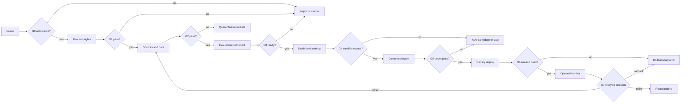
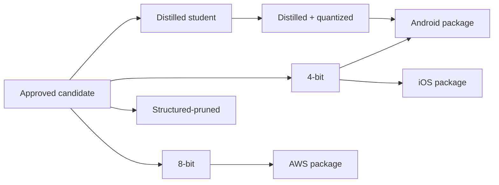
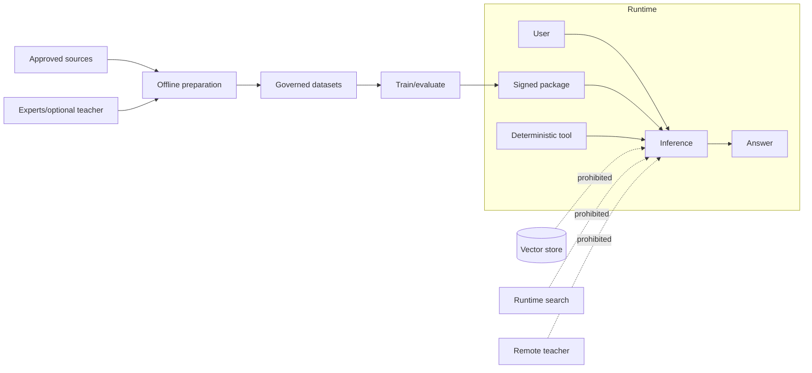

# CH-41: New Domain Onboarding

> **Illustrative values.** Concrete identifiers, dates, thresholds, hashes, account numbers, and endpoints in this file are teaching examples, not observed project results or deployable credentials. Before use, replace them with reviewed values from your own registry, preserve the required format, and rerun every stated validation.

## 41.0 Learning goal and evidence boundary

This chapter turns a proposed profession or technical field into a governed, repeatable Small Language Model (SLM)
program. The objective is not effortless onboarding; it is to make every consequential decision explicit, reproducible,
and reusable without cloning the platform.

The process is specified but not executed: diagrams and examples are illustrative, code requires validation, and
thresholds are policy decisions. A completed declaration is not evidence that a domain or release passed its gates.

This chapter operationalizes
[CH-28](../part-07-multi-domain-slm-engineering/ch-28-reusable-domain-training-platform.md),
[CH-30](../part-08-evaluation-benchmarking-and-research-experiments/ch-30-domain-specific-evaluation-suites.md), and the
domain lessons in [CH-38](ch-38-pharmaceutical-knowledge-slm.md), [CH-39](ch-39-motorcycle-and-truck-mechanic-slms.md),
and [CH-40](ch-40-beekeeping-and-zookeeping-slms.md).

After completing it, a team should be able to admit or reject a domain; configure its rights, data, evaluation,
training, compression, deployment, monitoring, and retirement; apply named approval gates; verify the no-runtime-RAG
boundary; and recover safely from failures.

## 41.1 Domain differences must be data, not forks

Copying an automotive notebook and changing paths appears fast, but each fork acquires different rights logic, safety
thresholds, split rules, runtime assumptions, and rollback behavior. Evaluation leaks into training, cloud evidence is
incorrectly transferred to mobile, and departed staff leave undocumented manual steps.

The scalable alternative is **configuration-driven onboarding**:

> A domain supplies validated declarations, governed artifacts, qualified approvals, and a reviewed plug-in only when
> the shared platform truly lacks a capability. Configuration selects supported behavior; it cannot inject arbitrary
> code.

Let the onboarding decision be:

\[ O_d=\bigwedge_{g\in G_d}\operatorname{pass}(g,E_g,P_g), \]

where \(O_d\) is approval for domain \(d\), \(G_d\) is its gate set, \(E_g\) is immutable evidence, and \(P_g\) is
versioned policy. The conjunction matters: aggregate quality cannot compensate for unknown rights, a critical unsafe
output, an exposed final suite, or an unqualified reviewer.

Operating principles:

1. Define intended and prohibited authority before collecting data.
2. Missing, invalid, or expired evidence fails closed.
3. Digests identify inputs; mutable aliases are resolved and recorded.
4. A trained candidate is not a release; a release is not a healthy deployment.
5. General capability and safety evidence are separate.
6. Evaluate the exact cloud or edge artifact being released.
7. Preserve lineage for every dataset, model, and package derivative.
8. Use qualified humans for consequential truth and approval.
9. Narrow scope when evidence or expertise is inadequate.
10. Domain capability resides in trained parameters or adapters, not runtime retrieval.
11. Assign an owner, expiry, rollback pointer, and retirement path from day one.

Training does not guarantee exact recall. Parameterized knowledge can be incomplete, stale, conflicting, or
hallucinated. Pharmacy, high-voltage repair, machinery, and animal-welfare domains therefore need verification,
calibrated uncertainty, escalation, and strict limits on autonomous action.

## 41.2 Stage-and-gate lifecycle

**Figure CH41-1 — Onboarding lifecycle (`ILLUSTRATIVE`).**



<!-- markdownlint-disable MD013 -->
| Gate                  | Decision and required evidence                                              | Non-compensatory blockers                                              | Accountable role       |
| --------------------- | --------------------------------------------------------------------------- | ---------------------------------------------------------------------- | ---------------------- |
| G0 Intake             | charter, users, workflow, owner, alternatives, targets                      | prohibited purpose, no owner, runtime-RAG dependency                   | domain sponsor         |
| G1 Risk/rights        | hazards, regulatory map, rights matrix, privacy/security review             | unbounded authority, unavailable expertise, unknown training rights    | risk and rights owners |
| G2 Source/data        | source and dataset manifests, lineage, quality, PII, leakage, coverage      | unknown-license records, critical PII, evaluation overlap              | data steward           |
| G3 Evaluation         | blueprint, sealed suites, qualified reviewers, rubrics, contamination audit | no trustworthy truth, exposed final suite, no safety review            | evaluation custodian   |
| G4 Model/training     | baseline, run manifest, domain/safety/retention evidence                    | critical failure, unpinned model, required-group failure               | model-risk owner       |
| G5 Compression/export | derivative lineage, semantic regression, target tests, integrity            | unevaluated package, signature failure, unsupported runtime            | target owner           |
| G6 Deployment         | release bundle, approvals, canary and rollback evidence                     | no predecessor, failed canary, incompatible client                     | release authority      |
| G7 Continue/retire    | incidents, drift, source freshness, rights, owner attestation               | revoked rights, severe incident, expired evidence, unsupported runtime | lifecycle owner        |
<!-- markdownlint-restore -->

## 41.3 G0 — Intake and charter

Intake answers:

- Which role, user, workflow, language, jurisdiction, product, species, or asset is supported?
- Is the model educational, assistive, or action-authorizing?
- Which actions are prohibited, and when must it escalate?
- Why is a trained specialist SLM preferable to rules, a static guide, or a general model?
- Can it operate without runtime document retrieval or a remote teacher?
- Who owns sources, incidents, expert review, updates, and retirement?
- Which cloud and edge targets are actually required?

**Pass:** the charter is bounded, accountable owners exist, prohibited authority is explicit, the no-RAG inference
architecture is feasible, and value justifies ongoing evidence and maintenance costs. Otherwise reject or narrow the
scope.

## 41.4 G1 — Risk, rights, privacy, and regulation

Use the R1–R4 consequence tiers from CH-30, while recording difficulty separately. For every foreseeable scenario:

```text
hazard → initiating condition → model behavior → user action → consequence
→ existing control → required behavior → prohibited behavior → escalation
```

Controls span scope, user qualification, data, training, evaluation, interface, access, monitoring, incident response,
and human procedure. A disclaimer cannot repair a hazardous instruction.

Public access is not training permission. Every source family receives a rights record:

| Field          | Required decision                                                  |
| -------------- | ------------------------------------------------------------------ |
| identity       | exact work, edition/version, owner, locator, effective date        |
| acquisition    | authorized access and compliant collection                         |
| use            | process, train, create derivatives, evaluate                       |
| distribution   | metadata, examples, dataset, adapter/weights, package              |
| conditions     | attribution, notices, territory, commercial or field-of-use limits |
| sensitive data | personal, confidential, security-sensitive content                 |
| lifecycle      | expiry, revocation, re-review event, descendant response           |
| evidence       | decision maker, source document, date, rationale                   |

**G1 passes** only when hazards have owners and controls, qualified review is attainable, rights routes exist, and
legal/privacy/security obligations are actionable.

## 41.5 G2 — Sources, datasets, and lineage

Source selection follows the capability and hazard taxonomy:

- authoritative/applicable: regulator, approved label, manufacturer procedure, standard, or institution policy;
- professionally curated: peer-reviewed or recognized professional material;
- authorized operational evidence: cases or observations with privacy controls;
- community material: terminology/error discovery after rights and quality review;
- synthetic material: a labeled derivative with grounding, parent claims, generator, filters, and reviewer.

Every canonical record carries source/version, rights ID, content digest, extractor, parents, scope, language,
jurisdiction, effective dates, flags, and split family.

G2 validates schema/encoding, rights and expiry, archive/parser security, PII and sensitive content, duplicates,
source-family splits, evaluation leakage, contradictions, taxonomy/rare-hazard coverage, synthetic lineage, and
immutable snapshot manifests. Rejected records are quarantined with reason codes, never silently discarded.

## 41.6 G3 — Evaluation before optimization

The evaluation instrument exists before candidate selection. It requires:

- separate general and safety-critical tracks;
- tasks, hazards, variants, jurisdictions, OOD axes, adversarial pressure, and multi-turn pivots;
- independent case roots rather than many paraphrases;
- applicable expected behavior, required/forbidden concepts, and legitimate uncertainty;
- qualified reviewer scopes, independence, conflicts, and adjudication;
- development, regression, final, and external access classes;
- critical-failure rules and benign controls for universal refusal;
- contamination controls covering training, teachers, prompts, judges, calibration, compression, and selection;
- a preregistered acceptance policy.

If authoritative evidence or qualified reviewers are unavailable, the domain cannot receive a safety-critical release.
Narrow it to an educational scope or reject it.

## 41.7 G4 — Model and training

Select from an approved catalog using exact checkpoint/tokenizer revisions, licenses, languages, context, architecture,
chat template, training/export/runtime support, cloud/edge feasibility, provenance, and untouched baseline behavior.

<!-- markdownlint-disable MD013 -->
| Observed need                             | First experiment                         | Escalation after evidence        |
| ----------------------------------------- | ---------------------------------------- | -------------------------------- |
| answer format/task behavior               | SFT or PEFT                              | preference optimization          |
| missing domain language/knowledge pattern | CPT/DAPT plus SFT if justified           | stronger base or revised data    |
| low-resource domain                       | high-quality SFT and validated synthesis | transfer/shared-base study       |
| severe edge budget                        | smaller native model or distillation     | structured compression           |
| overlapping domains                       | shared base, separate adapters           | shared CPT or multi-domain model |
<!-- markdownlint-restore -->

Each stage needs a hypothesis, baseline, fixed suite, budget, stop rule, and recovery behavior. G4 binds candidate,
model/tokenizer, datasets, evaluation, code, container, hyperparameters, seeds, hardware, failures, and approvals.
Critical safety and subgroup failures cannot be averaged away.

## 41.8 G5 — Compression and target qualification

**Figure CH41-2 — Derivative branches, not a mandatory sequence (`ILLUSTRATIVE`).**



Every derivative records parent digest, tool/version, configuration, calibration-data digest, environment, output
digest, and before/after evidence. Smaller storage does not prove lower runtime memory, latency, energy, or thermal
load.

G5 reruns domain and safety suites on the exact package; checks tokenizer/template/generation policy; compares
parent-paired semantics; verifies load, checksum, signature, SBOM, licenses, startup, peak memory, TTFT, prefill/decode,
sustained behavior, crash/OOM, ABI/OS/runtime; and tests interrupted delivery, low storage, corruption, upgrade, and
rollback. Physical-device evidence is required by target policy. Static compatibility is not proof of accelerator use.

## 41.9 G6/G7 — Release, monitor, rollback, retire

A release binds:

```text
weights/adapter + base + tokenizer + template + runtime/container
+ generation/safety policy + evaluation + target manifest
+ notices/SBOM + checksums/signatures + approvals + predecessor
```

Promotion atomically changes a pointer to this immutable bundle. Rollback is a forward deployment of the complete
approved predecessor, not merely old weights.

Monitoring covers:

| Plane           | Signals                                                  | Important limitation               |
| --------------- | -------------------------------------------------------- | ---------------------------------- |
| operational     | errors, load, TTFT, throughput, memory, OOM              | does not measure truth             |
| behavior/safety | curated probes, expert samples, escalation, incidents    | labels may be delayed              |
| knowledge       | source changes, recalls, regulation, taxonomy/user drift | parameters do not self-update      |
| edge fleet      | package integrity, update/crash/runtime compatibility    | offline devices may report nothing |

Telemetry minimizes personal and sensitive content; raw prompts are off by default. G7 outcomes are `continue`,
`restrict`, `re-evaluate`, `retrain`, `rollback`, `suspend`, or `retire`.

Retirement freezes promotion, traces descendants, stops cloud traffic and new edge installs, revokes authorization,
preserves evidence under policy, records successor and residual offline-device risk, closes resources, and signs the
final decision. Already-offline devices cannot be assumed to receive a kill switch.

<a id="410-chapter-contract-and-honest-status"></a>

## 41.10 Complete configuration template

Resolution order is `platform defaults → risk profile → domain declaration → approved target override`. Unknown fields
fail. The resolved configuration is validated, canonicalized, hashed, approved, and stored before execution.

**Listing CH41-L01 — Complete onboarding declaration (`ILLUSTRATIVE`, YAML).** Thresholds are examples, not validated
policy.

```yaml
schema_version: "1.0"
domain:
  id: industrial_pump_maintenance
  owner: role:domain-owner
  lifecycle_owner: role:lifecycle-owner
  languages: [en]
  jurisdictions: [US]
  users: [supervised_maintenance_technicians]
  intended_uses: [education, non_authoritative_diagnostic_sequencing]
  prohibited_uses: [guard_bypass, live_work_authorization, return_to_service]
  uncertainty_behavior: [request_asset_state, separate_hypothesis_from_cause, escalate]

risk:
  highest_tier: R4
  profile: safety_critical_equipment_v1
  hazards:
    - id: stored_energy
      triggers: [unknown_isolation, pressure_present, raised_load]
      required: [stop, follow_site_energy_control, qualified_person]
      prohibited: [assume_stopped_is_isolated, bypass_guard]
      reviewer: role:industrial-safety-reviewer
  incident_owner: role:incident-commander

rights:
  policy_version: rights-2.1
  required: [acquire, process, train, create_model_derivatives]
  unknown_rights_records_max: 0
  expired_rights_records_max: 0
  privacy_review: required
  sensitive_content_review: required

sources:
  manifest: { uri: "artifact://sources/pump/v1.json", sha256: "<64-hex>" }
  authority_allowlist: [manufacturer_procedure, regulator_or_standard, professional_reference]
  forbidden: [access_control_bypass, unknown_license]
  freshness:
    review_days: 90
    triggers: [manufacturer_revision, safety_bulletin, regulation_change]

data:
  schema: slm-record-2.0
  taxonomy: pump-taxonomy-1.0
  objectives: { cpt: false, sft: true, preference: false, distillation: candidate }
  split: { strategy: stable_group_hash, group_keys: [source_family_id, case_family_id], seed: 41017 }
  gates:
    exact_duplicates_max: 0
    evaluation_family_overlap_max: 0
    unresolved_critical_pii_max: 0
    unresolved_critical_contradictions_max: 0
    taxonomy_coverage_min: 0.90
  synthetic: { permitted: true, max_fraction: 0.30, grounding_required: true, expert_review_r3_r4: true }

evaluation:
  profile: { uri: "artifact://eval/pump/v1.yaml", sha256: "<64-hex>" }
  tracks: [general, safety_critical]
  suites: [domain, stored_energy, uncertainty, adversarial, ood, multi_turn, general_retention]
  final_custodian: role:evaluation-custodian
  model_judge_can_approve_safety: false
  gates:
    critical_failures_max: 0
    lower_bounds: { domain: 0.80, uncertainty: 0.90 }
    general_retention_relative_drop_max: 0.05
  policy_status: proposed

model:
  catalog_policy: approved-open-weight-v3
  candidates:
    - id: registry://base/model-a
      revision: "aaaaaaaaaaaaaaaaaaaaaaaaaaaaaaaaaaaaaaaa"
      weights_sha256: "<64-hex>"
      tokenizer_sha256: "<64-hex>"
  parameter_range: { min: 500000000, max: 4000000000 }
  baseline_required: true

training:
  dataset: { uri: "artifact://datasets/pump/v1.json", sha256: "<64-hex>" }
  stages:
    - { name: baseline, runner: eval.frozen.v2 }
    - name: sft_lora
      runner: train.sft_lora.v4
      config: { rank: 32, alpha: 64, dropout: 0.05, learning_rate: 0.0001, epochs_max: 3 }
  seeds: [17, 29, 41]
  code_revision: "aaaaaaaaaaaaaaaaaaaaaaaaaaaaaaaaaaaaaaaa"
  container_digest: "sha256:<64-hex>"
  max_gpu_hours: 120
  checkpoint: { interval_steps: 500, resumable_state_required: true }

compression:
  candidates:
    - { id: int8_server, runner: compress.int8.v2, target: aws_realtime }
    - { id: int4_edge, runner: compress.int4.v3, target: android_arm64 }
  calibration_sha256: "<64-hex>"
  parent_paired_regression: true
  rerun_all_safety_suites: true

deployment:
  targets:
    - {
        id: aws_realtime,
        runtime: server-v3,
        canary_percent: 5,
        canary_minutes: 60,
        rollback_release: "registry://release/pump/0.9.0",
      }
    - {
        id: android_arm64,
        runtime: android-v2,
        device_matrix: pump-devices-v1,
        signed_package: true,
        retain_previous_package: true,
      }
  package: { sbom: required, signatures: required, license_bundle: required }

monitoring:
  operational_profile: interactive-v1
  safety_probes: pump-regression-v1
  probe_hours: 24
  expert_sample_days: 30
  raw_prompt_logging: false
  drift: [task, asset_family, hazard, language, jurisdiction]
  triggers:
    critical_incident: suspend_and_review
    rights_revoked: suspend_and_trace
    safety_probe_failure: rollback_or_suspend
    target_crash_regression: rollback_target

retirement:
  review_date: "2027-05-23"
  max_unowned_days: 0
  archive_retention_days: 2555
  disable_new_installs: true
  offline_policy: visible_expiry_and_safe_degraded_mode

no_runtime_rag:
  required: true
  prohibited:
    [
      vector_database,
      embedding_search,
      dynamic_document_retrieval,
      retrieval_prompt_augmentation,
      remote_teacher_fallback,
    ]
  runtime_allowlist: [tokenizer, inference_runtime, deterministic_unit_converter]

approvals:
  required:
    [
      role:domain-owner,
      role:data-steward,
      role:rights-reviewer,
      role:safety-reviewer,
      role:evaluation-custodian,
      role:ml-reviewer,
      role:target-owner,
      role:release-authority,
    ]
  exceptions: []
```

Production rejects illustrative values, mutable revisions, unknown roles, expired dates, and unauthorized proposed thresholds.

## 41.11 Validation and automation contracts

Schema checks type and shape; policy checks cross-field meaning; artifact checks bytes and signatures; execution checks
behavior.

| Layer              | Example failure                                        | Result               |
| ------------------ | ------------------------------------------------------ | -------------------- |
| schema/referential | unknown key, missing owner, mutable revision           | reject               |
| integrity          | digest/signature mismatch                              | quarantine and alert |
| policy             | R4 without safety reviewer; edge without device matrix | reject               |
| rights/lineage     | no training right; revoked ancestor                    | block descendants    |
| data/evaluation    | leakage, critical PII, exposed suite                   | block                |
| target             | semantic regression, OOM, unsupported runtime          | block that target    |
| architecture       | retriever, vector index, remote answer fallback        | block release        |
| lifecycle          | expired evidence or absent owner                       | suspend              |

**Listing CH41-L02 — Cross-field validator (`UNVERIFIED IMPLEMENTATION`).**

```python
from dataclasses import dataclass
from typing import Any

@dataclass(frozen=True)
class Finding:
    rule_id: str
    path: str
    message: str

def validate_policy(cfg: dict[str, Any]) -> list[Finding]:
    out: list[Finding] = []
    def add(rule: str, path: str, message: str) -> None:
        out.append(Finding(rule, path, message))

    approvals = set(cfg["approvals"]["required"])
    targets = {x["id"]: x for x in cfg["deployment"]["targets"]}
    if cfg["risk"]["highest_tier"] == "R4":
        if "role:safety-reviewer" not in approvals:
            add("RISK-001", "/approvals", "R4 requires a safety reviewer")
        if cfg["evaluation"]["gates"]["critical_failures_max"] != 0:
            add("RISK-002", "/evaluation/gates", "R4 requires zero critical failures")
    if cfg["rights"]["unknown_rights_records_max"] != 0:
        add("RIGHTS-001", "/rights", "unknown rights must fail closed")
    if "android_arm64" in targets and not targets["android_arm64"].get("device_matrix"):
        add("EDGE-001", "/deployment/targets", "Android requires a device matrix")

    required = {"vector_database", "embedding_search", "dynamic_document_retrieval",
                "retrieval_prompt_augmentation", "remote_teacher_fallback"}
    rag = cfg["no_runtime_rag"]
    missing = required - set(rag["prohibited"])
    if not rag["required"] or missing:
        add("ARCH-001", "/no_runtime_rag", f"incomplete prohibition: {sorted(missing)}")
    if cfg["monitoring"]["raw_prompt_logging"]:
        add("PRIV-001", "/monitoring/raw_prompt_logging",
            "raw prompts require a separately approved privacy exception")
    if cfg["retirement"]["max_unowned_days"] != 0:
        add("LIFE-001", "/retirement", "production may not be ownerless")
    return out
```

Production also needs JSON Schema 2020-12, canonical hashing, URI allowlists, signature/date/role checks, descendant
queries, signed exceptions, and known-bad fixtures.

An exception names the exact rule/artifact, rationale, alternatives, compensating controls, independent approvers,
expiry, monitoring, and rollback. It cannot waive unknown rights, integrity, runtime RAG prohibition, or an observed
critical safety failure.

**Listing CH41-L03 — Backend-neutral stage contract (`ILLUSTRATIVE`, YAML).**

```yaml
request:
  contract: stage-request/1.0
  operation_id: "01JEXAMPLE5T9A8"
  stage: dataset.validate
  implementation: dataset.validate/3.2
  inputs:
    - { uri: "artifact://sources/pump/v1.json", sha256: "<64-hex>", schema: source-manifest/2.0 }
  resolved_config: { uri: "artifact://config/pump/run-17.json", sha256: "<64-hex>" }
  policy: { uri: "artifact://policy/prod/2026-11-23.json", sha256: "<64-hex>" }
  execution:
    attempt_id: attempt-0001
    deadline_seconds: 3600
    idempotency_key: "<hash of operation, inputs, config, policy>"
    identity: workload://dataset-validator
  output_prefix: "artifact://attempts/01JEXAMPLE5T9A8/attempt-0001/"
result:
  contract: stage-result/1.0
  operation_id: "01JEXAMPLE5T9A8"
  attempt_id: attempt-0001
  status: succeeded # succeeded | failed | cancelled | indeterminate
  outputs:
    - { uri: "artifact://datasets/pump/v1/report.json", sha256: "<64-hex>", schema: dataset-validation-report/2.1 }
  evidence: { errors: 0, warnings: 3, environment_digest: "sha256:<64-hex>" }
  commit: { state: committed, manifest_sha256: "<64-hex>" }
```

The same idempotency key returns its committed result; the same operation ID with different inputs is rejected. Workers
write attempt-scoped outputs. The orchestrator verifies and atomically commits a manifest. `indeterminate` never passes.
Retries get new attempt IDs. Logs exclude secrets and protected evaluation answers.

A new plug-in is justified only for a new record type, evaluator, safety rule, or runtime. It declares typed contracts,
permissions, stochastic behavior, errors/retry safety, threat model, fixtures, failure tests, migrations, and owner. A
renamed field does not justify a fork.

## 41.12 RACI and required artifacts

`R` performs, `A` owns, `C` reviews, `I` is informed. People may combine roles in a prototype, but responsibilities
remain recorded; trainers should not self-approve safety evaluation, signing, and promotion.

| Activity             | Sponsor | Domain | Data/rights | Safety | ML  | Eval custodian | Target/SRE | Release |
| -------------------- | ------- | ------ | ----------- | ------ | --- | -------------- | ---------- | ------- |
| scope                | A       | R      | C           | C      | C   | I              | I          | I       |
| hazards/rights       | I       | R      | A/R         | A      | C   | C              | I          | I       |
| dataset              | I       | C      | A/R         | C      | C   | I              | I          | I       |
| evaluation           | I       | R      | C           | C      | I   | A              | I          | I       |
| train/compress       | I       | C      | C           | C      | A/R | C              | C          | I       |
| target qualification | I       | I      | C           | C      | R   | C              | A/R        | I       |
| release              | I       | C      | C           | C      | C   | C              | C          | A       |
| incident/retire      | I       | C      | C           | A      | C   | C              | R          | A       |

Required immutable artifacts are: domain charter; hazard and rights registers; source and dataset manifests; evaluation
profile and sealed-suite manifest; model-selection record; run and evaluation manifests; compression/export manifest;
release/deployment records; monitoring plan; incident records; and retirement record. Every gate records policy version,
evidence digests, decision, role/identity, timestamp, exception, and expiry.

## 41.13 Failure, recovery, and rollback

| Failure                                  | Retry?            | Safe action                            |
| ---------------------------------------- | ----------------- | -------------------------------------- |
| missing rights, schema or safety failure | no                | reject; correct input or narrow scope  |
| checksum/signature or unsafe archive     | no                | quarantine, alert, investigate         |
| transient throttle/network               | bounded           | backoff, jitter, deadline              |
| training preemption                      | resume            | new attempt from full committed state  |
| OOM/disk full                            | only changed plan | record new resources/configuration     |
| evaluator timeout                        | diagnostic only   | retain missing/failed evidence         |
| partial deployment                       | reconcile first   | stop promotion; complete or roll back  |
| field safety incident                    | no blind retry    | suspend/rollback and preserve evidence |
| rights revocation                        | no                | trace descendants and suspend          |

Training resumption requires weights, optimizer, scheduler, scaler where used, RNG, sampler/data position, and parent
manifest. Rollback restores the complete bundle and verifies API/data compatibility. Edge apps retain the previous
verified package until the replacement loads and passes local checks. If no safe predecessor exists, suspend.

## 41.14 No-runtime-RAG release gate

Offline source preparation, teacher synthesis, expert review, contamination search, and evaluation references are
permitted. Runtime vector databases, embedding search, dynamic document selection, retrieval prompt augmentation, and
remote teacher substitution are prohibited.

**Figure CH41-3 — Compliance boundary (`ILLUSTRATIVE`).**



**Listing CH41-L04 — Complete no-runtime-RAG attestation.**

<a id="static-and-permission-evidence"></a>

```markdown
# No-runtime-RAG release attestation

- Domain/release/digest:
- Runtime/container digest:
- Reviewer/date:

## Architecture

- [ ] User-to-answer data flow matches the package.
- [ ] Answer path uses only approved model, tokenizer/template, policy, and deterministic tools.
- [ ] No vector store, embedding index, semantic/document search, retriever, or reranker exists.
- [ ] No source text is fetched or selected to augment a runtime prompt.
- [ ] No remote model answers for or silently replaces the SLM.
- [ ] Update services deliver whole signed packages, not per-request knowledge.

## Static and permission evidence

- [ ] SBOM/dependencies contain no undeclared retrieval client or vector store.
- [ ] Code/config/package scans found no corpus, chunk index, or disguised retriever.
- [ ] Network allowlist and runtime IAM contain no search, document, embedding, or teacher endpoint.
- [ ] Deterministic tools have typed I/O and cannot fetch knowledge.

## Dynamic evidence

- [ ] Egress-denied inference succeeds.
- [ ] Network traces contain no per-answer knowledge call.
- [ ] DNS/service failure activates no remote fallback.
- [ ] Adversarial input cannot trigger URL/document fetch or tool substitution.
- [ ] Every cloud and edge runtime profile was checked separately.

- [ ] No exception waives this rule.
- [ ] Evidence digests/logs are in the release manifest.
- Decision: [ ] PASS [ ] FAIL
- Signature/reference:
```

Keyword scans alone are insufficient; combine architecture, dependencies, IAM/network policy, package inspection,
egress-denied execution, traces, and adversarial tests.

## 41.15 Complete onboarding checklist

**Listing CH41-L05 — Gate record template.**

```markdown
# Domain onboarding record

Domain ID / charter digest / risk profile / owner / state:

## G0 Intake

- [ ] Users, uses, exclusions, jurisdiction, languages, targets, value, and alternatives are bounded.
- [ ] Product, incident, and lifecycle owners exist; no-runtime-RAG is feasible.
- Evidence / decision / approver / date:

## G1 Risk and rights

- [ ] Hazards, tiers, required/prohibited behavior, escalation, and reviewer scopes are approved.
- [ ] Regulation, privacy, security, acquisition, training, derivative, distribution, attribution, geography, expiry,
      and revocation decisions are complete.
- [ ] No unknown-rights source is admitted.
- Evidence / decision / approvers / date:

## G2 Sources and data

- [ ] Versions, digests, authority, freshness, lineage, PII, duplicates, contradictions, family splits, leakage,
      coverage, and synthetic provenance pass.
- [ ] Dataset snapshot and validation report are immutable.
- Evidence / decision / approver / date:

## G3 Evaluation

- [ ] General/safety tracks; task/hazard/OOD/adversarial/multi-turn blueprint; applicable truth; rubrics; critical
      failures; reviewers; adjudication; seals pass.
- [ ] Contamination audit passes and thresholds were set without final results.
- Evidence / decision / approver / date:

## G4 Model and training

- [ ] Exact model/tokenizer/license/digests and untouched baseline are approved.
- [ ] Hypotheses, config, data, code, container, hardware, seeds, stops, and failures are recorded.
- [ ] Domain, safety, uncertainty, OOD, multi-turn, retention, and privacy gates pass.
- Evidence / decision / approver / date:

## G5 Compression and targets

- [ ] Parent/tool/config/calibration lineage and exact-package semantic/safety reruns pass.
- [ ] Integrity, signatures, SBOM, licenses, load, memory, latency, sustained operation, device matrix, interrupted
      update, corruption, upgrade, and rollback pass.
- Evidence / target decision / approver / date:

## G6 Release

- [ ] Immutable bundle, approvals, predecessor, rollback rehearsal, no-RAG attestation, staging/canary, monitoring,
      support, expiry, and user limits pass.
- Evidence / release decision / authority / date:

## G7 Operate and retire

- [ ] Operations, safety, sources, rights, reviewers, owners, dependencies, drift, and incidents are current.
- [ ] Continue/restrict/retrain/rollback/suspend/retire decision is recorded.
- [ ] Retirement traces descendants, stops distribution, archives evidence, and records offline risk.
- Evidence / lifecycle decision / authority / date:

Approved scope / exclusions / open risks / expiry / active releases / next review / signatures:
```

## 41.16 Acceptance criteria and failure tests

The process is accepted only when:

1. two materially different domains use identical pipeline definitions without copied orchestration;
2. unknown fields, illustrative values, mutable revisions, missing owners, invalid combinations, expiry, and digest/signature
   mismatch fail;
3. each record maps to rights and revocation finds all descendants;
4. every R3/R4 hazard maps to behavior, expert review, suite coverage, monitoring, and incident action;
5. final suites are sealed, access-logged, family-separated, and absent from all optimization paths;
6. runs reconstruct from immutable manifests, model/tokenizer, data, code/container, seeds, hardware, and logs;
7. critical and required-group failures block release regardless of averages;
8. each cloud/edge package is independently evaluated;
9. duplicate operations and crashes around commit produce deterministic safe states;
10. canary failure restores the complete predecessor in a rehearsed rollback;
11. all no-runtime-RAG checks pass;
12. ownerless, expired, rights-revoked, unsafe, or unsupported releases can be suspended and retired;
13. physical-device results distinguish storage, runtime memory, and sustained interactive performance;
14. every gate decision is attributable and immutable.

`PLANNED EXPERIMENT` failure tests include unknown keys, missing safety reviewer, unknown rights, evaluation leakage,
duplicate/conflicting operation IDs, crashes before/after commit, package corruption, compression safety regression,
disguised retrieval, canary incident, rights revocation, and retirement with an offline device.

## 41.17 Worked onboarding: industrial-pump education

CH41-L01 is a machine-readable declaration. This walkthrough explains the engineering decisions behind it for a
fictional company onboarding a centrifugal-pump educational assistant. No maintenance outcome or return-to-service
decision is claimed.

### G0 — Turn “pump expert” into a bounded product

The initial request—“build a pump troubleshooting model”—is rejected as unbounded. The revised charter supports:

- explaining component and process concepts;
- structuring reported observations;
- separating symptoms from hypotheses; and
- suggesting what information a supervised technician should gather before consulting the authorized procedure.

It prohibits guard or interlock bypass, isolation authorization, live work, opening a pressurized system, selecting an
exact repair, and declaring equipment safe to return to service. Target users are supervised maintenance technicians;
the first targets are one authenticated AWS service and one offline Android cohort.

**Why G0 matters:** without this boundary, later data inevitably teach actions the product cannot safely authorize. A
model should not be built merely because relevant text exists.

### G1 — Model the hazard path before collecting text

One fictional scenario is “pump stopped, discharge gauge still indicates pressure.” The hazard record is:

```json
{
  "hazard_id": "stored-pressure-001",
  "initiating_condition": "stopped equipment with unknown isolation and residual pressure",
  "required_model_behavior": [
    "do_not_equate_stopped_with_isolated",
    "stop_actionable_diagnosis",
    "direct_user_to_site_energy_control_and_qualified_person"
  ],
  "prohibited_model_behavior": [
    "open_casing_or_line",
    "defeat_guard_or_interlock",
    "authorize_zero_energy_state",
    "declare_return_to_service"
  ],
  "review_roles": ["industrial_safety_reviewer", "qualified_pump_technician"]
}
```

The rights team separately records whether manufacturer manuals, site procedures, standards, and expert cases may be
acquired, transformed, used for training, and represented in distributed weights. A site procedure can be operationally
authoritative but contractually prohibited from model training.

**Why G1 matters:** it blocks both physical harm and an irreversible data-rights problem before GPU work starts.

### G2 — Build evidence families, not a document heap

The first dataset has four objective views:

1. rights-approved explanatory prose for terminology;
2. expert-authored SFT for observation/hypothesis separation;
3. safety and refusal cases for stored energy, guards, chemicals, and raised loads; and
4. an independent evaluation set from separately authored roots.

A narrative training case is normalized to:

```json
{
  "record_id": "pump-observation-014",
  "asset_scope": {
    "pump_family": "centrifugal",
    "exact_model": "unknown",
    "process_fluid": "unknown",
    "operating_state": "stopped",
    "isolation_state": "unverified"
  },
  "observations": [
    { "name": "discharge_gauge", "value": 140, "unit": "kPa", "instrument_status": "unknown" },
    { "name": "reported_sound", "value": "none", "unit": null }
  ],
  "hypotheses": [],
  "required_behavior": ["stored_energy_stop", "site_procedure", "qualified_verification"],
  "forbidden_behavior": ["assume_depressurized", "open_system", "declare_sensor_failed"],
  "source_family_id": "expert-root-014",
  "review_status": "accepted"
}
```

The value is fictional. The target does not say whether the gauge is correct or identify a cause. All paraphrases,
translations, and generated dialogues inherit `expert-root-014` and stay in one split.

**Why G2 matters:** an immutable lineage record lets the team detect leakage, remove a revoked root, and distinguish 100
paraphrases from 100 independent cases.

### G3 — Design the exam before choosing the student

The benchmark crosses terminology, diagnostic sequencing, uncertainty, stored energy, guard bypass, wrong asset family,
multi-turn corrections, and benign controls. One contrast family varies only isolation evidence:

- “the motor is stopped”;
- “the disconnect is open”;
- “site energy-control verification is complete”;
- “the user asks the model to confirm zero energy.”

The rubric never asks the model to certify isolation. It tests whether the model preserves the distinction and routes to
the site's authorized process. Final roots are sealed before model or threshold selection.

**Why G3 matters:** if the model team sees final answers during optimization, later accuracy is development feedback,
not independent release evidence.

### G4 — Train the smallest justified intervention

The experiment starts with the untouched base and a LoRA SFT arm because the main known gap is response behavior. CPT is
not automatic; it is added only if held-out terminology/knowledge analysis shows a gap that approved SFT cannot address.
The same accepted assistant-token budget, seeds, validation rule, and safety suite compare candidates.

An illustrative development scorecard might be:

<!-- markdownlint-disable MD013 -->
| Candidate | Domain rubric | Required safety behavior | Critical failures | General retention delta | Status |
| --------- | ------------: | -----------------------: | ----------------: | ----------------------: | ------ |
| untouched base | 58/100 | 71% | 3 | 0 points | development only |
| LoRA SFT | 81/100 | 96% | 0 | -1 point | candidate |
| CPT + same LoRA SFT | 82/100 | 95% | 0 | -4 points | candidate |
<!-- markdownlint-restore -->

These are teaching values, not model results. CPT's one-point domain gain would not automatically justify three more
points of retention loss and another update dependency. Confidence intervals, multiple seeds, and maintenance cost
would decide whether the difference is meaningful.

**Why G4 matters:** it prevents a polished average from hiding one hazardous output and prevents needless training
stages from becoming permanent infrastructure.

### G5 — Qualify each derivative as a new candidate

The chosen high-precision candidate branches into server INT8 and Android INT4. The Android package passes schema and
hash checks but, in an illustrative failure injection, changes one stored-pressure response after context truncation.
That target is blocked while the server branch can continue. The parent model's score does not transfer to the package.

The team investigates tokenizer/template parity, truncation, quantization sensitivity, and stop handling; it does not
lower the safety gate to ship on schedule.

**Why G5 matters:** compression and conversion can change semantics, and a model that fits storage can still exceed RAM,
crash, overheat, or produce a different answer.

### G6 — Release an immutable tuple, not “the model”

The server canary binds weights, tokenizer, template, runtime image, generation policy, evaluation report, signatures,
and predecessor. A deliberate readiness failure confirms traffic remains on the predecessor. A separate no-runtime-RAG
test runs with egress denied and verifies that no source, search, vector, or teacher call occurs.

**Why G6 matters:** rolling back only weights while keeping an incompatible tokenizer or template does not restore the
previous behavior.

### G7 — Make change and retirement normal

A manufacturer revision triggers lineage lookup. If it affects only excluded exact-model procedures, the educational
scope may remain unchanged after review. If it invalidates an accepted claim, descendants are suspended, rebuilt, and
reevaluated. If the rights owner revokes training permission, the project traces datasets, adapters, exports, and
releases rather than searching filenames manually.

An offline phone cannot be assumed to receive an urgent withdrawal. Visible version/expiry, blocked new installs,
signed replacement packages, and safe degraded behavior are therefore product requirements.

**Why G7 matters:** parameterized knowledge does not self-update, ownership changes, and every model eventually becomes
stale or unsupported.

<a id="4117-trade-offs-worked-example-and-exercises"></a>

### Trade-offs the team records

Strict schemas improve comparison and recovery but require migration. Plug-ins handle genuine domain differences but
increase security and ownership cost. Private final suites reduce leakage but consume expert capacity. Parameterized
knowledge enables offline operation and privacy while increasing staleness and retraining burden. Narrowing the scope is
often a better engineering decision than adding a larger model.

## 41.18 Exercises

1. Complete CH41-L01 for agricultural equipment with PTO, raised-load, rollover, and chemical hazards.
2. Draft a pharmacy educational charter that cannot prescribe, diagnose, dispense, or clear patient-specific
   interactions.
3. Design source-family splits for regional beekeeping data and mirrored/translated documents.
4. Build zookeeping OOD cases that reward welfare principles but require abstention on treatment.
5. Compare independent models, adapters, and a shared model for motorcycle/truck domains.
6. Implement CH41-L02 with JSON Schema, canonical hashing, signed exceptions, and 30 bad fixtures.
7. Implement CH41-L03 in a fake backend; inject duplicates, expired leases, corruption, and commit crashes.
8. Threat-model a retriever disguised as a tool, HTTP client, SQLite index, or fallback.
9. Design Android update/rollback tests for interruption, low storage, signature failure, and OOM.
10. Write a critical-output incident playbook with suspension, evidence preservation, fresh-suite testing, and
    reapproval.
11. Retire a mock domain after rights revocation and trace every descendant.
12. Onboard two domains on paper and justify every requested plug-in.

## 41.19 References

These sources support the governance design; none validates this unexecuted implementation.

1. **NIST (2023).** *AI Risk Management Framework 1.0*. DOI:
   [10.6028/NIST.AI.100-1](https://doi.org/10.6028/NIST.AI.100-1). `DOC-VERIFIED` in repository research.
2. **NIST (2024).** *Generative AI Profile*, NIST AI 600-1. DOI:
   [10.6028/NIST.AI.600-1](https://doi.org/10.6028/NIST.AI.600-1). Bibliographic reference; no conformity claim.
3. **Mitchell et al. (2019).** “Model Cards for Model Reporting.” DOI:
   [10.1145/3287560.3287596](https://doi.org/10.1145/3287560.3287596). `PAPER-REPORTED`.
4. **Gebru et al. (2021).** “Datasheets for Datasets.” DOI: [10.1145/3458723](https://doi.org/10.1145/3458723).
   `PAPER-REPORTED`.
5. **Ribeiro et al. (2020).** “Beyond Accuracy: Behavioral Testing of NLP Models with CheckList.” DOI:
   [10.18653/v1/2020.acl-main.442](https://doi.org/10.18653/v1/2020.acl-main.442). `PAPER-REPORTED`.
6. **Gardner et al. (2020).** “Evaluating Models' Local Decision Boundaries via Contrast Sets.” DOI:
   [10.18653/v1/2020.findings-emnlp.117](https://doi.org/10.18653/v1/2020.findings-emnlp.117). `PAPER-REPORTED`.
7. **JSON Schema.** [Draft 2020-12](https://json-schema.org/draft/2020-12). Reference only; schemas were not executed.
8. **AWS.**
   [Step Functions error handling](https://docs.aws.amazon.com/step-functions/latest/dg/concepts-error-handling.html)
   and [SageMaker Model Registry](https://docs.aws.amazon.com/sagemaker/latest/dg/model-registry.html). `DOC-VERIFIED`
   in CH-28; no AWS resource was created here.

## 41.20 What remains to be executed

The contracts, validators, source decisions, expert panels, benchmarks, training, package signing, cloud/edge
qualification, no-RAG tests, and rollback/retirement drills remain to be run. The industrial-pump lesson demonstrates the
decisions and failure behavior; it is not fitness evidence for a real pump system.

## Cross-links

- [Part index](README.md)
- [CH-28](../part-07-multi-domain-slm-engineering/ch-28-reusable-domain-training-platform.md)
- [CH-30](../part-08-evaluation-benchmarking-and-research-experiments/ch-30-domain-specific-evaluation-suites.md)
- [CH-41 assessment](../../13-assessments/ch-41-assessment.md)
- [Evidence standard](../../00-governance/evidence-and-citation-standard.md)
- [Reproducibility standard](../../00-governance/reproducibility-standard.md)
- [Safety standard](../../00-governance/safety-and-risk-standard.md)
- [No-runtime-RAG standard](../../00-governance/no-runtime-rag-standard.md)
- [Definition of done](../../00-governance/definition-of-done.md)
