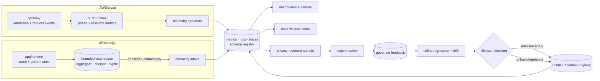
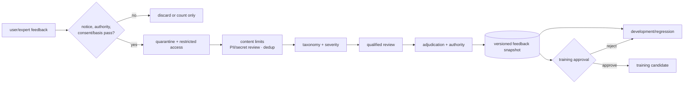
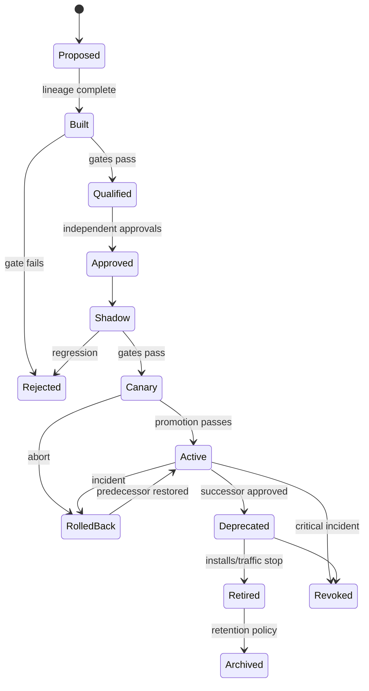

# Chapter 43 — Monitoring and Model Lifecycle

**Research cut-off:** 2026-11-23  
**Evidence status:** cited standards, papers, and official documentation are `PAPER-REPORTED` or `DOC-VERIFIED` in
§43.22. Neither label means this project reproduced a finding or exercised a service.  
**Evidence boundary:** diagrams, thresholds, and event records are illustrative. They teach an implementation contract;
they do not claim that a model, endpoint, phone cohort, canary, or rollback has been operated.

Monitoring a specialist Small Language Model (SLM) means detecting whether the exact released system still behaves,
performs, and costs as approved. Lifecycle management determines what may be built, evaluated, released, observed,
changed, rolled back, deprecated, or destroyed. Neither is equivalent to collecting logs.

This book's primary product uses no runtime Retrieval-Augmented Generation (RAG). Stale knowledge therefore cannot be
repaired by silently changing a document index. A factual update requires new data, training or adaptation, complete
evaluation, and a new release. Monitoring can reveal evidence of a problem; it cannot make learned knowledge current or
prove an unobserved answer safe.

## 43.1 Learning outcomes and invariants

After this chapter, the reader should be able to:

1. assign immutable identities to data, training, model, adapter, tokenizer, template, runtime, policy, cloud, and edge
   artifacts;
2. design observability that joins production signals to offline evidence without collecting prompts or outputs by
   default;
3. distinguish input, concept, label, prediction, and infrastructure drift;
4. detect quality, latency, crash, memory, energy, battery, thermal, and cost regressions with valid denominators;
5. release through shadow and canary stages without allowing a proxy metric to override a safety gate;
6. govern user feedback and qualified expert review without sending production text directly into training;
7. choose periodic retraining, event-triggered retraining, or controlled continual learning;
8. evaluate catastrophic forgetting and cross-domain interference;
9. execute complete-tuple cloud and edge rollback; and
10. deprecate models while preserving audit, communication, and permanently offline limitations.

The core identity invariant is:

\[ \boxed{R=(D,C,B,A,T,G,O,E,P)} \tag{EQ-CH43-01} \]

where \(D\)=dataset graph, \(C\)=training code/configuration, \(B\)=base checkpoint, \(A\)=adapter or merged weights,
\(T\)=tokenizer and chat template, \(G\)=generation/safety policy, \(O\)=runtime/container/app, \(E\)=execution
environment and compatibility cohort, and \(P\)=provenance, evaluations, approvals, and package manifest. Changing any
member creates a new release identity or separately controlled configuration revision. “The weights did not change” does
not prove behavior did not change.

Three invariants follow:

- **No orphan telemetry:** every event names an approved release and schema version.
- **No metric-only promotion:** release evidence includes offline domain, retention, safety, and compatibility gates.
- **No partial rollback:** recovery restores a qualified release tuple, not old weights with a new tokenizer or runtime.

## 43.2 Why model monitoring differs from service monitoring

An HTTP service can be healthy while its model is wrong. A model can score well offline while its endpoint is
overloaded. A mobile model can be accurate but unusable after an operating-system update increases crashes or power use.
Monitoring spans four planes:

1. **Lineage:** what exact data and software produced the artifact?
2. **Behavior:** are answers useful, factual, calibrated, safe, and retained?
3. **Serving:** is inference available, bounded, performant, and economical?
4. **Fleet:** can cloud and edge cohorts install, load, run, update, and recover?

Quality often has delayed or partial ground truth. Production prompts are not a clean benchmark, user ratings are
selection-biased, and many failures are never reported. Online metrics are indicators, not substitutes for the sealed
evaluations in
[Chapter 29](../part-08-evaluation-benchmarking-and-research-experiments/ch-29-model-quality-evaluation.md).

**TBL-CH43-01 — Signal classes and limits (`STATICALLY REVIEWED`).**

<!-- markdownlint-disable MD013 -->
| Signal           | Examples                                     | Can establish                                  | Cannot establish                       |
| ---------------- | -------------------------------------------- | ---------------------------------------------- | -------------------------------------- |
| service          | availability, errors, queue, TTFT, tokens/s  | operational behavior under observed traffic    | factual quality or safety              |
| resources        | CPU/GPU/memory/disk/network, exposed power   | capacity and efficiency symptoms               | model correctness                      |
| input metadata   | language, task, token-count/domain buckets   | population movement under declared classifiers | semantic truth or causation            |
| output metadata  | length, finish reason, refusal class         | behavioral-mix changes                         | response correctness                   |
| feedback         | rating, correction, complaint, escalation    | reported experience and candidate failures     | prevalence without sampling correction |
| delayed labels   | expert adjudication, resolved case           | quality for reviewed cases                     | all production traffic                 |
| edge diagnostics | crash/OOM, load phase, memory, thermal state | cohort reliability/performance                 | prompt content or universal behavior   |
| offline suites   | domain, safety, retention, robustness tests  | reproducible release comparison                | live prevalence without valid sampling |
<!-- markdownlint-restore -->

## 43.3 Model, data, and release versioning

### Complete model identity

Use a human-readable semantic or calendar version for communication, but immutable digests for identity. `production`,
`latest`, and `v2` are aliases, not evidence.

A release record includes:

- source checkpoint repository and immutable revision;
- final weights/adapters and SHA-256;
- tokenizer, normalizer, special-token map, chat template, and stop policy;
- quantizer/converter/pruner/merger identity and commands;
- training code commit, container digest, dependency lock, seeds, and hardware;
- dataset graph and split manifests;
- runtime/container/app digest and flags;
- API or on-device interaction schema;
- context limit, decoding defaults, safety policy, and intended use;
- offline evaluation, device, security, privacy, and license evidence;
- parent release, approvers, lifecycle state, and deprecation policy.

Semantic versioning remains policy. One convention is `MAJOR` for incompatible interface/intended-use change, `MINOR`
for a qualified behavioral update, and `PATCH` for a compatible runtime or packaging fix. Every version still maps to
one immutable manifest digest.

### Dataset versioning

A dataset is a directed graph:

```text
source snapshots
 -> extraction/OCR -> normalization -> filtering/redaction/deduplication
 -> labels/synthetic generation/expert corrections
 -> train/development/calibration/test assignment
 -> mixture weights and sampling
```

Version each node by content and transformation identity. Record source/contract ID, acquisition time, license/consent,
content hash, parser/OCR version, filter code/configuration, exclusions, deduplication clusters, annotation policy,
synthetic teacher and prompt, seed, split assignment, and row counts by risk-relevant stratum. A stable row ID may
survive benign formatting changes; the snapshot manifest changes whenever bytes, metadata, membership, labels, or
weights change.

Never mutate a published snapshot in place to honor deletion or correction. Create a successor and tombstone/correction
ledger, trace derivatives, and decide whether retraining or withdrawal is required. Test data must be isolated from
training, teacher generation, quantization calibration, prompt tuning, and analyst feedback.

**Listing CH43-L01 — Release-lineage record (`UNVERIFIED IMPLEMENTATION`).**  
**Purpose:** bind data, model, runtime, evidence, and parentage. **Format:** JSON validated by a versioned schema.
**Dependencies/hardware:** none to author; registry and signature integration remain unverified. **Expected failures:**
mutable references, missing hashes, circular parentage, or incompatible tuple. **Privacy:** never include credentials,
prompts, outputs, or personal data.

```json
{
  "schema": "slm-release-lineage/v1",
  "release_id": "auto-edge-2026-11-r7",
  "release_manifest_sha256": "7a0d20b792ac946d74f861be5cf48d8d1953f3b01de6d2e9d09249a528d241f2",
  "parent_release_id": "auto-edge-2026-10-r6",
  "lifecycle_state": "candidate",
  "data": {
    "snapshot_id": "auto-domain-2026q4-r3",
    "manifest_sha256": "1111111111111111111111111111111111111111111111111111111111111111",
    "transform_code_revision": "git:4d53d8c",
    "train_split_sha256": "2222222222222222222222222222222222222222222222222222222222222222",
    "sealed_test_sha256": "3333333333333333333333333333333333333333333333333333333333333333"
  },
  "model": {
    "base_revision": "registry:base/auto-small@8b7612e",
    "adapter_sha256": "4444444444444444444444444444444444444444444444444444444444444444",
    "final_artifact_sha256": "5555555555555555555555555555555555555555555555555555555555555555",
    "tokenizer_sha256": "6666666666666666666666666666666666666666666666666666666666666666",
    "chat_template_sha256": "7777777777777777777777777777777777777777777777777777777777777777"
  },
  "build": {
    "code_revision": "git:9c2f7a1",
    "container_digest": "sha256:8888888888888888888888888888888888888888888888888888888888888888",
    "training_run_id": "train-auto-2026q4-seed1729",
    "seed": 1729
  },
  "deployment": {
    "runtime_digest": "sha256:9999999999999999999999999999999999999999999999999999999999999999",
    "policy_sha256": "aaaaaaaaaaaaaaaaaaaaaaaaaaaaaaaaaaaaaaaaaaaaaaaaaaaaaaaaaaaaaaaa",
    "platform": "android",
    "cohort": "arm64-midrange-qualified"
  },
  "evidence": {
    "quality_report_sha256": "bbbbbbbbbbbbbbbbbbbbbbbbbbbbbbbbbbbbbbbbbbbbbbbbbbbbbbbbbbbbbbbb",
    "retention_report_sha256": "cccccccccccccccccccccccccccccccccccccccccccccccccccccccccccccccc",
    "safety_report_sha256": "dddddddddddddddddddddddddddddddddddddddddddddddddddddddddddddddd",
    "performance_report_sha256": "eeeeeeeeeeeeeeeeeeeeeeeeeeeeeeeeeeeeeeeeeeeeeeeeeeeeeeeeeeeeeeee"
  },
  "approvals": []
}
```

DVC, lakehouse formats, object-store versioning, experiment trackers, and model registries can implement parts of this
graph. None replaces source rights, sealed-test isolation, or a signed release manifest. Export registry metadata to
avoid vendor lock-in.

## 43.4 Reference observability architecture

**FIG-CH43-01 — Cloud and offline-edge observability (`ILLUSTRATIVE`).**  
_Alt text:_ Cloud and mobile sources emit bounded operational data. Release metadata joins monitoring, alerts, expert <!-- markdownlint-disable-line MD013 MD049 -->
review, offline evaluation, and lifecycle decisions. User content is absent from the default path.



Separate the telemetry data plane, release control plane, evaluation plane, and training plane. Only separately
approved, versioned feedback may enter training.

Use OpenTelemetry or another vendor-neutral semantic layer where feasible, bounded-cardinality metrics, and a controlled
log/trace backend. On AWS, CloudWatch can receive application/host metrics while CloudTrail records control-plane
actions; neither replaces model events. Request, user, prompt, artifact-path, and device identifiers do not belong in
metric labels.

### Four concrete event flows

The following flows show how raw events become decisions. Values are illustrative, not production thresholds.

#### Flow A: a slow cloud answer

1. The gateway emits `request.accepted` for release `auto-cloud-r7`, workload bucket `257-1024` input tokens.
2. The scheduler emits `queue.completed` with 820 ms queue time.
3. The runtime emits `prefill.completed` at 95 tokens/s and `generation.completed` with 410 ms model-side TTFT.
4. The gateway emits `response.completed` with 1,270 ms client-visible TTFT.
5. The metrics pipeline joins events by random request ID, then discards that high-cardinality ID after aggregation.
6. The dashboard shows that model prefill is stable but queue time rose after offered load increased.
7. The capacity runbook adds a replica or tightens admission; it does not retrain the model.

This flow prevents a common mistake: blaming weights for queueing. Client TTFT is approximately gateway overhead plus
queue plus prefill-to-first-token time, so phase events identify the responsible term.

#### Flow B: an Android crash after an update

1. The app records `model.activation.succeeded` for release `auto-edge-r12`.
2. During prefill, the process exits under memory pressure. On next launch, the app records a coarse
   `inference.terminated` event: release, app build, OS/device cohort, phase `prefill`, and class `memory`.
3. The local crash-loop counter reaches two; without waiting for a network, the app atomically activates signed
   predecessor `r11` and records `rollback.local.succeeded`.
4. With consent and connectivity, the bounded queue uploads those metadata events—never the prompt, output, token IDs,
   file paths, or memory contents.
5. Fleet aggregation calculates 18 crash sessions among 1,240 eligible sessions:

\[
\mathrm{CrashSessionRate}=\frac{18}{1240}=0.0145=1.45\%.
\]

1. The cohort-specific rollout stops while other unaffected cohorts remain unchanged. A lab reproduction compares peak
   memory for `r11` and `r12`; only that controlled test supports a memory-regression diagnosis.

#### Flow C: a new failure pattern in user feedback

1. A technician reports that the model confuses two similar fault codes. The operational system records a category and
   release ID; conversation donation is a separate explicit choice.
2. Authorized content enters restricted quarantine, passes privacy and rights review, and receives a scenario-family
   ID.
3. Two qualified reviewers independently label applicability, severity, correct next action, and supporting authority;
   disagreement goes to adjudication.
4. The case joins a versioned feedback snapshot and a development regression set—not the sealed test and not training.
5. Analysts search for related cases in an independently sampled frame. If the pattern is confirmed, they create a
   retraining proposal with a failure hypothesis.
6. Any corrected examples enter a new training snapshot only after separate admission. The successor model must still
   pass the untouched confirmation suite.

One complaint can reveal a serious bug, but it cannot estimate prevalence by itself.

#### Flow D: knowledge freshness without production-content logging

1. The source inventory reports that an authoritative service procedure used by dataset `auto-2026q3` has a newer
   revision.
2. Descendant tracing identifies releases trained from the older snapshot.
3. A domain expert determines whether the change affects intended use. A spelling correction closes with no model
   action; a changed high-voltage isolation procedure opens a critical review.
4. Curated probes and the sealed applicable slice test the active release. Monitoring records result IDs and verdicts,
   not production conversations.
5. Release authority may restrict scope immediately. The data team creates a successor snapshot, and the normal
   training, evaluation, target qualification, signing, and rollout path follows.

Because this system has no runtime RAG, updating a source inventory never changes answers silently. It creates evidence
for a controlled lifecycle decision.

## 43.5 Metric and event schemas

Safe dimensions include release, runtime, platform, app build, bounded device cohort, region, route, phase, status/error
class, token-count bucket, domain/language bucket, and experiment arm. Do not use raw request/user/device IDs, IPs,
prompt fragments, output text, stack traces, or unrestricted exceptions as labels.

**TBL-CH43-02 — Minimum metric dictionary (`STATICALLY REVIEWED`).**

<!-- markdownlint-disable MD013 -->
| Metric                           | Type/unit   | Segmentation                             | Use                         |
| -------------------------------- | ----------- | ---------------------------------------- | --------------------------- |
| `inference_requests_total`       | counter     | release, route, status, cohort           | traffic/failure denominator |
| `inference_duration_seconds`     | histogram   | release, I/O buckets                     | end-to-end tails            |
| `inference_ttft_seconds`         | histogram   | release, prompt bucket, cohort           | interaction regression      |
| `prefill_tokens_per_second`      | histogram   | release, prompt bucket, backend          | phase diagnosis             |
| `decode_tokens_per_second`       | histogram   | release, context/output bucket           | decode regression           |
| `queue_duration_seconds`         | histogram   | release, region                          | capacity diagnosis          |
| `runtime_oom_total`              | counter     | release, phase, cohort                   | reliability gate            |
| `model_load_seconds`             | histogram   | release, cold/warm, cohort               | load/update gate            |
| `model_load_failures_total`      | counter     | release, error, cohort                   | rollback trigger            |
| `quality_review_outcome_total`   | counter     | release, rubric, severity, frame         | delayed quality             |
| `feedback_total`                 | counter     | release, channel, category               | feedback operations         |
| `mobile_crash_sessions_total`    | counter     | release, app/OS/device cohort, signature | stability numerator         |
| `mobile_sessions_total`          | counter     | same cohort dimensions                   | denominator                 |
| `thermal_state_duration_seconds` | histogram   | release, cohort, state                   | sustained edge health       |
| `deployment_state`               | gauge/event | release, environment, arm                | rollout correctness         |
<!-- markdownlint-restore -->

**Listing CH43-L02 — Privacy-minimized event (`UNVERIFIED IMPLEMENTATION`).**  
**Purpose:** a joinable cloud/edge envelope. **Dependencies:** a selected schema registry and platform SDK. **Expected
failures:** skew, duplicate delivery, offline backlog, unknown schema, consent withdrawal, cardinality breach.
**Privacy:** excludes content, credentials, raw IP, stable advertising/device IDs, and personal identifiers.

```json
{
  "schema": "slm-observability-event/v1",
  "event_id": "7fcad3bc-8b71-497d-9578-3c95fa54a920",
  "occurred_utc": "2026-11-23T14:05:12Z",
  "monotonic_ns": 481229004551,
  "event_type": "inference.completed",
  "release": {
    "release_id": "auto-edge-2026-11-r7",
    "runtime_revision": "llama.cpp@8e4d2ab",
    "app_build": "android-214"
  },
  "execution": {
    "platform": "aws|android|ios|linux",
    "region_or_device_cohort": "arm64-midrange-v1",
    "backend": "cpu-neon",
    "experiment_arm": "control|shadow|canary|stable"
  },
  "workload": {
    "domain_bucket": "automotive",
    "language_bucket": "en",
    "input_token_bucket": "257-1024",
    "output_token_bucket": "65-256"
  },
  "outcome": {
    "status": "success|rejected|cancelled|timeout|crash|oom",
    "error_class": null,
    "finish_reason": "stop",
    "duration_ms_bucket": "1000-1999",
    "ttft_ms_bucket": "250-499"
  },
  "privacy": {
    "content_captured": false,
    "consent_policy": "operational-v1",
    "retention_class": "short"
  }
}
```

Use at-least-once delivery with random-event deduplication. Keep high-resolution benchmark traces in experiment storage,
not routine fleet telemetry.

## 43.6 Inference and cloud resource monitoring

Connect user-visible service indicators to scheduler and hardware symptoms:

- accepted/rejected requests, policy rejections, cancellation, timeout, and stream termination;
- queue depth/time, active sequences, batch occupancy, and cache pressure;
- TTFT, prefill, inter-token latency, decode, and end-to-end duration;
- token/context distributions and finish reason;
- model-load phases, readiness, restarts, OOM, and incorrect version;
- CPU, host memory, disk, network, GPU utilization/memory/power/temperature where exposed;
- desired/running/queued replicas, placement failures, autoscaling, and cold start;
- allocated cost per request/token and observability volume;
- control-plane deployment, role, key, registry, and configuration changes.

Segment latency by prompt/output/context buckets; one p95 hides workload movement. Publish counts with percentiles.
Measure with monotonic clocks and distinguish client-visible TTFT from server first-token time.

Define service-level indicators for correct-version rate, bounded errors, TTFT, stalled streams, OOM, and rollback
readiness. Quality and safety remain separate gates because labels arrive later.

High GPU utilization can be healthy; low utilization can mean idle capacity or starvation. Alert on user impact plus
sustained resource pressure. GPU metrics may require an exporter such as NVIDIA DCGM and qualification for the exact
stack.

## 43.7 Drift detection

Let reference data follow \(P_0(X,Y)\) and current data \(P_t(X,Y)\), where \(X\) is observable input/metadata and \(Y\)
is desired outcome.

- **Covariate drift:** \(P_t(X)\ne P_0(X)\).
- **Label/prior drift:** \(P_t(Y)\ne P_0(Y)\).
- **Concept drift:** \(P_t(Y\mid X)\ne P_0(Y\mid X)\).
- **Prediction drift:** output, refusal, length, or score distribution changes.
- **Operational drift:** runtime, hardware, OS, policy, or traffic conditions change.
- **Data-quality drift:** missingness, parse failure, duplication, schema, language, or unit distribution changes.

Telemetry normally observes privacy-minimized features of \(X\), not \(Y\). It can detect a changed distribution but
cannot prove concept drift or degradation. More long prompts may explain slower TTFT without a runtime regression.

For categorical distributions, Population Stability Index is:

\[ \mathrm{PSI}=\sum_{i=1}^{k}(p_i-q_i)\ln\frac{p_i}{q_i}, \tag{EQ-CH43-02} \]

where \(p_i,q_i\) are reference/current proportions. Zero bins require declared smoothing. PSI thresholds are
conventions, not universal guarantees.

For empirical one-dimensional distributions \(F_0,F_t\), the Kolmogorov–Smirnov statistic is:

\[ D_{KS}=\sup_x|F_0(x)-F_t(x)|. \tag{EQ-CH43-03} \]

Large samples flag negligible change; repeated tests inflate false alarms; dependent observations violate simple
assumptions. Report effect, uncertainty, sample size, window, and multiplicity. Classifier two-sample or representation
tests can help with multivariate shift (`PAPER-REPORTED`), but representations may encode private content.

Process:

1. freeze a representative reference window and feature contract;
2. monitor interpretable privacy-safe features by domain, language, task, token length, runtime, region, and cohort;
3. use minimum samples, effect thresholds, persistence, and multiple-test control;
4. investigate collection/routing changes first;
5. obtain delayed labels through a governed sample;
6. rerun offline quality, safety, robustness, and retention;
7. retrain only when evidence and expected benefit justify it.

A drift alarm must never automatically retrain.

## 43.8 Quality regression

A quality regression is a material decline against an approved baseline under the same evaluation contract. It may come
from weights, quantization, tokenizer/template, decoding, policy, precision, truncation, traffic mix, or stale
knowledge.

Use:

1. frozen domain, factuality, diagnostic, calibration, robustness, multi-turn, refusal, safety, and retention suites;
2. non-sensitive synthetic probes for rendering, stops, schema, and invariants;
3. shadow comparisons without user exposure;
4. privacy-approved stratified production sampling;
5. expert labels, resolved cases, and authoritative corrections;
6. complaint/correction/escalation indicators, treated as biased signals.

For higher-is-better quality:

\[ \Delta q=q_c-q_b. \tag{EQ-CH43-04} \]

Use paired cases and intervals. A non-inferiority gate requires the lower confidence bound of \(\Delta q\) to exceed
predeclared \(-\delta\). A safety-critical failure is non-compensatory.

Online “hallucination rate” is unavailable without ground truth. Do not relabel heuristic disagreement or a model-judge
score as factual error unless validated for that domain and severity.

## 43.9 Privacy-safe mobile crash reporting

Offline inference does not mean zero telemetry; it means inference requires no connection. Optional or operational
diagnostics still need an applicable policy, notice, consent or other valid basis, and collection-disabled operation.

Collect only:

- app build, release ID, runtime revision, OS and bounded device cohort;
- crash/OOM/termination class and phase: download, verify, load, prefill, decode, render, background;
- symbolicated signature from app/runtime frames;
- memory/thermal bucket and prior lifecycle transition;
- rollback and next-launch recovery outcome;
- random event ID and coarse time.

Do not collect prompts, outputs, token IDs, conversation history, model bytes, local filenames, user text, contacts,
clipboard, stable advertising ID, exact location, or raw exception strings. Native tombstones can contain paths,
registers, or memory fragments; symbolize and filter in a restricted pipeline.

Android vitals and `ApplicationExitInfo` and Apple MetricKit provide documented stability/diagnostic capabilities.
Third-party crash SDKs add processors, identifiers, and transfer paths requiring separate review. Documentation does not
prove a particular integration compliant.

\[ \mathrm{CrashFreeSessionRate} =1-\frac{N_{\text{sessions with crash}}}{N_{\text{eligible sessions}}}.
\tag{EQ-CH43-05} \]

Define session, eligibility, deduplication, delayed upload, and offline missingness. Unuploaded crashes make estimates
incomplete. A crash loop must trigger local safe start or a qualified predecessor without waiting for telemetry.

## 43.10 Battery and performance regression

Fleet telemetry identifies symptoms; controlled experiments establish battery/energy regression. Battery percentage is
too coarse for short tests and energy attribution is boundary-specific.

Follow
[Chapter 31](../part-08-evaluation-benchmarking-and-research-experiments/ch-31-compression-and-edge-benchmarking.md):

- exact device, OS, runtime, app, model, ambient, charge, radios/display, and background policy;
- cold/warm load, TTFT, prefill, decode, E2E, memory, crash/OOM;
- sustained generation with early/late windows;
- thermal state/sensors and clocks where available;
- calibrated energy or clearly named proxy/boundary;
- randomized/blocked trials with all failures.

For a lower-is-better metric:

\[ \rho_m=\frac{m_c}{m_b}. \tag{EQ-CH43-06} \]

`ILLUSTRATIVE`: controlled median TTFT changing from 420 ms to 470 ms yields \(\rho=1.119\), an 11.9% increase. This is
not a project result and is insufficient without uncertainty, tails, workload, and failures.

Fleet events should be sampled and bucketed. Continuous profiling drains battery and changes what is measured. Bound
local bytes, upload attempts, and retention; upload according to user and platform policy.

## 43.11 Alert policies

An alert names owner, severity, query, population, threshold, persistence, minimum count, runbook, suppression, and
recovery. Dashboard color is not policy.

Use fast-burn, slow-burn, release-comparison, and cohort windows. Alert on missing telemetry: a release is not perfect
because events stopped.

**TBL-CH43-03 — Filled alert examples (`ILLUSTRATIVE`; values require local calibration).**

| Alert           | Condition                               | Automatic action            | Human action              |
| --------------- | --------------------------------------- | --------------------------- | ------------------------- |
| wrong release   | unknown/mixed tuple observed            | stop promotion              | verify deployment         |
| critical safety | one adjudicated blocking failure        | halt/rollback               | safety incident review    |
| canary errors   | error-rate difference >1 point for 15 min, n≥1,000 | stop shift              | phase triage              |
| latency         | matched p95 ratio >1.15 for 15 min, n≥1,000       | pause canary            | queue/runtime triage      |
| OOM/load crash  | cohort session rate >1%, n≥500                    | stop rollout/rollback   | memory investigation     |
| drift           | PSI >0.20 for three daily windows, n≥2,000        | no automatic retraining | validate and label sample |
| crash loop      | repeated load crashes by release/cohort | signed local predecessor    | symbol review             |
| cost/capacity   | budget or queue burn exceeded           | bounded safe control        | capacity/abuse review     |
| telemetry loss  | completeness falls                      | freeze risky promotion      | repair instrumentation    |

## 43.12 Shadow and canary deployment

### Shadow

A shadow receives a duplicate request, but only the control response reaches the user. It tests realistic load and
paired candidate output without candidate authority.

Controls: privacy authorization; deterministic sampling; failure/latency isolation; no duplicated side effects; bounded
capacity; kill switch; non-identifying pair ID; approved retention; validated scoring; matched buckets.

Shadowing cannot measure user reaction and exposes content to another system. Cloud shadowing violates local-only
expectations if edge prompts leave a device. For edge, prefer opt-in dual runs on lab/managed devices using synthetic or
authorized replay. Dual inference can double memory, heat, and battery work.

### Canary

A canary serves real candidate output to limited eligible users. Begin only after offline and shadow gates pass.
Assignment must be sticky within conversations and never mix session/KV state across releases.

`ILLUSTRATIVE`, not recommended percentages:

```text
candidate -> internal -> shadow -> 1% -> 5% -> 25% -> 100%
```

Gate each step on samples, duration, request mix, errors, quality indicators, feedback, resources, and tested rollback.
Rare safety failures may never occur in a small canary; offline expert gates remain.

For mobile, canary means signed channel/device eligibility. Control for OS/device/app adoption delay. A model may remain
offline after rollout stops, so local health checks, qualified predecessor, and reconnection-aware revocation are
mandatory.

## 43.13 Feedback governance

Feedback is a governed dataset, not a button count. Channels include ratings, categories, corrections, support
escalation, expert annotation, task outcome, and opt-in conversation donation. Each has different bias.

**FIG-CH43-02 — Feedback flow (`ILLUSTRATIVE`).**  
_Alt text:_ Feedback passes consent, quarantine, privacy/security checks, triage, independent review, and adjudication <!-- markdownlint-disable-line MD013 MD049 -->
before evaluation or separately approved training admission.



Record random ID, release, channel/time bucket, locale/domain/task/risk, sampling frame, rating/category, consent state,
restricted content location if authorized, provenance/rights/retention/deletion, training eligibility,
reviewer/rubric/adjudication, authority/correction date, and links to issues/tests/successors.

Never automatically train on corrections. They can be wrong, malicious, copyrighted, private, duplicated, or out of
scope. Keep operational feedback, evaluation evidence, and training admission separate. Do not train on a case and
retain it as untouched test.

Voluntary ratings do not estimate population quality without assumptions. Report response rate and sampling mechanism.

## 43.14 Human expert review

Experts are required where correctness depends on professional scope, revision, jurisdiction, or consequence. “Human in
the loop” is meaningless without qualifications, rubric, independence, workload, and authority.

1. define intended use and severity;
2. assign qualifications by domain/dimension;
3. blind release identity where feasible;
4. sample by prevalence plus rare hazards;
5. use independent review and adjudication for critical cases;
6. record authority, revision, applicability, disagreement, and uncertainty;
7. time-box queues and escalate critical reports;
8. audit conflicts and reviewer drift.

Pharmacy requires qualified clinical/regulatory review and no autonomous prescribing or dosage change. Repair review
covers applicability, lockout, lifting, pressure, high voltage, and stored energy. Animal care requires species,
welfare, region, veterinary, and regulatory context.

Prioritize critical reports, disagreement, novel clusters, drift strata, representative random samples, and
candidate/control differences. A model judge may triage only after expert validation and is never sole critical
authority.

## 43.15 Retraining policy

Retraining needs a hypothesis, not merely a calendar.

- **Periodic:** predictable and catches accumulated updates, but may waste compute or regress a stable model.
- **Event-triggered:** follows authoritative change, labeled regression, quality-relevant drift, new scope, remediation,
  or enough governed data; it depends on reliable labels.
- **Hybrid:** periodic review with training only when entry criteria pass; recommended starting point.

Every cycle:

1. state failure/capability hypothesis;
2. create a new data snapshot and correction/deletion ledger;
3. preserve sealed confirmation and add known-failure regression tests honestly;
4. choose CPT, SFT, preference optimization, replay, adapter update, or full training based on evidence;
5. freeze base, code, config, seed, hardware, and environment;
6. compare with the approved release using paired tests;
7. evaluate domain, retention, safety, privacy, calibration, edge export, and operations;
8. repeat expert, compatibility, signing, shadow, canary, and rollback gates;
9. publish a new release; never mutate the old one;
10. retain failed runs and negative results.

Cadence is domain-dependent. Current pharmaceutical or regulated technical changes may require urgent review; stable
fundamentals may not. No universal cadence is established.

## 43.16 Continual learning and forgetting

Continual learning updates a model over sequential tasks/distributions while retaining earlier capability. Naive
sequential fine-tuning can cause catastrophic forgetting.

Let \(a_{i,j}\) be performance on task \(j\) after learning through task \(i\). After \(T\) tasks:

\[ F_j=\max_{i<T}a_{i,j}-a_{T,j},\qquad \bar F=\frac{1}{T-1}\sum_{j=1}^{T-1}F_j. \tag{EQ-CH43-07} \]

Higher \(F_j\) means more loss. Results depend on task order, metric direction, checkpoint, and suite; report per-task
and safety failures.

Mitigations:

- **replay:** mix approved old examples; effective but adds storage, rights, privacy, and mixture issues;
- **regularization:** constrain important parameters, e.g. EWC; assumptions may not transfer to generative SLMs;
- **parameter isolation:** domain adapters/modules; less interference but more routing/storage complexity;
- **distillation:** preserve old outputs/logits; can preserve errors;
- **small learning rate/early stop/balanced mixture:** useful, not guarantees;
- **joint retraining:** expensive but often easier to validate than online updates.

Do not autonomously update weights from production interactions. Start with offline batches, independent evaluation, and
adapters where isolation helps. Continual learning is advanced practical, not default.

Evaluate old specialist domains, rare hazards, general capabilities, uncertainty/refusal/escalation/privacy,
tokenizer/edge parity, cross-domain confusion, and intentionally superseded versus still-valid facts. Use multiple task
orders and seeds where feasible.

## 43.17 Lifecycle state machine

**FIG-CH43-03 — Lifecycle (`ILLUSTRATIVE`).**  
_Alt text:_ Artifacts progress from proposal to build, qualification, approval, shadow, canary, active use, deprecation, <!-- markdownlint-disable-line MD013 MD049 -->
retirement, or revocation, with rollback to a qualified predecessor.



`Built` has no deployment authority. `Qualified` passed exact-tuple gates. `Approved` has accountable authorization.
`Shadow` has no user authority. `Canary` has bounded exposure. `Deprecated` remains temporarily supported; `Retired`
accepts no new use; `Revoked` is blocked because continued use is unacceptable. Only release authority changes state.
Registry, traffic, mobile eligibility, and documentation discrepancies are incidents.

## 43.18 Release and rollback runbooks

### Release

1. Freeze EQ-CH43-01 and verify signed lineage.
2. Confirm rights, corrections/deletions, and test isolation.
3. Pass domain, retention, calibration, robustness, privacy, and safety gates.
4. Pass source/final-artifact parity and exact compatibility.
5. Pass cloud load/cost or device memory/crash/latency/energy/thermal gates.
6. Confirm dashboards, schemas, alerts, owners, and telemetry-loss alarm.
7. Rehearse and retain the loadable known-good predecessor.
8. Approve independently and sign immutable release/evidence.
9. Run shadow and investigate paired differences.
10. Run sticky canary with declared stop conditions.
11. Promote stepwise; preserve control/predecessor through observation.
12. Publish version, cutoff, intended-use changes, and deprecation clock.

### Cloud rollback

1. declare incident, freeze promotion, and preserve evidence;
2. stop candidate traffic;
3. restore model, tokenizer, template, runtime image, flags, API, and policy;
4. drain candidate sessions without state reuse;
5. verify correct version, readiness, probes, errors, and latency;
6. identify affected cohorts under privacy policy;
7. communicate impact;
8. perform root-cause analysis and issue a corrected new identity.

### Edge rollback

1. stop new download/activation;
2. atomically activate only the signed qualified predecessor allowed by policy;
3. keep partial/candidate bytes non-loadable;
4. verify cold load and a non-sensitive smoke test;
5. upload a minimized rollback event only when permitted;
6. publish a higher-sequence repair/rollback manifest;
7. state that permanently offline devices cannot receive immediate revocation;
8. use app-store/MDM channels for urgent runtime fixes.

Rollback does not cure corrupted user state, leaked data, or signer compromise; use
[Chapter 42](ch-42-model-security-and-reliability.md).

## 43.19 Deprecation and retirement

Deprecation is a managed transition, not deletion. Triggers include a qualified successor, excessive knowledge
staleness, ended OS/runtime support, license expiry, unpatchable vulnerability, unacceptable reliability, or
intended-use change.

The plan states affected releases/cohorts, reason/risk/owner, announcement and end dates, successor/migration,
post-retirement behavior, rollback exception, evidence/data retention/deletion, offline limitations, and
support/regulatory communication.

Never silently route a deprecated specialist model to a generic model or remote teacher. That changes behavior, privacy,
cost, availability, and architecture. Explicit unavailability is safer than an unqualified fallback.

Retain enough artifact/environment evidence to investigate incidents, but not personal feedback indefinitely. Retirement
removes traffic, download entitlement, promotion authority, capacity, secrets, and stale aliases while preserving
required audit and recovery assets.

## 43.20 Domain, AWS, and offline-edge implications

- **Automotive/industrial:** track vehicle/product/revision strata, code/units, test ordering, and hazardous-energy
  prerequisites; one invented specification can block release.
- **Pharmacy:** monitor drug/formulation/route/population/jurisdiction/update strata; qualified review and escalation
  are mandatory; the model is not an autonomous prescriber.
- **Beekeeping/zookeeping:** monitor species, season, climate, region, welfare, treatment legality, and professional
  escalation; low volume makes uncertainty wide.
- **Multi-domain systems:** monitor each domain and router/adapter selection; averages can hide one forgotten domain.

AWS centralizes traffic shifting, metrics, resource telemetry, and revocation but concentrates content and credentials.
Edge preserves offline availability and local prompts but fragments cohorts, delays telemetry, and cannot guarantee
revocation while disconnected. Do not require telemetry, login, or cloud fallback for an already installed offline model
unless an explicit managed-fleet policy says otherwise.

## 43.21 Validation and exercises

**TBL-CH43-04 — Validation matrix (`PLANNED EXPERIMENT`).**

| Area        | Test                                              | Blocking result                          |
| ----------- | ------------------------------------------------- | ---------------------------------------- |
| identity    | mutate model/tokenizer/runtime/data reference     | mixed tuple accepted                     |
| schema      | unknown field/version, oversized event, duplicate | fail-open/cardinality explosion          |
| privacy     | inspect payloads, crashes, retention/deletion     | content/identifier captured by default   |
| drift       | known shift and no-shift windows                  | missed shift or automatic retraining     |
| quality     | rare critical regression with stable mean         | average hides failure                    |
| cloud       | load, OOM, restart, scaling, telemetry loss       | alert/runbook fails                      |
| mobile      | crash loop, OOM, offline backlog, low disk        | candidate remains active/unbounded queue |
| performance | matched controlled device trials                  | unqualified battery/energy claim         |
| feedback    | malicious correction, PII, deletion, leakage      | direct training admission                |
| continual   | task orders, replay ablation, retention           | mean hides unsafe forgetting             |
| rollout     | shadow isolation, sticky canary, rollback         | user impact/partial rollback             |
| deprecation | stale/offline client, aliases                     | silent fallback/new installs             |

### Review questions

1. Why is a release tuple larger than weights?
2. Distinguish alias and immutable identity.
3. What must a dataset snapshot preserve besides rows?
4. Why can input drift occur without quality regression?
5. Distinguish covariate, label, concept, prediction, and operational drift.
6. Why is a drift alarm not a retraining command?
7. Why can a healthy endpoint be a failed model service?
8. Which dimensions create cardinality/privacy risk?
9. Why is voluntary feedback not prevalence?
10. What makes expert review reproducible?
11. Distinguish shadow and canary exposure.
12. Why is fleet battery telemetry weaker than controlled energy testing?
13. Define catastrophic forgetting and a limitation of EQ-CH43-07.
14. Why restore a complete tuple?
15. What cannot be revoked on a permanently offline device?

### Engineering exercises

1. Implement a JSON Schema for CH43-L01; reject mutable identities.
2. Build an automotive dataset graph with deduplication, corrections, deletion, and sealed-test isolation.
3. Implement CH43-L02 with an allowlist serializer and prove content cannot emit.
4. Design bounded-cardinality metrics and calculate worst-case series count.
5. Inject token, language, and cohort shifts; compare PSI, KS, and a classifier test.
6. Seed a rare critical regression that leaves average quality unchanged.
7. Shadow synthetic authorized traffic and prove candidate isolation.
8. Canary a wrong tokenizer in nonproduction and exercise complete rollback.
9. Audit Android/iOS crash payloads for text, IDs, paths, and memory fragments.
10. Execute paired Chapter 31 device trials and report the energy boundary.
11. Build feedback consent, quarantine, review, deletion, and training admission.
12. Compare periodic/event retraining for pharmacy and beekeeping.
13. Adapt a toy model sequentially to three domains; report order/seed forgetting.
14. Drill cloud and offline rollback during telemetry outage.
15. Write deprecation policy with no silent cloud/generic fallback.

## 43.22 Sources

Sources were accessed or recency-checked for the stated cut-off. `DOC-VERIFIED` verifies documentation, not execution;
`PAPER-REPORTED` does not establish applicability here.

### Lifecycle, lineage, observability, and AWS

1. **NIST.** [AI RMF 1.0](https://www.nist.gov/itl/ai-risk-management-framework) and
   [Generative AI Profile, AI 600-1](https://doi.org/10.6028/NIST.AI.600-1). `DOC-VERIFIED`.
2. **NIST.** [SSDF, SP 800-218](https://csrc.nist.gov/pubs/sp/800/218/final). `DOC-VERIFIED`.
3. **D. Sculley et al. (2015).** “Hidden Technical Debt in Machine Learning Systems.” _NeurIPS_. <!-- markdownlint-disable-line MD013 MD049 -->
   [Proceedings](https://papers.nips.cc/paper/5656-hidden-technical-debt-in-machine-learning-systems). `PAPER-REPORTED`.
4. **Margaret Mitchell et al. (2019).** “Model Cards for Model Reporting.” \*FAT\*\*. DOI
   [10.1145/3287560.3287596](https://doi.org/10.1145/3287560.3287596). `PAPER-REPORTED`.
5. **Timnit Gebru et al. (2021).** “Datasheets for Datasets.” _CACM_ 64(12). DOI <!-- markdownlint-disable-line MD013 MD049 -->
   [10.1145/3458723](https://doi.org/10.1145/3458723). `PAPER-REPORTED`.
6. **MLflow.** [Model Registry](https://mlflow.org/docs/latest/ml/model-registry/). `DOC-VERIFIED`.
7. **DVC.** [Data/model versioning](https://dvc.org/doc/use-cases/versioning-data-and-model-files). `DOC-VERIFIED`.
8. **OpenTelemetry.** [Specification](https://opentelemetry.io/docs/specs/otel/). `DOC-VERIFIED`.
9. **Prometheus.** [Instrumentation](https://prometheus.io/docs/practices/instrumentation/) and
   [alerting rules](https://prometheus.io/docs/prometheus/latest/configuration/alerting_rules/). `DOC-VERIFIED`.
10. **Google.** [Monitoring Distributed Systems](https://sre.google/sre-book/monitoring-distributed-systems/) and
    [Alerting on SLOs](https://sre.google/workbook/alerting-on-slos/). `DOC-VERIFIED`.
11. **AWS.**
    [CloudWatch concepts](https://docs.aws.amazon.com/AmazonCloudWatch/latest/monitoring/cloudwatch_concepts.html),
    [alarms](https://docs.aws.amazon.com/AmazonCloudWatch/latest/monitoring/AlarmThatSendsEmail.html),
    [NVIDIA GPU metrics](https://docs.aws.amazon.com/AmazonCloudWatch/latest/monitoring/CloudWatch-Agent-NVIDIA-GPU.html),
    and [CloudTrail](https://docs.aws.amazon.com/awscloudtrail/latest/userguide/cloudtrail-user-guide.html).
    `DOC-VERIFIED`.
12. **AWS SageMaker AI.** [Model Registry](https://docs.aws.amazon.com/sagemaker/latest/dg/model-registry.html),
    [Model Monitor](https://docs.aws.amazon.com/sagemaker/latest/dg/model-monitor.html), and
    [deployment guardrails](https://docs.aws.amazon.com/sagemaker/latest/dg/deployment-guardrails.html). `DOC-VERIFIED`;
    recheck Region/support.

### Drift research

1. **João Gama et al. (2014).** “A Survey on Concept Drift Adaptation.” _ACM Computing Surveys_ 46(4). DOI <!-- markdownlint-disable-line MD013 MD049 -->
   [10.1145/2523813](https://doi.org/10.1145/2523813). `PAPER-REPORTED`.
2. **Zachary C. Lipton, Yu-Xiang Wang, and Alexander J. Smola (2018).** “Detecting and Correcting for Label Shift with
   Black Box Predictors.” _ICML_. [PMLR](https://proceedings.mlr.press/v80/lipton18a.html). `PAPER-REPORTED`. <!-- markdownlint-disable-line MD013 MD049 -->
3. **Stephan Rabanser, Stephan Günnemann, and Zachary Lipton (2019).** “Failing Loudly.” _NeurIPS_. <!-- markdownlint-disable-line MD013 MD049 -->
   [Proceedings](https://proceedings.neurips.cc/paper/2019/hash/846c260d715e5b854ffad5f70a516c88-Abstract.html).
   `PAPER-REPORTED`.
4. **Arthur Gretton et al. (2012).** “A Kernel Two-Sample Test.” _JMLR_ 13. <!-- markdownlint-disable-line MD013 MD049 -->
   [JMLR](https://jmlr.org/papers/v13/gretton12a.html). `PAPER-REPORTED`.
5. **Jie Lu et al. (2019).** “Learning under Concept Drift: A Review.” _IEEE TKDE_ 31(12). DOI <!-- markdownlint-disable-line MD013 MD049 -->
   [10.1109/TKDE.2018.2876857](https://doi.org/10.1109/TKDE.2018.2876857). `PAPER-REPORTED`.

### Mobile and privacy

1. **Android Developers.** [Android vitals](https://developer.android.com/topic/performance/vitals),
   [`ApplicationExitInfo`](https://developer.android.com/reference/android/app/ApplicationExitInfo),
   [performance](https://developer.android.com/topic/performance), and
   [privacy/security](https://developer.android.com/privacy-and-security/about). `DOC-VERIFIED`.
2. **Apple Developer.** [MetricKit](https://developer.apple.com/documentation/metrickit),
   [`MXCrashDiagnostic`](https://developer.apple.com/documentation/metrickit/mxcrashdiagnostic), and
   [app responsiveness](https://developer.apple.com/documentation/xcode/improving-app-responsiveness). `DOC-VERIFIED`.
3. **European Union.** [GDPR, Regulation 2016/679](https://eur-lex.europa.eu/eli/reg/2016/679/oj). Primary law;
   application requires accountable review.

### Continual learning

1. **James Kirkpatrick et al. (2017).** “Overcoming Catastrophic Forgetting in Neural Networks.” _PNAS_ 114(13). DOI <!-- markdownlint-disable-line MD013 MD049 -->
   [10.1073/pnas.1611835114](https://doi.org/10.1073/pnas.1611835114). `PAPER-REPORTED`.
2. **David Lopez-Paz and Marc'Aurelio Ranzato (2017).** “Gradient Episodic Memory for Continual Learning.” _NeurIPS_. <!-- markdownlint-disable-line MD013 MD049 -->
   [Proceedings](https://proceedings.neurips.cc/paper/2017/hash/f87522788a2be2d171666752f97ddebb-Abstract.html).
   `PAPER-REPORTED`.
3. **Matthias De Lange et al. (2022).** “A Continual Learning Survey.” _IEEE TPAMI_ 44(7). DOI <!-- markdownlint-disable-line MD013 MD049 -->
   [10.1109/TPAMI.2021.3057446](https://doi.org/10.1109/TPAMI.2021.3057446). Primarily classification evidence.
   `PAPER-REPORTED`.
4. **German I. Parisi et al. (2019).** “Continual Lifelong Learning with Neural Networks.” _Neural Networks_ 113. DOI <!-- markdownlint-disable-line MD013 MD049 -->
   [10.1016/j.neunet.2019.01.012](https://doi.org/10.1016/j.neunet.2019.01.012). `PAPER-REPORTED`.
5. **Ian J. Goodfellow et al. (2014).** “An Empirical Investigation of Catastrophic Forgetting.”
   [arXiv:1312.6211](https://arxiv.org/abs/1312.6211). `PAPER-REPORTED`.

<a id="4323-honest-completion-record"></a>

## 43.23 A learner's first monitoring implementation

Begin with one release identity, one cloud route, and one mobile cohort. Emit accepted, completed, rejected, OOM, model
load, and activation events using the minimized envelope. Build three views: request outcomes with denominators,
phase-separated latency, and mobile activation/crash/rollback by cohort. Add a telemetry-loss alert before adding more
metrics.

Next, rehearse two failures in nonproduction: overload the cloud queue while model execution remains stable, and ship a
mobile package that fails a synthetic load check. The correct outcomes are a capacity diagnosis in the first case and
local predecessor activation in the second. Finally, walk one synthetic feedback report through quarantine, expert
adjudication, regression-case creation, and training-admission separation.

This small slice demonstrates lineage, observability, privacy, and recovery more effectively than a large dashboard
with no runbooks. Exact schemas, alert thresholds, mobile APIs, cloud integrations, and lifecycle decisions still
require implementation and representative execution for the named release and cohorts.

## Cross-links

- [Part XII index](README.md)
- [CH-29: Model Quality Evaluation](../part-08-evaluation-benchmarking-and-research-experiments/ch-29-model-quality-evaluation.md)
- [CH-31: Compression and Edge Benchmarking](../part-08-evaluation-benchmarking-and-research-experiments/ch-31-compression-and-edge-benchmarking.md)
- [CH-35: AWS Inference Serving](../part-09-aws-training-optimization-and-deployment/ch-35-aws-inference-serving.md)
- [CH-36: AWS-to-Edge Delivery](../part-09-aws-training-optimization-and-deployment/ch-36-aws-to-edge-model-delivery.md)
- [CH-42: Model Security and Reliability](ch-42-model-security-and-reliability.md)
- [CH-43 assessment](../../13-assessments/ch-43-assessment.md)
- [Evidence standard](../../00-governance/evidence-and-citation-standard.md)
- [Reproducibility standard](../../00-governance/reproducibility-standard.md)
- [Safety standard](../../00-governance/safety-and-risk-standard.md)
