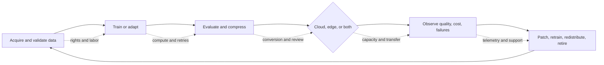
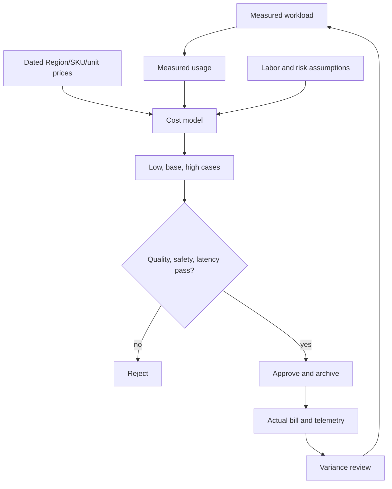

# Chapter 44 — Cost Optimization

> **Evidence boundary (2026-11-23):** service mechanisms are sourced; all worked dollar values are explicitly fictional
> teaching assumptions, not cloud prices or a project quote. Real decisions require dated, Region-specific rates and
> measured usage.

## 44.1 The optimization problem

A cheap training run can produce an expensive model to serve. A cheap endpoint can create an unacceptable cold start. A
free on-device inference call can still impose download, support, battery, and replacement-device costs. Cost
optimization is the constrained selection of a development and deployment plan that meets quality, safety, latency,
privacy, availability, and hardware requirements at the lowest risk-adjusted **total cost of ownership (TCO)**.

For a planning horizon of $M$ months:

$$
\begin{aligned} TCO_M ={}& C_{\text{data}}+C_{\text{build}}+C_{\text{train}}
+C_{\text{evaluate}}+C_{\text{deploy}}+C_{\text{operate}}\\ &+C_{\text{deliver}}+C_{\text{maintain}}+C_{\text{risk}}
-V_{\text{residual}} \end{aligned} \tag{44.1}
$$

The terms cover data rights/annotation; engineering; training and retries; evaluation; release; inference; model
delivery; maintenance; expected failure loss; and residual value of reusable assets. Money is only one objective:

$$
x^\_=\arg\min_{x\in\mathcal F}TCO_M(x) \quad\text{subject to}\quad Q(x)\ge Q_{\min},\ L_{p95}(x)\le L_{\max},\
A(x)\ge A_{\min},\ R(x)\le R_{\max},\ S(x)=\text{pass} \tag{44.2}
$$

$Q$ is domain quality, $L_{p95}$ latency, $A$ availability, $R$ peak device memory, and $S$ the safety gate.
A pharmacy model that fails contraindication tests is not cost-effective at any price.

### Figure 44.1 — Lifecycle cost boundaries



**Evidence:** `ILLUSTRATIVE`; arrows are accounting boundaries, not measured shares.

## 44.2 Unit economics

Use units that map to the product:

- training: cost per **accepted model release**, not successful job;
- dataset: cost per expert-accepted, unique, licensed example;
- cloud inference: cost per completed request or accepted output token;
- edge inference: amortized cost per active device-month or request;
- operations: cost per supported model-domain-runtime combination.

$$
C_{\text{accepted}}= \frac{\sum_j(H_jP_j+C_{\text{storage},j}+C_{\text{transfer},j}
+C_{\text{labor},j})}{N_{\text{accepted releases}}} \tag{44.3}
$$

$H_j$ is billed runtime and $P_j$ the verified currency/billed-time rate.

$$
C_{\text{request}}= \frac{nH_mP_{\text{instance}}+C_{\text{platform}}+C_{\text{storage}}
+C_{\text{network}}+C_{\text{observability}}} {N_{\text{completed requests}}} \tag{44.4}
$$

Record aborted, timed-out, and retried requests separately; excluding them hides waste. Token accounting is:

$$
C_{\text{1M output tokens}}= \frac{C_{\text{monthly inference}}}{\sum\text{accepted output tokens}}\times10^6
\tag{44.5}
$$

State whether prompt, speculative, cached, moderation, and failed tokens are included.

## 44.3 Decision sequence and comparison map

1. Eliminate candidates that fail license, safety, quality, memory, or compatibility.
2. Measure token lengths, burstiness, concurrency, idle periods, fleet, and updates.
3. Measure candidate resource demand under identical conditions.
4. Obtain dated prices for exact Region, SKU, option, and billing unit.
5. Compute low/base/high cases including labor and failure.
6. Select a Pareto-efficient candidate and validate forecast against the bill.



**Evidence:** `ILLUSTRATIVE`.

<!-- markdownlint-disable MD013 -->
| Decision                | First option tends to fit when…                     | Second tends to fit when…                      | Required evidence                       |
| ----------------------- | --------------------------------------------------- | ---------------------------------------------- | --------------------------------------- |
| Scratch / adapt         | lawful bases cannot meet architecture/control needs | a suitable base exists                         | tokens, scaling study, quality, license |
| Full FT / LoRA or QLoRA | full-weight change gives necessary measured gain    | adapters pass gates                            | memory, time, quality, export           |
| Teacher / manual        | drafts can be grounded and reviewed at scale        | rare/safety-critical tacit knowledge dominates | acceptance, correction, rights, labor   |
| Rent / own GPU          | demand varies or hardware changes rapidly           | sustained use justifies ownership              | utilization, power, depreciation        |
| EC2 / SageMaker AI      | team operates the stack efficiently                 | management/governance saves labor/risk         | bill plus engineering time              |
| Spot / On-Demand        | work is checkpointable                              | interruption/deadline loss dominates           | price history, restore test             |
| CPU / GPU               | small quantized model and low concurrency meet SLO  | parallel load rewards accelerators             | equal-workload load test                |
| Serverless / persistent | sparse traffic tolerates cold starts                | steady load or warm latency dominates          | arrivals, cold-start tail               |
| Cloud / edge            | central control and elasticity dominate             | offline/privacy/marginal compute dominate      | fleet, delivery, support, unit cost     |
<!-- markdownlint-restore -->

## 44.4 Price verification: date, Region, and unit

Never copy a price from a blog, search snippet, old estimate, or another Region.

1. Freeze model, precision, traffic, duration, replicas, storage, network, and option.
2. Record price-as-of UTC, currency, tax, payer account, and private discounts.
3. Record workload Region, AZ for Spot, OS, tenancy, and license.
4. List every meter: compute, EBS, S3, registry, logs, metrics, public IPv4, load balancer, NAT, cross-Region/AZ
   traffic, egress, support, and managed-service meters.
5. Capture the official pricing page and export AWS Pricing Calculator [S8].
6. Query AWS Price List for eligible fixed-price products and save raw JSON. It omits Spot and Savings Plan prices; the
   service page controls if sources disagree [S6].
7. Capture Spot price history for the exact instance/AZ [S2].
8. Normalize rates to explicit units; never mix GB/GiB or wall/billed time.
9. Label lines `VERIFIED-PUBLIC`, `VERIFIED-ACCOUNT`, `ESTIMATE`, or `UNKNOWN`.
10. Require a second-person SKU/unit check and archive sources, exports, hashes.
11. Reconcile forecast to Cost Explorer or the Cost and Usage Report after execution.
12. Expire the quote on a declared date or architecture change.

| Price-record field                       | Filled illustrative record                                      |
| ---------------------------------------- | --------------------------------------------------------------- |
| ID / retrieved UTC / expiry              | `PRICE-DEMO-01 / 2026-11-23T12:00Z / 2026-12-23`                |
| Provider, service, SKU, usage type       | `AWS / EC2 / demo-instance / BoxUsage:demo-instance`            |
| Workload Region / AZ                     | `us-east-1 / us-east-1a`                                        |
| Pricing API endpoint Region              | `us-east-1` (not the workload-location selector)                |
| OS / tenancy / license / purchase option | `Linux / Shared / No additional license / On-Demand`            |
| Currency / rate / exact unit             | `USD / 2.40 illustrative / instance-hour`                       |
| Tier, minimum, allowance, tax            | `none assumed / none / none / tax excluded`                     |
| Public URL / calculator export hash      | `official pricing URL / demo-export-sha256-7a0d20b7`            |
| Raw API response hash                    | `demo-raw-sha256-1f6a02cd`                                      |
| Evidence / reviewer                      | `ILLUSTRATIVE-NOT-A-QUOTE / second-person SKU review required`  |

The Price List client endpoint Region does not choose the product `location`; filter the workload location explicitly
[S6].

## 44.5 Scratch training versus pretrained adaptation

Scratch training pays to acquire general language and domain capability. Adaptation starts from pretrained weights and
pays for the domain delta:

$$
C_{\text{scratch}}=C_{\text{corpus}}+C_{\text{tokenizer}}+ \sum
C_{\text{pretraining}}+C_{\text{post-training}}+C_{\text{evaluation}} \tag{44.6}
$$

$$
C_{\text{adapt}}=C_{\text{base due diligence}}+C_{\text{domain data}}+
C_{\text{CPT/SFT/PEFT}}+C_{\text{evaluation}}+C_{\text{license constraints}} \tag{44.7}
$$

| Criterion                       | From scratch        | Adapt pretrained model     |
| ------------------------------- | ------------------- | -------------------------- |
| General-language acquisition    | project pays        | inherited                  |
| Tokenizer/architecture control  | maximum             | base-constrained           |
| Data and failed-run exposure    | highest             | focused and normally lower |
| Base license/supply chain       | avoided             | requires review            |
| Provenance                      | project corpus only | includes base uncertainty  |
| Initial choice for this project | exceptional         | default candidate          |

Start with a lawful supported SLM and test SFT, then CPT plus SFT if evidence shows a knowledge gap. Approve scratch
only when a documented requirement cannot be met by adaptation and a scaling study supports it.

$$
\sum_{m=1}^{M}\frac{B_{\text{scratch},m}-B_{\text{adapt},m}}{(1+r)^m} \ge C_{\text{scratch}}-C_{\text{adapt}}
\tag{44.8}
$$

$B$ is benefit and $r$ monthly discount rate. Quality/safety remain hard gates.

## 44.6 Full fine-tuning, LoRA, and QLoRA

LoRA freezes $W$ and learns $\Delta W=(\alpha/r)BA$ [S9]. QLoRA backpropagates through a frozen quantized base into
LoRA adapters [S10]. Reduced trainable state does not guarantee equal quality, runtime, or backend compatibility.

$$
N_{\text{LoRA}}=r(d_{\text{in}}+d_{\text{out}}) \tag{44.9}
$$

for one $d_{\text{out}}\times d_{\text{in}}$ target matrix.

<!-- markdownlint-disable MD013 -->
| Dimension           | Full FT                   | LoRA                     | QLoRA                                      |
| ------------------- | ------------------------- | ------------------------ | ------------------------------------------ |
| Updated weights     | full selected model       | low-rank adapters        | low-rank adapters                          |
| Frozen base         | no                        | yes                      | yes, quantized in training                 |
| Optimizer state     | largest                   | smaller                  | smaller                                    |
| Per-domain artifact | full checkpoint           | adapter + shared base    | adapter + compatible base                  |
| Export              | direct                    | merge or runtime adapter | merge/dequantize/requantize must be tested |
| Hidden cost         | distributed state/storage | version compatibility    | kernels and conversion                     |
<!-- markdownlint-restore -->

$$
C_{\text{method}}=\sum_iH_iP_i+C_{\text{checkpoint}}+ C_{\text{evaluation}}+C_{\text{retry}},\qquad \Delta
C=C_{\text{full}}-C_{\text{PEFT}} \tag{44.10}
$$

Compare identical immutable base/data/evaluation/stopping rules. Record peak memory, utilization distribution, wall and
billed time, retries, quality intervals, merge, export, and serving cost. This is a `PLANNED EXPERIMENT`, not a claimed
result.

## 44.7 Teacher generation versus manual datasets

A robust hybrid has experts define ontology/high-risk cases, a teacher draft permitted examples, deterministic checks
reject defects, and experts approve or correct the rest.

$$
C_{\text{teacher/accepted}}= \frac{N(t_ip_i+t_op_o)+h_rp_r+C_{\text{pipeline}}}{Na} \tag{44.11}
$$

$$
C_{\text{manual/accepted}}= \frac{h_ap_a+h_qp_q+C_{\text{tooling}}}{N_{\text{accepted}}} \tag{44.12}
$$

$a$ is acceptance after deduplication and review; $t,p,h$ denote tokens, rates, and labor hours.

| Issue                | Teacher drafts                              | Manual experts                 |
| -------------------- | ------------------------------------------- | ------------------------------ |
| Scale                | high candidate volume                       | expert-time limited            |
| Tacit/rare knowledge | may invent                                  | strong only if expert holds it |
| Errors               | correlated teacher bias                     | author bias                    |
| Rights/privacy       | provider terms and context                  | source/employment rights       |
| Safety               | authoritative grounding + expert acceptance | independent QA still required  |
| Cost trap            | low acceptance/correction                   | scarce experts/revision        |

$$
a^\_=\frac{N(t_ip_i+t_op_o)+h_rp_r+C_{\text{pipeline}}}{Nc_m} \tag{44.13}
$$

Below $a^\_$, teacher generation is not cheaper than manual unit cost $c_m$. Pharmacy and safety-critical repair
teacher output is always a draft; preserve the authoritative source, qualified reviewer, corrections, and escalation.

## 44.8 GPU rental, utilization, and ownership

$$
U_{\text{delivered}}=\frac{T_{\text{useful training}}}{T_{\text{provisioned}}}, \qquad C_{\text{useful
GPU-hour}}=\frac{P_{\text{rental}}}{U_{\text{delivered}}} \tag{44.14}
$$

Provisioned time includes setup, data wait, compilation, checkpointing, idle notebooks, debugging, and failures. Also
report accelerator telemetry.

$$
C_{\text{owned}}=C_{\text{purchase}}-V_{\text{resale}}+C_{\text{power}}+
C_{\text{cooling}}+C_{\text{space}}+C_{\text{network}}+ C_{\text{support}}+C_{\text{admin}}+C_{\text{downtime}}
\tag{44.15}
$$

$$
H^\_=\frac{C_{\text{owned,fixed}}} {P_{\text{cloud,all-in}}-P_{\text{owned,variable}}} \tag{44.16}
$$

If the denominator is non-positive, there is no ownership break-even from this model. Stage data/container before
allocation, smoke-test cheaply, auto-terminate idle resources, test resume, tag owner/expiry, and track productive
tokens per billed accelerator-hour.

## 44.9 EC2 versus SageMaker AI

EC2 exposes the VM and transfers more operations to the team. SageMaker AI supplies managed training/hosting workflows
and charges by capability and underlying meters [S3]. Managed is not intrinsically cheaper or dearer:

$$
\Delta TCO=(C_{\text{SM usage}}-C_{\text{EC2 usage}}) +(L_{\text{SM}}-L_{\text{EC2}})+(R_{\text{SM}}-R_{\text{EC2}})
\tag{44.17}
$$

$L$ is loaded labor and $R$ expected operational-risk cost.

| Dimension           | EC2                     | SageMaker AI                         |
| ------------------- | ----------------------- | ------------------------------------ |
| Control             | machine-level           | managed interfaces/containers        |
| Orchestration labor | team-owned              | more service-managed                 |
| Charge              | EC2 + attached services | SageMaker meters + attached services |
| Lineage/workflows   | assembled               | integrated options                   |
| Portability         | broader                 | integration can add switching work   |

Fair-test the same container, data, instance class, algorithm, stopping rule, and checkpoint cadence. Compare billed
duration, ancillary services, labor, recovery, and audit evidence.

## 44.10 Spot versus On-Demand

AWS says Spot prices vary with supply/demand. Its “up to 90%” discount is a maximum vendor statement, not a budget rate
[S2]. AWS documents best-effort interruption notices, generally two minutes before stop/termination except hibernation
[S4].

$$
E[C_{\text{Spot}}]=H_sP_s+E[N_i](C_{\text{lost}}+C_{\text{restart}}+ C_{\text{deadline}})+C_{\text{checkpoint}}
\tag{44.18}
$$

Compare with $C_{\text{OD}}=H_oP_o$. A simple uniform interruption model gives expected lost work near half the
checkpoint interval; this is `ILLUSTRATIVE`, not an AWS forecast.

Use Spot for idempotent preprocessing, sweeps, checkpointed training, and flexible batch evaluation. Use On-Demand or
mixed capacity for unproven recovery, hard deadlines, and stateful serving. Persist model, optimizer, scheduler, data
cursor, and RNG state; validate atomic restore; diversify valid capacity; cap retries.

## 44.11 CPU versus GPU inference

Measure the same model semantics, quantization, prompt/output distribution, batching, quality, and latency SLO:

$$
N_{\text{replicas}}= \left\lceil\frac{\lambda T_{\text{service}}}{U_{\text{target}}}\right\rceil \tag{44.19}
$$

$\lambda$ is requests/second, $T_{\text{service}}$ measured device-seconds per request, and $U_{\text{target}}<1$
leaves tail-latency headroom.

| Factor                  | CPU                                    | GPU                                  |
| ----------------------- | -------------------------------------- | ------------------------------------ |
| Small quantized model   | often practical with optimized kernels | overhead can erase benefit           |
| Large model/concurrency | may need many replicas                 | batching/parallelism may pay         |
| Portability             | broad                                  | Region/instance constraints          |
| Dependencies            | ISA, threads, bandwidth                | precision, kernels, memory, batching |

Report TTFT, prefill/decode throughput, p50/p95/p99, completed requests, memory, utilization, energy if measured, and
cost per accepted request. Do not import throughput from unrelated hardware or prompts.

## 44.12 Serverless versus persistent endpoints

AWS documents that SageMaker on-demand Serverless Inference scales to zero, bills compute by the millisecond plus data
processed, and can cold-start [S3, S5]. Its documentation currently states 1–6 GB selectable memory, 5 GB ephemeral
disk, and exclusions including GPUs and VPC configuration [S5]. These `DOC-VERIFIED` constraints, dated 2026-11-23,
require recheck before implementation and exclude many generative SLM artifacts.

$$
C_{\text{sl}}=N_{\text{requests}}t_{\text{bill}}p_{\text{compute}}+
D_{\text{processed}}p_{\text{data}}+C_{\text{provisioned}}+C_{\text{adjacent}} \tag{44.20}
$$

$$
C_{\text{persistent}}=N_{\text{replicas}}H_mp_{\text{instance}}+ C_{\text{adjacent}} \tag{44.21}
$$

Ignoring unequal adjacent costs:

$$
N^\_=\frac{N_{\text{replicas}}H_mp_{\text{instance}}}
{t_{\text{bill}}p_{\text{compute}}+d_{\text{request}}p_{\text{data}}} \tag{44.22}
$$

Do not use the break-even until model fit, cold-start, timeout, concurrency, and feature constraints pass testing.

| Traffic                               | Candidate                           | Main risk                  |
| ------------------------------------- | ----------------------------------- | -------------------------- |
| rare, unpredictable, latency tolerant | on-demand serverless                | cold start/fit             |
| predictable bursts                    | provisioned concurrency or schedule | warm-capacity charge       |
| steady                                | persistent/autoscaled               | idle headroom              |
| long asynchronous jobs                | async or batch                      | queue/completion semantics |

## 44.13 Cloud versus on-device inference

Cloud centralizes updates, access control, telemetry, and elastic capacity. Edge can work offline, keep prompts local,
and avoid marginal cloud compute, but shifts cost to conversion, compatibility, delivery, device resources, app
releases, and support.

$$
C_{\text{cloud},M}=C_{\text{integration}}+ \sum_{m=1}^{M}(C_{\text{compute},m}+C_{\text{network},m}+C_{\text{ops},m})
\tag{44.23}
$$

$$
C_{\text{edge},M}=C_{\text{conversion}}+C_{\text{device QA}}+ C_{\text{delivery}}+\sum_{m=1}^{M}
(C_{\text{updates},m}+C_{\text{support},m}+C_{\text{device impact},m}) \tag{44.24}
$$

With fixed costs $F$ and marginal costs $c$:

$$
N^\_=\frac{F_e-F_c}{c_c-c_e} \tag{44.25}
$$

If $c_c\le c_e$, volume alone gives no edge break-even. Privacy, offline use, or latency may still justify edge.

| Dimension             | Cloud                      | Edge/mobile                             |
| --------------------- | -------------------------- | --------------------------------------- |
| Marginal compute      | account pays               | device supplies compute/energy          |
| Offline               | no without fallback        | central advantage                       |
| Model confidentiality | server controls            | extractable artifact risk               |
| Updates               | centralized                | fragmented/stale clients                |
| Hardware              | selectable                 | installed fleet                         |
| Telemetry             | richer, privacy-controlled | limited/consent-sensitive               |
| Failure               | network/service            | storage, memory, battery, compatibility |

A hybrid may use separate cloud and edge models, but runtime document retrieval remains outside this book’s primary
architecture.

## 44.14 Storage, downloads, and mobile hardware

$$
S_{\text{stored}}=S_{\text{base}}+N_aS_{\text{adapter}}+ N_qS_{\text{quantized}}+N_cS_{\text{checkpoints}}+
S_{\text{optimizer}}+S_{\text{logs}} \tag{44.26}
$$

Storage cost includes class-specific GB-month, requests, retrieval, early deletion, replication, and transfer. S3
pricing is Region/class/request/retrieval/transfer dependent [S7]; a single “per GB” number is incomplete.

For artifact size $s$, successful downloads $n$, retry fraction $r_d$, and cache hit fraction $h$:

$$
D_{\text{out}}=ns(1+r_d)(1-h) \tag{44.27}
$$

For delta updates replace $s$ by the delta fraction, then include patch creation, verification, rollback, and
full-download fallback.

Hardware gates:

1. Artifact plus rollback copy fits storage with OS reserve.
2. Weights, KV cache, activations, tokenizer, runtime, and app fit under memory pressure.
3. TTFT and sustained decode pass after warm-up.
4. Battery and thermal behavior pass repeated physical-device tests.
5. Required CPU/GPU/NPU operators work on the minimum OS/device.
6. Download resumes, checksums, authenticates, activates atomically, and rolls back.

| Mobile cost                    | Frequency          | Measurement                          |
| ------------------------------ | ------------------ | ------------------------------------ |
| Conversion/runtime integration | initial + upgrades | engineer hours/CI                    |
| Device lab                     | fleet changes      | devices and test labor               |
| Initial/update delivery        | install/release    | bytes, requests, retries             |
| Storage/memory failures        | ongoing            | installed bytes, OOM/crash by device |
| Battery/thermal impact         | use                | controlled device test               |
| Compatibility/security support | recurring/event    | tickets and response labor           |

No mobile latency, throughput, or battery value is claimed because no physical test was executed. Segment by measured
capability, not marketing tier.

## 44.15 Long-term maintenance and hidden costs

$$
C_{\text{maintain/year}}=f_rC_{\text{release}}+f_dC_{\text{data refresh}}+
C_{\text{monitoring}}+C_{\text{support}}+C_{\text{security}}+
C_{\text{compliance}}+C_{\text{deprecation}}+E[C_{\text{incidents}}] \tag{44.28}
$$

Common omissions include:

- licensing, provenance, deletion duties, expert scarcity, and safety adjudication;
- failed runs, idle accelerators, optimizer states, duplicate artifacts;
- container builds, vulnerability fixes, dependency/runtime upgrades;
- NAT, public IPv4, load balancing, logs, metrics, support, and data transfer;
- cold starts, headroom, throttling, retries, and failed Spot recovery;
- adapter/base/tokenizer/runtime combinations and regression suites;
- device labs, app-store rollout, stale clients, rollback copies, customer support;
- endpoint, snapshot, bucket, key, identity, and artifact decommissioning.

$$
K=N_{\text{bases}}N_{\text{domains}}N_{\text{precisions}} N_{\text{runtimes}}N_{\text{platform classes}} \tag{44.29}

$$

Not every combination needs a separate test if equivalence is justified, but uncontrolled multiplication makes
maintenance dominate training. Standardize the base family, validated precisions, and platform tiers unless evidence
supports more.

<a id="tbl-13"></a>

## 44.16 Editable budgets and sensitivity

The examples below are complete arithmetic lessons. Every dollar rate is deliberately fictional and labelled
`ILLUSTRATIVE`; it is not an AWS quote, market wage, project budget, or recommendation. Replace each rate with a dated
record from §44.4 before making a real decision.

### Worked example A — cost per accepted training release

Assume an automotive QLoRA experiment consumes 18 billed accelerator-hours at an illustrative \$2.40/hour. Two failed
smoke runs add 3 hours. Expert review takes 14 hours at an illustrative loaded rate of \$85/hour. Engineering takes
10 hours at \$70/hour. Storage/evaluation are represented by an illustrative \$55 combined line.

| Cost line                         | Calculation                 | Illustrative cost |
| --------------------------------- | --------------------------- | ----------------: |
| accepted training run             | $18\times \$2.40$         |           \$43.20 |
| failed smoke runs                 | $3\times \$2.40$          |            \$7.20 |
| qualified expert review           | $14\times \$85$           |        \$1,190.00 |
| engineering and release work      | $10\times \$70$           |          \$700.00 |
| storage and evaluation allocation | stated scenario assumption  |           \$55.00 |
| **total attempted-release cost**  | sum                         |        \$1,995.40 |

If only one of two attempted releases is accepted, the cost per accepted release is not half the total:

$$

C_{\text{accepted}}=\frac{\$1{,}995.40+\$1{,}995.40}{1}=\$3{,}990.80.

$$

This deliberately simple assumption treats both attempts as equally costly. A real ledger sums their actual lines.
The interpretation is more important than the fictional total: expert and engineering time dominate GPU rental, and
failed attempts belong in the denominator. Optimizing only the accelerator rate would barely move this scenario.

### Worked example B — teacher drafts versus manual writing

Suppose 10,000 teacher drafts cost an illustrative \$180 to generate and \$600 to run through tooling. Reviewers spend
80 hours at \$75/hour. After deduplication and correction, 6,500 examples are accepted:

$$

C_{\text{teacher/accepted}}=
\frac{\$180+\$600+(80\times \$75)}{6{,}500}
=\frac{\$6{,}780}{6{,}500}
=\$1.043\text{ per accepted example}.

$$

Manual authoring produces 1,000 accepted examples in 22 hours at \$85/hour, plus 8 QA hours at \$75/hour:

$$

C_{\text{manual/accepted}}=
\frac{22\times \$85+8\times \$75}{1{,}000}
=\frac{\$2{,}470}{1{,}000}
=\$2.47.

$$

Under these assumptions teacher-assisted production is cheaper. If acceptance falls to 2,000 while review time stays
fixed, its unit cost becomes $\$6{,}780/2{,}000=\$3.39$, so manual production wins. The practical control is to run a
small stratified pilot and measure acceptance and severe-defect rates before purchasing a large generation batch.

### Worked example C — persistent cloud unit economics

Assume two continuously running replicas, 730 hours/month, at a fictional \$0.85 per replica-hour. Adjacent monthly
costs are \$110 for gateway/network, \$75 for observability, and \$40 for storage. The system receives 900,000 requests;
18,000 fail or time out, leaving 882,000 completed requests and 105 million accepted output tokens.

$$

C_{\text{compute}}=2\times730\times\$0.85=\$1{,}241.00,

$$

$$

C_{\text{monthly}}=\$1{,}241+\$110+\$75+\$40=\$1{,}466,

$$

$$

C_{\text{request}}=\frac{\$1{,}466}{882{,}000}=\$0.001662,
\qquad
C_{\text{1M output}}=\frac{\$1{,}466}{105}\approx\$13.96.

$$

Using all 900,000 attempts would understate cost per completed request. If utilization is only 20%, first investigate
scheduling, scale-to-zero feasibility, and cold-start SLOs; do not assume a serverless alternative fits the model.

### Worked example D — cloud versus edge break-even

For a 12-month horizon, use these fictional planning values:

- cloud integration \$18,000, operations \$2,400/month, and \$0.006 variable cost per completed request;
- edge conversion/device qualification \$52,000, support \$3,100/month, and \$0.0004 delivery/telemetry cost per
  completed request.

Fixed 12-month cost is $F_c=\$18{,}000+12(\$2{,}400)=\$46{,}800$ for cloud and
$F_e=\$52{,}000+12(\$3{,}100)=\$89{,}200$ for edge. Therefore:

$$

N^*=\frac{F_e-F_c}{c_c-c_e}
=\frac{\$89{,}200-\$46{,}800}{\$0.006-\$0.0004}
=7{,}571{,}429\text{ completed requests (approximately)}.

$$

Below roughly 7.57 million requests, cloud is cheaper under this narrow accounting model; above it, edge is cheaper.
At 10 million requests, cloud is $\$46{,}800+\$60{,}000=\$106{,}800$, while edge is
$\$89{,}200+\$4{,}000=\$93{,}200$. This does not settle the architecture: offline availability, privacy, model
confidentiality, device energy, stale clients, and capability equivalence are hard constraints, not adjustments that a
break-even equation can erase.

### Sensitivity interpretation

If edge support ranges from \$2,000 to \$5,000 per month, its fixed 12-month cost ranges from \$76,000 to \$112,000.
The corresponding break-even moves from

$$

\frac{\$76{,}000-\$46{,}800}{0.0056}=5.21\text{ million requests}

$$

to

$$

\frac{\$112{,}000-\$46{,}800}{0.0056}=11.64\text{ million requests}.

$$

That wide interval says the decision is driven more by support assumptions than by arithmetic precision. Measure the
high-leverage inputs first, retain low/base/high cases, and rerun nonlinear capacity rather than scaling it linearly.

## 44.17 Calculator listings

### Listing 44.1 — TCO and break-even

**Status: `UNVERIFIED IMPLEMENTATION`.** Statically reviewed; not executed. It has no prices. Save as
`ch44_cost_calculator.py`, fill from approved records, and compare its CSV with hand arithmetic.

```python
from dataclasses import dataclass
from decimal import Decimal
import csv

D = Decimal

@dataclass(frozen=True)
class Line:
    scenario: str
    item: str
    quantity: Decimal
    unit: str
    rate: Decimal
    currency: str
    record: str

    @property
    def subtotal(self):
        return self.quantity * self.rate

def total(lines, scenario):
    return sum((x.subtotal for x in lines if x.scenario == scenario), D("0"))

def break_even(fixed_a, variable_a, fixed_b, variable_b):
    denominator = variable_a - variable_b
    return None if denominator == 0 else (fixed_b - fixed_a) / denominator

def write_report(lines, path):
    if len({x.currency for x in lines}) != 1:
        raise ValueError("Explicitly convert currencies")
    if any(not x.record for x in lines):
        raise ValueError("Every rate requires an evidence record")
    with open(path, "w", newline="", encoding="utf-8") as f:
        out = csv.writer(f)
        out.writerow(["scenario", "item", "quantity", "unit", "rate",
                      "currency", "subtotal", "record"])
        for x in lines:
            out.writerow([x.scenario, x.item, x.quantity, x.unit, x.rate,
                          x.currency, x.subtotal, x.record])

# Filled teaching inputs; replace both rates with reviewed records.
lines = [
    Line("base", "training", D("21"), "instance-hour",
         D("2.40"), "USD", "PRICE-DEMO-01"),
    Line("base", "review", D("14"), "loaded-hour",
         D("85"), "USD", "LABOR-DEMO-01"),
]
write_report(lines, "ch44_cost_report.csv")
print(total(lines, "base"))
```

Before approval, reject unset lines, add date/Region/tax/expiry metadata, unit-test conversions, reproduce one case by
hand, compare to billed usage, and archive hashes.

### Listing 44.2 — AWS Price List query skeleton

**Status: `UNVERIFIED IMPLEMENTATION`.** It prints candidates instead of silently choosing a rate. A reviewer must
inspect attributes and terms. Spot and Savings Plan prices are outside this API [S6].

```python
import json
import boto3

pricing = boto3.client("pricing", region_name="us-east-1")
response = pricing.get_products(
    ServiceCode="AmazonEC2",
    Filters=[
        {"Type": "TERM_MATCH", "Field": "location",
         "Value": "us-west-2"},
        {"Type": "TERM_MATCH", "Field": "instanceType",
         "Value": "ml.g5.2xlarge"},
        {"Type": "TERM_MATCH", "Field": "operatingSystem", "Value": "Linux"},
        {"Type": "TERM_MATCH", "Field": "tenancy", "Value": "Shared"},
        {"Type": "TERM_MATCH", "Field": "preInstalledSw", "Value": "NA"},
        {"Type": "TERM_MATCH", "Field": "capacitystatus", "Value": "Used"},
    ],
    MaxResults=100,
)
products = [json.loads(x) for x in response["PriceList"]]
assert products, "No candidate; verify exact filters"
print(json.dumps(products, indent=2, sort_keys=True))
```

Verify current schema/IAM, paginate, select the correct term/dimension, preserve raw output, and compare with the
controlling service page.

## 44.18 Sources and claim map

Web sources accessed **2026-11-23 UTC**. Recheck all fast-moving claims at release.

- **[S1] AWS, “Amazon EC2 On-Demand Pricing.”** Billing mechanism and ancillary charges. `DOC-VERIFIED`.
  <https://aws.amazon.com/ec2/pricing/on-demand/>
- **[S2] AWS, “Amazon EC2 Spot Instances Pricing.”** Dynamic prices; “up to 90%” is `VENDOR-REPORTED`, not a scenario
  rate. <https://aws.amazon.com/ec2/spot/pricing/>
- **[S3] AWS, “Amazon SageMaker AI Pricing.”** Managed training/hosting and serverless meters. `DOC-VERIFIED`.
  <https://aws.amazon.com/sagemaker-ai/pricing/>
- **[S4] AWS, “Spot Instance interruption notices.”** Notice behavior. `DOC-VERIFIED`.
  <https://docs.aws.amazon.com/AWSEC2/latest/UserGuide/spot-instance-termination-notices.html>
- **[S5] AWS, “Deploy models with Amazon SageMaker Serverless Inference.”** Scaling, cold starts, limits, exclusions.
  `DOC-VERIFIED`. <https://docs.aws.amazon.com/sagemaker/latest/dg/serverless-endpoints.html>
- **[S6] AWS, “Calling AWS services and prices using the AWS Price List.”** Query and Bulk APIs, endpoints, exclusions,
  source precedence. `DOC-VERIFIED`. <https://docs.aws.amazon.com/awsaccountbilling/latest/aboutv2/price-changes.html>
- **[S7] AWS, “Amazon S3 pricing.”** Official storage/request/transfer entry point. `DOC-VERIFIED`.
  <https://aws.amazon.com/s3/pricing/>
- **[S8] AWS, “AWS Pricing Calculator.”** Official estimation/export tool; `DOC-VERIFIED` as a tool, not a project
  quote. <https://calculator.aws/>
- **[S9] Hu et al., “LoRA: Low-Rank Adaptation of Large Language Models.”** ICLR 2022, arXiv:2106.09685.
  `PAPER-REPORTED`. <https://arxiv.org/abs/2106.09685>
- **[S10] Dettmers et al., “QLoRA: Efficient Finetuning of Quantized LLMs.”** NeurIPS 2023, arXiv:2305.14314.
  `PAPER-REPORTED`. <https://arxiv.org/abs/2305.14314>
- **[S11] AWS, “AWS Cost Explorer.”** Cost/usage analysis and forecasting. `DOC-VERIFIED`.
  <https://aws.amazon.com/aws-cost-management/aws-cost-explorer/>

No source establishes this project’s cheapest architecture; that requires measurement.

## 44.19 Worked Spot interruption comparison

Use fictional rates to understand equation 44.18. A checkpointed QLoRA job needs 20 productive hours. Its illustrative
Spot rate is \$1.20/hour. Four interruptions add 1.5 lost hours and four 15-minute restores, for 2.5 extra billed hours.
Checkpoint storage and I/O add \$18:

$$

C_{\text{Spot}}=(20+2.5)\times\$1.20+\$18=\$45.

$$

The same 20-hour job at an illustrative On-Demand rate of \$3.10/hour costs $20\times\$3.10=\$62$. Spot saves \$17
in this run. If a deadline penalty of \$30 is triggered, Spot becomes \$75 and loses. The conclusion is conditional:
checkpoint/resume must work, interruption and restore time must be measured, and the deadline cost must be explicit.
Replace the fictional rates with exact dated evidence before budgeting.

## 44.20 Review questions and exercises

1. Why can lower GPU hourly price increase cost per accepted release?
2. Derive equation 44.13. Why must acceptance include deduplication/correction?
3. Name four costs omitted by a GPU-hours-only EC2/SageMaker comparison.
4. When does equation 44.22 fail to support a serverless decision?
5. Why is a maximum Spot discount unusable as a budget rate?
6. Compare CPU/GPU without using parameter count as the decision rule.
7. How can adapter proliferation erase LoRA’s training savings?
8. Why are privacy, offline, safety, quality, and thermals hard gates?

### Exercise A — Dated AWS estimate

Complete the price record for one training and inference candidate; export the AWS calculator estimate; save raw Price
List candidates; obtain Spot history separately; fill low/base/high budgets; obtain peer verification; list exclusions.
Required evidence: URLs, timestamps, hashes, scripts, assumptions, and `ESTIMATE`. It is not an invoice.

### Exercise B — Full FT/LoRA/QLoRA ablation

Use one experiment contract. Measure quality/safety, peak memory, productive/billed time, utilization, retries, storage,
conversion, and inference. Plot quality against cost per accepted release and mark the Pareto frontier. Use `EXECUTED`
only with raw logs, versions, seeds, hashes, price records, and failures; otherwise `PLANNED EXPERIMENT`.

### Exercise C — Teacher/manual crossover

On a stratified sample, qualified reviewers record time, accept/revise/reject, defects, and uniqueness. Compute
equations 44.11–44.13 with confidence intervals. Report severe safety defects separately.

### Exercise D — Cloud/edge TCO

Benchmark one approved model on cloud and two physical device classes. Include delivery, updates, rollback, battery,
thermal, compatibility, support, and cloud operations. Find break-even only among candidates passing identical product
gates.

## 44.21 Release checklist and limitations

- [x] Scratch/fine-tuning; full/LoRA/QLoRA; teacher/manual compared.
- [x] Rental/utilization; EC2/SageMaker; Spot/On-Demand covered.
- [x] CPU/GPU; serverless/persistent; cloud/edge compared.
- [x] Storage, download, mobile hardware, and maintenance covered.
- [x] TCO, sensitivity, break-even, diagrams, tables, editable budgets, calculator listings, sources, exercises, and
      evidence states included.
- [ ] Obtain dated account-specific prices for a declared Region/architecture.
- [ ] Execute and test calculators.
- [ ] Run controlled cloud and physical-device benchmarks.
- [ ] Reconcile one forecast with an actual bill.
- [ ] Complete independent technical, FinOps, security, and safety review.
- [ ] Update separate assessment/audit ledgers; outside chapter-only scope.

**Honest completion statement:** the chapter documents the complete analysis method, but does not claim a cheapest
configuration. Numeric prices, performance, battery, and project break-even remain unverified until executed for a named
date, Region, unit, model, workload, and hardware target.

## Cross-links

- [Part XII index](README.md)
- [Detailed table of contents](../../01-planning/detailed-table-of-contents.md)
- [CH-44 assessment](../../13-assessments/ch-44-assessment.md)
- [Evidence standard](../../00-governance/evidence-and-citation-standard.md)
- [Reproducibility standard](../../00-governance/reproducibility-standard.md)
- [Initial research survey](../../01-planning/initial-research-survey.md)
