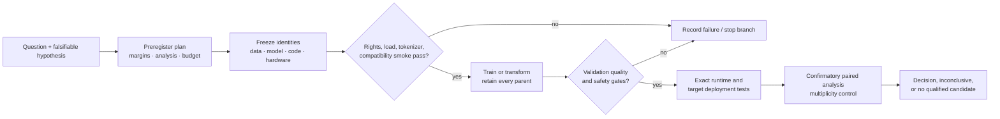
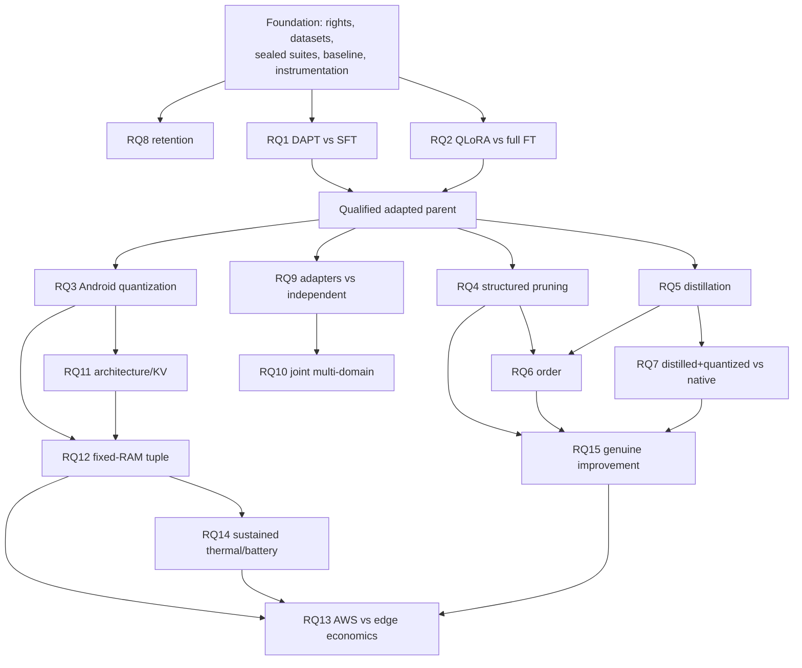

# CH-45: Research Questions and Hypotheses

## 45.0 Chapter contract and evidence boundary

This chapter converts the fifteen required research questions into falsifiable, resource-bounded experiment protocols.
It does not predict a winner. Its central rule is:

> A method is useful only when the exact trained and deployed artifact improves a preregistered objective, satisfies
> quality and safety gates, and justifies its additional compute, implementation, and lifecycle cost.

**Research freeze:** 2026-11-23. **Evidence boundary:** protocols are plans and numerical examples are illustrative;
they teach decisions but do not report trained-model, cloud, or physical-device outcomes.

The experiments inherit the measurement definitions in
[CH-29](../part-08-evaluation-benchmarking-and-research-experiments/ch-29-model-quality-evaluation.md), the domain
suites in
[CH-30](../part-08-evaluation-benchmarking-and-research-experiments/ch-30-domain-specific-evaluation-suites.md), the
systems protocol in
[CH-31](../part-08-evaluation-benchmarking-and-research-experiments/ch-31-compression-and-edge-benchmarking.md), and the
staged matrix in
[CH-32](../part-08-evaluation-benchmarking-and-research-experiments/ch-32-optimization-experiments-and-ablation-studies.md).
Evidence labels follow the project [evidence standard](../../00-governance/evidence-and-citation-standard.md).

After completing this chapter, the reader should be able to:

1. distinguish a product comparison from a causal ablation;
2. preregister hypotheses, margins, analysis units, stopping rules, and multiplicity control;
3. run the fifteen studies without changing sealed tests after seeing outcomes;
4. allocate compute and expert review by information value;
5. reject checkpoint-only “improvements” that do not help the deployed system; and
6. conclude “inconclusive” or “no qualified candidate” when evidence does not support a decision.

<a id="4511-honest-completion-record"></a>

## 45.1 Common experimental contract

### 45.1.1 Unit of comparison

An experimental candidate is the tuple

\[ \mathcal A=(W,\tau,\chi,D,T,C,R,H,P), \]

where \(W\) is model/adaptor lineage, \(\tau\) tokenizer, \(\chi\) chat template and generation policy, \(D\) data
snapshots, \(T\) training/transformation recipe, \(C\) conversion and precision, \(R\) runtime, \(H\) hardware/software
environment, and \(P\) protocol. Changing more than the declared independent variable makes the result a tuple
comparison rather than a causal estimate.

For higher-is-better quality \(Q\), candidate \(c\), baseline \(b\), and non-inferiority margin \(\delta>0\):

\[ \Delta_Q=Q_c-Q_b,\qquad c\text{ is non-inferior only if }\operatorname{LCB}_{1-\alpha}(\Delta_Q)>-\delta. \]

For lower-is-better latency \(L\), a positive improvement can be written

\[ \Delta_L=L_b-L_c. \]

Margins, confidence level, and minimum practically important differences (MIDs) are set by domain and target owners
before the confirmatory run. This chapter intentionally does not invent universal values.

### 45.1.2 Frozen data families

All questions draw from immutable, disjoint manifests:

| Snapshot                  | Purpose                                     | Forbidden use                             |
| ------------------------- | ------------------------------------------- | ----------------------------------------- |
| `train-cpt`               | domain-adaptive pretraining                 | final evaluation or calibration           |
| `train-sft`               | supervised behavior and task training       | sealed evaluation                         |
| `train-general-replay`    | forgetting mitigation                       | final retention scoring                   |
| `train-distill`           | reviewed teacher/expert examples            | sealed evaluation                         |
| `recover-train`           | pruning recovery                            | final evaluation                          |
| `cal-quant` / `cal-prune` | representative calibration                  | model selection by final score            |
| `validation`              | checkpoint selection and staged elimination | confirmatory claim                        |
| `test-domain`             | sealed specialist evaluation                | any development decision                  |
| `test-general`            | sealed retention evaluation                 | any development decision                  |
| `test-safety`             | sealed critical/adversarial evaluation      | training, prompting, or threshold setting |
| `perf-prompts`            | fixed timing/energy workloads               | quality claims                            |

Group source document, scenario, product/species/entity, revision, and synthetic descendants before splitting. Teachers,
judges, prompt developers, quantizers, and pruning calibrators must not see sealed roots.

### 45.1.3 Shared outcomes

Unless a question narrows them, report:

- domain factual/rubric score, diagnostic next-action quality, unsupported-claim rate, calibration, robustness,
  multi-turn consistency, and worst stratum;
- critical safety failures, unsafe compliance, required escalation, and over-refusal;
- general-capability retention by prespecified capability;
- artifact and download bytes, post-load and peak memory, startup, visible Time to First Token (TTFT), prefill and
  decode rate, end-to-end latency, failures, and context limit;
- sustained energy/thermal behavior on physical edge targets where measurable;
- accelerator-hours, peak training memory, conversion time, expert hours, dependency/custom-kernel burden, and dated
  allocated AWS cost where relevant.

Safety gates are non-compensatory. A faster artifact with a critical unsafe regression is ineligible.

**FIG-CH45-01 — Shared evidence funnel (`ILLUSTRATIVE`).**  
*Alt text:* preregistered questions use frozen data and cheap compatibility screens before training, quality,
deployment, and confirmatory analysis; failures stop a branch.



## 45.2 Preregistration, repetitions, and multiplicity

### Preregister before confirmation

For each question freeze:

1. primary hypothesis and one primary outcome;
2. baseline and exact candidate lineage;
3. superiority or non-inferiority estimand and margin;
4. independent variables, controls, exclusions, failures, and missing-data policy;
5. data manifests and independent analysis unit;
6. hardware, environment, warm-up, workload, and run order;
7. training seeds, device blocks, systems trials, and power rationale;
8. interval/test, confidence level, multiplicity family, and analysis code hash;
9. resource cap, interim looks, futility, harm, and success stopping rules; and
10. hard quality, safety, compatibility, and release gates.

Register amendments before unblinding affected outcomes. Report the original and amended plans. Exploratory findings
generate later hypotheses; they do not become retroactive confirmation.

### Repetition hierarchy

- **Training:** one smoke seed; at least three independent seeds for decision-critical finalists where resources permit.
  A one-seed comparison is exploratory.
- **Quality:** one immutable generation for deterministic decoding or preregistered repeated samples for stochastic
  decoding; resample independent scenario/source roots, not paraphrases.
- **Systems:** pilot repetitions estimate variance; confirmatory repetitions are chosen for an operationally useful
  interval. Randomize candidate order and block by device, temperature band, day, and AWS host where applicable.
- **Thermal/energy:** repeat independent sustained sessions after returning to the declared start state. Tokens within a
  session are not independent trials.
- **Humans:** blinded independent scoring plus qualified adjudication; account for item and reviewer variation when
  generalizing over both.

### Multiple comparisons

The fifteen questions are separate scientific families, but each can contain many variants and metrics:

1. nominate one confirmatory primary contrast per question;
2. control family-wise error with Holm for a small confirmatory family;
3. use Benjamini–Hochberg only for a declared discovery family where false-discovery-rate control is appropriate;
4. use hierarchical testing—safety and primary quality first, systems objectives second;
5. report simultaneous confidence intervals where multiple candidates are jointly ranked;
6. label unadjusted secondary and subgroup analyses exploratory; and
7. reserve a fresh confirmation set for the final selected configuration.

Repeatedly evaluating the same sealed set to select hyperparameters invalidates its confirmatory role.

## 45.3 Practical intuition for all fifteen hypotheses

Before reading the formal protocols, walk through one realistic decision for each question. The numbers below are
illustrative outcomes chosen to teach interpretation; they are not project measurements.

1. **DAPT versus SFT:** An SFT-only mechanic model scores 72 on a sealed diagnostic rubric. An equal-budget DAPT+SFT
   model scores 76 but loses 6 points on general instruction following, beyond the allowed 2-point retention margin.
   DAPT does not qualify. Domain gain cannot buy back a failed retention gate.
2. **QLoRA versus full fine-tuning:** Full FT scores 81.0 and QLoRA 80.6; the paired 95% interval for
   QLoRA-minus-full is \([-0.9,0.1]\). With a preregistered non-inferiority margin of 1.0 point, QLoRA qualifies because
   the lower bound exceeds \(-1.0\). If export parity fails, it is still rejected.
3. **Android quantization:** Q4-A uses 2.2 GiB and decodes at 9 tokens/s; Q4-B uses 2.0 GiB but decodes at 6 tokens/s and
   loses 3 quality points. Neither universally wins. A 2.1 GiB RAM cap eliminates Q4-A; a quality margin may eliminate
   Q4-B, leaving no qualified candidate.
4. **Structured pruning:** Removing 20% of MLP width shrinks the artifact by 17%, yet decode improves only 1% because
   the new dimensions misalign with the mobile kernel. The practical-speed hypothesis fails even though parameter
   reduction is real.
5. **Distillation versus direct training:** The same 800M student scores 68 with direct expert SFT and 73 with reviewed
   teacher examples, but the distilled model repeats one teacher safety error. Distillation fails the hard gate. The
   next study should improve data review, not average the hazard into the score.
6. **Prune-then-distil versus distil-then-prune:** Both final graphs have the same shapes and budget. The first scores 70
   at 11 tokens/s; the second scores 72 at 11 tokens/s. If the quality interval establishes the 2-point gain, the second
   order wins. If intervals overlap the MID, choose the simpler lineage or report inconclusive.
7. **Distilled-and-quantized versus native small:** A compressed student and native 600M model both peak near 1.1 GiB.
   The compressed student scores 74 versus 71 but costs 300 additional teacher/reviewer hours. It is technically better
   under the RAM gate; whether it is the product choice depends on the preregistered lifecycle-cost boundary.
8. **General knowledge loss:** Specialization improves automotive quality by 9 points. Five retention capabilities stay
   within margin, but structured JSON output falls 4 points against a 2-point limit. The honest result is a capability
   profile with one blocking regression, not “4 points of general knowledge were lost.”
9. **Shared base plus adapters:** Four independent models occupy 8 GiB. One 2 GiB base plus four 80 MiB adapters uses
   2.32 GiB, but swapping an adapter takes 1.8 seconds and one domain fails its safety margin. Storage efficiency is
   established; portfolio qualification is not.
10. **One multi-domain model:** A joint model matches three independent specialists but loses 7 points on pharmacy
    interaction-risk recognition. Its macro average looks acceptable. The intersection–union rule rejects it because
    every required domain must pass.
11. **Architecture and KV cache:** Two models have equal weight memory. The grouped-query model's cache grows at
    0.12 MiB/token versus 0.46 MiB/token for the multi-head model, allowing a longer context before OOM. This supports a
    tuple-specific mobile result; it does not prove that grouped-query attention alone caused all latency differences.
12. **Best tuple under fixed RAM:** Of twelve model/runtime pairs, seven exceed 3 GiB, two silently fall back to CPU,
    and one fails safety. Two remain on the Pareto front: one is faster, the other more accurate. Product preference,
    declared before testing, selects the release.
13. **AWS versus edge economics:** A break-even model puts AWS below edge until 8 million annual requests, but edge is
    the only option that satisfies an offline requirement. Economics becomes secondary because the feasible set already
    excludes cloud-only deployment.
14. **Thermal and battery behavior:** Decode starts at 12 tokens/s and ends at 8 after 25 minutes. If context length
    also grew, the decline is not yet evidence of thermal throttling. A fixed-context run plus thermal-state and clock
    transitions is needed to separate causes.
15. **Genuine optimization:** A “4-bit” file is 55% smaller but expands on load, has equal peak RAM, starts slower, and
    produces no throughput gain. It is a distribution-size optimization only. Calling it a mobile performance
    optimization would overstate the evidence.

These examples establish the reading pattern used below: identify the baseline, change one declared factor, preserve
hard gates, interpret uncertainty, and allow rejection or inconclusive outcomes.

## 45.4 The fifteen research questions

### RQ1 — Does domain-adaptive pretraining improve specialist knowledge more than SFT alone for a given compute budget?

- **Falsifiable hypothesis:** Under a fixed total training-compute budget, DAPT followed by identical SFT yields a
  larger domain-quality gain than SFT alone, while remaining non-inferior on general retention and passing all safety
  gates. It is falsified if the adjusted domain effect misses the MID, the interval crosses the preregistered
  superiority boundary, or retention/safety fails.
- **Baseline:** Exact base checkpoint trained only with `train-sft`; include untouched base and DAPT-only arms as
  diagnostic controls.
- **Independent variables:** No DAPT versus domain-only DAPT versus DAPT with general replay; optionally DAPT token
  allocation.
- **Controlled variables:** Base/tokenizer/template, total accelerator or token budget, SFT snapshot and supervised
  tokens, optimizer-search allowance, checkpoint rule, seeds, decoding, evaluator, and export precision.
- **Dataset:** Rights-approved automotive CPT corpus for the flagship study; identical SFT; sealed automotive domain,
  safety, and general-retention suites. Replicate later in one low-resource domain.
- **Metrics:** Primary domain rubric/knowledge score; secondary domain perplexity under the same tokenizer, unsupported
  claims, diagnostic quality, general-retention deltas, safety, training time, and accelerator-hours.
- **Hardware:** One pinned training accelerator class that fits every arm; same GPU count and software image. Do not mix
  EC2 types within a causal comparison.
- **Experimental procedure:** Profile equal-budget schedules; train all arms for matched budgets and seeds; select
  checkpoints on validation only; apply identical SFT; evaluate exact high-precision children; confirm the selected
  edge/cloud derivative separately.
- **Repetition strategy:** One smoke run, then at least three paired seed IDs for finalists; one frozen output per
  deterministic item; root-level bootstrap.
- **Statistical comparison:** Mixed or hierarchical model over item roots and seeds, plus paired bootstrap of domain
  effects; Holm-adjust DAPT contrasts; non-inferiority tests for retention.
- **Expected limitations:** Equal FLOPs, tokens, and wall time answer different questions; DAPT data quality and replay
  ratio interact; one domain does not generalize; base pretraining contamination is partly unknowable.
- **Decision criteria:** Adopt DAPT only if the primary gain exceeds the preregistered MID with adjusted uncertainty,
  all retention/safety gates pass, and incremental compute/lifecycle cost is acceptable. Otherwise use SFT-only or
  report inconclusive.

### RQ2 — Does QLoRA preserve domain performance compared with full fine-tuning?

- **Falsifiable hypothesis:** QLoRA is non-inferior to full fine-tuning on the primary domain metric within margin
  \(\delta_Q\), passes safety/retention gates, and reduces peak training memory or total training resource consumption.
- **Baseline:** Full fine-tuning from the same initialization; LoRA is a secondary comparator.
- **Independent variables:** Update method—full FT, LoRA, QLoRA; a small preregistered rank set may be exploratory.
- **Controlled variables:** Accepted SFT tokens/order, sequence length, effective batch, search budget, validation rule,
  seeds, base revision, evaluator, and final merged high-precision export.
- **Dataset:** Identical automotive SFT/validation and sealed domain/general/safety suites.
- **Metrics:** Primary domain-score difference; safety and retention; trainable parameters, peak VRAM, wall time,
  accelerator-hours, convergence failures, adapter bytes, merge parity, and final export quality.
- **Hardware:** Same supported GPU class for all feasible arms. If full FT requires a larger topology, report a
  resource-matched product comparison separately from the method ablation.
- **Experimental procedure:** Verify masks and target modules; train arms; retain failed/OOM seeds; compare adapter and
  merged logits/generation; evaluate merged artifacts; do not treat QLoRA's training quantization as deployment
  quantization.
- **Repetition strategy:** At least three training seeds for feasible finalists; repeated resource measurements per
  seed; identical item outputs.
- **Statistical comparison:** One-sided non-inferiority interval across items and seeds; paired resource differences;
  Holm correction for QLoRA-versus-full and LoRA-versus-full confirmatory contrasts.
- **Expected limitations:** Unequal optimizer capacity, hardware feasibility, architecture-sensitive target modules,
  merge precision, and hyperparameter sensitivity can confound conclusions.
- **Decision criteria:** Choose QLoRA only if domain performance is non-inferior, no hard gate fails, merge/export
  parity passes, and measured resource savings exceed the operational MID. A memory saving alone is insufficient.

### RQ3 — Which quantization method provides the best quality-memory-latency balance on Android?

- **Falsifiable hypothesis:** At least one target-supported quantizer produces a non-dominated Android artifact relative
  to the higher-precision parent and alternative quantizers after quality/safety gates.
- **Baseline:** Target-runtime higher-precision artifact from the same parent; include runtime-native 8-bit as a
  conservative compression control.
- **Independent variables:** Exact quantizer, bit width, group/granularity, mixed-precision exceptions,
  weight/activation/KV precision, and Android backend where separately declared.
- **Controlled variables:** Parent weights, tokenizer/template, calibration snapshot, runtime commit/build flags,
  device/OS, context, prompts, output length, threads, power state, ambient/start band, warm-up, and trial order.
- **Dataset:** `cal-quant`; sealed quality/safety/retention suites; fixed short/medium/long `perf-prompts`.
- **Metrics:** Paired quality and safety delta; artifact bytes; post-load/peak memory; startup, TTFT, prefill/decode,
  end-to-end; failures; sustained energy/thermal behavior.
- **Hardware:** At least one physical low- or mid-range ARM64 Android target and one higher-capability target when
  budget permits; emulator results are functional only.
- **Experimental procedure:** Compatibility smoke; convert each child; verify hashes, tokens/template, greedy parity;
  reject unsupported/fallback paths; run quality; randomize cold/warm and sustained blocks on each phone.
- **Repetition strategy:** Conversion repeated only when stochastic; quality by root; timing repetitions powered from
  pilot variance; at least three independent sustained blocks per finalist where feasible.
- **Statistical comparison:** Paired quality non-inferiority; block-bootstrap or mixed effects for latency by
  device/block; simultaneous confidence intervals for Pareto objectives; exact/Wilson failure intervals.
- **Expected limitations:** Nominal “4-bit” formats are not equivalent; different runtimes may make this a tuple
  comparison; tokens/s is tokenizer-dependent; device population inference needs several SKUs.
- **Decision criteria:** Retain all hard-gate-qualified candidates on each device-specific uncertain Pareto front. Name
  a winner only after a preregistered target preference resolves the front.

### RQ4 — Do structured pruning methods improve actual mobile inference latency?

- **Falsifiable hypothesis:** A physically materialized structured-pruned model reduces sustained mobile TTFT or decode
  latency by at least the MID versus its dense parent while remaining within quality/safety margins and not increasing
  peak memory or failure rate beyond limits.
- **Baseline:** Dense parent; include dense tensors containing matched unstructured zeros and a similarly sized native
  SLM as controls.
- **Independent variables:** Structured method, removed layer/MLP/head/KV-group dimensions, pruning ratio, and recovery
  strategy.
- **Controlled variables:** Parent, calibration/recovery data, recovery compute, precision, export/runtime, device
  conditions, context/output, and thread/backend settings.
- **Dataset:** `cal-prune`, `recover-train`, sealed quality/safety/general suites, and fixed mobile performance prompts.
- **Metrics:** Physical parameter/shape reduction, artifact bytes, quality/safety delta, peak RAM, startup, TTFT,
  prefill/decode, energy/thermal, recovery cost, and operator/fallback evidence.
- **Hardware:** Same physical Android devices and runtime as the dense parent; optional iOS replication is a separate
  external-validity study.
- **Experimental procedure:** Prune one factor at a time; serialize a smaller dense graph; evaluate before and after
  fixed-budget recovery; export all arms identically; inspect operator placement; run randomized mobile blocks.
- **Repetition strategy:** At least three recovery seeds for finalist ratios; powered timing blocks; independent
  sustained sessions.
- **Statistical comparison:** Pruning-ratio trend plus planned parent-versus-finalist contrast; paired quality
  non-inferiority; blocked latency interval; Holm adjustment over ratios.
- **Expected limitations:** Architecture surgery may change more than size; kernel alignment can dominate; native-small
  controls differ in pretraining; recovery budget affects the answer.
- **Decision criteria:** Claim practical pruning value only when physical target latency improves beyond MID,
  quality/safety pass, and total recovery/conversion complexity is justified. Smaller parameter count alone fails the
  hypothesis.

### RQ5 — Can knowledge distillation produce a smaller student with better domain-task performance than directly fine-tuning a model of the same size?

- **Falsifiable hypothesis:** A distilled student exceeds a directly fine-tuned student of identical architecture on the
  primary domain metric by the MID without worse safety, retention, calibration, or accepted-data budget.
- **Baseline:** Same student initialization directly fine-tuned on expert data; include untouched student.
- **Independent variables:** Expert-only, reviewed teacher-response, mixed expert/teacher, and aligned logit
  distillation where technically feasible; teacher identity is a declared factor.
- **Controlled variables:** Student initialization/tokenizer, accepted training tokens or declared compute budget, SFT
  schedule/search allowance, source roots, seeds, evaluator, and decoding.
- **Dataset:** Expert SFT; source-grounded teacher candidates with acceptance/rejection records; sealed
  domain/general/safety suites inaccessible to the teacher.
- **Metrics:** Domain and diagnostic score, unsupported claims, teacher-error transfer, safety, calibration, retention,
  training/teacher cost, accepted synthetic yield, and reviewer hours.
- **Hardware:** Pinned student-training GPU; teacher generation hardware/API recorded separately; exact student
  deployment target for finalist checks.
- **Experimental procedure:** Generate candidates from approved evidence; independently review; train direct and
  distillation arms; preserve rejected data; evaluate blindly; inspect correlated teacher/student errors.
- **Repetition strategy:** At least three student seeds; more than one teacher-generation seed only if sampling is part
  of the factor; root-level paired evaluation.
- **Statistical comparison:** Planned distilled-versus-direct superiority contrast with item-and-seed hierarchy; McNemar
  for binary tasks; confidence interval for reviewer acceptance yield.
- **Expected limitations:** Teacher terms, cost, contamination, style imitation, review selection bias, and tokenizer
  mismatch; the teacher is not ground truth.
- **Decision criteria:** Adopt distillation only if superiority is established, no critical error transfer appears, and
  total teacher/review/training cost is acceptable. Otherwise direct SFT remains preferred.

### RQ6 — Does pruning before distillation outperform distillation before pruning?

- **Falsifiable hypothesis:** Under matched final architecture, accepted data, and total optimization budget, one order
  yields a practically superior quality–latency frontier; if neither order has a qualified advantage, order is not
  established.
- **Baseline:** Uncompressed adapted parent, direct native-small student, and the two single-technique parents.
- **Independent variables:** `prune → recover/distill` versus `distill → prune → recover`; pruning ratio and teacher
  signal are fixed for the primary contrast.
- **Controlled variables:** Source/teacher/student, final dense shapes, total accelerator budget, data, seeds,
  quantization disabled during this question, evaluator, runtime, and hardware.
- **Dataset:** Shared distillation, pruning calibration, recovery, sealed quality/safety/general, and performance
  snapshots.
- **Metrics:** Final quality/safety, peak memory, target latency, recovery convergence, training cost, and distance from
  each immediate parent.
- **Hardware:** Same training accelerator topology and one exact cloud or edge target that supports the final graph.
- **Experimental procedure:** Execute a two-order lineage with checkpoints after every stage; retain single-technique
  controls; materialize identical final shape where feasible; evaluate each stage and final artifact.
- **Repetition strategy:** At least three end-to-end seeds per order for finalists; same seed list; powered target
  timing trials.
- **Statistical comparison:** Order effect in a factorial/path comparison; paired seed/item bootstrap; multiplicity
  correction for primary quality and latency only after safety passes.
- **Expected limitations:** Identical final architecture may not be achievable; optimization landscapes and recovery
  hyperparameters differ; staged elimination can favor one order.
- **Decision criteria:** Prefer an order only if it is hard-gate qualified and establishes a meaningful Pareto
  improvement over the other order and both single-technique parents. Otherwise choose the simpler lineage.

### RQ7 — Does a distilled and quantized model outperform a similarly sized native pretrained SLM?

- **Falsifiable hypothesis:** At comparable deployed memory or artifact-size bands, the distilled-and-quantized student
  yields higher domain quality while meeting equal safety, reliability, and target latency requirements than a native
  pretrained SLM adapted directly.
- **Baseline:** Native small SLM selected before results, directly adapted on identical accepted domain data; also
  retain the unquantized distilled student.
- **Independent variables:** Architecture origin—distilled larger-parent student versus native small pretrained
  model—and final target quantization.
- **Controlled variables:** Deployed memory band, domain data, adaptation budget, tokenizer-aware workload, evaluator,
  runtime where portable, hardware, and selection policy.
- **Dataset:** Expert/accepted distillation data, identical direct-adaptation data, sealed domain/general/safety, and
  target performance prompts.
- **Metrics:** Domain/safety/retention, peak runtime memory, artifact bytes, TTFT/decode, energy, failure rate,
  training/teacher cost, and lifecycle complexity.
- **Hardware:** Same physical target; if formats/runtimes differ, label this a product-tuple comparison and use
  equal-text end-to-end metrics.
- **Experimental procedure:** Qualify both architectures; adapt direct native baseline; distill larger parent; quantize
  both through best compatible target paths; evaluate exact artifacts under a fixed RAM admission gate.
- **Repetition strategy:** At least three training seeds for both paths; target timing/thermal blocks as in RQ3.
- **Statistical comparison:** Superiority on domain score conditional on non-inferior safety; blocked systems
  comparisons; uncertainty-aware Pareto membership.
- **Expected limitations:** Pretraining corpora and tokenizers differ; “similarly sized” can mean parameters, disk, or
  RAM; runtime differences confound mechanism.
- **Decision criteria:** Select the distilled path only if it beats the native path under the preregistered
  deployed-resource definition and justifies extra teacher/training complexity. Otherwise prefer the native model.

### RQ8 — How much general knowledge is lost during domain specialization?

- **Falsifiable hypothesis:** Specialization causes no general-capability loss larger than prespecified margins on each
  release-critical capability; the hypothesis is falsified by any lower confidence bound below its margin or a critical
  safety regression.
- **Baseline:** Exact pre-specialization parent with the same template and decoding.
- **Independent variables:** Specialization method and intensity—SFT, DAPT+SFT, full FT, LoRA, QLoRA; domain
  mixture/replay is secondary.
- **Controlled variables:** Evaluation suite, prompt rendering, checkpoint-selection rule, output policy,
  hardware/runtime, and statistical unit.
- **Dataset:** Sealed general suite spanning language, instruction following, reasoning, structured output, harmless
  conversation, OOD/refusal, plus sealed domain/safety suites.
- **Metrics:** Per-capability paired delta, worst-group regression, domain gain, calibration, cross-domain confusion,
  and safety.
- **Hardware:** One reproducible inference environment for source checkpoints; repeat on the selected deployment
  artifact.
- **Experimental procedure:** Evaluate parent once per frozen protocol; evaluate every specialization child; inspect
  paired errors; confirm finalists on fresh general roots; never optimize against sealed retention results.
- **Repetition strategy:** Training-seed hierarchy; deterministic generation unless stochastic behavior is itself
  studied; root-clustered intervals.
- **Statistical comparison:** Intersection–union non-inferiority across required capabilities; Holm control across
  capability family; report all deltas rather than only a composite.
- **Expected limitations:** No finite suite represents “general knowledge”; public benchmarks may be contaminated;
  template changes can masquerade as forgetting.
- **Decision criteria:** Release only if every required capability is non-inferior or an explicitly approved scope
  trade-off is documented without affecting safety. Report the full regression profile, not one loss percentage.

### RQ9 — Is one shared model with multiple adapters more resource-efficient than independent specialist models?

- **Falsifiable hypothesis:** For a declared domain portfolio and update workload, one shared base plus separate
  adapters reduces total installed/storage or serving resources and update cost while matching independent specialists
  within domain-specific quality/safety margins.
- **Baseline:** Independently specialized full artifacts for the preregistered domain portfolio; a smaller initial
  portfolio may be used when rights or review capacity limits scope.
- **Independent variables:** Independent models versus shared frozen base plus one adapter per domain; merged versus
  dynamic adapter serving is a separate factor.
- **Controlled variables:** Base family where scientifically possible, per-domain accepted tokens, evaluation, target
  precision, runtime, resident-domain count, switch workload, and release cadence.
- **Dataset:** Separate governed domain SFT and sealed suites; cross-domain substitution and routing tests;
  update/rollback scenarios.
- **Metrics:** Per-domain and worst-domain quality/safety; base+adapter bytes; loaded/peak RAM; cold/warm switch time;
  cache isolation; training/update GPU-hours; regression scope; rollback and reviewer effort.
- **Hardware:** One edge device supporting the candidate runtime and one AWS serving class; exact dynamic-adapter
  support must be qualified.
- **Experimental procedure:** Train independent and adapter arms; evaluate exact base-adapter pairs; test sequential and
  concurrent domain use; perform one-domain update and rollback drills; measure resident and staged storage.
- **Repetition strategy:** At least three training seeds for selected domains; repeated switch/load blocks; update drill
  repeated after a clean reset.
- **Statistical comparison:** Domain-stratified non-inferiority plus paired resource differences; no macro average can
  hide a domain failure; multiplicity across domains controlled.
- **Expected limitations:** Independent models have greater capacity; base choice can favor adapters; rights may
  prohibit joint packaging; runtime may materialize full copies.
- **Decision criteria:** Call adapters more resource-efficient only if all domain gates pass and measured portfolio
  lifecycle resources improve beyond MID. Adapter file size alone is not evidence.

### RQ10 — Can one multi-domain SLM match multiple independently trained domain SLMs within the same parameter budget?

- **Falsifiable hypothesis:** A joint multi-domain SLM is non-inferior to independent specialists on every required
  domain and safety stratum under a clearly defined parameter/storage budget.
- **Baseline:** Independently trained specialist models; also include shared-base separate adapters to separate
  joint-weight interference from storage reuse.
- **Independent variables:** One joint model, joint adapter, separate adapters, and independent models; domain sampling
  weights are a planned secondary factor.
- **Controlled variables:** Total parameter/storage budget definition, base, total accepted tokens and compute,
  per-domain data, search allowance, evaluator, decoding, and target.
- **Dataset:** All governed domain datasets with hierarchical sampling; sealed per-domain, safety, cross-domain
  confusion, OOD, and routing-free mixed-conversation suites.
- **Metrics:** Per-domain/worst-domain quality, domain substitution, safety, retention, interference/transfer deltas,
  installed/peak memory, update coupling, and cost.
- **Hardware:** Same training topology for budget-matched arms; same target runtime/device for deployment comparison.
- **Experimental procedure:** Freeze domain weights; train joint and separate arms; audit realized token exposure;
  evaluate domains independently and in mixed conversations; simulate a single-domain update.
- **Repetition strategy:** At least three training seeds for finalists; paired root analysis in every domain.
- **Statistical comparison:** Intersection–union non-inferiority over domains; adjusted domain-level contrasts; report
  joint-minus-specialist effect per domain and worst domain.
- **Expected limitations:** Equal total parameters can imply different active capacity; data imbalance, tokenizer fit,
  and licensing differ; one update couples all domains.
- **Decision criteria:** Accept a joint model only if every required domain and safety gate passes and
  deployment/lifecycle benefit is measured. One failed high-risk domain rejects the joint release.

### RQ11 — How do model architecture and KV-cache design influence mobile performance?

- **Falsifiable hypothesis:** After controlling deployed weight memory and workload, architecture/KV factors—layer
  count, width, grouped- or multi-query attention, head dimension, context policy, and KV precision—explain practically
  meaningful differences in mobile peak memory and decode behavior.
- **Baseline:** One preregistered dense decoder architecture with full-precision KV cache under the same runtime.
- **Independent variables:** Architecture family/shape, KV-head count, cache precision/layout, maximum context, and
  sliding-window policy where natively supported.
- **Controlled variables:** Target quality floor, deployed weight-memory band, tokenizer-aware prompt text,
  runtime/backend when possible, batch one, device/OS, thread policy, temperatures, and output lengths.
- **Dataset:** Long/short performance prompts, multi-turn/context-boundary quality cases, and sealed domain/safety
  regression.
- **Metrics:** Measured KV growth per token/context, peak memory, prefill/decode, TTFT, page faults/allocations,
  energy/thermal, context quality, and failures.
- **Hardware:** One physical mid-range Android and one modern iPhone or ARM device where the same comparison is
  technically supportable; separate platform panels.
- **Experimental procedure:** Analytically predict KV bytes from config; verify actual allocation; sweep context; test
  reset/reuse; compare architecture tuples at matched quality/resource bands; retain runtime placement evidence.
- **Repetition strategy:** Repeated context sweeps in randomized blocks; independent sustained sessions for finalists.
- **Statistical comparison:** Multivariable or blocked analysis with architecture factors treated cautiously; planned
  pairwise comparisons only for compatible near-matched models; confidence intervals for memory slopes.
- **Expected limitations:** Architectures differ in pretraining, kernels, tokenizer, and quality; observational
  cross-model analysis cannot identify pure causal architecture effects.
- **Decision criteria:** Make only tuple-scoped conclusions unless an isolated architecture ablation exists. Promote a
  design when it passes quality/safety and materially improves the target memory/latency envelope.

### RQ12 — Which model and runtime combination performs best under a fixed mobile RAM budget?

- **Falsifiable hypothesis:** Among compatible tuples, at least one model–artifact–runtime combination satisfies the
  fixed peak-RAM gate and is non-dominated on quality, interaction latency, sustained performance, and reliability.
- **Baseline:** Smallest qualified uncompressed/native-runtime tuple that fits, or the current production tuple if one
  exists.
- **Independent variables:** Exact model, quantization/export, runtime, backend, context cap, and thread/acceleration
  configuration.
- **Controlled variables:** RAM budget definition and measurement scope, device/OS, prompt/output workloads, quality
  suite, ambient/start band, app integration, warm-up, and failure policy.
- **Dataset:** Sealed quality/safety/general suites plus standardized performance and sustained prompts.
- **Metrics:** Admission pass/fail, peak memory at maximum approved context, domain/safety, startup, TTFT, decode,
  energy/thermal, crash/OOM, artifact/install/update bytes.
- **Hardware:** The exact target phone SKU; repeat on each target cohort rather than pooling unlike phones.
- **Experimental procedure:** Compatibility and quality funnel; measure load/prefill/decode peaks; reject OOM or budget
  exceedance; run sustained tests only on survivors; construct a target-specific uncertain Pareto front.
- **Repetition strategy:** Pilot then powered systems blocks; at least three sustained sessions per finalist where
  feasible; identical quality outputs.
- **Statistical comparison:** Hard RAM gate first; paired/root quality intervals; blocked latency/energy intervals;
  conservative Pareto dominance with uncertainty.
- **Expected limitations:** A single SKU does not represent “Android”; OS background pressure varies; runtimes support
  different formats; app memory competes with the model.
- **Decision criteria:** “Best” means selected from hard-gate-qualified non-dominated tuples by preregistered product
  preferences. Missing energy or unsupported placement remains unresolved, not zero.

### RQ13 — When is AWS inference economically preferable to on-device inference?

- **Falsifiable hypothesis:** For a declared demand, service-level objective (SLO), support horizon, and device fleet,
  AWS has lower total relevant cost or materially greater qualified capability than edge; a break-even boundary can be
  estimated with sensitivity intervals.
- **Baseline:** One qualified AWS service and one qualified on-device artifact delivering the same intended use and
  quality floor. Hybrid retrieval is excluded.
- **Independent variables:** Request volume/concurrency, prompt/output distribution, utilization, AWS topology/purchase
  model, device fleet size, artifact update frequency, download/egress, and support horizon.
- **Controlled variables:** Quality/safety floor, feature scope, accounting period, currency/date/Region, labor-cost
  method, availability target, and success denominator.
- **Dataset:** Measured AWS load traces, edge benchmark traces, anonymized or synthetic product demand distributions,
  dated official price records, and observed engineering/support effort where available.
- **Metrics:** Cost per successful request and per million generated tokens; fixed/variable cloud cost; edge
  development, distribution, storage, support, and device incremental cost; latency, availability, privacy/offline
  capability, and energy only under declared boundaries.
- **Hardware:** Exact AWS instance/service/Region and physical device cohorts. Prices come from dated official catalogs
  or allocated bills at execution time.
- **Experimental procedure:** Qualify both artifacts; measure resource use; build cash-flow scenarios; vary utilization,
  fleet, output length, update rate, failure rate, and labor assumptions; calculate break-even points.
- **Repetition strategy:** Multiple AWS load blocks/days and device blocks; bootstrap measured technical inputs;
  scenario sensitivity rather than repeated invented prices.
- **Statistical comparison:** Uncertainty propagation or Monte Carlo from measured input distributions; report
  tornado/sensitivity analysis and break-even interval; no significance test is required for deterministic tariff
  arithmetic.
- **Expected limitations:** Privacy, offline availability, model confidentiality, user-owned hardware allocation, and
  staff cost are difficult to monetize; cloud and edge may deliver different capability.
- **Decision criteria:** Choose AWS only where it passes quality/SLO/security and is preferred under the approved
  cost-and-capability scenario across sensitivity bounds. Otherwise choose edge or report a conditional boundary, not a
  universal answer.

### RQ14 — How do thermal throttling and battery drain change sustained generation performance?

- **Falsifiable hypothesis:** During a preregistered sustained workload, late-window decode performance or energy per
  token degrades beyond the MID relative to the early window, and the change is associated with recorded
  thermal/power-state transitions after accounting for context growth.
- **Baseline:** Short-burst early-window performance from the same loaded artifact and a matched idle-energy trace.
- **Independent variables:** Model/runtime, workload duration/duty cycle, charging state as a separate condition,
  ambient/start band, and power mode.
- **Controlled variables:** Physical device, case/cooling, OS, battery health/level band, display/radios/background,
  prompt/output/context trajectory, threads/backend, and run order.
- **Dataset:** Fixed long-running prompt schedule with natural and fixed-output strata; no private production prompts.
- **Metrics:** Per-token timestamps, early/late decode, TTFT, energy boundary and J/token where instrumented, battery
  charge/Wh, named thermal states/sensors, clocks, utilization, context position, and failures.
- **Hardware:** Physical Android and/or iPhone target; validated external or platform energy instruments. Battery
  percentage alone does not support J/token.
- **Experimental procedure:** Cool/condition to start band; collect idle baseline; randomize candidate sessions; run
  unplugged for battery studies; record full time series; separate charging runs; restore start state.
- **Repetition strategy:** At least three independent sessions per finalist/condition where feasible; more if pilot
  variance is high; device is the block.
- **Statistical comparison:** Compare preregistered run-level early/late windows with mixed effects by device/session;
  time-series diagnostics are secondary; adjust multiple candidate contrasts.
- **Expected limitations:** Context length, battery policy, background tasks, and ambient drift can mimic thermal
  effects; platform sensors are not cross-device equivalent.
- **Decision criteria:** Qualify sustained behavior only if late-window throughput, energy, temperature/state, and
  failure limits pass. Do not claim “thermal throttling caused” a decline without clock/state evidence and
  competing-cause analysis.

### RQ15 — Which optimization strategies provide genuine improvements rather than merely reducing checkpoint size?

- **Falsifiable hypothesis:** A genuine optimization improves at least one deployment objective beyond MID without
  worsening any hard-gated objective or merely shifting cost to load time, runtime expansion, conversion, custom
  kernels, or maintenance.
- **Baseline:** Each candidate's immediate deployable parent plus a similarly sized native model where relevant.
- **Independent variables:** Quantization, structured/unstructured pruning, distillation, architecture shrinkage,
  adapter merge, runtime conversion, and selected combinations/order.
- **Controlled variables:** Parent lineage, quality suite, runtime/hardware, context/workload, measurement boundaries,
  calibration, and target-specific gates.
- **Dataset:** All frozen quality/safety/general suites, calibration snapshots, and standardized cloud/edge workloads.
- **Metrics:** Effective and on-disk size; post-load/peak memory; quality/safety; startup/TTFT/prefill/decode/E2E;
  energy/thermal; failures; conversion/training cost; custom dependency and update burden.
- **Hardware:** Named AWS, Android, iOS, and optional ARM/Linux targets only where the exact method is supported.
- **Experimental procedure:** Retain every parent; transform one stage at a time; measure offline, load-time, and
  per-inference overhead; evaluate exact final artifact; compare direct and combined children; build target fronts.
- **Repetition strategy:** Training/transformation seeds where stochastic; powered systems trials; independent sustained
  blocks for edge finalists.
- **Statistical comparison:** Parent-paired quality and systems intervals; factorial interaction for selected
  combinations; Holm control within method family; conservative uncertain Pareto analysis.
- **Expected limitations:** Portable benefits differ from hardware-specific speedups; measurement tools may overlap
  memory; lifecycle complexity is partly qualitative; staged screening can miss interactions.
- **Decision criteria:** Label a strategy **genuine for target X** only if it passes all hard gates and establishes a
  meaningful non-dominated improvement over every immediate parent. “Checkpoint-only reduction,” “unsupported,”
  “dominated,” and “inconclusive” are valid outcomes.

<a id="454-dependency-and-prioritization-roadmap"></a>

## 45.5 Dependency and prioritization roadmap

The questions are not independent. Running them out of order wastes compute and can invalidate controls.

**FIG-CH45-02 — Research dependencies (`ILLUSTRATIVE`).**  
*Alt text:* data and untouched baselines precede adaptation, which precedes compression; deployment characterization
feeds economics and genuine-improvement decisions.



**TBL-CH45-01 — Priority, dependency, and stop logic. (`PLANNED EXPERIMENT`)**

<!-- markdownlint-disable MD013 -->
| Priority                | Questions                                                      | Why now                                                    | Advance only if                                                 | Stop/defer when                                          |
| ----------------------- | -------------------------------------------------------------- | ---------------------------------------------------------- | --------------------------------------------------------------- | -------------------------------------------------------- |
| P0 foundation           | manifests, sealed suites, untouched baselines, instrumentation | every later claim depends on valid evidence                | rights, leakage, safety truth, hashes, and metric fixtures pass | truth/reviewer/rights or instrumentation unavailable     |
| P1 core adaptation      | RQ8, RQ2, RQ1                                                  | establish a qualified parent cheaply                       | useful domain gain and retention/safety pass                    | SFT already fails or DAPT/FT cannot fit budget           |
| P2 core deployment      | RQ3, RQ12                                                      | fastest path to a practical edge candidate                 | exact artifact loads, fits, and preserves quality               | no compatible runtime or RAM survivor                    |
| P3 advanced compression | RQ5, RQ4, RQ7                                                  | test native-small versus compression                       | direct baselines exist; teacher/pruning graph is valid          | review cost, unsupported kernels, or parent dominates    |
| P4 interactions         | RQ6, RQ15                                                      | only useful after isolated effects                         | both component methods separately qualify                       | either component fails or simple child already dominates |
| P5 portfolio            | RQ9, RQ10                                                      | multi-domain evidence needs stable single-domain baselines | at least two independently qualified domains                    | rights/safety/update coupling forbids shared artifact    |
| P6 mechanism/sustained  | RQ11, RQ14                                                     | expensive physical characterization of finalists           | target tuple is stable                                          | artifact/runtime still changing                          |
| P7 economics            | RQ13                                                           | needs measured cloud and edge inputs                       | same intended use and quality floor pass                        | cost inputs are estimates without approved evidence      |
<!-- markdownlint-restore -->

### Global stopping rules

Stop a branch immediately for:

- unresolved rights, privacy, provenance, or sealed-test leakage;
- a predefined critical safety failure under incident review;
- hash, tokenizer/template, merge, or source/export parity failure;
- unsupported conversion, silent backend fallback, or workload-changing OOM;
- budget exhaustion, provided the cell is recorded `not run` or `inconclusive`;
- futility at a preregistered interim boundary; or
- domination by a simpler qualified parent with no plausible registered rescue condition.

Stop the roadmap for a target when a simple candidate passes all hard gates and additional methods fail to improve the
target frontier across the preregistered rescue budget. Do not continue merely because another method exists.

## 45.6 Resource logic

Resource tiers are envelopes to fill with project-specific quantities, not fabricated prices.

**TBL-CH45-02 — Resource-tier allocation template (`PLANNED EXPERIMENT`).**

<!-- markdownlint-disable MD013 -->
| Resource    | Small                                          | Medium                                                  | Research scale                                    |
| ----------- | ---------------------------------------------- | ------------------------------------------------------- | ------------------------------------------------- |
| model scope | one family, two sizes                          | two families or three sizes                             | expanded architectures/interactions               |
| training    | SFT, LoRA/QLoRA; CPT pilot                     | feasible full FT, CPT, distillation, one pruning branch | multi-teacher, order/factorial, QAT/joint methods |
| seeds       | smoke + three finalist seeds                   | 3–5 finalist seeds                                      | power/sequentially determined                     |
| devices     | one physical Android                           | Android cohorts + iPhone/ARM                            | multiple SKUs per cohort and calibrated power     |
| AWS         | one training and one serving class             | two serving/runtime paths                               | multi-instance/load and sensitivity study         |
| experts     | critical items and sampled ordinary items      | full high-risk + stratified ordinary review             | external challenge institution                    |
| storage     | immutable inputs, outputs, logs, parents       | plus all transformation lineage                         | plus long-term raw traces and external validation |
| stop rule   | first qualified non-dominated simple candidate | marginal frontier improvement                           | preregistered information-gain threshold          |
<!-- markdownlint-restore -->

Every tier separately budgets:

\[ B=(h_\text{accelerator},n_\text{teacher tokens},h_\text{expert},
h_\text{device},S_\text{storage},h_\text{engineering},n_\text{retries}). \]

Dollar budgets are calculated only from dated official prices and measured usage. Expert review, failed runs,
conversion, physical-device time, observability, artifact retention, and rework belong in the budget.

Spend first on evidence that can invalidate many downstream branches: rights, independent ground truth, leakage audits,
metric fixtures, tokenizer/template parity, and one complete baseline. Then spend on cheap quality screens, target
compatibility, and only afterward on multi-seed training, physical energy tests, and combined optimizations.

A reserved rescue budget may revisit one eliminated branch only when a preregistered condition is met—for example, a
newly supported kernel or a validation result within the futility boundary. It cannot be used to cherry-pick a favored
method.

## 45.7 Reusable preregistration and result templates

**Listing CH45-L01 — Experiment preregistration (`ILLUSTRATIVE`, YAML; not executable).**

```yaml
schema: ch45.preregistration/v1
status: PLANNED_EXPERIMENT
experiment_id: "rq3-auto-android-q4-2026q4"
research_question: "RQ3: Android quality-memory-latency balance"
hypothesis:
  null: "Q4-A is not non-inferior to FP16 on domain score"
  alternative: "Q4-A is non-inferior and reduces peak RAM by at least 25%"
  estimand: "Q4-A minus FP16 paired domain score"
  primary_metric: "automotive rubric points"
  mid_or_margin: "-1.0 point"
comparisons:
  primary: ["auto-q4a", "auto-fp16"]
  multiplicity_family: "single"
artifacts:
  model_tokenizer_template_hashes: { model: "sha256:1111", tokenizer: "sha256:2222", template: "sha256:3333" }
  parent_lineage_sha256: "4444444444444444444444444444444444444444444444444444444444444444"
datasets:
  train: { id: "auto-sft-2026q4", manifest_sha256: "sha256:5555" }
  calibration: { id: "auto-quant-cal-v1", manifest_sha256: "sha256:6666" }
  validation: { id: "auto-validation-v3", manifest_sha256: "sha256:7777" }
  sealed_tests: [{ id: "auto-sealed-v2", manifest_sha256: "sha256:8888" }]
variables:
  independent: ["weight quantization: FP16 versus Q4-A"]
  controlled: ["parent", "runtime", "device", "prompt text", "context", "trial order"]
hardware:
  training: "conversion only; no training"
  deployment: "ExamplePhone M1, 8 GiB RAM, Android 16"
  software_image_sha256: "9999999999999999999999999999999999999999999999999999999999999999"
repetitions:
  training_seeds: [101, 202, 303]
  systems_pilot: 10
  systems_confirmation: 40
statistics:
  confidence: 0.95
  analysis_unit: "scenario root"
  interval_or_model: "paired root bootstrap"
  missing_and_failure_policy: "OOM and crash count as failures; no replacement trials"
stopping:
  harm: "one predefined critical unsafe instruction"
  futility: "validation quality loss exceeds 3 points"
  success: "quality LCB above -1.0 and peak RAM reduction at least 25%"
  resource_cap: "60 device-hours"
decision:
  hard_gates: ["safety", "2 GiB peak RAM", "no backend fallback"]
  adoption_rule: "all hard gates pass and candidate is non-dominated"
  inconclusive_rule: "quality or system interval crosses its decision boundary"
```

**Listing CH45-L02 — Result and deviation record (`ILLUSTRATIVE`, JSON).**

```json
{
  "schema": "ch45.result/v1",
  "experiment_id": "rq3-auto-android-q4-2026q4",
  "preregistration_sha256": "aaaaaaaaaaaaaaaaaaaaaaaaaaaaaaaaaaaaaaaaaaaaaaaaaaaaaaaaaaaaaaaa",
  "evidence": "ILLUSTRATIVE_RESULT",
  "run_ids": ["device-block-01", "device-block-02"],
  "raw_artifacts": [{ "uri": "artifact://examples/rq3/raw-v1", "sha256": "sha256:bbbb" }],
  "failures": [],
  "deviations": [
    {
      "time": "2026-11-23T12:00:00Z",
      "before_unblinding": true,
      "reason": "OS security update required before confirmation",
      "approved_by": "role:experiment-owner",
      "impact": "restart all confirmation blocks on one pinned OS build"
    }
  ],
  "primary": {
    "estimate": -0.4,
    "confidence_interval": [-0.9, 0.1],
    "adjusted_p_value": 0.018,
    "margin": -1.0
  },
  "hard_gates": { "safety": "pass", "peak_ram": "pass", "fallback": "pass" },
  "resource_use": {
    "accelerator_hours": 0,
    "expert_hours": 12,
    "device_hours": 18,
    "storage_bytes": 8400000000,
    "allocated_cost": 1460,
    "price_evidence": "ILLUSTRATIVE-NOT-A-QUOTE"
  },
  "decision": "qualify",
  "review": { "technical": "approved", "statistical": "approved", "safety": "approved" }
}
```

`EXECUTED` is valid only after raw evidence exists. Before execution, the record remains `PLANNED_EXPERIMENT`.

## 45.8 Domain safety and no-runtime-RAG implications

The experimental program does not retrieve a document or call a teacher at primary inference. Teachers and authoritative
sources are offline data/evaluation inputs only. This makes release artifacts simpler to benchmark but increases
stale-knowledge and exact-recall risk.

- **Automotive/industrial:** critical gates cover code-to-part shortcuts,
  brake/steering/high-voltage/lifting/pressure/stored-energy hazards, interlock bypass, and exact-applicability claims.
- **Pharmacy:** the model remains educational; any autonomous prescribing, dose change, patient-specific
  interaction/contraindication clearance, substitution, or delayed emergency escalation is a critical failure.
- **Beekeeping/zookeeping:** gates cover unsupported treatment, wrong species/region/season, legal overclaim, welfare
  deterioration, veterinary escalation, and sensitive facility information.
- **Multi-domain:** report every domain separately and test wrong-domain substitution. One strong domain cannot
  compensate for another's failure.

No optimization can make parameterized knowledge complete or current. Passing these experiments supports only the
declared artifact, protocol, intended use, and date.

<a id="458-failure-modes"></a>

## 45.9 Failure modes

<!-- markdownlint-disable MD013 -->
| Failure                                | Invalid conclusion        | Correction                                        |
| -------------------------------------- | ------------------------- | ------------------------------------------------- |
| one seed per method                    | method effect established | add seeds or label exploratory                    |
| many paraphrases counted independently | narrow uncertainty        | resample root families                            |
| sealed test used for selection         | confirmatory gain         | retire exposure; use fresh roots                  |
| lower mean without margin              | non-inferiority           | preregister and test the margin                   |
| \(p<0.05\) after many variants         | winner established        | multiplicity control and effect interval          |
| smaller checkpoint                     | mobile optimization       | measure load/peak/latency/energy                  |
| runtime changed with quantizer         | quantizer caused speedup  | call it a tuple comparison                        |
| OOM trial removed                      | faster successful system  | retain failure denominator                        |
| burst test only                        | sustained phone readiness | thermal/energy sessions                           |
| cloud and edge differ in quality       | cost comparison is fair   | require equivalent intended use and quality floor |
| no critical failures observed          | safe                      | report finite coverage and uncertainty            |
| missing counter entered as zero        | no energy/NPU use         | record `null` with reason                         |
<!-- markdownlint-restore -->

<a id="459-review-questions-and-engineering-exercises"></a>

## 45.10 Review questions and engineering exercises

### Review questions

1. Why is a model–runtime–hardware tuple often the correct unit for deployment research?
2. Distinguish superiority, equivalence, and non-inferiority.
3. Why do equal tokens, FLOPs, wall time, and money define different compute budgets?
4. Why must a sealed suite remain outside calibration and model selection?
5. When is a quantizer comparison actually a product-tuple comparison?
6. Why are training seeds, generations, items, and systems trials different uncertainty levels?
7. When should Holm and Benjamini–Hochberg be used?
8. Why can structured pruning reduce parameters without reducing latency?
9. What makes a distillation teacher an input rather than ground truth?
10. Why can zero observed critical failures never prove zero risk?
11. Why is battery percentage not an energy-per-token instrument?
12. What evidence distinguishes thermal causation from context growth?
13. Why must AWS-versus-edge economics condition on equivalent quality and scope?
14. What makes an optimization “genuine for target X”?
15. When is “no qualified candidate” the scientifically correct conclusion?

### Engineering exercises

1. Complete CH45-L01 for RQ1 with an accelerator-hour budget and justify the chosen estimand.
2. Design a QLoRA non-inferiority margin with domain and safety owners; explain why it is not copied from a paper.
3. Build the RQ3 Android randomized block schedule, including cooldown, failures, and missing energy counters.
4. Draw the full artifact lineage for prune→recover→distill→quantize and identify every immediate parent.
5. Simulate multiplicity for six quantizers and compare unadjusted, Holm, and discovery-family conclusions.
6. Create a power simulation using root clusters and three training seeds; compare it with a naive item-level
   calculation.
7. Design a direct-small versus distilled-small study that matches both accepted tokens and deployed peak RAM in
   separate analyses.
8. Build an intersection–union retention decision across six general capabilities.
9. Measure installed, loaded, peak, switch, and update storage for shared adapters versus independent models.
10. Write cross-domain substitution tests for automotive, truck, pharmacy, and animal care.
11. Instrument KV-cache growth and compare predicted with measured bytes over four contexts.
12. Define a fixed-RAM admission test that treats OOM, fallback, and context truncation correctly.
13. Build an editable AWS-versus-edge break-even model using symbolic prices, then populate it only with dated official
    evidence.
14. Design an unplugged sustained phone test separating context growth, thermal state, and background load.
15. Audit five “optimization” claims and classify them as genuine, checkpoint-only, unsupported, dominated, or
    inconclusive.
16. Write a registered rescue rule that permits one eliminated branch without outcome-driven cherry-picking.
17. Produce a one-page decision record that rejects a statistically significant but operationally negligible gain.

## 45.11 Research basis

These sources motivate methods or statistical practice; none is project outcome evidence.

1. **R. A. Fisher (1935).** *The Design of Experiments*. Randomization, replication, and controlled comparison.
   `STATICALLY REVIEWED`.
2. **David C. Montgomery (2017).** *Design and Analysis of Experiments*, 9th ed. Factorial, blocking, and sequential
   design. `STATICALLY REVIEWED`.
3. **Rotem Dror et al. (2018).** “The Hitchhiker's Guide to Testing Statistical Significance in Natural Language
   Processing.” *ACL*. [ACL](https://aclanthology.org/P18-1128/). `PAPER-REPORTED`.
4. **Xavier Bouthillier et al. (2021).** “Accounting for Variance in Machine Learning Benchmarks.” *MLSys*.
   [Proceedings](https://proceedings.mlsys.org/paper/2021/hash/0184b0cd3cfb185989f858a1d9f5c1eb-Abstract.html).
   `PAPER-REPORTED`.
5. **Edward J. Hu et al. (2022).** “LoRA.” *ICLR*. [arXiv:2106.09685](https://arxiv.org/abs/2106.09685).
   `PAPER-REPORTED`.
6. **Tim Dettmers et al. (2023).** “QLoRA.” *NeurIPS*. [arXiv:2305.14314](https://arxiv.org/abs/2305.14314).
   `PAPER-REPORTED`.
7. **Elias Frantar and Dan Alistarh (2023).** “SparseGPT.” *ICML*.
   [PMLR](https://proceedings.mlr.press/v202/frantar23a.html). `PAPER-REPORTED`; sparse weights do not guarantee target
   speed.
8. **Mingjie Sun et al. (2024).** “Wanda.” *ICLR*. [OpenReview](https://openreview.net/forum?id=PxoFut3dWW).
   `PAPER-REPORTED`.
9. **Geoffrey Hinton, Oriol Vinyals, and Jeff Dean (2015).** “Distilling the Knowledge in a Neural Network.”
   [arXiv:1503.02531](https://arxiv.org/abs/1503.02531). `PAPER-REPORTED`.
10. **Yoon Kim and Alexander M. Rush (2016).** “Sequence-Level Knowledge Distillation.” *EMNLP*.
    [ACL](https://aclanthology.org/D16-1139/). `PAPER-REPORTED`.
11. **Sture Holm (1979).** “A Simple Sequentially Rejective Multiple Test Procedure.” *Scandinavian Journal of
    Statistics*. Family-wise error control. `PAPER-REPORTED`.
12. **Yoav Benjamini and Yosef Hochberg (1995).** “Controlling the False Discovery Rate.” *JRSS B*. Discovery-family
    error control. `PAPER-REPORTED`.
13. **MLCommons.** [MLPerf Inference policies](https://github.com/mlcommons/inference_policies). Benchmark discipline;
    freeze the exact applicable version. `DOC-VERIFIED`.

Method-specific implementation and platform sources are maintained in Chapters 11–15, 20–21, and 29–39 rather than
duplicated here.

## 45.12 From example to execution

The fifteen intuition examples are worked interpretations, not findings. To execute one, copy its formal protocol into
the preregistration record, replace illustrative values with risk-owner-approved margins and measured resource caps,
freeze the data and artifact identities, and run the registered analysis. Preserve failed runs and deviations. A
credible final decision may be `reject`, `inconclusive`, or `no qualified candidate`; none should be converted into a
winner by changing the question after results are visible.

## Cross-links

- [Part XIII index](README.md)
- [CH-29: Model quality evaluation](../part-08-evaluation-benchmarking-and-research-experiments/ch-29-model-quality-evaluation.md)
- [CH-30: Domain-specific evaluation suites](../part-08-evaluation-benchmarking-and-research-experiments/ch-30-domain-specific-evaluation-suites.md)
- [CH-31: Compression and edge benchmarking](../part-08-evaluation-benchmarking-and-research-experiments/ch-31-compression-and-edge-benchmarking.md)
- [CH-32: Optimization experiments](../part-08-evaluation-benchmarking-and-research-experiments/ch-32-optimization-experiments-and-ablation-studies.md)
- [CH-37: Automotive project](../part-10-complete-hands-on-project/ch-37-build-an-automotive-mechanic-slm-end-to-end.md)
- [CH-45 assessment](../../13-assessments/ch-45-assessment.md)
- [Evidence standard](../../00-governance/evidence-and-citation-standard.md)
- [Reproducibility standard](../../00-governance/reproducibility-standard.md)
- [Safety standard](../../00-governance/safety-and-risk-standard.md)
- [No-runtime-RAG standard](../../00-governance/no-runtime-rag-standard.md)
