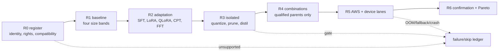
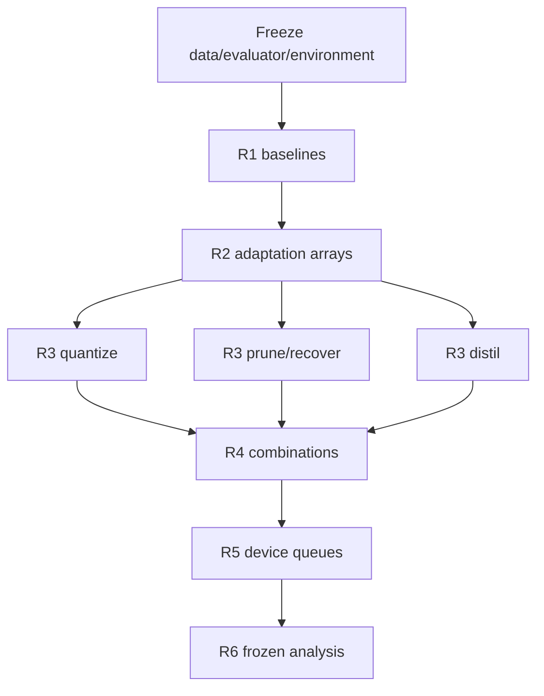

# CH-46: Benchmark Matrix

## 46.1 Contract and honest status

This chapter turns Chapter 45's questions and
[Chapter 32's](../part-08-evaluation-benchmarking-and-research-experiments/ch-32-optimization-experiments-and-ablation-studies.md)
experiment principles into an operational benchmark programme. It covers model scale, training, quantization, pruning,
distillation, combined pipelines, Amazon Web Services (AWS), Android central processing unit (CPU), graphics processing
unit (GPU), and neural processing unit (NPU) paths, iOS, ARM64 Linux, and optional NVIDIA Jetson execution without
constructing an infeasible Cartesian product.

**Research freeze:** 2026-11-23. **Evidence boundary:** the staged run and records are complete illustrative examples,
not project benchmark results, prices, compatibility claims, or winners.

Apply the project [evidence](../../00-governance/evidence-and-citation-standard.md),
[reproducibility](../../00-governance/reproducibility-standard.md),
[safety](../../00-governance/safety-and-risk-standard.md), and
[no-runtime-RAG](../../00-governance/no-runtime-rag-standard.md) standards. Exact checkpoints, licences, tools, devices,
AWS region, and prices are late-bound and must be frozen after current verification. A matrix slot is not permission to
use an artifact.

## 46.2 Definition and staged mechanism

A benchmark row is a versioned tuple

$$
x=(m,a,q,p,d,c,r,h,w,s),
$$

where $m$=model, $a$=adaptation, $q$=quantization, $p$=pruning, $d$=distillation, $c$=ordered combined
pipeline, $r$=runtime, $h$=hardware, $w$=workload, and $s$=seed/trial. It also has an immutable parent,
data/evaluator hashes, controls, budget, gates, and outcome. “4-bit model on a phone” is not a reproducible row.

Cheap identity and quality screens reject weak or invalid candidates before expensive training, conversion,
physical-device, thermal, and human-review work. Every child points to its direct parent. Rejected, failed, unsupported,
and unattempted rows remain visible.

**FIG-CH46-01 — Evidence funnel (`ILLUSTRATIVE`; no measured data).**  
_Alt text:_ four model-size bands enter identity and baseline screens; fewer candidates proceed through adaptation, <!-- markdownlint-disable-line MD013 MD049 -->
compression, device execution, and confirmation.



Staging may miss a weak method that interacts favourably. One pre-registered rescue branch (Section 46.15) limits that
risk without enabling post-hoc cherry-picking.

### A staged example: from 24 ideas to two finalists

This illustrative walkthrough shows how the matrix works. The values teach decisions; they are not measured project
results.

**R0 — register.** The team starts with four model sizes and six candidate runtimes, which could create 24 pairings
before training choices are added. Rights review blocks the 7B checkpoint for edge redistribution. Static compatibility
shows that two runtimes cannot execute the selected architecture. Those cells remain visible as `BLOCKED` or
`UNSUPPORTED`; 15 viable model/runtime ideas remain.

**R1 — establish untouched baselines.** The 300M, 800M, and 2B models are evaluated in source precision. Their
illustrative automotive scores are 48, 61, and 70. The 300M model misses the minimum validation floor of 55. The 800M
and 2B checkpoints become `K1` and `K2`. This is selection on validation, not a test-set claim.

**R2 — adapt only survivors.** Each survivor receives SFT, LoRA, and QLoRA; the 2B model also receives CPT+SFT. Seven
arms are therefore trained instead of applying every method to every original model. After paired validation and safety
gates:

- 800M QLoRA scores 72 and peaks at 1.4 GiB on the reference host;
- 2B LoRA scores 80 and peaks at 3.8 GiB;
- 2B CPT+SFT scores 81 but fails the general-retention margin;
- the other four arms are dominated or fail a gate.

The first two become `A1` and `A2`. The one-point CPT+SFT gain does not survive its hard gate.

**R3 — isolate compression effects.** For each adapted parent, the team creates Q8, Q4-A, and Q4-B children. Structured
pruning is attempted only on `A2`; direct and response-distilled 800M students are compared from the same
initialization. Eleven new transformations replace a much larger cross-product. Illustrative results on one Android
target are:

| Candidate        | Domain score | Peak RAM | Decode | Gate interpretation                         |
| ---------------- | -----------: | -------: | -----: | ------------------------------------------- |
| `A1-FP`          |         72.0 |  2.4 GiB |  6.0/s | quality passes; misses 2 GiB RAM target     |
| `A1-Q4A`         |         71.6 |  1.1 GiB | 10.2/s | qualified                                  |
| `A1-Q4B`         |         69.0 |  1.0 GiB | 10.8/s | quality loss exceeds margin                 |
| `A2-Q4A`         |         79.3 |  2.3 GiB |  6.5/s | qualified for flagship, not low-memory lane |
| `A2-PRUNE20`     |         76.0 |  2.1 GiB |  6.6/s | dominated by its Q4 parent                  |
| `D-RESP-Q4A`     |         73.5 |  1.0 GiB | 11.0/s | qualified; teacher-cost review remains      |

`/s` means generated tokens per second under this one illustrative workload. It is not portable across tokenizers or
devices.

**R4 — test only plausible combinations.** The prune-plus-quantize branch stops because pruning added no meaningful
value. The team tests merged-QLoRA-to-Q4 for both parents and distillation-to-Q4 for the student. It does not test every
order. Parent comparisons show that `A1-Q4A`, `A2-Q4A`, and `D-RESP-Q4A` remain non-dominated.

**R5 — execute target lanes.** The three survivors enter AWS GPU, Android CPU, iOS, and ARM64 CPU lanes. Android
GPU/NPU cells remain registered but are marked `UNSUPPORTED` after placement tracing shows CPU fallback. A crash during
the long-context Android run remains a reliability outcome rather than being removed from timing statistics.

**R6 — confirm and assign roles.** Fresh sealed evaluation and repeated system blocks leave two finalists:

- `A2-Q4A` is the qualified quality-oriented AWS/flagship candidate;
- `A1-Q4A` is the operationally simpler low-memory candidate.

The distilled child loses its apparent quality advantage after uncertainty and reviewer-cost analysis, so it is
`INCONCLUSIVE`, not a failed scientific effort. The report publishes all 24 initial ideas and their final states,
including blocked, unsupported, failed, and budget-stopped cells.

The staged design spent expensive device and expert time on three candidates, while preserving enough parent controls
to explain why each branch advanced or stopped.

## 46.3 Factor catalogue

Prefer one architecture family for scale ablations. Cross-family comparisons are product comparisons confounded by
tokenizer, training data, architecture, and licence.

**TBL-CH46-01 — Matrix factors (`PLANNED EXPERIMENT`).**

<!-- markdownlint-disable MD013 -->
| Factor       | IDs/levels                                            | Exact record                                                       |
| ------------ | ----------------------------------------------------- | ------------------------------------------------------------------ |
| scale        | `XS` 0.1–<0.5B; `S` 0.5–<1.5B; `M` 1.5–<4B; `L` 4–8B  | dense, active, unique parameters; MoE separate                     |
| adaptation   | `B0`, `SFT`, `LORA`, `QLORA`, `CPT-SFT`, `FFT`        | tokens, optimizer, precision, trainable tensors, merge state       |
| quantization | `FP`, `Q8-NATIVE`, `Q4-A`, `Q4-B`                     | format, group, scales, activation/KV precision, exclusions, kernel |
| pruning      | `P-STRUCT10/20`, `P-REC10/20`, conditional `P-SPARSE` | physical shapes/removals, masks, recovery                          |
| distillation | `D-DIRECT`, `D-RESP`, `D-MIX`, conditional `D-LOGIT`  | teacher, accepted tokens, filtering, signal/alignment              |
| combination  | `C-MERGE-Q4`, `C-PREC-Q4`, `C-DQ4`, `C-DPREC-Q4`      | ordered transformations and every parent                           |
| deployment   | ten lanes in TBL-CH46-07                              | runtime, package, device, placement, workload                      |
<!-- markdownlint-restore -->

`Q4-A/B` are two supported 4-bit algorithms/layouts on the same target, selected only after compatibility checks.
Candidates may include GPTQ, AWQ, GGUF/runtime-native, or framework-native formats. AWQ/CUDA versus GGUF/ARM changes
several factors and is not a quantizer-only ablation. Zero weights do not imply sparse speedup without an executing
sparse kernel.

## 46.4 Frozen data, controls, and workloads

Freeze disjoint `train-cpt`, `train-sft`, `general-replay`, `train-distill`, `recover-train`, `cal-quant`, `cal-prune`,
`validation-domain/general/safety/OOD`, sealed `test-domain/general/safety/OOD`, and `perf-prompts`. Group splits by
source document, underlying scenario/entity, template family, and near-duplicate cluster before synthesis/paraphrase. No
test item enters training, teacher generation, calibration, recovery, or selection.

No vector database, retrieval, external lookup, or remote teacher may answer tests. Offline trusted sources and
qualified experts may establish ground truth. Identical evaluation means identical item IDs, rendered semantic prompts,
references, decoding, stop rules, rubric, and evaluator. Report tokenizer-specific counts; never silently truncate.

**TBL-CH46-02 — Workloads (`PLANNED EXPERIMENT`).**

| ID        |    Prompt target | Output cap | Batch/concurrency | Purpose                    |
| --------- | ---------------: | ---------: | ----------------: | -------------------------- |
| `W-S`     | 128 input tokens |         64 |               1/1 | short interaction          |
| `W-M`     |              512 |        128 |               1/1 | standard quality/latency   |
| `W-L`     |            2,048 |        256 |               1/1 | context/KV-cache stress    |
| `W-AWS-C` |       `W-M` text |        128 |  registered sweep | offered-load cloud service |
| `W-SOAK`  |   repeated `W-M` |   128/turn |   1/1, 30 minutes | sustained edge thermals    |

Separate cold launch, first warm run, steady warm runs, and soak. Synchronize asynchronous accelerators. Measure
startup, time to first token (TTFT), prefill/decode tokens/s, end-to-end latency, resident/peak memory,
utilization/placement, crashes/OOM, malformed output, thermal trace, and energy only when instrumented.

## 46.5 R0–R2: registration, baseline, adaptation

R0 records every proposed tuple before expensive work.

<!-- markdownlint-disable MD013 -->
| Check       | Pass condition                                                                              | Failure              |
| ----------- | ------------------------------------------------------------------------------------------- | -------------------- |
| identity    | immutable model/tokenizer/template SHA-256 manifests; finite logits and deterministic smoke | invalid              |
| rights      | reviewed model/data/teacher-output use and redistribution terms                             | blocked              |
| data        | provenance, leakage, duplicates, PII, hazard strata reviewed                                | blocked              |
| toolchain   | pinned trainer/exporter/runtime accepts architecture/operators                              | unsupported          |
| placement   | trace proves intended accelerator and quantifies fallback                                   | fallback/unsupported |
| environment | code, container, lockfile, drivers, firmware, commands, seeds, hardware captured            | unreproducible       |
<!-- markdownlint-restore -->

**TBL-CH46-03 — Exact R1 baseline matrix (`PLANNED EXPERIMENT`).**

| Run ID     | Scale | Variant                    | Advancement |
| ---------- | ----- | -------------------------- | ----------- |
| `R1-XS-B0` | `XS`  | untouched source precision | G1          |
| `R1-S-B0`  | `S`   | untouched source precision | G1          |
| `R1-M-B0`  | `M`   | untouched source precision | G1          |
| `R1-L-B0`  | `L`   | untouched source precision | G1          |

G1 requires identity, functional generation, safety floor, reference-host memory fit, and pre-registered validation
floor. Name at most three validation-ranked survivors `K1..K3`; ranking does not imply test superiority. An unavailable
band remains `UNAVAILABLE`.

**TBL-CH46-04 — Exact R2 adaptation matrix (`PLANNED EXPERIMENT`).**

| Pattern                          | Maximum rows | Control                   | Tier                              |
| -------------------------------- | -----------: | ------------------------- | --------------------------------- |
| `R2-{K1,K2,K3}-{SFT,LORA,QLORA}` |            9 | corresponding `B0`        | small uses K1/K2 (6); medium+ all |
| `R2-{K1,K2}-CPT-SFT`             |            2 | identical SFT without CPT | medium+                           |
| `R2-{K1,K2}-FFT`                 |            2 | same initialization/data  | medium+ if feasible               |

Medium/research has at most 13 adaptation rows. Smoke one seed, then apply Section 46.13 to finalists. LoRA/QLoRA
adapter and merged artifacts require parity checks. An infeasible full fine-tune is `BUDGET-BLOCKED`, not forced into an
unfair configuration. G2 requires domain improvement/non-inferiority, general-retention margin, every safety stratum,
stability, and lineage. Advance at most three adapted parents `A1..A3`, retaining a native-small control.

## 46.6 R3: isolated compression matrices

**TBL-CH46-05 — Quantization (`PLANNED EXPERIMENT`).**

| Pattern                        |               Rows | Control                              |
| ------------------------------ | -----------------: | ------------------------------------ |
| `R3Q-{A1,A2,A3}-FP`            | 3 retained parents | itself                               |
| `R3Q-{A1,A2,A3}-{Q8N,Q4A,Q4B}` |      9 conversions | matching FP parent, same `cal-quant` |

There are 12 artifacts, 9 new conversions. Q4 cells without target kernels are `UNSUPPORTED`. QAT, activation, or
KV-cache quantization are separate research factors. G3Q requires parity, quality/safety margins, real
storage/runtime-memory benefit, and load on an intended target.

**TBL-CH46-06 — Pruning/recovery (`PLANNED EXPERIMENT`).**

| Pattern                 |          Rows | Purpose                                                 |
| ----------------------- | ------------: | ------------------------------------------------------- |
| `R3P-{A1,A2}-{S10,S20}` |             4 | 10%/20% architecture-valid structured removal           |
| `R3P-{A1,A2}-{R10,R20}` |             4 | fixed-budget recovery from matching pruned child        |
| `R3P-{A1,A2}-SPARSE`    | 2 conditional | real sparse kernel versus dense and dense-zero controls |

Record shapes, removed units, parameters, masks, recovery tokens, and serialized size. G3P requires quality/safety and
measured target latency/memory benefit; theoretical sparsity is insufficient.

**TBL-CH46-07 — Distillation (`PLANNED EXPERIMENT`).**

| Pattern              |          Rows | Signal/control                                  |
| -------------------- | ------------: | ----------------------------------------------- |
| `R3D-{S1,S2}-DIRECT` |             2 | expert SFT control, same student initialization |
| `R3D-{S1,S2}-RESP`   |             2 | validated teacher responses                     |
| `R3D-{S1,S2}-MIX`    |             2 | fixed expert/teacher mixture                    |
| `R3D-{S1,S2}-LOGIT`  | 2 conditional | aligned soft targets                            |

Core/medium attempts 6 rows; research 8. Freeze teacher, student, accepted-token budget, filtering, review sample, and
rights. Tokenizer/alignment infeasibility yields `INFEASIBLE`, not an approximate logit method. G3D compares each
distilled student with direct adaptation of the same student under the registered resource policy.

## 46.7 R4: combined pipelines

Only qualified isolated parents enter these exact core rows:

| Run              | Ordered pipeline                       | Required controls                  |
| ---------------- | -------------------------------------- | ---------------------------------- |
| `R4-C1-MERGE-Q4` | LoRA/QLoRA → clean merge → selected Q4 | adapter, merged FP, parent Q4      |
| `R4-C2-PREC-Q4`  | structured prune → recover → Q4        | dense FP/Q4, pruned, recovered     |
| `R4-C3-DQ4`      | distilled student → Q4                 | direct student FP/Q4, distilled FP |
| `R4-C4-DPREC-Q4` | distil → prune → recover → Q4          | every immediate parent and C2/C3   |

Research may add pre-registered `R4-QAT` after PTQ failure and `R4-JOINT-PD`. Reversed order is a new row. For outcome
$Y$,

$$
I_{AB}=(Y_{AB}-Y_A)-(Y_B-Y_0).
$$

`ILLUSTRATIVE`: values 80, 79, 78, 75 give $I_{AB}=-2$; these are teaching numbers, not results. Advance at most six
artifacts `F1..F6`, at most two per target. A combination must improve a target Pareto frontier over every direct
parent.

## 46.8 R5: exact cloud and device matrix

Each `F1..F6` receives one cell in every lane: exactly 60 registered attempts. Unsupported rows remain in the
denominator.

**TBL-CH46-08 — Execution lanes (`PLANNED EXPERIMENT`).**

| Lane         | Hardware/backend intent                        | Workloads and proof                                  |
| ------------ | ---------------------------------------------- | ---------------------------------------------------- |
| `AWS-GPU`    | immutable region/instance GPU; pinned server   | W-S/M/L/AWS-C; GPU placement and offered-load curve  |
| `AWS-CPU`    | immutable region/instance CPU                  | W-S/M/L/AWS-C; ISA, threads/NUMA, CPU placement      |
| `AND-CPU`    | physical mid-range ARM64 Android               | W-S/M/L/SOAK; CPU-only policy                        |
| `AND-GPU`    | same Android where supported                   | same; GPU trace and fallback share                   |
| `AND-NPU`    | physical accessible vendor NPU                 | same; compiled graph/operator placement and fallback |
| `IOS-CPU`    | physical iPhone/iPad                           | same; constrained CPU placement                      |
| `IOS-GPU`    | same iOS device, compatible Metal/Core ML path | same; trace and fallback                             |
| `IOS-ANE`    | same iOS device, ANE where supported           | same; placement evidence                             |
| `ARM-CPU`    | physical Raspberry Pi-class/ARM64 Linux board  | same; board, RAM, cooling, governor                  |
| `JETSON-GPU` | optional Jetson-class module                   | same; module, power mode, clocks, GPU placement      |

Conversion is not acceleration. Report partition boundaries and processor time for tokenization, prefill, decode,
sampling, and KV-cache work.

AWS infrastructure is immutable and automatically torn down. Record region, instance, CPU/GPU and memory, storage,
image/container, driver/toolkit, runtime, replicas, batching, concurrency, and interruptions. Use a separate load
generator. Derive cost only from captured dated billing or official region-specific inputs; this chapter supplies no
price.

For devices, record manufacturer/model/variant, system-on-chip, RAM/storage, OS/build, app/runtime, battery
health/charge/charging, radios, screen, background policy, ambient and device temperatures, case/cooling, power mode,
and free storage. Use physical devices for energy/thermal claims. External instrumentation or documented high-resolution
telemetry is required for joules/token; otherwise energy is unavailable.

## 46.9 Gates

Numeric margins are domain/target fields frozen before R1.

| Gate         | Requirement                                                       |
| ------------ | ----------------------------------------------------------------- |
| `G-ID/FUNC`  | identity/rights/lineage complete; valid load/template/output      |
| `G-DOM`      | primary domain lower bound meets superiority/non-inferiority rule |
| `G-GEN`      | general-retention loss within margin                              |
| `G-SAFE`     | every critical stratum passes; hazards are non-compensatory       |
| `G-MEM/PERF` | peak memory, TTFT, decode, end-to-end, and soak meet target       |
| `G-PLACE`    | intended placement proven; fallback within allowance              |
| `G-REL`      | crash/OOM/timeout/malformed upper bound below target              |
| `G-BUDGET`   | compute, teacher, expert, storage, device ceilings respected      |
| `G-PARETO`   | child is not conservatively dominated and adds meaningful value   |

Pharmacy and hazardous repair require qualified review, escalation, and stricter gates. The model must not prescribe or
authorize dangerous work. Compression does not make learned knowledge complete or current.

## 46.10 Sampling and statistics

Evaluation items, independent training seeds, and system/device blocks are distinct units.

- Smoke one seed; run at least three pre-listed independent training seeds for finalists.
- Pair identical items; bootstrap by the highest leakage-relevant source/scenario cluster and stratify by risk. Use
  McNemar for suitable paired binary outcomes and paired permutation/bootstrap methods for rubric scores.
- Blind/randomize human review; record qualifications, agreement, and adjudication.
- Pilot system variance/autocorrelation, then freeze cold starts, warm repetitions, and device blocks. Randomize
  candidates within thermal blocks. Tokens are not independent trials.
- Pre-register confirmatory families and multiplicity control (for example Holm); other analyses are exploratory.
- OOM/crash/timeout/fallback/malformed output are outcomes. `UNSUPPORTED`, `NOT-RUN-AFTER-GATE`, and `NOT-RUN-BUDGET`
  are distinct.

For higher-is-better quality and margin $\delta>0$,

$$
\Delta=Q_C-Q_B,\qquad C\text{ is non-inferior if }\operatorname{LCB}_{1-\alpha}(\Delta)>-\delta.
$$

A pilot approximation is

$$
n\approx\left(\frac{(z_{1-\alpha}+z_{1-\beta})\sigma_d}{\Delta_{\min}}\right)^2.
$$

Use simulation/hierarchical methods for clustered, bounded, or rare safety outcomes. Report item-, seed-, and
device-block uncertainty separately. Zero observed critical events does not prove zero risk; report counts and a
suitable upper bound. Underpowered means `INCONCLUSIVE`.

## 46.11 Resource budgets

These are programme ceilings, not runtime/feasibility predictions or prices. Accelerator-hour means one accelerator
occupied for one hour; actual hardware/utilization are still reported.

**TBL-CH46-09 — Tier ceilings (`PLANNED EXPERIMENT`).**

<!-- markdownlint-disable MD013 -->
| Resource                    |                     Small |                              Medium |                       Research |
| --------------------------- | ------------------------: | ----------------------------------: | -----------------------------: |
| R1 checkpoints              |                   2 (S,M) |                                   4 |    4 + 4 registered alternates |
| aggregate accelerator-hours |                       120 |                               1,200 |                          8,000 |
| aggregate CPU-hours         |                       300 |                               3,000 |                         20,000 |
| teacher tokens              |                        2M |                                 20M |                           100M |
| qualified expert hours      |                        20 |                                 120 |                            500 |
| retained storage            |                     1 TiB |                               8 TiB |                         40 TiB |
| AWS host-hours              |                        24 |                                 160 |                            800 |
| physical device-hours       |                        30 |                                 240 |                          1,500 |
| Android                     | 1 CPU + accelerator check | low/mid/flagship; GPU and NPU paths |      ≥2 units/key SKU/OS block |
| iOS                         |         1 physical device |            2 generation/RAM classes |             ≥2 units/key class |
| additional edge             |             1 ARM64 board |             ARM64 + optional Jetson | replicated ARM64/Jetson blocks |
| retry reserve               |                       10% |                                 10% |            15%, pre-classified |
<!-- markdownlint-restore -->

Small covers two sizes, SFT/LoRA/QLoRA, Q8/one Q4, one prune or distil branch, AWS, Android CPU, conditional accelerator
check, iOS, and ARM64, but cannot support broad claims. Medium is canonical. Research adds interactions,
logit/sparse/QAT/joint branches, and replication—not unlimited search. Exhaustion stops new work; it never permits
imputation or fabricated/extrapolated measurements.

## 46.12 Scheduling and artifact lineage



**FIG-CH46-02 — Dependency schedule (`ILLUSTRATIVE`).** Alt text: staged experiment branches share prerequisites, run
independent compatible work in parallel, serialize scarce devices, and converge on frozen analysis and release review.
Independent R3 branches run in parallel; each physical device, power instrument, and exclusive accelerator is
serialized. Block by device/day, randomize candidate order, and use a measured cooldown criterion. Run parity
immediately after each transformation. Cache sources read-only by hash, upload logs/checkpoints, use bounded retries,
and freeze the analysis image before unsealing tests.

Artifacts are content-addressed: source → adapter/merged parent → pruned/recovered or distilled child → quantized child
→ runtime package → evaluation bundle → signed release manifest. Each manifest records parents,
code/config/container/data hashes, tensor shapes/counts, adapter/merge state, pruning structures, quantization details,
tokenizer/template, converter/runtime commits, rights/provenance, bytes, signatures, targets, release state, and
rollback parent. Retain raw predictions, traces, failures, and analysis code. Access-control sensitive prompts and
expert notes.

## 46.13 Planned schemas

**Listing CH46-L01 — Plan (`UNVERIFIED IMPLEMENTATION`).** Purpose: immutable row. Dependency: future pinned YAML
1.2/schema validator. Input: resolved values; output: hashed plan. Reject unresolved or mutable revisions. Never embed
secrets.

```yaml
schema: ch46.experiment/v1
status: PLANNED_EXPERIMENT
experiment_id: "ch46-r3q-auto-q4a-2026q4"
run_id: "R3Q-A1-Q4A-seed101"
matrix: { scale: M, adaptation: QLORA, quantization: Q4-A, pruning: none, distillation: none, order: [merge, ptq] }
parents: ["sha256:1111111111111111111111111111111111111111111111111111111111111111"]
source:
  model: { repository: "registry.example/auto-small", revision: "8b7612e", manifest_sha256: "sha256:2222" }
  tokenizer: { revision: "8b7612e", manifest_sha256: "sha256:3333", chat_template_sha256: "sha256:4444" }
datasets:
  train: { revision: "auto-sft-2026q4", manifest_sha256: "sha256:5555" }
  calibration: { revision: "auto-cal-v1", manifest_sha256: "sha256:6666" }
  validation: { revision: "auto-validation-v3", manifest_sha256: "sha256:7777" }
  sealed_tests: ["sha256:8888", "sha256:9999", "sha256:aaaa"]
method: { config_sha256: "sha256:bbbb", precision_group_exclusions: "output projection in FP16" }
seeds: { training: 101, sampler: 1101, generation: 2101, systems: 3101 }
environment: { git_commit: "9c2f7a1", container_digest: "sha256:cccc", lockfile_sha256: "sha256:dddd", versions: { runtime: "1.2.0" } }
hardware: { training_id: "gpu-lab-01", lane: AND-CPU, device_id: "example-phone-m1" }
workload: { ids: [W-S, W-M, W-L, W-SOAK], config_sha256: "sha256:eeee" }
gates:
  {
    domain_margin: "-1.0 rubric point",
    general_margin: "-2.0 rubric points",
    safety: "zero predefined critical failures",
    memory_bytes: 2147483648,
    ttft_p95_ms: 1200,
    decode_tokens_s: 8.0,
    fallback: "none",
  }
statistics: { alpha: 0.05, power: 0.8, family: "rq3-primary", resampling_unit: "scenario-root" }
budget: { accelerator_hours: 24, cpu_hours: 60, device_hours: 40, expert_hours: 16 }
retry_policy_sha256: "sha256:ffff"
```

**Listing CH46-L02 — Result (`UNVERIFIED IMPLEMENTATION`).** Null is unmeasured, never zero. Raw files are
authoritative.

```json
{
  "schema": "ch46.result/v1",
  "evidence": "EXECUTED",
  "experiment_run_matrix": ["ch46-r3q-auto-q4a-2026q4", "b87bf578-3322-45c9-8844-88159e2a584c", "R3Q-A1-Q4A"],
  "plan_sha256": "sha256:1111",
  "artifact_parents": ["sha256:2222", "sha256:3333"],
  "identity_hashes": {},
  "hardware_runtime_workload_hashes": {},
  "placement": { "cpu_fraction": null, "gpu_fraction": null, "npu_fraction": null },
  "raw": [{ "kind": "per_item_quality", "uri": "artifact://examples/ch46/r3q/raw", "sha256": "sha256:4444" }],
  "metrics": {
    "domain_score": { "estimate": null, "ci": [null, null], "unit": "points" },
    "unsafe_compliance": { "events": null, "trials": null, "ci": [null, null] },
    "peak_memory": { "estimate": null, "ci": [null, null], "unit": "byte" },
    "ttft_p95": { "estimate": null, "ci": [null, null], "unit": "ms" },
    "sustained_decode": { "estimate": null, "ci": [null, null], "unit": "token/s" },
    "energy": { "estimate": null, "ci": [null, null], "unit": "J/token" }
  },
  "resources": {
    "accelerator_hours": null,
    "cpu_hours": null,
    "teacher_tokens": null,
    "expert_hours": null,
    "device_hours": null,
    "billed_cost": null,
    "currency_region_price_timestamp": null
  },
  "outcome": "PASS",
  "gates": [],
  "failure_ids": [],
  "review": "unreviewed"
}
```

**Listing CH46-L03 — Failure (`UNVERIFIED IMPLEMENTATION`).**

```yaml
schema: ch46.failure/v1
failure_id: "654fc746-2a80-4dfa-9d29-b3a8807941db"
experiment_run_matrix: ["ch46-r3q-auto-q4a-2026q4", "seed101-attempt2", "R3Q-A1-Q4A"]
artifact_parents: ["sha256:2222", "sha256:3333"]
stage: "benchmark"
classification: "resource"
expected_observed: ["peak RAM <= 2147483648", "process OOM at W-L"]
attempt: 1
retry_allowed: false
environment_hardware_hashes: ["sha256:5555", "sha256:6666"]
logs: [{ uri: "artifact://restricted/ch46/failures/654fc746", sha256: "sha256:7777" }]
impact: "G-MEM/PERF fails for W-L on this cohort"
suspected_cause: "KV-cache peak exceeds the registered RAM envelope"
remediation: "none; preserve as failed cell"
resolved: false
```

## 46.14 Failure policy and R6 reports

Bounded retry applies only to pre-classified infrastructure failures. Preserve NaNs/divergence and seeds; treat
OOM/crash/timeout as reliability outcomes; mark unsupported exports; report accelerator fallback by operator/time;
quarantine output mismatch; retain thermal tails; report energy unavailable without instrumentation; block on critical
safety failure; record budget exhaustion and lost lineage. Never replace a seed after observing it, shorten a prompt
silently, infer joules from latency, or reconstruct identity from a filename. Outlier rules are pre-written; removed
trials remain raw and primary/sensitivity analyses are both shown.

R6 publishes:

1. coverage for every row (`PASS`, `FAIL`, `INCONCLUSIVE`, `UNSUPPORTED`, `NOT-RUN-AFTER-GATE`, `NOT-RUN-BUDGET`);
2. identity/lineage and rollback;
3. paired domain/general/safety/OOD results by risk stratum;
4. separate AWS, Android CPU/GPU/NPU, iOS CPU/GPU/ANE, ARM64, and Jetson systems panels;
5. compute, teacher, expert, storage, device, failure, and dated measured billing resources;
6. machine-readable Pareto sets and uncertainty plots;
7. target decisions, sensitivity, and unresolved risks.

After hard gates, $a$ dominates $b$ if no worse on every objective and better on one. Use conservative uncertain
dominance: bounds must establish no-worse behaviour and meaningful improvement. Build separate fronts by hardware,
runtime semantics, workload/context/concurrency, and thermal mode. Required planned panels are domain-score lower bound
versus peak bytes, p95 TTFT, sustained decode, J/token where measured, and AWS measured cost at declared load. Draw no
points until data exist. Two-dimensional projections are not authoritative.

Name target roles—qualified quality, low-memory Android, sustained mobile, iOS, ARM64, low-concurrency AWS, throughput
AWS, operational simplicity—not a universal winner. Weighted scores are secondary and require frozen weights plus
sensitivity.

## 46.15 Rescue, stopping, implications, and limitations

Pre-register one rescue trigger, resource cap, and analysis before R1. Stop when a simple candidate passes all gates and
added transformations add no conservative Pareto value, or when budget expires. “No qualified candidate” is valid.

Cloud and edge may select different children. File fit, load fit, interactive fit, and sustained fit differ. AWS
emphasizes offered-load/operations; phones emphasize RAM, single-user latency, energy, and thermals. NPU/GPU support is
model-, operator-, runtime-, OS-, and device-specific.

The matrix is bounded, attributable, failure-aware, and target-specific. Limitations are staged survival bias, missed
interactions, validation overfitting, compatibility restrictions, expensive expert/energy evidence, confounded
cross-family scale, limited hardware generalization, and possible contamination. Mitigate with independent validation,
blinded sealed confirmation, one rescue, margin sensitivity, replicated critical devices, and publication of failures.

No benchmark proves factual completeness. Learned knowledge can be stale, conflicting, or unrecalled. Without runtime
RAG, release controls must rely on scope limits, uncertainty/refusal, expert escalation, monitoring, and updates.

## 46.16 Exercises

1. Expand one Android NPU tuple and identify every mutable field.
2. Calculate the naive product of 4 sizes, 5 adaptations, 4 quantizers, 5 pruning levels, 4 distillation methods, 5
   combinations, 10 lanes, 4 workloads, and 3 seeds; explain why it is not a useful plan.
3. Populate R1 with lawful checkpoints without claiming cross-family scale causality.
4. Define different safety margins for low-risk education and pharmacy.
5. Draw lineage for CPT→SFT→prune→recover→Q4→Android.
6. Design pruning×quantization four-cell interaction controls.
7. Explain why CUDA Q4 versus ARM Q4 is not a quantizer ablation.
8. Design an Android NPU placement audit that catches fallback.
9. Randomize a phone thermal schedule with measured cooldown.
10. Perform pilot power analysis and critique it for rare clustered hazards.
11. Validate L02 so null cannot become zero and units cannot mix.
12. Record OOM, unsupported export, fallback, and lost-lineage failures.
13. Bootstrap items by scenario and performance by device block.
14. Produce separate AWS/Android/iOS/ARM64 Pareto reports.
15. Show how a 2-D front hides energy or memory domination.
16. Audit a report that omits failed conversions.
17. Pre-register the rescue rule before seeing outcomes.
18. Write a justified “no qualified candidate” release memo.

**Practical assignment:** implement the schemas, resolve a small-tier plan, perform only authorized identity/static
checks, and make empty reports refuse to draw unexecuted points. Keep code `UNVERIFIED IMPLEMENTATION` until tested.

## 46.17 Sources

Sources establish methods or interfaces, not project results or compatibility. Recheck exact releases at execution.

1. Fisher, R. A. (1935). _The Design of Experiments_. Randomization and controls. <!-- markdownlint-disable-line MD013 MD049 -->
2. Montgomery, D. C. (2017). _Design and Analysis of Experiments_, 9th ed. Wiley. <!-- markdownlint-disable-line MD013 MD049 -->
3. Dror, R. et al. (2018). “The Hitchhiker’s Guide to Testing Statistical Significance in NLP.” _ACL_. <!-- markdownlint-disable-line MD013 MD049 -->
   <https://aclanthology.org/P18-1128/> (`PAPER-REPORTED`).
4. Bouthillier, X. et al. (2021). “Accounting for Variance in Machine Learning Benchmarks.” _MLSys_. <!-- markdownlint-disable-line MD013 MD049 -->
   <https://proceedings.mlsys.org/paper/2021/hash/0184b0cd3cfb185989f858a1d9f5c1eb-Abstract.html> (`PAPER-REPORTED`).
5. Henderson, P. et al. (2020). “Systematic Reporting of Energy and Carbon Footprints.” _JMLR_ 21(248). <!-- markdownlint-disable-line MD013 MD049 -->
   <https://www.jmlr.org/papers/v21/20-312.html> (`PAPER-REPORTED`).
6. Hu, E. et al. (2022), LoRA, <https://arxiv.org/abs/2106.09685>; Dettmers, T. et al. (2023), QLoRA,
   <https://arxiv.org/abs/2305.14314> (`PAPER-REPORTED`).
7. Frantar, E. et al. (2023), GPTQ, <https://arxiv.org/abs/2210.17323>; Lin, J. et al. (2024), AWQ,
   <https://arxiv.org/abs/2306.00978> (`PAPER-REPORTED`).
8. Frantar, E. and Alistarh, D. (2023), SparseGPT, <https://proceedings.mlr.press/v202/frantar23a.html>; Sun, M. et al.
   (2024), Wanda, <https://openreview.net/forum?id=PxoFut3dWW> (`PAPER-REPORTED`; no speed guarantee).
9. Hinton, G. et al. (2015), knowledge distillation, <https://arxiv.org/abs/1503.02531>; Kim, Y. and Rush, A. (2016),
   sequence-level distillation, <https://aclanthology.org/D16-1139/> (`PAPER-REPORTED`).
10. MLCommons Inference: <https://mlcommons.org/benchmarks/inference/> (`DOC-VERIFIED` protocol entry point).
11. AWS EC2/SageMaker/pricing documentation: <https://docs.aws.amazon.com/ec2/latest/instancetypes/instance-types.html>,
    <https://docs.aws.amazon.com/sagemaker/>, <https://aws.amazon.com/pricing/> (`DOC-VERIFIED` entry points; recheck
    region/availability/prices).
12. Android NNAPI and LiteRT: <https://developer.android.com/ndk/guides/neuralnetworks>,
    <https://ai.google.dev/edge/litert> (`DOC-VERIFIED` interfaces; drivers/operators vary).
13. Apple Core ML: <https://developer.apple.com/documentation/coreml> (`DOC-VERIFIED` interface; measure placement).
14. llama.cpp/GGUF: <https://github.com/ggml-org/llama.cpp>; ExecuTorch: <https://docs.pytorch.org/executorch/>; ONNX
    Runtime Mobile: <https://onnxruntime.ai/docs/tutorials/mobile/> (`DOC-VERIFIED` entry points; freeze commits and
    test).
15. NVIDIA Jetson: <https://developer.nvidia.com/embedded/learn/getting-started-jetson> (`DOC-VERIFIED` entry point).

## 46.18 Reading the eventual report

Start with coverage, not the leaderboard. A result is interpretable only when blocked, unsupported, failed, and
budget-stopped cells remain visible beside successful rows. Next inspect hard gates and immediate-parent comparisons.
Only then read target-specific Pareto fronts and uncertainty.

The staged example above is a completed teaching scenario, not project evidence. Real rows require immutable artifacts,
rights and compatibility checks, sealed tests, physical-device and AWS execution, raw traces, and reviewed analysis.
Until those exist, the matrix is an experiment plan and cannot name a production winner.

## Cross-links

- [Part index](README.md)
- [CH-45](ch-45-research-questions-and-hypotheses.md)
- [CH-32](../part-08-evaluation-benchmarking-and-research-experiments/ch-32-optimization-experiments-and-ablation-studies.md)
- [Experiment framework](../../06-experiment-framework/README.md)
- [CH-46 assessment](../../13-assessments/ch-46-assessment.md)
