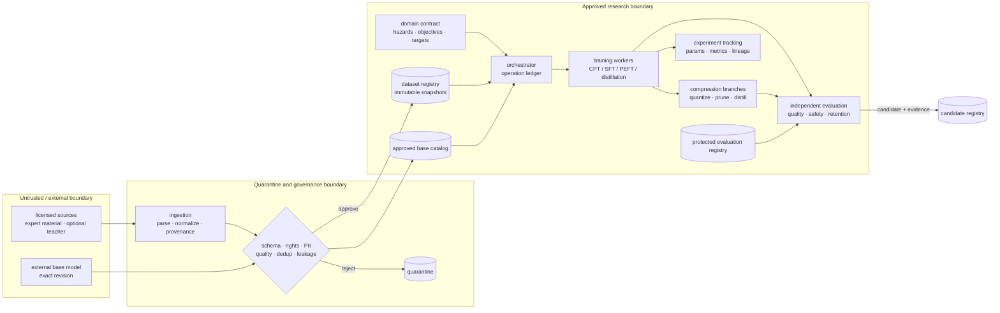
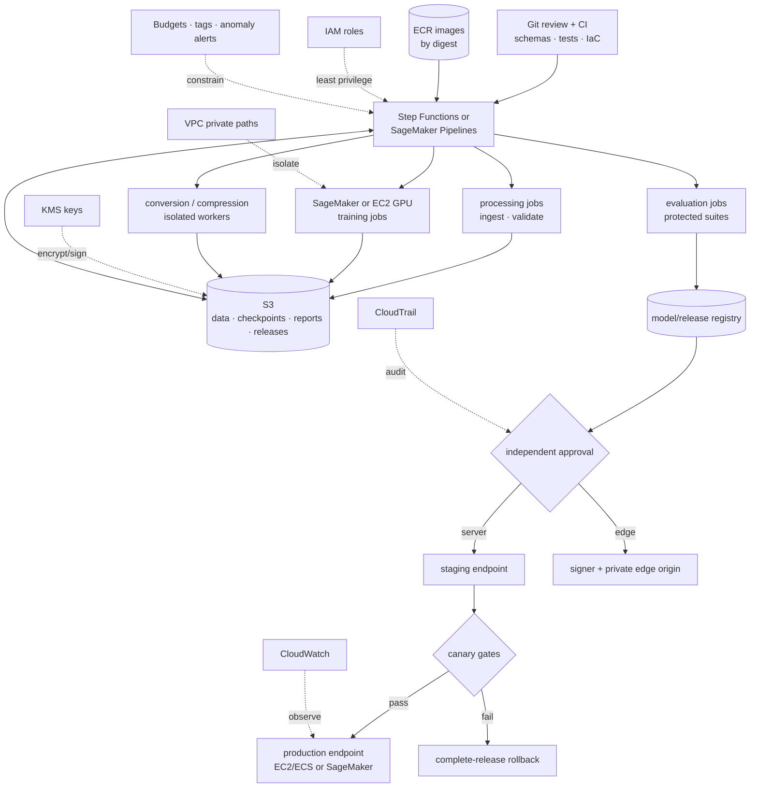
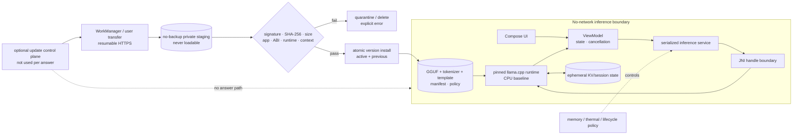
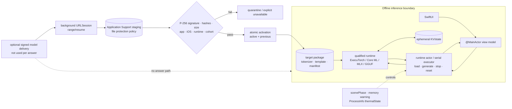
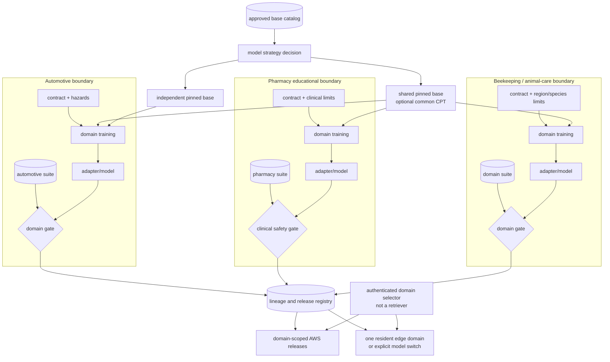
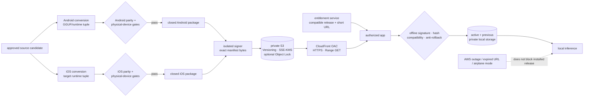
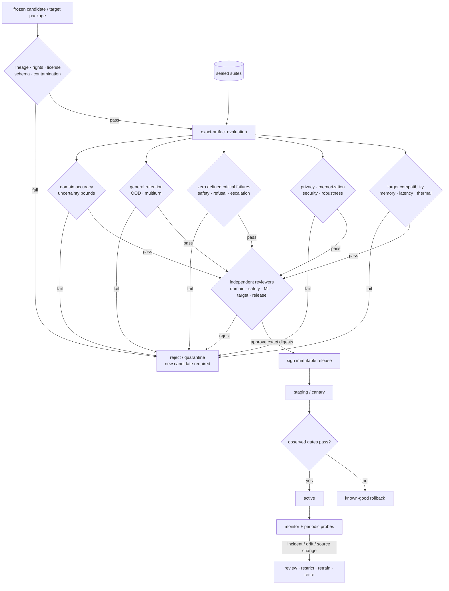

# Chapter 47 — Proposed Production System

**Research cut-off:** 2026-11-23  
**Evidence boundary:** the seven diagrams and filled records are illustrative design artifacts. They explain a
production system but do not claim that a dataset, model, AWS deployment, signed package, phone cohort, or rollback has
been qualified.

This chapter consolidates the platform decisions made in
[CH-28](../part-07-multi-domain-slm-engineering/ch-28-reusable-domain-training-platform.md), target delivery in
[CH-36](../part-09-aws-training-optimization-and-deployment/ch-36-aws-to-edge-model-delivery.md), onboarding in
[CH-41](../part-11-extending-the-platform-to-other-domains/ch-41-new-domain-onboarding.md), and security in
[CH-42](../part-12-production-engineering-safety-and-maintenance/ch-42-model-security-and-reliability.md). It is a
proposed production design, not evidence that those systems exist.

## 47.1 Problem, outcome, and invariants

The platform must repeatedly turn authorized domain material into independently qualified cloud and edge releases:

> **Data acquisition → validation → dataset registry → model selection → domain training → optimization experiments →
> evaluation → model registry → AWS serving or edge export → mobile deployment → monitoring → retraining**

The problem is not merely scheduling training. It is preserving identity and evidence while data, models, conversion
tools, runtimes, applications, and policies change at different rates. A fluent checkpoint is only a candidate. A
release is a closed, immutable, target-specific bundle.

$$
R_t=F(D,E,C,B,H,K,I,P,Q_t,A_t) \tag{EQ-CH47-01}
$$

Here $R_t$ is a release for target $t$; $D$ is the training-data snapshot; $E$ the protected evaluation
snapshot; $C$ the domain contract; $B$ the base model and tokenizer; $H$ resolved hyperparameters; $K$ source
revision; $I$ build/training environment; $P$ product and safety policy; $Q_t$ target-specific qualification; and
$A_t$ approval evidence. Every term is immutable or digest-bound. A mutable alias such as `production` is only a
pointer resolved to one release.

Non-negotiable invariants:

1. Domain capability is learned into weights or adapters; primary inference has no runtime Retrieval-Augmented
   Generation (RAG).
2. Configuration selects reviewed capabilities; it cannot execute arbitrary code.
3. Missing rights, provenance, evaluation, signature, target evidence, ownership, or required approval fails closed.
4. Training, evaluation, approval, signing, and deployment are separate authorities even when one person temporarily
   fills several prototype roles.
5. Cloud, Android, and iOS packages are evaluated independently. Evidence does not transfer merely because source
   weights match.
6. Weights, tokenizer, template, runtime, generation policy, licenses, Software Bill of Materials (SBOM), evidence, and
   predecessor form one release unit.
7. Rollback deploys a complete known-good release; it never edits history or swaps only weights.
8. Monitoring can trigger review, restriction, rollback, retraining, or retirement; telemetry alone never proves factual
   correctness.
9. Training cannot guarantee exact recall. Learned knowledge can be incomplete, stale, conflicting, or hallucinated.
10. Pharmacy remains educational and non-prescribing. Safety-critical repair, industrial, electrical, and animal-care
    outputs require scope limits, authoritative verification, qualified review, and escalation.

## 47.2 One release, end to end

Follow an illustrative automotive release named `auto-android-r12`. This narrative connects all seven diagrams before
the chapter examines each subsystem.

**1. Research and training infrastructure (Figure 27).** A data steward declares two licensed service-training sources
and an expert-authored hazard set. Intake places bytes in quarantine; parsers normalize records without granting
approval. Validation rejects records with unknown rights, groups near-duplicates, and separates the protected
evaluation roots. The approved dataset manifest and an immutable base-model revision enter the orchestrator. It runs an
untouched baseline, LoRA SFT, and two compression branches. Each child points to its parent. Independent evaluation,
not the training worker, produces the first candidate record.

**2. AWS MLOps platform (Figure 28).** The same logical workflow now runs with private S3 artifacts and digest-pinned
containers. A short-lived training role can read the approved training snapshot and write attempt-scoped checkpoints;
it cannot read sealed answers, approve a release, use the signing key, or deploy. An interrupted GPU job resumes from a
committed full-state checkpoint. Evaluation writes a report tied to the exact candidate digest. The registry now holds
a server candidate and an edge-source candidate, not a vague tag such as `latest`.

**3. Offline Android application (Figure 29).** The edge-source candidate is converted to a qualified GGUF/runtime
tuple. The Android app downloads it only as an optional update operation. It verifies the signed manifest, byte length,
hash, app/runtime/ABI compatibility, storage headroom, and anti-rollback sequence before native code can parse the
model. Activation is atomic and retains `r11` as predecessor. A technician can then switch to airplane mode and
generate an answer locally; the network is absent from the answer path.

**4. Offline iOS application (Figure 30).** The source candidate does not reuse Android evidence. A separate export is
qualified for one pinned iOS runtime and device cohort. `URLSession` stages bytes, CryptoKit verifies the package, and a
Swift actor serializes load, generation, cancellation, and reset. Memory warnings and thermal state can stop work
safely. The lesson is not that iOS needs a different model family; it needs its own closed package and target evidence.

**5. Multi-domain management (Figure 31).** A pharmacy team later uses the same platform but a separate domain contract,
data boundary, evaluation suite, safety authority, and release policy. It may share the approved base and use a distinct
adapter, but `base + adapter + tokenizer + policy` is one bound identity. The domain selector chooses among already
approved releases; it never searches documents. Switching an edge domain unloads the first model and clears session
state before loading the next.

**6. Cloud-to-edge distribution (Figure 32).** Android and iOS packages pass their own parity, physical-device, and
safety gates. A separate signer authenticates exact manifest bytes. Private object storage and a delivery layer provide
resumable transfer, while an entitlement service returns only a compatible release. After installation, an AWS outage
does not disable local inference. If `r12` later proves unsafe, connected clients receive a signed higher-sequence
rollback; a permanently offline client remains an explicit residual risk.

**7. Evaluation and release approval (Figure 33).** Before signing, the exact server, Android, and iOS artifacts pass
lineage/rights, domain, general-retention, safety, privacy/security, and target gates. A single predefined catastrophic
repair instruction blocks release even if average accuracy rises. Named reviewers approve exact digests. Cloud begins
with a sticky canary; mobile begins with bounded cohorts. Monitoring can pause, roll back, or propose retraining, but
feedback never flows directly into weights.

The complete loop ends when a source revision or observed failure creates a new dataset and release identity. `r12`
remains immutable for audit and comparison; its correction becomes `r13`. This is the practical meaning of the chapter's
pipeline: every arrow carries identity and evidence, not merely bytes.

## 47.3 Logical planes and component responsibilities

The architecture separates five planes. Separation limits blast radius and makes ownership explicit.

<!-- markdownlint-disable MD013 -->
| Plane               | Carries                                                                        | Principal stores                                      | Rule                                                 |
| ------------------- | ------------------------------------------------------------------------------ | ----------------------------------------------------- | ---------------------------------------------------- |
| Data                | source bytes, canonical records, datasets, protected tests, governed telemetry | immutable object storage and approved metadata        | data never becomes approved by being copied          |
| Artifact            | checkpoints, adapters, exports, containers, packages, reports, SBOMs           | content-addressed object/image stores                 | large bytes are immutable and digest-addressed       |
| Control             | workflows, leases, gates, aliases, deployments, rollback                       | transactional workflow/registry metadata              | control messages contain references, not model bytes |
| Security/governance | identities, policy, rights, signatures, approvals, audit                       | IAM, key service, policy and append-only audit stores | no producer approves its own output                  |
| Observability       | logs, metrics, traces, cost and incidents                                      | bounded-retention monitoring systems                  | prompts and outputs are off by default               |
<!-- markdownlint-restore -->

### Component catalog

<!-- markdownlint-disable MD013 -->
| Component              | Input                                          | Output                                                | Failure behavior                                         | Accountable owner                |
| ---------------------- | ---------------------------------------------- | ----------------------------------------------------- | -------------------------------------------------------- | -------------------------------- |
| Domain configuration   | charter, hazards, sources, objectives, targets | validated domain contract                             | reject unknown or inconsistent fields                    | domain owner                     |
| Data ingestion         | authorized source declarations                 | canonical records plus provenance                     | quarantine malformed or unauthorized material            | data steward                     |
| Data validation        | records, rights, split and quality policy      | validation report and immutable dataset manifest      | fail closed; preserve reason codes                       | data steward and rights reviewer |
| Dataset registry       | approved manifest and shards                   | versioned dataset identity and lineage                | never mutate a published snapshot                        | registry owner                   |
| Model selection        | approved catalog, domain/target constraints    | pinned candidate set and baseline plan                | eliminate license or target incompatibility              | ML owner                         |
| Training orchestration | manifests and resolved config                  | checkpoints, run manifest, final candidate            | resume only from committed complete state                | ML platform owner                |
| Experiment tracking    | run events, metrics, artifacts                 | searchable lineage and comparisons                    | tracking outage must not corrupt authoritative artifacts | ML platform owner                |
| Compression            | candidate, calibration snapshot, method        | derived candidates with parent lineage                | quarantine unsupported or regressed derivatives          | optimization owner               |
| Evaluation             | exact candidate/package, sealed suite          | item results, aggregates, uncertainty, gate evidence  | timeout/missing result is not a pass                     | evaluation custodian             |
| Model/release registry | candidate lineage and evidence                 | candidate, release, alias, retirement records         | prohibit promotion without target evidence               | registry owner                   |
| Artifact packaging     | approved target artifacts                      | closed package, manifest, notices, SBOM               | reject extra, missing, mutable, or unsafe paths          | release engineering              |
| Edge compatibility     | package plus runtime/device matrix             | static, parity, emulator, and physical-device reports | mark untested tuple unsupported                          | mobile target owner              |
| Cloud deployment       | approved server release                        | staging/canary/active deployment                      | reconcile, stop, or roll back                            | SRE                              |
| Mobile integration     | verified local package                         | offline inference and update state                    | explicit unavailable state; no cloud fallback            | Android/iOS owner                |
| Monitoring             | bounded operational and behavior signals       | alerts, incident/retraining proposals                 | preserve privacy; declare blind spots                    | SRE and model-risk owner         |
| Security/governance    | all manifests and transitions                  | policy decisions, signatures, audit                   | deny on ambiguity                                        | security and release authority   |
<!-- markdownlint-restore -->

## 47.4 Required architecture 1 — research and training infrastructure

<a id="fig-27"></a> **FIG-27 — Research and training infrastructure (`ILLUSTRATIVE`; local role: CH-47 architecture
1).**  
_Alt text:_ Authorized offline sources pass through quarantine and validation into immutable dataset and evaluation <!-- markdownlint-disable-line MD013 MD049 -->
registries. A manifest-driven orchestrator selects a base model, trains, tracks experiments, branches into compression
candidates, and submits exact artifacts to independent evaluation.



Bulk data and artifacts move directly between stores and workers; the orchestrator passes signed or authenticated
manifest references. Protected final evaluation data is inaccessible to training workers. Compression is a branch graph,
not a mandatory sequence. A distilled student, a four-bit edge package, and an eight-bit server package can have one
source parent while remaining distinct candidates.

The training worker records model/tokenizer digests, dataset, code, container, driver/framework, hardware, seeds,
precision, resolved configuration, commands, trial status, checkpoint parents, failures, metrics, and outputs. A
resumable checkpoint includes weights, optimizer, scheduler, scaler where used, random-number-generator states,
sampler/data cursor, and manifest commit. A weight file alone is not resumable evidence.

## 47.5 Required architecture 2 — AWS MLOps platform

<a id="fig-28"></a> **FIG-28 — AWS MLOps platform (`ILLUSTRATIVE`; local role: CH-47 architecture 2; capabilities
`DOC-VERIFIED` in CH-33/CH-28).**  
_Alt text:_ Reviewed code and configuration trigger a private AWS workflow. S3 and ECR supply immutable inputs to <!-- markdownlint-disable-line MD013 MD049 -->
processing, GPU training, conversion, and evaluation. A registry and human gate create separate cloud and edge releases.
IAM, KMS, VPC, CloudTrail, CloudWatch, and cost controls span the system.



This is a mapping, not a mandatory service inventory. A small system can use S3, IAM, KMS, VPC, CloudWatch, CloudTrail,
one EC2 GPU, and a script or CI workflow. SageMaker jobs, Step Functions, ECR, ECS, and a managed registry are adopted
only when isolation, orchestration, service lifecycle, or team coordination justifies them. EKS is not a production
prerequisite.

Trust boundaries:

- Git/CI to AWS requires a short-lived deployment identity and reviewed IaC.
- Training can read approved inputs and write attempts, but cannot read sealed final answers, approve, sign, or deploy.
- Evaluation can read protected suites and candidates, but cannot alter either.
- Signing is available only to a narrow release role after immutable approvals.
- Serving reads exactly one approved bundle and cannot mutate registries or training data.
- Edge publication is separate from the cloud endpoint path.

## 47.6 Required architecture 3 — offline Android application

<a id="fig-29"></a> **FIG-29 — Offline Android application (`ILLUSTRATIVE`; local role: CH-47 architecture 3).**  
_Alt text:_ An optional update service deposits bytes into non-loadable private staging. Kotlin verifies the signed <!-- markdownlint-disable-line MD013 MD049 -->
manifest, hashes and compatibility, atomically activates a package, and then a ViewModel drives a serialized JNI and
llama.cpp runtime entirely offline.



The Chapter 20 reference decision remains llama.cpp plus GGUF, Kotlin `Flow`, JNI, and an ARM64 CPU correctness
baseline. GPU/NPU paths require separate artifact and device qualification. The app loads only from app-private
immutable storage after signature, path, size, hash, release-sequence, runtime, ABI, OS, context, memory, and storage
admission. It cancels foreground generation on unsafe lifecycle/thermal transitions and never silently falls back to
AWS.

Android runtime state is `ABSENT → DOWNLOADING → STAGED → VERIFIED → INSTALLED → ACTIVE → HEALTHY`; failures become
`QUARANTINED` or `PREVIOUS`. The native parser never sees partial bytes. Process death destroys native/KV state;
policy-approved conversation messages may reconstruct a session after reload.

## 47.7 Required architecture 4 — offline iOS application

<a id="fig-30"></a> **FIG-30 — Offline iOS application (`ILLUSTRATIVE`; local role: CH-47 architecture 4).**  
_Alt text:_ A background download enters Application Support staging. CryptoKit and policy checks authenticate the <!-- markdownlint-disable-line MD013 MD049 -->
package before atomic activation. SwiftUI communicates through an actor to one qualified local runtime; network services
do not participate in token generation.



Chapter 21 does not select one universal iOS runtime. Core ML, MLX Swift, ExecuTorch, llama.cpp/GGUF, and other
candidates have different conversion and backend contracts. Each package declares exact runtime revision, format,
compute policy, minimum OS, hardware cohort, context, measured memory, and fallback behavior. SwiftUI state is isolated
from native state; generation is serialized; cancellation quiesces native work before reset; backgrounding cancels
foreground inference. No checkpoint/runtime/device tuple is qualified by this diagram.

## 47.8 Required architecture 5 — multi-domain model management

<a id="fig-31"></a> **FIG-31 — Multi-domain management (`ILLUSTRATIVE`; local role: CH-47 architecture 5).**  
_Alt text:_ Domain contracts select an approved shared base or independent base. Automotive, pharmacy, and animal-care <!-- markdownlint-disable-line MD013 MD049 -->
datasets produce isolated adapters or models and separate evaluation suites. A lineage registry branches releases by
domain and target; routing selects already approved artifacts and performs no retrieval.



The default prototype strategy is one approved base plus independent LoRA adapters when licenses, tokenizer,
architecture, and safety boundaries permit. Adapters are always bound to the exact base and merge tool. Pharmacy should
not share an undifferentiated release policy with low-risk educational domains. A multi-domain model or adapter
composition is an experiment, not an assumed improvement; cross-domain interference, forgetting, routing errors,
storage, RAM, switch latency, and safety must be measured.

The selector may choose among already trained, approved releases using an explicit user entitlement or domain ID. It
does not retrieve documents, embed a query, or augment a prompt. Edge devices should initially keep one resident model
because simultaneous models multiply storage and runtime memory; switching unloads and clears KV/session state before
loading another domain.

<a id="478-required-architecture-6-cloud-to-edge-distribution"></a>

## 47.9 Required architecture 6 — cloud-to-edge distribution

<a id="fig-32"></a> **FIG-32 — Cloud-to-edge distribution (`ILLUSTRATIVE`; local role: CH-47 architecture 6; AWS
capabilities `DOC-VERIFIED` in CH-36).**  
_Alt text:_ An approved source candidate branches into target conversion and physical-device qualification. A separate <!-- markdownlint-disable-line MD013 MD049 -->
signer authenticates an immutable manifest and private S3 stores encrypted packages. CloudFront and an entitlement
service authorize download. Android and iOS independently verify, install, retain a predecessor, and infer offline.



The entitlement service authorizes package download; it is not an inference dependency. The signed manifest binds every
artifact, byte length, SHA-256, release sequence, domain, source lineage, runtime, compatibility envelope, measured
target requirements, evidence digests, licenses, SBOM, approvals, and predecessor. TLS protects transport; it does not
replace the detached signature. At-rest encryption does not authenticate bytes after download.

Interrupted download resumes only against the same signed artifact identity. A `206` response must begin at the durable
local offset and report the signed total length; a full `200` during resume causes truncation and restart, never append.
Installation is side-by-side and atomic. Arbitrary downgrade is rejected; controlled rollback uses the exact signed
predecessor or a new higher-sequence manifest referencing known-good bytes.

<a id="479-required-architecture-7-evaluation-and-release-approvals"></a>

## 47.10 Required architecture 7 — evaluation and release approvals

<a id="fig-33"></a> **FIG-33 — Evaluation and release approval (`ILLUSTRATIVE`; local role: CH-47 architecture 7).**  
_Alt text:_ A frozen candidate first passes lineage, rights, and contamination checks, then separate domain, <!-- markdownlint-disable-line MD013 MD049 -->
general-retention, safety, privacy, robustness, and target suites. Independent reviewers approve the exact hashes.
Signing, canary, activation, monitoring, rollback, and retirement follow.



Final suites are sealed and inaccessible to model selection, prompt tuning, calibration, compression choices, and
teacher generation. Safety-critical items use trustworthy ground truth and qualified human review; model judges can
assist triage but cannot solely approve critical correctness. A weighted average cannot compensate for unknown rights,
contamination, a failed required subgroup, or one predefined catastrophic instruction. Zero observed failures is not
proof of zero risk.

## 47.11 Contracts and immutable identities

Use versioned JSON Schema, Protobuf, or equivalent strict contracts. YAML can be a human authoring format but is
validated, resolved, canonicalized, and hashed before execution. Unknown fields fail.

### Core identifiers

| Identity             | Meaning                                                 | Immutability rule                  |
| -------------------- | ------------------------------------------------------- | ---------------------------------- |
| `domain_id`          | stable governed scope                                   | never reused for a different scope |
| `source_snapshot_id` | exact acquired source bytes and rights                  | digest-addressed                   |
| `dataset_id`         | canonical shards plus transformation and split manifest | published snapshots never change   |
| `base_model_id`      | weights, tokenizer, config, license, exact revision     | family name is insufficient        |
| `run_id`             | one resolved experiment                                 | retries use distinct attempt IDs   |
| `candidate_id`       | one trained/compressed/exported artifact                | content and lineage bound          |
| `release_id`         | approved closed bundle for one target                   | append-only; never overwritten     |
| `deployment_id`      | release in environment/cohort                           | state changes are events           |
| `alias`              | mutable convenience pointer                             | resolved once and recorded         |

### Required manifests

- **Source manifest:** origin, owner, acquisition method/date, version, license/rights decision, restrictions, digest,
  extractor, privacy class, expiry.
- **Dataset manifest:** source parents, transformation code, shard hashes, schemas, split families, deduplication,
  leakage/PII/contradiction reports, synthetic provenance, coverage, rejects, approvals.
- **Run manifest:** resolved config, code/tree state, container/dependencies, model/tokenizer, data, hardware/runtime,
  seeds, precision, command, checkpoints, metrics, failures, outputs.
- **Evaluation report:** suite and candidate digests, evaluator environment, prompts/decoding, item outcomes,
  aggregates, confidence intervals, subgroups, critical failures, reviewers, gate decisions.
- **Release manifest:** candidate lineage, every package file, tokenizer/template/runtime/policy, compatibility, limits,
  reports, licenses/notices, SBOM, checksums, signatures, approvals, predecessor, rollback and retirement.
- **Deployment record:** release, target/environment/cohort, desired and observed state, canary metrics, owner,
  timestamps, incidents, rollback.

### Listing CH47-L01 — Domain and release policy

**Status:** illustrative implementation. **Purpose:** demonstrate declarative domain onboarding and separate target
gates. The filled values form one coherent teaching record; hashes and thresholds are not project evidence. A
production schema must reject unauthorized roles, mutable references, and invalid combinations.

```yaml
schema_version: "domain-contract/1.0"
domain:
  id: automotive_education
  owner: role:automotive-domain-owner
  intended_use: [component_education, non_authoritative_diagnostic_sequencing]
  prohibited_use: [return_to_service_authority, safety_system_bypass]
  knowledge_cutoff: "2026-09-30"
risk:
  highest_tier: R4
  escalation: [airbag, brake_hydraulics, high_voltage, fuel_leak, unsupported_load]
data:
  source_manifest: { uri: "artifact://source/auto/v1", sha256: "1111111111111111111111111111111111111111111111111111111111111111" }
  unknown_rights_records_max: 0
  evaluation_family_overlap_max: 0
model:
  base: { id: "registry://base/auto-small", revision: "8b7612e", sha256: "2222222222222222222222222222222222222222222222222222222222222222" }
training:
  stages: [baseline, sft_lora]
  seeds: [17, 29, 41]
  code_revision: "9c2f7a1"
  container_digest: "sha256:3333333333333333333333333333333333333333333333333333333333333333"
evaluation:
  suite: { uri: "artifact://eval/auto/v1", sha256: "4444444444444444444444444444444444444444444444444444444444444444" }
  critical_failures_max: 0
  domain_lower_bound_min: 0.78
targets:
  - id: aws_realtime
    runtime: "vllm@0.12.0"
    canary_policy: "auto-canary-v2"
  - id: android_arm64
    runtime: "llama.cpp@8e4d2ab"
    format: "GGUF Q4_K_M"
    device_matrix: "auto-android-v1"
  - id: ios
    runtime: "ExecuTorch@1.0.0"
    format: "PTE int4-weight-only"
    device_matrix: "auto-ios-v1"
no_runtime_rag:
  required: true
  prohibited:
    [
      vector_database,
      embedding_search,
      dynamic_document_retrieval,
      retrieval_prompt_augmentation,
      remote_teacher_fallback,
    ]
approvals:
  required:
    [
      role:data-steward,
      role:rights-reviewer,
      role:domain-expert,
      role:safety-reviewer,
      role:ml-reviewer,
      role:target-owner,
      role:release-authority,
    ]
```

### Listing CH47-L02 — Backend-neutral stage envelope

**Status:** `UNVERIFIED IMPLEMENTATION`. **Purpose:** keep local and AWS execution semantically equivalent. Inputs and
outputs are immutable references. Serialization, authentication, operation-ledger storage, and retry behavior require
implementation and tests.

```json
{
  "contract": "stage-request/1.0",
  "operationId": "01JEXAMPLE",
  "attemptId": "attempt-0002",
  "stage": "model.evaluate",
  "implementation": "evaluation-runner/3.1",
  "inputs": [
    { "uri": "artifact://candidate/auto-q4a-r12", "sha256": "5555555555555555555555555555555555555555555555555555555555555555", "schema": "candidate/2.0" },
    { "uri": "artifact://eval/auto/v1", "sha256": "4444444444444444444444444444444444444444444444444444444444444444", "schema": "suite/2.0" }
  ],
  "resolvedConfig": { "uri": "artifact://config/run.json", "sha256": "6666666666666666666666666666666666666666666666666666666666666666" },
  "policy": { "uri": "artifact://policy/release.json", "sha256": "7777777777777777777777777777777777777777777777777777777777777777" },
  "idempotencyKey": "sha256:8888888888888888888888888888888888888888888888888888888888888888",
  "outputPrefix": "artifact://attempts/01JEXAMPLE/attempt-0002/"
}
```

The result is one of `succeeded`, `failed`, `cancelled`, or `indeterminate`. Only a digest-verified, schema-valid,
conditionally committed `succeeded` result can advance. `indeterminate` never passes.

## 47.12 Data, control, and artifact flows

### Data flow

1. Intake writes raw bytes to an immutable landing area and a source manifest.
2. Isolated parsers emit canonical records with source, rights, extractor, content digest, parents, language, effective
   date, and warnings.
3. Validators check schema, rights, privacy, archive safety, quality, duplicates, contradictions, split families,
   leakage, contamination, and taxonomy coverage.
4. Approved records become objective-specific datasets: continued pretraining, SFT, preference, distillation,
   calibration, and evaluation remain distinct.
5. Protected evaluation data is stored under a separate identity and access boundary.
6. Privacy-minimized field signals may create proposed evaluation cases or retraining requirements only after a governed
   review; they do not flow directly into training.

### Control flow

1. The domain owner submits a reviewed contract.
2. The orchestrator resolves aliases and configuration to immutable digests.
3. The operation ledger grants a bounded lease for one attempt.
4. A worker reads allowed inputs, writes attempt-scoped outputs, and reports evidence.
5. The orchestrator verifies digest, schema, policy, and idempotency before conditional commit.
6. Gate services calculate machine-checkable decisions; named humans approve non-automatable rights, domain, safety,
   target, and release judgments.
7. Promotion creates a release and changes a pointer only after signing and target gates.

### Artifact flow

Base model → training checkpoint → trained candidate → compression derivative → target export → package → signed release
→ deployment. Every edge in this lineage records parent digest, tool/version, configuration, calibration data,
environment, output digest, and before/after evaluation. Converters and quantizers never overwrite their parent.

## 47.13 State machines and transition rules

### Dataset state

`DISCOVERED → ACQUIRED → QUARANTINED → VALIDATED → APPROVED → PUBLISHED → DEPRECATED → RETIRED`

- Rights, PII, corruption, or leakage failure moves to `REJECTED`, not `APPROVED_WITH_WARNING`.
- A changed record creates a new snapshot.
- Rights revocation marks affected snapshots and triggers descendant tracing; history remains auditable.

### Run state

`PLANNED → RESOLVING → RUNNING ↔ CHECKPOINTED → SUCCEEDED | FAILED | CANCELLED | INDETERMINATE`

- `CHECKPOINTED` requires complete resumable state and committed manifest.
- Resume creates a new attempt with a parent.
- OOM retries only with a newly recorded resource/configuration plan.

### Candidate and release state

`BUILT → QUARANTINED → EVALUATING → QUALIFYING → PENDING_APPROVAL → APPROVED → SIGNED → RELEASED → DEPRECATED → RETIRED`

Any failed gate creates `REJECTED`. Repair creates a new candidate. `APPROVED` is not `RELEASED`; signing and target
packaging remain separate.

### Deployment state

`PLANNED → PROVISIONING → VERIFYING → CANARY → ACTIVE → DRAINING → INACTIVE`

Failures transition to `STOPPED`, `ROLLED_BACK`, or `FAILED`. Before retrying a partial deployment, reconcile actual
resources and traffic. An active incident may also transition to `SUSPENDED`.

### Edge installation state

`ABSENT → DISCOVERED → DOWNLOADING ↔ PAUSED → STAGED → VERIFIED → INSTALLED → ACTIVE → HEALTHY`

Invalid bytes transition to `QUARANTINED`; failed activation transitions to the signed `PREVIOUS` release. The app
retains the predecessor until the health window closes. A disconnected device cannot learn immediate revocation.

## 47.14 Reliability, recovery, and consistency

Every mutating task accepts an operation ID, input digests, idempotency key, deadline, attempt ID, and attempt-scoped
output prefix. The ledger:

- returns an existing committed result for the same operation and inputs;
- rejects the same operation ID with different inputs;
- refuses a concurrent live duplicate;
- reconciles an expired lease;
- verifies output before atomically committing a small manifest.

Retry policy:

<!-- markdownlint-disable MD013 -->
| Failure                                    | Retry                                         | Required action                               |
| ------------------------------------------ | --------------------------------------------- | --------------------------------------------- |
| transient throttling/network               | bounded exponential backoff, jitter, deadline | retain same immutable inputs                  |
| worker/Spot interruption                   | resume from last committed checkpoint         | new attempt, recorded parent                  |
| OOM/disk exhaustion                        | no identical retry                            | approve changed resource/config plan          |
| schema, rights, license, safety, signature | no blind retry                                | correct input, narrow scope, or reject        |
| evaluator timeout                          | diagnostic retry allowed                      | original evidence remains missing/failed      |
| partial deployment                         | reconcile first                               | continue safely or roll back                  |
| mobile corruption/low storage              | no activation                                 | preserve active package; retry exact identity |
<!-- markdownlint-restore -->

Recovery objectives are explicit per plane. Research jobs may accept single-AZ compute because S3 holds checkpoints; a
synchronous API may require multi-AZ replicas. Cross-Region recovery requires replicated approved artifacts,
keys/policies, IaC, stated recovery time objective (RTO), recovery point objective (RPO), and exercises. “Managed” and
“regional” do not prove availability.

Disaster-recovery evidence includes restore from registry backup, KMS/key-lifecycle recovery constraints, rebuild from
manifests, deployment of a known-good server release, edge signer rotation, and audit-log continuity. S3 Object Lock
cannot compensate for deletion of a required encryption key.

## 47.15 Ownership and separation of duties

| Decision                     | Responsible             | Accountable          | Required consultation          |
| ---------------------------- | ----------------------- | -------------------- | ------------------------------ |
| intended/prohibited use      | domain specialist       | domain owner         | safety, legal/privacy, product |
| source admission and rights  | data steward            | rights owner         | domain, privacy, security      |
| dataset approval             | data engineering        | data owner           | evaluation custodian           |
| model strategy and run       | ML engineer             | ML owner             | domain, platform               |
| final-suite custody/scoring  | evaluation team         | evaluation custodian | qualified experts              |
| safety acceptance            | safety reviewer         | model-risk owner     | domain experts                 |
| target qualification         | runtime/mobile/SRE team | target owner         | ML, security                   |
| release signing/promotion    | release engineer        | release authority    | all gate owners                |
| cloud operation              | SRE                     | service owner        | security, model-risk           |
| incident suspension/rollback | incident commander      | lifecycle owner      | release and domain owners      |
| retraining/retirement        | lifecycle team          | lifecycle owner      | rights, domain, SRE            |

In a prototype, one person can perform multiple tasks, but the record still names which role they exercised. The same
identity must not produce, solely evaluate, approve, sign, and deploy a high-risk release. Signing keys are not
available to CI build jobs.

## 47.16 Security and governance architecture

Principal threats are poisoned or unlicensed data, malicious archives/checkpoints, dependency compromise, cross-domain
access, exposed sealed tests, unauthorized promotion, artifact substitution, signer compromise, secret leakage, API
abuse, model extraction, memorization, unsafe prompts, and telemetry leakage.

Required controls:

- quarantine external files; reject executable serialization; prefer safe tensor formats where supported; parse in
  isolated, bounded workers;
- pin source, dependency, container, converter, runtime, mobile SDK, and IaC identities; produce SBOM and provenance;
- short-lived workload identities, least privilege, narrowly conditioned `iam:PassRole`, private paths where justified,
  and separate production authority;
- encrypt sensitive storage and transport; sign exact release-manifest bytes with a separately governed asymmetric key;
- bind weights, tokenizer, template, runtime, generation/safety policy, licenses, evidence, and predecessor;
- scan package paths, links, count, dimensions, metadata, and decompression bounds before native parsing;
- protect final suites from training and selection; audit access;
- default to metadata-only logs; no prompts, outputs, patient/customer identifiers, bearer tokens, signed URLs, or model
  bytes;
- rate, token, concurrency, context, output, and spend limits for cloud inference;
- app-private edge storage, anti-rollback sequence, atomic activation, and explicit extraction limitations;
- incident playbooks for poisoning, privacy leakage, unsafe release, signer compromise, parser vulnerability, rights
  revocation, and model/API abuse.

Authenticity does not prove safety. Encryption does not prove provenance. A model card does not prove legal
authorization. Consumer-device confidentiality is limited: if a device can infer from plaintext or mapped weights, a
capable controller may extract them.

<a id="4716-no-runtime-rag-enforcement"></a>

## 47.17 No-runtime-RAG enforcement

Permitted offline activities are source discovery, acquisition, dataset preparation, teacher synthesis, expert
validation, contamination research, and external ground-truth evaluation. Permitted runtime operations are tokenization,
local/cloud model inference, policy checks, and explicitly approved deterministic non-retrieval tools such as arithmetic
or unit conversion.

Prohibited primary inference paths are:

- vector databases or local bundled semantic indexes;
- embeddings used to search documents;
- runtime document or chunk selection;
- retrieval prompt augmentation;
- HTTP/database/tool calls that fetch knowledge for an answer;
- a remote teacher or general model silently answering for the specialist SLM.

Enforcement is defense in depth:

1. domain schema requires the prohibition;
2. architecture review traces user input to output;
3. source/dependency/SBOM scans detect retriever and vector-store clients;
4. package inspection detects corpora, chunk stores, and indexes;
5. cloud IAM and egress policy deny search/document/teacher services;
6. mobile applications operate with denied network during qualification;
7. runtime traces prove no per-answer knowledge call;
8. adversarial prompts attempt to invoke URL, document, search, or fallback paths;
9. missing/corrupt local assets produce explicit unavailability, never cloud substitution;
10. release approvals bind the no-RAG attestation digest.

This constraint has a cost: factual updates require a newly trained and qualified release. The UI exposes model version
and knowledge cut-off. Consequential claims require current authoritative verification outside the generation path and
qualified escalation; the system does not pretend parameterized knowledge is an exact database.

## 47.18 Evaluation, monitoring, and retraining loop

Pre-release evaluation covers domain capability, safety-critical precision, uncertainty/refusal, applicability, general
retention, OOD, adversarial behavior, multi-turn consistency, privacy/memorization, security, compression regression,
and exact-target compatibility. Metrics include denominators, uncertainty, subgroup and worst-group outcomes, and
critical-failure IDs.

Post-release monitoring has four layers:

<!-- markdownlint-disable MD013 -->
| Layer               | Signals                                                                      | Limitation                            |
| ------------------- | ---------------------------------------------------------------------------- | ------------------------------------- |
| Operational         | readiness, errors, queue, TTFT, decode, memory, OOM, restarts, cost          | does not establish truth              |
| Behavioral          | curated probes, expert sample, refusals, escalation, incident reports        | labels are delayed and sampled        |
| Knowledge/freshness | source revisions, recalls, regulations, taxonomy and task drift              | parameters cannot self-update         |
| Edge fleet          | package integrity, app/runtime version, crashes, update state, device cohort | offline devices may emit no telemetry |
<!-- markdownlint-restore -->

Raw prompts and answers are not collected by default. Feedback is untrusted input, never automatic training data. A
review pipeline classifies consent, privacy, rights, provenance, abuse, representativeness, and expert labels before it
can create a future dataset.

Retraining triggers include authoritative source change, rights change, safety incident, sustained approved-probe
regression, new domain coverage requirement, unsupported runtime/OS, security vulnerability, or scheduled evidence
expiry. Retraining repeats the full lifecycle; it is not in-place continual learning on production traffic. The old
release remains available for comparison and rollback unless rights or security policy requires quarantine.

<a id="4718-cost-and-edge-trade-offs"></a>

## 47.19 Cost and edge trade-offs

The architecture deliberately avoids hard-coded prices and unmeasured device claims. Total lifecycle cost is:

$$
C_{\text{life}}= C_{\text{data}}+C_{\text{expert}}+C_{\text{train}}+C_{\text{eval}}+
C_{\text{convert}}+C_{\text{device-lab}}+C_{\text{serve}}+ C_{\text{delivery}}+C_{\text{observe}}+C_{\text{maintain}}.
\tag{EQ-CH47-02}
$$

Cloud request cost is not only accelerator price:

$$
C_{\text{request}}= \frac{C_{\text{fixed period}}+C_{\text{variable period}}} {N_{\text{successful requests}}}.
\tag{EQ-CH47-03}
$$

Edge update storage must include coexistence:

$$
S_{\text{peak}}=S_{\text{active}}+S_{\text{previous}}+ S_{\text{partial}}+S_{\text{staged}}+S_{\text{unpacked}}+
S_{\text{temporary}}+S_{\text{margin}}. \tag{EQ-CH47-04}
$$

<a id="tbl-25"></a> **TBL-25 — Production architecture choices (`STATICALLY REVIEWED`; benefits and risks are
engineering hypotheses until the stated evidence is produced).**

<!-- markdownlint-disable MD013 -->
| Choice                               | Benefit                                        | Cost or risk                                           | Evidence required                            |
| ------------------------------------ | ---------------------------------------------- | ------------------------------------------------------ | -------------------------------------------- |
| LoRA/QLoRA before full tuning        | lower initial training resource need           | merge/base coupling and possible quality gap           | fixed-data paired experiment                 |
| Distillation to a smaller edge model | lower potential memory/latency                 | teacher generation, training, and quality loss         | student-versus-native baseline               |
| 4-bit edge weights                   | lower storage and weight bandwidth             | format/kernel dependence and output regression         | exact runtime/device quality and performance |
| Cloud serving                        | centralized patching, batching, telemetry      | recurring accelerator/network cost and prompt exposure | measured workload and dated rates            |
| Offline edge                         | privacy, availability, zero per-answer network | device lab, distribution, extraction, staleness        | physical-device matrix and update drills     |
| One shared base plus adapters        | lower storage/training duplication             | base coupling and domain interference                  | per-domain and cross-domain evaluation       |
| Independent models                   | isolation and independent updates              | more storage, training, and operations                 | lifecycle cost and safety comparison         |
| Bundled mobile model                 | first-launch offline                           | application size and coupled updates                   | store/install constraints                    |
| Post-install package                 | cohorts and independent cadence                | updater, peak storage, entitlement                     | interruption, atomicity, rollback tests      |
<!-- markdownlint-restore -->

The “best” model is target-dependent. A server release may favor quality and batching; a low-end phone may favor a
smaller student; a flagship device may accept a larger quantized model. Selection uses a Pareto frontier across domain
quality, critical safety, storage, peak memory, TTFT, decode, sustained thermal/energy behavior, compatibility,
training/serving cost, and maintenance burden. No variant is declared optimal until measured under controlled
conditions.

## 47.20 Prototype-to-production roadmap

### Stage 0 — local contract prototype

One domain, one approved base candidate, tiny authorized sample, CLI orchestration, local object directories with
hashes, one SQLite/MLflow-like tracker, CPU smoke tests, and manual signed gate records.

Exit criteria: schemas reject bad fixtures; stable split and leakage checks work; run manifest reconstructs inputs;
untouched baseline and one SFT/PEFT run are planned; no-RAG static test passes. No production claim.

### Stage 1 — one-domain AWS experiment

Add private S3, IAM, KMS, VPC, CloudWatch, CloudTrail, encrypted work storage, one right-sized GPU path, and IaC. ECR is
added if containers are used. Exercise forced interruption and checkpoint recovery.

Exit criteria: immutable artifacts, least-privilege access, termination/resume evidence, evaluation separation, actual
dated usage/cost record, cleanup.

### Stage 2 — repeatable research factory

Add backend-neutral stage contracts, operation ledger, shared tracking, digest-pinned images, independent evaluation
service, branch compression experiments, candidate registry, policy-as-code, and CI contract/security tests.

Exit criteria: duplicate/crash tests, lineage reconstruction, two materially different domains without pipeline copies,
protected final suites, target-independent candidate records.

### Stage 3 — first controlled release

Add target packaging, SBOM/provenance, asymmetric signing, cloud staging/canary, one Android and one iOS reference path,
physical-device lab, updater interruption tests, complete rollback, incident runbooks, and recorded human approvals.

Exit criteria: exact release tuples pass all gates; offline network-denial test; cloud canary rollback; mobile atomic
rollback; signer rotation rehearsal; privacy/security/safety review.

### Stage 4 — multi-domain production

Add self-service domain pull requests, quotas, separate accounts/environments, domain isolation, fleet compatibility
matrix, automated descendant tracing, lifecycle expiry, regular probes, support and retirement.

Exit criteria: RACI and on-call coverage, capacity and recovery exercises, rights-revocation drill, model/runtime
inventory, per-domain safety case, measured cost controls.

### Stage 5 — evidence-driven optimization

Only measured bottlenecks justify multi-node training, EKS, specialized accelerators, advanced quantization,
distillation, structured pruning, multi-adapter serving, or multi-domain models. Each addition has an architecture
decision record, rollback, owner, and deletion criterion.

### How the architecture evolves without being rewritten

The stages add controls around a stable core rather than replacing it:

- the local folder becomes immutable object storage, but content hashes and manifests stay;
- a CLI call becomes a leased workflow operation, but inputs and outputs remain digest-bound references;
- one person records several prototype roles, then separate identities enforce those same roles;
- manual evaluation becomes an isolated service, but the sealed-suite boundary remains;
- a copied mobile file becomes a signed, resumable, atomic update, but offline inference stays local;
- a manual release note becomes a registry state transition, yet rollback still restores a complete predecessor;
- one domain contract becomes a self-service contract schema, while each domain retains independent rights and safety
  gates.

This continuity is why Stage 0 should not be a throwaway notebook. If the prototype already preserves identities,
parents, decisions, and failures, production adds scale and enforcement. If the prototype relies on mutable filenames
and oral approvals, moving it to AWS only automates ambiguity.

## 47.21 Acceptance and failure-injection plan

All items are `PLANNED EXPERIMENTS`:

1. Onboard automotive and pharmacy without copied orchestration; prove distinct rights and safety policy.
2. Reject unknown configuration, mutable base revision, unknown rights, exposed evaluation, and missing owner.
3. Kill each stage before upload, during upload, before commit, and after commit; prove no corrupt committed result.
4. Send duplicate operations and conflicting operation IDs; prove idempotent or rejected outcomes.
5. Interrupt GPU training; verify full-state resume and record expected nondeterminism.
6. Corrupt checkpoint, tokenizer, template, package, signature, SBOM, and approval digest independently.
7. Prove training, evaluation, and deployment roles cannot approve or sign.
8. Inject one predefined critical safety failure and prove aggregate metrics cannot promote it.
9. Abort an AWS canary and restore the full known-good release.
10. Interrupt Android/iOS range downloads, exhaust storage, kill the app at every journal state, and prove partial bytes
    never load.
11. Attempt arbitrary downgrade and controlled signed rollback.
12. Run exact package parity and physical-device memory, latency, energy-boundary, and sustained thermal tests.
13. Deny DNS/network after installation and prove inference, reset, and multi-turn operation remain local.
14. Scan dependencies, packages, permissions, IAM, traces, and adversarial inputs for disguised retrieval or teacher
    fallback.
15. Rotate signing keys, revoke a release, and document the unavoidable disconnected-device delay.
16. Revoke a source right and trace every dataset, candidate, package, cloud deployment, and edge release descendant.
17. Restore registries and approved artifacts from backup under declared RTO/RPO.
18. Retire a domain and prove new cloud use and edge installs stop while evidence remains under retention policy.

<a id="4721-engineering-exercises"></a>

## 47.22 Engineering exercises

1. Implement schemas for domain, dataset, run, evaluation, release, and deployment manifests; create 50 invalid
   fixtures.
2. Design the operation ledger transaction for crashes before and after output commit.
3. Draw lineage for one base, two SFT runs, three quantizers, two runtimes, and three targets.
4. Write least-privilege role policies for ingestion, training, evaluation, signing, deployment, and rollback.
5. Extend CH47-L01 for pharmacy education and justify every stronger gate.
6. Create a source-rights revocation query that returns all derivatives and active deployments.
7. Implement a deterministic manifest builder and offline verifier without parsing model bytes before authentication.
8. Design server, Android, and iOS compatibility manifests and explain why evidence cannot be shared blindly.
9. Build a cost worksheet using dated official rates and measured usage; include expert, device-lab, failed-run,
   storage, observability, and maintenance cost.
10. Compare an independent-model strategy with shared-base adapters for four domains under storage, RAM,
    safety-isolation, and update constraints.
11. Threat-model a “deterministic tool” that secretly performs document lookup; add static and dynamic enforcement.
12. Run a paper incident drill for an unsafe pharmacy release on devices that may remain offline for six months.
13. Specify a privacy-preserving feedback process that cannot directly become training data.
14. Define Pareto selection rules for low-end Android, modern iPhone, and a small AWS endpoint without inventing
    benchmark values.

## 47.23 Sources

Sources below were accessed or recency-checked in the authored chapters on 2026-11-23. `DOC-VERIFIED` means
documentation supports the stated capability; no project deployment was reproduced.

### AWS and orchestration

- **AWS:**
  [Step Functions service integrations](https://docs.aws.amazon.com/step-functions/latest/dg/integrate-services.html)
  and [error handling](https://docs.aws.amazon.com/step-functions/latest/dg/concepts-error-handling.html).
  `DOC-VERIFIED`.
- **AWS SageMaker AI:** [Model Registry](https://docs.aws.amazon.com/sagemaker/latest/dg/model-registry.html),
  [training checkpoints](https://docs.aws.amazon.com/sagemaker/latest/dg/model-checkpoints.html), and
  [deployment options](https://docs.aws.amazon.com/sagemaker/latest/dg/deploy-model-options.html). `DOC-VERIFIED`.
- **AWS:** [S3 security](https://docs.aws.amazon.com/AmazonS3/latest/userguide/security-best-practices.html),
  [S3 Object Lock](https://docs.aws.amazon.com/AmazonS3/latest/userguide/object-lock.html),
  [ECR tag immutability](https://docs.aws.amazon.com/AmazonECR/latest/userguide/image-tag-mutability.html),
  [IAM best practices](https://docs.aws.amazon.com/IAM/latest/UserGuide/best-practices.html),
  [CloudTrail](https://docs.aws.amazon.com/awscloudtrail/latest/userguide/cloudtrail-user-guide.html), and
  [CloudWatch](https://docs.aws.amazon.com/cloudwatch/). `DOC-VERIFIED`.
- **AWS KMS:** [Sign](https://docs.aws.amazon.com/kms/latest/APIReference/API_Sign.html),
  [asymmetric keys](https://docs.aws.amazon.com/kms/latest/developerguide/symmetric-asymmetric.html), and
  [manual rotation](https://docs.aws.amazon.com/kms/latest/developerguide/rotate-keys-manually.html). `DOC-VERIFIED`.
- **AWS CloudFront:**
  [Origin Access Control](https://docs.aws.amazon.com/AmazonCloudFront/latest/DeveloperGuide/private-content-restricting-access-to-s3.html),
  [signed URLs](https://docs.aws.amazon.com/AmazonCloudFront/latest/DeveloperGuide/private-content-signed-urls.html),
  and [Range GETs](https://docs.aws.amazon.com/AmazonCloudFront/latest/DeveloperGuide/RangeGETs.html). `DOC-VERIFIED`.

### Mobile, supply chain, and governance

- **Android Developers:** [app-specific storage](https://developer.android.com/training/data-storage/app-specific),
  [WorkManager](https://developer.android.com/topic/libraries/architecture/workmanager),
  [Keystore](https://developer.android.com/privacy-and-security/keystore), and
  [app signing](https://developer.android.com/studio/publish/app-signing). `DOC-VERIFIED`.
- **Apple:** [URLSessionDownloadTask](https://developer.apple.com/documentation/foundation/urlsessiondownloadtask),
  [Application Support](https://developer.apple.com/documentation/foundation/filemanager/searchpathdirectory/applicationsupportdirectory),
  [file protection](https://developer.apple.com/documentation/foundation/fileprotectiontype),
  [CryptoKit P-256](https://developer.apple.com/documentation/cryptokit/p256/signing), and
  [thermal state](https://developer.apple.com/documentation/foundation/processinfo/thermalstate-swift.property).
  `DOC-VERIFIED`.
- **The Update Framework:** [Specification](https://theupdateframework.github.io/specification/latest/). `DOC-VERIFIED`;
  a high-assurance alternative to extending a simple signature scheme.
- **OpenSSF:** [SLSA](https://slsa.dev/spec/), [Sigstore](https://docs.sigstore.dev/), and
  [in-toto](https://in-toto.io/). `DOC-VERIFIED` frameworks; not implemented here.
- **NIST:** Tabassi, E. (2023), _AI Risk Management Framework 1.0_, DOI <!-- markdownlint-disable-line MD013 MD049 -->
  [10.6028/NIST.AI.100-1](https://doi.org/10.6028/NIST.AI.100-1);
  [SSDF SP 800-218](https://csrc.nist.gov/pubs/sp/800/218/final). `DOC-VERIFIED`.
- **Mitchell et al. (2019):** “Model Cards for Model Reporting,” DOI
  [10.1145/3287560.3287596](https://doi.org/10.1145/3287560.3287596). `PAPER-REPORTED`.
- **Gebru et al. (2021):** “Datasheets for Datasets,” DOI [10.1145/3458723](https://doi.org/10.1145/3458723).
  `PAPER-REPORTED`.
- **Ribeiro et al. (2020):** “Beyond Accuracy: Behavioral Testing of NLP Models with CheckList,” DOI
  [10.18653/v1/2020.acl-main.442](https://doi.org/10.18653/v1/2020.acl-main.442). `PAPER-REPORTED`.
- **IETF:** [RFC 8785 JSON Canonicalization Scheme](https://www.rfc-editor.org/rfc/rfc8785) and
  [RFC 9110 HTTP Semantics](https://www.rfc-editor.org/rfc/rfc9110.html). Normative references.

## 47.24 What the design does—and does not—establish

The architecture specifies responsibilities, trust boundaries, immutable contracts, seven data/control paths, failure
behavior, and a prototype-to-production evolution. It is sufficient to guide implementation and review. It is not
evidence that a dataset is lawful, a model is accurate, an AWS deployment is secure, a package is installable, a phone
meets latency or thermal limits, or a release is production-qualified. Those claims arise only from the acceptance
tests, raw artifacts, target measurements, and accountable approvals attached to a named release.

## Cross-links

- [Part index](README.md)
- [CH-20: Android deployment](../part-05-edge-ai-and-mobile-inference/ch-20-android-deployment.md)
- [CH-21: iOS deployment](../part-05-edge-ai-and-mobile-inference/ch-21-ios-deployment.md)
- [CH-28: Reusable domain platform](../part-07-multi-domain-slm-engineering/ch-28-reusable-domain-training-platform.md)
- [CH-30: Domain evaluation suites](../part-08-evaluation-benchmarking-and-research-experiments/ch-30-domain-specific-evaluation-suites.md)
- [CH-33: AWS infrastructure](../part-09-aws-training-optimization-and-deployment/ch-33-aws-infrastructure-for-slm-development.md)
- [CH-35: AWS inference serving](../part-09-aws-training-optimization-and-deployment/ch-35-aws-inference-serving.md)
- [CH-36: AWS-to-edge delivery](../part-09-aws-training-optimization-and-deployment/ch-36-aws-to-edge-model-delivery.md)
- [CH-41: New domain onboarding](../part-11-extending-the-platform-to-other-domains/ch-41-new-domain-onboarding.md)
- [CH-42: Security and reliability](../part-12-production-engineering-safety-and-maintenance/ch-42-model-security-and-reliability.md)
- [CH-47 assessment](../../13-assessments/ch-47-assessment.md)
- [Evidence standard](../../00-governance/evidence-and-citation-standard.md)
- [No-runtime-RAG standard](../../00-governance/no-runtime-rag-standard.md)
- [Reproducibility standard](../../00-governance/reproducibility-standard.md)
- [Safety standard](../../00-governance/safety-and-risk-standard.md)
