# Automotive specialist SLM: a 17-phase project course

This course turns the end-to-end workflow in
[CH-37](../02-textbook/part-10-complete-hands-on-project/ch-37-build-an-automotive-mechanic-slm-end-to-end.md)
into a learner-facing engineering project. You will define a bounded educational automotive assistant, create
governed datasets, compare adaptation and compression methods, deploy qualified artifacts to AWS and mobile
targets, benchmark them under controlled conditions, and make target-specific decisions.

The course assumes Python, PyTorch, transformer fine-tuning, command-line tools, Git, containers, and basic cloud
knowledge. It does not assume that any experiment in this repository has run.

## How to read the evidence labels

- **`ILLUSTRATIVE`** values are fictional teaching data. They demonstrate calculations and decisions and are not
  project results.
- **`UNVERIFIED IMPLEMENTATION`** code is complete enough to study or extract, but this repository does not claim
  target execution.
- **`PLANNED EXPERIMENT`** describes how to obtain evidence; it does not report an outcome.

Every worked number in this course is explicitly illustrative. Replace it with a measured value linked to raw
output, an environment manifest, and an exact artifact hash before making a real release decision.

## Project scenario

You are building **AutoTutor**, an offline-capable educational assistant for technicians. It explains component
theory, interprets generic diagnostic trouble codes, separates observations from hypotheses, and recommends safe,
discriminating checks. It is not a repair authority. It must not invent vehicle-specific specifications, defeat
safety systems, control a vehicle, or direct hazardous work without authoritative procedures and qualified
supervision.

The primary inference architecture has no vector database, embedding search, runtime document retrieval, prompt
augmentation from external documents, or remote teacher. Training can improve domain behavior, but parameterized
knowledge can still be stale, incomplete, or wrong.

## Learning path

1. [Define scope](phase-01-define-scope.md): convert product intent into measurable behavior and safety constraints.
2. [Select a baseline model](phase-02-select-a-baseline-model.md): admit exact checkpoints through rights,
   tokenizer, training, and export probes.
3. [Acquire data](phase-03-acquire-data.md): collect only purpose-approved bytes with provenance and removal lineage.
4. [Process data](phase-04-process-data.md): create objective-specific, deduplicated, leakage-safe snapshots.
5. [Establish the baseline](phase-05-establish-baseline.md): preserve untouched model behavior as the comparator.
6. [Decide on domain adaptation](phase-06-domain-adaptation.md): test whether continued pretraining earns its cost.
7. [Run supervised fine-tuning](phase-07-supervised-fine-tuning.md): teach answer structure, uncertainty, and safe
   diagnostic behavior.
8. [Compare training methods](phase-08-optimize-training.md): compare full fine-tuning, LoRA, and QLoRA fairly.
9. [Evaluate distillation](phase-09-distillation.md): test whether reviewed teacher data improves a smaller student.
10. [Quantize for targets](phase-10-quantization.md): produce runtime-native artifacts and measure quality loss.
11. [Test pruning](phase-11-pruning.md): distinguish logical sparsity from deployable speed or memory gains.
12. [Combine optimizations](phase-12-combined-optimization.md): stage compatible operations and eliminate weak arms.
13. [Run sealed evaluation](phase-13-evaluate.md): assess quality, safety, robustness, and retention without tuning
    on the test set.
14. [Deploy to AWS](phase-14-cloud-deployment.md): package a qualified artifact with security, observability, and
    rollback.
15. [Deploy to mobile](phase-15-mobile-deployment.md): validate signed offline packages on physical Android and iOS
    devices.
16. [Benchmark cloud and edge](phase-16-benchmark.md): collect comparable latency, memory, energy, reliability, and
    cost evidence.
17. [Make final selections](phase-17-final-selection.md): compute the Pareto front and choose per target utility.

## Course artifact lineage

```mermaid
flowchart LR
  A["Scope and hazards"] --> B["Model and source admission"]
  B --> C["Immutable data snapshots"]
  C --> D["Untouched baseline"]
  D --> E["CPT and SFT experiments"]
  E --> F["Distill, quantize, prune"]
  F --> G["Sealed evaluation"]
  G --> H["AWS and mobile packages"]
  H --> I["Controlled benchmark"]
  I --> J["Pareto decisions"]
```



Each phase creates a new immutable descendant. A source takedown, safety regression, or conversion mismatch can
therefore identify every affected checkpoint and release. Never overwrite accepted evidence; create a new run ID
and preserve failed attempts.

## Shared illustrative conventions

The worked examples use fictional artifact IDs such as `auto-base-r1`, `auto-sft-lora-r1`, and `auto-q4-r1`.
The recurring test case is a gasoline vehicle with DTC P0300, rough idle, normal cranking voltage, and no confirmed
root cause. These details teach diagnostic ordering; they do not provide a repair procedure for a real vehicle.

A typical course workspace is:

```text
automotive-slm/
├── configs/
├── data/{raw,receipts,curated,eval}/
├── artifacts/{checkpoints,exports,releases}/
├── results/{runs,predictions,benchmarks,decisions}/
└── src/automotive_slm/
```

## Completion standard

Finish the course when you can explain every decision from raw evidence: why the scope is safe, why each byte may be
used, why splits do not leak, what training changed, what compression cost, what each target actually did, and why
each selected artifact is Pareto-efficient for its intended target. Governance details remain authoritative in the
[definition of done](../00-governance/definition-of-done.md),
[evidence standard](../00-governance/evidence-and-citation-standard.md), and
[reproducibility standard](../00-governance/reproducibility-standard.md).
