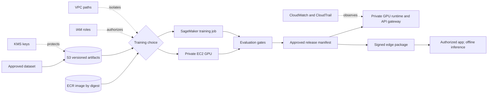

# AWS lessons for specialist small language models

**Research cut-off:** 2026-11-24  
**Implementation status:** The designs and commands are instructional examples. They were syntax-checked where noted,
but no AWS account was changed and no performance or price claim is made.

## What you will build

These lessons take one approved specialist SLM through four connected outcomes:

1. a reproducible training run on replaceable GPU compute;
2. a private, authenticated inference API;
3. a measured release process with canary and rollback;
4. a signed model package that a mobile app can verify, install, and use offline.

The serving path does not use runtime retrieval-augmented generation. S3 stores datasets and artifacts, but the model
does not fetch documents to answer a request.

## First mental model: control plane, data plane, and workload identity

AWS services are easier to reason about when separated into three concerns:

- The **control plane** creates and changes resources: an operator applies Terraform, ECS starts a task, or SageMaker
  creates a training job.
- The **data plane** carries workload data: a trainer reads an S3 object, an API invokes a model, or an app downloads a
  package.
- A **service role** is an IAM role assumed by an AWS service so it can act for the workload. An EC2 instance profile,
  ECS task role, and SageMaker execution role are different workload identities. A role supplies temporary credentials;
  it is not a user, password, or permission by itself. Its policies define what the session can do.

This distinction prevents a common design error: granting a deployment role, training role, and running model the same
broad permissions.

## Core services in plain language

- **IAM** answers who may perform which API action on which resource, and under what conditions.
- **VPC** provides network boundaries, routes, subnets, security groups, and private service paths. It does not replace
  IAM.
- **KMS** controls cryptographic key use. S3 or EBS performs encryption; KMS authorizes use of the wrapping key and
  records key operations.
- **S3** is durable object storage. A key name can be overwritten, so use Version IDs and hashes for immutable identity.
- **ECR** stores container images. Deploy by image digest, not a mutable tag.
- **CloudWatch** stores operational logs, metrics, alarms, and dashboards.
- **CloudTrail** records AWS API activity. It is not model-request telemetry.

## Worked illustrative architecture

The example project is `garage-slm`, deployed in `us-west-2` in AWS account `111122223333`. These values are realistic
examples, not credentials. Substitute:

- your 12-digit account ID from `aws sts get-caller-identity`;
- a Region in which the required instance type and service feature are available;
- globally unique S3 bucket names, normally including your account ID and Region;
- ARNs created by your own infrastructure deployment.



The arrows show data flow, not implied public access. Training and serving run in private subnets. Operators use
federated access and Systems Manager rather than public SSH. The runtime reads only one approved release prefix.

## Learning path

| Lesson | Begin with | Finish with |
| --- | --- | --- |
| [1. Select services](service-selection.md) | EC2 versus SageMaker, IAM/VPC/KMS/S3/ECR, GPU choice | a small justified architecture |
| [2. Train and recover](training-on-aws.md) | container lifecycle, checkpoints, Spot interruption | a resumable training run |
| [3. Serve safely](inference-serving.md) | serving topology and API trust boundary | an authenticated, observable API |
| [4. Operate responsibly](security-observability-and-cost.md) | least privilege, telemetry, prices | alarms, cost worksheet, cleanup |
| [5. Deliver to edge](cloud-to-edge-delivery.md) | signatures and update trust | secure install, rollback, offline use |

## Common worked values

Examples use the following names consistently:

```bash
export AWS_REGION="us-west-2"
export AWS_ACCOUNT_ID="111122223333"
export PROJECT="garage-slm"
export ENVIRONMENT="learning"
export ARTIFACT_BUCKET="garage-slm-111122223333-us-west-2"
export ECR_REPOSITORY="garage-slm-training"
export RUN_ID="sft-20261124-001"
```

`export` is Bash syntax. In PowerShell, use `$env:AWS_REGION = "us-west-2"`. Confirm the active identity before any
write:

```bash
aws sts get-caller-identity
aws configure get region
```

Expected behavior: the first command returns the account and assumed-role ARN; the second prints the configured Region.
Stop if either differs from the intended learning account. Do not paste long-lived access keys into scripts.

## The complete release journey

1. Approve exact model, tokenizer, dataset, licenses, intended use, and safety limits.
2. Estimate training and serving memory separately; verify Region support, quota, and capacity.
3. Create storage, keys, network paths, roles, logs, budget alerts, and expiry automation with reviewed IaC.
4. Build a container, scan it, and record its immutable digest.
5. Train on EC2 or SageMaker; continuously publish complete checkpoints to versioned S3.
6. interrupt a nonproduction run and prove recovery from the last accepted checkpoint.
7. Evaluate the trained, merged, quantized, and served forms independently.
8. Deploy the whole release tuple: model, tokenizer, chat template, runtime image, flags, and API policy.
9. Shift canary traffic; stop or roll back automatically on defined alarms.
10. Convert each edge format, test physical devices, sign exact manifest bytes, and publish immutable objects.
11. Measure usage and multiply by dated official rates; never infer cost from list price alone.
12. Delete temporary compute and networking while preserving required evidence and approved releases.

## How to diagnose failures

Use the failing boundary to narrow the cause:

- `AccessDenied`: inspect the caller ARN, identity policy, resource policy, KMS key policy, and VPC endpoint policy.
- timeout to an AWS API: inspect subnet routes, DNS, security groups, endpoints, NAT, and proxy policy.
- `ResourceLimitExceeded` or launch failure: inspect service quota, exact instance availability, and account restrictions.
- CUDA out of memory: reduce microbatch/context/concurrency, inspect KV cache and fragmentation, or choose more memory.
- image starts locally but not in AWS: compare architecture, driver/CUDA contract, task role, filesystem, and entrypoint.
- hash mismatch: quarantine the object; do not retry by weakening verification.

## Safe cleanup pattern

Cleanup is a controlled workflow, not `terraform destroy` by reflex:

1. stop new traffic and checkpoint writes;
2. verify retained artifacts by hash and S3 Version ID;
3. drain and terminate endpoints, tasks, jobs, and instances;
4. remove orphaned EBS volumes, snapshots, ENIs, load balancers, NAT gateways, and public IPv4 addresses;
5. expire temporary S3 objects, ECR images, logs, and secrets under reviewed retention policies;
6. retain audit records, IaC state, rights records, manifests, and known-good rollback artifacts;
7. check Cost Explorer after billing data arrives and record residual charges.

## Evidence language

- **Documented:** an official source supports the capability.
- **Illustrative:** an architecture, value, or calculation teaches a method but is not a measured result.
- **Planned test:** a repeatable validation procedure exists.
- **Executed:** commands and environment evidence were preserved.
- **Reproduced:** the declared protocol and repetitions succeeded.

## Official starting points

- [AWS architecture decision guides](https://docs.aws.amazon.com/decision-guides/latest/decision-guides/)
- [EC2 accelerated computing](https://docs.aws.amazon.com/ec2/latest/instancetypes/ac.html)
- [SageMaker AI training](https://docs.aws.amazon.com/sagemaker/latest/dg/how-it-works-training.html)
- [S3 security best practices](https://docs.aws.amazon.com/AmazonS3/latest/userguide/security-best-practices.html)
- [IAM security best practices](https://docs.aws.amazon.com/IAM/latest/UserGuide/best-practices.html)
- [AWS Pricing Calculator](https://calculator.aws/)

Recheck service features, Region support, quotas, runtime compatibility, and prices at implementation time.
