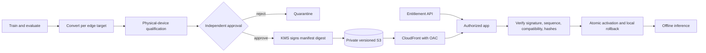

# Lesson 5: Sign and deliver a cloud-trained model to edge devices

## Learning objectives

You will distinguish encryption, hashes, signatures, and download authorization; build a signed release manifest;
publish through private S3 and CloudFront; resume downloads safely; install atomically; and support rollback while
keeping inference offline.

## 1. Understand the trust problem

Several controls solve different problems:

- TLS protects bytes while they travel.
- S3 SSE-KMS protects stored objects and controls AWS-side key use.
- SHA-256 detects a byte change only when the expected hash came from a trusted source.
- a CloudFront signed URL authorizes a temporary download.
- a detached release signature proves that an approved signing key authorized exact manifest bytes.

Only the last control remains verifiable when the device is offline. The app therefore pins one or more release-signing
public keys and verifies the signed manifest before it trusts artifact hashes.

## 2. Worked architecture



CloudFront Origin Access Control keeps the S3 origin private. The entitlement API authenticates a user/device, selects
a compatible release, and returns short-lived authorization. It does not answer model prompts. Once installed, the
model runs without AWS connectivity.

## 3. Package one exact target

Do not label one generic archive “mobile.” Produce separately qualified artifacts:

```text
release/
  manifest.json
  manifest.sig.json
  model.gguf
  tokenizer.json
  chat-template.txt
  LICENSES/
  NOTICE.txt
  sbom.spdx.json
  qualification-summary.json
```

An Android ARM64 llama.cpp cohort and an iOS Core ML cohort require different formats, runtimes, app versions, memory
evidence, and tests.

The manifest must bind release ID, monotonically increasing sequence, UTC creation, channel, status, source run and
dataset identities, knowledge cutoff, licenses, app/OS/ABI/runtime/backend/format/context compatibility, measured
storage/RAM, every artifact path/size/SHA-256, report hashes, approvals, predecessor, rollback window, and revocation
epoch.

## 4. Build deterministic manifest bytes

```python
from __future__ import annotations

import hashlib
import json
import os
from pathlib import Path, PurePosixPath

EXCLUDED = {"manifest.json", "manifest.sig.json"}

def sha256(path: Path) -> str:
    digest = hashlib.sha256()
    with path.open("rb") as stream:
        for block in iter(lambda: stream.read(8 * 1024 * 1024), b""):
            digest.update(block)
    return digest.hexdigest()

def build_manifest(root: Path, metadata: dict) -> bytes:
    records = []
    for path in sorted(item for item in root.rglob("*") if item.is_file()):
        if path.is_symlink():
            raise ValueError("symbolic links are forbidden")
        relative = path.relative_to(root).as_posix()
        parsed = PurePosixPath(relative)
        if parsed.is_absolute() or ".." in parsed.parts or "\\" in relative:
            raise ValueError(f"unsafe path: {relative}")
        if relative not in EXCLUDED:
            records.append(
                {
                    "path": relative,
                    "bytes": path.stat().st_size,
                    "sha256": sha256(path),
                }
            )
    if not records:
        raise ValueError("release is empty")
    document = {**metadata, "artifacts": records}
    raw = json.dumps(
        document,
        ensure_ascii=False,
        allow_nan=False,
        sort_keys=True,
        separators=(",", ":"),
    ).encode("utf-8")
    target = root / "manifest.json"
    with target.open("xb") as stream:
        stream.write(raw)
        stream.flush()
        os.fsync(stream.fileno())
    return raw
```

The code rejects links and path traversal, calculates hashes itself, sorts keys, removes insignificant whitespace, and
creates the manifest only if it does not already exist. `fsync` asks the operating system to flush the file. This is a
defined project serialization, not a general JSON canonicalization standard; never parse and reserialize before
verification.

Worked metadata:

```python
metadata = {
    "schema": "offline-slm-release/v1",
    "releaseId": "garage-slm-android-arm64-2026.11.24.1",
    "sequence": 17,
    "createdUtc": "2026-11-24T10:00:00Z",
    "channel": "stable",
    "domain": "automotive-mechanics",
    "status": "approved",
    "minimumAppVersion": "1.4.0",
    "target": {
        "os": "android",
        "abi": "arm64-v8a",
        "runtime": "llama.cpp-tested-commit",
        "format": "gguf",
        "maxContextTokens": 4096
    },
    "previousReleaseId": "garage-slm-android-arm64-2026.10.10.1",
    "rollbackUntilUtc": "2027-01-24T00:00:00Z",
    "revocationEpoch": 3
}
```

Substitute the runtime commit, app compatibility, measured ceilings, report hashes, and actual predecessor. Do not
publish a manifest until all fields correspond to final bytes.

## 5. Sign with a dedicated KMS asymmetric key

Create a P-256 `SIGN_VERIFY` KMS key through reviewed infrastructure. Keep it separate from S3 encryption keys.

```python
import base64
import hashlib
import json
from pathlib import Path

import boto3

KEY_ARN = (
    "arn:aws:kms:us-west-2:111122223333:key/"
    "87654321-4321-4321-4321-210987654321"
)
manifest = Path("release/manifest.json").read_bytes()
digest = hashlib.sha256(manifest).digest()
response = boto3.client("kms", region_name="us-west-2").sign(
    KeyId=KEY_ARN,
    Message=digest,
    MessageType="DIGEST",
    SigningAlgorithm="ECDSA_SHA_256",
)
if response["KeyId"] != KEY_ARN:
    raise RuntimeError("KMS returned an unexpected key")

envelope = {
    "schema": "offline-slm-signature/v1",
    "keyId": response["KeyId"],
    "algorithm": response["SigningAlgorithm"],
    "manifestSha256": digest.hex(),
    "signatureDerBase64": base64.b64encode(
        response["Signature"]
    ).decode("ascii"),
}
Path("release/manifest.sig.json").write_text(
    json.dumps(envelope, sort_keys=True, separators=(",", ":")),
    encoding="utf-8",
)
```

Substitute the real key ARN. `MessageType="DIGEST"` tells KMS that the 32 bytes are already a SHA-256 digest.
`ECDSA_SHA_256` returns a DER-encoded ECDSA signature. The envelope names the key and exact manifest hash.

Independently export the public key, record its fingerprint through an out-of-band approval, and verify the signature
outside KMS before publication. Expected failures include wrong key usage, algorithm mismatch, disabled key, and
`AccessDenied`. Do not grant the build job signing permission; the publisher signs only an independently approved hash.

## 6. Publish immutable objects

Upload to a content-addressed or release-specific prefix:

```bash
aws s3 sync release/ \
  s3://garage-slm-111122223333-us-west-2/releases/garage-slm-android-arm64-2026.11.24.1/ \
  --sse aws:kms \
  --sse-kms-key-id alias/garage-slm-artifacts \
  --no-follow-symlinks
```

Before using `sync`, ensure the destination prefix is new and bucket versioning is enabled. Production publication
should upload a closed file list, capture every S3 Version ID and checksum, and fail if any key exists. S3 Object Lock
may add retention when governance requires it.

CloudFront uses OAC to read the private bucket. The app receives short-lived signed URLs for the exact signed artifact.
Never put long-lived AWS credentials in the app.

## 7. Qualify before delivery

For each physical device cohort:

1. compare tokenizer IDs, chat-template bytes, stop tokens, deterministic token/logit samples, KV reset/reuse, and
   context behavior;
2. rerun domain, general-retention, hallucination, safety, and privacy tests on final converted bytes;
3. measure package size, peak storage, peak RAM, load time, TTFT, prefill/decode, energy/thermal behavior, cancellation,
   and crashes;
4. test malformed, truncated, decompression-bomb, and parser-fuzz cases;
5. test oldest supported, median, and high-end devices;
6. preserve exact app, OS, runtime, backend, and model hashes.

Conversion success is not compatibility evidence. Missing physical-device evidence means untested.

## 8. Resume a download without mixing versions

The app first verifies manifest signature, schema, sequence, and compatibility. It binds resume state to release ID,
artifact path, expected bytes, signed SHA-256, immutable URL identity, validator, and temporary file.

Protocol:

1. allocate app-private staging only after checking signed size and free storage;
2. request a new file and require `200` plus expected total length;
3. to resume at byte $n$, send `Range: bytes=n-` and `If-Range`;
4. append only when a `206` response begins at $n$ and names the signed total size;
5. if the server returns `200`, truncate and restart—never append;
6. accept `416` only when local length already equals signed size, then hash;
7. refresh expired authorization only for the same signed artifact identity;
8. reread the whole file and compare SHA-256;
9. fsync and verify every package file before activation.

Reject redirects outside an allowlist. Never expose partial bytes to a native model parser. Do not store models in a
shared Downloads folder or purgeable cache.

Failure diagnosis:

- signature failure: wrong bytes, wrong key, corrupted envelope, or untrusted key; quarantine;
- hash failure: interrupted/mixed/corrupted object; delete staging and restart from the signed identity;
- insufficient storage: preserve active model and abort safely;
- app/runtime incompatibility: offer another signed cohort, never bypass the compatibility gate;
- authorization expired: refresh only the URL, not release identity.

## 9. Budget storage and activate atomically

$$

S_{peak}=S_{active}+S_{previous}+S_{partial}+S_{staged}+S_{unpacked}+S_{temporary}+S_{margin}

$$

Use measured bytes. Keep immutable version directories and a small activation record. Journal updates so process death
is recoverable. Rename within one filesystem; cross-volume rename is not guaranteed atomic.

Activation sequence:

1. acquire updater lock and recover any journal;
2. verify signature, sequence, compatibility, paths, sizes, and hashes;
3. fsync and rename staged version into its immutable directory;
4. perform isolated load, tokenizer/template, and tiny deterministic generation checks;
5. atomically replace the activation record;
6. retain the predecessor through the signed health window;
7. remove only unreferenced versions.

## 10. Rollback, anti-rollback, and key rotation

Persist the highest accepted sequence, revocation epoch, and manifest digest. Reject arbitrary lower sequences. Permit
local rollback only to the exact predecessor named by the accepted signed manifest and within its signed window. For
fleet rollback, publish a new **higher-sequence** manifest that references known-good prior bytes.

Offline devices cannot learn immediate revocation. For high-risk deployments, use visible version/cutoff information,
conservative local safety limits, and a reconnect or device-management policy.

Rotate signing keys by shipping old and new public keys in an app update, beginning new-key signing, removing old
signing permission, retaining old verification for installed packages, and later removing trust through another app
update. Keep model-release, app-signing, CloudFront URL-signing, and encryption keys separate.

## 11. Bundle or download?

Bundle a small universal model when first-launch offline use matters and updates track the app. Download when models are
large, optional, domain/cohort-specific, separately entitled, or updated independently. A useful design is a small
bundled fallback plus one signed specialist download.

## 12. Safe cleanup

After publication, remove quarantined conversion workspaces and temporary signed URLs. Retain approved S3 versions,
manifest/signature, qualification evidence, public-key fingerprints, CloudTrail signing records, active and predecessor
packages, and required licenses. Delete stale CloudFront distributions, logs, objects, and KMS grants only under
reviewed retention. Never delete a verification key needed by installed offline releases.

## Official sources

- [S3 object integrity](https://docs.aws.amazon.com/AmazonS3/latest/userguide/checking-object-integrity.html)
- [S3 Versioning](https://docs.aws.amazon.com/AmazonS3/latest/userguide/Versioning.html)
- [CloudFront Origin Access Control](https://docs.aws.amazon.com/AmazonCloudFront/latest/DeveloperGuide/private-content-restricting-access-to-s3.html)
- [CloudFront Range GET](https://docs.aws.amazon.com/AmazonCloudFront/latest/DeveloperGuide/RangeGETs.html)
- [CloudFront signed URLs](https://docs.aws.amazon.com/AmazonCloudFront/latest/DeveloperGuide/private-content-signed-urls.html)
- [KMS Sign API](https://docs.aws.amazon.com/kms/latest/APIReference/API_Sign.html)
- [Android app-specific storage](https://developer.android.com/training/data-storage/app-specific)
- [The Update Framework](https://theupdateframework.github.io/specification/latest/)
