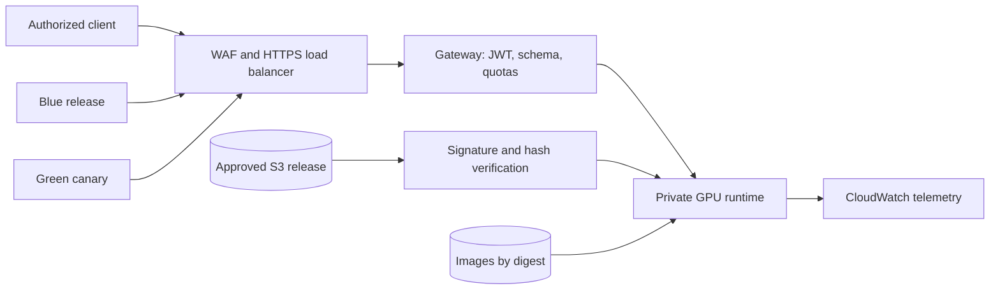

# Lesson 3: Serve an SLM through a secure, scalable API

## Learning objectives

You will distinguish serving architectures, qualify a runtime, protect an API, estimate capacity, observe model
behavior, scale GPU capacity, release through a canary, and roll back the complete serving tuple.

## 1. Understand the serving path

An inference service has four boundaries:

1. the **edge boundary** terminates TLS and applies coarse web controls;
2. the **API gateway** authenticates callers, validates requests, and enforces tenant quotas;
3. the **model runtime** loads weights and generates tokens;
4. the **artifact path** stages an approved model and container onto the host.

The runtime belongs in a private subnet and should not accept public traffic.



### Three practical architectures

- **Single EC2 host:** simplest runtime qualification and lowest abstraction. You own replacement and deployment.
- **ECS on EC2 GPU:** ECS maintains desired tasks; an EC2 Auto Scaling group supplies validated GPU hosts. Service and
  host capacity must scale together.
- **SageMaker real-time endpoint:** managed model endpoint lifecycle, variants, and deployment guardrails. Runtime and
  artifact contracts still require qualification.

EKS is appropriate only with an existing Kubernetes operating model or a measured scheduling need. Lambda is not a GPU
model host. Batch and asynchronous endpoints are better candidates for noninteractive workloads than an interactive
chat target.

## 2. Qualify a runtime instead of choosing by reputation

For a Hugging Face-format model on NVIDIA GPUs, vLLM is a useful first baseline and SGLang a useful comparison.
llama.cpp is valuable for GGUF, CPU/light-GPU serving, and cloud-edge artifact parity. TensorRT-LLM can improve
NVIDIA-specific performance but adds engine-building and version coupling. ONNX Runtime GenAI is a portability path.
Hugging Face documents TGI as maintenance mode, so use it mainly for an existing dependency.

The compatibility identity is:

> model + tokenizer + chat template + adapter + quantization + runtime + image + driver + GPU + flags

General model-family support does not prove that tuple works. Test tokenization, stop behavior, context limits,
quality, memory, streaming, cancellation, and malformed requests.

## 3. Estimate capacity, then measure it

Serving memory includes weights, KV cache, runtime state, workspaces, and fragmentation:

\[
M \approx M_{weights}+M_{KV}+M_{workspace}+M_{runtime}+M_{margin}
\]

Measure time to first token (TTFT), queue time, prefill tokens/second, inter-token latency, decode tokens/second,
request throughput, errors, and peak host/GPU memory. Report prompt length, output length, concurrency, sampling,
hardware, and warm/cold state. A model file fitting in VRAM does not prove the serving workload fits.

## 4. Run a local runtime qualification

The following Compose file uses a concrete model alias and requires `VLLM_IMAGE` to contain an authentic image URI
with a registry-provided digest:

```yaml
services:
  runtime:
    image: "${VLLM_IMAGE:?set VLLM_IMAGE to an approved digest URI}"
    command:
      - "--model=/models/garage-specialist"
      - "--served-model-name=garage-specialist-v1"
      - "--max-model-len=4096"
      - "--dtype=auto"
      - "--disable-log-requests"
    volumes:
      - "./model:/models/garage-specialist:ro"
    ports:
      - "127.0.0.1:8000:8000"
    deploy:
      resources:
        reservations:
          devices:
            - driver: nvidia
              count: 1
              capabilities: [gpu]
```

Create a `.env` file containing a line such as
`VLLM_IMAGE=registry.example.org/vllm/vllm-openai@sha256:` followed immediately by the 64 hexadecimal characters
returned by the reviewed registry. Do not commit that file unless it is the project's approved image record. `image`
must be immutable. `command` fixes the model path, public runtime alias, context ceiling, automatic compatible dtype,
and request-payload logging policy. The read-only mount prevents the runtime from changing approved bytes. Loopback
binding keeps the qualification server off the external network. The reservation gives the container one GPU.

Run:

```bash
docker compose config
docker compose up -d
curl --fail http://127.0.0.1:8000/v1/models
curl --fail http://127.0.0.1:8000/v1/chat/completions \
  -H "Content-Type: application/json" \
  -d '{
    "model": "garage-specialist-v1",
    "messages": [
      {"role": "user", "content": "Explain why an engine may crank but not start."}
    ],
    "temperature": 0,
    "max_tokens": 128
  }'
```

`docker compose config` catches YAML and interpolation errors. The first request proves the model registry is ready.
The second is a deterministic-style smoke request, not a quality evaluation. Expected behavior is HTTP 200 and a chat
completion object. HTTP 404 suggests a wrong route or alias; HTTP 500 during load suggests format/runtime mismatch;
CUDA OOM requires a smaller context/concurrency, quantized artifact, or larger validated GPU.

## 5. Design the public API contract

Expose:

- `POST /v1/chat/completions`;
- `GET /livez` for process liveness only;
- `GET /readyz` for exact approved model readiness;
- authenticated `GET /version` for release hashes and versions.

Require OAuth 2.0/OpenID Connect bearer JWTs. Verify an algorithm allowlist, signature, issuer, audience, expiry, and
subject. Do not decode without verification. Bound body bytes before JSON parsing; reject unknown fields; limit
messages, characters, input tokens, output tokens, stop strings, sampling fields, queue time, stream duration, and
concurrency.

### Worked request

```bash
API_URL="https://api.learning.example.org"
ACCESS_TOKEN="$(security-reviewed-command-that-returns-a-short-lived-token)"
curl --no-buffer "$API_URL/v1/chat/completions" \
  -H "Authorization: Bearer $ACCESS_TOKEN" \
  -H "Content-Type: application/json" \
  -H "X-Request-Id: 6ca17b85-8cd1-4a8e-a387-1bf3cf571ba2" \
  -d '{
    "model": "garage-specialist",
    "messages": [
      {
        "role": "user",
        "content": "A petrol engine cranks normally but will not start. Give a safe diagnostic sequence."
      }
    ],
    "temperature": 0.2,
    "top_p": 0.95,
    "max_tokens": 300,
    "stream": true
  }'
```

Replace the illustrative domain and token-acquisition command with your identity provider's approved flow. Do not
store the token in shell history. `--no-buffer` displays Server-Sent Events as they arrive. The model alias is stable;
the gateway maps it to an internal release. The request asks for bounded output and low sampling randomness.

Expected behavior: an authenticated streaming response, an initial event within the TTFT objective, ordered chunks,
and a terminal event. A 401 indicates token verification failure; 403 means identity is valid but unauthorized; 422
means schema rejection; 429 means quota or overload; 503 means no ready compatible runtime.

## 6. Layer security and abuse controls

Use:

1. WAF for coarse IP/rule controls;
2. JWT authentication and authorization;
3. distributed per-subject or per-tenant request and token budgets;
4. bounded queues and concurrency;
5. runtime context/KV/output ceilings;
6. anomaly detection for extraction and resource-exhaustion patterns.

An IP rate rule is not a user quota and can penalize shared networks. Count tokens on the trusted server side. Do not
automatically retry a sampled generation after an ambiguous timeout because the original request may still consume GPU
work.

## 7. Health, startup, and failure diagnosis

`/livez` must not load the model. `/readyz` should verify the expected model identity and a bounded internal operation.
Instrument startup phases independently: host capacity, boot, image pull, model download, signature/hash verification,
weight load, memory allocation, kernel initialization, warm-up, and readiness.

Failure map:

- task remains queued: no compatible GPU host, placement constraint, quota, or capacity;
- target unhealthy: wrong port/path, security group, startup period, or readiness failure;
- intermittent OOM: concurrency/context/KV pressure or memory fragmentation;
- slow first token: queue, artifact cold start, prefill length, kernel warm-up, or underpowered GPU;
- streaming stalls: proxy buffering, timeout, disconnect handling, or overloaded runtime;
- wrong answer style after release: tokenizer/chat-template mismatch can exist even when weights load.

## 8. Scale on demand signals

CPU utilization is often a poor signal for GPU inference. Prefer queue time/depth, queued tokens, TTFT, active
sequences, KV pressure, and GPU memory/utilization. Keep a measured warm minimum for interactive traffic. Configure a
maximum replica count and admission limit so an attack cannot create unbounded capacity.

For ECS, scaling the service without scaling the GPU Auto Scaling group leaves tasks queued. Scale-in must drain new
requests, allow bounded streams to finish, and preserve enough capacity. Do not claim scale-to-zero meets an interactive
latency objective without a cold-start measurement.

## 9. Canary and rollback the complete release

A release consists of:

> model hash + tokenizer hash + template hash + runtime image digest + gateway digest + flags + API schema + safety policy

Worked rollout:

1. create green capacity and wait for exact-version readiness;
2. run authenticated golden, safety, malformed, streaming, and cancellation tests through a test listener;
3. send 5% of an eligible low-risk cohort to green for 30 minutes;
4. compare green with blue on error rate, p95 TTFT, queue time, OOM/restarts, refusal behavior, and sampled expert review;
5. automatically stop if any predeclared threshold fails;
6. move to 25%, 50%, and 100% only after each observation window;
7. retain blue for the rollback window;
8. roll back the entire tuple, not just the model alias.

The percentages and windows are illustrative. Derive real thresholds from a stable baseline and risk assessment.
Quality alarms cannot rely only on infrastructure metrics; use delayed expert-reviewed samples that respect privacy.

## 10. Observability

Metrics should include accepted/rejected requests, status/error class, queue, TTFT, prefill/decode/inter-token latency,
token distributions, active streams, context rejection, timeout, cancellation, OOM, GPU memory/utilization, model-load
phases, desired/running/queued tasks, and release identity.

Logs should contain timestamp, request ID, approved pseudonymous subject/tenant, route, release, token counts, duration,
finish reason, and error class. Do not log raw prompts, outputs, bearer tokens, signed URLs, or model bytes by default.
Request IDs belong in logs, not metric dimensions.

## 11. Safe cleanup

Stop routing new traffic, drain streams, preserve release/benchmark evidence, set service desired count to zero, remove
the service and GPU capacity, then inspect target groups, load balancers, ENIs, EBS, public IPv4, NAT, logs, and alarms.
Retain the known-good model and image digests until the rollback window and retention policy allow removal.

## Official sources

- [vLLM documentation](https://docs.vllm.ai/en/stable/)
- [SGLang documentation](https://docs.sglang.io/)
- [llama.cpp server](https://github.com/ggml-org/llama.cpp/blob/HEAD/tools/server/README.md)
- [TensorRT-LLM support matrix](https://nvidia.github.io/TensorRT-LLM/reference/support-matrix.html)
- [ECS GPU workloads](https://docs.aws.amazon.com/AmazonECS/latest/developerguide/ecs-gpu.html)
- [ECS blue/green deployments](https://docs.aws.amazon.com/AmazonECS/latest/developerguide/deployment-type-bluegreen.html)
- [SageMaker deployment guardrails](https://docs.aws.amazon.com/sagemaker/latest/dg/deployment-guardrails.html)
- [AWS WAF rate-based rules](https://docs.aws.amazon.com/waf/latest/developerguide/waf-rule-statement-type-rate-based.html)
