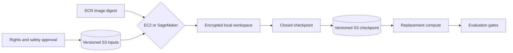

# Lesson 2: Train on AWS and recover from failure

## Learning objectives

You will build a reproducible container, materialize immutable S3 inputs, run QLoRA training, preserve complete
checkpoints, recover from Spot interruption, diagnose common failures, and remove temporary resources safely.

## 1. The training invariant

Treat GPU compute as replaceable:

> immutable inputs + pinned environment + complete durable state = recoverable training

Local NVMe or EBS can accelerate a run, but versioned S3 is the durable handoff. A checkpoint that contains only adapter
weights can support inference, yet cannot resume the optimizer, scheduler, data cursor, and random state exactly.



## 2. Write the run contract first

For `RUN_ID=sft-20261124-001`, record:

- git commit and whether the tree was dirty;
- ECR image digest and dependency lock hash;
- model/tokenizer repository, immutable revision, local hashes, license, and remote-code policy;
- dataset S3 URI, Version ID, SHA-256, split policy, and rights record;
- objective, hyperparameters, seed, effective batch, precision, and exact command;
- Region, instance type, GPU, driver, CUDA, PyTorch, volume size, and subnet;
- checkpoint interval, Spot policy, maximum runtime, retention, and cleanup owner.

The effective batch is `microbatch × gradient accumulation × data-parallel workers`. Record token count as well because
examples can have different lengths.

## 3. Build the container and understand its lifecycle

Use a reviewed PyTorch CUDA base **digest** obtained from the registry; do not copy an invented digest. Set it during
the build:

```dockerfile
ARG BASE_IMAGE
FROM ${BASE_IMAGE}

ENV PYTHONDONTWRITEBYTECODE=1 \
    PYTHONUNBUFFERED=1 \
    HF_HOME=/opt/slm/cache/huggingface \
    TOKENIZERS_PARALLELISM=false

RUN groupadd --gid 10001 trainer \
 && useradd --uid 10001 --gid trainer --create-home trainer \
 && mkdir -p /workspace /opt/slm/cache /opt/slm/data /opt/slm/checkpoints \
 && chown -R trainer:trainer /workspace /opt/slm

COPY requirements.lock /tmp/requirements.lock
RUN python -m pip install --require-hashes -r /tmp/requirements.lock
COPY --chown=trainer:trainer src/ /workspace/src/
COPY --chown=trainer:trainer configs/ /workspace/configs/
USER trainer
WORKDIR /workspace
ENTRYPOINT ["python", "/workspace/src/train.py"]
```

Every section has a purpose:

- `ARG` forces the caller to supply the exact approved base URI recorded in `approved-base-image-uri.txt`.
- environment variables make logs immediate and put caches on a known path.
- the user has no root privileges at runtime.
- `--require-hashes` rejects an unapproved dependency file.
- source and configuration are copied after dependencies so dependency layers can be reused.
- the entrypoint launches the trainer; ECS/SageMaker/EC2 can append arguments.

Build and publish:

```bash
BASE_IMAGE="$(cat approved-base-image-uri.txt)"
ECR_URI="111122223333.dkr.ecr.us-west-2.amazonaws.com/garage-slm-training"
aws ecr get-login-password --region us-west-2 |
  docker login --username AWS --password-stdin \
  111122223333.dkr.ecr.us-west-2.amazonaws.com
docker build --build-arg BASE_IMAGE="$BASE_IMAGE" -t garage-slm-training:20261124 .
docker run --rm --gpus all garage-slm-training:20261124 \
  /workspace/src/cuda_smoke.py
docker tag garage-slm-training:20261124 "$ECR_URI:20261124"
docker push "$ECR_URI:20261124"
aws ecr describe-images --repository-name garage-slm-training \
  --image-ids imageTag=20261124 --query 'imageDetails[0].imageDigest'
```

Before running this command, populate `approved-base-image-uri.txt` with the exact tag-and-digest URI copied from the
reviewed registry record. The login token is piped directly to Docker. The smoke test should perform representative
forward, backward, optimizer, save, and load operations; `nvidia-smi` alone is insufficient. The last command returns
the digest to place in the run manifest.

Failure diagnosis:

- `no basic auth credentials`: repeat ECR login with the same account and Region.
- `manifest unknown`: verify repository, tag, and architecture.
- `could not select device driver`: install and validate the NVIDIA container runtime.
- CUDA kernel error: compare GPU compute capability, host driver, image CUDA runtime, PyTorch build, and quantizer.

## 4. Materialize immutable S3 inputs

An S3 URI identifies a key, not immutable bytes. A closed input record should look like:

```json
[
  {
    "s3_uri": "s3://garage-slm-111122223333-us-west-2/datasets/approved/automotive-sft.jsonl",
    "version_id": "3Lg...value-returned-by-s3...",
    "sha256": "64-lowercase-hex-characters-from-sha256sum",
    "path": "train.jsonl"
  }
]
```

The values containing explanatory text must be replaced by values returned from your upload and local hash command.
Do not use ETag as a general SHA-256; multipart objects have different ETag semantics.

```bash
sha256sum data/automotive-sft.jsonl
aws s3api put-object \
  --bucket garage-slm-111122223333-us-west-2 \
  --key datasets/approved/automotive-sft.jsonl \
  --body data/automotive-sft.jsonl \
  --server-side-encryption aws:kms \
  --ssekms-key-id alias/garage-slm-artifacts
```

Expected behavior: `put-object` returns an ETag and, on a versioned bucket, a `VersionId`. Preserve the Version ID and
the locally calculated SHA-256. If KMS denies access, inspect the caller policy, key policy, and key Region.

## 5. Configure a worked QLoRA run

```yaml
objective: qlora_sft
model_path: /opt/slm/cache/base
train_file: /opt/slm/data/train.jsonl
validation_file: /opt/slm/data/validation.jsonl
output_dir: /opt/slm/checkpoints
max_length: 2048
learning_rate: 0.0001
epochs: 2
microbatch: 1
gradient_accumulation: 16
gradient_checkpointing: true
bf16: true
seed: 3401
save_steps: 100
lora:
  rank: 16
  alpha: 32
  dropout: 0.05
  target_modules: [q_proj, k_proj, v_proj, o_proj]
```

These are hypotheses for a learning run, not universal best settings. QLoRA stores a quantized frozen base while LoRA
matrices train in higher precision. BF16 requires compatible hardware. Target-module names vary by architecture; make
the trainer fail if a requested module is absent. Render and test the exact chat template, end-of-sequence token,
truncation, packing, and assistant-only loss mask.

An OOM at startup points toward model load or quantization compatibility. An OOM during backward points toward
activation and batch pressure. NaN loss calls for inspecting data, precision, learning rate, gradient scaling, and the
first offending batch.

## 6. Choose the execution plane

### EC2 path

Provision a private GPU instance from an exact approved AMI. Require IMDSv2, encrypted EBS, no public IP, no inbound
SSH, and Systems Manager access. The instance role reads only approved input prefixes and writes only its run prefix.
Launch the container by digest and use an independent maximum-runtime/idle-stop mechanism.

### SageMaker path

Create a training job using the same image digest, execution role, private subnets, security groups, KMS keys, input
locations, checkpoint location, and runtime limits. For Managed Spot, enable Spot and set maximum wait longer than
maximum runtime. Managed Spot does not silently convert to On-Demand.

Example job fragment:

```python
import os

import boto3

sm = boto3.client("sagemaker", region_name="us-west-2")
training_image = os.environ["GARAGE_SLM_TRAINING_IMAGE"]
sm.create_training_job(
    TrainingJobName="garage-slm-sft-20261124-001",
    AlgorithmSpecification={
        "TrainingImage": training_image,
        "TrainingInputMode": "File",
    },
    RoleArn=(
        "arn:aws:iam::111122223333:role/"
        "garage-slm-sagemaker-training"
    ),
    OutputDataConfig={
        "S3OutputPath": (
            "s3://garage-slm-111122223333-us-west-2/"
            "runs/sft-20261124-001/output"
        )
    },
    ResourceConfig={
        "InstanceType": "ml.g5.2xlarge",
        "InstanceCount": 1,
        "VolumeSizeInGB": 200,
    },
    StoppingCondition={
        "MaxRuntimeInSeconds": 14400,
        "MaxWaitTimeInSeconds": 21600,
    },
    EnableManagedSpotTraining=True,
    CheckpointConfig={
        "S3Uri": (
            "s3://garage-slm-111122223333-us-west-2/"
            "runs/sft-20261124-001/checkpoints"
        ),
        "LocalPath": "/opt/slm/checkpoints",
    },
)
```

Set `GARAGE_SLM_TRAINING_IMAGE` to the full ECR repository-and-digest URI returned by `describe-images`. Adapt the
example account, role, validated instance type, subnets/KMS/network settings, and limits. This minimal fragment teaches
the job contract; production code must also provide input channels, VPC configuration, encryption, tags, environment,
and idempotent state handling. `ResourceLimitExceeded` indicates quota; `CapacityError` requires another validated
capacity path or retry policy.

## 7. Make checkpoints complete and atomic

A resumable checkpoint contains model or adapter, optimizer, scheduler, gradient scaler, global step, accumulation
state, RNG states, sampler/data cursor, configuration, and a file-hash manifest.

Write to `checkpoint-0100.partial`, close and fsync files, write hashes last, rename to `checkpoint-0100`, then upload
that closed directory to a unique S3 prefix. Publish `ACCEPTED.json` only after every object and hash is verified.
Never synchronize a directory while the trainer is still mutating its files.

On resume:

1. list accepted checkpoints;
2. choose the highest complete step;
3. download a specific S3 Version ID for each file;
4. verify all sizes and hashes;
5. restore all state;
6. confirm the next data cursor and step in logs;
7. fall back to the previous accepted checkpoint if the newest is corrupt.

## 8. Spot recovery is an application feature

Spot capacity can be interrupted. EC2 interruption notices and rebalance recommendations are best-effort signals, not
durability. SageMaker can replace interrupted managed Spot capacity, but the trainer must load coherent checkpoint
state.

Planned recovery exercise:

1. run a small fixed On-Demand control;
2. kill only the training process and resume;
3. terminate the host during a checkpoint write and resume on replacement compute;
4. corrupt the newest checkpoint and prove fallback;
5. compare step, data cursor, optimizer/scheduler, RNG restoration, and final evaluation;
6. document nondeterminism rather than claiming bit-for-bit identity.

Use On-Demand when a deadline is more important than interruption savings. Diversify only across instance/AZ choices
that passed the exact runtime test.

## 9. Monitor and scale from evidence

Collect loss, learning rate, tokens, step/data/communication time, GPU utilization/memory/power/temperature, host disk
and network, checkpoint age, sync lag, retries, OOM, NaN, and interruptions.

Scale in this order: one GPU with accumulation; activation checkpointing and PEFT; single-node DDP; FSDP or ZeRO;
multi-node. DDP replicates model state and does not make an oversized model fit. Multi-node introduces rendezvous,
collective communication, placement, coordinated failure, and distributed checkpoint concerns.

## 10. Safe cleanup

1. stop the trainer and close the last checkpoint;
2. verify durable artifacts from a separate principal or process;
3. preserve manifests, logs, evaluation evidence, and exact image digest;
4. terminate the SageMaker job or EC2 instance;
5. remove temporary EBS volumes, ENIs, secrets, and unreferenced images after retention review;
6. confirm that no GPU job, instance, endpoint, or autoscaling capacity remains;
7. inspect billing later for residual storage, NAT, logs, and snapshots.

## Official sources

- [SageMaker custom training containers](https://docs.aws.amazon.com/sagemaker/latest/dg/adapt-training-container.html)
- [SageMaker checkpoints](https://docs.aws.amazon.com/sagemaker/latest/dg/model-checkpoints.html)
- [SageMaker Managed Spot](https://docs.aws.amazon.com/sagemaker/latest/dg/model-managed-spot-training.html)
- [EC2 Spot interruption notices](https://docs.aws.amazon.com/AWSEC2/latest/UserGuide/spot-instance-termination-notices.html)
- [CloudWatch NVIDIA GPU metrics](https://docs.aws.amazon.com/AmazonCloudWatch/latest/monitoring/CloudWatch-Agent-NVIDIA-GPU.html)
- [PyTorch reproducibility](https://docs.pytorch.org/docs/stable/notes/randomness.html)
- [PEFT LoRA reference](https://huggingface.co/docs/peft/package_reference/lora)
