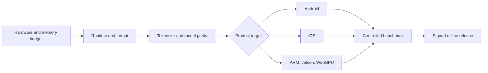

# Edge and mobile SLM engineering course

This course teaches how to turn a trained specialist small language model (SLM) into a secure, offline product.
It uses no runtime retrieval or remote teacher. The central engineering lesson is that a checkpoint is only one part
of a deployable system: tokenizer, prompt template, cache policy, runtime, hardware backend, app lifecycle, and update
mechanism jointly determine correctness.

## Learning outcomes

After completing the modules, you can:

- classify low-, mid-, and high-capability devices by measured resources rather than marketing labels;
- explain CPU, GPU, and NPU execution and prove where a graph actually ran;
- calculate weight, activation, workspace, tokenizer, and key-value (KV) cache budgets;
- convert a model without changing its tokenization, chat semantics, or safety behavior;
- integrate streaming inference into Android, iOS, ARM Linux, Jetson, and WebGPU applications;
- measure latency, memory, battery energy, and sustained thermal behavior;
- install and update model packages with signatures, hashes, atomic activation, and rollback.

## Course map



1. [Hardware targets](hardware-targets.md)
2. [Runtime selection](runtime-selection.md)
3. [Android deployment](android-deployment.md)
4. [iOS deployment](ios-deployment.md)
5. [Other edge deployment](other-edge-deployment.md)
6. [Mobile benchmarking](mobile-benchmarking.md)
7. [Offline installation and updates](offline-installation-and-updates.md)

## The deployment unit

A support claim applies to the complete tuple:

```text
model revision + tokenizer + chat template + quantization + KV format +
runtime revision + backend + device/SoC + OS/driver + workload limits
```

Changing one member can alter outputs, memory, latency, or compatibility. “Runs on Android” is therefore too broad;
the defensible claim is, for example, “this signed GGUF and runtime build passes the declared tests on this arm64
device cohort at a 2,048-token context.”

## Worked example: a mid-tier offline mechanic assistant

Assume a 1-billion-parameter dense decoder, 4.5 effective bits per weight after scales, 24 layers, 8 KV heads,
64 values per head, FP16 cache, batch one, and a 4,096-token context.

$$

M_W = 10^9 \times 4.5 / 8 = 562.5\ \text{MB}

$$

$$

M_{KV}=2 \times 24 \times 1 \times 4096 \times 8 \times 64 \times 2
=192\ \text{MiB}

$$

If measurement later shows 180 MiB for runtime/UI and 320 MiB for peak workspace, an illustrative peak is about
1.25 GiB before safety margin. Applying 25% headroom gives about 1.56 GiB. These are transparent planning calculations,
not measurements; the physical-device test replaces each assumed component.

## End-to-end build path

1. Freeze source model, tokenizer, template, licenses, and evaluation set.
2. Inventory exact target devices and set storage, RAM, context, latency, quality, and energy gates.
3. Select a maintained runtime whose supported model list includes the exact architecture.
4. Convert and quantize on a controlled workstation; retain command lines and hashes.
5. Compare source and target token IDs, rendered prompts, logits or greedy tokens, stops, and cache reset.
6. Integrate one serialized inference session with streaming, cancellation, and lifecycle handling.
7. Establish an optimized CPU baseline before adding GPU or NPU artifacts.
8. Run correctness, quality, maximum-context, cold/warm, and sustained tests.
9. Sign a cohort-specific manifest; test interrupted installation, atomic activation, and rollback.
10. Deny networking, cold-start the release app, and prove local generation still works.

Expected behavior is deterministic admission: compatible devices load the verified local package; unsupported or
corrupt packages produce a clear unavailable state and never trigger hidden cloud inference.

## Common failure patterns

- A small file still exhausts RAM because weights expand, prefill uses a large workspace, or KV is preallocated.
- Fluent but wrong output follows a mismatched tokenizer, RoPE configuration, template, or stop-token policy.
- GPU/NPU selection is slower because unsupported operators fall back and tensors cross backend boundaries.
- The first generation is slow because hashing, memory mapping, shader compilation, and page faults were mixed into TTFT.
- Short tests look fast, but clocks fall during sustained generation because the device heats.
- An update passes HTTPS transport but fails authenticity because the manifest was not signed independently.

## Course validation checklist

- Run all code using pinned releases; examples explain intent but do not claim physical execution.
- Render the Mermaid diagram and run Markdown lint.
- Check every internal link and issue HTTP HEAD/GET checks for external references.
- Scan for drafting markers and empty result fields.
- Compile platform code and execute unit tests before calling it an implementation.
- Publish physical results only with raw trial records, device identity, conditions, and measurement boundaries.

## Authoritative starting points

- [llama.cpp](https://github.com/ggml-org/llama.cpp/)
- [ExecuTorch backends](https://docs.pytorch.org/executorch/stable/backends-overview.html)
- [LiteRT-LM](https://developers.google.com/edge/litert-lm/overview)
- [Core ML](https://developer.apple.com/documentation/coreml)
- [WebGPU](https://www.w3.org/TR/webgpu/)
