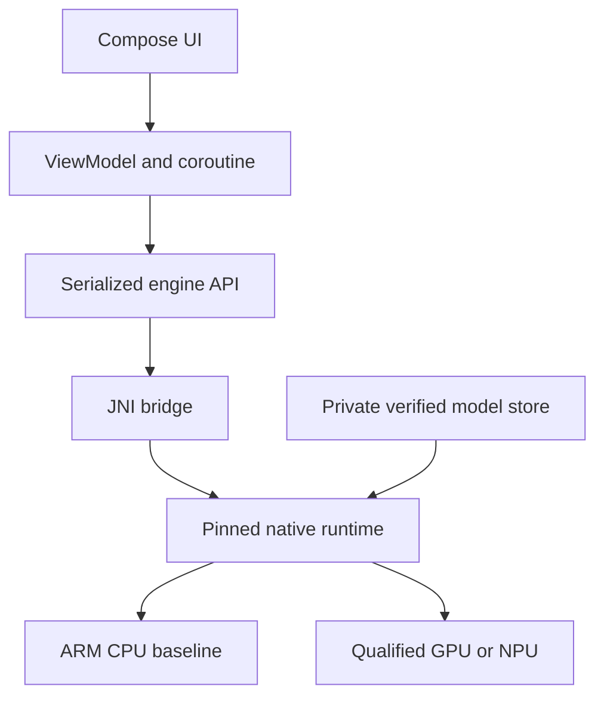

# Android offline SLM integration

## 1. Architecture and concepts

Use Kotlin/Compose for presentation and lifecycle, a serialized engine owner for session state, and JNI only where the
runtime requires native bindings. The model, tokenizer, template, stop policy, runtime revision, and context policy form
one release. Native work never runs on the main thread; cancellation must reach prefill and decode loops.



## 2. Worked device example

For an illustrative 8 GiB phone with 2.5 GiB available under the test workload, use the course's 1B Q4 model, cap
context at 2,048 initially, and allow one session. Halving context halves the conventional KV estimate from 192 MiB to
96 MiB. If measured prefill peak remains below a preregistered 1.6 GiB process budget and 20-minute generation meets
thermal and latency gates, the cohort may be admitted. These are planning thresholds, not claimed phone results.

## 3. Build path

1. Install a pinned JDK, Android Studio, SDK, NDK, CMake, and Gradle toolchain.
2. Vendor or submodule a pinned runtime release and preserve its license notices.
3. Build `arm64-v8a`; use emulator `x86_64` only for UI and failure-path tests.
4. Convert the final merged model on a workstation and complete tokenizer/template/logit parity.
5. Put a tiny fallback in app assets or download the specialist artifact into `noBackupFilesDir`.
6. Verify signature, manifest, length, and SHA-256 before passing a path to native code.
7. Expose `load`, `stream`, `cancel`, `reset`, and idempotent `close`.
8. Stream display-safe fragments through a ViewModel; coalesce updates to avoid repeated full-string copies.
9. Add background, process-death, low-memory, and thermal policy.
10. Build a signed Release AAB/APK and test representative physical cohorts.

## 4. Build configuration

```kotlin
android {
    namespace = "com.example.offlinechat"
    compileSdk = 35
    defaultConfig {
        applicationId = "com.example.offlinechat"
        minSdk = 28
        targetSdk = 35
        ndk { abiFilters += listOf("arm64-v8a") }
    }
    buildFeatures { compose = true }
    buildTypes {
        release {
            isMinifyEnabled = true
            ndk.debugSymbolLevel = "SYMBOL_TABLE"
        }
    }
}
```

The SDK values make the snippet concrete, not permanent recommendations; align them with the tested toolchain and
current store policy. Symbol tables and mapping files are essential for diagnosing native release crashes.

## 5. Kotlin integration shape

```kotlin
data class ChatState(
    val ready: Boolean = false,
    val generating: Boolean = false,
    val answer: String = "",
    val message: String = "Model not loaded"
)

class ChatViewModel(app: Application) : AndroidViewModel(app) {
    private val engine = LocalEngine(app.applicationContext)
    private val stateFlow = MutableStateFlow(ChatState())
    val state: StateFlow<ChatState> = stateFlow.asStateFlow()
    private var generation: Job? = null

    fun load(modelPath: String) {
        generation = viewModelScope.launch(Dispatchers.IO) {
            runCatching { engine.load(modelPath, contextTokens = 2048) }
                .onSuccess { stateFlow.value = ChatState(true, message = "Ready offline") }
                .onFailure { stateFlow.value = ChatState(message = "Model unavailable") }
        }
    }

    fun send(text: String) {
        if (!stateFlow.value.ready || text.isBlank()) return
        generation = viewModelScope.launch {
            stateFlow.value = stateFlow.value.copy(generating = true, answer = "")
            val output = StringBuilder()
            engine.stream(text, maxNewTokens = 256).collect { fragment ->
                output.append(fragment)
                stateFlow.value = stateFlow.value.copy(answer = output.toString())
            }
            stateFlow.value = stateFlow.value.copy(generating = false)
        }
    }

    fun cancel() { engine.cancel(); generation?.cancel() }
    override fun onCleared() { cancel(); engine.close() }
}
```

`LocalEngine` is the adapter to the selected runtime; implement it from that pinned runtime's API. It should own one
native handle, serialize calls, buffer incomplete UTF-8, and verify the artifact before load. Expected behavior is
incremental text, prompt cancellation, and clean release when the ViewModel is destroyed.

## 6. CPU, GPU, NPU, battery, and lifecycle

Start with a conservative CPU thread sweep. For Vulkan or a vendor NPU, create the documented backend artifact and
capture partition logs, copies, first-run compilation, and sustained traces. Android NNAPI is deprecated for new
Android 15 designs; use a maintained runtime or explicit vendor path.

Permit interactive inference only while foregrounded. Cancel by policy when backgrounded, reconstruct after process
death, stop safely at critical thermal status, and avoid repeated OOM retries. Model transfer is separate user-visible
persistent work and must follow current background execution rules.

## 7. Common failures and validation

- `UnsatisfiedLinkError`: inspect APK splits and packaged `lib/arm64-v8a`.
- JNI method missing: align class, package, signature, and native registration.
- Illegal instruction: use runtime dispatch and recheck cohort CPU features.
- Fluent nonsense: compare tokenizer IDs, exact template bytes, RoPE, logits, and cache.
- Rotation crash: remove Activity ownership and serialize stop/reset.
- GPU/NPU regression: inspect fallback, transfers, compilation, and heat.

Validate clean install, wrong/corrupt artifact, first and multi-turn generation, Unicode, stop tokens, cancellation
during prefill/decode, reset, maximum context, rotation, background, process kill, memory pressure, network denial,
interrupted update, rollback, CPU/accelerator placement, and a sustained physical-device run.

## Sources

- [Android native code](https://developer.android.com/studio/projects/add-native-code)
- [Android ABI management](https://developer.android.com/ndk/guides/abis)
- [llama.cpp Android example](https://github.com/ggml-org/llama.cpp/tree/master/examples/llama.android)
- [Android thermal API](https://developer.android.com/games/optimize/adpf/thermal)
