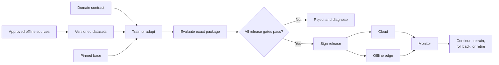
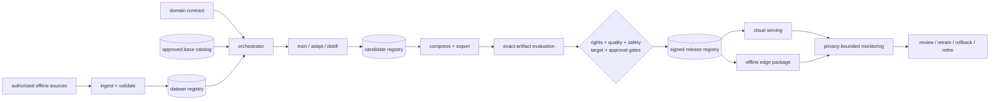

# Reusable multi-domain architecture

## Learning goals

This module turns the rules below into a system-design course. By the end, you should be able to choose between
independent specialist models, shared bases with adapters, routers, and multi-domain models; explain interference and
isolation; and design the artifact, release, rollback, monitoring, and no-runtime-RAG lifecycle.

The examples are worked designs, not deployment claims. Example thresholds are teaching values that a real team must
replace with measured, reviewed policy.

## The problem in one picture



Large model and dataset bytes follow the **data flow**. Small commands, approvals, and active-version pointers follow
the **control flow**. Separating them prevents a command such as “deploy production” from silently changing which bytes
were tested.

## A first trade-off calculation

Four independent 2-billion-parameter models stored at 4 bits need approximately:

\[
4 \times 2{,}000{,}000{,}000 \times 4 / 8 = 4.0\text{ GB}.
\]

One shared 1.0 GB base plus four 80 MB adapters needs about 1.32 GB, a 67% storage reduction. This is not a 67% RAM
reduction: the runtime still needs the base, one active adapter, the KV cache, activations, and temporary buffers.

## How to study this module

1. [Strategy comparison](strategy-comparison.md): build and compare each model topology.
2. [Platform components](platform-components.md): trace data and control flows.
3. [Domain configuration contract](domain-configuration-contract.md): configure one new domain.
4. [Release management](release-and-model-management.md): promote, monitor, and roll back exact packages.
5. [No-runtime-RAG](no-runtime-rag-architecture.md): close and test the answer boundary.

## Design exercise

Design a product family for automotive repair, pharmacy education, and beekeeping:

1. state one intended and one prohibited use per domain;
2. select an architecture and name its true isolation boundary;
3. calculate stored bytes and list every peak-RAM term;
4. draw authentication, routing, model selection, and unavailable-model behavior;
5. define one critical safety gate and rollback trigger per domain; and
6. remove every answer-path edge to documents, search, databases, or another model.

A defensible starting design isolates pharmacy, shares a mechanical base only where licenses and safety contracts align,
routes after authorization, and refuses rather than using a general fallback for a high-risk unavailable specialist.

## Status and authority

**NORMATIVE ARCHITECTURE / NOT DEPLOYED.** Requirements use **MUST**, **MUST NOT**, **SHOULD**, and **MAY** normatively.
Diagrams are `ILLUSTRATIVE`; configuration and interface listings are `UNVERIFIED IMPLEMENTATION`; proposed tests are
`PLANNED EXPERIMENT`. No model, cloud service, mobile package, benchmark, or production control is claimed as executed.

This directory implements
[CH-27](../02-textbook/part-07-multi-domain-slm-engineering/ch-27-single-domain-versus-multi-domain-strategies.md),
[CH-28](../02-textbook/part-07-multi-domain-slm-engineering/ch-28-reusable-domain-training-platform.md),
[CH-41](../02-textbook/part-11-extending-the-platform-to-other-domains/ch-41-new-domain-onboarding.md), and
[CH-47](../02-textbook/part-14-final-engineering-architecture/ch-47-proposed-production-system.md). The stricter safety,
rights, integrity, or no-runtime-RAG rule governs an unresolved conflict.

## Mission and invariants

> acquisition → validation → dataset registry → model selection → training → optimization → evaluation → release
> registry → deployment → monitoring → retraining or retirement

1. Domain capability MUST reside in trained weights, adapters, experts, or students. Primary inference MUST NOT retrieve
   documents or delegate an answer to a remote teacher.
2. Configuration MAY select reviewed capabilities but MUST NOT execute arbitrary code.
3. Every input and output MUST have an immutable identity and digest. Mutable aliases are pointers, never evidence.
4. Training success creates a candidate, not a release.
5. Server, Android, iOS, and other edge packages MUST be qualified separately.
6. Missing rights, provenance, safety or target evidence, signatures, ownership, or approval MUST fail closed.
7. Release and rollback operate on the complete tuple: model/adapter, base, tokenizer, template, runtime, policies,
   notices, SBOM, evidence, and predecessor.
8. A critical safety failure is non-compensatory.
9. Products MUST expose scope, version/knowledge date, uncertainty behavior, and escalation because learned knowledge
   can be incomplete or stale.

## Architecture

**FIG-MDA-01 — Multi-domain lifecycle (`ILLUSTRATIVE`).** Alt text: authorized sources and a domain contract drive
training; exact candidates pass evaluation and approval before cloud or offline edge deployment.



<!-- markdownlint-disable MD013 -->
| Plane               | Carries                                               | Mandatory boundary                       |
| ------------------- | ----------------------------------------------------- | ---------------------------------------- |
| Data                | sources, records, datasets, protected tests, feedback | tests are unavailable to optimization    |
| Artifact            | checkpoints, adapters, packages, reports, SBOMs       | immutable and content-addressed          |
| Control             | workflows, leases, gates, aliases, deployments        | references and decisions, not bulk bytes |
| Security/governance | identity, rights, approvals, signatures, audit        | producers cannot self-promote            |
| Observability       | metrics, bounded logs, traces, incidents              | prompts and answers are off by default   |
<!-- markdownlint-restore -->

## Document set

<!-- markdownlint-disable MD013 -->
| Document                                                          | Normative concern                                                            |
| ----------------------------------------------------------------- | ---------------------------------------------------------------------------- |
| [Strategy comparison](strategy-comparison.md)                     | model, adapter, joint, routing, merging, continual, MoE, and student choices |
| [Platform components](platform-components.md)                     | responsibilities, interfaces, manifests, state, trust and flows              |
| [Domain configuration contract](domain-configuration-contract.md) | schema, policy, example, onboarding and retirement                           |
| [No-runtime-RAG architecture](no-runtime-rag-architecture.md)     | permitted/prohibited paths and enforcement                                   |
| [Release and model management](release-and-model-management.md)   | registry, versions, rollout, rollback, monitoring and revocation             |
<!-- markdownlint-restore -->

## Identities and release equation

\[ R_t=F(D,E,C,B,H,K,I,P,Q_t,A_t) \]

For target \(t\), release \(R_t\) binds dataset \(D\), evaluation \(E\), domain contract \(C\), base/tokenizer \(B\),
hyperparameters \(H\), code \(K\), environment \(I\), policy \(P\), target qualification \(Q_t\), and approvals \(A_t\).
Every term MUST resolve to immutable bytes or an immutable decision.

Canonical identifiers are `domain_id`, `source_snapshot_id`, `dataset_id`, `base_model_id`, `run_id`, `attempt_id`,
`candidate_id`, `release_id`, and `deployment_id`. Aliases such as `production` MUST be resolved and recorded before an
operation starts.

```text
Git: schemas, domain declarations, policy, code, tests, IaC
Object/image stores: immutable data, models, packages, reports, containers
Transactional registry: identities, lineage, states, aliases, approvals
Audit store: append-only decisions and security events
Monitoring store: bounded operational and approved behavioral telemetry
```

Git MUST NOT contain credentials, protected evaluation answers, personal data, mutable registries, or production model
bytes.

## Onboarding, isolation, and safety

A domain MUST define bounded uses, hazards, rights, sources, objective-specific datasets, protected evaluation,
candidate strategy, targets, reviewers, monitoring, rollback, expiry, and retirement. Unknown rights, unavailable
qualified review, a runtime-RAG dependency, exposed final tests, or an unbounded safety-critical purpose blocks
onboarding.

Authorization MUST precede artifact loading, adapter activation, routing, or invocation. Domain tags, classifiers, and
MoE gates are not access control. Every derivative MUST reconcile base, dataset, teacher, adapter, merge, runtime, and
distribution terms. Shared/merged weights MUST NOT be represented as a removable domain boundary.

Pharmacy releases MUST remain educational and non-prescribing. Hazardous repair and animal-care releases MUST preserve
safe ordering, applicability, competence limits, refusal, and qualified escalation. Consumer-device encryption MUST NOT
be presented as perfect model confidentiality.

## Operation and acceptance

Every mutating operation MUST be idempotent over operation ID and immutable inputs. Workers write attempt-scoped
outputs; the control plane verifies digest, schema, authorization, and policy before conditional commit. Schema, rights,
safety, signature, and incompatibility failures are not blindly retried. Preemption resumes only from a complete
committed checkpoint under a new attempt.

Monitoring MUST distinguish operational health from model truth. Feedback is untrusted and MUST pass rights, privacy,
provenance, and quality review before entering a future dataset.

Acceptance requires strict schemas, queryable descendant lineage, protected evaluation separation, distinct
candidate/release/deployment states, independent target evidence, rehearsed rollback and update failure handling, and
static plus dynamic no-runtime-RAG checks.

## Dependencies and governance

- [Governance](../00-governance/README.md)
- [Evidence](../00-governance/evidence-and-citation-standard.md)
- [Reproducibility](../00-governance/reproducibility-standard.md)
- [Safety](../00-governance/safety-and-risk-standard.md)
- [No-runtime-RAG standard](../00-governance/no-runtime-rag-standard.md)
- [Implementation handbook](../03-implementation-handbook/README.md)
- [Dataset guide](../05-dataset-guide/README.md)
- [Experiment framework](../06-experiment-framework/README.md)
- [AWS guide](../08-aws-guide/README.md)
- [Edge guide](../09-edge-guide/README.md)
- [Bookmap](../BOOKMAP.md)

## Honest completion record

The architecture documents specify strategy, interfaces, components, configuration, lineage, state, isolation,
licensing, safety, onboarding, release, rollback, monitoring, and no-runtime-RAG enforcement. Implementation and
execution evidence remain required before production claims.
