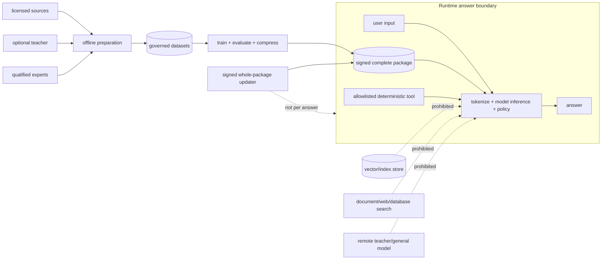

# No-runtime-RAG architecture

## Lesson: move knowledge acquisition before release

Retrieval-Augmented Generation selects external facts while answering. This project instead learns domain behavior
during offline training and ships a closed model package. The difference is timing:

- **before release:** collect licensed manuals, build datasets, use an optional teacher, train, and evaluate;
- **during each answer:** tokenize, run the approved model, optionally call a bounded calculator, and decode.

This constraint simplifies offline operation and privacy, but it does not make learned parameters an exact database.
Models can forget details, blend domains, become stale, and hallucinate. Pharmacy and hazardous repair therefore need
narrow scope, uncertainty behavior, qualified review, prominent knowledge dates, and human escalation.

### Three boundary examples

1. Converting `35 psi` to kilopascals with fixed constants is deterministic computation and may be allowed.
2. Looking up diagnostic code `P0302` in a bundled table is runtime factual retrieval and is prohibited in the primary
   architecture, even if the table is offline.
3. Downloading a complete signed model version between sessions is an update, not RAG. Fetching a manual paragraph for
   the current prompt is RAG.

### Failure scenario

The Android app cannot load its local model. A convenience handler calls a cloud general model and returns an answer.
The user sees a fluent response, but the product has violated the architecture and may have crossed a privacy or safety
boundary. Correct behavior is explicit unavailability, safe guidance, and a separately managed package repair.

### Design exercise

1. Draw every process, file, network destination, SDK, plug-in, and tool reachable from user input.
2. Mark the exact approved model package and deterministic tools.
3. Remove access to datasets, source stores, vector indexes, search APIs, teacher endpoints, and general models.
4. Run with DNS and network blocked; local load, generation, cancellation, reset, and multi-turn must still work.
5. Corrupt the local package and prove the app reports unavailability instead of falling back remotely.
6. Capture file, database, DNS, network, process, and tool traces for normal and adversarial prompts.
7. Bind the resulting evidence digest into the target release manifest.

## Normative boundary

**NORMATIVE SECURITY AND PRODUCT CONSTRAINT / NOT EXECUTED.** Domain capability MUST be learned into weights, adapters,
experts, or students. The primary answer path MUST NOT use Retrieval-Augmented Generation (RAG), hidden retrieval, or
remote-model substitution.

Permitted offline activities:

- source discovery, acquisition, parsing, normalization, and dataset building;
- teacher-generated examples or logits with rights, grounding, filtering, and expert review;
- external references for evaluation and adjudication;
- contamination search, model selection, calibration, and research;
- packaging complete newly trained releases.

Permitted runtime activities:

- tokenization, template rendering, local/cloud inference, decoding, policy checks, and explicit user-interface state;
- approved deterministic tools with typed input/output, bounded execution, no network/database access, and no
  domain-knowledge corpus;
- update checks and complete signed-package download outside the answer path.

Prohibited runtime activities:

- vector databases, embedding indexes, semantic/document search, retrievers, rerankers, or dynamic chunk selection;
- fetching source text, web pages, records, manuals, or database rows to augment a prompt;
- bundled corpora or indexes queried per answer, even entirely offline;
- tools or SDKs that perform undeclared knowledge lookup;
- remote teachers, general models, agents, or cloud fallbacks answering for the specialist SLM;
- network failure silently changing local inference into a remote answer path.

Static prompt templates, policy text, stop tokens, and user-supplied text are not retrieval. A deterministic calculator
or unit converter is not retrieval if it contains no knowledge corpus and cannot fetch one. A SQL lookup, search API, or
“tool” returning domain facts is retrieval and is prohibited.

## Architecture and data flow

**FIG-MDA-03 — Offline learning and retrieval-free inference (`ILLUSTRATIVE`).** Alt text: sources, optional teacher,
and experts are used only before release; runtime consumes a signed model package and optional deterministic tools;
vector search, runtime search, and remote teacher calls are blocked.



The runtime dependency graph MUST be closed and declared:

```text
user input
  → authentication/authorization (cloud when applicable)
  → tokenizer + immutable chat template
  → approved model/base-adapter tuple
  → optional deterministic allowlisted tool
  → decoding + safety/output policy
  → response
```

No answer-path edge may reach a source store, dataset registry, protected evaluation store, embedding service, search
engine, teacher endpoint, general model endpoint, or update service.

## Runtime tool contract

Every runtime tool MUST declare:

| Field       | Requirement                                                  |
| ----------- | ------------------------------------------------------------ |
| identity    | immutable implementation/version and owner                   |
| purpose     | one bounded deterministic operation                          |
| I/O schema  | typed, size-bounded, validated                               |
| authority   | whether output is advisory or exact computation              |
| resources   | CPU/memory/time limits                                       |
| permissions | explicit filesystem/network/database denial                  |
| data        | no corpus, document collection, embeddings, or mutable facts |
| logging     | privacy-bounded metadata only                                |
| failure     | explicit error; no model or retrieval fallback               |
| tests       | fixtures, abuse cases, egress-denied execution               |

Examples that MAY qualify are arithmetic, unit conversion with fixed conversion constants, checksum verification, and
local date formatting. Drug databases, diagnostic-code lookups, web search, manual search, and inventory lookup do not
qualify for the primary architecture.

## Defense-in-depth enforcement

### 1. Configuration and policy

Every domain and release MUST include `no_runtime_rag.required: true`, the full prohibition list, and the exact
runtime-tool allowlist. Missing declarations or exceptions fail.

### 2. Architecture and code review

Reviewers MUST trace every path from input to output and from tool invocation to external resources. Review MUST cover
application, runtime, sidecars, SDKs, plugins, analytics, safety services, feature flags, and fallback handlers.

### 3. Dependency and package inspection

CI MUST inspect source, lockfiles, SBOM, containers, mobile bundles, model packages, configuration, and generated assets
for vector-store/search clients, embedding models, corpora, chunk stores, database files, retriever prompts, and
undeclared HTTP clients. Keyword scans are useful but insufficient.

### 4. Identity, permissions, and egress

Cloud inference roles MUST be unable to read source/dataset/evaluation stores or invoke search, embedding, document, or
teacher services. Network policy MUST allow only declared service dependencies. Mobile qualification MUST include a
no-network execution profile; the installed model cannot require DNS, CDN, authentication, analytics, fonts, tokenizer
download, safety API, or cloud fallback to answer.

### 5. Dynamic traces and adversarial tests

Qualification MUST capture network, DNS, database/file, process, and tool traces while running normal, multi-turn,
malformed, and adversarial prompts. Tests MUST attempt to trigger URL fetch, document lookup, prompt injection into
tools, missing-model fallback, disabled-service fallback, and domain switching.

### 6. Release attestation

**Listing MDA-NR-01 — Completed synthetic attestation (`UNVERIFIED IMPLEMENTATION`).** The identities and evidence
digests demonstrate a fully populated record; they are not evidence that tests actually ran.

```markdown
# No-runtime-RAG release attestation

- Domain: `automotive_education`
- Release: `automotive-android-2.1.0`
- Target: `android_arm64`
- Package digest: `74d0915d9e39ab661f6cbd7b2e7f40a2264f8aac94fb975768c9a4c19598c154`
- Runtime/app digest: `39d1780fc5b10386f4fca5ae7ad50379f663832daa42f1d65693090d584b099d`
- Reviewer: `principal:security-reviewer-mobile`
- Review date: `2026-11-24`
- Policy digest: `687c48ab539f385b3656ff964521d80560a838fca27350d47f98bf240b9a7687`

## Architecture

- [x] The user-to-answer flow matches the reviewed architecture.
- [x] Only the approved package, tokenizer/template, policy, and deterministic tools participate.
- [x] No vector store, embeddings search, retriever, reranker, or runtime document selection exists.
- [x] No source text is fetched or selected for prompt augmentation.
- [x] No remote model answers or silently replaces the specialist model.
- [x] Updates deliver complete signed packages, never per-request knowledge.

## Static, package, and permission evidence

- [x] Source, dependencies, SBOM, container/app, package, and configuration were inspected.
- [x] No corpus, chunk/index store, disguised retriever, or undeclared client is packaged.
- [x] Runtime IAM, filesystem permissions, and egress deny knowledge/search/teacher services.
- [x] Every allowlisted tool has typed I/O, bounded resources, and no knowledge access.

## Dynamic evidence

- [x] Egress-denied inference loads, generates, cancels, resets, and runs multi-turn.
- [x] Traces show no per-answer knowledge call or undeclared file/database lookup.
- [x] DNS/service failure activates no remote fallback.
- [x] Adversarial prompts cannot trigger retrieval, URL fetch, or model substitution.
- [x] Android ARM64 was checked independently; this attestation makes no claim about server or iOS.

- Decision: `PASS`
- Evidence bundle digest: `4e934f3b2b1dc21dd7e7421de43d86f2b6caa7388cd9178c302afba7dc379fac`
- Reviewer signature record: `artifact://attestations/automotive-android-2.1.0/security-reviewer-mobile`
```

The attestation digest MUST be bound into the release manifest. There is no waiver path for the prohibition.

## CI and acceptance gates

`PLANNED EXPERIMENT` release gates:

1. schema validation finds the complete prohibition and tool allowlist;
2. architecture graph has no answer-path edge to forbidden services;
3. dependency/SBOM and package scans have no unexplained finding;
4. cloud runtime with denied source/search/teacher permissions still answers;
5. edge app after reboot, expired credentials, blocked DNS, and blocked network loads, generates, cancels, resets, and
   handles multi-turn locally;
6. removal/corruption of local assets produces explicit unavailability, not cloud substitution;
7. adversarial tool and fallback tests pass;
8. traces and attestation are immutable release evidence.

Monitoring MUST alert on new runtime dependencies, egress destinations, permissions, packaged assets, tool
registrations, or fallback configuration. Such a change requires re-review and a new release.

## Consequences and safety compensation

Without retrieval, the model may have imperfect recall, stale knowledge, conflicting domain memories, hallucinations,
and weak citation fidelity. Training MUST NOT be described as exact database storage. The product SHOULD:

- display release identity and knowledge cutoff;
- train and test uncertainty, applicability, refusal, and escalation;
- narrow intended use and prohibit autonomous high-consequence authority;
- use authoritative sources and qualified experts offline for evaluation;
- trigger a new dataset/model release for material source changes;
- maintain short review cadences for pharmacy and safety-critical domains.

“Verify against current authoritative guidance” may be a user instruction or workflow outside generation. The primary
model itself MUST NOT perform that lookup while generating the answer.

## Cross-links

- [Architecture index](README.md)
- [Domain contract](domain-configuration-contract.md)
- [Platform components](platform-components.md)
- [No-runtime-RAG governance standard](../00-governance/no-runtime-rag-standard.md)
- [Offline installation](../09-edge-guide/offline-installation-and-updates.md)
- [CH-47 enforcement](../02-textbook/part-14-final-engineering-architecture/ch-47-proposed-production-system.md#4716-no-runtime-rag-enforcement)

## Honest status

The boundary, tool contract, architecture, static and dynamic controls, attestation, release gates, monitoring, and
safety compensation are specified. No static scan, permission test, network trace, adversarial test, or attestation has
been executed.
