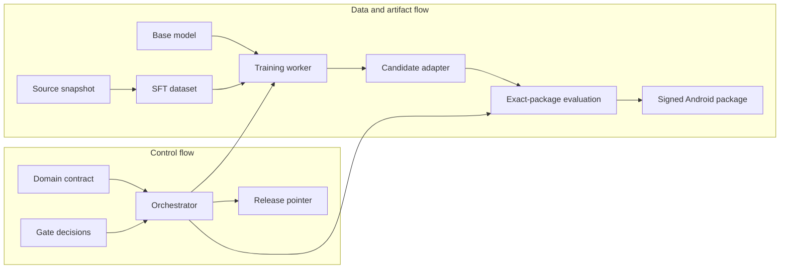
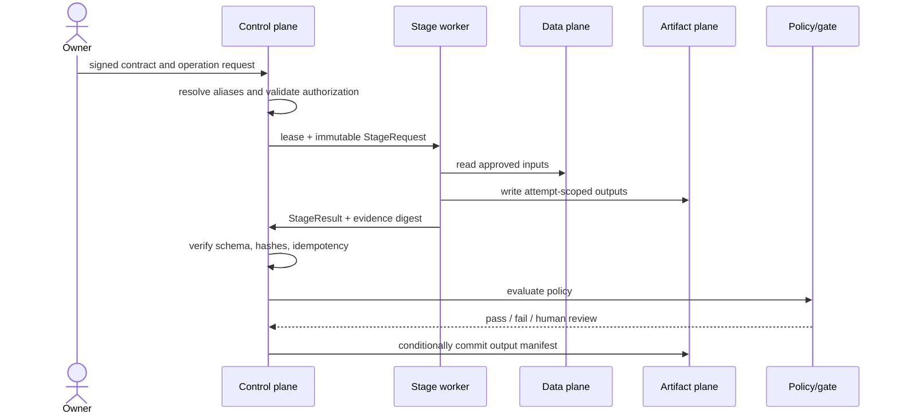

# Platform components and interfaces

## Lesson: separate the factory from the product

The platform is a factory that produces immutable model packages. The runtime product consumes one approved package; it
does not reach back into training datasets. This separation makes failures diagnosable and keeps protected evaluation
answers away from training.

Consider a pump-maintenance adapter:



The worker reads bytes directly from artifact storage. The orchestrator sends references and records decisions. If a
worker crashes after uploading output but before commit, the output remains attempt-scoped; the control plane verifies
its digest before making it a candidate.

### Concrete control-flow failure

Attempt 1 trains successfully but loses its network connection before reporting completion. A retry must not create a
second “successful” candidate with ambiguous lineage. The operation ledger compares the operation ID and immutable
inputs. It either returns the already committed result or starts attempt 2 from a complete checkpoint. Rights,
signature, schema, and safety failures are not transient and must not be blindly retried.

### Platform design exercise

1. Start with one domain contract and one immutable dataset manifest.
2. Draw which component may read source data, protected tests, model bytes, and signing keys.
3. Define a stage request and result with immutable digests.
4. Inject a crash before upload, after upload, and during manifest commit.
5. Verify that none creates two committed identities or exposes final tests to training.
6. Repeat the same contract with a local worker and an AWS worker; only the backend should change.

## Status and architectural style

**NORMATIVE COMPONENT SPECIFICATION / `UNVERIFIED IMPLEMENTATION`.** Components communicate through versioned manifests
and immutable artifact references. Local processes and AWS jobs MUST implement the same logical contracts. Configuration
selects allowlisted implementations; it MUST NOT contain code.

## Component catalog

<!-- markdownlint-disable MD013 -->
| Component                      | Consumes                                   | Produces                                    | Must fail on                                               |
| ------------------------------ | ------------------------------------------ | ------------------------------------------- | ---------------------------------------------------------- |
| Domain contract service        | authored declaration, policy               | canonical validated contract digest         | unknown fields, missing owner/rights/safety/retirement     |
| Ingestion                      | approved source manifest, connector config | canonical records and receipts              | unauthorized source, unsafe archive, parser bounds         |
| Validation                     | records, rights, split/quality policy      | report, quarantine, dataset candidate       | rights, PII, leakage, critical contradiction               |
| Dataset registry               | approved manifest/shards                   | immutable dataset identity and lineage      | mutation or unresolved parent                              |
| Base catalog/model selector    | approved models, domain/target constraints | pinned shortlist and baseline plan          | license, tokenizer, export/runtime incompatibility         |
| Orchestrator/operation ledger  | stage request, policy, identities          | lease, committed result, events             | duplicate conflict, unauthorized stage, invalid result     |
| Training runner                | base, datasets, resolved run config        | checkpoints, candidate, run manifest        | unpinned input, non-resumable claimed checkpoint           |
| Experiment tracker             | append-only run events/references          | searchable comparisons and lineage          | conflicting immutable identity                             |
| Evaluation service             | exact candidate/package, sealed suite      | item results, aggregate report, gate facts  | suite exposure, missing result, evaluator mismatch         |
| Compression/merge service      | candidate, calibration, method             | derived candidate and parent edge           | unsupported method, missing calibration lineage            |
| Export/packager                | candidate, tokenizer/template, target      | closed target package, SBOM, manifest       | extra/missing file, unsafe path, conversion parity failure |
| Compatibility lab              | package, runtime/device matrix             | static, parity, emulator/device evidence    | unsupported or untested tuple                              |
| Candidate/release registry     | lineage, evidence, approvals               | states, aliases, signed release             | incomplete evidence or invalid transition                  |
| Cloud deployer                 | signed server release, deployment policy   | staging/canary/active deployment record     | signature, health, canary, capacity failure                |
| Edge publisher                 | signed edge release, entitlement           | immutable downloadable objects              | target mismatch, hash/signature failure                    |
| Monitoring/incident service    | bounded telemetry, probes, reports         | alerts, incidents, review proposals         | privacy policy or evidence-integrity breach                |
| Rollback/retirement controller | incident/lifecycle decision                | forward deployment or disabled distribution | absent approved predecessor/authority                      |
<!-- markdownlint-restore -->

Training, evaluation, approval, signing, deployment, and rollback MUST be separate authorities. A prototype MAY map
several roles to one person, but the event record MUST preserve the exercised role.

## Data, control, and artifact flows

**FIG-MDA-02 — Manifest-driven stage execution (`ILLUSTRATIVE`).**



Bulk bytes SHOULD move directly between stores and workers. The orchestrator SHOULD carry references, leases, and
decisions. Protected evaluation data MUST not be readable by training, selection, teacher-generation, compression
choice, or threshold-setting roles.

## Stage interface

**Listing MDA-PC-01 — Backend-neutral stage envelope (`UNVERIFIED IMPLEMENTATION`).** Exact serialization,
authentication, storage, and retry code remain to be implemented.

```yaml
contract: stage-request/1.0
operation_id: "01JDG5X9V7E6F3C2B1A0R8M4NK"
attempt_id: "attempt-0001"
stage: "model.evaluate"
implementation: "evaluation-runner/3.1"
inputs:
  - uri: "artifact://candidate/pump-lora-r3"
    sha256: "6ce6c6f11f1fb56af166c09d2afddb7d8bca18d6a781e72ff6bc66cc1ce10c95"
    schema: "candidate/2.0"
resolved_config:
  uri: "artifact://config/pump-evaluation-v3.json"
  sha256: "946f9fc4c1e53c75078f3fc64c3f2fd76fd701dcf26c02393d8350a9e6863f4d"
policy:
  uri: "artifact://policy/release-2026-10.json"
  sha256: "687c48ab539f385b3656ff964521d80560a838fca27350d47f98bf240b9a7687"
idempotency_key: "f34c132681c6ace9e7180ad53b32c7e3703ab6f531707da26aef79e8f2cc62b9"
deadline_seconds: 3600
output_prefix: "artifact://attempts/01JDG5X9V7E6F3C2B1A0R8M4NK/attempt-0001/"
```

The result MUST contain the same operation/attempt IDs, one of `succeeded`, `failed`, `cancelled`, or `indeterminate`,
output references, evidence, environment digest, timing, and commit state. Only a schema-valid, digest-verified,
authorized, conditionally committed `succeeded` result MAY advance. `indeterminate` is never a pass.

## Artifact and registry interfaces

Every artifact manifest MUST contain:

```text
schema and artifact ID; kind; SHA-256 and bytes; media type; creator/time;
parents; transformation method/code/config/environment; exact inputs;
kind-specific identity; rights/notices/permitted uses; security review;
retention; release state; targets; rollback parent
```

Kind-specific requirements:

- **dataset:** source/record families, transformations, rights/privacy, split, counts, duplicate/leakage audits,
  approvals, access class;
- **model:** repository revision, inventory, architecture/config, tensor shapes, dtype, parameter counts,
  tokenizer/template, license;
- **adapter/merge:** exact base, method/rank/targets/scales, order/dtype/tool, parity evidence;
- **compressed model:** parent, calibration, algorithm, exclusions, formats, target kernels, before/after evaluation;
- **runtime package:** all files, tokenizer/template, runtime/app build, operators/backend placement, platform/cohort,
  SBOM, signature;
- **result/report:** plan, runs/trials/failures, raw bundles, analysis identity, reviewers and supersession.

The lineage graph MUST be acyclic. Every non-origin artifact MUST name a parent. Evaluation MUST attach to the exact
runtime package, not an abstract model.

## State machines

Dataset:

```text
DISCOVERED → ACQUIRED → QUARANTINED → VALIDATED → APPROVED → PUBLISHED
→ DEPRECATED → RETIRED
```

Run:

```text
PLANNED → RESOLVING → RUNNING ↔ CHECKPOINTED
→ SUCCEEDED | FAILED | CANCELLED | INDETERMINATE
```

Candidate/release:

```text
BUILT → QUARANTINED → EVALUATING → QUALIFYING → PENDING_APPROVAL
→ APPROVED → SIGNED → RELEASED → DEPRECATED → RETIRED
```

Deployment:

```text
PLANNED → PROVISIONING → VERIFYING → CANARY → ACTIVE
→ DRAINING → INACTIVE
```

Edge installation:

```text
ABSENT → DISCOVERED → DOWNLOADING ↔ PAUSED → STAGED → VERIFIED
→ INSTALLED → ACTIVE → HEALTHY
```

Failed gates create `REJECTED`; repair creates a new candidate. Invalid bytes become `QUARANTINED`. Deployment incidents
can become `SUSPENDED` or `ROLLED_BACK`. State history MUST be append-only.

## Idempotency, retry, and recovery

The operation ledger MUST:

- return an existing committed result for identical operation/inputs;
- reject the same operation ID with different inputs;
- refuse a concurrent live duplicate;
- reconcile an expired lease;
- verify output before atomically committing a small manifest.

Transient throttling/network failures use bounded exponential backoff, jitter, and deadlines. Worker interruption
resumes from a complete committed checkpoint under a new attempt. Out-of-memory or disk failure retries only with a
recorded changed plan. Schema, rights, license, safety, signature, and compatibility failures are not blindly retried.
Partial deployment requires reconciliation before continuation or rollback.

A resumable training checkpoint MUST include weights, optimizer, scheduler, scaler where used, random states,
sampler/data cursor, parent, and manifest commit. A weight file alone is not resumable state.

## Security and trust boundaries

- External files MUST enter quarantine and be parsed with size, count, path, decompression, time, and memory limits.
- Unsafe executable deserialization MUST be prohibited for untrusted models.
- Workloads MUST use short-lived identities and least privilege.
- Training cannot approve, sign, deploy, or read sealed final answers.
- The signer MUST receive only a fully approved immutable manifest and use a narrowly governed key.
- Runtime MUST read one approved bundle and MUST NOT mutate registries/data.
- Logs MUST exclude secrets, signed URLs, model bytes, protected tests, and raw prompts/answers by default.

## Local and AWS adapters

`LocalProcessBackend` and `AwsJobBackend` MUST satisfy the same stage contract, status semantics, idempotency, and
evidence rules. An AWS mapping MAY use S3, ECR, Step Functions or SageMaker Pipelines, SageMaker/EC2/ECS/EKS compute,
Model Registry or a custom registry, KMS, IAM, VPC, CloudWatch, and CloudTrail. These are replaceable implementations,
not mandatory services.

## Monitoring and ownership

Operational signals include readiness, errors, queue, TTFT, throughput, memory, OOM, restarts, and cost. Behavioral
signals include approved probes, refusal/escalation, expert samples, and incidents. Knowledge signals include source
revisions, recalls, regulations, and taxonomy drift. Edge signals include package integrity, app/runtime versions,
crashes, and update state.

Every component MUST have an accountable owner, support window, evidence retention, failure runbook, and retirement
procedure. Offline-device telemetry may be absent; the control plane MUST NOT infer fleet-wide rollback from silence.

## Contract tests

`PLANNED EXPERIMENT`: reject unknown/mutable inputs; inject duplicates and crashes around commit; corrupt every artifact
class; deny cross-role access; expose a fake final suite; interrupt training; abort canary; interrupt edge
download/activation; revoke a source right; scan and dynamically test for runtime retrieval; reconstruct one release
from manifests.

## Cross-links

- [Architecture index](README.md)
- [Domain contract](domain-configuration-contract.md)
- [No-runtime-RAG](no-runtime-rag-architecture.md)
- [Release management](release-and-model-management.md)
- [Artifact specification](../06-experiment-framework/specifications/artifact-and-provenance-specification.md)
- [AWS guide](../08-aws-guide/README.md)
- [Edge guide](../09-edge-guide/README.md)

## Honest status

Responsibilities, interfaces, state, lineage, recovery, security, monitoring, and backend rules are specified. No
component or contract test was executed.
