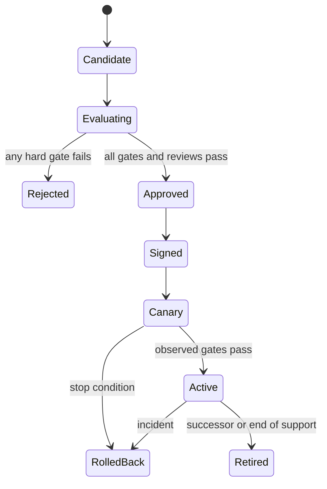

# Release and model management

## Lesson: version the runnable system, not just the weights

A candidate is an output of training or conversion. A release is the exact runnable bundle that users receive. Changing
the tokenizer, chat template, quantization, runtime, or safety policy can change behavior even when weights are
unchanged, so all of them belong to release identity.



Suppose a 1.12 GB Android model is active and its predecessor is 1.08 GB. A safe update also needs a 1.12 GB partial
download, a 1.12 GB staged copy, and 0.20 GB reserve. Peak free storage is therefore about
$1.12 + 1.08 + 1.12 + 1.12 + 0.20 = 4.64$ GB, not 1.12 GB. Measure packaging and filesystem behavior rather than
using this planning estimate as a release value.

The complete manifest below is syntactically populated with synthetic teaching identities. Its performance values are
illustrative, not measured claims.

## Status and release principle

**NORMATIVE LIFECYCLE SPECIFICATION / `UNVERIFIED IMPLEMENTATION`.** A model file is not a release. A release is one
immutable, target-specific, independently approved bundle:

```text
weights or adapter + exact base + model config + tokenizer + chat template +
runtime/container/app + quantization/KV format + generation/safety policy +
compatibility + licenses/notices + SBOM + evaluation + approvals +
signature + predecessor and rollback instructions
```

Cloud, Android, iOS, and other edge targets MUST have separate release IDs and qualification even when they share source
weights.

## Registries and identities

Maintain conceptually distinct registries:

| Registry           | Identity and purpose                                                   |
| ------------------ | ---------------------------------------------------------------------- |
| Source             | acquired bytes, rights, version, expiry, provenance                    |
| Dataset            | immutable objective-specific shards, transformations, splits, audits   |
| Base model         | exact weights/config/tokenizer/template/license and approved uses      |
| Run/experiment     | resolved inputs, code/environment, hardware, seeds, attempts, failures |
| Candidate          | trained or transformed artifact before approval                        |
| Evaluation         | suite, exact candidate/package, item results, statistics, reviewers    |
| Release            | closed approved target bundle and signature                            |
| Deployment/install | release in environment, cohort, or device state                        |

Large bytes reside in content-addressed stores. Registry rows contain immutable IDs, digests, lineage, state, policy,
approvals, and aliases. A correction creates a superseding record; history MUST NOT be rewritten.

## Artifact and lineage graph

```text
sources → datasets → base + training run → trained candidate
→ adapter merge / prune / distill / quantize → target export
→ runtime package → exact evaluation → approved release → deployment/install
```

Every transformation edge MUST record exact parent digests, implementation and version, command/config, environment,
calibration data, seed when applicable, start/end, logs, output digest, and failure state. Every release MUST support
ancestor and descendant queries. Rights or security revocation uses descendant tracing; deletion is not proof of machine
unlearning.

## Version policy

Digests establish identity. Semantic versions communicate compatibility:

- **major:** incompatible tokenizer/template, API, output schema, safety contract, intended use, rights boundary,
  runtime format, or minimum client;
- **minor:** retraining, new dataset, behavioral change, adapter/model update, changed thresholds, or compatible
  capability addition;
- **patch:** packaging or metadata correction proven behavior-compatible.

Behavioral retraining MUST NOT be patch-only. Version strings MUST NOT replace digests. Mutable aliases such as
`candidate`, `stable`, and `production` point to immutable releases and changes MUST be atomic, authorized, and audited.

## Required release manifest

**Listing MDA-RM-01 — Target release manifest (`UNVERIFIED IMPLEMENTATION`).** Unresolved tokens and zero values are invalid
in production.

```yaml
schema: "slm-release/1.0"
release_id: "automotive-android-2.1.0"
release_sequence: 42
domain_id: automotive_education
target: android_arm64
created_at: "2026-11-24T05:30:00Z"
knowledge_cutoff: "2026-10-01"
lineage:
  domain_contract:
    uri: "artifact://domain/auto/v3"
    sha256: "34b866f1841ac5c015ab7a2ca821208557d365e881ddc8309e22aa21dc93c947"
  dataset:
    uri: "artifact://dataset/auto-sft/v7"
    sha256: "d7a4db3d8b9d80cbfc98e602164ca83304180a8962d80c1978088077d6b33696"
  base:
    uri: "artifact://base/example-decoder-2b"
    sha256: "60ed4854b05751634c8d707c7d0c881cb82cc850935a4a27d6505343574e7b16"
  run:
    uri: "artifact://run/auto-184"
    sha256: "cd5d4bbcc8bb798a0f2f2983c3d2c78a03c1fffb53d8b512ace168308386955a"
  candidate:
    uri: "artifact://candidate/auto-q4"
    sha256: "1a550fe4ea84b7ce48aa86370c8ff5669ef06a9a9aa1fbd2538fab08ad45a7d5"
compatibility:
  platform: android
  abi: [arm64-v8a]
  minimum_os: "Android 9 API 28"
  minimum_app_build: 21000
  runtime: "llama.cpp@b6820"
  model_format: "GGUFv3-Q4_K_M"
  context_tokens_maximum: 4096
  device_cohorts: [auto-android-v1]
  measured_peak_ram_bytes: 1879048192
  required_free_storage_bytes: 4982162064
artifacts:
  - path: "model.gguf"
    bytes: 1127428912
    sha256: "74d0915d9e39ab661f6cbd7b2e7f40a2264f8aac94fb975768c9a4c19598c154"
    media_type: "application/octet-stream"
  - path: "chat-template.txt"
    bytes: 1840
    sha256: "c558e7248416941314f8be90e0c28f3338df698e1378ddbd98285e6bbcf72560"
    media_type: "text/plain"
evidence:
  quality_safety_report_sha256: "ed1a3008a45e5bf51bb76ce7bdc97f087aec9feb76e526bd1499e640668279c1"
  compatibility_report_sha256: "d36fcd715ea18eaa6c9b29de16d951529024a450c97439a357b3a58eb16b5a68"
  physical_device_report_sha256: "64f70ccfbb77320a56d36772efef64f8387738fe153648a75d746b8b70d749d0"
  no_runtime_rag_attestation_sha256: "4e934f3b2b1dc21dd7e7421de43d86f2b6caa7388cd9178c302afba7dc379fac"
supply_chain:
  sbom_sha256: "369d61734798a4d3c69551e6c8d32c1ae248adfb1a686f0fdb85b60265b46be5"
  license_bundle_sha256: "8337203f401b0dfc8c477f8154c314c60f5c9d41a2f09a7b9f3304cd8af622ec"
  provenance_sha256: "44804b7217699b3b6a1a722f8f353c5aa8d78bb61acb142c1dc3d5b1f24da6de"
approvals:
  - role: "role:release-authority"
    identity: "principal:release-board-automotive"
    decision: approve
    evidence_sha256: "7ec2745d78a2746d4fe189674cfcfa9b6a53e4fe515b816a18eb0105a335fe33"
rollback:
  predecessor_release_id: "automotive-android-2.0.3"
  predecessor_manifest_sha256: "6bb8b24e30504a9ec97b1f01b86ae48ba46974c5bf35774a4f2e85b0e838b72d"
  automatic_until: "2027-02-24T05:30:00Z"
signature:
  algorithm: "Ed25519"
  key_id: "release-signing-2026-q4"
  detached_signature: "MEUCIQDmSYNTHETICTEACHINGVALUEONLY8bQIgP0NOTAVALIDPRODUCTIONSIGNATURE0="
```

The manifest MUST bind every package file with normalized relative path, byte length, digest, and media type. Reject
absolute paths, drive prefixes, `..`, backslashes, duplicate/ambiguous names, links, special files, unexpected files,
and archive expansion above signed ceilings. Sign exact deterministic bytes; verify signature before parsing model
bytes.

The signature value above is deliberately non-operational teaching data. A real signer creates the signature from
canonical manifest bytes after all evidence and approvals are final.

## Candidate and release gates

Promotion is conjunctive:

1. identity, lineage, rights, privacy, license, and contamination pass;
2. exact package passes domain, safety, uncertainty/refusal, general retention, OOD, adversarial, multi-turn,
   privacy/memorization, and security suites;
3. defined critical failures and required subgroup failures equal zero;
4. tokenizer/template/stops, logits or deterministic outputs, cache/reset, and conversion parity pass;
5. exact target passes load, startup, memory, TTFT, prefill/decode, sustained thermal/energy, cancellation, OOM/crash,
   and compatibility policy;
6. SBOM, provenance, notices, package bounds, hashes, and signatures pass;
7. no-runtime-RAG attestation passes for that target;
8. independent named reviewers approve exact digests;
9. a known-good predecessor and rollback procedure exist unless this is an explicitly approved initial release with a
   suspend path.

Final suites MUST be inaccessible to optimization. Model judges MAY support triage but MUST NOT solely approve
safety-critical correctness.

## Signing and publication

Build, evaluate, approve, sign, publish, and deploy permissions MUST be separated. Signing keys MUST be asymmetric,
narrowly scoped, audited, and unavailable to ordinary CI/training jobs. Public-key fingerprints MUST be distributed out
of band in trusted server/client configuration.

Cloud publication SHOULD use immutable object identities, versioning, authenticated checksums, encryption, least
privilege, and optional retention. Transport authorization and TLS do not replace the detached release signature. For
complex delegated update trust, use a reviewed framework such as The Update Framework rather than inventing ad hoc
delegation.

## Rollout

Cloud rollout:

```text
approved → signed → staging → smoke/parity → canary → observed gate
→ active → expand; or stop → complete predecessor rollback
```

Canary policy MUST define cohort/traffic, duration, operational and behavioral signals, minimum sample, stop conditions,
owner, and rollback deadline. Canaries MUST NOT expose high-risk users merely to obtain safety evidence.

Edge rollout:

```text
discover signed manifest → compatibility admission → resumable staging
→ full hash verification → side-by-side install → isolated smoke test
→ atomic active pointer → health window → retain/delete predecessor
```

Partial bytes MUST never be loadable. Peak storage MUST include active, previous, partial, staged, unpacked, temporary,
and reserve. Apps MUST reject arbitrary downgrade. Controlled rollback uses the exact signed predecessor during its
window or a new higher-sequence manifest referring to known-good old bytes.

## Rollback

Rollback is a forward deployment of the complete known-good release; it MUST NOT swap only weights or mutate history.
Trigger examples are critical safety incident, signature/integrity failure, incompatible client, material quality/probe
regression, crash/OOM increase, unacceptable latency/resource regression, runtime vulnerability, or rights revocation.

Procedure:

1. suspend promotion and preserve evidence;
2. identify affected release/targets/cohorts and decision authority;
3. atomically direct cloud traffic to the approved predecessor or suspend;
4. activate the locally retained signed predecessor where policy permits;
5. verify service/package health and critical probes;
6. record incident, observed state, decision, and residual exposure;
7. create a new candidate for remediation and require complete reapproval.

Offline devices cannot be assumed to learn revocation or rollback immediately. High-risk products MUST disclose this
limitation and MAY require managed-device reconnection/expiry policy.

## Monitoring and lifecycle

Monitor four layers:

<!-- markdownlint-disable MD013 -->
| Layer               | Signals                                                                 | Limitation                         |
| ------------------- | ----------------------------------------------------------------------- | ---------------------------------- |
| Operational         | readiness, errors, queue, TTFT, throughput, memory, OOM, restarts, cost | not factual correctness            |
| Behavioral/safety   | curated probes, refusals, escalation, expert samples, incidents         | delayed/sampled labels             |
| Knowledge/freshness | source revisions, recalls, laws, taxonomy/task drift                    | parameters do not self-update      |
| Edge fleet          | package integrity, app/runtime/cohort, crash/update state               | offline devices may report nothing |
<!-- markdownlint-restore -->

Raw prompts and answers are off by default. Monitoring creates a review or future-data proposal, never direct online
training.

Lifecycle decisions are `continue`, `restrict`, `re-evaluate`, `retrain`, `rollback`, `suspend`, `deprecate`, or
`retire`. Deprecation stops new selection while preserving a known-good installed release if policy permits. Retirement
stops cloud traffic and new installs, revokes authorization, traces descendants, records successor and offline residual
risk, closes resources, and retains evidence under policy.

## Multi-domain specifics

- A base-plus-adapter release versions the pair, not the adapter alone.
- A composition release binds ordered adapter digests/scales/fusion weights.
- A merged release binds all sources and merge recipe; source rights remain.
- A routed release binds router model/config/calibration, authorization policy, route-to-release map, health/fallback
  policy, and every selected release.
- A joint model cannot offer hard per-domain removal or entitlement.
- A distilled student binds teachers, generated/logit data, loss/config, and direct student evaluation.

## Failure and drill matrix

`PLANNED EXPERIMENT`: corrupt each package member and approval digest; use a wrong/revoked key; interrupt every
cloud/edge transition; force canary failure; exhaust edge storage; kill app around activation; attempt downgrade; make
the specialist unavailable; revoke a source right; rotate signing keys; restore registries; retire a domain with
disconnected devices.

## Step-by-step release and rollback exercise

1. Build two target manifests from one candidate: AWS server and Android ARM64.
2. Give each a different runtime, package digest, compatibility report, release ID, and predecessor.
3. Calculate Android peak update storage, then simulate insufficient storage halfway through download.
4. Corrupt one package byte and confirm verification fails before model parsing.
5. Fail a canary on crash rate and route all cloud traffic to the complete predecessor release.
6. Simulate a rights revocation. Trace descendants, suspend affected releases, and record offline devices that may not
   receive the decision immediately.
7. Verify rollback restores weights, tokenizer, template, runtime, and policy together; swapping only weights fails.

## Cross-links

- [Architecture index](README.md)
- [Strategy comparison](strategy-comparison.md)
- [Platform components](platform-components.md)
- [No-runtime-RAG](no-runtime-rag-architecture.md)
- [Cloud-to-edge delivery](../08-aws-guide/cloud-to-edge-delivery.md)
- [Offline installation](../09-edge-guide/offline-installation-and-updates.md)
- [Artifact specification](../06-experiment-framework/specifications/artifact-and-provenance-specification.md)

## Honest status

Registry identity, lineage, semantic versions, manifests, gates, signing, rollout, rollback, monitoring, deprecation,
retirement, and multi-domain release rules are complete. No registry, signature, deployment, device update, monitor,
rollback, revocation, or drill was executed.
