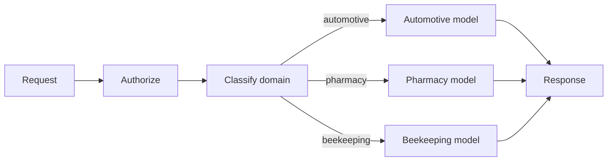
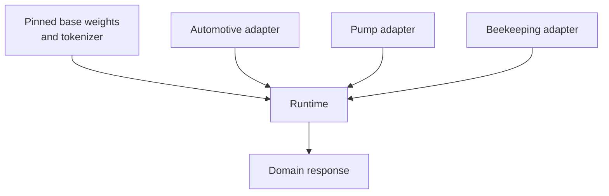
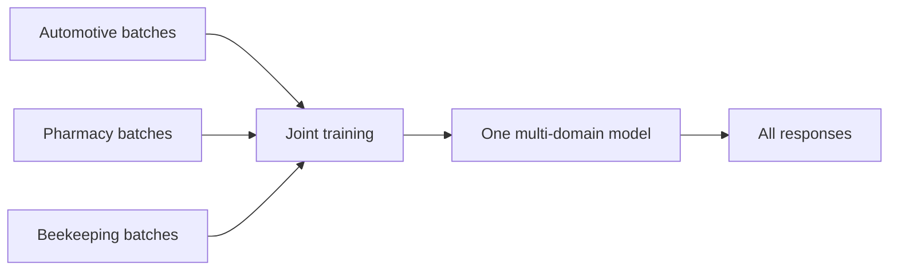
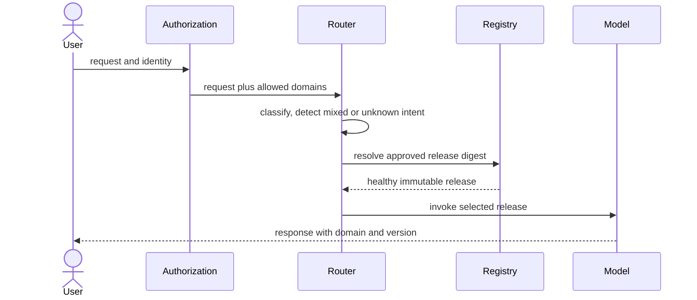

# Multi-domain strategy comparison

## Lesson: four architectures you should be able to draw

### 1. Independent specialist models

Automotive, pharmacy, and beekeeping each receive a separately trained checkpoint. A router may select one, but no
gradients or runtime weights are shared between specialists.



This gives the clearest operational isolation: a pharmacy update cannot alter automotive weights. It costs more storage,
training, export, and warm capacity. If each 2B INT4 package is 1.1 GB after format overhead, three copies use 3.3 GB.
Loading only one at a time saves RAM but adds model-switch latency; keeping all three warm avoids switching but roughly
triples weight memory.

**Failure scenario:** the router labels “Can I combine these tablets?” as a general question. A general fallback answers
instead of the pharmacy model. Isolation did not help because routing became part of the safety boundary. The safe
response is to refuse or clarify when the authorized high-risk specialist is uncertain or unavailable.

### 2. Shared base with independent adapters

One frozen base supplies language ability; each LoRA adapter stores a trained weight delta.



For a transformer matrix $W$, LoRA applies $W' = W + (\alpha/r)BA$. The base $W$ is shared, while each domain owns
different low-rank matrices $A$ and $B$. This saves storage and retraining cost, but an adapter is only valid with
the exact base, tokenizer, target modules, rank, scaling, and runtime tested with it.

Example: a 1.1 GB base and three 70 MB adapters use 1.31 GB, 60% less than three 1.1 GB checkpoints. Peak memory may
still be 1.8 GB after KV cache and runtime buffers, so adapter size alone is not a device-feasibility metric.

**Failure scenario:** an engineer upgrades the base from revision `a17c` to `b920` but keeps the old pump adapter.
Tensor shapes happen to match, yet behavior changes. The registry must reject the pair because its base digest differs.

### 3. One dense multi-domain model

All domains train one set of parameters, usually through a balanced multi-task mixture.



Deployment is simple: one resident artifact, no adapter switch. The cost is **interference**. If gradients from two
domains point in conflicting directions, improving one loss can increase the other:

$$

\cos(g_a,g_b)=\frac{g_a\cdot g_b}{\lVert g_a\rVert\lVert g_b\rVert}.

$$

A negative cosine is evidence of local gradient conflict, not proof of product failure. Measure per-domain validation,
worst-group results, and safety suites after every mixture change. Oversampling a small pharmacy dataset can preserve
its presence while causing memorization; undersampling can erase rare contraindication behavior.

**Failure scenario:** adding 40% automotive diagnostic conversations improves aggregate score from 0.81 to 0.84 but
drops pharmacy refusal recall from 0.98 to 0.91. The aggregate gain cannot compensate for the critical-domain gate.

### 4. Router over trained models or adapters

A router is control logic, not a knowledge source. It authenticates, determines allowed domains, classifies intent, and
selects an already-trained release.



For 10,000 labeled requests, suppose 9,400 are routed correctly, 300 are safely clarified, 200 are wrongly routed, and
100 are unsafe fallbacks. Correct-route accuracy is 94%, but unsafe-fallback rate is 1%; both matter. High-risk policy
can raise the confidence threshold, trading coverage for safety.

## Less common choices

- **Continual fine-tuning** updates one model sequentially. It is compact but order-dependent and requires replay plus
  regression tests for every earlier domain.
- **Adapter composition** activates multiple deltas, such as mechanical knowledge plus a response-format adapter.
  Validate the ordered composition; two individually good adapters can conflict.
- **Model merging** combines trained weights into one checkpoint. It may simplify serving but destroys a removable
  boundary and requires full requalification.
- **Mixture of Experts** learns a token-level gate over experts. Sparse active compute does not mean low storage or RAM,
  and the learned gate is not authorization.
- **Domain-aware distillation** trains a smaller student from one or more teachers. It helps edge budgets only if direct
  student tests show retained rare safety behavior.

## Step-by-step architecture selection exercise

You must support automotive repair, educational pharmacy, and pump maintenance on Android and AWS.

1. Set hard constraints: 2.5 GB Android peak RAM, 1.8 GB download, no autonomous prescribing, and separate pharmacy
   approval.
2. Eliminate one joint model as the initial pharmacy isolation strategy because its knowledge and rights are entangled.
3. Prototype a shared mechanical base with automotive and pump adapters; separately prototype pharmacy.
4. Export before full training to prove that the Android runtime supports the exact adapter or merged format.
5. Measure package bytes, peak RAM, switch time, domain quality, refusal recall, and routing confusion.
6. Simulate wrong routes, unavailable specialists, base mismatch, and a mid-dialogue domain shift.
7. Choose only among candidates that pass rights, safety, isolation, and no-runtime-RAG gates.

The exercise has no universal numeric winner. A likely starting topology is a shared mechanical base, an isolated
pharmacy model, and an authorization-first router on AWS. On a phone, explicit user selection may be safer and simpler
than an automatic router.

## Status and decision rule

**NORMATIVE DECISION FRAMEWORK / `PLANNED EXPERIMENT`.** This document defines selection gates, not a universal winner.
Strategy behavior is `STATICALLY REVIEWED`; qualitative rankings are `ILLUSTRATIVE`. Measure the exact model, tokenizer,
adapter, quantization, runtime, hardware, workload, and policy tuple before release.

Choose representation, training, and serving independently:

- **representation:** specialist checkpoint, adapter, shared weights, expert, merge, or student;
- **training:** separate, joint, sequential, composed, merged, or distilled;
- **serving:** one artifact, adapter activation, expert gate, or request router.

Routing selects an already-trained artifact. It MUST NOT retrieve knowledge.

## Mandatory strategy catalog

<!-- markdownlint-disable MD013 -->
| Strategy                           | Primary advantage                              | Principal risk                                         | Preferred boundary                                       |
| ---------------------------------- | ---------------------------------------------- | ------------------------------------------------------ | -------------------------------------------------------- |
| Independent specialist models      | dedicated capacity and direct rollback         | duplicated training/storage/operations                 | hard domain, tenant, license, or safety isolation        |
| Shared base + independent adapters | compact domain updates                         | exact base/runtime coupling                            | common legal/technical base with separate cadence        |
| One dense multi-domain model       | one resident artifact and no switching         | interference and entangled rights                      | pooled rights and measured per-domain quality            |
| Continually fine-tuned model       | one evolving artifact                          | catastrophic forgetting and order dependence           | sequential updates with replay and all-domain regression |
| Adapter composition                | reusable domain/task/safety deltas             | composition interference and backend limits            | experimentally validated complementary skills            |
| Model merging                      | one dense serving checkpoint                   | destructive parameter conflict and inseparable lineage | compatible ancestry and full requalification             |
| Multi-task instruction tuning      | explicit task/response contracts               | task/format imbalance                                  | pooled tasks and one-artifact deployment                 |
| Mixture of Experts (MoE)           | high total capacity with sparse active compute | all experts may consume storage/RAM; router coupling   | supported cloud systems, not assumed mobile fit          |
| Request router over trained models | specialist isolation and scaling               | routing errors become model/safety errors              | authorization-first cloud or offline model selection     |
| Domain-aware distillation          | smaller target architecture                    | teacher error transfer and student capacity loss       | tight edge/server budget with legal teacher use          |
<!-- markdownlint-restore -->

## Comparative engineering matrix

<!-- markdownlint-disable MD013 -->
| Strategy        | Interference/forgetting                                              | Storage and RAM                                 | Update/release                             | Isolation, rights, access                            | Safety                                       |
| --------------- | -------------------------------------------------------------------- | ----------------------------------------------- | ------------------------------------------ | ---------------------------------------------------- | -------------------------------------------- |
| Independent     | no cross-model gradient interference; each can forget general skills | $K$ files; one or many resident               | domain-local, repeated export/test         | strongest artifact boundary; base terms still apply  | separate gates; router still hazardous       |
| Base + adapters | adapters isolated until composed                                     | one base + deltas; base/KV/runtime dominate RAM | replace one compatible adapter             | adapter entitlement plus shared-base dependency      | evaluate exact pair/composition              |
| Joint dense     | joint gradient conflict possible                                     | one file and resident model                     | every update triggers all-domain tests     | knowledge inseparable                                | confusion and policy leakage                 |
| Continual       | explicit sequential forgetting                                       | latest plus rollback history                    | order/replay dependent                     | deletion/unlearning difficult                        | old safety behavior may regress              |
| Composition     | inference-time delta conflict                                        | base + active adapters/kernels                  | composition graph expands                  | all component terms apply                            | safety delta is not a shield                 |
| Merge           | task-vector/weight conflict                                          | one serving file; source artifacts retained     | re-merge and requalify                     | poor post-merge removal                              | refusal/calibration can shift                |
| Multi-task      | task and format conflict                                             | one file                                        | broad regression                           | task tags are not access control                     | explicit safety tasks remain probabilistic   |
| MoE             | shared router/attention and expert starvation                        | active FLOPs do not imply low RAM               | router/expert coupling                     | learned gate is not isolation                        | rare routes need dedicated tests             |
| Request router  | models isolated; router can regress                                  | all stored; one or more resident                | model and route manifests versioned        | strong only if authorization precedes route/load     | low-confidence/wrong route is a safety event |
| Distillation    | joint student can compete; separate students isolate                 | smaller only if measured                        | teacher changes may require redistillation | depends on joint/separate student and teacher rights | student may lose rare refusals               |
<!-- markdownlint-restore -->

Storage MUST be separated from runtime memory:

$$
S_{\text{weights}}=\frac{Pb}{8},\qquad M_{\text{peak}}=M_W+M_{KV}+M_A+M_R+M_T+M_{\text{alternatives}}.
$$

Here $P$ is parameter count, $b$ bits per stored weight, $M_A$ activations, $M_R$ runtime buffers, and $M_T$
temporary allocations. Metadata, quantization scales, alignment, dequantization, and allocator behavior MUST be
measured. A file that fits storage may not fit RAM.

## Base-versus-adapter rules

A base-plus-adapter release MUST bind:

```text
base weights digest + model config digest + tokenizer/template digests +
adapter digest + adapter method/rank/targets/scales + merge/runtime revision +
precision/quantization + generation policy + evaluation report
```

Dynamic adapters SHOULD be preferred when the target runtime demonstrably supports the exact operations and independent
updates matter. Offline merging MAY improve portability but creates a full derived checkpoint and MUST preserve
base/adapter/merge lineage. An adapter MUST NOT be loaded against a merely similar base or tokenizer.

Independent models SHOULD be preferred over adapters when bases, tokenizers, licenses, jurisdictions, safety policies,
or hard tenant boundaries differ.

## Routing contract

The router MUST execute in this order:

1. authenticate user/device;
2. derive authorized domains independently of content classification;
3. classify domain and out-of-distribution/mixed intent;
4. clarify, refuse, or select only an authorized healthy release;
5. bind conversation route and explicit reroute rules;
6. record privacy-safe route, confidence, release, and outcome metadata.

It MUST fail closed for unavailable high-risk specialists. A fluent general fallback MUST NOT silently answer a pharmacy
or hazardous-repair request. Evaluation MUST include confusion matrices, per-domain precision/recall, calibration,
selective coverage/risk, OOD, mixed intent, adversarial wording, mid-dialogue shift, switch latency, and oracle-route
versus predicted-route end-to-end quality.

## Isolation, licensing, and removal

- Authorization MUST precede load/invocation; prompt tags and learned gates MUST NOT be used as entitlement controls.
- Base, data, teacher, synthetic-output, adapter, merge, and redistribution terms MUST all permit the chosen derivative
  and target.
- Rights revocation MUST trigger descendant tracing and deployment review.
- Independent artifacts/adapters are operationally removable; this is not proof of machine unlearning.
- Joint, continual, merged, MoE, and joint-student artifacts MUST be treated as entangled. A restricted domain cannot be
  disabled by hiding its UI route.

## Safety and monitoring

Hard gates precede Pareto ranking. Pharmacy cannot autonomously prescribe or clear patient-specific treatment. Repair
systems cannot authorize energized work, bypass interlocks, or invent applicability. Animal-care systems require
species/life-stage context and veterinary escalation.

Monitor per-domain quality probes, uncertainty/refusal, routing, critical incidents, source freshness, latency, memory,
OOM, thermal behavior, and artifact integrity. Operational metrics do not prove factual correctness.

## Selection procedure

1. Declare intended/prohibited uses, rights boundaries, target cohorts, installed-byte/RAM/latency budgets, update
   cadence, traffic, and safety thresholds.
2. Eliminate strategies that violate licenses, isolation, no-RAG, target compatibility, or safety review.
3. Run export/load probes before expensive training.
4. Compare at least one isolation-first candidate, shared-base candidate, one-artifact candidate, and smaller student
   when feasible.
5. Freeze data, evaluation, accepted-token and compute views, seeds, decoding, runtimes, hardware, and reviewer
   procedure.
6. Measure per-domain quality, worst-group behavior, forgetting, critical failures, bytes, peak RAM, TTFT, throughput,
   energy/thermal behavior, training/update effort, cloud utilization, and rollback.
7. Reject hard-gate failures; report target-specific Pareto sets for survivors.

No strategy SHOULD be selected from parameter count, adapter size, active MoE parameters, or aggregate benchmark score
alone.

## Default prototype and escalation

When one approved base is legally and technically suitable, start with independent LoRA adapters and compare against one
independently fine-tuned specialist and one joint/multi-task candidate. Export a dense merged edge candidate only when
dynamic adapters are unsupported. Add routing when domain-specific isolation or scaling is required. Add distillation
when measured target budgets demand a smaller architecture. Model merging, continual learning, composition, and MoE
remain hypothesis-driven experiments.

## Cross-links

- [Architecture index](README.md)
- [Platform components](platform-components.md)
- [Domain contract](domain-configuration-contract.md)
- [Release management](release-and-model-management.md)
- [CH-27 full treatment](../02-textbook/part-07-multi-domain-slm-engineering/ch-27-single-domain-versus-multi-domain-strategies.md)
- [Multi-domain benchmark protocol](../06-experiment-framework/protocols/multi-domain-ablation.md)
- [Edge guide](../09-edge-guide/README.md)

## Honest status

The strategy mechanisms, boundaries, selection gates, and measurement contract are complete. No strategy comparison has
been executed; no winner, compatibility, performance, cost, or safety outcome is claimed.
