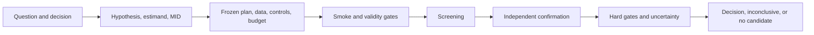

# Research and optimization roadmap

## Purpose and evidence status

This directory teaches an engineer how to turn a broad research question into a
bounded experiment, run useful controls, interpret uncertainty, and make a
deployment decision. It connects [CH-45](../02-textbook/part-13-experimental-research-roadmap/ch-45-research-questions-and-hypotheses.md),
[CH-46](../02-textbook/part-13-experimental-research-roadmap/ch-46-benchmark-matrix.md),
and the reusable [experiment framework](../06-experiment-framework/README.md).

**Research freeze: 2026-11-23. Status: ROADMAP AUTHORED / EXPERIMENTS NOT RUN.**
Every numerical example in this directory is `ILLUSTRATIVE`. The examples teach
calculation and interpretation; they are not observations, prices, performance
claims, or evidence that a model is safe. Every proposed study is a
`PLANNED EXPERIMENT`.

The primary inference design does not retrieve documents or call a teacher at
runtime. Documents, teacher outputs, and expert review may be used offline to
construct governed training and evaluation data under the
[no-runtime-RAG standard](../00-governance/no-runtime-rag-standard.md).

## How to use the five documents

1. Start with [research questions and hypotheses](research-questions-and-hypotheses.md).
   Each of the fifteen studies explains the engineering issue, a falsifiable
   claim, variables, controls, procedure, stopping rule, evidence gap, and
   decision criterion.
2. Use the [prioritized experiment roadmap](prioritized-experiment-roadmap.md)
   to place the study in the dependency sequence. Cheap validity checks come
   before costly training or device trials.
3. Select the smallest defensible envelope in
   [resource budget tiers](resource-budget-tiers.md). Its worked examples show
   how screening, confirmation, storage, expert time, and retry reserves fit
   together.
4. Read [open risks and evidence gaps](open-risks-and-evidence-gaps.md) before
   approval. It explains why each gap can invalidate a conclusion and what
   concrete evidence closes it.
5. Copy the selected study into the
   [experiment plan template](../06-experiment-framework/templates/experiment-plan-template.md),
   replace illustrative values with approved values, obtain review, and freeze
   the plan before exposing sealed-test results.

## From question to experiment

An experiment is useful only when its result changes a decision. Apply this
sequence:

1. **Name the decision.** Example: choose whether the Android release should
   use the parent precision or a particular 4-bit export.
2. **Define the comparison tuple.** Record weights, adapter, tokenizer, chat
   template, data snapshots, decoding, conversion, runtime, device, software,
   and workload. If several tuple fields change, the result compares products;
   it does not isolate one algorithm.
3. **Write a falsifiable hypothesis.** “Q4 is good” is not testable. “The Q4
   child loses less than 2 percentage points of paired domain score, reduces
   peak memory by at least 500 MiB, and passes safety” is testable.
4. **Choose one primary estimand.** An estimand is the exact quantity whose
   uncertainty answers the question, such as paired score difference
   `score_Q4 - score_parent`.
5. **Separate variables.** The independent variable is intentionally changed.
   Controls are held fixed. Blocking variables such as device-day are allowed
   to vary but are recorded and included in analysis.
6. **Freeze data and metrics.** Training, calibration, validation, sealed
   tests, safety tests, and performance prompts need separate immutable
   manifests. Validation selects; sealed tests confirm.
7. **Set gates and useful-effect sizes.** A minimum important difference (MID)
   prevents a statistically detectable but operationally useless result from
   winning. Safety, rights, identity, compatibility, and reliability are hard
   gates that cannot be averaged away.
8. **Budget screening and confirmation separately.** A smoke run finds broken
   pipelines. It is not evidence of reproducible quality. Protect resources
   for independent seeds and physical-target confirmation.
9. **Predefine stopping.** Stop on harm, invalid identity, leakage, unsupported
   fallback, futility, clear success, domination, or resource exhaustion.
10. **Interpret the interval, not only the point estimate.** A mean gain of
    1.5 points does not establish a 1-point MID if the confidence interval is
    `[-0.4, 3.4]`.

## Worked miniature example

`ILLUSTRATIVE`: suppose 200 sealed automotive items are scored for a parent and
its Q4 child. The paired domain-score difference is `-0.008`, with a 95%
confidence interval of `[-0.015, -0.001]`. The registered non-inferiority
margin is `-0.020`, so the lower bound clears the quality gate. Peak memory
falls from 3,000 MiB to 2,150 MiB:

$$

\Delta M = 3000 - 2150 = 850\ \text{MiB},
\qquad
\text{reduction} = 850/3000 = 28.3\%.

$$

If the memory MID is 500 MiB, the example clears quality and memory. It still
does **not** qualify if one prohibited high-voltage instruction is answered
unsafely, if the runtime silently executes unsupported operators on another
backend, or if the failure-rate upper bound exceeds its gate. This is why a
single composite “model score” is inadequate.

## Variables, controls, and units

- **Independent variable:** the intervention being tested, such as update
  method, quantization format, pruning ratio, or deployment location.
- **Dependent variable:** the measured response, such as domain score, peak
  bytes, visible time to first token, decode tokens/s, energy/token, or cost.
- **Controlled variable:** deliberately fixed, such as data snapshot, prompt,
  decoding, context length, or runtime build.
- **Block:** a recorded nuisance source, such as device, host, day, or thermal
  start band, across which comparisons are balanced.
- **Analysis unit:** the independent unit that supports uncertainty. Rephrased
  descendants from one source are one root cluster, not many independent
  samples.
- **Failure:** an attempted unit that did not produce a valid result. Failures
  remain in the denominator unless the frozen policy identifies an
  instrumentation fault.

Use physical units. Distinguish GB from GiB, model-file bytes from runtime
memory, prefill from decode throughput, and gross power from incremental energy.
The [metric specification](../06-experiment-framework/specifications/metric-specification.md)
defines reusable boundaries.

## Evidence flow and ownership

The data custodian approves source rights and immutable manifests. The
experiment owner freezes the plan. The operator records every attempt in the
[run template](../06-experiment-framework/templates/run-record-template.md)
and uses the [failure template](../06-experiment-framework/templates/failure-report-template.md)
for terminal failures. The analyst produces the
[result record](../06-experiment-framework/templates/experiment-result-template.md).
Technical, statistical, domain/safety, and rights/privacy reviewers approve
only claims supported by the retained evidence.

**Figure status: `ILLUSTRATIVE`.** The diagram shows the required reasoning
flow, not completed work or measured results.

## Rules that prevent false conclusions

- Compare the exact release artifact, not only a training checkpoint.
- Preserve OOM, crash, fallback, invalid-output, and stopped branches.
- Change one causal factor at a time when claiming a method effect.
- Allow a tuple comparison when isolation is impossible, but scope the claim
  to the complete tuple.
- Never trade a safety failure for better average quality or speed.
- Do not use sealed tests to tune prompts, thresholds, or checkpoints.
- Treat one training seed and one phone as screening evidence.
- Use `null` plus a reason for unmeasured values; zero means measured zero.
- “No qualified candidate” and “inconclusive within this budget” are valid
  outcomes.

## Completion criteria

Documentation is complete when links, formulas, tables, and fences validate and
all five files retain honest evidence labels. The research program is complete
only when every attempted branch has immutable plan/run/failure/result records,
all fifteen questions have reviewed dispositions, every release artifact passes
its hard gates, and raw evidence plus independent reviews are retained.

Canonical experiment states are:

`DRAFT → APPROVED → RUNNING → EXECUTED → REVIEWED → QUALIFIED | REJECTED | INCONCLUSIVE`

## Related standards

- [Bookmap](../BOOKMAP.md)
- [Evidence and citation standard](../00-governance/evidence-and-citation-standard.md)
- [Reproducibility standard](../00-governance/reproducibility-standard.md)
- [Safety and risk standard](../00-governance/safety-and-risk-standard.md)
- [Pareto analysis specification](../06-experiment-framework/specifications/pareto-analysis-specification.md)
- [Results registry](../06-experiment-framework/results/README.md)
