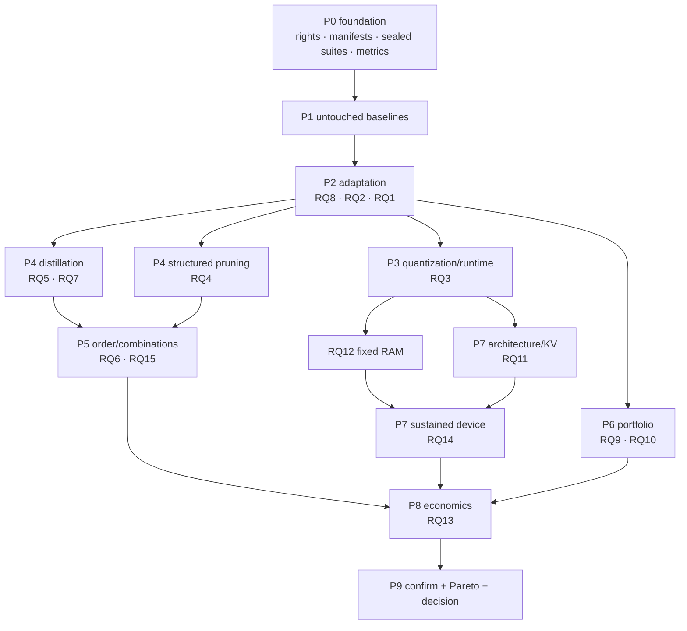

<!-- markdownlint-disable MD013 -->

# Prioritized experiment roadmap

## Status and objective

**Status: STAGED PROGRAM AUTHORED / NOT EXECUTED.** This `PLANNED EXPERIMENT` roadmap spends resources in
information-value order and prevents an infeasible Cartesian search. It implements the elimination logic in
[CH-46](../02-textbook/part-13-experimental-research-roadmap/ch-46-benchmark-matrix.md) and maps every stage to the
[fifteen questions](research-questions-and-hypotheses.md).

The optimization objective is not “most compressed.” It is to identify target-specific qualified tuples on an
uncertainty-aware Pareto frontier after rights, identity, domain, retention, safety, compatibility, memory, reliability,
and placement gates.

The order matters. A training run is wasted if the dataset cannot legally be
used. A quantization benchmark is misleading if the tokenizer or chat template
changed. A thermal test is premature while the artifact is still changing.
Each stage therefore closes uncertainties needed by the next stage.

## Dependency graph

This diagram is `ILLUSTRATIVE`; nodes are dependencies, not completed work.

## Why staged elimination is practical

A full Cartesian benchmark grows too quickly. `ILLUSTRATIVE`: four base models,
three adaptation methods, four quantizers, three pruning choices, three
distillation choices, four runtimes, and six devices would create

$$

4 \times 3 \times 4 \times 3 \times 3 \times 4 \times 6
= 10{,}368

$$

tuples before seeds, workloads, and repetitions. At three seeds and ten device
trials, that becomes 311,040 trial instances. Most would test broken,
dominated, or unsafe branches.

The staged plan instead asks a sequence of cheaper questions:

1. Is the source lawful and the test valid?
2. Does the untouched model provide a usable reference?
3. Does adaptation add domain value without unacceptable forgetting?
4. Can the artifact load and execute correctly on target hardware?
5. Does an isolated optimization add value over its parent?
6. Do combinations beat every immediate parent?
7. Does the final tuple sustain performance and make economic sense?

This sequence does not guarantee discovery of every interaction. The
pre-registered rescue rule preserves one bounded route for a plausible branch
that screening might otherwise remove.

## Stage plan and elimination gates

<!-- markdownlint-disable MD013 -->
| Priority / stage       | Work and questions                                                                                                                   | Required deliverables and owner                                                                                                                                                                              | Advance criteria                                                                                                 | Stop/defer criteria                                                                                                      |
| ---------------------- | ------------------------------------------------------------------------------------------------------------------------------------ | ------------------------------------------------------------------------------------------------------------------------------------------------------------------------------------------------------------ | ---------------------------------------------------------------------------------------------------------------- | ------------------------------------------------------------------------------------------------------------------------ |
| P0 foundation          | source rights, hazard analysis, immutable snapshots, leakage/PII/duplicate audit, sealed suites, metric fixtures, hardware inventory | data manifests (data custodian); hazard/scope record (domain/safety owner); tested metric registry (evaluation owner)                                                                                        | rights and provenance approved; sealed access works; reference answers reviewed; metric fixtures and hashes pass | unresolved rights/privacy, no qualified truth/review, leakage, or unusable instrumentation                               |
| P1 baseline            | R0 identity/compatibility and R1 untouched XS/S/M/L bands; one complete reference path                                               | approved [plans](../06-experiment-framework/templates/experiment-plan-template.md), [run records](../06-experiment-framework/templates/run-record-template.md), baseline bundles (experiment owner/operator) | deterministic smoke, valid template/tokenizer, baseline safety floor, reference-host fit, validation floor       | invalid identity, unlicensed artifact, unsupported architecture, baseline below rescue floor                             |
| P2 adaptation          | SFT, LoRA, QLoRA; RQ8/RQ2; CPT pilot then RQ1 only if evidence/budget supports                                                       | training artifacts, seed records, merge parity, retention/safety report (training + evaluation owners)                                                                                                       | useful domain gain; every safety/retention gate; stable lineage; at most three adapted parents                   | SFT fails; merge parity fails; method infeasible; CPT dominated or budget blocked                                        |
| P3 deployment screen   | parent precision, runtime-native Q8 and one/two supported Q4 paths; RQ3/RQ12                                                         | converted packages, placement traces, Android admission results (edge owner)                                                                                                                                 | exact artifact loads, no forbidden fallback, fits RAM/context, quality non-inferior, real bytes/memory benefit   | unsupported export/operator, OOM/truncation, quality/safety loss, parent dominates                                       |
| P4 isolated advanced   | direct-small control; response/mixed/logit distillation where aligned; structured prune/recover; RQ4/RQ5/RQ7                         | teacher acceptance ledger (data/domain owner), shape lineage, recovery records, target measurements                                                                                                          | direct controls exist; accepted teacher data; physical smaller graph; candidate adds qualified frontier value    | teacher rights/review unavailable, transfer of critical errors, no portable graph, no supported kernel, parent dominates |
| P5 interactions        | pruning/distillation order and qualified combinations; RQ6/RQ15                                                                      | every immediate parent, ordered lineage, interaction analysis (compression owner)                                                                                                                            | each component separately qualifies and combination beats every immediate parent                                 | either component fails; simple child equivalent/dominant; rescue cap exhausted                                           |
| P6 portfolio           | shared adapters then joint multi-domain; RQ9/RQ10                                                                                    | ≥2 independently qualified domains, switching/update/rollback drill, per-domain report (platform owner)                                                                                                      | every domain passes; measured storage/update benefit; rights allow packaging                                     | any high-risk domain fails; cross-domain substitution; coupled update/rights unacceptable                                |
| P7 mechanism/sustained | architecture/KV characterization, exact-phone fixed-RAM confirmation, thermal/energy; RQ11/RQ12/RQ14                                 | context sweeps, raw traces, power-boundary record (device/performance owner)                                                                                                                                 | artifact/runtime frozen; placement proven; instrumentation validated; late-window gates pass                     | candidate still changing, no physical target, no valid power evidence, thermal/reliability failure                       |
| P8 cloud/economics     | AWS CPU/GPU qualified lanes and equivalent-use edge comparison; RQ13                                                                 | load traces, dated price/bill records, cost model and sensitivity (cloud + finance owners)                                                                                                                   | both sides meet same use/quality floor; SLOs and accounting boundary approved                                    | unequal feature/quality, estimated-only price inputs, security/SLO failure                                               |
| P9 confirmation        | fresh sealed roots, finalist seeds/blocks, uncertainty-aware fronts, release review                                                  | immutable [results](../06-experiment-framework/templates/experiment-result-template.md), Pareto bundles, release/no-release decision (analyst + reviewers)                                                   | adjusted evidence establishes gates and role-specific selection                                                  | underpowered/incomplete evidence → `INCONCLUSIVE`; no survivor → `NO QUALIFIED CANDIDATE`                                |
<!-- markdownlint-restore -->
<!-- markdownlint-disable MD013 -->

## Bounded matrix

Use one family where possible for causal scale comparisons. Register four scale bands (XS 0.1–<0.5B, S 0.5–<1.5B, M
1.5–<4B, L 4–8B) but do not force unavailable checkpoints. Baseline all authorized bands, advance at most three models
to adaptation, at most three adapted parents to isolated quantization, at most two parents into pruning and two student
architectures into distillation, and at most six final artifacts with at most two per target.

Execution lanes are separately registered for AWS GPU/CPU, physical Android CPU and conditional GPU/NPU, physical iOS
CPU and conditional GPU/ANE, ARM64 Linux, and optional Jetson. `UNSUPPORTED` lanes remain in coverage. Conversion is not
proof of acceleration; placement traces must quantify fallback.

## Stage-level rules

### Selection and confirmation

- Validation may rank or eliminate; sealed tests may confirm only.
- A one-seed result is exploratory. Use the same prelisted seed IDs across paired arms.
- Human review is blinded and stratified by risk. Critical items require qualified adjudication.
- Confirmatory families use a frozen primary contrast and suitable multiplicity control; exploratory findings generate
  new plans.
- Final fronts are separate by hardware/OS/runtime, workload/context/concurrency, power mode, intended use, and
  evaluation snapshot.

### What an engineer does at each stage

For every row in the stage table:

1. copy the applicable question into an immutable experiment plan;
2. name the baseline, candidates, one primary estimand, MID or margin, and hard
   gates;
3. reserve screening and confirmation resources separately;
4. execute deterministic identity and compatibility checks before stochastic
   training or long systems trials;
5. record all attempts, including failures and early stops;
6. apply the frozen gate using validation evidence;
7. expose sealed tests only for candidates that advance; and
8. publish `PASS`, `FAIL`, `INCONCLUSIVE`, `UNSUPPORTED`,
   `NOT_RUN_AFTER_GATE`, or `NOT_RUN_BUDGET`.

An inconclusive result means the experiment did not distinguish the registered
effects under its design and budget. It does not mean the methods are equal.

### Global stop rules

Stop the affected branch immediately for:

1. unresolved rights, privacy, provenance, secret exposure, or sealed-test leakage;
2. a predefined critical safety event under incident review;
3. model/tokenizer/template/hash, adapter-merge, or source/export parity failure;
4. unsupported conversion, silent fallback beyond allowance, invalid output, or workload-changing OOM/truncation;
5. preregistered futility, budget exhaustion, or reliability upper-bound failure;
6. conservative domination by a simpler qualified parent with no registered rescue condition.

Stop the target program when a simple tuple passes every hard gate and later methods add no frontier value within the
authorized rescue budget. Do not continue merely to exercise another technique.

### Rescue rule

Before R1, register one rescue trigger, eligible branch, analysis, and resource cap. Valid triggers include a newly
supported target kernel or a validation result inside the predefined futility boundary. The rescue cannot be created
after sealed outcomes or replace a failed seed. Its result remains exploratory unless independently confirmed.

## Worked staged example

The following numbers are `ILLUSTRATIVE`, not executed results.

### Small tier

Two base models pass rights review. Identity smoke eliminates one because its
export changes tokenization. The remaining model runs SFT, LoRA, and QLoRA
screens. SFT and QLoRA pass validation; QLoRA advances because its quality
interval is compatible with the registered margin and its training-resource
saving exceeds the MID. Q8 and one Q4 export are tested. Q4 passes the 2.5 GiB
RAM cap and safety; the program spends its protected reserve on three QLoRA-Q4
seeds and repeated trials on one Android target. It stops after one qualified
candidate. This supports feasibility on that tuple and phone only.

### Medium tier

Four baseline bands enter; at most three adapted parents advance. Suppose two
quantizers, one direct-small control, one distilled student, and one structured
pruning family survive compatibility screening. If isolated pruning improves
checkpoint size but misses the 10% sustained-latency MID, pruning and all
pruning combinations stop. Distillation and quantization continue because both
add frontier value. Multiple Android classes, two iOS classes, AWS CPU/GPU, and
ARM64 receive confirmation blocks. The conclusion is target-specific.

### Research tier

After medium-tier qualification, the research tier may replicate key devices,
study operation order, use calibrated power instrumentation, and test external
challenge roots. It does not reopen failed safety branches. If the expected
information gain of another architecture is below the registered threshold,
the program stops even with resources remaining.

### Attrition arithmetic

`ILLUSTRATIVE`: if 12 screened candidates become 5 valid exports, 3 pass
quality/safety, and 2 pass physical-target gates, report every denominator:

- export-valid yield: `5/12 = 41.7%`;
- quality/safety yield among exports: `3/5 = 60%`;
- final qualification among all screened candidates: `2/12 = 16.7%`.

Reporting only “two successful models” hides ten failures and overstates
pipeline reliability.

## Deliverable ownership and handoffs

| Deliverable                                       | Responsible             | Required approver / consumer     |
| ------------------------------------------------- | ----------------------- | -------------------------------- |
| rights/provenance and split manifests             | data custodian          | rights/privacy + domain reviewer |
| hazard model, intended/prohibited use, escalation | safety/domain owner     | release authority                |
| immutable plan and matrix row                     | experiment owner        | technical + statistical + safety |
| environment and target qualification              | platform owner          | experiment owner                 |
| run/trial and telemetry bundle                    | operator                | analyst                          |
| failure record and containment                    | operator/incident owner | technical/safety as applicable   |
| scoring and statistical bundle                    | evaluation analyst      | statistical reviewer             |
| artifact lineage, package, rollback               | model-release owner     | security/platform reviewer       |
| cost allocation and dated price evidence          | cloud/finance custodian | program owner                    |
| final result and Pareto role decision             | research lead           | all required reviewers           |
<!-- markdownlint-disable MD013 -->

## Publication package

Every final stage publishes matrix coverage (`PASS`, `FAIL`, `INCONCLUSIVE`, `UNSUPPORTED`, `NOT_RUN_AFTER_GATE`,
`NOT_RUN_BUDGET`), hashes and parent lineage, per-domain/general/safety/OOD results, separate systems panels,
resource/failure ledgers, target Pareto relations, sensitivity, deviations, and unresolved risks. Unmeasured planned
values are omitted rather than displayed as measured points.

## Decision criteria by stage

- **P0:** evidence exists to run ethically and interpret scores.
- **P1:** identity is stable and the untouched reference is valid.
- **P2:** domain gain is useful, retention is acceptable, and safety passes.
- **P3:** the exact export loads without forbidden fallback and creates a real
  memory or performance benefit.
- **P4:** an advanced method beats its direct control and justifies its added
  generation, recovery, or graph-surgery cost.
- **P5:** a combination beats every immediate parent; otherwise use the simpler
  parent.
- **P6:** every domain passes independently and portfolio lifecycle resources
  improve.
- **P7:** the frozen tuple survives realistic RAM, context, thermal, energy, and
  reliability conditions.
- **P8:** equivalent-use cloud and edge scenarios have verified technical and
  dated cost inputs.
- **P9:** fresh confirmation supports a role-specific selection, an
  inconclusive decision, or no qualified candidate.

## Cross-links

- [Roadmap index](README.md)
- [Budget tiers](resource-budget-tiers.md)
- [Open risks](open-risks-and-evidence-gaps.md)
- [Framework protocols](../06-experiment-framework/README.md#required-directory-flow)
- [Pareto specification](../06-experiment-framework/specifications/pareto-analysis-specification.md)
- [CH-32 ablation studies](../02-textbook/part-08-evaluation-benchmarking-and-research-experiments/ch-32-optimization-experiments-and-ablation-studies.md)
