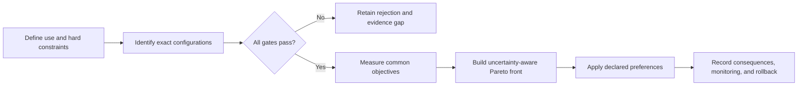

# Engineering decisions as repeatable lessons

This section teaches how to turn model measurements into a defensible deployment decision. It does not name a real
winner. All numbers in worked examples are invented for instruction and must never be copied into a release record.

## Lesson 1: decide on a complete configuration

A model name is not a deployable option. Treat each option as

$$

D=(W,T,A,Q,R,H,O,C,P,E),

$$

where $W$ is the weight and adapter lineage, $T$ the tokenizer and chat template, $A$ the exported artifact,
$Q$ the weight, activation, and KV-cache precision, $R$ the runtime build, $H$ the hardware, $O$ the operating
environment, $C$ the context and generation policy, $P$ the intended-use and safety policy, and $E$ the evidence
snapshot. Changing one element creates a different option because it can change outputs, memory, latency, rights, or
failure behavior.

## Lesson 2: eliminate before ranking

Hard constraints answer “may this ship?” Examples are commercial rights, zero critical safety failures, a 2.5 GiB
memory ceiling, and proven execution on the intended backend. Soft objectives answer “which qualified trade-off do we
prefer?” Examples are lower latency, higher quality, and easier maintenance. Apply every hard constraint first.

Suppose three illustrative configurations score 92, 84, and 77 on a weighted utility, but the first has one prohibited
safety failure and the second exceeds memory. Their scores are irrelevant: only the third remains eligible. This is
**safety non-compensation**—extra quality or speed cannot buy permission to violate a release gate.

## Lesson 3: compare evidence, not impressions

Measurements need an exact configuration, protocol, conditions, interval, date, and raw-artifact identity. Current
external documentation can justify an experiment; only controlled target execution can qualify a release. Required
missing data makes an option incomplete. Optional missing data remains unknown and is tested in sensitivity analysis;
it is never silently replaced by zero or an average.

## Lesson 4: retain trade-offs with a Pareto front

An eligible option is Pareto-dominated when another is no worse on every objective and materially better on at least
one. The non-dominated set preserves legitimate choices such as “lowest memory” and “highest quality.” Weighted scoring
is a transparent preference rule used only after this front is built, not a substitute for it.

## Learning path

1. [Criteria and measurement](criteria-and-measurement.md) explains gates, normalization, confidence, missing data,
   licensing, maintenance, and a complete numerical example.
2. [Pareto selection](pareto-selection-process.md) derives a frontier and tests preference sensitivity.
3. The eight [target lessons](targets/low-end-android-phone.md) apply the method to distinct hardware and service
   profiles. Each compares at least three invented configurations.
4. The [filled decision record](decision-record-template.md) shows what an auditable recommendation looks like and
   explains how to reuse every field.
5. The architecture decision lessons cover [no runtime RAG](adrs/adr-001-no-runtime-rag.md),
   [separate target artifacts](adrs/adr-002-separate-target-specific-artifacts.md),
   [evidence-gated selection](adrs/adr-003-evidence-gated-model-selection.md),
   [staged elimination](adrs/adr-004-staged-experimental-elimination.md), and
   [safety-critical release gates](adrs/adr-005-safety-critical-domain-release-gates.md). Each explains choices,
   alternatives, and consequences.

## Release sequence

The diagram is instructional, not experimental evidence.

## Further reading

- [Experiment framework](../06-experiment-framework/README.md)
- [Safety and risk standard](../00-governance/safety-and-risk-standard.md)
- [Model quality evaluation](../02-textbook/part-08-evaluation-benchmarking-and-research-experiments/ch-29-model-quality-evaluation.md)
- [Compression and edge benchmarking](../02-textbook/part-08-evaluation-benchmarking-and-research-experiments/ch-31-compression-and-edge-benchmarking.md)
